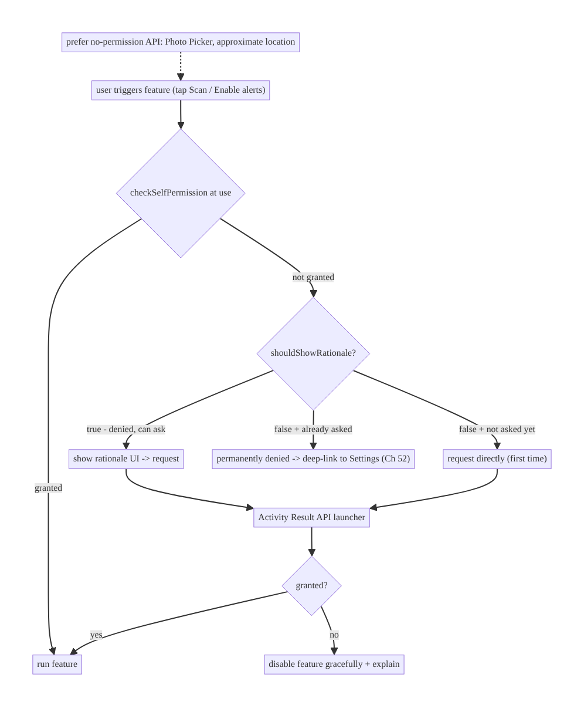
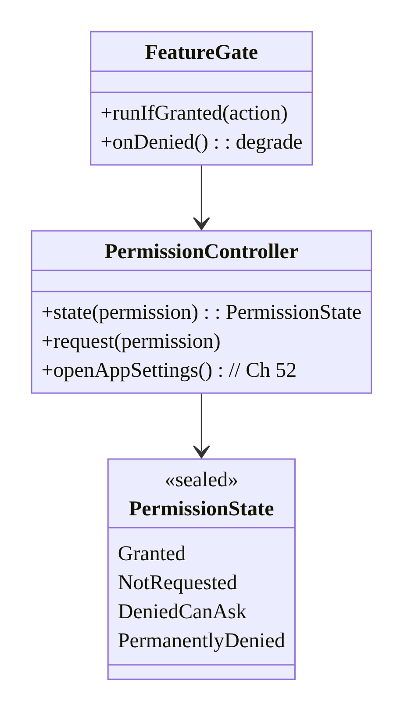
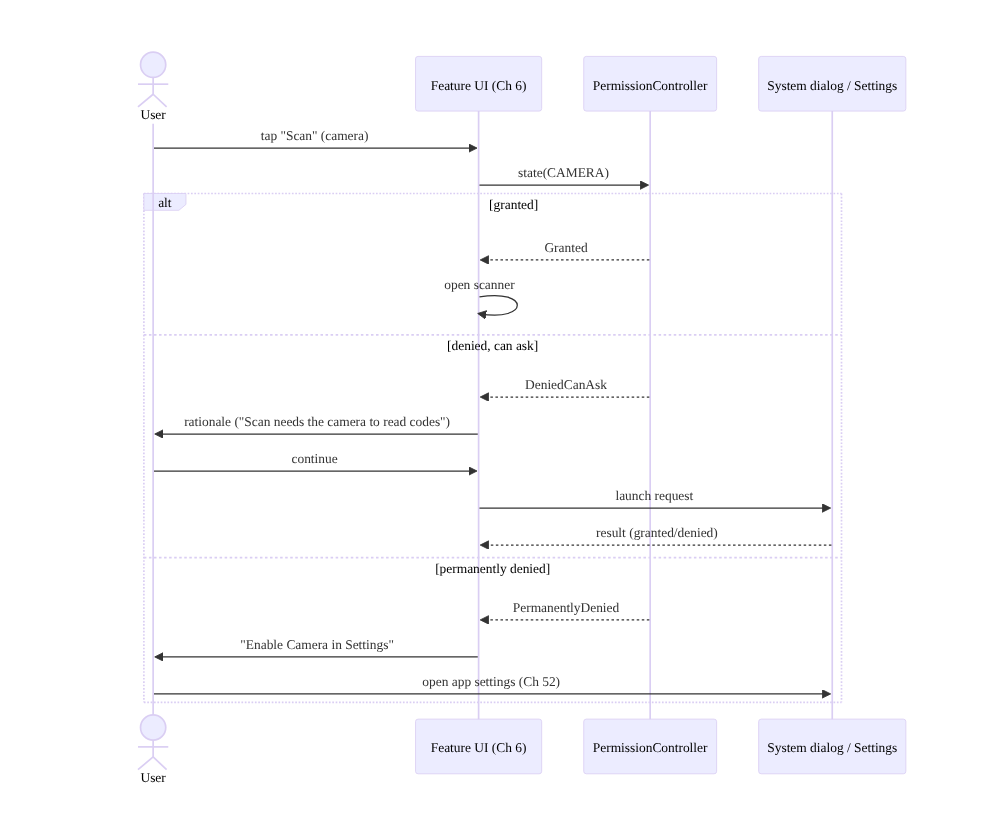
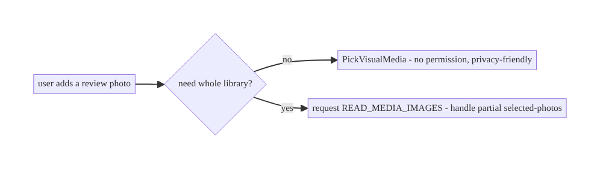
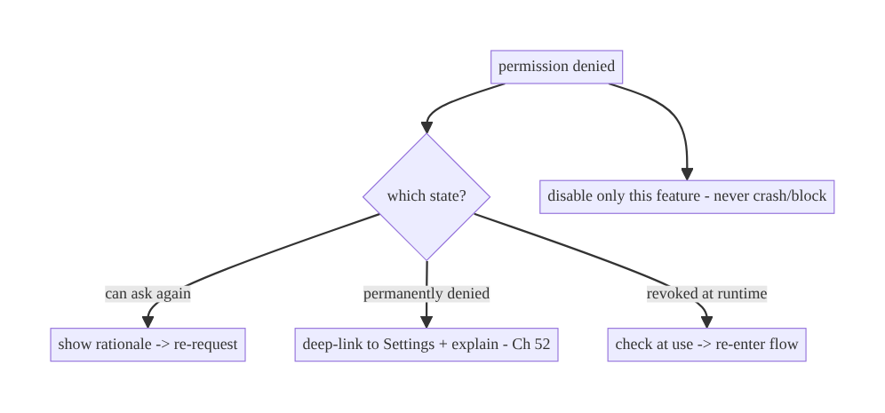

# Chapter 51 — Runtime Permissions Management

> **Part VI — Lifecycle, Background & Platform** · Complexity: **Standard** (≥25 interview questions)
>
> **Prerequisites:** Ch 44 (lifecycle), Ch 6 (UI state), Ch 49/50 (notifications),
> Ch 67 (location), Ch 25 (storage). Pairs with Ch 52 (deep links to settings),
> Ch 28 (privacy).
>
> **Reference surface in StreamCart:** requesting and managing dangerous permissions —
> notifications (Android 13+), camera (scan a product/QR), location (nearby stores/
> delivery), media/photos (upload a review image), microphone (voice search) — with
> correct rationale, graceful denial handling, and no feature breakage when denied.

---

## 51.1 Problem Definition and Real-World Context

Android gates access to sensitive capabilities (camera, location, contacts, mic,
notifications, media) behind **runtime permissions** the user grants or denies in a
system dialog. This is a **consent and UX contract**, and it's easy to get wrong in ways
that either break features or get the app rejected/uninstalled:

- **Asking at the wrong time.** Requesting camera/location at app launch (before the
  user understands why) → reflexive denial, and now the feature is dead. Permissions must
  be requested **in context**, when the user triggers the feature.
- **No rationale.** The system dialog is terse; without an app-provided **rationale**
  (especially after a first denial), users don't understand the value and deny.
- **Mishandling the denial states.** There are several: not-yet-asked, granted, denied
  (can ask again), and **permanently denied** ("don't ask again" / denied twice on modern
  Android — the system dialog won't show again). Treating "denied" as one state, or
  trying to re-request when permanently denied (silently does nothing), breaks the flow.
- **Not degrading gracefully.** A denied permission should **disable just that feature**
  with a clear path to settings — not crash, not block the whole app, not nag.
- **New permission models.** **Notifications** became a runtime permission (Android 13+);
  **location** has foreground/background split + "approximate vs precise" + "only this
  time"; **media** moved to granular `READ_MEDIA_IMAGES/VIDEO/AUDIO` and the **Photo
  Picker** / "Selected photos" partial access (Android 13/14). Old patterns (request all
  storage) are wrong now.
- **Permissions can be revoked** anytime (settings, or auto-reset for unused apps,
  Android 11+) — so you must **check at use**, never cache "granted" forever.

The architecture: **request in context** (on feature trigger, not launch); **show
rationale** (before, or after a denial, via `shouldShowRequestPermissionRationale`); use
the **Activity Result API** (`registerForActivityResult`) — not the deprecated
`onRequestPermissionsResult`; **model the full state machine** (not-asked / granted /
denied-can-ask / permanently-denied) and route each correctly (request / proceed /
rationale+request / deep-link to settings, Ch 52); **check permission at use** (it can be
revoked); **degrade gracefully** (disable just the feature); and use the **modern
privacy-friendly APIs** (Photo Picker, approximate location, "only this time"). This
chapter is about **getting consent respectfully and handling every outcome without
breaking the app**.

### Three practical use cases

1. **Notifications (Android 13+).** Request `POST_NOTIFICATIONS` after onboarding / when
   the user opts into alerts — with rationale — so pushes (Ch 49/50) can display; if
   denied, the inbox still works (Ch 50).
2. **Camera for QR/product scan (StreamCart).** Request `CAMERA` when the user taps
   "Scan"; rationale if previously denied; on permanent denial, show a settings deep-link;
   feature disabled cleanly otherwise.
3. **Photos for a review image.** Use the **Photo Picker** (no permission needed) by
   default; only request `READ_MEDIA_IMAGES` if full-gallery access is truly required,
   handling "Selected photos" partial grants.

### Why this is architectural

Permission handling is a **cross-cutting consent state machine** touching lifecycle
(Ch 44), UI state (Ch 6), many features (camera/location/media/notifications), privacy
(Ch 28), and deep links to settings (Ch 52). The decisions — when to ask, how to explain,
how to handle each outcome, how to degrade — determine grant rates, feature reliability,
and user trust.

---

## 51.2 Requirements Engineering

### Functional requirements

| ID | Requirement |
|----|-------------|
| F1 | Request permissions in context (on feature trigger). |
| F2 | Show rationale before/after denial to explain value. |
| F3 | Model and route all states (not-asked/granted/denied/permanently-denied). |
| F4 | Check permission at use (revocation/auto-reset). |
| F5 | Degrade gracefully (disable just the feature; settings path). |
| F6 | Use modern privacy APIs (Photo Picker, approximate location, partial media). |

### Non-functional requirements

| Attribute | Policy |
|-----------|--------|
| **UX / grant rate** | In-context + rationale; never nag; clear value. |
| **Correctness** | Check at use; handle permanent denial (no silent re-request). |
| **Resilience** | No crash/whole-app block on denial. |
| **Privacy** | Least privilege; prefer no-permission APIs (Photo Picker); minimal scope. |
| **Maintainability** | Central permission helper + state machine, not ad hoc. |

### Scope

- **In scope:** runtime permission model, dangerous vs normal permissions, Activity
  Result API, rationale (`shouldShowRequestPermissionRationale`), state machine
  (not-asked/granted/denied/permanently-denied), check-at-use, graceful degradation,
  settings deep-link (Ch 52), notifications (13+), location (fg/bg, approximate/precise,
  one-time), media (granular + Photo Picker + partial), auto-reset, central helper.
- **Out of scope:** specific feature internals (camera/location — Ch 67), privacy policy
  (Ch 28), deep-link mechanics (Ch 52), notification rendering (Ch 50).

### Assumptions & constraints

- `minSdk 24`, `targetSdk` current (13+ notifications, 14 partial media). AndroidX
  Activity Result API, Compose (`rememberLauncherForActivityResult` /
  Accompanist-style patterns). Permissions can be revoked anytime; permanent denial has
  no programmatic re-prompt (only settings).

---

## 51.3 System Design Fundamentals

- **Normal vs dangerous permissions.** **Normal** (e.g., `INTERNET`) are granted at
  install, declared in the manifest. **Dangerous** (camera, location, contacts, mic,
  notifications, media) require a **runtime request** and user consent. This chapter is
  about dangerous permissions.
- **The permission state machine (model all of it):**
  1. **Not requested** → request (optionally with pre-rationale).
  2. **Granted** → proceed.
  3. **Denied (can ask again)** → `shouldShowRequestPermissionRationale()` returns
     **true** → show **rationale**, then re-request.
  4. **Permanently denied** ("don't ask again" / denied the required number of times) →
     `shouldShowRequestPermissionRationale()` returns **false** *and* not granted → the
     system dialog **won't show**; you must **deep-link to app settings** (Ch 52) and
     explain. Re-requesting does nothing (returns denied immediately).
  Collapsing these into "granted/denied" is the #1 bug — you must distinguish
  "denied-can-ask" from "permanently-denied" to decide between rationale+request and a
  settings deep-link.
- **Activity Result API (the correct mechanism).** Use
  `registerForActivityResult(RequestPermission()/RequestMultiplePermissions())` (Views)
  or `rememberLauncherForActivityResult` (Compose) — **not** the deprecated
  `requestPermissions`/`onRequestPermissionsResult`. It's lifecycle-safe (Ch 44) and
  returns the grant result in a callback.
- **Request in context, with rationale.** Ask when the user **triggers the feature**
  (taps "Scan", "Find nearby", "Enable alerts"), not at launch. If a previous denial
  occurred (`shouldShowRequestPermissionRationale` true), show a **rationale UI** first
  explaining the value, then request. This maximizes grant rate and respects the user.
- **Check at use, not once.** Permissions can be **revoked** in settings or
  **auto-reset** for unused apps (Android 11+). Always `ContextCompat.
  checkSelfPermission()` **at the point of use**; never assume a past grant persists.
- **Graceful degradation.** A denied permission disables **only that feature**, with a
  clear message and (if permanently denied) a settings path — the rest of the app works.
  Never crash, never block the whole app, never nag repeatedly (one in-context ask +
  rationale; after that, a passive settings link).
- **Modern per-permission specifics:**
  - **Notifications (`POST_NOTIFICATIONS`, Android 13+):** runtime permission; request
    when the user opts into alerts / after onboarding. Denied → system notifications
    suppressed, but the **inbox still works** (Ch 50). Don't request at first launch
    before value is shown.
  - **Location:** foreground (`ACCESS_FINE_LOCATION`/`ACCESS_COARSE_LOCATION`) vs
    **background** (`ACCESS_BACKGROUND_LOCATION`, must be requested **separately/after**
    foreground, and sparingly, Ch 67); **approximate vs precise** (Android 12+ — request
    coarse if precise isn't needed); **"only this time"** grants (ephemeral). Request the
    least you need.
  - **Media (Android 13+):** granular `READ_MEDIA_IMAGES`/`VIDEO`/`AUDIO` replaced
    `READ_EXTERNAL_STORAGE`; **Android 14** adds **partial access** ("Selected photos" →
    `READ_MEDIA_VISUAL_USER_SELECTED`). **Prefer the Photo Picker**
    (`PickVisualMedia`) which needs **no permission** at all — use it unless you truly
    need the whole library.
  - **Camera/Mic:** request on feature use; nothing special beyond the state machine.
- **Manifest + policy:** declare each permission; Play requires a **declared, justified**
  use for sensitive ones (location/camera/mic background) and may reject over-broad
  requests. Least privilege is both UX and policy.

Core insight: **request dangerous permissions in context (on feature trigger) with a
clear rationale, using the Activity Result API; model the full state machine —
not-asked / granted / denied-can-ask (rationale + re-request) / permanently-denied
(settings deep-link, no silent re-request) — distinguishing the last two via
`shouldShowRequestPermissionRationale`; check the permission at the point of use (it can
be revoked/auto-reset); degrade gracefully (disable just the feature, never crash/nag);
and prefer the least-privilege, no-permission modern APIs (Photo Picker, approximate
location, one-time grants).**

---

## 51.4 High-Level Architecture



**Components & ownership**

- **Feature trigger** initiates an in-context check.
- **State machine** routes to proceed / request / rationale+request / settings.
- **Activity Result launcher** performs the request lifecycle-safely.
- **Graceful degradation** disables just the feature on denial.
- **No-permission APIs** (Photo Picker) bypass the whole flow when possible.

**Direction:** trigger → check-at-use → state-routed request/rationale/settings →
proceed or degrade.

---

## 51.5 Detailed Component Design



| Component | Responsibility |
|-----------|----------------|
| `PermissionState` | the 4-state model (the crux) |
| `PermissionController` | compute state, launch request, open settings (Ch 52) |
| `FeatureGate` | gate a feature on grant; degrade on denial |
| Rationale UI | explain value (before/after denial) |

---

## 51.6 End-to-End Data Flow

### In-context request with rationale and permanent-denial handling



### Media: prefer Photo Picker (no permission)



---

## 51.7 Complete Kotlin Implementation

Package: `com.streamcart.permissions`.

### 51.7.1 The state model + controller

```kotlin
sealed interface PermissionState {
    data object Granted : PermissionState
    data object NotRequested : PermissionState
    data object DeniedCanAsk : PermissionState       // shouldShowRationale == true
    data object PermanentlyDenied : PermissionState  // asked, not granted, rationale == false
}

class PermissionController(private val activity: ComponentActivity) {
    fun state(permission: String, alreadyAsked: Boolean): PermissionState = when {
        ContextCompat.checkSelfPermission(activity, permission) == PackageManager.PERMISSION_GRANTED ->
            PermissionState.Granted
        activity.shouldShowRequestPermissionRationale(permission) -> PermissionState.DeniedCanAsk
        alreadyAsked -> PermissionState.PermanentlyDenied   // asked before + no rationale + not granted
        else -> PermissionState.NotRequested
    }
    fun openAppSettings() = activity.startActivity(                 // Ch 52
        Intent(Settings.ACTION_APPLICATION_DETAILS_SETTINGS, Uri.parse("package:${activity.packageName}")))
}
// Persist "alreadyAsked" per permission (DataStore, Ch 4) since the system doesn't expose it directly.
```

### 51.7.2 Compose: in-context request, rationale, degrade

```kotlin
@Composable
fun ScanButton(viewModel: ScanViewModel = hiltViewModel()) {
    val context = LocalContext.current
    var showRationale by remember { mutableStateOf(false) }
    var showSettings by remember { mutableStateOf(false) }

    val launcher = rememberLauncherForActivityResult(ActivityResultContracts.RequestPermission()) { granted ->
        viewModel.onCameraResult(granted)   // granted -> open scanner; denied -> degrade
    }

    fun onScanClicked() {
        when {
            ContextCompat.checkSelfPermission(context, Manifest.permission.CAMERA)   // CHECK AT USE
                == PackageManager.PERMISSION_GRANTED -> viewModel.openScanner()
            (context as Activity).shouldShowRequestPermissionRationale(Manifest.permission.CAMERA) ->
                showRationale = true                                 // DeniedCanAsk -> rationale first
            viewModel.cameraAlreadyAsked() -> showSettings = true    // PermanentlyDenied -> settings
            else -> { viewModel.markCameraAsked(); launcher.launch(Manifest.permission.CAMERA) } // first ask
        }
    }

    Button(onClick = ::onScanClicked) { Text("Scan") }

    if (showRationale) RationaleDialog(
        text = "Scanning uses your camera to read product and QR codes.",
        onContinue = { showRationale = false; viewModel.markCameraAsked(); launcher.launch(Manifest.permission.CAMERA) },
        onDismiss = { showRationale = false })
    if (showSettings) SettingsDialog(
        text = "Camera is turned off. Enable it in Settings to scan.",
        onOpenSettings = { showSettings = false; PermissionController(context as ComponentActivity).openAppSettings() },
        onDismiss = { showSettings = false })
}
```

### 51.7.3 Notifications permission (Android 13+)

```kotlin
@Composable
fun EnableAlerts(onResult: (Boolean) -> Unit) {
    val launcher = rememberLauncherForActivityResult(ActivityResultContracts.RequestPermission(), onResult)
    LaunchedEffect(Unit) {
        if (Build.VERSION.SDK_INT >= 33) launcher.launch(Manifest.permission.POST_NOTIFICATIONS)
        else onResult(true)   // pre-13: granted by manifest
    }
    // Request after onboarding / when user opts into alerts — NOT at first launch.
    // Denied -> inbox still works (Ch 50); don't block.
}
```

### 51.7.4 Media: Photo Picker (no permission) preferred

```kotlin
@Composable
fun AddReviewPhoto(onPicked: (Uri?) -> Unit) {
    // Photo Picker needs NO permission and is privacy-friendly (Android 13+, backported via Play services).
    val picker = rememberLauncherForActivityResult(
        ActivityResultContracts.PickVisualMedia()) { uri -> onPicked(uri) }
    Button(onClick = { picker.launch(PickVisualMediaRequest(ActivityResultContracts.PickVisualMedia.ImageOnly)) }) {
        Text("Add photo")
    }
    // Only fall back to READ_MEDIA_IMAGES (handling READ_MEDIA_VISUAL_USER_SELECTED partial) if you
    // genuinely need full-library access (e.g., a gallery browser).
}
```

### 51.7.5 Location: least privilege (approximate, foreground-first)

```kotlin
// Request COARSE if precise isn't needed; request BACKGROUND only separately/after foreground (Ch 67).
val locationLauncher = rememberLauncherForActivityResult(
    ActivityResultContracts.RequestMultiplePermissions()) { grants ->
    val coarse = grants[Manifest.permission.ACCESS_COARSE_LOCATION] == true
    viewModel.onLocationResult(precise = grants[Manifest.permission.ACCESS_FINE_LOCATION] == true, coarse = coarse)
}
// locationLauncher.launch(arrayOf(ACCESS_FINE_LOCATION, ACCESS_COARSE_LOCATION))  // user may pick "Approximate"
```

### 51.7.6 Module structure

```
:core:permissions  PermissionState, PermissionController, FeatureGate, rationale/settings UI
# "alreadyAsked" flags in DataStore (Ch 4). Settings deep-link -> Ch 52. Feature code per feature module.
```

---

## 51.8 Concurrency and Race Conditions

| Scenario | Risk | Handling |
|----------|------|----------|
| Cached "granted" then revoked | crash/`SecurityException` at use | check at use (not cached) |
| Re-request when permanently denied | nothing happens (silent) | detect state → settings deep-link |
| Launcher registered after STARTED | crash | register at composition/`onCreate` (Activity Result API handles) |
| Config change mid-dialog | lost result | Activity Result API is lifecycle-safe (Ch 44) |
| Returning from settings | stale UI state | re-check permission on `ON_RESUME` (Ch 44) |
| Partial media grant treated as full | missing photos | handle `READ_MEDIA_VISUAL_USER_SELECTED` / use Photo Picker |

- **Check at use + re-check on resume:** because permissions can be revoked (settings/
  auto-reset) and the user may grant via settings then return, verify with
  `checkSelfPermission` at the point of use and re-evaluate on `ON_RESUME` (Ch 44) so the
  UI reflects a grant made in settings.
- **Activity Result API is lifecycle-safe:** it survives config changes and delivers the
  result correctly, unlike the deprecated `onRequestPermissionsResult` — register it at
  composition/`onCreate`, never conditionally.

---

## 51.9 Failure Scenarios and Recovery

| Failure | Detection | Response | Outcome |
|---------|-----------|----------|---------|
| Low grant rate | analytics | request in-context + rationale; don't ask at launch | higher grants |
| Permanent denial, feature dead | user stuck | detect state → settings deep-link + explain | recoverable |
| Crash on revoked permission | `SecurityException` | check at use; try/catch | no crash |
| Whole app blocked on denial | user report | degrade just the feature | app usable |
| Nagging repeated prompts | opt-out/uninstall | one ask + rationale, then passive settings link | retained |
| Over-broad request rejected by Play | review | least privilege; Photo Picker; justify | approved |
| Partial media missing files | user report | handle partial / use Photo Picker | correct |



> **The two mistakes that define bad permission UX:** asking out of context (low grants)
> and mishandling permanent denial (feature permanently dead with no path out). Fix both
> with in-context rationale and a settings deep-link, and always degrade just the one
> feature.

---

## 51.10 Scaling the Implementation

- **Level 1.** Activity Result API; in-context request; check at use.
- **Level 2.** Full 4-state machine with rationale + settings deep-link; graceful
  degradation per feature.
- **Level 3 — production.** Per-permission "alreadyAsked" persistence; re-check on
  resume; notifications (13+), least-privilege location, Photo Picker for media.
- **Level 4 — large.** Central `PermissionController`/`FeatureGate` reused across
  features; grant-rate analytics + rationale A/B; auto-reset handling; consistent
  rationale/settings UI.
- **Level 5 — enterprise.** Permission governance (which features may request what,
  Play justification), privacy review (Ch 28), grant-rate dashboards, consent center,
  per-market/regulatory variations.

**Avoid overengineering:** a small central helper + the 4-state machine covers nearly
everything. Don't wrap every permission in bespoke logic or request permissions you can
avoid (use the Photo Picker and approximate location).

---

## 51.11 Alternative Approaches and Trade-offs

| Dimension | Option A | Option B | When |
|-----------|----------|----------|------|
| When to ask | In context (feature trigger) | at launch | In context (far higher grant rate) |
| Mechanism | Activity Result API | deprecated `onRequestPermissionsResult` | Activity Result API (lifecycle-safe) |
| State model | 4-state machine | granted/denied | 4-state (must distinguish permanent denial) |
| Media access | Photo Picker (no permission) | `READ_MEDIA_IMAGES` | Photo Picker unless whole library needed |
| Location precision | Approximate (coarse) | precise (fine) | Approximate unless precise truly needed |
| Permission caching | Check at use | cache granted | Check at use (revocation/auto-reset) |
| Denial handling | Degrade just the feature | block/crash/nag | Degrade (app remains usable) |

**In-context vs launch-time requests:** asking at launch, before the user sees the
feature's value, yields reflexive denials and often permanent denial — killing the
feature. Requesting when the user actively triggers the feature (with a rationale when
previously denied) dramatically improves grant rates and respects the user. Always ask in
context.

**Photo Picker vs media permissions:** the Photo Picker (`PickVisualMedia`) lets the user
pick specific images **without any permission** and is the privacy-friendly default
(backported via Play services). Requesting `READ_MEDIA_IMAGES` gives full-library access
but triggers a permission dialog, partial-access complexity (Android 14 "Selected
photos"), and Play scrutiny. Use the Photo Picker unless you genuinely need to browse the
whole library.

**Approximate vs precise location:** many features (nearby stores, city-level content)
work fine with **coarse** location, which users grant more readily and which is more
privacy-respecting. Request **precise** only when truly needed (turn-by-turn), and
**background** location only separately and sparingly (Ch 67) — over-requesting hurts
grant rates and Play approval.

---

## 51.12 Security & Privacy Considerations

- **Least privilege:** request the **minimum** permission that enables the feature
  (coarse over fine, Photo Picker over full media, no background location unless
  essential). This is both privacy and Play policy (Ch 28).
- **Justify sensitive permissions:** Play requires declared, justified use for
  location/camera/mic (especially background); over-broad or unjustified requests are
  rejected. Provide an in-app rationale and a privacy policy.
- **Don't abuse rationale/prompts** to coerce; respect "no" (degrade, don't nag).
- **Handle "only this time" and partial grants** honestly — don't try to escalate an
  ephemeral/partial grant into persistent/full access.
- **Auto-reset for unused apps (Android 11+)** revokes permissions of unused apps;
  re-request in context when the feature is used again (don't assume persistence).
- **No sensitive data from a denied-then-revoked state:** check at use to avoid
  `SecurityException` and avoid leaking that a capability is unavailable in a way that
  harms UX.
- Client vs backend: permissions are a client consent concern; the backend should never
  assume the client has a capability (e.g., don't require location if denied — degrade
  server-side features too).

---

## 51.13 Performance and Resource Optimization

- Permission checks are **cheap** — do them at use; the cost is the user flow, not CPU.
- **Avoid unnecessary permissions entirely** (Photo Picker, approximate location, system
  share) — the best optimization is not needing the permission.
- **Don't block startup** on permission requests (Ch 45) — request in context later.
- **Re-check on resume** cheaply (Ch 44) rather than polling.
- **Batch multi-permission requests** (`RequestMultiplePermissions`) when a feature needs
  several at once (e.g., fine+coarse location) to avoid sequential dialogs.
- **Profiling:** grant/denial/permanent-denial rates per permission; feature-usage drop
  after denial; settings-deep-link conversion.

---

## 51.14 Testing Strategy

Permissions test with Espresso + `UiAutomator`/`GrantPermissionRule` (instrumentation)
and unit tests for the state machine.

```kotlin
class PermissionStateTest {
    @Test fun `granted when checkSelfPermission granted`() { /* ... */ }
    @Test fun `DeniedCanAsk when shouldShowRationale true`() { /* ... */ }
    @Test fun `PermanentlyDenied when asked, not granted, no rationale`() { /* ... */ }
    @Test fun `NotRequested when never asked`() { /* ... */ }
}

@RunWith(AndroidJUnit4::class)
class ScanPermissionFlowTest {
    @get:Rule val grant = GrantPermissionRule.grant(Manifest.permission.CAMERA)
    @Test fun `scanner opens when camera granted`() { /* launch, tap Scan, assert scanner */ }
    // Denial/permanent-denial flows: use UiAutomator to deny in the system dialog and
    // assert rationale / settings dialog appears; verify feature degrades (no crash).
}
```

What to test: the 4-state computation; in-context flow (granted → proceed; denied →
rationale; permanent → settings); check-at-use (revoke → re-enter flow); degrade (denied
→ feature disabled, no crash); notifications 13+; Photo Picker needs no permission;
re-check on resume after settings. UiAutomator for real system-dialog interaction.

---

## 51.15 Production Observability

- **Metrics:** per-permission **grant / denied / permanently-denied** rates; in-context
  request rate; rationale-shown → grant conversion; settings-deep-link conversion;
  feature-usage after denial; auto-reset re-request rate; notification-permission grant
  (Ch 49/50).
- **Logs:** `permission{name, state, result, in_context}` (no PII, Ch 28).
- **Debugging:** low grants → asking out of context / weak rationale; feature "broken" →
  permanent denial not routed to settings; crashes → not checking at use; Play rejection
  → over-broad/unjustified.
- **Alerting:** grant-rate drop after a release (changed flow) or OS update (new model);
  permanent-denial spike.
- **Dashboards:** grant funnel per permission; feature retention post-denial.

---

## 51.16 System Design Interview Preparation

> ≥25 questions.

**Fundamentals**
1. *Normal vs dangerous?* Install-time (manifest) vs runtime consent.
2. *Mechanism?* Activity Result API (`registerForActivityResult`/
   `rememberLauncherForActivityResult`).
3. *Why not `onRequestPermissionsResult`?* Deprecated, not lifecycle-safe.
4. *When to request?* In context (feature trigger), not launch.
5. *Why rationale?* Explain value → higher grant rate.

**State machine**
6. *The states?* Not-asked / granted / denied-can-ask / permanently-denied.
7. *Distinguish denied vs permanent?* `shouldShowRequestPermissionRationale` (true =
   can ask; false + asked + not granted = permanent).
8. *Permanent denial handling?* Settings deep-link (Ch 52); re-request does nothing.
9. *Why persist "alreadyAsked"?* System doesn't expose not-asked vs permanent directly.

**Check at use**
10. *Cache granted?* No — can be revoked / auto-reset.
11. *Auto-reset?* Android 11+ revokes unused apps' permissions.
12. *Re-check when?* At use + on resume (after settings).

**Degradation**
13. *On denial?* Disable just that feature; never crash/block/nag.
14. *Settings path?* Deep-link to app settings with explanation.

**Modern APIs**
15. *Notifications?* `POST_NOTIFICATIONS` runtime (13+); request on opt-in; inbox still
    works if denied (Ch 50).
16. *Media?* Prefer Photo Picker (no permission); else granular `READ_MEDIA_*` + partial
    (14).
17. *Location?* Fg/bg split, approximate vs precise, "only this time"; least privilege;
    background separate/after (Ch 67).

**Security/UX**
18. *Least privilege?* Minimal permission (coarse, Photo Picker) — privacy + Play.
19. *Play justification?* Declared/justified sensitive use or rejection.
20. *Respect "no"?* Degrade, don't coerce/nag.

**Testing/Production**
21. *Test the state machine?* Unit test the 4 states.
22. *Test real dialogs?* UiAutomator / `GrantPermissionRule`.
23. *Low grant rate cause?* Out-of-context / weak rationale.
24. *Feature "broken"?* Permanent denial not routed to settings.
25. *Crashes?* Not checking at use.
26. *Key metric?* Grant funnel + permanent-denial rate.

### Design-change challenges
1. **Camera scan feature with respectful permission UX.** In-context + rationale +
   settings on permanent denial + degrade.
2. **Enable notifications on Android 13+.** `POST_NOTIFICATIONS` after onboarding; inbox
   resilient if denied.
3. **Add a review photo without full gallery access.** Photo Picker (no permission).
4. **App crashes when a user revokes location in settings.** Check at use; degrade.
5. **Feature permanently dead after "don't ask again".** Detect permanent denial →
   settings deep-link.

### Mock walkthrough (abridged)
Clarify (which permissions, can we avoid them, when triggered?) → prefer no-permission
APIs (Photo Picker/approximate) → in-context request + rationale → 4-state machine
(`shouldShowRationale`) → permanent denial → settings deep-link (Ch 52) → check at use +
re-check on resume → degrade gracefully → least privilege + Play justification (Ch 28) →
testing (UiAutomator) → grant-funnel observability.

---

## 51.17 Practical Exercises

1. **Beginner.** Request `CAMERA` in context via the Activity Result API when the user
   taps "Scan"; open the scanner on grant. *Eval:* in-context; granted → scanner.
2. **Intermediate.** Implement the 4-state machine: rationale on denied-can-ask, settings
   deep-link on permanent denial, degrade on denial. *Eval:* each state routed; feature
   recoverable; no crash.
3. **Advanced.** Replace a `READ_MEDIA_IMAGES` flow with the Photo Picker (no permission)
   and request `POST_NOTIFICATIONS` after onboarding. *Eval:* no media permission;
   notifications requested in context; inbox works if denied.
4. **Production debugging.** Fix a crash when location is revoked (check at use) and a
   "dead feature" after permanent denial (settings deep-link). *Eval:* no crash;
   recoverable.
5. **System design challenge.** Build a reusable `PermissionController`/`FeatureGate` and
   a grant-funnel dashboard; A/B two rationales. *Eval:* reused across features;
   measurable grant rate.

*(Solutions withheld unless requested.)*

---

## 51.18 Chapter Summary & Reference Sheet

**Key decisions:** request dangerous permissions **in context** (on the feature trigger,
never at launch) with a clear **rationale**, using the **Activity Result API**
(`registerForActivityResult` / `rememberLauncherForActivityResult`, not the deprecated
callback); model the **full 4-state machine** — **not-asked / granted / denied-can-ask
(rationale + re-request) / permanently-denied (settings deep-link, no silent re-request)**
— distinguishing the last two via **`shouldShowRequestPermissionRationale`** (persist an
"alreadyAsked" flag to tell not-asked from permanent); **check the permission at the
point of use** (it can be revoked or auto-reset) and re-check on resume; **degrade
gracefully** (disable only that feature, never crash/block/nag); and **prefer
least-privilege, no-permission modern APIs** — the **Photo Picker** for media,
**approximate** location, **"only this time"**, and request **background location only
separately** (Ch 67). Notifications are a runtime permission on Android 13+, but the
inbox (Ch 50) must still work if denied.

**Concepts:** dangerous permissions, Activity Result API, 4-state machine,
`shouldShowRequestPermissionRationale`, check-at-use, auto-reset, graceful degradation,
settings deep-link, notifications (13+), location (fg/bg/approximate/one-time), media
(granular/Photo Picker/partial), least privilege.

**Common mistakes:** asking at launch (low grants); treating denial as one state;
re-requesting when permanently denied (silent no-op); caching "granted" (crash on
revoke); blocking the whole app / nagging on denial; over-broad requests (full media,
precise/background location) hurting grants and Play approval; using deprecated APIs.

**Checklist:** ☐ request in context ☐ Activity Result API ☐ 4-state machine via
`shouldShowRationale` + persisted "alreadyAsked" ☐ rationale UI ☐ settings deep-link on
permanent denial (Ch 52) ☐ check at use + re-check on resume ☐ degrade just the feature
☐ Photo Picker / approximate location (least privilege) ☐ notifications in context
(inbox resilient) ☐ grant-funnel telemetry.

**Key APIs:** `ContextCompat.checkSelfPermission`, `ActivityResultContracts.
RequestPermission`/`RequestMultiplePermissions`/`PickVisualMedia`,
`registerForActivityResult`/`rememberLauncherForActivityResult`,
`Activity.shouldShowRequestPermissionRationale`, `Settings.ACTION_APPLICATION_DETAILS_SETTINGS`
(Ch 52), `POST_NOTIFICATIONS`, `ACCESS_FINE/COARSE/BACKGROUND_LOCATION`,
`READ_MEDIA_IMAGES/VIDEO/AUDIO`/`READ_MEDIA_VISUAL_USER_SELECTED`.

**References:**
- Request runtime permissions: https://developer.android.com/training/permissions/requesting
- Permissions best practices: https://developer.android.com/training/permissions/usage-notes
- Notification permission: https://developer.android.com/develop/ui/views/notifications/notification-permission
- Photo Picker: https://developer.android.com/training/data-storage/shared/photopicker
- Location permissions: https://developer.android.com/develop/sensors-and-location/location/permissions
- (composes) Ch 44 Lifecycle, Ch 49/50 Notifications, Ch 52 Deep Links (settings), Ch 67 Location, Ch 28 Privacy

### Chapter review (Phase 4)
- **Completeness:** all 18 sections; architecture/class/sequence/media/failure diagrams;
  state model + controller + Compose in-context flow + notifications + Photo Picker +
  location code; concurrency (check-at-use, resume re-check, lifecycle-safe launcher);
  failure (grant-rate/permanent-denial/revoke triage); 5 levels; in-context, Photo-Picker,
  approximate-location trade-offs; security (least privilege, Play justification, auto-
  reset); perf (avoid permissions); unit + UiAutomator tests; observability (grant funnel);
  26 Q&A + 5 challenges. ✅
- **Expand later:** location (Ch 67), notifications (Ch 49/50), deep links to settings
  (Ch 52), privacy (Ch 28).
- **Interview coverage:** exceeds ≥25 bar.
