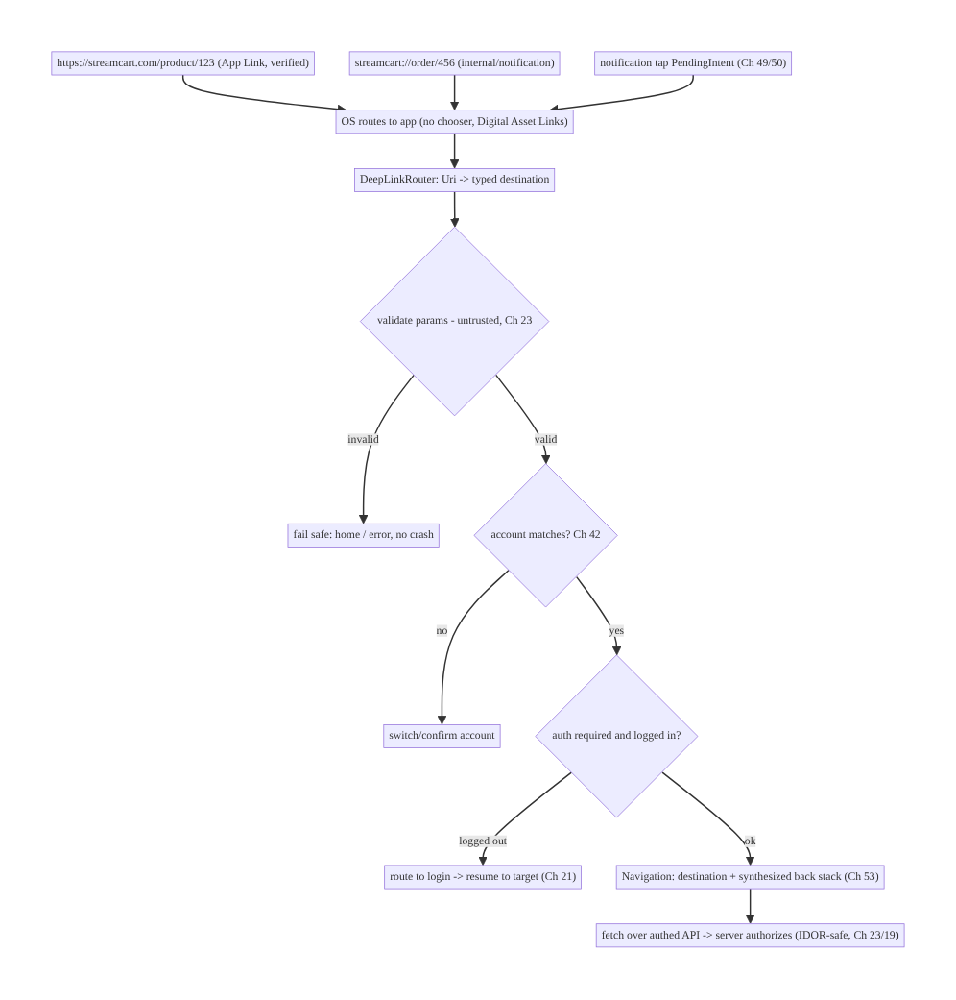
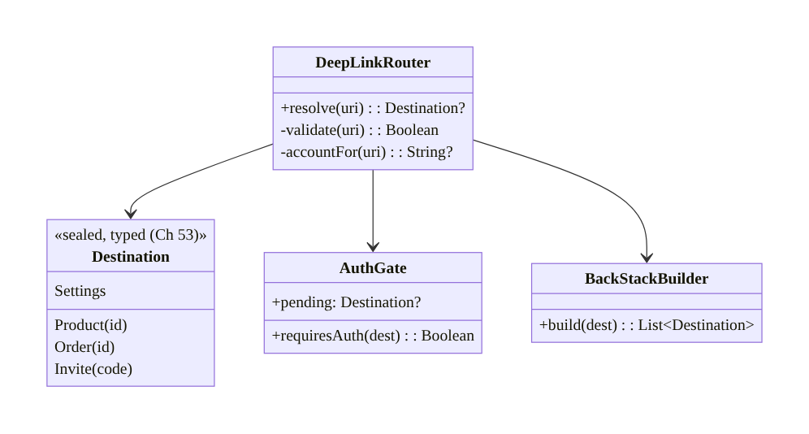
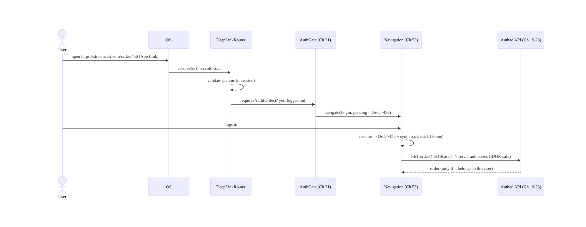
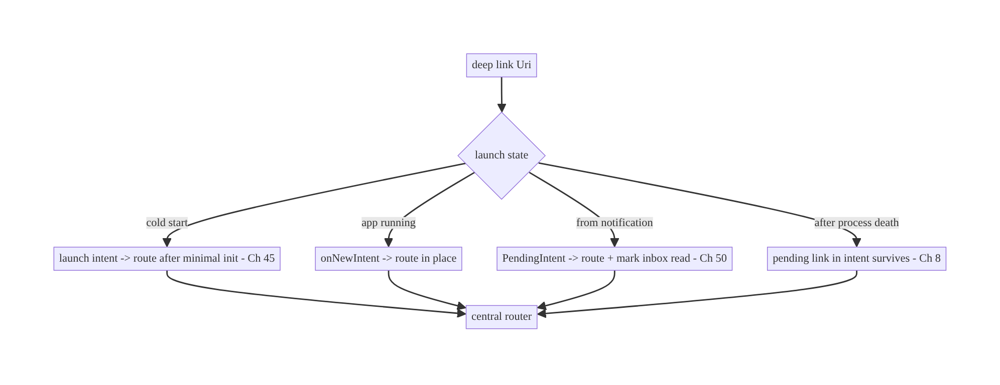
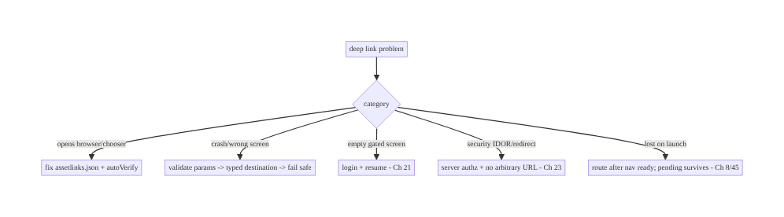

# Chapter 52 — Deep Links & App Links Routing

> **Part VI — Lifecycle, Background & Platform** · Complexity: **Standard** (≥25 interview questions)
>
> **Prerequisites:** Ch 53 (navigation), Ch 49/50 (push/notifications), Ch 44
> (lifecycle), Ch 19/21 (auth), Ch 42 (multi-account). Pairs with Ch 51 (settings
> deep-link), Ch 23 (security).
>
> **Reference surface in StreamCart:** every link that opens a specific screen — a
> marketing URL `https://streamcart.com/product/123`, a notification tap (Ch 49/50), a
> referral, a share link, an `streamcart://` scheme — resolved to the right
> destination, authenticated, and safe against malicious/forged links.

---

## 52.1 Problem Definition and Real-World Context

A **deep link** is a URI that opens a specific screen in the app rather than the home
screen. They're everywhere: push notifications (Ch 49/50), marketing emails/SMS, web
pages, referrals, QR codes, shares, and the Play Store. Done right, a link drops the
user exactly where intended with the right back stack and auth; done wrong, links open
the wrong screen, a browser instead of the app, a crash on malformed input, or a
**security hole** (a forged link that triggers a sensitive action or leaks data).

Concretely, teams hit:

- **Scheme vs App Links confusion.** A custom scheme (`streamcart://`) **any app can
  claim** (hijacking) and browsers won't open it from a web context; **Android App
  Links** (verified `https://` links via Digital Asset Links) open your app directly
  from the web **without a chooser** and can't be hijacked — but require server-side
  verification setup. Choosing wrong means links open a browser or a chooser dialog, or
  get hijacked.
- **Broken back stack.** Tapping a product link should let Back go to a sensible place
  (home/category), not exit the app. A deep link must **synthesize a proper back stack**,
  not just slap one screen on top.
- **Auth-gated destinations.** A link to "My Orders" opened while logged out must route
  through login (Ch 21) and **resume** to the target afterward — not drop the user or
  show an empty screen.
- **Unvalidated parameters = security risk.** Link params are **untrusted input**
  (anyone can craft a URL). Blindly trusting `?userId=` or opening an arbitrary `url=`
  param leads to **IDOR**, open-redirect, intent-injection, or data leaks (Ch 23).
- **State-dependent routing.** Cold start (process not alive) vs warm (app running) vs
  from a notification — the link must resolve correctly in all cases, including after
  process death (Ch 8/44).
- **Multi-account.** A link for account A tapped while account B is active must switch/
  confirm, not show A's data under B (Ch 42).

The architecture: define a **URI scheme + App Links** (verified `https://` for web, a
custom scheme for internal); **centralize routing** (one place maps a `Uri` → a typed
destination, integrated with Navigation, Ch 53); **synthesize a correct back stack**;
**gate auth** (route through login, resume to target, Ch 21); **validate every
parameter as untrusted** and authorize server-side (Ch 23); handle **all launch states**
(cold/warm/notification); and respect **multi-account** (Ch 42). This chapter is about
**resolving links to the right destination — correctly, with the right back stack and
auth, and safely**.

### Three practical use cases

1. **Marketing App Link (StreamCart).** `https://streamcart.com/product/123` opens the
   app directly (verified App Link) to the product screen with Home in the back stack;
   falls back to the web if the app isn't installed.
2. **Notification deep link.** A push (Ch 49/50) taps into `streamcart://order/456` → the
   order screen, marking the inbox item read; routes through login if the session expired
   (Ch 21).
3. **Referral/share link with params.** `https://streamcart.com/invite?code=ABC` — the
   `code` is validated and redeemed **server-side** (never trusting it client-side);
   malformed/forged codes fail safely.

### Why this is architectural

Deep linking is a **routing + security + auth + navigation** concern spanning the web↔app
boundary, notifications (Ch 49/50), login (Ch 21), multi-account (Ch 42), and navigation
(Ch 53). The decisions — App Links vs scheme, centralized routing, back-stack synthesis,
auth gating, parameter validation — determine whether links work reliably and whether
they're an attack surface.

---

## 52.2 Requirements Engineering

### Functional requirements

| ID | Requirement |
|----|-------------|
| F1 | Resolve a URI to the correct in-app destination (web App Links + custom scheme). |
| F2 | Synthesize a sensible back stack for the destination. |
| F3 | Gate auth-required destinations through login and resume to target. |
| F4 | Handle all launch states (cold/warm/from notification/after process death). |
| F5 | Validate parameters as untrusted; authorize server-side. |
| F6 | Respect multi-account (switch/confirm, not cross-account rendering). |

### Non-functional requirements

| Attribute | Policy |
|-----------|--------|
| **Correctness** | Right destination + back stack in every launch state. |
| **Security** | Params untrusted; server-side authz; no open-redirect/IDOR/injection. |
| **Reliability** | Verified App Links (no chooser/hijack); graceful fallback. |
| **UX** | Resume after login; sensible Back; web fallback if not installed. |
| **Maintainability** | Central routing map; typed destinations (Ch 53). |

### Scope

- **In scope:** custom scheme vs Android App Links (Digital Asset Links verification),
  manifest intent filters, central `Uri`→destination routing, Navigation integration
  (Ch 53), back-stack synthesis, auth gating + resume (Ch 21), launch-state handling
  (cold/warm/notification/process death), parameter validation + server-side authz
  (Ch 23), multi-account (Ch 42), settings deep-links (Ch 51), deferred deep links
  (install-then-link).
- **Out of scope:** navigation architecture detail (Ch 53), auth internals (Ch 19/21),
  push detail (Ch 49), notification rendering (Ch 50), general security (Ch 23).

### Assumptions & constraints

- `minSdk 24`, Jetpack Navigation (Compose or fragments), Hilt, verified App Links
  (hosting `assetlinks.json`). Link params are untrusted; App Links require server
  control; the backend is the authorization authority.

---

## 52.3 System Design Fundamentals

- **Three link kinds:**
  - **Custom scheme** (`streamcart://product/123`): simple, works for internal/
    notification links, but **any app can register the same scheme** (hijack risk), and
    web browsers won't launch it from a page context. Fine for internal, not for public
    web links.
  - **Web deep link (`http(s)://`) without verification:** opens a **disambiguation
    chooser** (browser vs app) — poor UX and hijackable.
  - **Android App Links** (`https://`, **verified**): you host a **Digital Asset Links**
    file (`/.well-known/assetlinks.json`) proving you own the domain; verified links open
    your app **directly, no chooser, un-hijackable**, and fall back to the web if the app
    isn't installed. The correct choice for public web links.
- **Intent filters (declaration).** Destinations are reachable via `<intent-filter>` with
  `VIEW`/`BROWSABLE`/`DEFAULT`, a `<data>` scheme/host/path, and
  `android:autoVerify="true"` for App Links. Navigation (Ch 53) can also declare deep
  links per destination (`<deepLink>` / `navDeepLink`).
- **Centralized routing (the key pattern).** Don't scatter `Uri` parsing across
  Activities. Have **one router** that maps a `Uri` → a **typed destination** (a sealed
  type / Navigation route, Ch 53), so all links (web, scheme, notification, settings)
  resolve consistently, with validation and auth in one place.
- **Back-stack synthesis.** A deep link shouldn't land on a lone screen with nowhere to
  go Back. Build a **sensible synthetic back stack** (e.g., product → category → home) via
  Navigation (`NavDeepLinkBuilder` / nav graph deep links) so Back behaves naturally.
- **Auth gating + resume.** If the destination requires auth and the user is logged out/
  session-expired (Ch 21/22), route to **login**, then **resume** to the original target
  (carry the pending deep link). Never drop the link or show an empty gated screen.
- **Launch-state handling (Ch 44/8):**
  - **Cold start:** process starts; the launch intent carries the `Uri`; route after
    minimal init (Ch 45).
  - **Warm/running:** route within the live app (`onNewIntent` for single-top
    activities).
  - **From notification:** the `PendingIntent` carries the deep link (Ch 49/50);
    additionally mark the inbox item read (Ch 50).
  - **After process death:** the pending deep link must survive (it's in the intent;
    don't lose it during restoration, Ch 8).
- **Parameters are untrusted (security core, Ch 23).** Treat every path/query param as
  **attacker-controlled**:
  - **Validate/allowlist** types and values; reject malformed.
  - **Never open an arbitrary `url=` param** (open-redirect / phishing / intent
    injection) — allowlist domains or don't forward URLs.
  - **Authorize server-side:** a link to `order/456` must be checked **on the backend**
    against the authed user (IDOR, Ch 23) — the client passing an id proves nothing.
  - **Don't perform sensitive actions directly from a link** (e.g.,
    `streamcart://delete-account` or `confirm-payment`) without an in-app confirmation +
    server authz; links can be forged/auto-opened.
- **Multi-account (Ch 42):** resolve the link's target account vs the active account; if
  they differ, **switch/confirm** rather than rendering cross-account.
- **Deferred deep links:** for install-then-open (user clicks a link, installs, opens),
  a deferred-deep-link solution (e.g., Play Install Referrer / a link provider) carries
  the intended destination into the first launch — validate it like any other link.

Core insight: **use verified Android App Links for public web URLs (direct, un-hijackable,
web fallback) and a custom scheme for internal/notification links; route every URI
through one central resolver to a typed destination (Navigation, Ch 53) that synthesizes
a correct back stack, gates auth and resumes to the target after login (Ch 21), and works
across cold/warm/notification/process-death launches; and treat all link parameters as
untrusted — validate/allowlist them, authorize server-side (Ch 23), never open arbitrary
URLs or perform sensitive actions straight from a link, and respect multi-account
(Ch 42).**

---

## 52.4 High-Level Architecture



**Components & ownership**

- **App Links/scheme + intent filters** get the URI into the app.
- **`DeepLinkRouter`** centrally maps URI → typed destination, validating params.
- **Auth gate + account check** route through login/switch and resume.
- **Navigation** (Ch 53) places the destination with a proper back stack.
- **Server** is the authorization authority (client ids are untrusted).

**Direction:** URI → OS → central router (validate) → account/auth gates → navigation +
server authz.

---

## 52.5 Detailed Component Design



| Component | Responsibility |
|-----------|----------------|
| `DeepLinkRouter` | parse+validate URI → typed `Destination` (one place) |
| `Destination` | typed, exhaustive destinations (Navigation routes, Ch 53) |
| `AuthGate` | which destinations need auth; hold pending link for resume (Ch 21) |
| `BackStackBuilder` | synthesize a sensible back stack per destination |

---

## 52.6 End-to-End Data Flow

### Auth-gated deep link (cold start, logged out)



### Routing across launch states



---

## 52.7 Complete Kotlin Implementation

Package: `com.streamcart.deeplink`.

### 52.7.1 Manifest: App Links (verified) + custom scheme

```xml
<activity android:name=".MainActivity" android:launchMode="singleTop" android:exported="true">
    <!-- Verified App Links (https) -> open directly, no chooser, un-hijackable -->
    <intent-filter android:autoVerify="true">
        <action android:name="android.intent.action.VIEW" />
        <category android:name="android.intent.category.DEFAULT" />
        <category android:name="android.intent.category.BROWSABLE" />
        <data android:scheme="https" android:host="streamcart.com" />
    </intent-filter>
    <!-- Custom scheme for internal/notification links -->
    <intent-filter>
        <action android:name="android.intent.action.VIEW" />
        <category android:name="android.intent.category.DEFAULT" />
        <category android:name="android.intent.category.BROWSABLE" />
        <data android:scheme="streamcart" />
    </intent-filter>
</activity>
<!-- Server hosts https://streamcart.com/.well-known/assetlinks.json (Digital Asset Links). -->
```

### 52.7.2 Typed destinations + central router (validate as untrusted)

```kotlin
sealed interface Destination {                       // typed (Navigation routes, Ch 53)
    data class Product(val id: String) : Destination
    data class Order(val id: String) : Destination
    data class Invite(val code: String) : Destination
    data object Settings : Destination
}

@Singleton
class DeepLinkRouter @Inject constructor() {
    /** Parse + VALIDATE. Returns null for anything unrecognized/malformed -> caller fails safe. */
    fun resolve(uri: Uri): Destination? {
        val segments = uri.pathSegments
        return when {
            // /product/{id} -- validate id shape; never trust blindly
            segments.size == 2 && segments[0] == "product" && segments[1].isValidId() ->
                Destination.Product(segments[1])
            segments.size == 2 && segments[0] == "order" && segments[1].isValidId() ->
                Destination.Order(segments[1])           // server authorizes ownership (Ch 23)
            segments.size == 1 && segments[0] == "invite" ->
                uri.getQueryParameter("code")?.takeIf { it.isValidCode() }?.let { Destination.Invite(it) }
            segments.firstOrNull() == "settings" -> Destination.Settings
            else -> null                                  // unknown -> fail safe, NOT a crash
        }
    }
    // NEVER: open an arbitrary uri.getQueryParameter("url"); never act on a sensitive verb from a link.
    private fun String.isValidId() = matches(Regex("^[a-zA-Z0-9_-]{1,64}$"))
    private fun String.isValidCode() = matches(Regex("^[A-Z0-9]{4,16}$"))
}
```

### 52.7.3 Activity: handle all launch states → central routing

```kotlin
@AndroidEntryPoint
class MainActivity : ComponentActivity() {
    @Inject lateinit var router: DeepLinkRouter

    override fun onCreate(savedInstanceState: Bundle?) {
        super.onCreate(savedInstanceState)
        setContent { AppNav(onReady = { nav -> handleIntent(intent, nav) }) }   // cold start
    }
    override fun onNewIntent(intent: Intent) {         // app already running (singleTop)
        super.onNewIntent(intent); setIntent(intent)
        navController?.let { handleIntent(intent, it) }
    }
    private fun handleIntent(intent: Intent?, nav: NavController) {
        val uri = intent?.data ?: intent?.getStringExtra(EXTRA_DEEP_LINK)?.let(Uri::parse) ?: return
        val dest = router.resolve(uri) ?: run { nav.navigate(Routes.Home); return }   // fail safe
        navigateWithAuthAndBackStack(dest, nav)        // auth gate + back-stack synthesis
    }
}
```

### 52.7.4 Auth gating + resume + back-stack synthesis (Navigation, Ch 53)

```kotlin
fun navigateWithAuthAndBackStack(dest: Destination, nav: NavController) {
    val account = ActiveAccountHolder.current()                     // Ch 42
    if (dest.targetAccount != null && dest.targetAccount != account?.id) {
        nav.navigate(Routes.ConfirmAccountSwitch(dest)); return     // don't render cross-account
    }
    if (dest.requiresAuth && !SessionHolder.isLoggedIn()) {         // Ch 21/22
        PendingDeepLink.set(dest)                                   // remember to resume
        nav.navigate(Routes.Login); return
    }
    // Synthesize a sensible back stack, then land on the destination:
    when (dest) {
        is Destination.Product -> nav.navigate(Routes.Product(dest.id)) {
            // e.g., ensure Home/Category is beneath so Back is natural
            popUpTo(Routes.Home) { saveState = true }; launchSingleTop = true
        }
        is Destination.Order -> nav.navigate(Routes.Order(dest.id))
        is Destination.Invite -> nav.navigate(Routes.Invite(dest.code))   // redeemed server-side (Ch 23)
        Destination.Settings -> nav.navigate(Routes.Settings)
    }
}

// After successful login, resume:
fun onLoginSuccess(nav: NavController) {
    PendingDeepLink.consume()?.let { navigateWithAuthAndBackStack(it, nav) } ?: nav.navigate(Routes.Home)
}
```

### 52.7.5 Building a deep-link PendingIntent for notifications (Ch 49/50)

```kotlin
class DeepLinkFactory @Inject constructor(@ApplicationContext private val ctx: Context) {
    fun pendingIntent(deepLink: String, inboxId: String): PendingIntent {
        val intent = Intent(Intent.ACTION_VIEW, Uri.parse(deepLink), ctx, MainActivity::class.java)
            .putExtra(EXTRA_INBOX_ID, inboxId)
        return PendingIntent.getActivity(ctx, deepLink.hashCode(), intent,
            PendingIntent.FLAG_UPDATE_CURRENT or PendingIntent.FLAG_IMMUTABLE)   // immutable (Ch 49)
    }
}
```

### 52.7.6 Module structure

```
:core:deeplink   DeepLinkRouter, Destination, DeepLinkFactory, AuthGate, back-stack logic
:core:navigation Navigation routes + graph (Ch 53)
# assetlinks.json hosted by backend. Auth -> Ch 21/22; accounts -> Ch 42.
```

---

## 52.8 Concurrency and Race Conditions

| Scenario | Risk | Handling |
|----------|------|----------|
| Deep link during cold start before nav ready | lost/crash | route after NavController ready (callback); minimal init (Ch 45) |
| Multiple rapid links | duplicate/stacked screens | `launchSingleTop`; dedupe |
| Pending link lost on process death | link dropped | it's in the launch intent (survives, Ch 8); persist pending if needed |
| Login resume vs user navigating away | wrong resume | consume pending once; clear on manual nav |
| Account switch mid-route | cross-account render | resolve account before navigating (Ch 42) |
| `onNewIntent` not handled (not singleTop) | new Activity instance | `launchMode="singleTop"` + handle `onNewIntent` |

- **Route only when Navigation is ready:** on cold start the `NavController` may not
  exist when the intent arrives; resolve first, then navigate once the graph is set
  (callback), so the link isn't dropped or crashes.
- **`singleTop` + `onNewIntent`:** without it, a link while the app runs spawns a new
  Activity instance; declare `singleTop` and handle `onNewIntent` to route in place.
- **Consume the pending deep link exactly once** after login, and clear it if the user
  navigates elsewhere, to avoid a surprising late jump.

---

## 52.9 Failure Scenarios and Recovery

| Failure | Detection | Response | Outcome |
|---------|-----------|----------|---------|
| App Link opens browser/chooser | QA / reports | fix `assetlinks.json` + `autoVerify`; re-verify | opens app directly |
| Malformed link crash | crash | validate → return null → fail safe (home) | no crash |
| Gated screen while logged out | empty/blocked | route to login + resume (Ch 21) | lands correctly |
| Wrong user's data (IDOR) | security audit | server-side authz; validate params (Ch 23) | blocked |
| Open-redirect via `url=` param | security audit | never open arbitrary URLs; allowlist | safe |
| Link lost on cold start | QA | route after nav ready; pending survives | resolved |
| Cross-account render | user report | account check before nav (Ch 42) | isolated |
| Not installed | user | App Link falls back to web | graceful |



> **Two axes of deep-link failure:** *routing* (wrong screen, chooser, lost link, bad
> back stack) and *security* (unvalidated params, IDOR, open-redirect, sensitive actions
> from forged links). Centralized routing with typed destinations fixes the first;
> untrusted-param validation + server-side authz fixes the second.

---

## 52.10 Scaling the Implementation

- **Level 1.** Custom scheme + intent filter; central router → typed destination;
  fail-safe on unknown.
- **Level 2.** Verified App Links (`assetlinks.json` + `autoVerify`) for web; Navigation
  deep links + back-stack synthesis (Ch 53).
- **Level 3 — production.** Auth gating + resume (Ch 21); all launch states
  (cold/warm/notification/process death); parameter validation + server-side authz
  (Ch 23); multi-account (Ch 42).
- **Level 4 — large.** Deferred deep links (install referrer); link analytics
  (open/attribution); dynamic link catalog; per-destination back-stack rules; settings
  deep-links (Ch 51).
- **Level 5 — enterprise.** Centralized link registry/governance (one source of truth for
  all routes), security review of every linkable action, A/B of link destinations,
  link-open funnel dashboards, universal/dynamic link provider integration.

**Avoid overengineering:** most apps need App Links + a scheme + one central router with
typed destinations + auth gating. Don't scatter parsing, and don't build a dynamic link
DSL before you have many links.

---

## 52.11 Alternative Approaches and Trade-offs

| Dimension | Option A | Option B | When |
|-----------|----------|----------|------|
| Public web links | Verified App Links | custom scheme / unverified https | App Links (direct, un-hijackable, web fallback) |
| Internal/notification | Custom scheme | App Links | Scheme is fine (no web context, no hijack concern) |
| Routing | Central router → typed destinations | per-Activity `Uri` parsing | Central (consistency, one place for validation/auth) |
| Back stack | Synthesized (NavDeepLink) | single screen on top | Synthesized (natural Back) |
| Auth | Gate + resume to target | drop/show empty | Gate + resume (Ch 21) |
| Param trust | Validate + server authz | trust client params | Validate + server (security, Ch 23) |
| Sensitive action | In-app confirm + server authz | act directly from link | Confirm + server (links are forgeable) |

**App Links vs custom scheme:** a custom scheme is trivial but **hijackable** (any app
can claim `streamcart://`) and **won't launch from a web page**, so it's unsuitable for
public web links — use it for **internal/notification** links only. **Android App Links**
require hosting a Digital Asset Links file and server coordination, but open your app
**directly from the web with no chooser, can't be hijacked, and fall back to the web**
when the app isn't installed. Use App Links for all public `https://` links.

**Centralized routing vs per-Activity parsing:** parsing `Uri`s in each Activity scatters
validation and auth logic, causing inconsistent behavior and security gaps. A **single
router** mapping `Uri` → **typed destination** puts validation, auth gating, account
checks, and back-stack rules in one audited place and integrates cleanly with Navigation
(Ch 53). Centralize.

**Trusting link params vs server-side authz:** a link carries whatever the sender put in
it — treating `order/456` or `?userId=` as authoritative enables **IDOR** and data leaks.
The client must **validate shape** and the **backend must authorize** the action against
the authenticated user (Ch 23/19). Never perform a sensitive action (delete, pay) straight
from a link without in-app confirmation and server authorization.

---

## 52.12 Security Considerations

- **All parameters are untrusted input.** Validate/allowlist path and query params;
  reject malformed; **fail safe** (home/error), never crash or proceed on garbage.
- **Server-side authorization (IDOR).** The client passing an id (`order/456`) proves
  nothing — the backend authorizes against the authed user (Ch 23/19). This is the single
  most important deep-link security rule.
- **No open-redirect / intent injection.** Never open an arbitrary `url=` param or
  forward a link to `startActivity` with attacker-controlled components; allowlist
  domains/targets (Ch 23).
- **No sensitive actions straight from a link.** `delete-account`, `confirm-payment`,
  `change-email` must require **in-app confirmation + server authz** — links can be
  auto-opened, forged, or embedded maliciously.
- **App Links verification** (`assetlinks.json`) prevents **hijacking** of your `https://`
  links by other apps; custom schemes can't be verified, so keep them internal.
- **`exported` + `singleTop`** correctly; validate the intent's data; don't leak via a
  `PendingIntent` that's mutable (use `FLAG_IMMUTABLE`, Ch 49).
- **Multi-account isolation (Ch 42):** resolve the link's account and confirm/switch;
  never render account A's resource under account B.
- **Deferred deep links** from install referrers are also untrusted — validate before
  acting.
- Client vs backend: the client validates shape and routes; the **backend authorizes and
  resolves** the resource against the session (the authority). Links are an **attack
  surface** — treat them like any untrusted external input (Ch 23).

---

## 52.13 Performance and Resource Optimization

- **Route fast on cold start:** keep `Application.onCreate` light (Ch 45) so a link
  resolves quickly; show a skeleton while fetching the destination's data (Ch 45).
- **Avoid redundant fetches:** the destination loads from SSOT/cache first (Ch 3/12),
  fetches fresh in background — a link shouldn't block on the network.
- **`launchSingleTop`** prevents duplicate destinations/back-stack bloat.
- **Lazy-load feature modules** (Ch 96) the link targets if using dynamic features.
- **Cheap validation** (regex/allowlist) before any navigation or fetch.
- **Profiling:** link-open latency (tap → rendered), cold-start-from-link time,
  open→destination funnel.

---

## 52.14 Testing Strategy

Deep links test with Navigation testing, `adb` to fire intents, and App Links
verification checks.

```bash
# Fire a deep link via adb (test routing without a real web click):
adb shell am start -W -a android.intent.action.VIEW -d "https://streamcart.com/product/123" com.streamcart
adb shell am start -W -a android.intent.action.VIEW -d "streamcart://order/456" com.streamcart
# Verify App Links association (Digital Asset Links):
adb shell pm verify-app-links --re-verify com.streamcart
adb shell pm get-app-links com.streamcart     # should show "verified" for streamcart.com
```

```kotlin
class DeepLinkRouterTest {
    private val router = DeepLinkRouter()
    @Test fun `resolves product link`() =
        assertEquals(Destination.Product("123"), router.resolve(Uri.parse("https://streamcart.com/product/123")))
    @Test fun `rejects malformed id - fail safe`() =
        assertNull(router.resolve(Uri.parse("https://streamcart.com/product/<script>")))
    @Test fun `never resolves arbitrary url param`() =
        assertNull(router.resolve(Uri.parse("https://streamcart.com/redirect?url=http://evil.com")))
    @Test fun `unknown path returns null`() = assertNull(router.resolve(Uri.parse("https://streamcart.com/???")))
}

@RunWith(AndroidJUnit4::class)
class DeepLinkNavTest {
    @Test fun `gated link routes to login then resumes`() { /* logged out -> Login -> login -> Order */ }
    @Test fun `product link synthesizes back stack to home`() { /* Back from product -> Home */ }
}
```

What to test: router resolution + rejection of malformed/arbitrary-URL params (fail
safe); back-stack synthesis; auth gate + resume; launch states (`adb` cold/warm/
notification); App Links verification (`pm get-app-links`); multi-account switch;
server-authz is enforced (integration — wrong user gets 403). Fuzz the router with
hostile URIs.

---

## 52.15 Production Observability

- **Metrics:** link **open → destination** funnel (opened / resolved / rendered); App
  Links **verification status** + chooser-shown rate; unknown/malformed-link rate; gated-
  link resume success; link-open latency; cross-account-switch rate; security rejects
  (malformed/arbitrary-URL) count.
- **Logs:** `deeplink{scheme, host, path_template, resolved, auth_gated, account_ok}` —
  **no raw params/PII** (Ch 28).
- **Debugging:** chooser shown → App Links not verified (`assetlinks.json`); crashes →
  unvalidated params; empty gated screen → missing resume; wrong user data → server
  authz gap (IDOR); lost on launch → routing before nav ready.
- **Alerting:** App Links verification failure after a deploy (broke `assetlinks.json`);
  spike in malformed/arbitrary-URL links (attack); any IDOR indicator.
- **Dashboards:** open funnel by link source (web/notification/referral); verification
  health.

---

## 52.16 System Design Interview Preparation

> ≥25 questions.

**Fundamentals**

1. *Deep link?* A URI that opens a specific screen.
2. *Custom scheme vs App Link?* Hijackable, no web launch vs verified https, direct,
   un-hijackable, web fallback.
3. *Digital Asset Links?* `assetlinks.json` proving domain ownership → verified App
   Links.
4. *`autoVerify`?* Triggers App Link verification for the intent filter.
5. *When scheme vs App Link?* Scheme for internal/notification; App Links for public web.

**Routing**

6. *Why centralize routing?* Consistency + one place for validation/auth; avoid scattered
   parsing.
7. *Typed destinations?* Map `Uri` → sealed/Navigation route (Ch 53).
8. *Back stack?* Synthesize a sensible one (NavDeepLink), not a lone screen.
9. *Unknown link?* Fail safe (home/error), never crash.

**Auth/accounts**

10. *Gated destination, logged out?* Route to login, resume to target (Ch 21).
11. *Carry the pending link?* Yes — consume once after login.
12. *Multi-account link?* Resolve account; switch/confirm (Ch 42).

**Launch states**

13. *Cold start?* Launch intent → route after minimal init (Ch 45).
14. *App running?* `singleTop` + `onNewIntent`.
15. *From notification?* `PendingIntent` carries the link; mark inbox read (Ch 50).
16. *Process death?* Link in the intent survives (Ch 8).

**Security**

17. *Params trust?* Untrusted — validate/allowlist; fail safe.
18. *IDOR?* Authorize server-side against the authed user (Ch 23) — client id proves
    nothing.
19. *Open-redirect?* Never open arbitrary `url=`; allowlist.
20. *Sensitive action from a link?* In-app confirm + server authz; never direct.
21. *Hijacking?* App Links verification prevents it; schemes can't be verified.

**Testing/Production**

22. *Test links?* `adb am start -d`; `pm get-app-links`; router unit tests.
23. *Chooser shown?* App Links not verified.
24. *Verify App Links?* `pm verify-app-links` / Play Console.
25. *Lost link on launch?* Routed before nav ready.
26. *Key metric?* Open→destination funnel + verification health.

### Design-change challenges
1. **Marketing URLs should open the app directly.** Verified App Links +
   `assetlinks.json` + `autoVerify`.
2. **A link to "My Orders" opened logged out.** Auth gate → login → resume (Ch 21).
3. **Security review flags `?url=` redirects.** Never open arbitrary URLs; allowlist;
   server authz.
4. **Deep link crashes on malformed input.** Validate → typed destination → fail safe.
5. **Links show the wrong account's data after switching.** Account check before nav
   (Ch 42).

### Mock walkthrough (abridged)
Clarify (web or internal links, auth-gated, multi-account, which destinations?) → App
Links (verified) + scheme → central router → typed destinations + validation (untrusted)
→ back-stack synthesis (Ch 53) → auth gate + resume (Ch 21) → launch states (cold/warm/
notification/death) → security (server authz, no arbitrary URL, no direct sensitive
action, Ch 23) → multi-account (Ch 42) → testing (`adb`, `pm get-app-links`) →
observability (open funnel, verification).

---

## 52.17 Practical Exercises

1. **Beginner.** Add a central `DeepLinkRouter` that resolves `product/{id}` to a typed
   destination and fails safe on unknown links. *Eval:* correct destination; no crash on
   garbage.
2. **Intermediate.** Set up verified App Links (`assetlinks.json` + `autoVerify`) so a web
   URL opens the app directly; synthesize a back stack to Home. *Eval:* no chooser; Back
   goes Home.
3. **Advanced.** Gate an order link through login and resume to it; handle cold-start,
   running, and notification launches. *Eval:* resumes after login; works in all states.
4. **Production debugging / security.** Fix an open-redirect (`?url=`) and an IDOR (trust
   of `order/{id}` client-side). *Eval:* arbitrary URLs rejected; server authorizes
   ownership.
5. **System design challenge.** Build a link registry + open-funnel dashboard + App Links
   verification monitoring; add multi-account confirmation. *Eval:* centralized routes;
   observable; account-isolated.

*(Solutions withheld unless requested.)*

---

## 52.18 Chapter Summary & Reference Sheet

**Key decisions:** use **verified Android App Links** (`assetlinks.json` + `autoVerify`)
for public `https://` URLs — they open the app **directly, with no chooser, can't be
hijacked, and fall back to the web** — and a **custom scheme** only for
internal/notification links; route **every URI through one central `DeepLinkRouter`** to
a **typed destination** (Navigation, Ch 53) that **validates all parameters as untrusted**
(allowlist, **fail safe** on unknown — never crash), **synthesizes a sensible back
stack**, **gates auth** (route to login and **resume** to the target, Ch 21), handles
**all launch states** (cold/warm/`onNewIntent`/notification/process death), and respects
**multi-account** (switch/confirm, Ch 42); and enforce **security**: **authorize
server-side** (IDOR — the client id proves nothing, Ch 23/19), **never open arbitrary
`url=` params** (open-redirect/injection), and **never perform sensitive actions straight
from a link** (in-app confirm + server authz).

**Concepts:** custom scheme vs App Links, Digital Asset Links/`autoVerify`, intent
filters, central routing → typed destinations, back-stack synthesis, auth gating + resume,
launch-state handling, untrusted parameters, server-side authorization, multi-account,
deferred deep links.

**Common mistakes:** custom scheme for public web links (hijack/chooser); scattered
per-Activity parsing; no back-stack synthesis; dropping/empty gated links; trusting link
params (IDOR); opening arbitrary `url=` (open-redirect); sensitive actions straight from a
link; not handling `onNewIntent`/cold start; cross-account rendering; crashing on
malformed input.

**Checklist:**

- [ ] verified App Links for web + scheme for internal
- [ ] `assetlinks.json` + `autoVerify`
- [ ] central router → typed destinations
- [ ] validate params (allowlist, fail safe)
- [ ] synthesize back stack
- [ ] auth gate + resume (Ch 21)
- [ ] handle cold/warm/notification/process-death
- [ ] server-side authz (IDOR, Ch 23)
- [ ] no arbitrary URL / no direct sensitive action
- [ ] multi-account switch/confirm (Ch 42)
- [ ] `FLAG_IMMUTABLE` PendingIntents
- [ ] open-funnel + verification telemetry.

**Key APIs:** `<intent-filter>` `VIEW`/`BROWSABLE`/`DEFAULT` + `<data>` +
`android:autoVerify`, `/.well-known/assetlinks.json`, `Activity.onNewIntent` +
`launchMode="singleTop"`, `Intent.data`/`Uri.pathSegments`/`getQueryParameter`,
Navigation `navDeepLink`/`NavDeepLinkBuilder` (Ch 53), `PendingIntent.getActivity`
(`FLAG_IMMUTABLE`), `Settings.ACTION_APPLICATION_DETAILS_SETTINGS` (Ch 51),
`adb am start -d` / `pm get-app-links`.

**References:**
- Deep links & App Links: https://developer.android.com/training/app-links
- Verify Android App Links: https://developer.android.com/training/app-links/verify-android-applinks
- Navigation deep links: https://developer.android.com/guide/navigation/navigation-deep-link
- App Links security: https://developer.android.com/privacy-and-security/risks/unsafe-use-of-deeplinks
- (composes) Ch 53 Navigation, Ch 49/50 Push/Notifications, Ch 21 Auth, Ch 42 Multi-Account, Ch 23 Security, Ch 8 Process Death

### Chapter review (Phase 4)
- **Completeness:** all 18 sections; architecture/class/sequence/launch-state/failure
  diagrams; manifest (App Links+scheme) + typed destinations + validating router + launch-
  state handling + auth-gate/resume/back-stack + notification PendingIntent code;
  concurrency (nav-ready timing, singleTop, pending-once); failure (routing vs security
  axes); 5 levels; App-Links-vs-scheme, central-routing, server-authz trade-offs; security
  (untrusted params, IDOR, open-redirect, sensitive actions, hijack); perf (fast cold
  route); adb + router + nav tests + fuzzing; observability (open funnel, verification);
  26 Q&A + 5 challenges. ✅
- **Expand later:** navigation (Ch 53), auth (Ch 21), push/notifications (Ch 49/50),
  security (Ch 23).
- **Interview coverage:** exceeds ≥25 bar.
