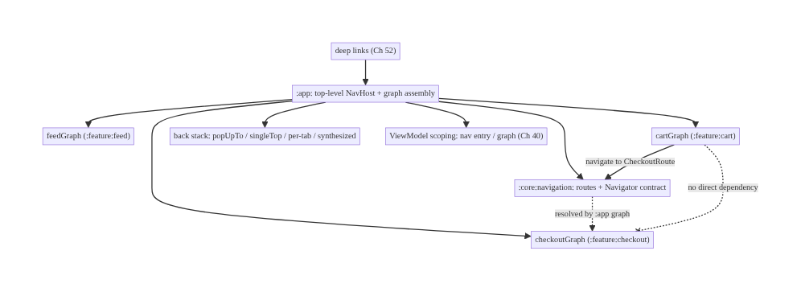
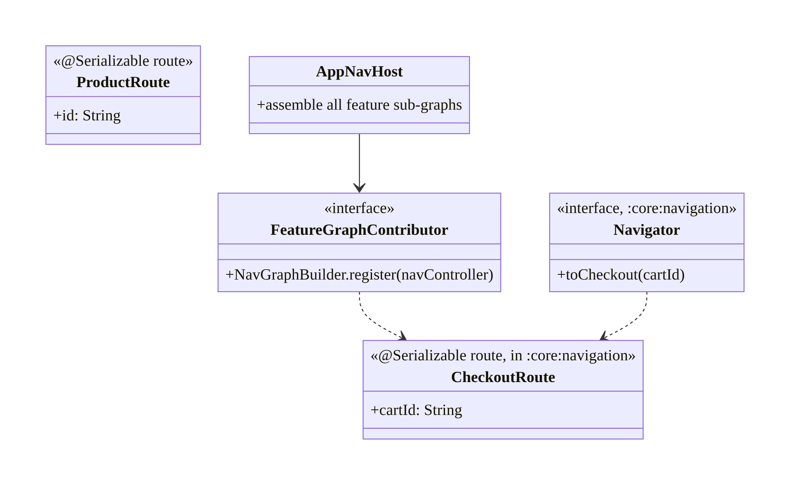
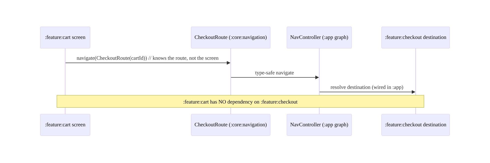
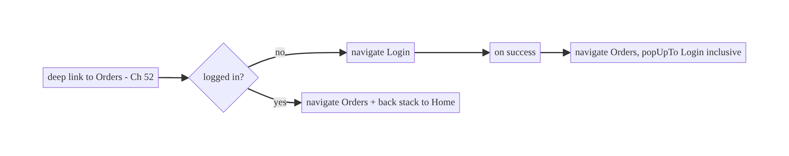
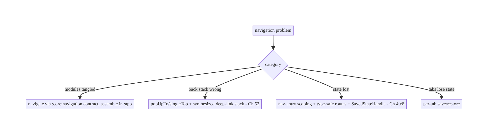

# Chapter 53 — Navigation Architecture (Multi-Module)

> **Part VI — Lifecycle, Background & Platform** · Complexity: **Standard** (≥25 interview questions)
>
> **Prerequisites:** Ch 52 (deep links), Ch 6 (UI state), Ch 5 (Hilt/modules), Ch 8
> (process death), Ch 44 (lifecycle), Ch 42 (multi-account). Pairs with Ch 96 (dynamic
> features), Ch 40 (shared ViewModel scoping).
>
> **Reference surface in StreamCart:** how the app moves between screens — feed,
> product, cart, checkout, orders, profile — across many feature modules, with type-safe
> routes, a correct back stack, deep-link integration (Ch 52), and no feature module
> depending on another.

---

## 53.1 Problem Definition and Real-World Context

Navigation is how users move through the app, and in a **multi-module** codebase it's
also an **architecture boundary problem**: feature modules must navigate to each other
**without depending on each other**, or the module graph collapses into a tangled
monolith. A navigation design that works for a 3-screen sample breaks badly at scale:

- **Module coupling.** If `:feature:cart` calls `CheckoutActivity` directly, it must
  **depend on** `:feature:checkout` — and soon every feature depends on every other,
  killing build times, reuse, and team autonomy. Features must navigate via an
  **abstraction**, not concrete screens.
- **Back-stack correctness.** Deep links (Ch 52), bottom-nav tab switching, nested
  graphs, "up vs back," and conditional flows (login, onboarding) all shape the back
  stack. Getting it wrong strands users or exits the app unexpectedly.
- **Type safety.** String-route navigation (`navigate("product/$id")`) is error-prone —
  typos, missing/mis-typed args, no compile-time checks. Modern Navigation offers
  **type-safe routes** (Kotlin Serialization) that catch these at compile time.
- **State & lifecycle across navigation.** ViewModels scoped to the right nav entry
  (Ch 40), arguments surviving process death (Ch 8), and not leaking state between
  screens.
- **Deep-link integration.** Links (Ch 52) must map to the same destinations/graph as
  in-app navigation — one routing model, not two.
- **Single-Activity vs multi-Activity, Compose vs Fragments.** Choosing the navigation
  host and how it interacts with lifecycle (Ch 44) and config changes.
- **Conditional/nested flows.** Auth gates (Ch 21), onboarding, nested feature graphs,
  and bottom-nav with per-tab back stacks.

The architecture: adopt a **single-Activity + Navigation** model (Compose Navigation or
Jetpack Navigation) with a **nav graph composed of per-feature sub-graphs**; keep feature
modules **decoupled** via a **navigation abstraction** (a `:core:navigation` contract of
routes/APIs that features depend on, while an `:app`-level graph wires them together — the
**api/impl** or **navigator interface** pattern); use **type-safe routes** (Kotlin
Serialization); **synthesize and manage the back stack** correctly (deep links, tabs,
conditional flows); **scope ViewModels** to nav entries (Ch 40) and **survive process
death** (Ch 8); and **unify deep links** (Ch 52) with in-app routes. This chapter is about
**scalable, decoupled, type-safe navigation across many modules**.

### Three practical use cases

1. **StreamCart cross-feature nav.** `:feature:cart` navigates to checkout **without
   depending on** `:feature:checkout` — via a route/contract in `:core:navigation`, wired
   in `:app`.
2. **Bottom-nav with per-tab back stacks.** Feed / Search / Cart / Profile tabs each keep
   their own back stack; switching tabs preserves state.
3. **Deep-link + auth flow.** A product deep link (Ch 52) lands on the product screen with
   Home beneath; an orders link routes through login and resumes (Ch 21), using the same
   graph.

### Why this is architectural

Navigation defines **module boundaries** (decoupling), the **back-stack model**
(correctness/UX), **type safety**, **state scoping** (Ch 40), **process-death survival**
(Ch 8), and the **single routing model** shared with deep links (Ch 52). These choices
determine build scalability, team autonomy, and navigation correctness across the whole
app.

---

## 53.2 Requirements Engineering

### Functional requirements

| ID | Requirement |
|----|-------------|
| F1 | Navigate between screens/features with a correct back stack. |
| F2 | Keep feature modules decoupled (no feature→feature dependency). |
| F3 | Type-safe routes with arguments; survive process death. |
| F4 | Integrate deep links (Ch 52) with the same destination graph. |
| F5 | Support nested graphs, bottom-nav per-tab back stacks, conditional flows (auth). |
| F6 | Scope ViewModels/state to the right nav entry (Ch 40). |

### Non-functional requirements

| Attribute | Policy |
|-----------|--------|
| **Modularity** | Features depend on a navigation contract, not each other. |
| **Correctness** | Back stack / up-vs-back / tabs behave predictably. |
| **Type safety** | Compile-time-checked routes + args. |
| **Resilience** | Args + back stack survive config change + process death (Ch 8). |
| **Build scalability** | Decoupling keeps module graph flat; fast builds. |
| **Consistency** | One routing model shared with deep links (Ch 52). |

### Scope

- **In scope:** single-Activity + Navigation (Compose/Jetpack), nav graph + per-feature
  sub-graphs, module-decoupling patterns (navigation contract / api-impl / navigator
  interface), type-safe routes (Serialization), back-stack management (deep links, tabs,
  conditional flows), nested graphs, bottom-nav per-tab back stacks, nav-entry ViewModel
  scoping (Ch 40), process-death survival (Ch 8), deep-link integration (Ch 52), up vs
  back.
- **Out of scope:** deep-link routing/security (Ch 52), UI state (Ch 6), ViewModel
  scoping detail (Ch 40), DI (Ch 5), dynamic feature modules (Ch 96), process-death
  mechanics (Ch 8).

### Assumptions & constraints

- Jetpack **Navigation** (Compose Navigation or Navigation component), Kotlin
  Serialization type-safe routes, Hilt, multi-module Gradle, single-Activity. `minSdk 24`.
  Feature modules must not depend on each other; `:app` owns the top-level graph wiring.

---

## 53.3 System Design Fundamentals

- **Single-Activity + Navigation (the modern default).** One `Activity` hosts a
  **NavHost**; screens are **destinations** (composables or fragments) in a **nav graph**.
  This centralizes the back stack, lifecycle (Ch 44), and deep-link handling (Ch 52), and
  avoids the complexity/`Intent` coupling of many Activities. Multi-Activity is reserved
  for special isolation (e.g., a separate task).
- **Nav graph composed of per-feature sub-graphs.** The top-level graph (in `:app`)
  includes a **nested sub-graph per feature** (`feedGraph`, `cartGraph`,
  `checkoutGraph`). Each feature module **contributes its own sub-graph** (an extension
  function registering its destinations), and `:app` assembles them — so features are
  self-contained and `:app` is the only place that knows about all of them.
- **Module decoupling (the crux). Three common patterns:**
  - **Navigation contract in `:core:navigation`:** define **routes** (type-safe route
    classes) and/or a **Navigator**/**feature-API interface** in a shared low-level
    module that all features depend on. `:feature:cart` navigates to a **route**
    (`CheckoutRoute(cartId)`) it knows from `:core:navigation`, **not** to
    `:feature:checkout`. `:app` (or an `:impl` module) provides the destination.
  - **api/impl split:** `:feature:checkout:api` exposes a navigation entry
    (route/interface); `:feature:checkout:impl` implements the screens. Others depend only
    on `:api`.
  - **Navigator interface (DI-provided):** a `Navigator` abstraction injected (Ch 5);
    features call `navigator.navigateToCheckout(cartId)`; the implementation (in `:app`)
    performs the real navigation.
  The invariant: **no feature module depends on another feature module's implementation.**
- **Type-safe routes.** Modern Navigation supports **Kotlin Serialization**-based routes:
  define `@Serializable data class ProductRoute(val id: String)` and navigate with the
  object — **compile-time-checked** destinations and arguments, no string typos, no
  manual arg bundling. Arguments are serialized into the back stack (survive process
  death, Ch 8).
- **Back-stack management:**
  - **popUpTo / launchSingleTop / inclusive** control what the back stack looks like
    after navigation (e.g., after login, pop the login off; after a tab switch, don't
    stack duplicates).
  - **Deep links (Ch 52)** synthesize a back stack via the graph (`navDeepLink` /
    start-destination hierarchy) so Back is natural.
  - **Bottom-nav per-tab back stacks:** each tab maintains its **own** back stack
    (`saveState`/`restoreState` when switching), so leaving and returning to a tab
    preserves where you were.
  - **Up vs Back:** *Up* navigates within the app's hierarchy (parent screen); *Back*
    pops the temporal back stack — handle both (`navigateUp()` vs system back).
- **Conditional/nested flows.** Auth gates (Ch 21), onboarding, and feature flows are
  **nested graphs** or conditional start destinations; route through them and
  `popUpTo` to clean up (e.g., remove onboarding/login from the stack after completion).
- **State scoping (Ch 40).** ViewModels can be scoped to a **nav entry** or a **nav
  graph** (`hiltViewModel()` with the nav back-stack entry / graph scope) so a shared flow
  (e.g., checkout steps) shares a ViewModel across its sub-graph, while per-screen state
  is per-destination. This is how you share state across a multi-step flow without a
  global singleton (Ch 39/40).
- **Process death (Ch 8).** The nav back stack + serialized route args are restored by
  the system; `SavedStateHandle` (Ch 6/8) in nav-entry ViewModels restores screen state.
  Type-safe routes make args restoration automatic.
- **Deep-link unification (Ch 52).** Deep links map to the **same destinations/graph** as
  in-app navigation (`navDeepLink`), so there's **one routing model** — no parallel
  deep-link navigation stack.

Core insight: **use a single-Activity NavHost with a nav graph composed of per-feature
sub-graphs, and keep feature modules decoupled by navigating through a shared navigation
contract (routes/Navigator interface in `:core:navigation`, assembled in `:app`) so no
feature depends on another; use type-safe (Serialization) routes whose arguments survive
process death; manage the back stack deliberately (popUpTo/singleTop, per-tab stacks,
synthesized deep-link stacks, up-vs-back); scope ViewModels to nav entries/graphs for
multi-step flows (Ch 40); and unify deep links (Ch 52) onto the same graph as one routing
model.**

---

## 53.4 High-Level Architecture



**Components & ownership**

- **`:core:navigation`** owns the **contract** (routes/Navigator) every feature depends
  on.
- **Feature modules** contribute **sub-graphs** and navigate via the contract — never to
  each other.
- **`:app`** assembles the full graph (the only place that knows all features) and hosts
  the single NavHost.
- **Deep links** (Ch 52) and **state scoping** (Ch 40) attach to the same graph.

**Direction:** features → contract (routes) → `:app` assembles graph → single NavHost;
back stack + scoping + deep links on one model.

---

## 53.5 Detailed Component Design



| Component | Module | Responsibility |
|-----------|--------|----------------|
| Route types (`ProductRoute`, `CheckoutRoute`) | `:core:navigation` | type-safe destinations shared across features |
| `Navigator` interface | `:core:navigation` | abstraction features call (optional alt to routes) |
| Feature sub-graph | `:feature:*` | registers its own destinations |
| `AppNavHost` | `:app` | assembles all sub-graphs; single host |

---

## 53.6 End-to-End Data Flow

### Decoupled cross-feature navigation



### Login gate + resume with back-stack cleanup



---

## 53.7 Complete Kotlin Implementation

Package: `com.streamcart.navigation` (contract) + per-feature.

### 53.7.1 `:core:navigation` — type-safe routes + Navigator contract

```kotlin
// Shared routes every feature can navigate to WITHOUT depending on the target feature module.
@Serializable data class ProductRoute(val id: String)
@Serializable data class CheckoutRoute(val cartId: String)
@Serializable data object HomeRoute
@Serializable data object LoginRoute

// Optional alternative/complement: a Navigator abstraction (DI-provided, Ch 5).
interface Navigator {
    fun toProduct(id: String)
    fun toCheckout(cartId: String)
    fun up(): Boolean
}
```

### 53.7.2 Feature module contributes its own sub-graph (no cross-feature dep)

```kotlin
// :feature:checkout — registers its destinations; knows its OWN route from :core:navigation.
fun NavGraphBuilder.checkoutGraph(navController: NavController) {
    composable<CheckoutRoute> { entry ->
        val route = entry.toRoute<CheckoutRoute>()            // type-safe args (survive process death)
        CheckoutScreen(cartId = route.cartId, onDone = { navController.navigate(HomeRoute) { popUpTo(HomeRoute) } })
    }
}

// :feature:cart — navigates to CheckoutRoute, NOT to :feature:checkout.
@Composable
fun CartScreen(navController: NavController) {
    Button(onClick = { navController.navigate(CheckoutRoute(cartId = "cart-1")) }) { Text("Checkout") }
    // :feature:cart depends only on :core:navigation (for CheckoutRoute), never :feature:checkout.
}
```

### 53.7.3 `:app` — single NavHost assembling all sub-graphs

```kotlin
@Composable
fun AppNavHost(navController: NavHostController = rememberNavController()) {
    NavHost(navController, startDestination = HomeRoute) {
        // :app is the ONLY module that depends on all features and wires them together.
        feedGraph(navController)
        cartGraph(navController)
        checkoutGraph(navController)         // from :feature:checkout
        composable<LoginRoute> { LoginScreen(onSuccess = { resumePendingOrHome(navController) }) }
        composable<ProductRoute> { entry -> ProductScreen(entry.toRoute<ProductRoute>().id) }
        // Deep links (Ch 52) attach to these same destinations via navDeepLink -> ONE routing model.
    }
}
```

### 53.7.4 Back-stack control (login resume, tabs)

```kotlin
// After login, resume to the pending destination and remove Login from the stack:
fun resumePendingOrHome(nav: NavController) {
    val pending = PendingDeepLink.consume()                  // Ch 52
    if (pending != null) nav.navigate(pending) { popUpTo(LoginRoute) { inclusive = true } }
    else nav.navigate(HomeRoute) { popUpTo(LoginRoute) { inclusive = true } }
}

// Bottom-nav: per-tab back stacks (save/restore so each tab keeps its place):
fun NavController.switchTab(tab: Any) = navigate(tab) {
    popUpTo(graph.findStartDestination().id) { saveState = true }
    launchSingleTop = true
    restoreState = true
}
```

### 53.7.5 Nav-entry / graph-scoped ViewModel for a multi-step flow (Ch 40)

```kotlin
// Share a ViewModel across the checkout sub-graph (steps share state) without a global singleton.
@Composable
fun CheckoutStepScreen(navController: NavController) {
    val parentEntry = remember(navController) { navController.getBackStackEntry<CheckoutRoute>() }
    val sharedVm: CheckoutViewModel = hiltViewModel(parentEntry)   // scoped to the checkout nav entry (Ch 40)
    // ... step UI reads/writes sharedVm; SavedStateHandle survives process death (Ch 6/8) ...
}
```

### 53.7.6 Module structure

```
:core:navigation   routes (@Serializable), Navigator interface, NavGraphBuilder extension signatures
:feature:feed      feedGraph(...) + screens   (depends on :core:navigation only)
:feature:cart      cartGraph(...) + screens   (depends on :core:navigation only)
:feature:checkout  checkoutGraph(...) + screens
:app               AppNavHost assembling all sub-graphs (depends on all features + :core:navigation)
# Invariant: no :feature:X depends on :feature:Y. Deep links (Ch 52) map to these routes.
```

---

## 53.8 Concurrency and Race Conditions

| Scenario | Risk | Handling |
|----------|------|----------|
| Double navigation (rapid taps) | duplicate destinations | `launchSingleTop`; debounce clicks |
| Navigate before NavHost ready | crash/no-op | navigate from composition/after host set (Ch 52) |
| Process death mid-flow | lost args/state | type-safe routes serialize args; `SavedStateHandle` (Ch 8) |
| Config change | state loss | nav-entry ViewModel survives (Ch 40/6) |
| Tab switch loses state | poor UX | per-tab `saveState`/`restoreState` |
| Shared flow VM leaks after flow | memory | scope to nav graph entry (cleared when popped) |

- **Type-safe routes serialize arguments into the back stack**, so process death (Ch 8)
  restores both the destination and its args automatically — a major reliability win over
  manual bundles.
- **Nav-entry scoping bounds shared-flow ViewModels:** a `CheckoutViewModel` scoped to the
  checkout entry is cleared when that sub-graph is popped (Ch 40), avoiding leaks and
  stale state across unrelated flows.
- **`launchSingleTop` + nav-ready checks** prevent duplicate destinations from rapid taps
  or navigating before the host exists.

---

## 53.9 Failure Scenarios and Recovery

| Failure | Detection | Response | Outcome |
|---------|-----------|----------|---------|
| Feature→feature coupling | module graph / build time | navigate via contract/routes in `:core:navigation` | decoupled |
| Back exits app unexpectedly | user report | synthesize back stack; correct `popUpTo` | natural Back |
| Args lost on process death | crash/empty screen | type-safe routes + `SavedStateHandle` (Ch 8) | restored |
| Tab loses state on switch | user report | per-tab save/restore | preserved |
| Duplicate screens | user report | `launchSingleTop` | single |
| Deep link uses a separate stack | inconsistency | unify on the same graph (Ch 52) | one model |
| Shared-flow state bleeds across flows | bug | nav-entry/graph scoping (Ch 40) | isolated |



> **The defining multi-module navigation failure is coupling:** the moment a feature
> navigates to another feature's *screen* instead of a shared *route/contract*, the module
> graph tangles and builds slow down. Keep features depending only on `:core:navigation`,
> assemble in `:app`, and the rest (back stack, scoping, deep links) is standard
> Navigation.

---

## 53.10 Scaling the Implementation

- **Level 1.** Single-Activity + Compose NavHost; type-safe routes; basic back stack.
- **Level 2.** Per-feature sub-graphs; module decoupling via `:core:navigation`
  routes/Navigator; deep-link integration (Ch 52).
- **Level 3 — production.** Back-stack discipline (login resume, per-tab stacks);
  nav-entry/graph ViewModel scoping (Ch 40); process-death survival (Ch 8); up-vs-back.
- **Level 4 — large.** api/impl feature splits; nested conditional flows (onboarding/
  auth); many teams owning sub-graphs independently; shared navigation contract governance.
- **Level 5 — enterprise.** Dynamic feature modules (Ch 96) with on-demand graphs;
  navigation analytics (screen funnels); centralized route registry; cross-app
  (universal) navigation; module-boundary enforcement in CI (no feature→feature deps).

**Avoid overengineering:** for a small app, a single graph with type-safe routes is
enough. Introduce sub-graphs + the navigation contract when you have multiple feature
modules; add api/impl splits only when build/ownership pressure demands.

---

## 53.11 Alternative Approaches and Trade-offs

| Dimension | Option A | Option B | When |
|-----------|----------|----------|------|
| Host | Single-Activity + NavHost | multi-Activity | Single-Activity default; multi for isolation/separate task |
| UI toolkit | Compose Navigation | Fragment Navigation | Compose for new apps; Fragments for existing/interop |
| Routes | Type-safe (Serialization) | string routes | Type-safe (compile-checked, arg safety) |
| Decoupling | Routes in `:core:navigation` | Navigator interface (DI) | Routes simplest; Navigator for complex/testable nav; both valid |
| Feature exposure | api/impl split | single module | api/impl at scale (ownership/build); single when small |
| Shared flow state | Nav-graph-scoped ViewModel | global singleton | Graph-scoped (bounded lifetime, Ch 40); singleton leaks/over-shares |
| Deep links | Unified on nav graph | separate deep-link routing | Unified (one model, Ch 52) |

**Routes-in-core vs Navigator interface for decoupling:** both avoid feature→feature
dependencies. **Shared route types** in `:core:navigation` are the simplest — a feature
navigates to `CheckoutRoute(cartId)` it imports from core, and `:app` wires the
destination; type-safe and minimal. A **Navigator interface** (DI-provided) adds
indirection but is more **testable** (mock the navigator) and better when navigation has
logic/side effects or when features shouldn't even know route shapes. Many apps use both:
routes for simple cases, a Navigator for complex flows. Either way, the invariant holds —
**no feature depends on another feature's implementation.**

**Single-Activity vs multi-Activity:** single-Activity + Navigation centralizes the back
stack, lifecycle (Ch 44), deep links (Ch 52), and transitions, and is the modern default.
Multi-Activity scatters navigation across `Intent`s, complicates the back stack and deep
links, and couples modules via concrete Activity classes — reserve it for genuine
isolation needs (a separate task, a third-party flow). Prefer single-Activity.

**Type-safe vs string routes:** string routes (`"product/$id"`) are quick but fragile —
typos compile fine and crash at runtime, args are manually bundled/parsed, and refactors
miss call sites. **Type-safe routes** (Serialization) give compile-time destination and
argument checking, automatic arg serialization (process-death-safe, Ch 8), and
refactor-safety. Use type-safe routes.

---

## 53.12 Security Considerations

- **Deep-link destinations are an attack surface (Ch 52):** navigation makes any
  `navDeepLink`-exposed destination reachable from outside — validate args and
  **authorize server-side** (IDOR, Ch 23); don't expose sensitive destinations to
  arbitrary external links without auth gating.
- **Auth gating in the graph (Ch 21):** gate protected destinations (conditional start /
  nested auth graph) so a route can't bypass login; `popUpTo` to prevent Back into a
  gated screen after logout.
- **Multi-account isolation (Ch 42):** route resolution must respect the active account;
  don't navigate to a destination rendering another account's data.
- **Don't leak sensitive args** in logs/analytics (Ch 28) — log route *templates*, not
  argument values (which may contain ids/PII).
- **Back-stack after logout:** on logout, clear the back stack (`popUpTo(start)
  { inclusive }`) so protected screens aren't reachable via Back (Ch 22).
- Client vs backend: navigation is client routing; the backend remains the authority for
  what data a destination may show (authz, Ch 23/19) — reaching a screen is not
  authorization.

---

## 53.13 Performance and Resource Optimization

- **Build performance** is the main win of decoupling: a flat module graph (features →
  core, not features → features) parallelizes builds and limits rebuild scope.
- **Lazy destination content:** destinations load state from SSOT/cache first (Ch 3/12),
  fetch fresh in background — navigation itself is cheap; the screen's data load is where
  cost is.
- **`launchSingleTop`** avoids back-stack bloat/duplicate ViewModels.
- **Scope ViewModels correctly** (Ch 40) so they're created/cleared with their nav entry,
  not leaked across the whole app.
- **Dynamic feature modules** (Ch 96) defer loading rarely-used features' code.
- **Profiling:** navigation latency (tap → rendered), back-stack depth, ViewModel
  create/clear counts, module build times (decoupling health).

---

## 53.14 Testing Strategy

Navigation tests with `TestNavHostController` / Compose navigation testing; module
decoupling enforced by build checks.

```kotlin
@RunWith(AndroidJUnit4::class)
class AppNavTest {
    @Test fun `cart navigates to checkout route`() {
        composeRule.setContent {
            navController = TestNavHostController(LocalContext.current).apply {
                navigatorProvider.addNavigator(ComposeNavigator())
            }
            AppNavHost(navController)
        }
        composeRule.onNodeWithText("Checkout").performClick()
        assertEquals("CheckoutRoute", navController.currentBackStackEntry?.destination?.route?.substringBefore("/"))
    }
    @Test fun `login resume pops login off back stack`() { /* gated nav -> login -> success -> target, no Login */ }
    @Test fun `type-safe args survive recreation`() { /* recreate -> route args intact (Ch 8) */ }
}

// Module boundary enforcement (Gradle/CI): assert :feature:cart has NO dependency on :feature:checkout.
// e.g., a dependency-analysis / custom Gradle check that fails the build on feature->feature deps.
```

What to test: cross-feature nav via routes (no direct dep), back-stack outcomes
(popUpTo/singleTop, login resume, per-tab save/restore), type-safe arg survival across
recreation (Ch 8), nav-entry ViewModel scoping (shared across sub-graph, cleared on pop,
Ch 40), deep-link → same destination (Ch 52), and a **CI check enforcing no feature→
feature dependencies** (the architectural invariant).

---

## 53.15 Production Observability

- **Metrics:** screen-view funnel (navigation analytics), navigation latency (tap →
  rendered), back-stack depth distribution, crash rate on navigation (missing
  destination/args), deep-link vs in-app nav consistency (Ch 52), module build times
  (decoupling health).
- **Logs:** `nav{route_template, source(in_app/deep_link), auth_gated}` — **route
  templates only, no arg values/PII** (Ch 28).
- **Debugging:** feature→feature coupling → slow/ cyclic builds (fix via contract);
  unexpected Back/exit → back-stack/popUpTo bug; lost args after death → non-type-safe
  routes / missing SavedState (Ch 8); tab state loss → missing save/restore; duplicate
  screens → no singleTop.
- **Alerting:** navigation crash spike after a release; a new feature→feature dependency
  introduced (CI boundary check).
- **Dashboards:** screen funnels; navigation crash rate; module dependency graph health.

---

## 53.16 System Design Interview Preparation

> ≥25 questions.

**Fundamentals**

1. *Single-Activity + Navigation?* One Activity hosts a NavHost; screens are destinations
   in a graph — centralizes back stack/lifecycle/deep links.
2. *Why single-Activity?* Simpler back stack, deep links (Ch 52), transitions vs
   `Intent`-coupled multi-Activity.
3. *Nav graph structure?* Top-level graph composed of per-feature sub-graphs.
4. *Who assembles the graph?* `:app` (only module that knows all features).
5. *Type-safe routes?* Serialization-based routes — compile-checked destinations/args.

**Module decoupling (the crux)**

6. *Core problem in multi-module nav?* Feature→feature coupling.
7. *How decouple?* Navigate via a contract (routes/Navigator) in `:core:navigation`;
   assemble in `:app`.
8. *Routes-in-core vs Navigator interface?* Simplest shared types vs DI'd testable
   abstraction; both avoid coupling.
9. *api/impl split?* `:feature:x:api` exposes nav entry; others depend only on api.
10. *The invariant?* No feature depends on another feature's implementation.
11. *Who knows all features?* Only `:app`.

**Back stack**

12. *`popUpTo`/`launchSingleTop`/inclusive?* Shape the stack (e.g., pop login after
    success; avoid duplicates).
13. *Deep-link back stack?* Synthesized via graph (Ch 52).
14. *Per-tab back stacks?* Each tab saves/restores its own stack.
15. *Up vs Back?* Hierarchical parent vs temporal pop.
16. *After logout?* Clear back stack (popUpTo start inclusive, Ch 22).

**State/lifecycle**

17. *Share state across a multi-step flow?* Nav-graph/entry-scoped ViewModel (Ch 40).
18. *Process death?* Type-safe routes serialize args; `SavedStateHandle` (Ch 8).
19. *Config change?* Nav-entry ViewModel survives (Ch 6).

**Deep links**

20. *Integrate deep links?* Same destinations/graph (`navDeepLink`) — one routing model
    (Ch 52).

**Security**

21. *Destination as attack surface?* Validate args + server authz (Ch 23); gate auth.
22. *Logging args?* Templates only, no PII (Ch 28).

**Testing/Production**

23. *Test navigation?* `TestNavHostController` / Compose nav testing.
24. *Enforce decoupling?* CI check: no feature→feature deps.
25. *Unexpected Back/exit?* Back-stack/popUpTo bug.
26. *Lost args after death?* Non-type-safe routes / missing SavedState.

### Design-change challenges
1. **`:feature:cart` must open checkout without depending on `:feature:checkout`.**
   Navigate to `CheckoutRoute` in `:core:navigation`; assemble in `:app`.
2. **Bottom-nav tabs lose state on switch.** Per-tab `saveState`/`restoreState`.
3. **A deep link uses a separate navigation path.** Unify on the nav graph (`navDeepLink`,
   Ch 52).
4. **Checkout steps need shared state without a singleton.** Nav-graph-scoped ViewModel
   (Ch 40).
5. **Builds are slow from a tangled module graph.** Enforce feature→core-only deps via a
   navigation contract + CI check.

### Mock walkthrough (abridged)
Clarify (how many feature modules, Compose/Fragments, bottom-nav, deep links, shared
flows?) → single-Activity NavHost + per-feature sub-graphs → **decouple via
`:core:navigation` contract, assemble in `:app`** → type-safe routes → back-stack
management (popUpTo/singleTop/per-tab/synthesized) → nav-entry scoping for flows (Ch 40) →
process-death survival (Ch 8) → unify deep links (Ch 52) → security (authz, logout clears
stack) → CI enforcement of decoupling → observability (funnels, build health).

---

## 53.17 Practical Exercises

1. **Beginner.** Set up a single-Activity Compose NavHost with type-safe routes for
   Home/Product; navigate with args that survive recreation. *Eval:* type-safe; args
   restored.
2. **Intermediate.** Make `:feature:cart` navigate to checkout via a `CheckoutRoute` in
   `:core:navigation`, assembled in `:app`, with no cart→checkout dependency. *Eval:*
   decoupled; a CI check would pass.
3. **Advanced.** Add bottom-nav with per-tab back stacks and a login gate that resumes to
   the target and pops Login. *Eval:* tabs preserve state; login resume + clean stack.
4. **Production debugging.** Fix a feature→feature dependency (introduce a route
   contract) and unexpected app-exit on Back (back-stack synthesis). *Eval:* flat module
   graph; natural Back.
5. **System design challenge.** Scope a `CheckoutViewModel` to the checkout sub-graph
   (shared across steps, cleared on pop) and add navigation analytics. *Eval:* shared
   bounded state; screen funnel visible.

*(Solutions withheld unless requested.)*

---

## 53.18 Chapter Summary & Reference Sheet

**Key decisions:** adopt **single-Activity + Navigation** with a **nav graph composed of
per-feature sub-graphs**; keep feature modules **decoupled** by navigating through a
**shared navigation contract** — type-safe **routes** and/or a **Navigator interface** in
**`:core:navigation`** that all features depend on, with **`:app` the only module that
assembles the full graph** (the invariant: **no feature depends on another feature's
implementation**); use **type-safe (Serialization) routes** whose **arguments survive
process death** (Ch 8); **manage the back stack deliberately** (`popUpTo`/`launchSingleTop`,
login-resume cleanup, **per-tab save/restore**, **synthesized deep-link stacks**, up-vs-
back); **scope ViewModels to nav entries/graphs** for multi-step flows (Ch 40, no global
singleton); and **unify deep links** (Ch 52) onto the same graph as one routing model.
Enforce the decoupling invariant with a **CI module-boundary check**.

**Concepts:** single-Activity NavHost, per-feature sub-graphs, navigation contract
(routes/Navigator/api-impl), type-safe routes, back-stack management (popUpTo/singleTop/
per-tab/synthesized), nav-entry/graph ViewModel scoping, process-death survival, deep-link
unification, up vs back.

**Common mistakes:** feature→feature dependencies (tangled graph, slow builds); multi-
Activity sprawl; string routes (runtime crashes); no back-stack synthesis (Back exits
app); tabs losing state; global singletons for flow state; separate deep-link stack;
logging arg values (PII); not surviving process death.

**Checklist:**

- [ ] single-Activity + NavHost
- [ ] per-feature sub-graphs
- [ ] decouple via `:core:navigation` routes/Navigator; assemble in `:app`
- [ ] no feature→feature deps (CI check)
- [ ] type-safe routes (args survive death)
- [ ] back stack: popUpTo/singleTop/per-tab/synthesized
- [ ] login gate + resume + clear-on-logout
- [ ] nav-entry/graph ViewModel scoping (Ch 40)
- [ ] unify deep links (Ch 52)
- [ ] authz at destination (Ch 23)
- [ ] log route templates only.

**Key APIs:** `NavHost`/`NavController`/`rememberNavController`, `composable<Route>()` +
`@Serializable` routes + `entry.toRoute<T>()`, `NavGraphBuilder` extensions (per-feature
sub-graphs), `navigate(route) { popUpTo(...) { inclusive }; launchSingleTop;
saveState/restoreState }`, `getBackStackEntry<Route>()` + `hiltViewModel(entry)` (Ch 40),
`navDeepLink` (Ch 52), `SavedStateHandle` (Ch 6/8), `TestNavHostController`.

**References:**
- Navigation overview: https://developer.android.com/guide/navigation
- Type-safe navigation: https://developer.android.com/guide/navigation/design/type-safety
- Multi-module navigation: https://developer.android.com/guide/navigation/design/encapsulate
- Nested graphs & scoping: https://developer.android.com/guide/navigation/design/nested-graphs
- (composes) Ch 52 Deep Links, Ch 40 Shared ViewModel Scoping, Ch 5 DI/Modules, Ch 8 Process Death, Ch 42 Multi-Account, Ch 96 Dynamic Features

### Chapter review (Phase 4)
- **Completeness:** all 18 sections; architecture/class/sequence/flow/failure diagrams;
  `:core:navigation` contract + feature sub-graph + `:app` assembly + back-stack control +
  nav-entry scoping code; concurrency (type-safe arg survival, scoping bounds, singleTop);
  failure (coupling as defining failure); 5 levels; routes-vs-Navigator, single-vs-multi-
  Activity, type-safe-vs-string trade-offs; security (destination attack surface, authz,
  logout clears stack); perf (build decoupling); TestNavHostController + CI-boundary tests;
  observability (funnels, build health); 26 Q&A + 5 challenges. ✅
- **Expand later:** deep links (Ch 52), ViewModel scoping (Ch 40), dynamic features
  (Ch 96), process death (Ch 8).
- **Interview coverage:** exceeds ≥25 bar.
