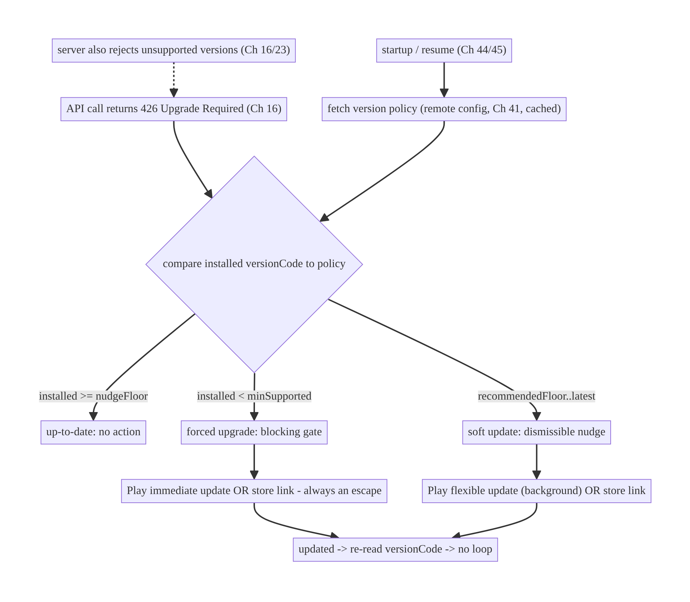
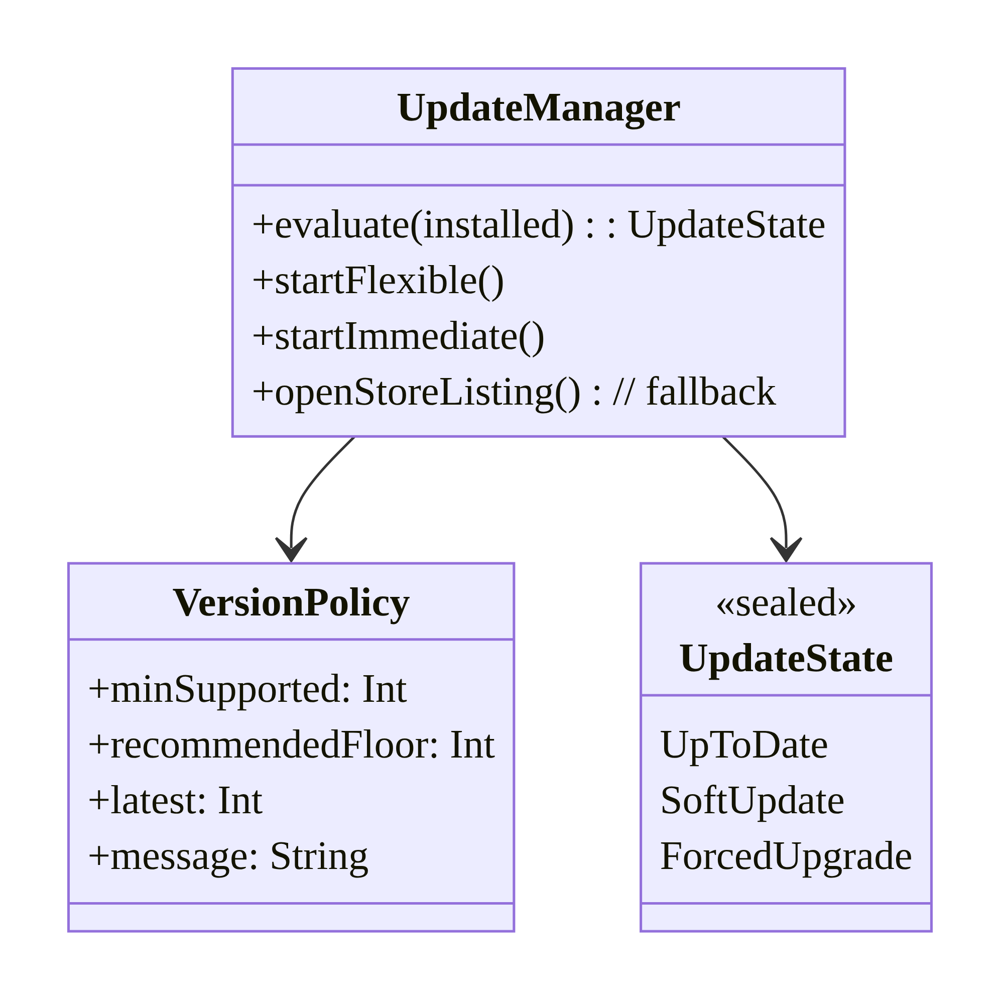
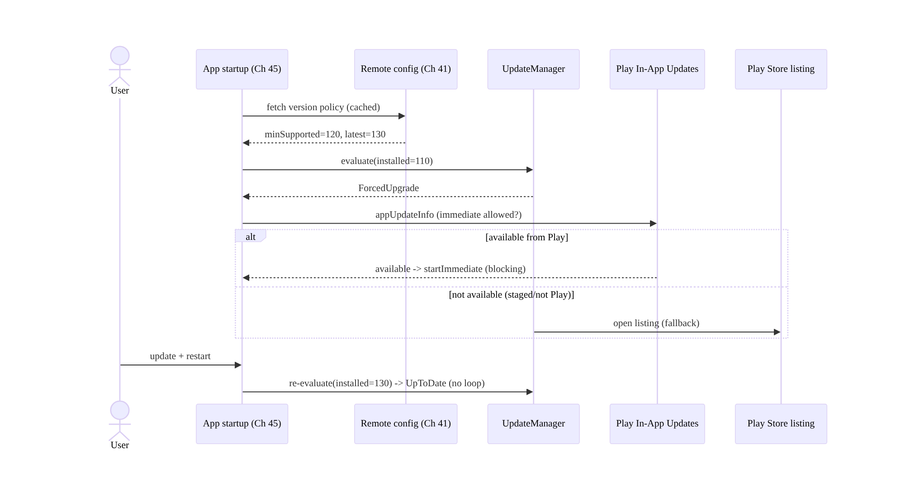
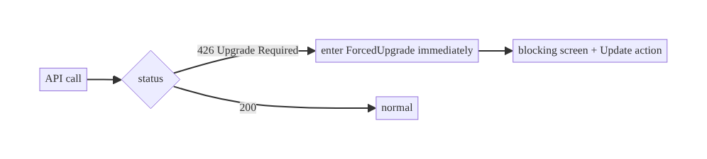
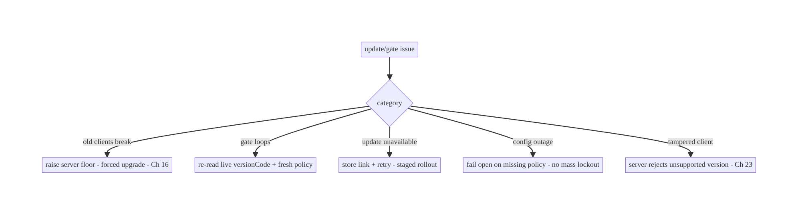

# Chapter 54 — App Update & Forced-Upgrade Flow

> **Part VI — Lifecycle, Background & Platform** · Complexity: **Standard** (≥25 interview questions)
>
> **Prerequisites:** Ch 16 (API schema evolution), Ch 41 (remote config/feature flags),
> Ch 19 (auth), Ch 44/45 (lifecycle/startup), Ch 52 (deep links). Pairs with Ch 26
> (integrity), Ch 28 (privacy).
>
> **Reference surface in StreamCart:** keeping users on a supported app version —
> nudging optional updates in-app, forcing an upgrade when an old client is
> incompatible or insecure, and doing it without locking users out or breaking the
> store-review contract.

---

## 54.1 Problem Definition and Real-World Context

Users don't update apps promptly. Weeks after you ship a release, a long tail of users
run old versions — and some of those versions are **incompatible** (a breaking API change,
Ch 16), **insecure** (a patched vulnerability, Ch 23), or **broken** (a server-side change
the old client can't handle). You need a way to **encourage** updates (soft nudge) and,
when necessary, **require** them (hard gate) — while respecting Play policy and never
stranding a user with a dead app they can't fix.

Concretely, teams hit:

- **No update strategy.** The app silently breaks for old-version users after a backend
  change (Ch 16) with no way to tell them to update — support floods, churn.
- **Forced upgrade done wrong.** A hard gate with no store link, or one that triggers
  for too many versions, or one driven by a hardcoded client constant (can't change
  without *another* release) — the thing you can't fix is a forced-upgrade bug itself.
- **In-App Updates misunderstood.** Google's **In-App Updates API** offers **flexible**
  (background download, user keeps using the app) and **immediate** (full-screen blocking
  update) flows — but these only work for apps installed from **Play**, require handling
  the update lifecycle, and are not a substitute for a **server-driven** minimum-version
  policy.
- **Version policy on the client vs server.** The decision "is this version still
  allowed?" must be **server-driven** (remote config / an endpoint, Ch 41) so you can
  change the floor without shipping a new build — a hardcoded min-version is useless for
  the very users who won't update.
- **Graceful degradation & escape hatches.** A forced upgrade must always give a working
  path (open Play), handle "update not available yet" (staged rollout), the no-network
  case, and never trap the user in a loop.

The architecture: define a **server-driven version policy** (minimum supported + "nudge
above" thresholds, delivered via remote config / an endpoint, Ch 41) checked at
startup/resume and on key API calls (a `426 Upgrade Required`-style signal, Ch 16); map
it to **three states** — up-to-date, **soft update** (dismissible nudge), **forced
upgrade** (blocking gate); drive updates with the **Play In-App Updates API** (flexible
for soft, immediate for forced) with a **fallback to opening the store listing**; handle
the **lifecycle** (download/resume/failure, staged rollout, not-from-Play installs); and
**degrade gracefully** (always an escape to Play, offline tolerance, no loops). This
chapter is about **steering users onto supported versions, forcibly when needed, without
breaking them**.

### Three practical use cases

1. **Soft nudge (StreamCart).** A new version is available with nice-to-have features →
   a dismissible in-app banner + Play flexible update (download in background, install
   when ready). The user can defer.
2. **Forced upgrade.** The server raises the minimum supported version (a breaking API
   change or security fix, Ch 16/23) → old clients get a **blocking** screen with an
   **Update** button (Play immediate update / store link) and cannot proceed until
   updated.
3. **Server signals incompatibility mid-session.** An API returns `426 Upgrade Required`
   → the client surfaces the forced-upgrade gate even without a fresh config fetch.

### Why this is architectural

Update policy is a **server-driven control plane** touching API compatibility (Ch 16),
remote config (Ch 41), security (Ch 23/26), startup/lifecycle (Ch 44/45), and store
policy. The decisions — where the version floor lives (server), soft vs forced, how
updates are delivered (In-App Updates vs store link), and how to never trap a user —
determine whether you can safely evolve the backend and retire old clients.

---

## 54.2 Requirements Engineering

### Functional requirements

| ID | Requirement |
|----|-------------|
| F1 | Determine update state (up-to-date / soft / forced) from a server-driven policy. |
| F2 | Nudge soft updates (dismissible); block on forced upgrade. |
| F3 | Drive the update (Play In-App Updates: flexible/immediate) with a store-link fallback. |
| F4 | Handle a mid-session incompatibility signal (e.g., `426`, Ch 16). |
| F5 | Degrade gracefully (offline, staged rollout, not-from-Play) — never trap the user. |
| F6 | Change the version floor without shipping a new build (remote, Ch 41). |

### Non-functional requirements

| Attribute | Policy |
|-----------|--------|
| **Controllability** | Version floor is server-driven; changeable instantly (Ch 41). |
| **Resilience** | Always an escape to Play; offline tolerant; no loops. |
| **Compliance** | Play policy for forced updates / In-App Updates. |
| **Security** | Forced upgrade can be used for security fixes (Ch 23). |
| **UX** | Soft nudges are respectful (dismiss/snooze); forced is clear + actionable. |

### Scope

- **In scope:** server-driven version policy (min supported + nudge thresholds via remote
  config/endpoint, Ch 41), the 3 update states, soft vs forced gating, Play In-App Updates
  (flexible/immediate) lifecycle, store-link fallback, mid-session `426` handling (Ch 16),
  staged-rollout/not-from-Play/offline handling, no-loop/escape-hatch design,
  startup/resume checks.
- **Out of scope:** API compatibility detail (Ch 16), remote config internals (Ch 41),
  integrity/anti-tamper (Ch 26), security vuln handling (Ch 23), startup optimization
  (Ch 45).

### Assumptions & constraints

- Play-distributed app (In-App Updates requires Play); remote config/endpoint available
  (Ch 41); `versionCode` monotonic; backend can emit `426`/compat signals (Ch 16).
  `minSdk 24`. Some installs aren't from Play (sideload/other stores) → store-link
  fallback needed.

---

## 54.3 System Design Fundamentals

- **The version floor must be server-driven (the core principle).** The decision "is
  version X still supported?" lives on the **server** (remote config, Ch 41, or a
  `/version-policy` endpoint), **not** a client constant. Why: the users you most need to
  force off an old version are exactly the ones who won't take a new build — a hardcoded
  min-version can't reach them. A server-driven floor lets you raise the minimum
  **instantly**, for a security fix or breaking change, without a release.
- **Three update states:**
  - **Up-to-date:** `installedVersion >= nudgeFloor` → nothing.
  - **Soft update (optional):** `recommendedFloor <= installed < latest` → a
    **dismissible** nudge (banner/dialog) + flexible update; user may defer/snooze.
  - **Forced upgrade (required):** `installed < minSupported` → a **blocking** screen;
    the app is unusable until updated (used for incompatibility/security).
  Thresholds (`minSupported`, `recommendedFloor`, `latest`) all come from the
  server-driven policy.
- **Two trigger paths:**
  - **Proactive check** at startup/resume (Ch 44/45): fetch policy (cached, Ch 41),
    compare to `versionCode`, set state.
  - **Reactive signal** mid-session: an API returns **`426 Upgrade Required`** (or a
    compat error, Ch 16) → immediately enter forced state even if the cached policy was
    stale. This catches users whose session predates a floor change.
- **Play In-App Updates API (the delivery mechanism):**
  - **Flexible flow:** downloads the update in the **background** while the user keeps
    using the app; you then prompt to **install** (a restart). Use for **soft** updates.
  - **Immediate flow:** a **full-screen, blocking** Google-provided UI that updates
    before the user can continue. Use for **forced** upgrades.
  - Requires the app to be installed from **Play**; you check availability
    (`AppUpdateManager.appUpdateInfo`), confirm the flow is allowed, start it, and handle
    the result/lifecycle (download progress, failure, user cancel).
- **Store-link fallback.** When In-App Updates isn't available (not from Play, staged
  rollout hasn't reached the device, API error), fall back to **opening the Play Store
  listing** (`market://details?id=...` → `https://play.google.com/...`). The forced gate
  must **always** offer a working action.
- **Staged rollout reality.** A new version may not be downloadable yet for a given
  device (staged rollout / regional). A forced gate must handle "update not available
  right now" gracefully — show the store link, allow retry, and don't claim an update
  exists that the device can't get.
- **Never trap the user.** The forced screen must: always have an **Update** action; not
  loop (don't re-gate immediately after a successful update because of a stale cached
  policy — re-read `versionCode`); tolerate **offline** (explain, allow retry, don't
  crash); and ideally allow limited read-only/offline use if the incompatibility is
  partial (design choice).
- **Security use (Ch 23/26).** A forced upgrade is a **security control**: when a
  vulnerability is patched, raise the floor to retire exploitable clients. (It is not
  itself anti-tamper — a modified client can ignore the gate, so the **server must also
  reject** unsupported versions, Ch 16/23 — the client gate is UX, the server check is
  enforcement.)

Core insight: **keep the version floor on the server (remote config/endpoint, Ch 41) so
you can retire old clients instantly; derive three states (up-to-date / soft dismissible
nudge / forced blocking gate) from it, checked proactively at startup/resume and
reactively on a `426`/compat signal (Ch 16); deliver updates via Play In-App Updates
(flexible for soft, immediate for forced) with an always-available store-link fallback;
handle staged rollout, offline, and not-from-Play so the user is never trapped in a loop;
and enforce the floor on the server too, since the client gate is UX, not security.**

---

## 54.4 High-Level Architecture



**Components & ownership**

- **Server policy** (remote config/endpoint, Ch 41) owns the floor; **server** also
  enforces it (`426`).
- **`UpdateManager`** fetches policy, computes state, and drives the Play flow /
  store-link fallback.
- **Gate UI** renders soft nudge or forced screen.
- **No-loop/escape** logic ensures the user always has a working path.

**Direction:** server policy + `426` → state → soft/forced → Play update or store link →
updated (re-checked, no loop).

---

## 54.5 Detailed Component Design



| Component | Responsibility |
|-----------|----------------|
| `VersionPolicy` | server-driven thresholds + message (Ch 41) |
| `UpdateManager` | evaluate state; start Play flow; store-link fallback; no-loop |
| `UpdateState` | up-to-date / soft / forced |
| Gate UI | dismissible nudge vs blocking screen |

---

## 54.6 End-to-End Data Flow

### Startup check → forced upgrade



### Reactive 426 mid-session



---

## 54.7 Complete Kotlin Implementation

Package: `com.streamcart.appupdate`.

### 54.7.1 Version policy + state evaluation (server-driven)

```kotlin
data class VersionPolicy(                     // from remote config / endpoint (Ch 41)
    val minSupported: Int, val recommendedFloor: Int, val latest: Int, val message: String,
)

sealed interface UpdateState {
    data object UpToDate : UpdateState
    data class SoftUpdate(val policy: VersionPolicy) : UpdateState
    data class ForcedUpgrade(val policy: VersionPolicy) : UpdateState
}

@Singleton
class UpdatePolicyEvaluator @Inject constructor(private val buildInfo: BuildInfo) {
    fun evaluate(policy: VersionPolicy): UpdateState = when {
        buildInfo.versionCode < policy.minSupported -> UpdateState.ForcedUpgrade(policy)   // blocking
        buildInfo.versionCode < policy.recommendedFloor -> UpdateState.SoftUpdate(policy)  // dismissible
        else -> UpdateState.UpToDate
    }
}
```

### 54.7.2 UpdateManager: Play In-App Updates + store fallback

```kotlin
@Singleton
class UpdateManager @Inject constructor(
    @ApplicationContext private val ctx: Context,
    private val appUpdateManager: AppUpdateManager,      // Play core
    private val evaluator: UpdatePolicyEvaluator,
    private val configRepo: RemoteConfigRepository,      // Ch 41
) {
    suspend fun currentState(): UpdateState =
        evaluator.evaluate(configRepo.versionPolicy())   // cached; refreshed in background

    /** Soft: flexible (background download, install when ready). */
    fun startFlexible(activity: Activity, info: AppUpdateInfo, launcher: ActivityResultLauncher<IntentSenderRequest>) {
        if (info.isUpdateTypeAllowed(AppUpdateType.FLEXIBLE))
            appUpdateManager.startUpdateFlowForResult(info, launcher,
                AppUpdateOptions.newBuilder(AppUpdateType.FLEXIBLE).build())
        else openStoreListing()                          // fallback
    }

    /** Forced: immediate (full-screen blocking Play UI). */
    fun startImmediate(activity: Activity, info: AppUpdateInfo, launcher: ActivityResultLauncher<IntentSenderRequest>) {
        if (info.isUpdateTypeAllowed(AppUpdateType.IMMEDIATE))
            appUpdateManager.startUpdateFlowForResult(info, launcher,
                AppUpdateOptions.newBuilder(AppUpdateType.IMMEDIATE).build())
        else openStoreListing()                          // staged rollout / not from Play -> always an escape
    }

    fun openStoreListing() {
        val market = Intent(Intent.ACTION_VIEW, Uri.parse("market://details?id=${ctx.packageName}"))
        val web = Intent(Intent.ACTION_VIEW, Uri.parse("https://play.google.com/store/apps/details?id=${ctx.packageName}"))
        runCatching { ctx.startActivity(market.addFlags(Intent.FLAG_ACTIVITY_NEW_TASK)) }
            .onFailure { ctx.startActivity(web.addFlags(Intent.FLAG_ACTIVITY_NEW_TASK)) }
    }
}
```

### 54.7.3 Reactive 426 interceptor (Ch 16/2) → forced state

```kotlin
class UpgradeRequiredInterceptor @Inject constructor(
    private val updateState: MutableStateFlow<UpdateState>,   // app-global (Ch 39)
    private val configRepo: RemoteConfigRepository,
) : Interceptor {
    override fun intercept(chain: Interceptor.Chain): Response {
        val response = chain.proceed(chain.request())
        if (response.code == 426) {                            // Upgrade Required (server enforcement, Ch 23)
            updateState.value = UpdateState.ForcedUpgrade(runBlocking { configRepo.versionPolicy() })
        }
        return response
    }
}
```

### 54.7.4 Gate UI: forced (blocking) vs soft (dismissible), no loop

```kotlin
@Composable
fun UpdateGate(content: @Composable () -> Unit, vm: UpdateViewModel = hiltViewModel()) {
    val state by vm.state.collectAsStateWithLifecycle()
    when (val s = state) {
        is UpdateState.ForcedUpgrade -> ForcedUpgradeScreen(            // BLOCKS the whole app
            message = s.policy.message,
            onUpdate = { vm.startImmediateOrStore() },                  // always a working action
            // No dismiss. Offline -> show retry, never crash. After update, re-eval -> no loop.
        )
        is UpdateState.SoftUpdate -> {
            content()                                                   // app usable
            SoftUpdateBanner(onUpdate = { vm.startFlexibleOrStore() }, onDismiss = { vm.snooze() })
        }
        UpdateState.UpToDate -> content()
    }
}
```

### 54.7.5 Resume handling (install downloaded flexible update; avoid stuck state)

```kotlin
// On resume, if a flexible update finished downloading, prompt to complete; if an immediate
// update was interrupted, resume it (Play requires handling this).
override fun onResume() {
    super.onResume()
    appUpdateManager.appUpdateInfo.addOnSuccessListener { info ->
        if (info.installStatus() == InstallStatus.DOWNLOADED) promptInstall()       // flexible finished
        if (info.updateAvailability() == UpdateAvailability.DEVELOPER_TRIGGERED_UPDATE_IN_PROGRESS)
            updateManager.startImmediate(this, info, launcher)                       // resume interrupted immediate
    }
}
```

### 54.7.6 Module structure

```
:core:appupdate  VersionPolicy, UpdatePolicyEvaluator, UpdateManager, UpgradeRequiredInterceptor, UpdateGate
:core:config     RemoteConfigRepository (Ch 41)  // version policy source
# 426 handling wired into the OkHttp stack (Ch 1/16). Server also enforces floor (Ch 23).
```

---

## 54.8 Concurrency and Race Conditions

| Scenario | Risk | Handling |
|----------|------|----------|
| Stale cached policy re-gates after update | infinite loop | re-read live `versionCode`; evaluate against fresh policy on resume |
| 426 during many parallel calls | repeated gate triggers | set forced state once (idempotent `MutableStateFlow`) |
| Flexible download completes in background | stuck "downloaded" | check `installStatus` on resume → prompt install |
| Immediate update interrupted | stuck mid-update | resume `IN_PROGRESS` on resume (Play requirement) |
| Config fetch fails at startup | wrong state | use last cached policy (Ch 41); fail open (don't force on no data) |
| Offline on forced screen | trapped/crash | show retry + store link; tolerate offline |

- **No-loop is the subtle bug:** after a successful update the app restarts with a new
  `versionCode`; if you evaluate against a **stale cached policy** or don't re-read the
  version, you can re-gate immediately. Always compare the **live** `versionCode` to a
  freshly evaluated policy on resume.
- **Reactive 426 must be idempotent:** many in-flight requests can each see `426`; set
  the forced state on a single app-global `StateFlow` (Ch 39) so the gate appears once.
- **Fail open on missing policy:** if the policy can't be fetched (offline, backend
  down) and there's no cached value, **don't force-gate** on absence of data — that would
  trap users during a config outage; the server still enforces via `426` when it matters.

---

## 54.9 Failure Scenarios and Recovery

| Failure | Detection | Response | Outcome |
|---------|-----------|----------|---------|
| Old client breaks after backend change | support/`426` | server-driven forced upgrade (Ch 16) | steered to update |
| Forced gate loops after update | user stuck | re-read live versionCode; fresh policy | no loop |
| Update not downloadable (staged) | Play API | store-link fallback + retry | recoverable |
| Not installed from Play | In-App API fails | store-link fallback | works |
| Offline on forced screen | no network | retry + explain; never crash | tolerated |
| Config outage force-gates everyone | spike | fail open on missing policy | no mass lockout |
| Modified client ignores gate | server logs | server rejects unsupported version (Ch 23) | enforced |



> **Two failure modes to fear most:** trapping users (loops, offline crashes, config-
> outage mass-gating) and failing to actually enforce (client gate ignored by a modified
> app). Fix the first with always-an-escape + fail-open + no-loop; fix the second by
> enforcing the floor on the **server** — the client gate is UX, not security.

---

## 54.10 Scaling the Implementation

- **Level 1.** Server-driven policy (remote config, Ch 41); 3 states; store-link
  update.
- **Level 2.** Play In-App Updates (flexible soft, immediate forced); resume handling;
  no-loop.
- **Level 3 — production.** Reactive `426` (Ch 16); staged-rollout/offline/not-from-Play
  fallbacks; fail-open; server-side enforcement.
- **Level 4 — large.** Per-platform/region policies; phased floors (nudge → force over
  time); A/B of nudge copy; update-adoption analytics; security-driven emergency floors.
- **Level 5 — enterprise.** Version-support lifecycle governance (deprecation calendar
  tied to Ch 16 API versions), automated floor bumps on security fixes, adoption-curve
  dashboards, multi-store support (not just Play).

**Avoid overengineering:** most apps need a server-driven floor + soft/forced states +
Play In-App Updates + store fallback. Don't hardcode min-versions, and don't build a
custom updater when In-App Updates + store link suffice.

---

## 54.11 Alternative Approaches and Trade-offs

| Dimension | Option A | Option B | When |
|-----------|----------|----------|------|
| Version floor | Server-driven (remote config/endpoint) | client constant | Server-driven always (reach non-updaters) |
| Update delivery | Play In-App Updates | store link only | In-App Updates (smooth) + store-link fallback |
| Forced flow | Immediate (Play blocking) | custom blocking screen + store link | Immediate where available; custom+link fallback |
| Soft flow | Flexible (background) | just a banner → store | Flexible (seamless); banner for non-Play |
| Enforcement | Server rejects old versions (426) | client gate only | Server (client gate is UX, bypassable) |
| Missing policy | Fail open | fail closed (force) | Fail open (avoid outage lockout) |

**Server-driven floor vs client constant:** a hardcoded `MIN_VERSION` in the app can only
be changed by shipping a new app — but the users who need to be forced off an old version
are precisely those who won't install the new one, so the constant never reaches them. A
**server-driven floor** (remote config/endpoint, Ch 41) is changeable instantly and
reaches every running client. Always server-drive the policy.

**Play In-App Updates vs store link:** In-App Updates give a seamless, Google-managed
flow (background download for flexible, blocking UI for immediate) and higher update
rates — but only for **Play installs** and subject to staged-rollout availability. A
plain **store link** always works as a fallback (including non-Play installs). Use In-App
Updates as the primary path and the store link as the always-available escape; never ship
a forced gate that can *only* use In-App Updates.

**Client gate vs server enforcement:** the client gate is a **UX** mechanism — a modified
or old client can ignore it. Real enforcement (for breaking changes/security) must be on
the **server** (reject unsupported versions with `426`, Ch 16/23). Do both: the gate
gives users a good experience; the server guarantees incompatible/insecure clients can't
transact.

---

## 54.12 Security Considerations

- **Forced upgrade as a security control (Ch 23):** when a client vulnerability is
  patched, raise the server floor to retire exploitable versions — but **enforce on the
  server** (reject old versions), since a tampered client ignores the gate.
- **Don't leak why in the message:** the forced-upgrade message shown to users shouldn't
  detail the vulnerability (Ch 28) — "please update to continue" suffices.
- **Validate the policy source:** the version policy comes over authed/trusted config
  (Ch 41/19) — a MITM that could force a downgrade or spoof a policy is a concern; fetch
  over TLS/pinning (Ch 23) and don't act on unauthenticated policy.
- **Store-link integrity:** open the official Play listing by package name; don't follow
  an arbitrary URL from config (open-redirect, Ch 52).
- **No bypass via deep links (Ch 52):** a deep link must not route *past* a forced gate;
  evaluate the gate before honoring deep-link navigation.
- Client vs backend: the **backend** enforces supported versions and emits `426`; the
  **client** provides the UX gate and update flow. Enforcement is server-side;
  convenience is client-side.

---

## 54.13 Performance and Resource Optimization

- **Cheap startup check:** use the **cached** policy (Ch 41) at startup (don't block the
  first frame on a network fetch, Ch 45); refresh in the background.
- **Flexible update downloads in the background** — doesn't interrupt the user; install on
  a natural restart.
- **Don't re-fetch policy excessively:** remote config caching (Ch 41) + background
  refresh; evaluate on resume, not continuously.
- **Lightweight gate check** (integer compare) — negligible cost.
- **Avoid over-gating:** too-aggressive soft nudges annoy; rate-limit/snooze.
- **Profiling:** update-adoption rate per version, forced-gate display rate, store-link
  vs In-App-Update conversion, time-on-old-version distribution.

---

## 54.14 Testing Strategy

Policy evaluation is pure logic (easy unit tests); Play flow via its test tracks / fakes.

```kotlin
class UpdatePolicyEvaluatorTest {
    private fun eval(installed: Int, min: Int, rec: Int, latest: Int) =
        UpdatePolicyEvaluator(BuildInfo(versionCode = installed)).evaluate(VersionPolicy(min, rec, latest, ""))
    @Test fun `forced when below minSupported`() =
        assertTrue(eval(110, min = 120, rec = 125, latest = 130) is UpdateState.ForcedUpgrade)
    @Test fun `soft when between recommended and latest`() =
        assertTrue(eval(122, min = 120, rec = 125, latest = 130) is UpdateState.SoftUpdate)
    @Test fun `up to date when at or above recommended`() =
        assertEquals(UpdateState.UpToDate, eval(130, min = 120, rec = 125, latest = 130))
    @Test fun `no loop - fresh version evaluates up to date`() =
        assertEquals(UpdateState.UpToDate, eval(130, 120, 125, 130))   // post-update
}

class UpgradeInterceptorTest {
    @Test fun `426 sets forced state once`() { /* two parallel 426 -> single ForcedUpgrade */ }
}
// Play In-App Updates: use FakeAppUpdateManager (play core testing) to simulate
// available/immediate/flexible, download complete, staged-unavailable -> assert store fallback.
```

What to test: evaluator for all boundaries (forced/soft/up-to-date + no-loop post-update);
`426` → forced (idempotent); flexible/immediate start + store fallback when not allowed;
resume install-complete + resume-interrupted; fail-open on missing policy; offline on
forced screen (retry, no crash). `FakeAppUpdateManager` for Play flows.

---

## 54.15 Production Observability

- **Metrics:** version-adoption distribution; forced-gate display + completion rate;
  soft-nudge show/accept/snooze; store-link vs In-App-Update conversion; `426` rate (old
  clients hitting the server); update-failure/cancel rate; time-to-adopt after a floor
  bump.
- **Logs:** `update{state, installed, min, latest, flow, outcome}` (no PII, Ch 28).
- **Debugging:** users stuck → loop (stale policy) / offline / staged-unavailable;
  low adoption → nudge ineffective / In-App Updates unavailable; mass lockout → failed
  fail-open; old clients still transacting → server not enforcing `426`.
- **Alerting:** forced-gate spike after a floor change (expected) vs unexpected (config
  bug); `426` from versions you didn't intend to gate; adoption stall.
- **Dashboards:** version adoption curve per release; floor-bump impact.

---

## 54.16 System Design Interview Preparation

> ≥25 questions.

**Fundamentals**

1. *Why an update strategy?* Old-version users break/are insecure; you must steer/force
   updates.
2. *Where does the version floor live?* On the **server** (remote config/endpoint,
   Ch 41) — never a client constant.
3. *Why not a client constant?* Non-updaters never get the build that changes it.
4. *Three states?* Up-to-date / soft (dismissible) / forced (blocking).
5. *Who enforces incompatibility?* The server (`426`, Ch 16); the client gate is UX.

**Triggers**

6. *Proactive check?* At startup/resume, compare `versionCode` to cached policy.
7. *Reactive signal?* `426 Upgrade Required` mid-session → forced.
8. *Why reactive matters?* Catches sessions predating a floor change.

**Delivery**

9. *Play In-App Updates flows?* Flexible (background) and immediate (blocking).
10. *Flexible for?* Soft updates.
11. *Immediate for?* Forced upgrades.
12. *Requirement?* Installed from Play.
13. *Fallback?* Open the Play Store listing (always available).

**Resilience**

14. *No-loop?* Re-read live `versionCode` + fresh policy after update.
15. *Staged rollout unavailable?* Store link + retry; don't claim unavailable update.
16. *Offline on forced screen?* Retry + explain; never crash/trap.
17. *Config outage?* Fail open (don't mass-gate on missing policy).
18. *Interrupted immediate update?* Resume on next launch (Play requirement).

**Security**

19. *Forced upgrade for security?* Yes — retire vulnerable clients; enforce server-side.
20. *Message content?* Don't leak the vuln (Ch 28).
21. *Policy source trust?* Authed/TLS-pinned config (Ch 23); don't act on spoofable
    policy.
22. *Deep-link bypass?* Evaluate gate before honoring deep links (Ch 52).

**Testing/Production**

23. *Test policy?* Pure unit tests at all boundaries + no-loop.
24. *Test Play flows?* `FakeAppUpdateManager`.
25. *Users stuck?* Loop / offline / staged-unavailable.
26. *Old clients still transacting?* Server not enforcing `426`.

### Design-change challenges
1. **A backend change breaks clients below v120.** Raise server floor → forced upgrade
   (Ch 16); server rejects < v120 with `426`.
2. **Forced gate loops after users update.** Re-read live `versionCode` + fresh policy.
3. **Some users aren't on Play.** Store-link fallback.
4. **A security fix must retire old clients fast.** Emergency server floor bump + server
   enforcement.
5. **A config outage locked everyone out.** Fail open on missing policy.

### Mock walkthrough (abridged)
Clarify (soft vs forced, security-driven?, Play-only?) → server-driven policy (Ch 41) +
server enforcement (`426`, Ch 16) → 3 states → proactive (startup/resume) + reactive
(`426`) triggers → Play In-App Updates (flexible/immediate) + store-link fallback →
resilience (no-loop, offline, staged, fail-open) → security (server enforcement, message,
policy trust) → observability (adoption, `426`).

---

## 54.17 Practical Exercises

1. **Beginner.** Implement `UpdatePolicyEvaluator` from a server-driven policy and render
   up-to-date/soft/forced states. *Eval:* correct boundaries; forced blocks.
2. **Intermediate.** Add Play In-App Updates (flexible for soft, immediate for forced)
   with a Play Store-link fallback. *Eval:* flows start; fallback when unavailable.
3. **Advanced.** Add a `426` interceptor that forces the gate mid-session (idempotent) and
   no-loop logic after update. *Eval:* `426` → forced once; no loop post-update.
4. **Production debugging.** Fix a forced-gate loop (stale cached policy) and an offline
   crash on the forced screen. *Eval:* no loop; offline tolerated.
5. **System design challenge.** Add fail-open on config outage and server-side version
   enforcement; build an adoption-curve dashboard. *Eval:* no mass lockout; server rejects
   old versions; adoption visible.

*(Solutions withheld unless requested.)*

---

## 54.18 Chapter Summary & Reference Sheet

**Key decisions:** keep the **version floor server-driven** (remote config/endpoint,
Ch 41) so you can retire old clients **instantly** (a client constant never reaches
non-updaters); derive **three states** — up-to-date / **soft** (dismissible nudge) /
**forced** (blocking gate) — checked **proactively** at startup/resume and **reactively**
on a **`426 Upgrade Required`** signal (Ch 16); deliver updates with **Play In-App
Updates** (**flexible** for soft background downloads, **immediate** for forced blocking)
with an **always-available Play Store-link fallback** (for staged-rollout/not-from-Play);
make it **resilient** — **no loop** (re-read live `versionCode` + fresh policy after
update), **offline-tolerant** (retry, never crash/trap), and **fail open** on missing
policy (no outage lockout); and **enforce the floor on the server** (`426`, Ch 16/23)
because the **client gate is UX, not security** (a tampered client ignores it). Use forced
upgrades as a **security control** to retire vulnerable clients.

**Concepts:** server-driven version policy, three update states, proactive/reactive
triggers, `426 Upgrade Required`, Play In-App Updates (flexible/immediate), store-link
fallback, staged rollout, no-loop, fail-open, server-side enforcement.

**Common mistakes:** hardcoded min-version (can't reach non-updaters); client-only
enforcement (bypassable); forced gate with no escape (In-App-Updates-only); loop after
update (stale policy); offline crash on gate; mass lockout on config outage (fail-closed);
leaking the vuln in the message; deep-link bypass.

**Checklist:**

- [ ] server-driven policy (Ch 41)
- [ ] 3 states (up-to-date/soft/forced)
- [ ] startup/resume + `426` triggers
- [ ] Play In-App Updates (flexible/immediate)
- [ ] store-link fallback (always an escape)
- [ ] no-loop (live versionCode + fresh policy)
- [ ] offline tolerant
- [ ] fail open on missing policy
- [ ] server enforces floor (`426`, Ch 16/23)
- [ ] non-leaky message
- [ ] no deep-link bypass.

**Key APIs:** `AppUpdateManager`/`appUpdateInfo`/`startUpdateFlowForResult`,
`AppUpdateType.FLEXIBLE`/`IMMEDIATE`, `AppUpdateOptions`, `InstallStatus`/
`UpdateAvailability`, `FakeAppUpdateManager` (test), `market://details?id=` /
`https://play.google.com/store/apps/details?id=`, OkHttp `Interceptor` (426, Ch 1/16),
remote config (Ch 41).

**References:**
- In-App Updates: https://developer.android.com/guide/playcore/in-app-updates
- Support in-app updates (Kotlin): https://developer.android.com/guide/playcore/in-app-updates/kotlin-java
- Test in-app updates: https://developer.android.com/guide/playcore/in-app-updates/test
- (composes) Ch 16 API Schema Evolution, Ch 41 Remote Config, Ch 23 Security, Ch 45 Startup, Ch 52 Deep Links

### Chapter review (Phase 4)
- **Completeness:** all 18 sections; architecture/class/sequence/flow/failure diagrams;
  evaluator + UpdateManager (flexible/immediate/store) + 426 interceptor + gate UI +
  resume code; concurrency (no-loop, idempotent 426, fail-open); failure (trap vs
  enforcement); 5 levels; server-floor/In-App-Updates/enforcement trade-offs; security
  (server enforcement, message, policy trust); perf (cached startup check); evaluator +
  FakeAppUpdateManager tests; observability (adoption, 426); 26 Q&A + 5 challenges. ✅
- **Expand later:** API evolution (Ch 16), remote config (Ch 41), security (Ch 23),
  integrity (Ch 26).
- **Interview coverage:** exceeds ≥25 bar.
