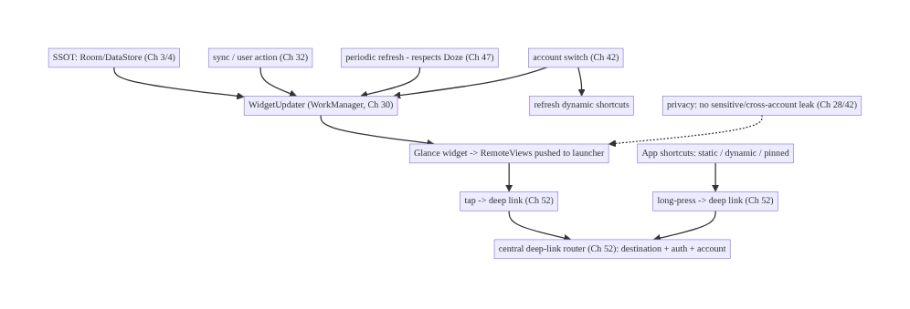
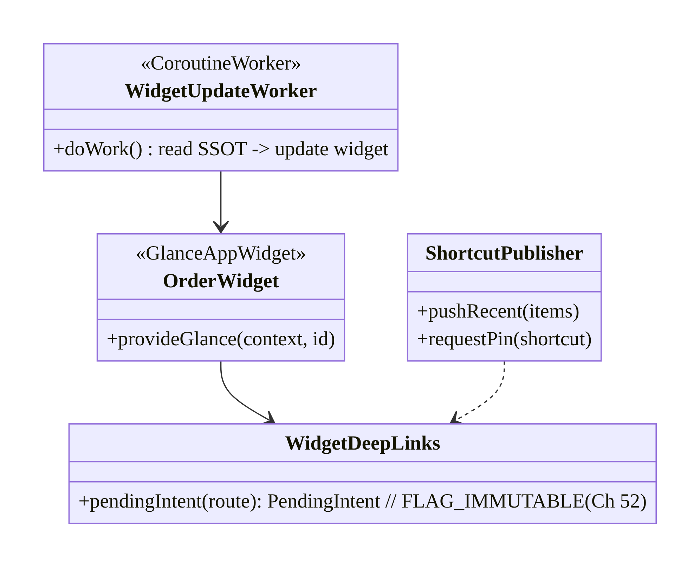
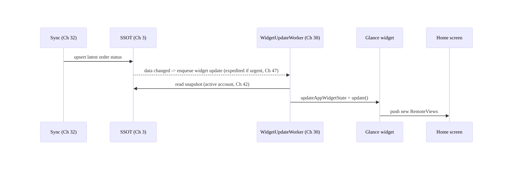
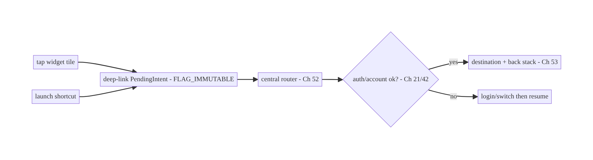
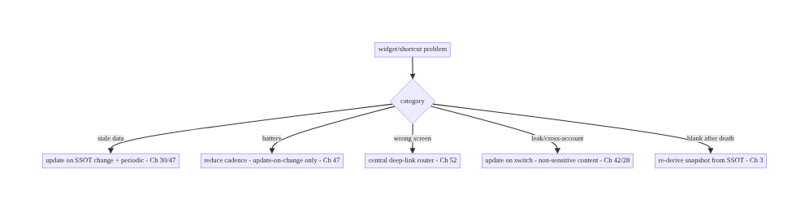

# Chapter 55 — Widgets & App Shortcuts

> **Part VI — Lifecycle, Background & Platform** · Complexity: **Standard** (≥25 interview questions)
>
> **Prerequisites:** Ch 30 (WorkManager), Ch 3 (SSOT/Room), Ch 32 (sync), Ch 52 (deep
> links), Ch 47 (background limits), Ch 44 (lifecycle). Pairs with Ch 50
> (notifications), Ch 42 (multi-account).
>
> **Reference surface in StreamCart:** surfaces *outside* the app — home-screen
> **widgets** (order status, cart total, continue-watching) built with Glance, and
> **app shortcuts** (static/dynamic/pinned long-press actions like "Search", "My
> Orders", "Resume last show") that deep-link into the app.
>
> **Note:** this chapter completes **Part VI — Lifecycle, Background & Platform (Ch 44–55)**.

---

## 55.1 Problem Definition and Real-World Context

Not everything happens inside your Activity. The **home screen** and **launcher** are
app surfaces too: **widgets** show glanceable, periodically-updated content on the home
screen, and **app shortcuts** give long-press quick actions on the launcher icon. Done
well, they drive re-engagement and fast task access; done poorly, they show stale/wrong
data, drain battery with over-frequent updates, leak content, or crash on the restricted
execution model these surfaces run under.

Concretely, teams hit:

- **The widget execution model is restrictive.** A widget runs in the **launcher's
  process** via `RemoteViews` — you **cannot** run arbitrary UI code or hold a long-lived
  process; updates are **pushed** to it, subject to background limits (Ch 47). Treating a
  widget like an in-app screen fails. **Glance** (Compose-style widget API) still compiles
  down to `RemoteViews` with these constraints.
- **Stale or wrong data.** Widgets must reflect the **SSOT** (Ch 3) and update on data
  change / periodically (WorkManager, Ch 30) — not hold their own copy. Over-frequent
  updates waste battery and hit update-rate limits; under-updating shows stale info.
- **App shortcut types confused.** **Static** (manifest, fixed), **dynamic**
  (runtime-pushed, e.g., recent items), and **pinned** (user places on home screen) have
  different lifecycles and limits (typically ~4–5 visible). Using the wrong type, or not
  updating dynamic shortcuts, gives stale/empty menus.
- **Deep-link integration.** Both widgets and shortcuts must **deep-link** (Ch 52) into
  the right screen with the right back stack, auth gating, and account (Ch 42) — they're
  entry points like notifications (Ch 50).
- **Multi-account & privacy.** A widget on a shared/home screen can **leak** another
  account's or sensitive data; account switching (Ch 42) must update widgets; sensitive
  content needs care on an always-visible surface.
- **Lifecycle & updates under limits.** Scheduling widget refresh respecting Doze/App
  Standby (Ch 47), handling the widget being added/removed, and surviving process death.

The architecture: build widgets with **Glance** backed by the **SSOT** (Ch 3), updated
by **WorkManager** (periodic + on-data-change, respecting Ch 47) and rendered as
**`RemoteViews`** under the restricted model; define **app shortcuts** (static for fixed
actions, **dynamic** for contextual/recent, pinned on user request) that **deep-link**
(Ch 52) into the app; integrate **deep links** for both surfaces (right destination,
back stack, auth, account); and handle **multi-account/privacy** (update on switch, don't
leak) and **lifecycle** (add/remove, update under background limits). This chapter is
about **first-class app surfaces beyond the Activity, built within their constraints**.

### Three practical use cases

1. **Order-status widget (StreamCart).** A home-screen widget shows the latest order's
   status from the SSOT (Ch 3), refreshed by WorkManager on sync (Ch 32) and
   periodically; tapping deep-links to the order (Ch 52).
2. **Continue-watching widget / shortcut.** A widget tile + a dynamic shortcut "Resume
   last show" that deep-links into the player at the saved position (Ch 58/59).
3. **Dynamic shortcuts for recent searches.** Long-pressing the icon shows recent
   searches/categories (dynamic shortcuts), updated as the user browses, each deep-linking
   to results.

### Why this is architectural

Widgets/shortcuts are **out-of-process entry points** bound to the SSOT (Ch 3), background
scheduling (Ch 30/47), deep linking (Ch 52), and multi-account/privacy (Ch 42/28). The
decisions — SSOT-backed updates, update cadence under limits, shortcut types, deep-link
integration, leak prevention — determine whether these surfaces are fresh, efficient,
safe, and correct.

---

## 55.2 Requirements Engineering

### Functional requirements

| ID | Requirement |
|----|-------------|
| F1 | Render glanceable widget content from the SSOT (Ch 3). |
| F2 | Update widgets on data change + periodically, respecting background limits (Ch 47). |
| F3 | Provide app shortcuts (static/dynamic/pinned) that deep-link into the app. |
| F4 | Deep-link widget/shortcut taps to the right destination + back stack + auth (Ch 52). |
| F5 | Handle multi-account (update on switch) and privacy (no leak) (Ch 42/28). |
| F6 | Handle widget/shortcut lifecycle (add/remove/limits) and process death. |

### Non-functional requirements

| Attribute | Policy |
|-----------|--------|
| **Freshness** | Reflects SSOT; timely updates without staleness. |
| **Battery** | Update cadence respects Doze/App Standby (Ch 47); no over-refresh. |
| **Correctness** | Right data, right deep-link; works under the RemoteViews model. |
| **Privacy** | No sensitive/cross-account leak on an always-visible surface. |
| **Resilience** | Survives process death; handles add/remove gracefully. |

### Scope

- **In scope:** widgets (Glance + `RemoteViews` model, `AppWidgetProvider`), SSOT-backed
  content, WorkManager-driven updates (periodic + on-change) under Ch 47, app shortcuts
  (static/dynamic/pinned, limits), deep-link integration (Ch 52), multi-account/privacy
  (Ch 42/28), lifecycle (add/remove/update/process death).
- **Out of scope:** deep-link routing/security detail (Ch 52), WorkManager internals
  (Ch 30), Doze detail (Ch 47), SSOT internals (Ch 3), notifications (Ch 50), Compose UI
  (Ch 6 — Glance is similar but separate).

### Assumptions & constraints

- Jetpack **Glance** for widgets (compiles to `RemoteViews`), `ShortcutManager`/
  `ShortcutManagerCompat` for shortcuts, WorkManager, Room, Hilt. `minSdk 24` (dynamic/
  pinned shortcuts 25+; Glance has its own min). Widgets run out-of-process under
  background limits; shortcut counts are capped.

---

## 55.3 System Design Fundamentals

- **Widgets run out-of-process via `RemoteViews` (the key constraint).** A home-screen
  widget is hosted in the **launcher's** process; you don't get a live Activity. You
  build a limited view tree (`RemoteViews`) and **push** updates to it via
  `AppWidgetManager`. You **cannot** run arbitrary code continuously, hold state, or use
  normal Compose. **Glance** gives a Compose-like authoring API but **compiles to
  `RemoteViews`**, so the same limits apply (limited components, no arbitrary logic in the
  view, updates pushed from your process).
- **Widget data must come from the SSOT (Ch 3).** The widget renders a **snapshot** of
  app state. Keep the source of truth in Room/DataStore (Ch 3/4); when it changes (sync,
  Ch 32, or user action), **trigger a widget update** that reads the SSOT and pushes new
  `RemoteViews`. The widget never holds its own authoritative copy.
- **Updates are scheduled, under background limits (Ch 47):**
  - **Periodic:** `android:updatePeriodMillis` has a **30-minute minimum** and is
    unreliable under Doze — for anything finer/more reliable use **WorkManager** (Ch 30)
    with constraints (Ch 47) to refresh.
  - **On-change:** when the SSOT changes, enqueue a (possibly expedited) WorkManager
    update so the widget reflects it promptly.
  - **Respect limits:** don't over-update (battery + rate limits); batch; update only
    when data actually changed.
  - Glance offers `GlanceAppWidget.update(context, id)` and state via
    `updateAppWidgetState` to push new content.
- **App shortcuts (three types):**
  - **Static:** declared in XML (manifest `<meta-data>`), **fixed** at build time (e.g.,
    "Search", "My Orders"). Always present.
  - **Dynamic:** pushed at **runtime** via `ShortcutManagerCompat.pushDynamicShortcut`
    (e.g., recent items, continue-watching). Update as context changes; **capped**
    (typically ~4–5 visible including static).
  - **Pinned:** the **user** places a shortcut on the home screen
    (`requestPinShortcut`); it persists until removed. Request only on user action.
  - All are long-press launcher actions that fire an **Intent** (a deep link, Ch 52).
- **Deep-link integration (Ch 52).** Widget taps and shortcut launches carry an
  **Intent/deep link** into the app → route through the **central router** (Ch 52) to the
  right destination with a synthesized back stack, auth gating (Ch 21), and account check
  (Ch 42). Treat the carried data as untrusted (Ch 52) and build `PendingIntent`s with
  `FLAG_IMMUTABLE`.
- **Multi-account & privacy (Ch 42/28).** A widget sits on a potentially shared surface:
  - **No sensitive leak:** avoid showing sensitive content (balances, private messages)
    on an always-visible widget unless the user opts in; consider a tap-to-reveal.
  - **Account correctness:** on account switch (Ch 42), **update/clear** widgets so they
    reflect the active account; don't show account A's order on account B.
- **Lifecycle (Ch 44/8):** handle widget **added** (`onEnabled`/`onUpdate`), **removed**
  (`onDisabled`/`onDeleted` — cancel its update work), **resize/reconfigure**, and
  **process death** (widget state is re-derived from the SSOT on next update, so nothing
  to restore — this is a benefit of SSOT-backing). Shortcuts persist across process death
  (managed by the system).

Core insight: **widgets run out-of-process via `RemoteViews` (Glance compiles to them),
so render a glanceable snapshot of the SSOT (Ch 3) and push updates via WorkManager —
periodic + on-change, respecting Doze/App Standby (Ch 47) and never over-refreshing;
provide app shortcuts (static for fixed actions, dynamic for contextual/recent within the
~4–5 cap, pinned on user request) that, like widgets, deep-link (Ch 52) into the right
destination with auth and account checks; and treat these as shared, always-visible
surfaces — update them on account switch and keep sensitive data off them (Ch 42/28).**

---

## 55.4 High-Level Architecture



**Components & ownership**

- **SSOT** is the single data source; **WidgetUpdater** (WorkManager) pushes snapshots to
  Glance/`RemoteViews`.
- **Shortcuts** (static/dynamic/pinned) are launcher entry points.
- Both **deep-link** through the central router (Ch 52) with auth/account checks.
- **Account/privacy** logic keeps surfaces correct and safe.

**Direction:** SSOT + triggers → WorkManager update → widget snapshot; widgets/shortcuts →
deep link → router → destination.

---

## 55.5 Detailed Component Design



| Component | Responsibility |
|-----------|----------------|
| `OrderWidget` (Glance) | render SSOT snapshot as `RemoteViews` |
| `WidgetUpdateWorker` | read SSOT, push widget update (periodic + on-change, Ch 30/47) |
| `ShortcutPublisher` | manage dynamic/pinned shortcuts (cap-aware) |
| `WidgetDeepLinks` | build `FLAG_IMMUTABLE` deep-link PendingIntents (Ch 52) |

---

## 55.6 End-to-End Data Flow

### SSOT change → widget update



### Widget/shortcut tap → deep link



---

## 55.7 Complete Kotlin Implementation

Package: `com.streamcart.widgets`.

### 55.7.1 Glance widget rendering an SSOT snapshot

```kotlin
class OrderWidget : GlanceAppWidget() {
    override suspend fun provideGlance(context: Context, id: GlanceId) {
        // Read a SNAPSHOT from the SSOT (Ch 3) for the ACTIVE account (Ch 42). No long-lived logic.
        val entryPoint = EntryPointAccessors.fromApplication(context, WidgetEntryPoint::class.java)
        val order = entryPoint.orderRepository().latestOrderSnapshot()   // suspend, from Room
        provideContent {
            Column(GlanceModifier.fillMaxSize().clickable(                // tap -> deep link (Ch 52)
                actionStartActivity(entryPoint.deepLinks().intent("streamcart://order/${order?.id}")))) {
                Text(order?.status ?: "No recent orders")                // glanceable, non-sensitive
                Text(order?.etaText ?: "")
            }
        }
    }
}
class OrderWidgetReceiver : GlanceAppWidgetReceiver() { override val glanceAppWidget = OrderWidget() }
```

### 55.7.2 WorkManager-driven updates (periodic + on-change, Ch 47)

```kotlin
@HiltWorker
class WidgetUpdateWorker @AssistedInject constructor(
    @Assisted ctx: Context, @Assisted p: WorkerParameters,
) : CoroutineWorker(ctx, p) {
    override suspend fun doWork(): Result = runCatching {
        OrderWidget().updateAll(applicationContext)    // re-reads SSOT snapshot, pushes RemoteViews
    }.fold({ Result.success() }, { Result.retry() })
}

@Singleton
class WidgetUpdater @Inject constructor(private val wm: WorkManager) {
    fun schedulePeriodic() = wm.enqueueUniquePeriodicWork(          // respects Doze (Ch 47)
        "widget-refresh", ExistingPeriodicWorkPolicy.KEEP,
        PeriodicWorkRequestBuilder<WidgetUpdateWorker>(30, TimeUnit.MINUTES)
            .setConstraints(Constraints.Builder().setRequiredNetworkType(NetworkType.CONNECTED).build()).build())

    fun updateNow() = wm.enqueue(OneTimeWorkRequestBuilder<WidgetUpdateWorker>()
        .setExpedited(OutOfQuotaPolicy.RUN_AS_NON_EXPEDITED_WORK_REQUEST).build())   // on data change (Ch 47)

    fun cancel() = wm.cancelUniqueWork("widget-refresh")   // when last widget removed (onDisabled)
}
```

### 55.7.3 App shortcuts: static (XML) + dynamic + pinned

```xml
<!-- Static shortcuts: res/xml/shortcuts.xml, referenced from the launcher activity meta-data -->
<shortcuts xmlns:android="http://schemas.android.com/apk/res/android">
    <shortcut android:shortcutId="search" android:shortcutShortLabel="@string/sc_search"
              android:icon="@drawable/ic_search">
        <intent android:action="android.intent.action.VIEW"
                android:data="streamcart://search" android:targetPackage="com.streamcart"
                android:targetClass="com.streamcart.MainActivity" />
    </shortcut>
    <!-- "My Orders" similar -->
</shortcuts>
```

```kotlin
@Singleton
class ShortcutPublisher @Inject constructor(@ApplicationContext private val ctx: Context) {
    /** Dynamic: recent/contextual; capped (~4-5 incl. static). Update as context changes. */
    fun pushRecentSearches(terms: List<String>) {
        val max = ShortcutManagerCompat.getMaxShortcutCountPerActivity(ctx)
        terms.take((max - STATIC_COUNT).coerceAtLeast(0)).forEach { term ->
            val sc = ShortcutInfoCompat.Builder(ctx, "recent_$term")
                .setShortLabel(term)
                .setIntent(Intent(Intent.ACTION_VIEW, Uri.parse("streamcart://search?q=$term"), ctx, MainActivity::class.java))
                .build()
            ShortcutManagerCompat.pushDynamicShortcut(ctx, sc)
        }
    }
    /** Pinned: only on explicit user action. */
    fun requestPin(id: String, label: String, deepLink: String) {
        if (!ShortcutManagerCompat.isRequestPinShortcutSupported(ctx)) return
        val sc = ShortcutInfoCompat.Builder(ctx, id).setShortLabel(label)
            .setIntent(Intent(Intent.ACTION_VIEW, Uri.parse(deepLink), ctx, MainActivity::class.java)).build()
        ShortcutManagerCompat.requestPinShortcut(ctx, sc, null)
    }
    fun clearDynamic() = ShortcutManagerCompat.removeAllDynamicShortcuts(ctx)   // on logout (Ch 42)
}
```

### 55.7.4 Account switch + privacy

```kotlin
// On account switch (Ch 42): refresh widgets + dynamic shortcuts so they reflect the active account.
suspend fun onAccountSwitched() {
    OrderWidget().updateAll(ctx)            // re-reads SSOT for the new active account
    shortcutPublisher.clearDynamic()        // clear previous account's contextual shortcuts
    // Privacy (Ch 28): widget shows non-sensitive summary; sensitive detail only inside the app.
}
```

### 55.7.5 Module structure

```
:feature:widgets   OrderWidget (Glance), OrderWidgetReceiver, WidgetUpdateWorker, WidgetUpdater
:feature:shortcuts ShortcutPublisher (+ res/xml/shortcuts.xml)
:core:deeplink     WidgetDeepLinks / central router (Ch 52)
:core:data         SSOT repositories (Ch 3) via Hilt EntryPoint for the out-of-process widget
```

---

## 55.8 Concurrency and Race Conditions

| Scenario | Risk | Handling |
|----------|------|----------|
| Over-frequent updates | battery + rate limit | WorkManager cadence; update only on real change (Ch 47) |
| Update after widget removed | wasted work/crash | cancel work in `onDisabled`/`onDeleted` |
| SSOT read in launcher process | cross-process access | Hilt `EntryPoint` + Room (safe, read snapshot) |
| Account switch mid-update | stale/cross-account content | re-read active account (Ch 42); clear dynamic shortcuts |
| Dynamic shortcut cap exceeded | pushes dropped | respect `getMaxShortcutCountPerActivity` |
| Process death during update | partial | WorkManager retries; next update re-derives from SSOT |

- **Update only when data changed:** enqueue a widget update on actual SSOT change
  (Ch 32) + a coarse periodic refresh — not on every event — to respect battery and
  update-rate limits (Ch 47).
- **Cancel update work when the last widget is removed** (`onDisabled`) so you don't keep
  refreshing a non-existent widget.
- **SSOT re-derivation makes widgets process-death-safe:** since the widget renders a
  snapshot read on each update, there's no widget state to restore — a benefit of
  SSOT-backing (Ch 3).

---

## 55.9 Failure Scenarios and Recovery

| Failure | Detection | Response | Outcome |
|---------|-----------|----------|---------|
| Widget shows stale data | user report | update on SSOT change + periodic (Ch 30/47) | fresh |
| Battery drain from updates | vitals (Ch 47) | reduce cadence; update-on-change only | battery ok |
| Widget blank after reboot/death | logs | re-derive from SSOT on next update | recovers |
| Dynamic shortcuts empty/stale | user report | push/update as context changes; respect cap | current |
| Cross-account leak on widget | privacy review | update on switch; non-sensitive content | isolated |
| Tap opens wrong screen | QA | route via central deep-link router (Ch 52) | correct |
| Pinned shortcut deep link broken | QA | validate route; `FLAG_IMMUTABLE` PendingIntent | works |



> **Widgets live or die by the SSOT + update cadence:** back them with the single source
> of truth (Ch 3) and update them on real changes plus a battery-respecting periodic job
> (Ch 30/47). Everything else — freshness, process-death resilience, account correctness —
> follows from rendering a snapshot of the SSOT rather than holding widget-local state.

---

## 55.10 Scaling the Implementation

- **Level 1.** A Glance widget rendering an SSOT snapshot; static shortcuts; deep-link
  taps.
- **Level 2.** WorkManager updates (periodic + on-change, Ch 47); dynamic shortcuts
  (contextual/recent); central deep-link routing (Ch 52).
- **Level 3 — production.** Multi-account updates (Ch 42) + privacy; cancel-on-remove
  lifecycle; pinned shortcuts on user action; battery-respecting cadence.
- **Level 4 — large.** Multiple widget types + sizes (responsive Glance); shortcut
  analytics (usage); per-account widget content; configurable widgets.
- **Level 5 — enterprise.** Widget/shortcut governance, engagement analytics
  (widget-driven opens), A/B of content, server-informed contextual shortcuts, consistent
  deep-link registry (Ch 52/53).

**Avoid overengineering:** most apps need one or two SSOT-backed widgets + a few static/
dynamic shortcuts + deep links. Don't build many rarely-used widgets or over-refresh them.

---

## 55.11 Alternative Approaches and Trade-offs

| Dimension | Option A | Option B | When |
|-----------|----------|----------|------|
| Widget API | Glance (Compose-style) | classic `RemoteViews`/`AppWidgetProvider` | Glance for new (nicer API, same limits); classic for legacy |
| Widget data | SSOT-backed snapshot | widget-local state | SSOT always (fresh, process-death-safe) |
| Update cadence | WorkManager (on-change + periodic) | `updatePeriodMillis` only | WorkManager (reliable, finer, respects Doze); updatePeriodMillis is 30-min min + unreliable |
| Shortcut type | Static + dynamic (+ pinned on request) | all static | Mix: static for fixed, dynamic for contextual |
| Entry routing | Central deep-link router (Ch 52) | per-surface intent handling | Central (consistency, auth, account) |
| Sensitive content | Summary + tap into app | full detail on widget | Summary (privacy on shared surface) |

**Glance vs classic `RemoteViews`:** Glance offers a Compose-style authoring experience
and is the modern recommendation, but it **compiles to `RemoteViews`** and inherits all
the out-of-process limits (limited components, pushed updates, no arbitrary logic). It
doesn't remove the constraints — it just makes authoring pleasanter. Use Glance for new
widgets; the execution model and SSOT/update requirements are identical to classic.

**SSOT-backed vs widget-local data:** holding data inside the widget leads to staleness,
divergence from the app, and loss on process death. Rendering a **snapshot of the SSOT**
(Ch 3) on each update keeps the widget consistent with the app, makes it
process-death-safe (re-derived), and centralizes freshness in the sync layer (Ch 32).
Always back widgets with the SSOT.

**WorkManager updates vs `updatePeriodMillis`:** the manifest `updatePeriodMillis` has a
**30-minute minimum** and is deferred/unreliable under Doze — inadequate for timely
updates. **WorkManager** (Ch 30) with constraints (Ch 47) gives reliable, finer, battery-
respecting updates and lets you push an **on-change** update promptly (expedited). Use
WorkManager; treat `updatePeriodMillis` as a coarse backstop at most.

---

## 55.12 Security & Privacy Considerations

- **Widgets are an always-visible, potentially shared surface:** don't show **sensitive**
  content (balances, private messages, health) by default — show a non-sensitive summary
  and require opening the app (or an opt-in / tap-to-reveal) for detail (Ch 28).
- **Multi-account isolation (Ch 42):** update/clear widgets and dynamic shortcuts on
  account switch; never show account A's data under account B.
- **Deep-link safety (Ch 52):** widget/shortcut intents carry deep links — route through
  the central router that **validates params** and **authorizes server-side** (IDOR);
  build `PendingIntent`s with **`FLAG_IMMUTABLE`**; don't perform sensitive actions
  directly from a shortcut without in-app confirmation.
- **Exported receivers:** the `AppWidgetProvider`/`GlanceAppWidgetReceiver` is invoked by
  the system; validate inputs and keep logic minimal.
- **Shortcut data is visible:** dynamic shortcut labels (e.g., recent searches) appear on
  the launcher — don't put sensitive text there (Ch 28).
- Client vs backend: widgets/shortcuts render client-side SSOT data and deep-link in; the
  backend authorizes the destination like any entry point (Ch 52/23).

---

## 55.13 Performance and Resource Optimization

- **Update-on-change + coarse periodic** (Ch 47) is the main battery lever — don't poll or
  over-refresh.
- **Only update when data actually changed** (diff against last-pushed snapshot) to skip
  redundant `RemoteViews` pushes.
- **Keep widget content light:** small images (sized for the widget), minimal view tree —
  `RemoteViews` are serialized across processes.
- **Cancel work when no widgets remain** (`onDisabled`).
- **Respect the shortcut cap** (`getMaxShortcutCountPerActivity`) — extra pushes are
  dropped.
- **Profiling:** widget-update frequency + battery attribution (Battery Historian),
  widget/shortcut-driven app opens, update latency after SSOT change.

---

## 55.14 Testing Strategy

Glance has test utilities; shortcuts/WorkManager test with their APIs; deep links via
Ch 52 patterns.

```kotlin
// Glance widget content (GlanceAppWidgetUnitTest / runGlanceAppWidgetUnitTest):
class OrderWidgetTest {
    @Test fun `renders latest order status from SSOT`() = runGlanceAppWidgetUnitTest {
        // provide a fake OrderRepository snapshot; assert the Text shows the status + deep-link action
    }
}

class WidgetUpdateWorkerTest {
    @Test fun `updates widget from SSOT`() = runTest {
        val worker = TestListenableWorkerBuilder<WidgetUpdateWorker>(context).build()
        assertEquals(Result.success(), worker.doWork())   // (fake widget update)
    }
}

class ShortcutPublisherTest {
    @Test fun `respects max shortcut count`() { /* push N > cap -> only cap pushed */ }
    @Test fun `clearDynamic removes all on logout`() { /* Ch 42 */ }
}
```

What to test: widget renders correct SSOT snapshot + deep-link action; update worker
pushes update; on-change + periodic scheduling (WM TestDriver); shortcut cap respected;
dynamic shortcuts cleared on logout; account switch updates widget/shortcuts; deep-link
tap routes correctly (Ch 52); no update after `onDisabled`. Instrumentation for real
widget add/remove.

---

## 55.15 Production Observability

- **Metrics:** widget-update frequency + battery attribution (Ch 47); widget/shortcut-
  driven app-open rate (engagement); update latency after SSOT change; dynamic-shortcut
  usage; pinned-shortcut acceptance; stale-data reports; cross-account leak (0).
- **Logs:** `widget{type, trigger, updated, account}` / `shortcut{type, id, launched}` —
  no sensitive content/PII (Ch 28).
- **Debugging:** stale widget → update not triggered on SSOT change / Doze deferral;
  battery → over-refresh; blank → process death + no re-derive; wrong screen → deep-link
  routing (Ch 52); empty shortcuts → not pushed / cap exceeded.
- **Alerting:** widget-update battery spike; cross-account leak; deep-link failure from
  these surfaces.
- **Dashboards:** widget/shortcut engagement (opens driven); update cost vs freshness.

---

## 55.16 System Design Interview Preparation

> ≥25 questions.

**Fundamentals**

1. *How does a widget run?* Out-of-process in the launcher via `RemoteViews`; updates
   pushed from your process.
2. *Glance?* Compose-style widget API that compiles to `RemoteViews` — same limits.
3. *Can a widget run arbitrary code?* No — limited view tree, pushed updates.
4. *Where does widget data come from?* The SSOT (Ch 3) — render a snapshot.
5. *Process death?* Widget re-derives from SSOT on next update (no state to restore).

**Updates**

6. *How to update a widget?* WorkManager (periodic + on-change) pushing new `RemoteViews`.
7. *`updatePeriodMillis` limits?* 30-min minimum, unreliable under Doze.
8. *Respect background limits?* Yes — cadence per Doze/App Standby (Ch 47); update-on-
   change.
9. *Over-update cost?* Battery + rate limits.

**Shortcuts**

10. *Three types?* Static (manifest, fixed), dynamic (runtime, contextual), pinned (user-
    placed).
11. *Cap?* ~4–5 visible (`getMaxShortcutCountPerActivity`).
12. *Dynamic use?* Recent/contextual; update as context changes.
13. *Pinned?* Request only on user action.
14. *What do they fire?* An Intent / deep link (Ch 52).

**Deep links**

15. *Routing?* Central router (Ch 52): destination + back stack + auth + account.
16. *PendingIntent?* `FLAG_IMMUTABLE`.
17. *Untrusted?* Yes — validate + server authz (Ch 52/23).

**Multi-account/privacy**

18. *Account switch?* Update/clear widgets + dynamic shortcuts (Ch 42).
19. *Sensitive content on widget?* Avoid — summary only; detail in-app (Ch 28).
20. *Shortcut labels?* No sensitive text (visible on launcher).

**Lifecycle**

21. *Widget removed?* `onDisabled`/`onDeleted` → cancel update work.
22. *SSOT access from widget?* Hilt `EntryPoint` + Room snapshot.

**Testing/Production**

23. *Test widget content?* Glance unit test utilities.
24. *Test shortcuts?* Cap + clear-on-logout.
25. *Stale widget cause?* Update not triggered / Doze deferral.
26. *Battery?* Over-refresh — reduce cadence.

### Design-change challenges
1. **Order-status widget that stays fresh.** SSOT-backed + WorkManager on-change +
   periodic (Ch 30/47).
2. **Long-press quick actions (Search, My Orders, recent).** Static + dynamic shortcuts →
   deep links.
3. **Widget drains battery.** Update-on-change only + coarse periodic; respect Doze.
4. **Widget shows the wrong account after switching.** Update on switch; non-sensitive
   content (Ch 42/28).
5. **Resume last show from the launcher.** Dynamic shortcut + widget tile deep-linking to
   the player (Ch 58).

### Mock walkthrough (abridged)
Clarify (what content, how fresh, which actions, shared surface/sensitive?) → widget =
`RemoteViews`/Glance snapshot of SSOT (Ch 3) → updates via WorkManager (on-change +
periodic, Ch 47) → shortcuts (static/dynamic/pinned, cap) → deep-link both via central
router (Ch 52, auth/account) → multi-account + privacy (Ch 42/28) → lifecycle (cancel on
remove) → testing/observability (engagement, battery).

---

## 55.17 Practical Exercises

1. **Beginner.** Build a Glance widget showing the latest order status from the SSOT, with
   a deep-link tap. *Eval:* renders snapshot; tap opens the order.
2. **Intermediate.** Update the widget on SSOT change and on a periodic WorkManager job
   respecting Doze; cancel work when the last widget is removed. *Eval:* fresh; battery-
   respecting; cancels.
3. **Advanced.** Add static shortcuts (Search, My Orders) and dynamic recent-search
   shortcuts (cap-aware) that deep-link; clear dynamic on logout. *Eval:* correct types;
   cap respected; cleared.
4. **Production debugging.** Fix a stale widget (update not triggered on sync) and
   battery drain (over-refresh). *Eval:* updates on change; cadence reduced.
5. **System design challenge.** Make widgets + dynamic shortcuts account-aware (update on
   switch, no leak) and add engagement analytics. *Eval:* account-isolated; opens
   tracked.

*(Solutions withheld unless requested.)*

---

## 55.18 Chapter Summary & Reference Sheet

**Key decisions:** build widgets with **Glance** (which compiles to **`RemoteViews`** and
runs **out-of-process** in the launcher, so no arbitrary logic — updates are **pushed**),
rendering a **snapshot of the SSOT** (Ch 3) so they're fresh and process-death-safe;
**update via WorkManager** (**on-change + a coarse periodic job**, respecting Doze/App
Standby, Ch 30/47) rather than the unreliable 30-minute `updatePeriodMillis`, and only
when data actually changed; provide **app shortcuts** — **static** (fixed, manifest),
**dynamic** (contextual/recent, within the ~4–5 cap), **pinned** (on user request) — that
**deep-link** (Ch 52) into the app; route **all** widget/shortcut taps through the
**central deep-link router** (destination + back stack + **auth** + **account**, with
`FLAG_IMMUTABLE` PendingIntents); and treat these as **shared, always-visible surfaces** —
**update/clear on account switch** (Ch 42) and keep **sensitive content off** them
(summary in the widget, detail in the app, Ch 28).

**Concepts:** `RemoteViews`/out-of-process widgets, Glance, SSOT-backed snapshots,
WorkManager updates (on-change + periodic) under Ch 47, app shortcuts (static/dynamic/
pinned + cap), deep-link integration, multi-account/privacy, widget lifecycle.

**Common mistakes:** treating a widget like an Activity (arbitrary logic); widget-local
data (stale/lost); `updatePeriodMillis`-only updates (unreliable/coarse); over-refreshing
(battery); wrong shortcut type / ignoring the cap; not updating on account switch (leak/
wrong data); sensitive content on the widget; not routing taps through the central deep-
link router; not cancelling work when widgets are removed.

**Checklist:**

- [ ] Glance/`RemoteViews` snapshot of SSOT (Ch 3)
- [ ] WorkManager updates (on-change + periodic, Ch 47)
- [ ] update only on real change
- [ ] static/dynamic/pinned shortcuts (respect cap)
- [ ] deep-link via central router (Ch 52) + `FLAG_IMMUTABLE`
- [ ] auth/account checks
- [ ] update/clear on account switch (Ch 42)
- [ ] no sensitive content on widget (Ch 28)
- [ ] cancel work on `onDisabled`
- [ ] engagement/battery telemetry.

**Key APIs:** `GlanceAppWidget`/`GlanceAppWidgetReceiver`/`provideContent`/`updateAll`/
`updateAppWidgetState`, `AppWidgetProvider`/`AppWidgetManager`/`RemoteViews`,
`ShortcutManagerCompat` (`pushDynamicShortcut`/`requestPinShortcut`/
`getMaxShortcutCountPerActivity`/`removeAllDynamicShortcuts`), `ShortcutInfoCompat`,
static shortcuts XML, `CoroutineWorker`/WorkManager (Ch 30), Hilt `EntryPoint`,
`PendingIntent`/`actionStartActivity` (`FLAG_IMMUTABLE`, Ch 52).

**References:**
- App widgets / Glance: https://developer.android.com/develop/ui/compose/glance
- Create a widget (RemoteViews): https://developer.android.com/develop/ui/views/appwidgets/overview
- App shortcuts: https://developer.android.com/develop/ui/views/launch/shortcuts
- Update widgets with WorkManager: https://developer.android.com/develop/ui/compose/glance/glance-app-widget
- (composes) Ch 3 SSOT, Ch 30 WorkManager, Ch 47 Doze/Limits, Ch 52 Deep Links, Ch 42 Multi-Account, Ch 28 Privacy

### Chapter review (Phase 4)
- **Completeness:** all 18 sections; architecture/class/sequence/flow/failure diagrams;
  Glance widget + update worker/scheduler + shortcuts (static/dynamic/pinned) + account/
  privacy code; concurrency (update-on-change, cancel-on-remove, SSOT re-derive); failure
  (stale/battery/leak triage); 5 levels; Glance-vs-RemoteViews, SSOT-backing, WorkManager-
  vs-updatePeriodMillis trade-offs; security (shared surface, account, deep-link safety);
  perf (update-on-change); Glance/WM/shortcut tests; observability (engagement/battery);
  26 Q&A + 5 challenges. ✅ Completes Part VI.
- **Expand later:** deep links (Ch 52), WorkManager (Ch 30), Doze (Ch 47), media (Ch 58).
- **Interview coverage:** exceeds ≥25 bar.
