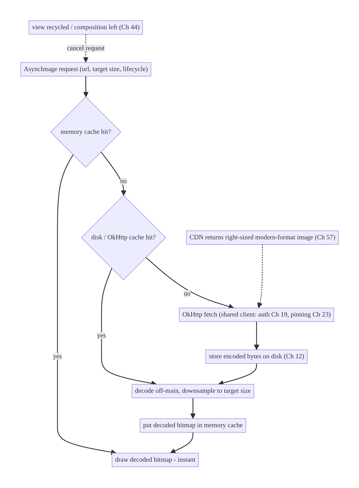
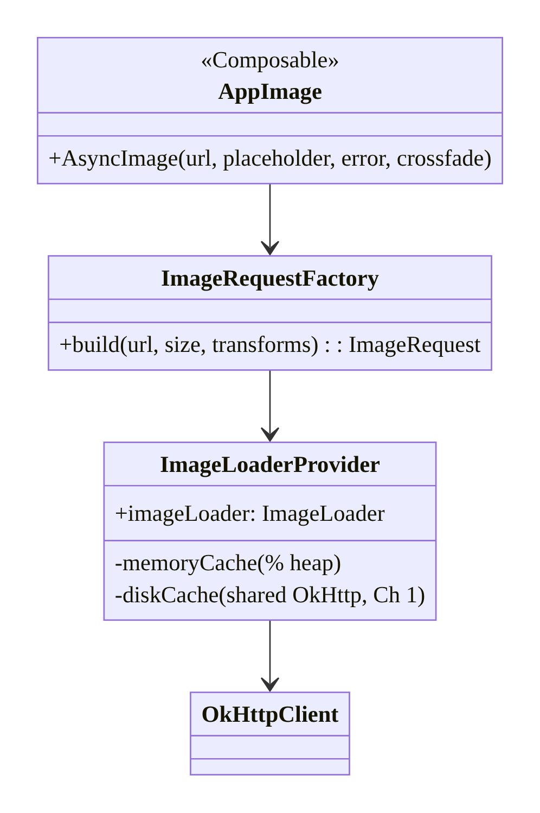
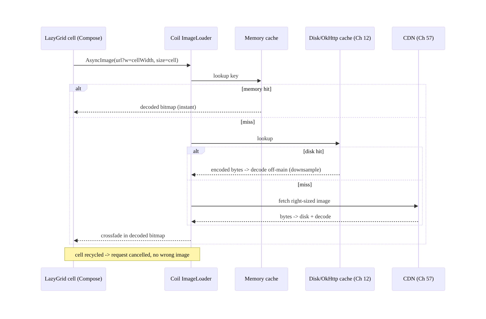
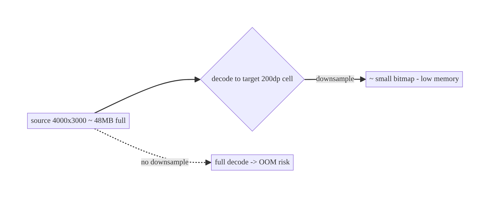
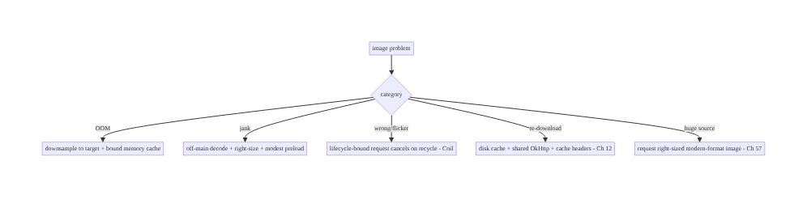

# Chapter 56 — Image Loading & Caching (Coil)

> **Part VII — Media & Files** · Complexity: **Standard** (≥25 interview questions)
>
> **Prerequisites:** Ch 12 (caching), Ch 1 (networking/OkHttp), Ch 6 (UI state), Ch 13
> (paging), Ch 44 (lifecycle), Ch 45 (startup/perf). Pairs with Ch 57 (thumbnails),
> Ch 60 (camera), Ch 86 (performance).
>
> **Reference surface in StreamCart:** every image — product photos, thumbnails,
> avatars, banner carousels, stream posters — loaded fast, cached in memory and on disk,
> correctly sized, and without jank, OOM, or recycled-view flicker.
>
> **Note:** this chapter opens **Part VII — Media & Files (Ch 56–62)**.

---

## 56.1 Problem Definition and Real-World Context

Images dominate a modern app's bandwidth, memory, and visual quality. A commerce/
streaming app shows thousands of images across feeds, grids, and carousels. Loading them
naively — decoding full-resolution bitmaps on the main thread, no caching, no size
targeting — causes **OOM crashes**, **jank**, **wasted bandwidth**, and **flicker** in
recycled lists. Image loading is deceptively deep: it spans networking, decoding, two
cache tiers, lifecycle, and view recycling.

Concretely, teams hit:

- **OOM from full-size bitmaps.** A 4000×3000 photo decoded at full resolution into a
  200dp `ImageView` wastes ~48MB and risks OOM. Images must be **downsampled to the
  target size**.
- **Main-thread decoding → jank.** Decoding/resizing on the UI thread drops frames;
  it must be **off the main thread** (Coil does this).
- **No caching → repeated downloads.** Without a **memory cache** (fast, in-RAM) and a
  **disk cache** (persistent, across sessions) every scroll re-downloads — slow, costly,
  battery-draining. Two tiers are needed (Ch 12).
- **Recycled-view flicker / wrong image.** In `RecyclerView`/`LazyColumn`, an async load
  completing after the view is recycled shows the **wrong image** unless the request is
  **tied to the view/lifecycle** and cancelled on recycle.
- **Reinventing it.** Hand-rolling decode/cache/cancel is a classic mistake — mature
  libraries (**Coil** for Kotlin/Compose, Glide/Fresco historically) solve it correctly.
  The job is to **use Coil well**, not rebuild it.
- **Formats, transformations, placeholders.** Modern formats (WebP/AVIF), transformations
  (crop/rounded/blur), placeholders/error images, crossfade, and (Ch 57) thumbnails all
  need coherent handling.

The architecture: use **Coil** (OkHttp-backed, coroutine-native, Compose-first) as the
image pipeline; configure a **two-tier cache** (memory + disk, Ch 12) sharing the app's
**OkHttp** client (Ch 1); **target the display size** (downsample so you never decode more
than needed); **tie each request to the lifecycle/composition** (auto-cancel on recycle/
leave, Ch 44) to avoid flicker/leaks; set **placeholders/error/crossfade**; apply
**transformations** efficiently; prefer **modern formats** and request **appropriately-
sized images from the backend/CDN** (Ch 57); and **tune memory** (cache size by device)
to avoid OOM. This chapter is about **fast, correct, memory-safe image loading at scale
with Coil**.

### Three practical use cases

1. **Product grid (StreamCart).** A `LazyVerticalGrid` of product images — Coil loads
   each sized to the cell, memory+disk cached, request scoped to composition so scrolling
   never shows the wrong image or OOMs.
2. **Avatar with transformation.** A circular avatar with a placeholder and crossfade,
   cached, decoded off-main.
3. **Banner carousel + thumbnails.** A hero banner (large) and thumbnail strip (small)
   request **different sizes** (Ch 57) from the CDN, each cached appropriately.

### Why this is architectural

Image loading touches **networking (Ch 1), caching (Ch 12), memory/OOM, main-thread/jank,
lifecycle (Ch 44), and list recycling** at once. The decisions — library choice, two-tier
cache, size targeting, lifecycle scoping, memory tuning — determine visual quality,
performance, crash rate, and bandwidth across the whole app.

---

## 56.2 Requirements Engineering

### Functional requirements

| ID | Requirement |
|----|-------------|
| F1 | Load remote/local images into Compose/Views asynchronously, off the main thread. |
| F2 | Cache in memory and on disk (two tiers), sharing OkHttp (Ch 1). |
| F3 | Downsample to the target display size (no over-decoding). |
| F4 | Tie requests to lifecycle/composition (cancel on recycle/leave) — no flicker/leak. |
| F5 | Placeholders, error images, crossfade, transformations. |
| F6 | Tune memory to avoid OOM; prefer modern formats + right-sized source (Ch 57). |

### Non-functional requirements

| Attribute | Target/Policy |
|-----------|---------------|
| **Memory** | No OOM; downsample to target; bounded memory cache by device. |
| **Performance** | Off-main decode; no jank; fast cache hits. |
| **Bandwidth** | Disk cache + right-sized requests; no re-download. |
| **Correctness** | No wrong/flickering images in recycled lists. |
| **Quality** | Placeholders/crossfade; sharp images at display size. |

### Scope

- **In scope:** Coil pipeline (ImageLoader, AsyncImage/rememberAsyncImagePainter),
  two-tier cache (memory + disk) + OkHttp sharing (Ch 1/12), size targeting/downsampling,
  lifecycle/composition scoping + cancellation, placeholders/error/crossfade,
  transformations, formats, memory tuning, right-sized CDN requests (Ch 57), preloading.
- **Out of scope:** thumbnail generation (Ch 57), camera capture (Ch 60), general caching
  theory (Ch 12), networking internals (Ch 1), Compose perf detail (Ch 60/86).

### Assumptions & constraints

- **Coil 2.x/3.x** (coroutine-native, Compose-first, OkHttp-backed), shared OkHttp client
  (Ch 1), Compose primary (Views supported). `minSdk 24`. Bitmaps are heap-heavy; main-
  thread decode causes jank; recycled views need request cancellation.

---

## 56.3 System Design Fundamentals

- **Use a mature library (Coil).** Coil is Kotlin-first, coroutine-native, Compose-first,
  and **OkHttp-backed** — it handles off-main decoding, two-tier caching, downsampling,
  lifecycle cancellation, transformations, and formats correctly. Don't hand-roll; the
  architecture is *configuring Coil well*. (Glide/Fresco are the mature Java-era
  equivalents; Coil is the modern Kotlin choice.)
- **Two-tier cache (Ch 12):**
  - **Memory cache:** decoded `Bitmap`s in RAM — **fastest**, bounded (by % of app
    memory). Hit = instant redraw (e.g., scrolling back).
  - **Disk cache:** encoded bytes on disk — **persistent** across sessions, avoids
    re-download. Coil's disk cache (or the shared **OkHttp** cache, Ch 1/12) stores the
    HTTP responses.
  - Flow: memory hit → use; else disk hit → decode → populate memory; else network
    (OkHttp) → disk + memory. **Share the app's OkHttp client** so HTTP caching, auth
    (Ch 19), and pinning (Ch 23) apply uniformly.
- **Size targeting / downsampling (the OOM lever).** A `Bitmap`'s memory is
  `width × height × bytesPerPixel` — independent of file size. Decoding a huge image into
  a small view wastes memory and risks OOM. Coil **measures the target** (the `ImageView`/
  composable bounds) and **downsamples** during decode so it only ever holds a bitmap
  near the display size. Always let Coil size to the target (don't force `Size.ORIGINAL`
  unless needed).
- **Off-main decoding → no jank.** Decoding/resizing happens on a background dispatcher;
  the main thread just draws the result. This (plus caching) is what keeps scrolling
  smooth.
- **Lifecycle & recycling (the correctness lever):**
  - In **Compose**, `AsyncImage`/`rememberAsyncImagePainter` tie the request to the
    composition — recomposition/leaving cancels/replaces it, so no wrong image.
  - In **Views**, Coil ties the request to the `ImageView` and **cancels on recycle**
    (via the view's lifecycle), preventing a late load from showing in a reused row.
  - Requests are also tied to a **`LifecycleOwner`** (Ch 44) so they pause/cancel
    appropriately.
- **Placeholders, error, crossfade:** show a **placeholder** while loading, an **error**
  image on failure, and a **crossfade** for a smooth appearance — basic quality that also
  avoids layout jumps (set a fixed size / aspect ratio).
- **Transformations:** crop, rounded corners, circle, blur applied in the pipeline
  (cached as part of the key). Keep them cheap; heavy transforms belong off-main (Coil
  handles) and should be cache-keyed so they're not recomputed.
- **Formats & right-sizing (Ch 57):** prefer **WebP/AVIF** (smaller) from the backend;
  request **CDN-resized** images per use (thumbnail vs full, Ch 57) rather than
  downloading a huge original and shrinking client-side — saves bandwidth and memory. The
  **URL carries the size** (`?w=200`) in a well-designed image API.
- **Memory tuning:** size the memory cache as a **percentage of available heap** (Coil
  default is sensible); on low-memory devices use less; respond to `onTrimMemory`/
  lifecycle to release. Avoid caching giant originals in memory.
- **Preloading:** for predictable needs (next carousel page, Ch 13), **preload** into the
  cache so the image is ready when shown — but don't over-preload (bandwidth/memory).

Core insight: **use Coil (OkHttp-backed, coroutine-native, Compose-first) rather than
hand-rolling; configure a two-tier cache (memory for decoded bitmaps + disk/OkHttp for
encoded bytes, sharing the app's OkHttp client, Ch 1/12); always downsample to the target
display size (the main OOM/jank lever) with off-main decoding; tie every request to the
composition/view lifecycle so recycled lists never flicker or show the wrong image
(Ch 44); add placeholders/error/crossfade/transformations; and request right-sized,
modern-format images from the CDN (Ch 57) while tuning the memory cache to the device.**

---

## 56.4 High-Level Architecture



**Components & ownership**

- **Coil `ImageLoader`** orchestrates: memory → disk/OkHttp → network, off-main decode +
  downsample.
- **Two-tier cache** (memory decoded, disk encoded) sharing OkHttp (Ch 1/12).
- **Lifecycle binding** cancels on recycle/leave.
- **CDN** supplies right-sized/modern-format sources (Ch 57).

**Direction:** request → memory → disk → network → decode/downsample off-main → draw;
cancelled on recycle.

---

## 56.5 Detailed Component Design



| Component | Responsibility |
|-----------|----------------|
| `ImageLoaderProvider` | single configured `ImageLoader` (memory %, disk, shared OkHttp) |
| `ImageRequestFactory` | build requests (size target, transforms, placeholders) |
| `AppImage` | Compose wrapper (`AsyncImage`) with app defaults |
| CDN URL helper (Ch 57) | append size params for right-sizing |

---

## 56.6 End-to-End Data Flow

### Loading a product image in a grid



### Size targeting prevents OOM



---

## 56.7 Complete Kotlin Implementation

Package: `com.streamcart.images`.

### 56.7.1 Single configured ImageLoader (shared OkHttp, two-tier cache)

```kotlin
@Module @InstallIn(SingletonComponent::class)
object ImageModule {
    @Provides @Singleton
    fun imageLoader(@ApplicationContext ctx: Context, okHttp: OkHttpClient): ImageLoader =
        ImageLoader.Builder(ctx)
            .okHttpClient(okHttp)                          // SHARE app OkHttp: auth (Ch 19), pinning (Ch 23), HTTP cache (Ch 12)
            .memoryCache { MemoryCache.Builder(ctx).maxSizePercent(0.25).build() }   // % of heap (tune by device)
            .diskCache { DiskCache.Builder().directory(ctx.cacheDir.resolve("image_cache")).maxSizeBytes(250L*1024*1024).build() }
            .crossfade(true)                               // smooth appearance
            .respectCacheHeaders(true)                     // honor server cache-control (Ch 12)
            .build()
}
```

### 56.7.2 Compose: AsyncImage with app defaults (size-targeted, placeholder/error)

```kotlin
@Composable
fun AppImage(url: String?, contentDescription: String?, modifier: Modifier = Modifier,
             contentScale: ContentScale = ContentScale.Crop) {
    AsyncImage(
        model = ImageRequest.Builder(LocalContext.current)
            .data(url?.sized(/* target handled automatically by the composable bounds */))  // right-size via CDN (Ch 57)
            .crossfade(true)
            .build(),
        contentDescription = contentDescription,           // a11y
        modifier = modifier,                               // bounds define decode target -> downsample
        contentScale = contentScale,
        placeholder = painterResource(R.drawable.ph_image),
        error = painterResource(R.drawable.ph_image_error),
    )
    // Coil measures `modifier` bounds -> decodes to that size (no OOM); request tied to composition (auto-cancel).
}
```

### 56.7.3 Right-sizing the CDN URL (Ch 57)

```kotlin
/** A well-designed image API carries size in the URL; request only what you display. */
fun String.sized(width: Int? = null, height: Int? = null, format: String = "webp"): String =
    buildString {
        append(this@sized)
        append(if (contains("?")) "&" else "?")
        width?.let { append("w=$it&") }
        height?.let { append("h=$it&") }
        append("fm=$format")                               // prefer modern format (WebP/AVIF)
    }
// Grid cell: imageUrl.sized(width = cellWidthPx). Hero: imageUrl.sized(width = screenWidthPx).
```

### 56.7.4 Transformations + avatar

```kotlin
@Composable
fun Avatar(url: String?, size: Dp) {
    AsyncImage(
        model = ImageRequest.Builder(LocalContext.current)
            .data(url?.sized(width = with(LocalDensity.current) { size.roundToPx() }))
            .transformations(CircleCropTransformation())    // cached as part of the key
            .crossfade(true)
            .build(),
        contentDescription = "avatar",
        modifier = Modifier.size(size).clip(CircleShape),
        placeholder = painterResource(R.drawable.ph_avatar),
    )
}
```

### 56.7.5 Preloading (predictable next content, Ch 13)

```kotlin
class ImagePreloader @Inject constructor(private val imageLoader: ImageLoader, @ApplicationContext private val ctx: Context) {
    fun preload(urls: List<String>) = urls.forEach { url ->
        imageLoader.enqueue(ImageRequest.Builder(ctx).data(url).build())   // warm memory/disk cache
    }
    // Preload next page of a carousel/grid; don't over-preload (bandwidth/memory).
}
```

### 56.7.6 Memory pressure + module structure

```kotlin
// Coil responds to onTrimMemory via its MemoryCache; optionally clear on severe pressure:
// imageLoader.memoryCache?.clear()  // on TRIM_MEMORY_COMPLETE if needed
```

```
:core:images   ImageModule (ImageLoader), AppImage, Avatar, ImageRequestFactory, ImagePreloader, String.sized
# Shares :core:network OkHttp (Ch 1). CDN right-sizing contract (Ch 57).
```

---

## 56.8 Concurrency and Race Conditions

| Scenario | Risk | Handling |
|----------|------|----------|
| Load completes after view recycled | wrong image in reused row | Coil ties request to view/composition → cancels on recycle |
| Many parallel loads on fast scroll | thrash/OOM | Coil dispatches off-main + bounded; downsample; cancel off-screen |
| Same URL requested concurrently | duplicate downloads | Coil de-dupes in-flight requests (single-flight, Ch 11) |
| Main-thread decode | jank | off-main decode (Coil) |
| Full-size decode into small view | OOM | size-target/downsample |
| Transformation recomputed each bind | CPU | cache-keyed transforms |

- **Lifecycle/view binding is the anti-flicker mechanism:** because Coil ties a request to
  the composable/`ImageView` and cancels it when recycled, a slow load for an off-screen
  item never lands in a reused view — the classic `RecyclerView` wrong-image bug is
  handled for you (don't bypass it with manual loads).
- **In-flight de-duplication** means the same URL requested by many cells downloads once
  (single-flight, Ch 11) — no manual coordination needed.
- **Downsampling + off-main decode** together are what keep fast scrolling smooth and
  OOM-free.

---

## 56.9 Failure Scenarios and Recovery

| Failure | Detection | Response | Outcome |
|---------|-----------|----------|---------|
| OOM on large images | crash/low-memory | downsample to target; bound memory cache | no OOM |
| Jank on scroll | frame metrics | off-main decode (Coil); right-size; preload modestly | smooth |
| Wrong image in recycled view | QA | lifecycle-bound request (Coil default) | correct |
| Repeated downloads | bandwidth | disk cache + share OkHttp; respect cache headers | cached |
| Broken image URL | load failure | error placeholder; retry policy | graceful |
| Layout jump on load | visual | fixed size/aspect + placeholder | stable |
| Huge original from backend | bandwidth/memory | request CDN right-sized/modern format (Ch 57) | efficient |



> **The two image killers are OOM and jank, and both come from decoding more than you
> display.** Size-targeting/downsampling plus off-main decode (both Coil defaults when you
> let it size to the view) eliminate them; two-tier caching kills re-downloads; and
> lifecycle-bound requests kill recycled-view flicker. Don't fight Coil's defaults.

---

## 56.10 Scaling the Implementation

- **Level 1.** Coil `AsyncImage` with a shared OkHttp client; placeholders/crossfade.
- **Level 2.** Two-tier cache tuned (memory %, disk size); size-targeting; transformations.
- **Level 3 — production.** CDN right-sizing + modern formats (Ch 57); preloading for
  predictable content; error handling; memory-pressure response.
- **Level 4 — large.** Per-surface request policies (grid vs hero vs avatar); image
  analytics (cache hit rate, decode time); device-tiered cache sizing; blur-hash/
  low-quality-image-placeholder (LQIP) for perceived speed.
- **Level 5 — enterprise.** Image CDN governance, format negotiation (AVIF/WebP by
  support), bandwidth/quality SLOs, offline image availability (Ch 59), consistent
  image API contract across teams.

**Avoid overengineering:** Coil with a shared OkHttp client, size-targeting, and a tuned
two-tier cache covers the vast majority. Don't hand-roll caching/decoding or over-preload.

---

## 56.11 Alternative Approaches and Trade-offs

| Dimension | Option A | Option B | When |
|-----------|----------|----------|------|
| Library | Coil | Glide / Fresco | Coil for Kotlin/Compose; Glide/Fresco for legacy/Views-heavy |
| Build vs buy | Use a library | hand-roll | Always use a library (decode/cache/cancel are hard) |
| Cache | Memory + disk (two-tier) | memory only / none | Two-tier (Ch 12) — persistence + speed |
| Sizing | Target display size (downsample) | full original | Target size (OOM/jank/bandwidth) |
| Source size | CDN right-sized (Ch 57) | download original, shrink | CDN right-sized (bandwidth/memory) |
| OkHttp | Share app client | separate client | Share (auth/pinning/cache uniform, Ch 1/19/23) |
| Perceived speed | Placeholder/crossfade/LQIP | blank → pop-in | Placeholder/crossfade (quality) |

**Coil vs Glide/Fresco:** all are mature and solve the hard parts (off-main decode,
two-tier cache, lifecycle cancellation, downsampling). **Coil** is Kotlin-first, coroutine-
native, and Compose-first with a small footprint and OkHttp integration — the natural
choice for modern Kotlin/Compose apps. **Glide** is battle-tested and feature-rich for
Views/Java; **Fresco** excels at very memory-constrained scenarios (ashmem). Pick Coil for
new Compose apps; the architectural principles (two-tier cache, size-targeting, lifecycle
scoping) are identical across all three.

**CDN right-sizing vs client-side shrink:** downloading a full-resolution original and
downsampling on-device still wastes **bandwidth** (you downloaded megabytes to show a
thumbnail) even if memory is fine. Requesting a **CDN-resized** image (`?w=200`, Ch 57)
transfers only what's displayed and in a **modern format** (WebP/AVIF). Right-size at the
source; let Coil size-target as a second safety net.

**Build vs buy:** hand-rolling image loading (decode, two-tier cache, in-flight dedupe,
lifecycle cancellation, downsampling, format support) is a large, bug-prone effort that
libraries have refined over years. Always use Coil/Glide/Fresco; spend effort on
*configuring* and *right-sizing*, not reimplementing.

---

## 56.12 Security & Privacy Considerations

- **Share the authenticated OkHttp client (Ch 1/19/23):** image requests to protected
  URLs carry auth and go through **certificate pinning** — don't use a separate,
  unpinned/unauthenticated client for images (a bypass of your network security).
- **Don't cache sensitive images insecurely:** private images (ID photos, documents)
  shouldn't sit in a world-readable cache; use app-internal cache dirs (default) and
  consider not disk-caching highly sensitive media (Ch 25/28).
- **Validate image sources:** load only from trusted hosts/CDN; an attacker-supplied URL
  (from a deep link, Ch 52, or user content) could point anywhere — allowlist domains for
  sensitive contexts and beware decompression bombs (very large dimensions → OOM; cap
  decode size).
- **Strip EXIF/metadata** where privacy matters (location in photos, Ch 28/60) before
  upload/caching.
- **Per-account isolation (Ch 42):** don't serve a cached image from one account's session
  in another where it implies private content; key sensitive caches per account or clear
  on logout.
- Client vs backend: the backend/CDN serves right-sized images and enforces access
  (signed URLs/auth for private media, Ch 19/23); the client caches within app-internal
  storage and uses the secure network stack.

---

## 56.13 Performance and Resource Optimization

- **Size-target/downsample** (the #1 memory + bandwidth lever) — never decode larger than
  displayed.
- **Two-tier cache** (memory for instant redraw, disk for cross-session) + **respect
  cache headers** (Ch 12).
- **CDN right-sizing + modern formats** (WebP/AVIF, Ch 57) cut bytes dramatically.
- **Off-main decode** (Coil default) prevents jank.
- **Modest preloading** of predictable next content (Ch 13) — balance vs bandwidth.
- **LQIP/blur-hash** placeholders for perceived speed.
- **Tune memory cache** by device heap; release on memory pressure (`onTrimMemory`).
- **Avoid heavy per-bind transformations;** cache-key them.
- **Profiling:** cache hit rate (memory/disk), decode time, bitmap memory, jank frames
  during scroll, image bandwidth.

---

## 56.14 Testing Strategy

Image loading tests with Coil's test support (fake `ImageLoader`/engine) and
instrumentation for scroll/memory.

```kotlin
class AppImageTest {
    @Test fun `uses shared OkHttp and targets size`() {
        // Provide a fake ImageLoader; assert requests carry the right-sized URL and size target.
    }
}

// Coil test: set a test ImageLoader that returns a fake image synchronously.
@Test fun `shows placeholder then image`() = runComposeTest {
    val fakeLoader = ImageLoader.Builder(context).components { /* fake engine */ }.build()
    setContent { CompositionLocalProvider(LocalImageLoader provides fakeLoader) { AppImage(url = "https://x/p.webp") } }
    // assert placeholder shown, then image
}

class UrlSizingTest {
    @Test fun `appends width and format`() =
        assertEquals("https://cdn/x.jpg?w=200&fm=webp", "https://cdn/x.jpg".sized(width = 200))
}
```

What to test: URL right-sizing helper; `AppImage` uses the shared loader + size target +
placeholder/error; cache config (memory %, disk size); transformation applied; (integration)
no OOM scrolling a large grid, no wrong-image on fast recycle, cache hit on scroll-back.
Use Coil's fake engine for deterministic unit tests; instrumentation for memory/jank.

---

## 56.15 Production Observability

- **Metrics:** memory/disk **cache hit rate**; average **decode time**; **bitmap memory**
  footprint; **image bandwidth**; OOM/low-memory rate attributable to images; scroll jank
  frames; load failure rate; preload waste (preloaded-not-shown).
- **Logs:** `image{host, size_requested, cache(memory/disk/network), decode_ms}` — no
  sensitive URLs/PII (Ch 28).
- **Debugging:** OOM → not downsampling / caching originals; jank → main-thread work /
  over-large decode / over-preload; re-downloads → disk cache misconfigured / cache
  headers ignored; wrong image → bypassed lifecycle binding; high bandwidth → not CDN
  right-sizing (Ch 57).
- **Alerting:** image-OOM rate; cache-hit-rate drop (CDN/caching regression).
- **Dashboards:** cache hit rate + bandwidth + decode time by surface; image OOM trend.

---

## 56.16 System Design Interview Preparation

> ≥25 questions.

**Fundamentals**

1. *Why a library (Coil)?* Off-main decode, two-tier cache, lifecycle cancel, downsample —
   all hard to hand-roll.
2. *Coil vs Glide/Fresco?* Kotlin/Compose-native vs legacy/Views vs memory-constrained;
   same principles.
3. *Two-tier cache?* Memory (decoded bitmaps, fast) + disk (encoded bytes, persistent,
   Ch 12).
4. *Share OkHttp?* Yes — uniform auth (Ch 19), pinning (Ch 23), HTTP cache (Ch 12).
5. *Why off-main decode?* Avoid jank.

**Memory/OOM**

6. *Bitmap memory?* `w × h × bytesPerPixel` (not file size).
7. *OOM cause/fix?* Full-size decode into small view → downsample to target.
8. *Memory cache sizing?* % of heap; tune by device; release on pressure.
9. *Decompression bomb?* Cap decode dimensions; validate sources.

**Correctness**

10. *Recycled-view wrong image?* Request tied to view/composition, cancelled on recycle.
11. *In-flight dedupe?* Same URL downloads once (single-flight, Ch 11).
12. *Layout jump?* Fixed size/aspect + placeholder.

**Quality/perf**

13. *Placeholders/crossfade?* Perceived speed + no pop-in.
14. *Transformations?* Pipeline, cache-keyed.
15. *Modern formats?* WebP/AVIF (smaller).
16. *CDN right-sizing?* Request `?w=` sized image (Ch 57) — bandwidth + memory.
17. *Preloading?* Warm cache for predictable content; don't over-preload.

**Caching**

18. *Cache flow?* Memory → disk → network.
19. *Respect cache headers?* Yes (Ch 12).
20. *Cross-session persistence?* Disk cache.

**Security**

21. *Sensitive images?* App-internal cache; maybe no disk cache; per-account (Ch 42/28).
22. *Untrusted URLs?* Allowlist; cap decode size (Ch 52).
23. *EXIF?* Strip for privacy (Ch 60/28).

**Testing/Production**

24. *Test images?* Coil fake engine; instrumentation for OOM/jank.
25. *Key metrics?* Cache hit rate, decode time, bitmap memory, bandwidth.
26. *OOM in prod?* Not downsampling / caching originals.

### Design-change challenges
1. **Product grid OOMs on scroll.** Size-target/downsample + bound memory cache +
   CDN right-size.
2. **Wrong images flash in a recycled list.** Lifecycle-bound requests (Coil default) —
   don't bypass.
3. **Images re-download every session.** Disk cache + shared OkHttp + respect cache
   headers.
4. **High image bandwidth.** CDN right-sizing + WebP/AVIF (Ch 57).
5. **Avatars need circular crop with a placeholder.** `CircleCropTransformation` +
   placeholder + crossfade.

### Mock walkthrough (abridged)
Clarify (how many images, sizes, offline?, sensitive?) → use Coil (shared OkHttp) →
two-tier cache (memory %, disk) → size-target/downsample (OOM/jank) + off-main → lifecycle-
bound requests (recycle correctness) → placeholders/crossfade/transforms → CDN right-
sizing + modern formats (Ch 57) → memory tuning → security (auth/pinning, sensitive cache,
untrusted URLs) → observability (cache hit, decode, bandwidth).

---

## 56.17 Practical Exercises

1. **Beginner.** Load a product grid with Coil `AsyncImage` using the shared OkHttp
   client, with placeholders and crossfade. *Eval:* images load off-main; cached.
2. **Intermediate.** Configure the two-tier cache (memory %, disk size) and right-size CDN
   URLs per surface (grid vs hero). *Eval:* cache hits on scroll-back; bandwidth matches
   display size.
3. **Advanced.** Add a circular avatar transformation and preload the next carousel page;
   verify no OOM on a large grid. *Eval:* transform cached; preloaded; no OOM.
4. **Production debugging.** Fix OOM (decoding originals) and recycled-view flicker
   (bypassed lifecycle binding). *Eval:* downsampled; correct images.
5. **System design challenge.** Add per-account sensitive-image handling (no shared disk
   cache / clear on logout) and a cache-hit-rate dashboard. *Eval:* isolated; measurable.

*(Solutions withheld unless requested.)*

---

## 56.18 Chapter Summary & Reference Sheet

**Key decisions:** use **Coil** (coroutine-native, Compose-first, **OkHttp-backed**)
rather than hand-rolling; configure a **two-tier cache** — **memory** for decoded bitmaps
(bounded by % heap) and **disk/OkHttp** for encoded bytes — and **share the app's OkHttp
client** so auth (Ch 19), pinning (Ch 23), and HTTP caching (Ch 12) apply uniformly;
**always downsample to the target display size** with **off-main decoding** (the #1 lever
against OOM and jank — bitmap memory is `w×h×bpp`, not file size); **tie every request to
the composition/view lifecycle** (Ch 44) so recycled lists never flicker or show the wrong
image (Coil also de-dupes in-flight loads, Ch 11); add **placeholders/error/crossfade**
and cache-keyed **transformations**; request **right-sized, modern-format (WebP/AVIF)
images from the CDN** (Ch 57) to cut bandwidth; and **tune the memory cache by device**,
releasing on pressure. Keep sensitive images in app-internal storage, per-account (Ch 42/
28), and validate untrusted URLs.

**Concepts:** Coil pipeline, two-tier cache (memory/disk) + OkHttp sharing, size-targeting/
downsampling, off-main decode, lifecycle/composition binding + cancellation, in-flight
dedupe, placeholders/crossfade/transformations, CDN right-sizing + modern formats, memory
tuning, preloading.

**Common mistakes:** hand-rolling image loading; no/one-tier cache (re-downloads);
decoding full-size into small views (OOM); main-thread decode (jank); bypassing lifecycle
binding (wrong image in recycled views); separate unpinned client for images; downloading
originals instead of CDN right-sizing; over-preloading; caching sensitive images
insecurely.

**Checklist:**

- [ ] use Coil + shared OkHttp (Ch 1/19/23)
- [ ] two-tier cache (memory %, disk)
- [ ] size-target/downsample to display
- [ ] off-main decode
- [ ] lifecycle/composition-bound requests
- [ ] placeholders/error/crossfade
- [ ] cache-keyed transformations
- [ ] CDN right-sizing + WebP/AVIF (Ch 57)
- [ ] tune memory cache by device + release on pressure
- [ ] sensitive images app-internal, per-account (Ch 42/28)
- [ ] validate untrusted URLs + cap decode size.

**Key APIs:** `ImageLoader.Builder` (`.okHttpClient`/`.memoryCache`/`.diskCache`/
`.crossfade`/`.respectCacheHeaders`), `AsyncImage`/`rememberAsyncImagePainter`,
`ImageRequest.Builder` (`.data`/`.size`/`.transformations`/`.placeholder`/`.error`),
`MemoryCache`/`DiskCache`, `CircleCropTransformation`/`RoundedCornersTransformation`,
`ImageLoader.enqueue` (preload), `LocalImageLoader` (test).

**References:**
- Coil: https://coil-kt.github.io/coil/
- Coil image requests / caching: https://coil-kt.github.io/coil/image_requests/
- Handling bitmaps / memory: https://developer.android.com/topic/performance/graphics
- (composes) Ch 1 Networking, Ch 12 Caching, Ch 57 Thumbnails, Ch 19 Auth, Ch 23 Pinning, Ch 42 Multi-Account

### Chapter review (Phase 4)
- **Completeness:** all 18 sections; architecture/class/sequence/sizing/failure diagrams;
  ImageLoader config + AsyncImage + URL right-sizing + transformations + preload code;
  concurrency (lifecycle binding, in-flight dedupe, downsample); failure (OOM/jank/flicker/
  re-download triage); 5 levels; Coil-vs-Glide, CDN-right-sizing, build-vs-buy trade-offs;
  security (shared pinned client, sensitive cache, untrusted URLs, EXIF); perf (downsample/
  cache/formats); Coil-fake-engine tests; observability (cache hit/decode/bandwidth); 26
  Q&A + 5 challenges. ✅ Opens Part VII.
- **Expand later:** thumbnails (Ch 57), camera/EXIF (Ch 60), caching (Ch 12), perf (Ch 86).
- **Interview coverage:** exceeds ≥25 bar.
