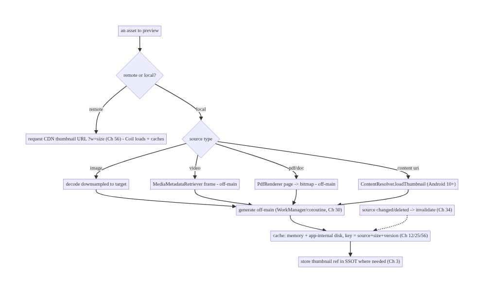
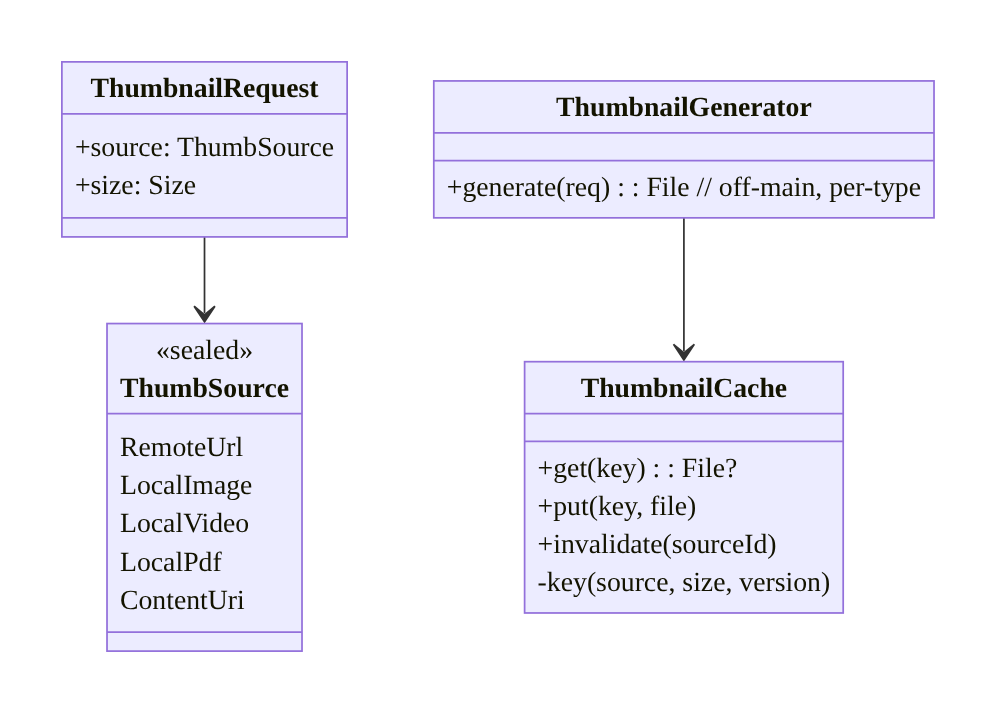
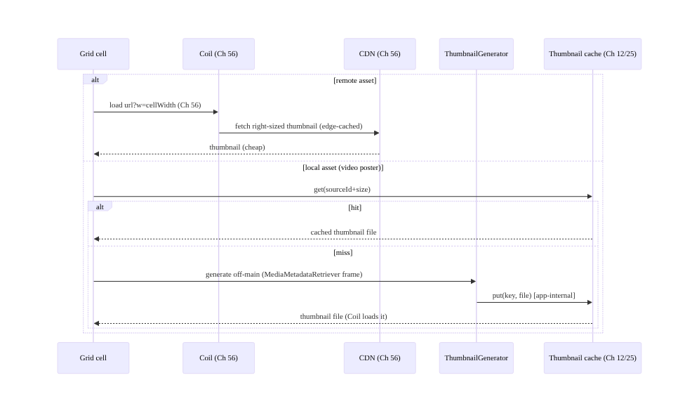
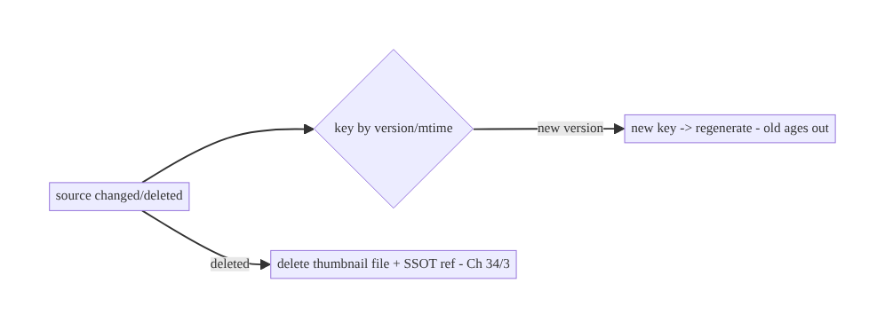
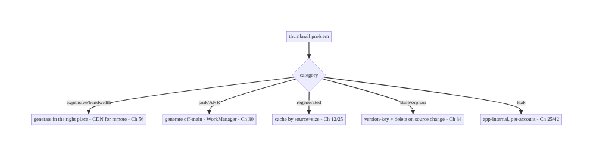

# Chapter 57 — Thumbnail Generation & Caching

> **Part VII — Media & Files** · Complexity: **Standard** (≥25 interview questions)
>
> **Prerequisites:** Ch 56 (Coil/image loading), Ch 12 (caching), Ch 30 (WorkManager),
> Ch 3 (SSOT), Ch 25 (secure file storage), Ch 60 (camera). Pairs with Ch 58/59 (media),
> Ch 61 (large files).
>
> **Reference surface in StreamCart:** small preview images derived from larger
> sources — grid thumbnails for products, video poster frames, PDF/receipt previews,
> user-uploaded photo previews — generated once, cached, and reused, so the app never
> re-downloads or re-decodes a full asset to show a tiny preview.

---

## 57.1 Problem Definition and Real-World Context

A **thumbnail** is a small preview derived from a larger asset: a resized image, a video
frame, a PDF-page render, a document icon. Thumbnails are everywhere (grids, lists,
carousels, pickers) and the wrong approach is costly: downloading or decoding the
**full-resolution** source just to show a 100dp tile wastes bandwidth, memory (Ch 56),
CPU, and battery, and is slow. The engineering question is **who generates the thumbnail,
where, and how it's cached** — and it differs by source type (remote image, local photo,
video, document).

Concretely, teams hit:

- **Downloading/decoding originals for previews.** Fetching a 5MB photo to show a tiny
  grid cell (should request a **CDN-resized** thumbnail, Ch 56) or decoding a 4K frame to
  preview a video.
- **Generating thumbnails on the main thread.** Video-frame extraction, PDF rendering,
  and large-image decode are **expensive** and must be **off-main** (WorkManager/coroutine,
  Ch 30), or they jank/ANR.
- **No thumbnail cache / regeneration every time.** Re-extracting a video frame or
  re-rendering a PDF page on every bind is wasteful; generated thumbnails must be
  **cached** (memory + disk, Ch 12/56) keyed by source + size.
- **Server vs client generation.** For remote assets, the **server/CDN should generate**
  thumbnails (on-the-fly resize, `?w=200`, Ch 56) — cheap, cached at the edge, no client
  cost. For **local** assets (camera photos, downloaded videos, user files) the **client**
  must generate (no server involved). Choosing wrong does expensive work in the wrong
  place.
- **Source-type specifics.** Images (downsample decode), **video** (`MediaMetadata
  Retriever`/`ThumbnailUtils`/Media3 frame extraction), **PDF** (`PdfRenderer`),
  **content URIs** (`ContentResolver.loadThumbnail`, Android 10+) each need the right API.
- **Staleness & invalidation.** A thumbnail must track its source (if the source changes/
  is deleted, invalidate the thumbnail, Ch 34).

The architecture: **prefer server/CDN-generated thumbnails for remote assets** (request a
right-sized URL via Coil, Ch 56) — the client does nothing special; for **local assets**,
**generate on the client off-main** (WorkManager/coroutine, Ch 30) using the **right API
per source type** (image downsample, `MediaMetadataRetriever` for video, `PdfRenderer` for
PDF, `ContentResolver.loadThumbnail` for content URIs); **cache** generated thumbnails
(memory + disk, Ch 12/56) keyed by `source + size`, stored in app-internal storage
(Ch 25); **invalidate** when the source changes (Ch 34); and **track** thumbnail
references in the SSOT (Ch 3) where needed. This chapter is about **cheap, cached previews
generated in the right place with the right API**.

### Three practical use cases

1. **Product grid (StreamCart).** Remote product images → request **CDN thumbnails**
   (`?w=cellWidth`, Ch 56); the client just loads them with Coil — no client generation.
2. **Uploaded-photo preview.** A user picks/captures a photo (Ch 60) → the **client
   generates** a downsized thumbnail off-main for instant grid preview while the full
   image uploads (Ch 17).
3. **Downloaded-video poster (OTT).** An offline video (Ch 59) → the **client extracts a
   frame** (`MediaMetadataRetriever`) off-main, caches it, and shows it as the poster.

### Why this is architectural

Thumbnailing is a **where-to-do-the-work decision** (server/CDN vs client) crossing
networking (Ch 56), caching (Ch 12), background work (Ch 30), per-source-type APIs,
storage (Ch 25), and invalidation (Ch 34). Getting it right keeps previews fast and cheap;
getting it wrong wastes bandwidth/CPU/memory and janks.

---

## 57.2 Requirements Engineering

### Functional requirements

| ID | Requirement |
|----|-------------|
| F1 | Produce small previews from images, video, PDFs, and content URIs. |
| F2 | Prefer server/CDN thumbnails for remote assets; generate client-side for local assets. |
| F3 | Generate off the main thread (WorkManager/coroutine, Ch 30). |
| F4 | Cache generated thumbnails (memory + disk) keyed by source + size (Ch 12/56). |
| F5 | Invalidate thumbnails when the source changes/is deleted (Ch 34). |
| F6 | Store thumbnails in app-internal storage; handle sensitive media (Ch 25/28). |

### Non-functional requirements

| Attribute | Policy |
|-----------|--------|
| **Efficiency** | Never fetch/decode full source for a preview; right-sized. |
| **Performance** | Off-main generation; cached reuse; no jank/ANR. |
| **Bandwidth** | Server/CDN thumbnails for remote; no original downloads. |
| **Correctness** | Right API per source; cache keyed by source+size; invalidated. |
| **Privacy** | App-internal cache; sensitive thumbnails handled (Ch 25/28). |

### Scope

- **In scope:** server/CDN vs client generation decision, per-source-type generation
  (image downsample, video frame via `MediaMetadataRetriever`/`ThumbnailUtils`/Media3,
  PDF via `PdfRenderer`, content URI via `ContentResolver.loadThumbnail`), off-main
  generation (Ch 30), thumbnail cache (memory+disk, keyed by source+size, Ch 12/56),
  invalidation (Ch 34), app-internal storage (Ch 25), integration with Coil (Ch 56).
- **Out of scope:** image loading pipeline (Ch 56), camera capture (Ch 60), media playback
  (Ch 58), offline downloads (Ch 59), upload (Ch 17), caching theory (Ch 12).

### Assumptions & constraints

- Coil (Ch 56), WorkManager (Ch 30), Room/DataStore (Ch 3), app-internal storage (Ch 25).
  `minSdk 24` (`ContentResolver.loadThumbnail` is 29+; `PdfRenderer` 21+;
  `MediaMetadataRetriever` broadly available). Remote assets go through a CDN that can
  resize (Ch 56); local assets have no server.

---

## 57.3 System Design Fundamentals

- **The core decision: server/CDN vs client generation.**
  - **Remote assets → server/CDN generates.** A well-designed image/media API resizes
    on-the-fly (`?w=200&fm=webp`, Ch 56): the **CDN** produces and **edge-caches** the
    thumbnail; the client simply **requests the small URL via Coil** (Ch 56) and does
    **no** generation. This is cheapest (no client CPU, minimal bandwidth, edge-cached).
  - **Local assets → client generates.** Camera photos (Ch 60), downloaded videos
    (Ch 59), picked files, generated PDFs have **no server** to ask — the client must
    generate the thumbnail locally.
  Deciding per asset is the architecture: **don't generate client-side what the CDN can
  do**, and **don't try to server-generate what's local**.
- **Per-source-type generation APIs (for local):**
  - **Image:** decode **downsampled** to the target (`BitmapFactory` with
    `inSampleSize`, or Coil with a size target, Ch 56) — never full-size.
  - **Video:** extract a frame — `MediaMetadataRetriever.getFrameAtTime()` (specific
    timestamp) or `ThumbnailUtils.createVideoThumbnail()` / Media3 — **expensive**,
    off-main.
  - **PDF/document:** `PdfRenderer` renders a page to a bitmap (off-main); other docs may
    need a type-specific renderer or a generic icon.
  - **Content URI (gallery/SAF):** `ContentResolver.loadThumbnail(uri, size, signal)`
    (Android 10+) asks the provider for a thumbnail — often already cached by the system.
- **Generate off-main (Ch 30).** Video frame extraction, PDF rendering, and large-image
  decode are CPU/IO-heavy → run on a background dispatcher or **WorkManager** (for
  batch/deferred generation, e.g., generating posters for many downloaded videos). Never
  on the main thread (jank/ANR).
- **Cache generated thumbnails (Ch 12/56).** A generated thumbnail is expensive to
  recompute, so cache it:
  - **Memory** (Coil's memory cache, Ch 56) for instant redraw.
  - **Disk** (app-internal, Ch 25) keyed by **`sourceId + size` (+ source version/mtime)**
    so it persists and is reused — and so a changed source produces a different key.
  - Integrate with **Coil** (Ch 56) by exposing the local thumbnail as a model/`File` Coil
    can load and cache, or use a custom Coil `Fetcher`/`Keyer` for generated thumbnails.
- **Invalidation (Ch 34).** When the source **changes or is deleted**, the thumbnail must
  be invalidated: key the cache by a **source version/mtime/hash** so a new source yields
  a new key (old entry ages out), and **delete** thumbnails when the source is deleted.
  Stale thumbnails are a classic bug.
- **SSOT tracking (Ch 3).** Where thumbnails belong to entities (a downloaded video's
  poster path), store the **thumbnail file path/ref in the SSOT** (Room) so the UI
  (Ch 6) observes it; the file lives in app-internal storage (Ch 25).
- **Right-sizing both ends.** Generate the thumbnail at (or slightly above) the display
  size; combined with Coil size-targeting (Ch 56), you never hold or transfer more than
  needed.

Core insight: **decide per asset where the thumbnail is generated — the CDN/server for
remote assets (request a right-sized URL via Coil, zero client cost, edge-cached, Ch 56)
and the client only for local assets (no server to ask); for local generation, use the
right API per source type (downsample images, `MediaMetadataRetriever` for video,
`PdfRenderer` for PDF, `ContentResolver.loadThumbnail` for content URIs), run it off-main
(WorkManager/coroutine, Ch 30), and cache the result (memory + app-internal disk, Ch 12/
25/56) keyed by source + size + version so it's reused and correctly invalidated when the
source changes (Ch 34).**

---

## 57.4 High-Level Architecture



**Components & ownership**

- **Decision gate:** remote → CDN (Coil); local → client generation.
- **Per-type generators** produce the preview using the correct API, **off-main**.
- **Thumbnail cache** (memory + app-internal disk, keyed by source+size+version) reuses
  and invalidates.
- **SSOT** tracks thumbnail refs for entities (Ch 3).

**Direction:** asset → remote(CDN)/local(generate off-main) → cache(keyed) → display;
invalidate on source change.

---

## 57.5 Detailed Component Design



| Component | Responsibility |
|-----------|----------------|
| `ThumbSource` | typed source (remote vs local kinds) |
| `ThumbnailGenerator` | generate per type, off-main (image/video/pdf/content-uri) |
| `ThumbnailCache` | memory+disk, key = source+size+version; invalidation (Ch 34) |
| Coil integration (Ch 56) | load remote CDN thumbs + cached local thumb files |

---

## 57.6 End-to-End Data Flow

### Remote (CDN) vs local (client) generation



### Invalidation on source change



---

## 57.7 Complete Kotlin Implementation

Package: `com.streamcart.thumbnails`.

### 57.7.1 Typed source + the decision

```kotlin
sealed interface ThumbSource {
    data class RemoteUrl(val url: String) : ThumbSource                     // CDN generates (Ch 56)
    data class LocalImage(val file: File, val version: Long) : ThumbSource  // client generates
    data class LocalVideo(val file: File, val atMs: Long, val version: Long) : ThumbSource
    data class LocalPdf(val file: File, val page: Int, val version: Long) : ThumbSource
    data class ContentUri(val uri: Uri) : ThumbSource                       // provider thumbnail
}

// Remote -> just load url.sized(width) with Coil (Ch 56). Local -> ThumbnailGenerator.
fun ThumbSource.isRemote() = this is ThumbSource.RemoteUrl
```

### 57.7.2 ThumbnailGenerator (off-main, per-type)

```kotlin
@Singleton
class ThumbnailGenerator @Inject constructor(
    @ApplicationContext private val ctx: Context,
    private val dispatchers: DispatcherProvider,     // Ch 1
    private val cache: ThumbnailCache,
) {
    suspend fun generate(source: ThumbSource, size: Size): File = withContext(dispatchers.io) {  // OFF-MAIN
        val key = cache.keyFor(source, size)
        cache.get(key)?.let { return@withContext it }                     // cache hit

        val bitmap: Bitmap = when (source) {
            is ThumbSource.LocalImage -> decodeDownsampled(source.file, size)            // inSampleSize
            is ThumbSource.LocalVideo -> MediaMetadataRetriever().use { mmr ->            // video frame
                mmr.setDataSource(source.file.absolutePath)
                mmr.getFrameAtTime(source.atMs * 1000, MediaMetadataRetriever.OPTION_CLOSEST_SYNC)!!
                    .scaleTo(size)
            }
            is ThumbSource.LocalPdf -> renderPdfPage(source.file, source.page, size)      // PdfRenderer
            is ThumbSource.ContentUri -> ctx.contentResolver.loadThumbnail(               // Android 10+
                source.uri, android.util.Size(size.width, size.height), null)
            is ThumbSource.RemoteUrl -> error("remote thumbnails are served by the CDN (Ch 56)")
        }
        cache.put(key, bitmap)                        // write to app-internal disk (Ch 25) + memory
    }

    private fun decodeDownsampled(file: File, size: Size): Bitmap {
        val bounds = BitmapFactory.Options().apply { inJustDecodeBounds = true }
        BitmapFactory.decodeFile(file.absolutePath, bounds)
        val opts = BitmapFactory.Options().apply { inSampleSize = calcInSampleSize(bounds, size) }  // downsample
        return BitmapFactory.decodeFile(file.absolutePath, opts)!!
    }
    private fun renderPdfPage(file: File, page: Int, size: Size): Bitmap { /* PdfRenderer -> bitmap */ ... }
}
```

### 57.7.3 ThumbnailCache (memory + app-internal disk, keyed, invalidation)

```kotlin
@Singleton
class ThumbnailCache @Inject constructor(@ApplicationContext private val ctx: Context) {
    private val dir = File(ctx.cacheDir, "thumbs").apply { mkdirs() }   // app-internal (Ch 25)

    /** Key includes source identity + size + VERSION so a changed source -> new key (Ch 34). */
    fun keyFor(source: ThumbSource, size: Size): String = when (source) {
        is ThumbSource.LocalImage -> "img_${source.file.name}_${source.version}_${size.width}x${size.height}"
        is ThumbSource.LocalVideo -> "vid_${source.file.name}_${source.atMs}_${source.version}_${size.width}x${size.height}"
        is ThumbSource.LocalPdf   -> "pdf_${source.file.name}_${source.page}_${source.version}_${size.width}x${size.height}"
        is ThumbSource.ContentUri -> "uri_${source.uri.hashCode()}_${size.width}x${size.height}"
        is ThumbSource.RemoteUrl  -> error("remote cached by Coil/CDN (Ch 56)")
    }
    fun get(key: String): File? = File(dir, "$key.webp").takeIf { it.exists() }
    fun put(key: String, bitmap: Bitmap): File = File(dir, "$key.webp").apply {
        outputStream().use { bitmap.compress(Bitmap.CompressFormat.WEBP_LOSSY, 80, it) }   // compact modern format
    }
    /** Invalidate when the source is deleted (Ch 34). */
    fun invalidate(sourcePrefix: String) = dir.listFiles { f -> f.name.startsWith(sourcePrefix) }?.forEach { it.delete() }
}
```

### 57.7.4 Batch generation via WorkManager (e.g., posters for downloaded videos)

```kotlin
@HiltWorker
class ThumbnailWorker @AssistedInject constructor(
    @Assisted ctx: Context, @Assisted p: WorkerParameters,
    private val generator: ThumbnailGenerator, private val repo: DownloadRepository,  // Ch 59
) : CoroutineWorker(ctx, p) {
    override suspend fun doWork(): Result = runCatching {
        repo.downloadsNeedingPosters().forEach { d ->
            val file = generator.generate(ThumbSource.LocalVideo(d.file, atMs = 5000, version = d.version), POSTER_SIZE)
            repo.setPosterPath(d.id, file.absolutePath)   // store ref in SSOT (Ch 3)
        }
    }.fold({ Result.success() }, { Result.retry() })   // off-main, deferrable (Ch 30)
}
```

### 57.7.5 Displaying (Coil loads CDN remote or local thumbnail file, Ch 56)

```kotlin
@Composable
fun Thumbnail(source: ThumbSource, size: Dp, vm: ThumbnailViewModel = hiltViewModel()) {
    when (source) {
        is ThumbSource.RemoteUrl -> AppImage(url = source.url.sized(width = size.px()), contentDescription = null)  // Ch 56
        else -> {
            val file by vm.localThumb(source, size).collectAsStateWithLifecycle()   // generated off-main + cached
            AppImage(url = file?.toString(), contentDescription = null, modifier = Modifier.size(size))
        }
    }
}
```

### 57.7.6 Module structure

```
:core:thumbnails  ThumbSource, ThumbnailGenerator (per-type, off-main), ThumbnailCache, ThumbnailWorker
:core:images      Coil AppImage (Ch 56) loads CDN remote thumbs + local thumb files
:core:data        SSOT refs to thumbnail paths (Ch 3); app-internal storage (Ch 25)
```

---

## 57.8 Concurrency and Race Conditions

| Scenario | Risk | Handling |
|----------|------|----------|
| Generate on main thread | ANR/jank | `withContext(io)` / WorkManager (Ch 30) |
| Same thumbnail requested concurrently | duplicate work | single-flight by key (Ch 11); cache check first |
| `MediaMetadataRetriever` not released | leak | `use {}` / release in finally |
| Source changes mid-generation | stale thumbnail | key by version/mtime; regenerate on new version |
| Cache write partial (crash) | corrupt file | write temp + atomic rename (Ch 25) |
| Many video extractions at once | CPU/memory spike | bound concurrency; batch via WorkManager |

- **Off-main is mandatory** for video/PDF/large-image generation — these are heavy enough
  to ANR; use a background dispatcher or WorkManager (Ch 30) for batches.
- **Single-flight by key** (Ch 11): concurrent requests for the same thumbnail should
  share one generation, not each decode — check cache, then coalesce in-flight.
- **Version in the key** makes invalidation race-free: a changed source yields a new key,
  so an in-flight generation of the old version can't overwrite the new.

---

## 57.9 Failure Scenarios and Recovery

| Failure | Detection | Response | Outcome |
|---------|-----------|----------|---------|
| Full source fetched for preview | bandwidth | CDN right-sized thumbnail (Ch 56) | cheap |
| Jank/ANR generating | ANR | off-main (Ch 30) | smooth |
| Regenerated every bind | CPU | cache by source+size (Ch 12/25) | reused |
| Stale thumbnail after source change | user report | version-keyed cache; invalidate (Ch 34) | fresh |
| Thumbnail orphaned after source delete | disk bloat | delete on source delete (Ch 34) | clean |
| Corrupt thumbnail file | decode error | atomic write; regenerate on failure | recovers |
| Sensitive thumbnail leaks | privacy review | app-internal storage; per-account (Ch 25/42) | safe |



> **The defining question is "where does the thumbnail come from?"** For remote assets the
> answer is almost always the **CDN** (right-sized URL, edge-cached, zero client cost,
> Ch 56) — generating client-side is the waste. For local assets the client must generate,
> but **off-main and cached by source+size+version** — never on the main thread, never
> twice, never stale.

---

## 57.10 Scaling the Implementation

- **Level 1.** CDN thumbnails for remote (Coil, Ch 56); simple client downsample for local
  images.
- **Level 2.** Per-type local generation (video/PDF/content-uri) off-main; cache by
  source+size (Ch 12/25).
- **Level 3 — production.** Version-keyed invalidation (Ch 34); SSOT thumbnail refs (Ch 3);
  batch generation via WorkManager (Ch 30); single-flight.
- **Level 4 — large.** Concurrency-bounded generation; blur-hash/LQIP placeholders (Ch 56);
  precompute popular thumbnails; per-account sensitive handling (Ch 42).
- **Level 5 — enterprise.** Server thumbnail service governance (sizes/formats), on-device
  generation budgets, cache eviction policy tuning, offline thumbnail availability (Ch 59),
  observability of generation cost + hit rate.

**Avoid overengineering:** for remote assets, just request CDN-sized URLs (Ch 56) — most
apps need no client generation at all. Add client generation only for genuinely local
assets.

---

## 57.11 Alternative Approaches and Trade-offs

| Dimension | Option A | Option B | When |
|-----------|----------|----------|------|
| Where (remote) | CDN/server generates | client downloads original + shrinks | CDN always (bandwidth/CPU/edge-cache, Ch 56) |
| Where (local) | Client generates | — (no server) | Client is the only option for local assets |
| Generation thread | Off-main (WorkManager/coroutine) | main thread | Off-main always (ANR/jank) |
| Video frame | `MediaMetadataRetriever`/Media3 | decode whole video | Frame extraction (cheap) vs full decode |
| Cache key | source + size + version | source + size | Include version for invalidation (Ch 34) |
| Storage | App-internal | shared/external | App-internal (privacy, Ch 25) |
| Format | WebP/AVIF | PNG/JPEG | WebP/AVIF (compact) |

**CDN vs client generation for remote assets:** downloading a full-resolution original to
shrink it on-device wastes **bandwidth** (you transferred the whole asset) and **CPU/
memory** (decode) for a tiny preview — and every client repeats the work. A **CDN/server
thumbnail** (`?w=200`, Ch 56) transfers only the preview, is generated once and
**edge-cached** for all clients, and costs the client nothing beyond a normal Coil load.
For remote assets, always use CDN thumbnails; client generation for remote is an
anti-pattern.

**Client generation for local assets (no alternative):** camera photos, downloaded videos,
and user-picked files have **no server** to produce a thumbnail — the client must generate
them. The trade-off is *how*: off-main with the right per-type API, cached by source+size+
version, in app-internal storage. The mistake isn't generating locally (it's required);
it's doing it on the main thread, not caching, or not invalidating.

**Version-keyed vs plain cache keys:** a cache key of just `source+size` can serve a
**stale** thumbnail after the source changes (same path, new content). Including a
**version/mtime/hash** in the key means a changed source produces a new key (fresh
generation; old entry ages out) and makes invalidation automatic — essential for mutable
local sources (Ch 34).

---

## 57.12 Security & Privacy Considerations

- **Store thumbnails in app-internal storage (Ch 25):** generated previews of sensitive
  media (ID photos, documents, private images) must not land in shared/external storage
  where other apps can read them; use `cacheDir`/`filesDir` (default here).
- **Per-account isolation (Ch 42):** don't serve one account's cached thumbnail in
  another; key sensitive thumbnails per account or clear on logout.
- **Strip/avoid leaking metadata:** a thumbnail of a photo shouldn't carry the original's
  EXIF/location (Ch 60/28); generate a clean bitmap.
- **Signed URLs for remote private thumbnails:** CDN thumbnails of private media must be
  access-controlled (signed URLs/auth, Ch 19/23) — not public.
- **Bound decode dimensions:** a malicious source (huge dimensions) can OOM during
  generation (decompression bomb, Ch 56) — cap decode size and validate sources.
- **Clean up on delete:** when the source is deleted, delete its thumbnails (Ch 34) so
  previews of deleted sensitive content don't linger.
- Client vs backend: the backend/CDN generates and access-controls **remote** thumbnails;
  the client generates **local** ones into app-internal, per-account storage and strips
  metadata.

---

## 57.13 Performance and Resource Optimization

- **Generate in the right place:** CDN for remote (zero client cost); only local on-device.
- **Off-main + batch** (WorkManager, Ch 30) for many local thumbnails; bound concurrency to
  avoid CPU/memory spikes (video extraction is heavy).
- **Cache aggressively** (memory + disk, keyed) — generation is expensive; reuse always.
- **Downsample during generation** (`inSampleSize` / target size) — never hold full
  bitmaps.
- **Compact format** (WebP/AVIF) for stored thumbnails — smaller disk + faster load.
- **Right-size** to display (combine with Coil size-targeting, Ch 56).
- **Precompute** predictable thumbnails (e.g., poster for each download, Ch 59) in the
  background.
- **Profiling:** generation time per type, thumbnail cache hit rate, generation CPU/battery,
  disk used by thumbnails, bandwidth saved vs originals.

---

## 57.14 Testing Strategy

Generation is pure-ish (bitmap in/out) given a dispatcher; cache/invalidation are
file-based.

```kotlin
class ThumbnailCacheTest {
    @Test fun `key includes version so changed source misses`() {
        val cache = ThumbnailCache(ctx)
        val k1 = cache.keyFor(ThumbSource.LocalImage(file, version = 1), SIZE)
        val k2 = cache.keyFor(ThumbSource.LocalImage(file, version = 2), SIZE)
        assertNotEquals(k1, k2)        // invalidation via version (Ch 34)
    }
    @Test fun `invalidate deletes source thumbnails`() { /* put 2, invalidate prefix, assert gone */ }
}

class ThumbnailGeneratorTest {
    @Test fun `generates off-main and caches`() = runTest(testDispatcher) {
        val gen = ThumbnailGenerator(ctx, TestDispatchers(testDispatcher), cache)
        val file = gen.generate(ThumbSource.LocalImage(sampleImage, version = 1), SIZE)
        assertTrue(file.exists()); assertTrue(cache.get(cache.keyFor(...)) != null)
    }
    @Test fun `second call hits cache - no regeneration`() { /* spy: generate once */ }
}
```

What to test: remote → CDN URL (no client generation); local per-type generation (image/
video/pdf/content-uri) off-main; cache hit on repeat; version-keyed invalidation + delete;
single-flight (concurrent → one generation); app-internal storage; downsampling (bounded
bitmap). Instrumentation for real `MediaMetadataRetriever`/`PdfRenderer`.

---

## 57.15 Production Observability

- **Metrics:** thumbnail **cache hit rate**; **generation time** by source type;
  generation CPU/battery; **bandwidth saved** (CDN thumbnails vs originals); disk used by
  thumbnails; stale-thumbnail reports; generation failure rate.
- **Logs:** `thumb{type, source=remote/local, generated, cache, gen_ms}` — no sensitive
  paths/PII (Ch 28).
- **Debugging:** high bandwidth → downloading originals instead of CDN (Ch 56); jank/ANR →
  main-thread generation; regeneration → cache miss (keying/storage); stale → missing
  version in key (Ch 34); disk bloat → not deleting orphans; leak → external storage /
  cross-account.
- **Alerting:** generation-cost or failure spike; thumbnail disk bloat.
- **Dashboards:** hit rate + generation cost by type; bandwidth saved.

---

## 57.16 System Design Interview Preparation

> ≥25 questions.

**Fundamentals**
1. *What's a thumbnail?* A small preview derived from a larger source.
2. *Core decision?* Where to generate — CDN/server (remote) vs client (local).
3. *Remote assets?* CDN right-sized URL (Ch 56), edge-cached, zero client cost.
4. *Local assets?* Client must generate (no server).
5. *Why not download originals for previews?* Wastes bandwidth/CPU/memory.

**Local generation**
6. *Image?* Downsample decode (`inSampleSize`/Coil size target).
7. *Video?* `MediaMetadataRetriever.getFrameAtTime` / `ThumbnailUtils` / Media3.
8. *PDF?* `PdfRenderer`.
9. *Content URI?* `ContentResolver.loadThumbnail` (Android 10+).
10. *Thread?* Off-main (WorkManager/coroutine) — heavy, ANR risk.

**Caching/invalidation**
11. *Cache tiers?* Memory + disk (app-internal), keyed by source+size (+version).
12. *Why cache?* Generation is expensive; reuse.
13. *Invalidation?* Version/mtime/hash in key; delete on source delete (Ch 34).
14. *Integrate with Coil?* Load CDN remote thumbs + local thumb files (Ch 56).
15. *Storage?* App-internal (Ch 25).

**Concurrency**
16. *Concurrent same thumbnail?* Single-flight by key (Ch 11).
17. *Retriever leak?* `use`/release.
18. *Batch generation?* WorkManager, bounded concurrency (Ch 30).

**Security/privacy**
19. *Sensitive thumbnails?* App-internal, per-account (Ch 25/42).
20. *Metadata?* Strip EXIF/location (Ch 60/28).
21. *Remote private thumbnails?* Signed URLs/auth (Ch 19/23).
22. *Decompression bomb?* Cap decode dimensions (Ch 56).

**Testing/Production**
23. *Test invalidation?* Version in key → changed source misses.
24. *Key metrics?* Cache hit rate, generation time, bandwidth saved.
25. *High bandwidth?* Downloading originals instead of CDN.
26. *Stale previews?* Missing version in cache key.

### Design-change challenges
1. **Product grid shows tiny previews.** CDN right-sized thumbnails (Ch 56) — no client
   generation.
2. **Poster frames for downloaded videos (OTT).** Client `MediaMetadataRetriever` off-main,
   cached, SSOT ref (Ch 59/3).
3. **Instant preview of a just-captured photo.** Client downsample off-main while full
   uploads (Ch 60/17).
4. **Thumbnails go stale after the source is edited.** Version-keyed cache (Ch 34).
5. **PDF receipt previews.** `PdfRenderer` off-main, cached.

### Mock walkthrough (abridged)
Clarify (remote or local assets, source types, offline, sensitive?) → decide CDN (remote,
Ch 56) vs client (local) → per-type generation off-main (Ch 30) → cache memory+disk keyed
by source+size+version (Ch 12/25) → invalidation (Ch 34) → SSOT refs (Ch 3) → security
(app-internal, per-account, metadata, signed URLs) → observability (hit rate, generation
cost, bandwidth saved).

---

## 57.17 Practical Exercises

1. **Beginner.** Show remote product thumbnails via CDN-sized URLs with Coil (no client
   generation). *Eval:* bandwidth matches preview size; edge-cached.
2. **Intermediate.** Generate video poster thumbnails client-side off-main
   (`MediaMetadataRetriever`), cache them, and store refs in the SSOT. *Eval:* off-main;
   cached; reused.
3. **Advanced.** Add version-keyed caching + invalidation so edited/deleted sources update/
   clean up thumbnails. *Eval:* changed source regenerates; deleted source cleans up.
4. **Production debugging.** Fix main-thread PDF rendering (ANR) and stale thumbnails
   (missing version in key). *Eval:* off-main; fresh.
5. **System design challenge.** Batch-generate posters for all downloads via WorkManager
   with bounded concurrency + per-account sensitive handling. *Eval:* no CPU spike;
   isolated; observable.

*(Solutions withheld unless requested.)*

---

## 57.18 Chapter Summary & Reference Sheet

**Key decisions:** decide **per asset where the thumbnail comes from** — for **remote**
assets, request a **CDN/server-generated right-sized URL** via Coil (edge-cached, zero
client cost, Ch 56), never download the original to shrink it; for **local** assets
(camera, downloaded video, picked files, generated PDFs) the **client must generate**,
using the **right API per source type** (downsample images via `inSampleSize`/Coil,
`MediaMetadataRetriever` for video frames, `PdfRenderer` for PDFs,
`ContentResolver.loadThumbnail` for content URIs), **off the main thread** (WorkManager/
coroutine, Ch 30), with **single-flight** (Ch 11); **cache** generated thumbnails in
**memory + app-internal disk** (Ch 12/25/56) keyed by **source + size + version** so
they're reused and **invalidated** when the source changes or is deleted (Ch 34); track
thumbnail refs in the **SSOT** (Ch 3) where they belong to entities; store a **compact
format** (WebP/AVIF); and keep sensitive thumbnails **app-internal and per-account**
(Ch 42/28) with metadata stripped.

**Concepts:** server/CDN vs client generation, per-source-type APIs (image/video/PDF/
content-uri), off-main generation, thumbnail cache (memory+disk) keyed by source+size+
version, invalidation (Ch 34), SSOT refs, Coil integration, right-sizing/compact formats.

**Common mistakes:** downloading/decoding originals for remote previews (should be CDN,
Ch 56); generating on the main thread (ANR); no cache (regeneration); keys without a
version (stale); not deleting orphaned thumbnails; storing sensitive thumbnails in shared
storage; leaking EXIF; not bounding decode size (OOM); unbounded concurrent video
extraction.

**Checklist:** ☐ remote → CDN right-sized URL (Ch 56) ☐ local → client generate off-main
(Ch 30) ☐ right API per source type ☐ cache memory+disk keyed by source+size+version ☐
invalidate on source change/delete (Ch 34) ☐ app-internal storage (Ch 25), per-account
(Ch 42) ☐ WebP/AVIF compact ☐ single-flight (Ch 11) ☐ strip metadata / signed URLs for
private ☐ cache-hit + generation-cost telemetry.

**Key APIs:** `BitmapFactory`/`inSampleSize`/`inJustDecodeBounds`,
`MediaMetadataRetriever.getFrameAtTime`/`ThumbnailUtils.createVideoThumbnail`, `PdfRenderer`,
`ContentResolver.loadThumbnail` (API 29+), `Bitmap.compress(WEBP_LOSSY)`, Coil
`AsyncImage`/custom `Fetcher`/`Keyer` (Ch 56), WorkManager `CoroutineWorker` (Ch 30),
app-internal `cacheDir`/`filesDir` (Ch 25).

**References:**
- Create thumbnails / loadThumbnail: https://developer.android.com/reference/android/content/ContentResolver#loadThumbnail(android.net.Uri,%20android.util.Size,%20android.os.CancellationSignal)
- MediaMetadataRetriever: https://developer.android.com/reference/android/media/MediaMetadataRetriever
- PdfRenderer: https://developer.android.com/reference/android/graphics/pdf/PdfRenderer
- Loading large bitmaps efficiently: https://developer.android.com/topic/performance/graphics/load-bitmap
- (composes) Ch 56 Image Loading (Coil), Ch 12 Caching, Ch 30 WorkManager, Ch 25 Secure Storage, Ch 34 Cache Invalidation, Ch 60 Camera

### Chapter review (Phase 4)
- **Completeness:** all 18 sections; architecture/class/sequence/invalidation/failure
  diagrams; typed source + per-type generator + keyed cache + batch worker + display code;
  concurrency (off-main, single-flight, version-key race); failure (where/off-main/cache/
  invalidate triage); 5 levels; CDN-vs-client, local-generation, version-key trade-offs;
  security (app-internal, per-account, metadata, signed URLs, bomb); perf (right place/
  off-main/cache/format); cache+generator tests; observability (hit rate, gen cost,
  bandwidth saved); 26 Q&A + 5 challenges. ✅
- **Expand later:** image loading (Ch 56), camera (Ch 60), offline media (Ch 59), large
  files (Ch 61).
- **Interview coverage:** exceeds ≥25 bar.
