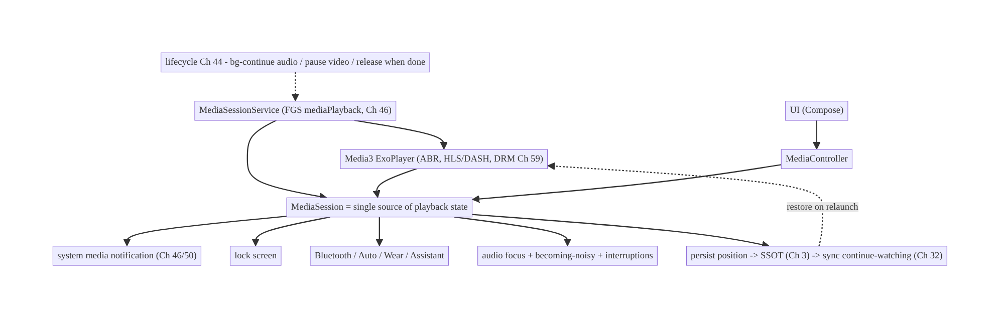
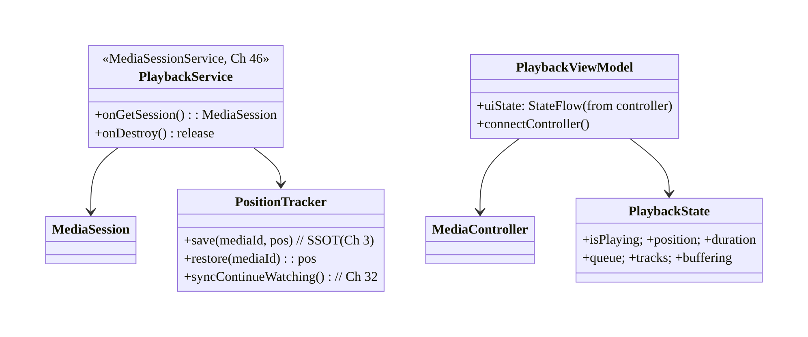
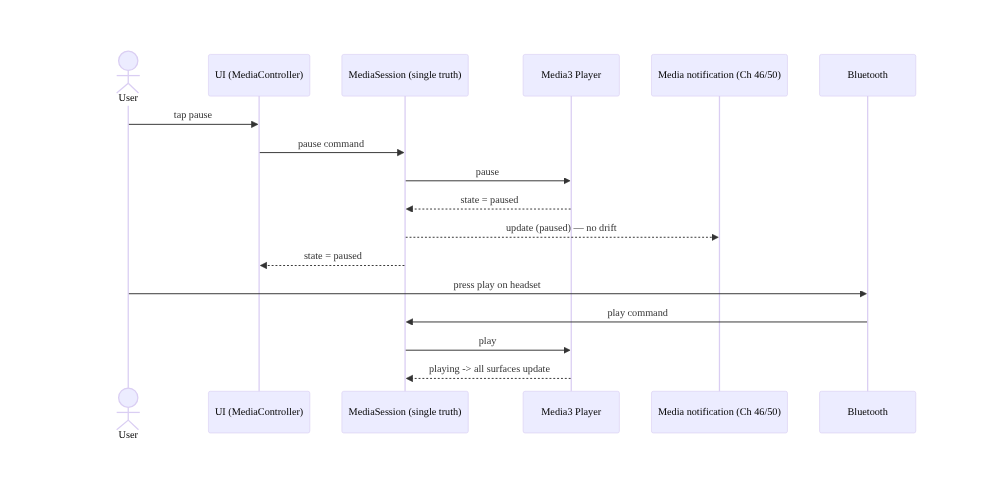
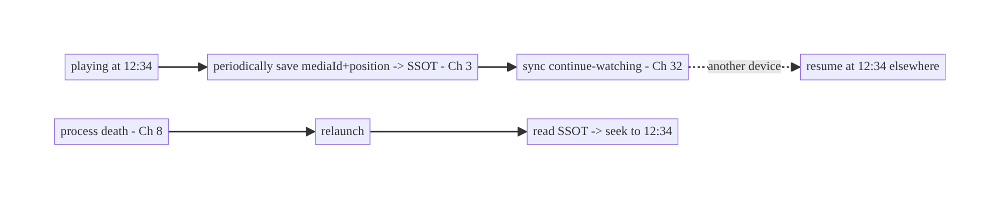
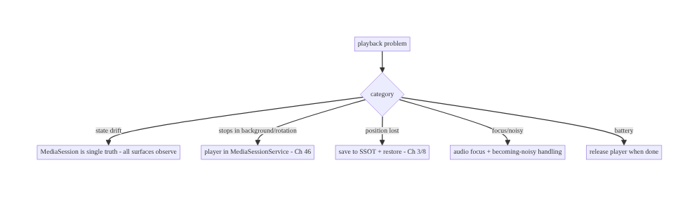

# Chapter 58 — Media Playback State (Media3/ExoPlayer)

> **Part VII — Media & Files** · Complexity: **Complex** (≥40 interview questions)
>
> **Prerequisites:** Ch 46 (foreground services/MediaSessionService), Ch 44 (lifecycle),
> Ch 6 (UI state), Ch 3 (SSOT), Ch 8 (process death), Ch 32 (sync). Pairs with Ch 59
> (offline downloads), Ch 57 (thumbnails), Ch 67 (background).
>
> **Reference surface in StreamCart:** the streaming half of the super-app — playing
> audio/video (adaptive HLS/DASH), keeping **playback state** consistent across the UI,
> notification, background, lock screen, Bluetooth/Auto, and process death, and resuming
> where the user left off.

---

## 58.1 Problem Definition and Real-World Context

Media playback is one of the hardest state-management problems on Android because
**playback state lives in many places at once** and must stay consistent: the player
engine, the on-screen UI, the media notification (Ch 46/50), the lock screen, Bluetooth
headsets / Android Auto / Wear, and across **background** and **process death**. A naive
implementation (an `ExoPlayer` created in a Fragment) breaks the moment the user
backgrounds the app, rotates the screen, plugs in headphones, or the OS kills the process
mid-stream.

Concretely, teams hit:

- **Player tied to the UI lifecycle.** An `ExoPlayer` owned by an Activity/Composable is
  destroyed on config change (Ch 44) and can't play in the background — playback should
  outlive the UI, in a **`MediaSessionService`** (Ch 46).
- **State scattered and inconsistent.** The notification shows "playing" while the UI
  shows "paused"; the lock-screen controls do nothing; Bluetooth next/previous is ignored.
  There must be **one source of truth for playback state** (the `MediaSession`/`Player`)
  that every surface observes and controls.
- **No system integration.** Audio focus (another app starts playing → you must duck/
  pause), becoming-noisy (headphones unplugged → pause), media buttons, Android Auto/
  Wear/Assistant — all require a **`MediaSession`**; hand-rolling misses them.
- **Adaptive streaming complexity.** HLS/DASH with multiple bitrates, ABR (adaptive
  bitrate), buffering, seeking, track selection (audio/subtitle), and DRM (Ch 59) — this
  is what ExoPlayer/Media3 handles; reinventing it is futile.
- **Resume & progress.** Saving and restoring **playback position** across process death
  (Ch 8) and app restarts, and syncing "continue watching" position across devices
  (Ch 32).
- **Lifecycle correctness.** Pause/resume on app background (Ch 44/67), release the player
  when truly done (resources/battery), handle interruptions (calls, other media).

The architecture: use **Media3** (the modern ExoPlayer) as the player engine inside a
**`MediaSessionService`** (Ch 46) so playback **outlives the UI and runs in the
background** with a system-managed media notification; expose a **`MediaSession`** as the
**single source of playback state** that the UI connects to via a **`MediaController`**
(observe state, send commands) and that the system (notification, lock screen, Bluetooth,
Auto, Assistant) controls uniformly; handle **audio focus**, **becoming-noisy**, and
**interruptions**; support **adaptive streaming** (HLS/DASH, ABR, track selection) and
hooks for **DRM/offline** (Ch 59); **persist and restore playback position** (SSOT +
process death, Ch 3/8) and **sync** continue-watching (Ch 32); and manage **lifecycle**
(background pause/continue per content type, release when done). This chapter is about
**consistent, system-integrated, resilient media playback state**.

### Three practical use cases

1. **Video playback (StreamCart).** An HLS stream plays in a Media3 player inside a
   `MediaSessionService`; the UI is a thin `MediaController` view; backgrounding keeps
   audio playing with a notification; rotation doesn't interrupt; position persists.
2. **Audio/podcast with background + controls.** Plays in the background with
   notification/lock-screen/Bluetooth controls; pauses on headphone unplug and on a phone
   call (audio focus); resumes after.
3. **Continue watching across devices.** Playback position is saved to the SSOT and synced
   (Ch 32); the user resumes on another device where they left off.

### Why this is architectural

Playback state is a **multi-surface consistency problem** (UI, notification, lock screen,
Bluetooth, Auto) layered on **background execution** (Ch 46/67), **lifecycle** (Ch 44),
**process death** (Ch 8), **sync** (Ch 32), and **adaptive streaming/DRM** (Ch 59). The
decisions — service-hosted player, `MediaSession` as the single source of truth,
controller-based UI, audio-focus/interruption handling, position persistence/sync —
determine whether playback is consistent, controllable everywhere, and resilient.

---

## 58.2 Requirements Engineering

### Functional requirements

| ID | Requirement |
|----|-------------|
| F1 | Play audio/video (adaptive HLS/DASH), including in the background. |
| F2 | Single source of playback state controllable from UI, notification, lock screen, Bluetooth/Auto. |
| F3 | Handle audio focus, becoming-noisy, and interruptions (calls/other media). |
| F4 | Persist/restore playback position across process death; sync continue-watching (Ch 8/32). |
| F5 | Support track selection (audio/subtitle), seeking, playlist/queue. |
| F6 | Manage lifecycle (background pause/continue by content, release when done). |

### Non-functional requirements

| Attribute | Policy |
|-----------|--------|
| **Consistency** | All surfaces reflect/control one state (no drift). |
| **Resilience** | Survives config change, background, process death. |
| **Battery/Resources** | Release player when done; background only when intended (Ch 46). |
| **Quality** | Smooth ABR, fast start, correct seeking/buffering. |
| **Integration** | Works with notification, lock screen, Bluetooth, Auto, Assistant. |

### Scope

- **In scope:** Media3/ExoPlayer, `MediaSessionService` (Ch 46), `MediaSession` as single
  source of truth, `MediaController` UI, audio focus / becoming-noisy / interruptions,
  adaptive streaming (HLS/DASH/ABR) + track selection, playlists/queue, position persist/
  restore (Ch 8) + continue-watching sync (Ch 32), lifecycle (background/release),
  notification integration (Ch 46/50), DRM/offline hooks (Ch 59).
- **Out of scope:** offline downloads/DRM detail (Ch 59), foreground-service mechanics
  (Ch 46), notifications UI (Ch 50), thumbnails/posters (Ch 57), sync algorithm (Ch 32),
  background limits detail (Ch 67/47).

### Assumptions & constraints

- **Media3** (`androidx.media3`, the current ExoPlayer), `MediaSessionService`/
  `MediaSession`/`MediaController`, Hilt, Room/DataStore (Ch 3/4), WorkManager (Ch 30).
  `minSdk 24`. Playback must run in the background (FGS, Ch 46) and survive process death
  (Ch 8); the system expects a `MediaSession` for integration.

---

## 58.3 System Design Fundamentals

- **Media3 is the engine; don't reinvent it.** Media3 (the evolution of ExoPlayer)
  handles **adaptive streaming** (HLS/DASH/SmoothStreaming), **ABR** (adaptive bitrate),
  buffering, seeking, **track selection** (audio/video/subtitle), **DRM** (Widevine,
  Ch 59), caching, and extensible `MediaSource`/`DataSource` pipelines. You configure and
  observe it — you don't build a player.
- **The player must outlive the UI → `MediaSessionService` (Ch 46).** Create the
  `ExoPlayer`/`MediaSession` inside a **`MediaSessionService`** (a foreground service,
  Ch 46, type `mediaPlayback`) so playback **continues in the background**, survives
  **config changes**, and is **owned** independently of any Activity. The UI is a
  **client**, not the owner.
- **`MediaSession` = the single source of playback state (the crux).** The `MediaSession`
  (wrapping the `Player`) exposes the **authoritative** playback state (playing/paused,
  position, duration, queue, metadata) and accepts **commands** (play/pause/seek/skip).
  Every surface — your UI, the system **media notification** (Ch 46/50), the **lock
  screen**, **Bluetooth** headsets, **Android Auto**, **Wear**, **Assistant** — observes
  and controls the *same* session. This is why there's no drift: there's one state, many
  controllers.
- **UI connects via `MediaController`.** The UI (Compose/Views) creates a
  **`MediaController`** that connects to the `MediaSession` (even across process), observes
  state (`Player.Listener`), and sends commands. The UI holds **no** player state of its
  own — it renders the session's state (UDF, Ch 6). On config change the UI is recreated
  and re-attaches to the still-running session (no interruption).
- **System integration via the session:**
  - **Audio focus:** request focus; when another app takes it, **pause or duck**
    (Media3's `AudioAttributes` + `setHandleAudioBecomingNoisy` + focus handling do much
    automatically). On regaining focus, resume if appropriate.
  - **Becoming noisy:** headphones unplugged → **pause** (expected UX;
    `setHandleAudioBecomingNoisy(true)`).
  - **Media buttons / Bluetooth / Auto / Assistant:** routed to the session's command
    handlers automatically.
- **Adaptive streaming & track selection.** Provide an HLS/DASH `MediaItem`; Media3's
  `DefaultTrackSelector` + ABR pick bitrate by bandwidth; expose **track selection**
  (quality, audio language, subtitles) through the selector. Buffering/seeking are handled;
  you surface state (buffering spinner) from the player's state.
- **Playlists / queue.** Media3 supports a **playlist** (`setMediaItems`, queue
  navigation `seekToNext/Previous`); the session exposes queue metadata to all surfaces.
- **Position persistence & resume (Ch 8/3/32):**
  - **Process death:** save the current `mediaId + position` periodically and on
    pause/stop to the **SSOT** (Ch 3) / `SavedState` so you can **restore** on relaunch
    (Media3 also supports state restoration).
  - **Continue watching:** persist position to the SSOT and **sync** it (Ch 32) so other
    devices resume where the user left off (position is synced state).
- **Lifecycle (Ch 44/67).** For **audio** (podcast/music), **continue in background** (FGS,
  Ch 46). For **video**, you may **pause on background** (unless PiP/audio-only) to save
  resources/battery, per content type. **Release** the player/session when playback is
  truly done (`onDestroy` of the service / no controllers + stopped) to free codecs/
  battery. Handle **interruptions** (incoming call → pause via focus; resume after).
- **DRM / offline hooks (Ch 59).** Protected content uses a DRM session (Widevine);
  offline playback uses downloaded media + offline license (Ch 59) — Media3 integrates
  both through its `MediaSource`/`DrmSessionManager`/download modules.

Core insight: **host the Media3 player in a `MediaSessionService` (Ch 46) so playback
outlives the UI and runs in the background, and make the `MediaSession` the single source
of playback state that the UI (via a `MediaController`, UDF, Ch 6) and the whole system
(notification, lock screen, Bluetooth, Auto, Assistant) observe and control — eliminating
state drift; let Media3 handle adaptive streaming/ABR/track-selection/DRM; handle audio
focus, becoming-noisy, and interruptions; persist and restore playback position across
process death (Ch 8) and sync continue-watching across devices (Ch 32); and manage
lifecycle per content type (background-continue audio, pause video; release when done).**

---

## 58.4 High-Level Architecture



**Components & ownership**

- **`MediaSessionService`** owns the **Media3 player** and the **`MediaSession`** —
  playback runs here, background-capable (Ch 46).
- **`MediaSession`** is the **single source of playback state**; all surfaces
  (notification, lock screen, Bluetooth, Auto) and the UI (`MediaController`) observe/
  control it.
- **Persistence/sync** saves position to the SSOT and syncs continue-watching (Ch 3/32).

**Direction:** service-hosted player → session (single truth) → all surfaces + UI
controller; position persisted/synced; lifecycle managed.

---

## 58.5 Detailed Component Design



| Component | Responsibility |
|-----------|----------------|
| `PlaybackService` | own Media3 player + `MediaSession`; background; release |
| `MediaSession` | single source of playback state + command target |
| `MediaController` (in UI/VM) | observe state + send commands (UDF, Ch 6) |
| `PositionTracker` | persist position (SSOT, Ch 3/8) + sync continue-watching (Ch 32) |

---

## 58.6 End-to-End Data Flow

### UI, notification, and Bluetooth all control one session



### Resume across process death + continue-watching sync



---

## 58.7 Complete Kotlin Implementation

Package: `com.streamcart.playback`.

### 58.7.1 MediaSessionService hosting the Media3 player (Ch 46)

```kotlin
@AndroidEntryPoint
class PlaybackService : MediaSessionService() {       // FGS type mediaPlayback (Ch 46)
    @Inject lateinit var positionTracker: PositionTracker
    private lateinit var player: ExoPlayer
    private lateinit var session: MediaSession

    override fun onCreate() {
        super.onCreate()
        player = ExoPlayer.Builder(this)
            .setAudioAttributes(AudioAttributes.DEFAULT, /* handleAudioFocus = */ true)   // audio focus
            .setHandleAudioBecomingNoisy(true)                                            // pause on unplug
            .build()
            .also { it.addListener(positionListener()) }
        session = MediaSession.Builder(this, player).build()   // the SINGLE source of playback state
    }
    override fun onGetSession(controllerInfo: MediaSession.ControllerInfo) = session

    private fun positionListener() = object : Player.Listener {
        override fun onIsPlayingChanged(isPlaying: Boolean) {
            if (!isPlaying) positionTracker.save(player.currentMediaItem?.mediaId, player.currentPosition)  // Ch 3
        }
        override fun onMediaItemTransition(item: MediaItem?, reason: Int) { /* save on track change */ }
    }

    override fun onDestroy() {                          // release when done (resources/battery)
        positionTracker.save(player.currentMediaItem?.mediaId, player.currentPosition)
        session.release(); player.release(); super.onDestroy()
    }
}
```

### 58.7.2 UI connects via MediaController (observes the single state, UDF Ch 6)

```kotlin
@HiltViewModel
class PlaybackViewModel @Inject constructor(
    @ApplicationContext private val ctx: Context,
) : ViewModel() {
    private var controller: MediaController? = null
    private val _state = MutableStateFlow(PlaybackUiState())
    val state: StateFlow<PlaybackUiState> = _state.asStateFlow()

    fun connect() {
        val token = SessionToken(ctx, ComponentName(ctx, PlaybackService::class.java))
        val future = MediaController.Builder(ctx, token).buildAsync()
        future.addListener({
            controller = future.get().also { c ->
                c.addListener(object : Player.Listener {           // render the SESSION's state (no local truth)
                    override fun onEvents(player: Player, events: Player.Events) {
                        _state.value = PlaybackUiState(
                            isPlaying = player.isPlaying, position = player.currentPosition,
                            duration = player.duration, buffering = player.playbackState == Player.STATE_BUFFERING)
                    }
                })
            }
        }, MoreExecutors.directExecutor())
    }
    fun playPause() { controller?.let { if (it.isPlaying) it.pause() else it.play() } }  // commands -> session
    fun seekTo(ms: Long) { controller?.seekTo(ms) }
    override fun onCleared() { controller?.release() }   // release controller, NOT the session/player
}
```

### 58.7.3 Playing adaptive content + resume to saved position

```kotlin
fun PlaybackViewModel.play(mediaId: String, hlsUrl: String) {
    val resumeAt = positionTracker.restore(mediaId)        // continue-watching (Ch 3/32)
    val item = MediaItem.Builder().setMediaId(mediaId).setUri(hlsUrl)
        .setMimeType(MimeTypes.APPLICATION_M3U8)           // HLS; Media3 handles ABR
        .build()
    controller?.apply { setMediaItem(item, resumeAt); prepare(); play() }   // seek to saved position
}
```

### 58.7.4 Position persistence + continue-watching sync (Ch 3/32)

```kotlin
@Singleton
class PositionTracker @Inject constructor(
    private val dao: PlaybackPositionDao,       // Room SSOT (Ch 3)
    private val syncRepo: SyncRepository,       // Ch 32
    private val scope: CoroutineScope,          // app scope (Ch 5)
) {
    fun save(mediaId: String?, positionMs: Long) {
        mediaId ?: return
        scope.launch {
            dao.upsert(PlaybackPosition(mediaId, positionMs, System.currentTimeMillis()))  // survive process death (Ch 8)
            syncRepo.pushContinueWatching(mediaId, positionMs)   // sync across devices (Ch 32, debounced/outbox Ch 31)
        }
    }
    suspend fun restore(mediaId: String): Long = dao.get(mediaId)?.positionMs ?: 0L
}
```

### 58.7.5 Track selection (quality / subtitles)

```kotlin
// Expose Media3 track selection to the UI (quality, audio language, subtitles).
fun PlaybackViewModel.selectSubtitle(languageTag: String) {
    controller?.trackSelectionParameters = controller!!.trackSelectionParameters.buildUpon()
        .setPreferredTextLanguage(languageTag).build()
}
fun PlaybackViewModel.capQuality(maxHeight: Int) {
    controller?.trackSelectionParameters = controller!!.trackSelectionParameters.buildUpon()
        .setMaxVideoSize(Int.MAX_VALUE, maxHeight).build()   // ABR within cap
}
```

### 58.7.6 Module structure

```
:feature:player   PlaybackService (MediaSessionService), PlaybackViewModel (MediaController), player UI
:core:playback    PositionTracker, PlaybackPositionDao (Room SSOT, Ch 3), continue-watching sync (Ch 32)
# FGS/notification -> Ch 46/50; offline/DRM -> Ch 59; background limits -> Ch 67.
```

---

## 58.8 Concurrency and Race Conditions

| Scenario | Risk | Handling |
|----------|------|----------|
| UI owns player state | drift with notification/BT | session is single truth; UI observes via controller |
| Config change recreates UI | playback interrupted | player in service; UI re-attaches controller |
| Multiple controllers (UI + Auto) | conflicting commands | session serializes commands; single player |
| Position save races with transition | wrong position saved | save on pause/stop/transition from player state |
| Audio focus loss during command | double pause/resume | let Media3 handle focus; idempotent commands |
| Process death mid-playback | lost position | periodic + on-pause save to SSOT (Ch 8); restore on relaunch |
| Controller released but service running | leaks/wrong lifetime | release controller in UI `onCleared`, not the session |

- **The `MediaSession` serializes state and commands**, so multiple controllers (your UI,
  Android Auto, a Bluetooth remote) can't drive conflicting states — there's one player,
  one state, commands applied in order. This is the whole reason drift disappears.
- **Separate the controller's lifecycle from the session's:** the UI `MediaController` is
  released on UI teardown, but the **session/player live in the service** and keep playing
  — never release the player when the UI goes away (only when playback is truly done).
- **Persist position from the player's authoritative state** (on pause/stop/transition +
  periodically) so saves reflect true position, surviving process death (Ch 8).

---

## 58.9 Failure Scenarios and Recovery

| Failure | Detection | Response | Outcome |
|---------|-----------|----------|---------|
| Notification/UI/BT state drift | user report | single session as truth; all observe it | consistent |
| Playback stops on background | user report | `MediaSessionService` FGS (Ch 46) | continues (audio) |
| Playback lost on rotation | user report | player in service; UI re-attaches | uninterrupted |
| Position lost on process death | user report | periodic + on-pause SSOT save; restore (Ch 8) | resumes |
| Doesn't pause on headphone unplug | user report | `setHandleAudioBecomingNoisy(true)` | pauses |
| Keeps playing over a phone call | user report | audio focus handling | pauses/ducks |
| Player never released | battery/resources | release in service `onDestroy`/when done | freed |
| Continue-watching not synced | user report | persist + sync position (Ch 32) | cross-device |



> **One principle resolves most playback bugs: the `MediaSession` (in a service) is the
> single source of playback state.** Drift (UI vs notification vs Bluetooth), background
> survival, and config-change resilience all follow from putting the player in a
> `MediaSessionService` and having every surface — including your UI — observe and control
> that one session rather than holding its own state.

---

## 58.10 Scaling the Implementation

- **Level 1.** Media3 player in a `MediaSessionService`; UI via `MediaController`;
  HLS/DASH playback.
- **Level 2.** Audio focus / becoming-noisy / interruptions; media notification + lock
  screen + Bluetooth (free via session); position persist + resume (Ch 8).
- **Level 3 — production.** Continue-watching sync (Ch 32); track selection (quality/
  subtitles); playlist/queue; lifecycle (bg-audio/pause-video, release when done).
- **Level 4 — large.** Android Auto/Wear/Assistant integration; ABR tuning; DRM + offline
  (Ch 59); PiP for video; casting (Cast); analytics (QoE: start time, rebuffering).
- **Level 5 — enterprise.** Playback QoE SLOs (startup latency, rebuffer ratio), adaptive-
  bitrate policy, multi-DRM, cross-device resume governance, A/B of player behavior.

**Avoid overengineering:** use Media3 + `MediaSessionService` + `MediaController`; the
session gives you notification/lock-screen/Bluetooth/Auto nearly for free. Don't hand-roll
the player, the notification, or a second state store.

---

## 58.11 Alternative Approaches and Trade-offs

| Dimension | Option A | Option B | When |
|-----------|----------|----------|------|
| Player engine | Media3/ExoPlayer | `MediaPlayer` / custom | Media3 (ABR/HLS/DASH/DRM); `MediaPlayer` only for trivial cases |
| Player host | `MediaSessionService` (FGS) | in Activity/Fragment | Service (background, outlives UI); in-UI breaks on bg/rotation |
| State source | `MediaSession` (single truth) | UI-held state | Session (no drift, system integration) |
| UI link | `MediaController` | direct player reference | Controller (cross-process, lifecycle-safe) |
| Background video | Pause (unless PiP/audio) | keep rendering | Pause (battery) unless PiP/audio-only |
| Position | SSOT persist + sync (Ch 3/32) | in-memory only | Persist+sync (process death + cross-device) |
| Audio focus | Media3-managed | manual | Media3-managed (handles duck/pause/resume) |

**Media3/ExoPlayer vs `MediaPlayer`:** `MediaPlayer` is a thin wrapper suitable only for
trivial single-file playback — it lacks robust adaptive streaming (HLS/DASH), ABR, track
selection, DRM, and a modern state model. **Media3/ExoPlayer** is the production standard:
adaptive streaming, extensible pipelines, DRM, offline (Ch 59), and `MediaSession`
integration. Use Media3 for any real media app.

**`MediaSession` as single truth vs UI-held state:** holding playback state in the UI
guarantees drift — the notification, lock screen, and Bluetooth can't see or control it,
and config changes/background break it. Making the **`MediaSession`** the single
authoritative state (in a service) means every surface, including your UI via a
`MediaController`, observes and controls the *same* state — the system handles notification/
lock-screen/Bluetooth/Auto automatically. This is the central design decision.

**Service-hosted vs UI-hosted player:** an `ExoPlayer` created in an Activity/Composable is
destroyed on config change and can't play in the background. Hosting it in a
`MediaSessionService` (Ch 46) lets playback **outlive the UI**, run in the **background**,
and survive rotation — the UI becomes a reconnectable client. Always host the player in a
service for real playback.

---

## 58.12 Security & DRM Considerations

- **DRM for protected content (Ch 59):** premium video uses **Widevine** via Media3's
  `DrmSessionManager`; keys are handled by the platform DRM stack, never exposed to app
  code; offline playback uses offline licenses (Ch 59). Don't attempt to decrypt in app
  code.
- **Secure output / screen capture:** DRM content may require `FLAG_SECURE` and secure
  surfaces to block screenshots/recording of protected video (Ch 44).
- **Authenticated manifests/segments:** HLS/DASH URLs and license requests go over the
  **authenticated, pinned** network stack (Ch 19/23); use signed/expiring URLs for
  content; don't leak content URLs.
- **Don't log media URLs/keys/PII** (Ch 28); playback analytics use content ids, not
  signed URLs.
- **Per-account entitlements (Ch 42):** verify the user is entitled to the content
  server-side (Ch 23); the client player trusts the server's authorization.
- Client vs backend: the backend issues **entitlements, signed URLs, and DRM licenses**;
  the client plays within those and uses secure surfaces — it never holds decryption keys
  or bypasses entitlement.

---

## 58.13 Performance and Resource Optimization

- **Release the player when done** (no controllers + stopped / service destroyed) — the
  top battery/memory lever (codecs/buffers are heavy).
- **Pause video on background** (unless PiP/audio-only) to stop decoding/rendering.
- **ABR tuning:** let Media3 adapt bitrate to bandwidth; cap quality on cellular/low
  battery (track selection) to save data.
- **Buffering policy:** tune load control (buffer sizes) for fast start vs memory; prefetch
  next item modestly.
- **Reuse one player/session** (don't create per screen); the service owns it.
- **Efficient position saves:** debounce/periodic + on-pause, not every frame (Ch 31/32).
- **Profiling:** QoE — startup latency (time to first frame), **rebuffer ratio**, bitrate
  distribution, dropped frames, battery during playback, player create/release counts.

---

## 58.14 Testing Strategy

Media3 provides test utilities (`TestExoPlayerBuilder`, `FakeMediaSource`,
`RobolectricUtil`); state/persistence test in isolation.

```kotlin
@RunWith(AndroidJUnit4::class)
class PlaybackStateTest {
    @Test fun `controller reflects session state - no local truth`() {
        val player = TestExoPlayerBuilder(context).build()
        // attach a controller; assert UI state mirrors player.isPlaying/position
    }
    @Test fun `pause saves position to SSOT`() = runTest {
        val tracker = PositionTracker(fakeDao, fakeSync, testScope)
        tracker.save("m1", 12_340); assertEquals(12_340, fakeDao.get("m1")?.positionMs)
    }
    @Test fun `restore seeks to saved position`() = runTest { /* restore -> setMediaItem(item, pos) */ }
}

class PositionSyncTest {
    @Test fun `continue-watching position synced`() = runTest { /* assert syncRepo.pushContinueWatching */ }
}
// Audio focus / becoming-noisy / background: instrumentation on device (unplug, call, background).
```

What to test: UI state mirrors the session (no local truth); position persist on pause/
transition + restore (Ch 8); continue-watching sync (Ch 32); command routing (play/pause/
seek) via controller; track selection; lifecycle (player survives config change, released
when done). Instrumentation for audio focus, becoming-noisy, background continuation,
notification/Bluetooth control.

---

## 58.15 Production Observability

- **Metrics (QoE):** **startup latency** (play → first frame), **rebuffer ratio/
  frequency**, bitrate distribution, dropped frames, playback-error rate, continue-
  watching resume success, cross-device resume accuracy; state-drift incidents (0);
  player create/release balance; background-playback battery.
- **Logs:** `playback{mediaId, state, position, bitrate, event}` — no signed URLs/keys/PII
  (Ch 28).
- **Debugging:** drift → UI holding state (not observing session); stops in background →
  not in a service (Ch 46); position lost → not persisted (Ch 8); rebuffering → ABR/buffer
  policy/network; no Bluetooth control → session misconfigured; battery → player not
  released.
- **Alerting:** rebuffer-ratio or startup-latency regression; playback-error spike (CDN/
  DRM); state-drift reports.
- **Dashboards:** QoE (startup latency, rebuffer ratio) by network/device; resume success.

---

## 58.16 System Design Interview Preparation

> ≥40 questions.

**Fundamentals**

1. *Why is playback state hard?* It lives across UI, notification, lock screen, Bluetooth,
   Auto, background, process death.
2. *Engine?* Media3/ExoPlayer (ABR, HLS/DASH, DRM, track selection).
3. *Why not `MediaPlayer`?* No robust adaptive streaming/DRM/state model.
4. *Where does the player live?* In a `MediaSessionService` (Ch 46) — outlives UI,
   background.
5. *Single source of playback state?* The `MediaSession`.

**Session/controller**

6. *What does `MediaSession` expose?* Authoritative state + command target.
7. *Who controls it?* UI (`MediaController`), notification, lock screen, Bluetooth, Auto,
   Assistant.
8. *How does the UI connect?* `MediaController` (cross-process), observes + commands.
9. *UI-held state?* No — render the session's state (UDF, Ch 6).
10. *Config change?* UI recreated, re-attaches to the running session.
11. *Multiple controllers conflict?* Session serializes; one player.

**System integration**

12. *Audio focus?* Request; pause/duck on loss; resume on regain (Media3-managed).
13. *Becoming noisy?* Pause on headphone unplug (`setHandleAudioBecomingNoisy`).
14. *Media buttons/Bluetooth/Auto?* Routed to the session automatically.
15. *Notification?* System media notification via the service (Ch 46/50).

**Streaming**

16. *Adaptive streaming?* HLS/DASH + ABR (Media3).
17. *Track selection?* Quality/audio/subtitle via `TrackSelectionParameters`.
18. *Buffering/seeking?* Handled; surface state from the player.
19. *Playlist/queue?* `setMediaItems`, seekToNext/Previous.

**Persistence/resume**

20. *Process death?* Save mediaId+position to SSOT; restore on relaunch (Ch 8).
21. *When to save?* Periodically + on pause/stop/transition.
22. *Continue watching cross-device?* Persist + sync position (Ch 32).

**Lifecycle**

23. *Background audio?* Continue (FGS, Ch 46).
24. *Background video?* Pause (unless PiP/audio-only) for battery.
25. *When to release?* When done (no controllers + stopped / service destroyed).
26. *Interruptions (call)?* Pause via audio focus; resume after.

**DRM/security**

27. *Protected content?* Widevine via `DrmSessionManager` (Ch 59); platform-held keys.
28. *Block screen capture?* `FLAG_SECURE`/secure surface.
29. *URLs/manifests?* Authed, pinned, signed/expiring (Ch 19/23).
30. *Entitlement?* Server-side per account (Ch 42/23).
31. *Logging?* No URLs/keys/PII (Ch 28).

**Perf/QoE**

32. *Top battery lever?* Release the player when done.
33. *ABR on cellular?* Cap quality (track selection).
34. *QoE metrics?* Startup latency, rebuffer ratio, bitrate, dropped frames.
35. *Buffer policy?* Tune load control (start vs memory).

**Testing/Production**

36. *Test playback?* `TestExoPlayerBuilder`/`FakeMediaSource`; state in isolation.
37. *Test persistence?* Save/restore position.
38. *Drift in prod?* UI holding state, not observing session.
39. *Stops in background?* Not in a service.
40. *Rebuffering?* ABR/buffer/network.
41. *Key reliability signal?* QoE (startup latency + rebuffer ratio) + zero drift.

### Design-change challenges
1. **Audio must keep playing in the background with controls.** `MediaSessionService` +
   session-driven notification/lock-screen/Bluetooth (Ch 46).
2. **Notification and UI show different play/pause states.** Single `MediaSession` as
   truth; UI observes it.
3. **Resume where the user left off, across devices.** Persist position to SSOT + sync
   (Ch 3/32).
4. **Playback dies on rotation.** Host the player in the service; UI re-attaches.
5. **Protected 4K must block screenshots.** DRM (Widevine) + `FLAG_SECURE` (Ch 59).

### Mock walkthrough (abridged)
Clarify (audio/video, background, DRM, continue-watching, Auto?) → Media3 in a
`MediaSessionService` (Ch 46) → `MediaSession` as single truth → UI via `MediaController`
(UDF, Ch 6) → audio focus/becoming-noisy/interruptions → adaptive streaming + track
selection → position persist (Ch 8) + continue-watching sync (Ch 32) → lifecycle
(bg-audio/pause-video, release) → DRM/security (Ch 59/23) → QoE observability.

---

## 58.17 Practical Exercises

1. **Beginner.** Play an HLS stream with Media3 inside a `MediaSessionService`; drive it
   from a Compose UI via a `MediaController`. *Eval:* plays; UI reflects session; survives
   rotation.
2. **Intermediate.** Add background audio with notification/lock-screen/Bluetooth controls,
   audio focus, and becoming-noisy pause. *Eval:* consistent across surfaces; pauses on
   unplug/call.
3. **Advanced.** Persist playback position across process death and sync continue-watching
   across devices. *Eval:* resumes after kill; resumes on another device.
4. **Production debugging.** Fix notification/UI state drift (UI held its own state) and
   playback dying on background (player in the Activity). *Eval:* single session truth;
   survives background.
5. **System design challenge.** Add track selection (quality/subtitles), cap bitrate on
   cellular, and a QoE dashboard (startup latency, rebuffer ratio). *Eval:* selectable;
   capped; measurable.

*(Solutions withheld unless requested.)*

---

## 58.18 Chapter Summary & Reference Sheet

**Key decisions:** host the **Media3/ExoPlayer** engine in a **`MediaSessionService`**
(Ch 46) so playback **outlives the UI and runs in the background**, and make the
**`MediaSession` the single source of playback state** that your UI (via a
**`MediaController`**, UDF, Ch 6) and the **entire system** (media notification, lock
screen, Bluetooth, Android Auto, Wear, Assistant) observe and control — which eliminates
state drift and gives system integration nearly for free; let **Media3 handle adaptive
streaming (HLS/DASH), ABR, track selection, and DRM** (Ch 59); handle **audio focus**,
**becoming-noisy** (pause on unplug), and **interruptions** (calls); **persist playback
position to the SSOT** and **restore across process death** (Ch 3/8), and **sync
continue-watching across devices** (Ch 32); manage **lifecycle per content type**
(continue audio in the background, pause video for battery, **release the player when
done**); and secure protected content with **Widevine + `FLAG_SECURE` + authed/signed
URLs + server-side entitlement** (Ch 59/23/42).

**Concepts:** Media3/ExoPlayer, `MediaSessionService` (Ch 46), `MediaSession` as single
truth, `MediaController` UI (UDF), audio focus/becoming-noisy/interruptions, adaptive
streaming/ABR/track selection, position persist (Ch 8) + continue-watching sync (Ch 32),
lifecycle/release, DRM/secure output.

**Common mistakes:** player in the Activity/Composable (dies on bg/rotation); UI-held
playback state (drift with notification/Bluetooth); hand-rolling the player/`MediaPlayer`
(no ABR/DRM); no audio focus/becoming-noisy handling; position not persisted (lost on
death) or not synced (no cross-device resume); never releasing the player (battery);
leaving video rendering in the background; no DRM/secure output for protected content.

**Checklist:**

- [ ] Media3 player in `MediaSessionService` (Ch 46)
- [ ] `MediaSession` = single truth
- [ ] UI via `MediaController` (no local state, UDF)
- [ ] audio focus + becoming-noisy + interruptions
- [ ] adaptive streaming + track selection
- [ ] persist position (SSOT/process death, Ch 3/8)
- [ ] continue-watching sync (Ch 32)
- [ ] bg-continue audio / pause video / release when done
- [ ] DRM + `FLAG_SECURE` + authed/signed URLs + entitlement (Ch 59/23/42)
- [ ] QoE telemetry (startup latency, rebuffer ratio).

**Key APIs:** `ExoPlayer.Builder` (`setAudioAttributes(handleAudioFocus)`/
`setHandleAudioBecomingNoisy`), `MediaSessionService`/`MediaSession.Builder`/`onGetSession`,
`MediaController.Builder`/`SessionToken`, `Player.Listener`/`onEvents`, `MediaItem`
(HLS/DASH mime), `TrackSelectionParameters` (quality/subtitle), `DefaultTrackSelector`,
`DrmSessionManager` (Ch 59), `FLAG_SECURE`, `TestExoPlayerBuilder` (test), Room SSOT
(Ch 3), sync (Ch 32).

**References:**
- Media3 / ExoPlayer: https://developer.android.com/media/media3/exoplayer
- MediaSession: https://developer.android.com/media/media3/session/control-playback
- Background playback (MediaSessionService): https://developer.android.com/media/media3/session/background-playback
- Audio focus: https://developer.android.com/media/optimize/audio-focus
- Track selection: https://developer.android.com/media/media3/exoplayer/track-selection
- (composes) Ch 46 Foreground Services, Ch 59 Offline/DRM, Ch 44 Lifecycle, Ch 8 Process Death, Ch 32 Sync, Ch 6 UI State

### Chapter review (Phase 4)
- **Completeness:** all 18 sections; architecture/class/2 sequence+flow/failure diagrams;
  MediaSessionService + MediaController VM + position tracker + track selection code;
  concurrency (session serialization, controller-vs-session lifecycle, position races);
  failure (single-session principle); 5 levels; Media3-vs-MediaPlayer, session-as-truth,
  service-hosting trade-offs; security/DRM (Widevine, FLAG_SECURE, signed URLs,
  entitlement); perf/QoE (release, ABR, rebuffer); Media3 test utils; observability (QoE);
  41 Q&A + 5 challenges. ✅
- **Expand later:** offline/DRM (Ch 59), foreground services (Ch 46), process death (Ch 8),
  sync (Ch 32).
- **Interview coverage:** exceeds ≥40 Complex bar.
