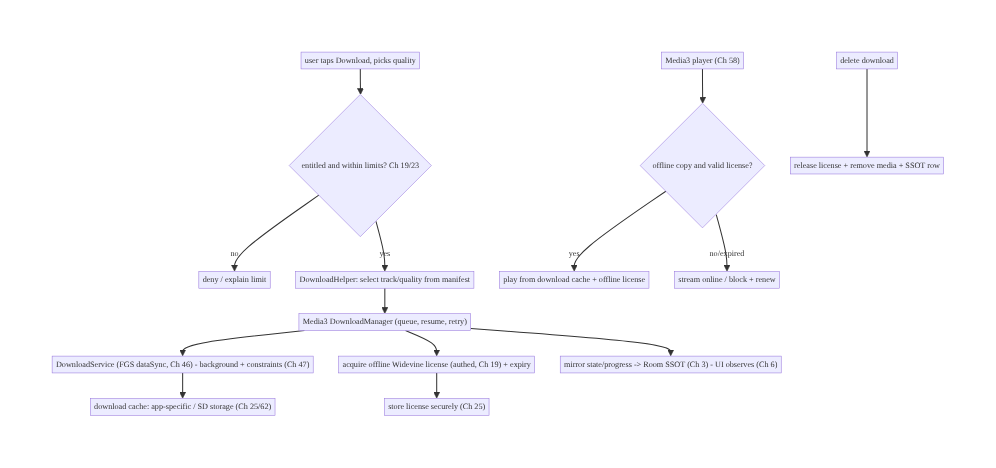
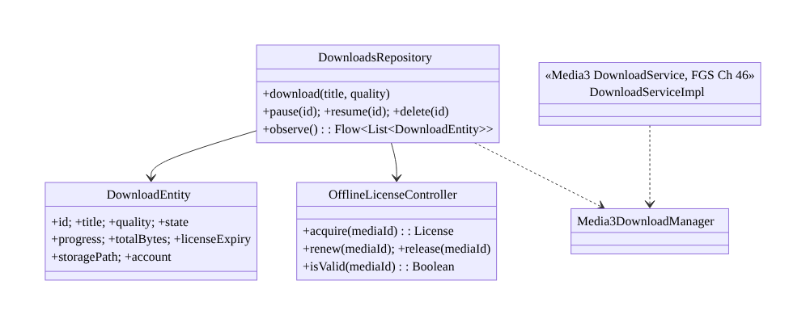
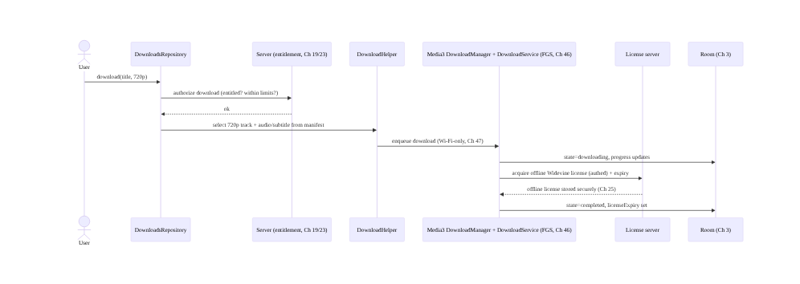
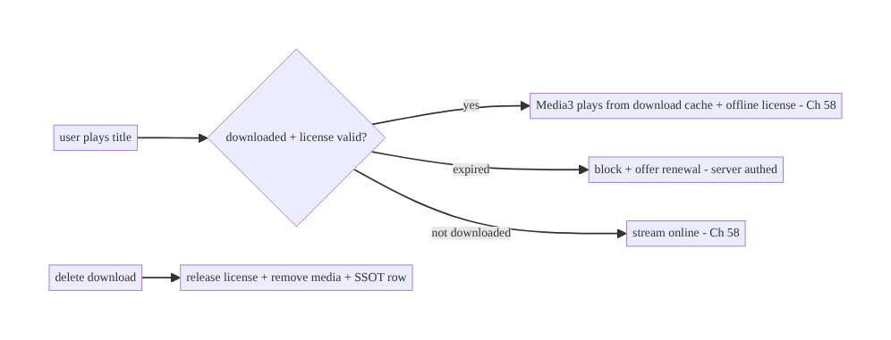
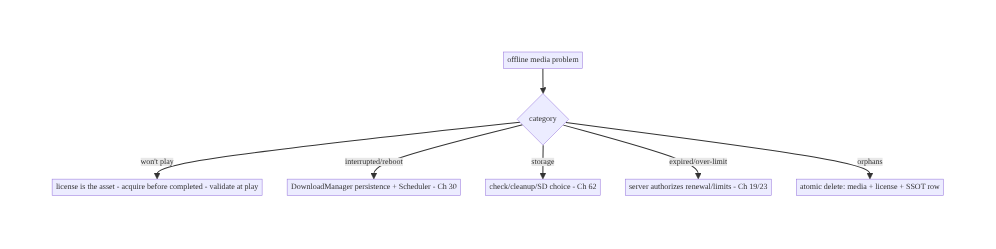

# Chapter 59 — Offline Media Downloads (OTT)

> **Part VII — Media & Files** · Complexity: **Complex** (≥40 interview questions)
>
> **Prerequisites:** Ch 58 (Media3 playback), Ch 18 (download manager), Ch 30
> (WorkManager), Ch 46 (foreground services), Ch 3 (SSOT), Ch 25 (secure storage), Ch 19
> (auth). Pairs with Ch 57 (posters), Ch 61 (large files), Ch 32 (sync).
>
> **Reference surface in StreamCart:** the "Download for offline" feature of the
> streaming side — letting users download movies/shows/podcasts (adaptive, DRM-protected)
> to watch without a network, with correct licensing, storage management, and playback
> that seamlessly switches online↔offline.

---

## 59.1 Problem Definition and Real-World Context

"Download to watch offline" (OTT: over-the-top video) is far harder than downloading a
file (Ch 18). Streaming content is **adaptive** (HLS/DASH — many segments, multiple
bitrates), usually **DRM-protected** (Widevine), **large** (gigabytes), **licensed**
(time-limited, device-bound, concurrency-limited by the rights holder), and must **play
back through the same player** (Media3, Ch 58) whether online or offline. A naive "save
the video file" approach fails on every axis.

Concretely, teams hit:

- **Adaptive streams aren't a single file.** An HLS/DASH title is hundreds of segments
  across several bitrates. You must download a **chosen track/quality** (not all), store
  the segments, and let the player read them offline — Media3's **download modules**
  (`DownloadManager`, `DownloadService`) handle this; hand-rolling segment download is a
  nightmare.
- **DRM & offline licenses.** Protected content needs an **offline Widevine license**
  acquired at download time, stored securely, with an **expiry** and **renewal** — and the
  license (not just the bytes) governs playback. Deleting the download must **release the
  license**; an expired license must block playback and prompt renewal.
- **Huge storage, user choice, cleanup.** Downloads are gigabytes; users pick quality
  (storage vs fidelity), downloads must be **pausable/resumable** (Ch 18), survive
  reboot/process death, and be **cleaned up** (auto-delete watched, expiry, storage
  pressure). External/SD-card storage choices (Ch 25/62) matter.
- **Background, long-running, constrained.** Multi-GB downloads run in the **background**
  via a **foreground service / WorkManager** (Ch 46/30), respecting Wi-Fi-only/charging
  constraints (Ch 47) and resuming after interruptions.
- **Online↔offline playback switch.** The player (Ch 58) must transparently use the
  **downloaded copy** when offline (or to save data) and the **stream** otherwise — one
  playback experience.
- **Licensing policy enforcement.** Download limits (how many titles, how many devices),
  geo/entitlement rules, and expiry are **server-governed** (Ch 19/23); the client
  enforces the UX but the server authorizes.

The architecture: use **Media3's download stack** (`DownloadManager` + a
`DownloadService`, a foreground service, Ch 46) to download a **selected track** of an
adaptive stream with pause/resume/constraints (Ch 18/30/47); acquire and store an
**offline DRM license** (Widevine) at download time, track its **expiry/renewal**, and
**release** it on delete; model downloads in the **SSOT** (Room, Ch 3) with state
(queued/downloading/paused/completed/failed/expired) and progress, stored in
**app-internal or user-chosen storage** (Ch 25/62); run downloads in the **background**
(FGS/WorkManager, Ch 46/30) under constraints; make the **player** (Ch 58) transparently
prefer the offline copy; **enforce licensing** (server-authorized limits/expiry, Ch 19/
23); and **manage storage** (quality choice, cleanup, pressure). This chapter is about
**licensed, DRM-protected, adaptive offline media done correctly**.

### Three practical use cases

1. **Download a movie (StreamCart).** User taps Download, picks quality → Media3 downloads
   the selected track in the background (FGS, Wi-Fi-only), acquires an offline Widevine
   license, tracks progress in the SSOT, generates a poster (Ch 57); plays offline later.
2. **Expiry & renewal.** A downloaded title's license expires in 48h after first play →
   the UI shows the countdown; on expiry, playback is blocked and renewal is offered
   (server-authorized, Ch 19).
3. **Storage management.** Auto-delete watched downloads, honor a storage cap, let the
   user choose SD-card storage (Ch 62), and clean up on storage pressure.

### Why this is architectural

Offline OTT combines **adaptive streaming + DRM licensing + huge background downloads +
secure storage + player integration + server-enforced rights** — a system where the
*license*, not just the bytes, is the asset, and correctness spans download, storage,
expiry, playback, and entitlement. The decisions determine whether offline playback is
legal, reliable, and storage-sane.

---

## 59.2 Requirements Engineering

### Functional requirements

| ID | Requirement |
|----|-------------|
| F1 | Download a selected quality/track of an adaptive (HLS/DASH) title for offline playback. |
| F2 | Acquire/store/renew/release an offline DRM (Widevine) license with expiry. |
| F3 | Pause/resume/retry downloads; survive reboot/process death; background + constraints. |
| F4 | Model downloads in the SSOT (state + progress); store securely (Ch 25/62). |
| F5 | Play offline transparently via the same player (Ch 58); online↔offline switch. |
| F6 | Enforce licensing policy (limits/expiry/entitlement) with server authorization (Ch 19/23). |

### Non-functional requirements

| Attribute | Policy |
|-----------|--------|
| **Legality** | DRM licenses respected; server-authorized limits/expiry/entitlement. |
| **Reliability** | Resumable; survives reboot/death; retries; completes multi-GB. |
| **Storage** | User-chosen quality/location; cleanup; pressure handling. |
| **Battery/Data** | Wi-Fi-only/charging constraints (Ch 47); background (Ch 46). |
| **Security** | Licenses + content stored securely (Ch 25); keys platform-held. |
| **UX** | Transparent offline playback; clear state/expiry/renewal. |

### Scope

- **In scope:** Media3 download stack (`DownloadManager`/`DownloadService` FGS, Ch 46),
  track/quality selection for download, offline DRM (Widevine) license acquire/store/
  renew/release + expiry, pause/resume/retry + reboot/death survival + constraints
  (Ch 18/30/47), SSOT download model (Ch 3), secure/user-chosen storage (Ch 25/62),
  transparent offline playback via Media3 (Ch 58), server-enforced licensing (Ch 19/23),
  storage management/cleanup, poster generation (Ch 57).
- **Out of scope:** playback state detail (Ch 58), generic downloads (Ch 18), WorkManager/
  Doze internals (Ch 30/47), storage APIs detail (Ch 62), sync (Ch 32), thumbnail
  generation (Ch 57).

### Assumptions & constraints

- **Media3** download modules + `DrmSessionManager` (Widevine), `DownloadService` (FGS,
  Ch 46), Room/DataStore (Ch 3/4), WorkManager (Ch 30). `minSdk 24`. Content is adaptive +
  DRM-protected + licensed; the **license governs playback** (bytes alone are useless);
  the **server authorizes** downloads/renewals/limits.

---

## 59.3 System Design Fundamentals

- **The license is the asset, not the bytes.** For DRM content, downloading the
  (encrypted) media segments is necessary but useless without a valid **offline license**.
  The license is **acquired** at download time (from the license server, authed, Ch 19),
  **stored** securely, has an **expiry** (and possibly a "playback window" that starts on
  first play), can be **renewed**, and must be **released** when the download is deleted
  (so the rights holder's device/concurrency accounting is correct). **Playback is gated
  by the license**, not file presence.
- **Use Media3's download stack (don't hand-roll).** Media3 provides:
  - **`DownloadManager`:** manages a queue of downloads, pause/resume, retries, progress,
    persistence (it has its own index), and constraint handling — purpose-built for
    adaptive media.
  - **`DownloadService`:** a **foreground service** (Ch 46, type `dataSync`) that runs the
    downloads in the background with a notification and survives app death/reboot.
  - **`DownloadHelper`:** selects which **tracks/qualities** to download from an adaptive
    manifest (so you download one bitrate + chosen audio/subtitle, not everything).
  - **Offline DRM:** `OfflineLicenseHelper`/`DefaultDrmSessionManager` acquire and persist
    the offline license; playback uses it.
  Hand-rolling segment download + DRM is a massive, error-prone effort — use the stack.
- **Track/quality selection (storage vs fidelity).** From the adaptive manifest, let the
  user (or a policy) choose a **bitrate/resolution** and which **audio/subtitle** tracks
  to download — this determines the storage footprint. You download a **single rendition**
  (plus chosen extra tracks), not all bitrates.
- **Background, long-running, constrained (Ch 46/30/47).** Multi-GB downloads run in the
  `DownloadService` (FGS) with **constraints** (Wi-Fi-only, charging, battery-not-low,
  Ch 47), **pause/resume** (user or constraint-driven), **retry with backoff** (Ch 2),
  and **survival** across reboot/process death (DownloadManager persists its index; a
  `BOOT_COMPLETED`/service restart resumes).
- **SSOT model (Ch 3).** Mirror download state into **Room** for the UI (Ch 6):
  `Download{id, title, quality, state, progress, bytesDownloaded, totalBytes, licenseExpiry,
  storagePath, account}` with states **queued / downloading / paused / completed / failed /
  expired**. Media3's DownloadManager is the engine; the SSOT is what the app/UI observes
  and what survives.
- **Secure, user-chosen storage (Ch 25/62).** Store downloaded (encrypted) media in
  **app-specific storage** (internal or app-specific external/SD — large content often
  goes to SD, Ch 62), not shared storage. The content is DRM-encrypted anyway; keep
  licenses in secure storage (Ch 25). Honor the user's **storage location** choice and a
  **storage cap**.
- **Transparent offline playback (Ch 58).** The **same Media3 player** plays the
  downloaded copy: when offline (or configured to prefer downloads), the player's
  `MediaSource` reads from the **download cache** and uses the **offline license**; when
  online and not downloaded, it streams. The user sees **one playback experience**; the
  app chooses the source based on availability/preference.
- **Expiry, renewal, release:**
  - **Expiry:** the offline license has a hard expiry and/or a playback window; the UI
    surfaces the countdown; on expiry, **block playback** and offer **renewal** (re-acquire
    from the server, authed, if still entitled).
  - **Release:** deleting a download must **release the offline license** (so the rights
    holder's accounting is correct) and remove the media + SSOT row.
- **Server-enforced licensing (Ch 19/23).** Download **limits** (titles/devices),
  **entitlement** (is the user allowed to download this?), **geo**, and **expiry** are
  decided **server-side**; the license server issues/renews offline licenses only to
  entitled, within-limit requests. The client enforces the **UX** (show limits, disable
  download) but the **server authorizes** — a modified client can't grant itself an
  offline license without the server.
- **Cleanup & storage pressure.** Auto-delete watched downloads (policy), delete on
  expiry, honor the cap, and react to **storage pressure** (stop/prompt). Orphaned
  media/licenses must be reclaimable.

Core insight: **offline OTT is about the license as much as the bytes — use Media3's
download stack (`DownloadManager` + a `DownloadService` foreground service + `DownloadHelper`
for track selection) to download a chosen rendition of an adaptive stream in the
background under constraints (Ch 46/30/47), acquire/store/renew/release an offline Widevine
license (expiry-governed, server-authorized, Ch 19/23), model downloads in the SSOT
(Ch 3) in secure/user-chosen storage (Ch 25/62), and let the same Media3 player (Ch 58)
play the downloaded copy transparently offline — with the server enforcing entitlement,
limits, and expiry because the license, not file presence, authorizes playback.**

---

## 59.4 High-Level Architecture



**Components & ownership**

- **Server** authorizes entitlement/limits and issues/renews offline licenses (Ch 19/23).
- **Media3 download stack** (`DownloadHelper` → `DownloadManager` → `DownloadService` FGS)
  downloads a chosen rendition in the background.
- **Offline license** (Widevine) is acquired, stored securely, expiry-tracked, released on
  delete.
- **SSOT** mirrors state/progress; the **player** (Ch 58) plays the offline copy
  transparently.

**Direction:** entitlement → track select → background download + license acquire →
SSOT/storage → transparent offline playback; delete releases license.

---

## 59.5 Detailed Component Design



| Component | Responsibility |
|-----------|----------------|
| `DownloadsRepository` | app-facing API; mirror Media3 DownloadManager into SSOT (Ch 3) |
| `DownloadEntity` | SSOT row (state/progress/expiry/path/account) |
| `OfflineLicenseController` | acquire/renew/release/validate offline Widevine license |
| `DownloadServiceImpl` | Media3 `DownloadService` (FGS, background, Ch 46) |

---

## 59.6 End-to-End Data Flow

### Downloading a DRM title



### Transparent offline playback + expiry



---

## 59.7 Complete Kotlin Implementation

Package: `com.streamcart.offline`.

### 59.7.1 Media3 DownloadService (FGS, Ch 46) + DownloadManager

```kotlin
@AndroidEntryPoint
class StreamCartDownloadService : DownloadService(
    FOREGROUND_NOTIFICATION_ID, DEFAULT_FOREGROUND_NOTIFICATION_UPDATE_INTERVAL,
    DOWNLOAD_CHANNEL_ID, R.string.downloads_channel, 0,   // notification (Ch 50)
) {
    @Inject lateinit var downloadManager: DownloadManager   // Media3, provided singleton
    override fun getDownloadManager() = downloadManager
    override fun getScheduler() = WorkManagerScheduler(this, "downloads")   // resume via WorkManager (Ch 30)
    override fun getForegroundNotification(downloads: List<Download>, notMetRequirements: Int) =
        downloadNotificationHelper.buildProgressNotification(this, R.drawable.ic_download, null,
            /* message */ null, downloads, notMetRequirements)   // progress (Ch 46/50)
}

// DownloadManager provided with constraints (Wi-Fi-only etc., Ch 47) + cache in chosen storage (Ch 25/62).
@Provides @Singleton
fun downloadManager(@ApplicationContext ctx: Context, db: StandaloneDatabaseProvider,
                    cache: Cache, dataSourceFactory: HttpDataSource.Factory): DownloadManager =
    DownloadManager(ctx, db, cache, dataSourceFactory, Executors.newFixedThreadPool(4)).apply {
        requirements = Requirements(Requirements.NETWORK_UNMETERED)   // Wi-Fi-only (Ch 47)
        maxParallelDownloads = 2
    }
```

### 59.7.2 Track/quality selection via DownloadHelper

```kotlin
suspend fun buildDownloadRequest(mediaItem: MediaItem, maxHeight: Int): DownloadRequest {
    val helper = DownloadHelper.forMediaItem(context, mediaItem, renderersFactory, dataSourceFactory)
    helper.prepare(object : DownloadHelper.Callback {
        override fun onPrepared(h: DownloadHelper) {
            // Select ONE rendition (chosen quality) + desired audio/subtitle -> not all bitrates
            val params = DefaultTrackSelector.Parameters.Builder(context).setMaxVideoSize(Int.MAX_VALUE, maxHeight).build()
            for (period in 0 until h.periodCount) {
                h.clearTrackSelections(period); h.addTrackSelection(period, params)
            }
        }
        override fun onPrepareError(h: DownloadHelper, e: IOException) { /* surface error */ }
    })
    return helper.getDownloadRequest(/* id */ mediaItem.mediaId, /* data */ null)
}
// DownloadService.sendAddDownload(context, StreamCartDownloadService::class.java, request, /*foreground*/ false)
```

### 59.7.3 Offline DRM license: acquire, renew, release (Widevine)

```kotlin
@Singleton
class OfflineLicenseController @Inject constructor(
    private val httpFactory: HttpDataSource.Factory,      // authed (Ch 19), pinned (Ch 23)
    private val licenseStore: SecureLicenseStore,         // Ch 25
) {
    private fun helper() = OfflineLicenseHelper.newWidevineInstance(LICENSE_URL, httpFactory, DrmSessionEventListener.EventDispatcher())

    /** At download time: server authorizes, then acquire + store the offline key set. */
    suspend fun acquire(mediaId: String, drmInitData: DrmInitData): ByteArray = withContext(Dispatchers.IO) {
        val keySetId = helper().downloadLicense(drmInitData)   // offline Widevine license
        licenseStore.put(mediaId, keySetId)                    // store securely (Ch 25)
        keySetId
    }
    suspend fun renew(mediaId: String, drmInitData: DrmInitData) = acquire(mediaId, drmInitData)  // re-acquire if entitled
    suspend fun release(mediaId: String) = withContext(Dispatchers.IO) {
        licenseStore.get(mediaId)?.let { helper().releaseLicense(it) }   // release at rights server
        licenseStore.remove(mediaId)                                     // delete local
    }
    fun remainingMs(mediaId: String): Long =
        licenseStore.get(mediaId)?.let { helper().getLicenseDurationRemainingSec(it).first * 1000L } ?: 0L
}
```

### 59.7.4 SSOT model + repository (mirror Media3 into Room, Ch 3)

```kotlin
@Entity(tableName = "downloads")
data class DownloadEntity(
    @PrimaryKey val id: String, val title: String, val quality: String, val state: String,  // queued/downloading/paused/completed/failed/expired
    val progress: Float, val bytesDownloaded: Long, val totalBytes: Long,
    val licenseExpiryMs: Long, val storagePath: String, val account: String,
)

@Singleton
class DownloadsRepository @Inject constructor(
    private val dao: DownloadDao, private val license: OfflineLicenseController,
    @ApplicationContext private val ctx: Context, private val activeAccount: ActiveAccountProvider,  // Ch 42
) {
    fun observe() = dao.observe(activeAccount.require().id)        // UI observes SSOT (Ch 6)

    suspend fun delete(id: String) {
        DownloadService.sendRemoveDownload(ctx, StreamCartDownloadService::class.java, id, false)  // remove media
        license.release(id)                                       // RELEASE the license (rights accounting)
        dao.delete(id)
    }
    // A DownloadManager.Listener updates the SSOT rows as Media3 progresses/completes/fails.
    fun bindListener(dm: DownloadManager) = dm.addListener(object : DownloadManager.Listener {
        override fun onDownloadChanged(dm: DownloadManager, d: Download, e: Exception?) {
            scope.launch { dao.upsert(d.toEntity(license.remainingMs(d.request.id), activeAccount.require().id)) }
        }
    })
}
```

### 59.7.5 Transparent offline playback (Media3, Ch 58)

```kotlin
// The player prefers the downloaded copy + offline license when available/valid; else streams.
fun buildMediaSource(mediaId: String, streamUri: Uri, cache: Cache): MediaSource {
    val offlineKeySetId = licenseStore.get(mediaId)
    val dataSourceFactory = CacheDataSource.Factory().setCache(cache)          // reads the download cache if present
        .setUpstreamDataSourceFactory(httpFactory)                            // else network (Ch 58)
    val drmConfig = MediaItem.DrmConfiguration.Builder(C.WIDEVINE_UUID)
        .setKeySetId(offlineKeySetId)                                         // use OFFLINE license if present
        .build()
    val item = MediaItem.Builder().setMediaId(mediaId).setUri(streamUri).setDrmConfiguration(drmConfig).build()
    return DefaultMediaSourceFactory(dataSourceFactory).createMediaSource(item)
}
// On play: if license expired -> block + offer renewal (server authed).
```

### 59.7.6 Module structure

```
:feature:downloads  StreamCartDownloadService (FGS, Ch 46), DownloadsRepository, DownloadEntity/Dao (Ch 3)
:core:drm           OfflineLicenseController, SecureLicenseStore (Ch 25)
:core:playback      offline-aware MediaSource for the player (Ch 58)
:core:storage       download cache location (app-specific/SD, Ch 62) + storage policy
# Entitlement/limits/license server -> backend (Ch 19/23). Posters -> Ch 57.
```

---

## 59.8 Concurrency and Race Conditions

| Scenario | Risk | Handling |
|----------|------|----------|
| Download + play same title | partial-file playback | play only when state=completed; Media3 cache handles partial for progressive, gate for DRM |
| License acquire fails mid-download | unplayable download | mark failed; retry license; don't mark completed without license |
| Delete during download | orphaned bytes/license | cancel download, release license, remove media atomically |
| Reboot/process death mid-download | stuck download | DownloadManager persists index; Scheduler/BOOT resumes (Ch 30) |
| Concurrent downloads exceed storage | failures | `maxParallelDownloads` + storage check before enqueue |
| Expiry during playback | illegal continued play | check license validity at play start + periodically; block on expiry |
| Account switch | cross-account downloads shown | filter SSOT by active account (Ch 42) |

- **Completion means bytes AND license:** never mark a download "completed/playable"
  until **both** the media is fully downloaded **and** a valid offline license is stored —
  otherwise the user sees a download that won't play (common bug).
- **Delete must be atomic across three things:** cancel/remove the media, **release the
  license** (rights accounting), and delete the SSOT row — a partial delete leaves orphans
  or over-counts the user's device/title limit.
- **DownloadManager persistence + a Scheduler** make downloads survive reboot/process
  death: the index is persisted and a `WorkManagerScheduler`/`BOOT_COMPLETED` resumes
  under constraints (Ch 30/47).

---

## 59.9 Failure Scenarios and Recovery

| Failure | Detection | Response | Outcome |
|---------|-----------|----------|---------|
| Downloaded but won't play | playback error | ensure license acquired before "completed"; renew | plays |
| License expired | validity check | block + offer renewal (server authed, Ch 19) | legal |
| Download interrupted | state | resume (DownloadManager + Scheduler, Ch 30) | completes |
| Reboot loses downloads | missing | persisted index + BOOT resume | survives |
| Storage full | enqueue/write fail | check before enqueue; cleanup; prompt (Ch 62) | handled |
| Delete leaves orphans | storage audit | atomic delete (media+license+row) | clean |
| Over device/title limit | server deny | enforce server-side; show limit UX | legal |
| Content plays after unsubscribe | entitlement | license expiry + server renewal check | enforced |



> **The license governs everything.** Bytes on disk are worthless without a valid offline
> license, so "downloaded" means **media + license**, playback is **gated by license
> validity**, delete must **release the license**, and limits/expiry/entitlement are
> **server-authorized**. Treat the license as the real asset and most offline-OTT bugs
> (won't-play, illegal-play, over-limit, orphans) disappear.

---

## 59.10 Scaling the Implementation

- **Level 1.** Media3 `DownloadManager` + `DownloadService` (FGS) downloading a chosen
  track; SSOT model; basic playback from cache.
- **Level 2.** Offline Widevine license acquire/validate/release; expiry UI; pause/resume/
  constraints (Ch 47); reboot/death resume (Ch 30).
- **Level 3 — production.** Server-enforced entitlement/limits/renewal (Ch 19/23);
  transparent online↔offline playback (Ch 58); storage choice (SD, Ch 62) + cleanup;
  posters (Ch 57); per-account (Ch 42).
- **Level 4 — large.** Quality/track selection UX + storage estimates; auto-delete-watched
  policies; download queue management; smart downloads (auto-download next episode);
  analytics (completion, expiry churn).
- **Level 5 — enterprise.** Rights-management governance (device/title/geo limits), multi-
  DRM, offline-license renewal SLAs, storage SLOs, cross-device download accounting,
  download-QoE dashboards.

**Avoid overengineering:** use Media3's download stack + offline license helper + SSOT;
don't hand-roll segment download or DRM. Add quality UX/cleanup policies as needed.

---

## 59.11 Alternative Approaches and Trade-offs

| Dimension | Option A | Option B | When |
|-----------|----------|----------|------|
| Download engine | Media3 download stack | custom segment downloader (Ch 18) | Media3 for adaptive+DRM; custom only for non-adaptive files |
| Playback auth | Offline license (gated) | file presence | License-gated always (DRM legality) |
| Track scope | Selected rendition | all bitrates | Selected (storage) — download one quality |
| Background | `DownloadService` (FGS) | WorkManager raw | DownloadService (purpose-built, resumable, Ch 46) |
| Storage | App-specific / SD (Ch 62) | shared storage | App-specific/SD (security + size); not shared |
| Limits/expiry | Server-authorized | client-only | Server (bypassable client) |
| Delete | Atomic media+license+row | remove bytes only | Atomic (release license/accounting) |

**Media3 download stack vs custom downloader (Ch 18):** a generic resumable downloader
(Ch 18) handles a single file, but **adaptive + DRM** media needs manifest parsing, track
selection, multi-segment download, a persistent index, and offline-license acquisition —
which Media3's `DownloadManager`/`DownloadService`/`DownloadHelper`/`OfflineLicenseHelper`
provide and integrate with the player (Ch 58). Hand-rolling this is a huge, fragile effort;
use Media3's stack for OTT, and reserve the Ch 18 downloader for plain files.

**License-gated vs file-presence playback:** treating "the file is on disk" as permission
to play ignores DRM — the content is encrypted and legally governed. Playback must be
**gated by a valid offline license** (acquired at download, expiry-bound, server-
authorized). This is both a legal requirement and the mechanism for expiry/limits; file
presence alone must never authorize playback.

**Selected rendition vs all bitrates:** downloading every bitrate of an adaptive title
wastes gigabytes. Download a **single chosen rendition** (quality the user picked) plus
desired audio/subtitle tracks via `DownloadHelper` — the whole point of offline is a
bounded, user-chosen footprint, not a full mirror of the stream.

---

## 59.12 Security & DRM Considerations

- **Offline license handling is the core security concern:** keys are managed by the
  platform DRM stack (never exposed to app code); the **offline key set id** is stored
  securely (Ch 25); the license has **expiry** and must be **released** on delete (rights
  accounting). Don't attempt to extract/persist raw keys.
- **Server authorizes entitlement/limits/renewal (Ch 19/23):** the license server issues/
  renews offline licenses only to entitled, within-limit, correct-geo requests — a
  modified client can't self-grant. License + manifest requests go over the **authed,
  pinned** stack (Ch 19/23).
- **Secure output for protected playback (Ch 58):** `FLAG_SECURE`/secure surfaces for
  protected video to block capture.
- **Store content in app-specific storage (Ch 25/62):** downloaded (encrypted) media in
  app-specific internal/external dirs, not shared storage; licenses in secure storage.
- **Per-account isolation (Ch 42):** downloads and licenses are per-account; switching/
  logout must not expose another account's downloads; release/clear appropriately.
- **No PII/keys/signed URLs in logs** (Ch 28).
- Client vs backend: the backend owns **entitlement, device/title limits, license
  issuance/renewal/expiry, and geo**; the client downloads within those, stores securely,
  gates playback on the license, and uses secure surfaces — it never bypasses DRM or
  self-authorizes.

---

## 59.13 Performance and Resource Optimization

- **Download one rendition** (chosen quality) — the main storage/bandwidth lever.
- **Constraints** (Wi-Fi-only, charging, Ch 47) avoid cellular/battery cost; schedule in
  good conditions.
- **Parallelism bounded** (`maxParallelDownloads`) to avoid IO/CPU thrash.
- **Resume, don't restart** (DownloadManager persistence) — never re-download on
  interruption.
- **Storage management:** quality-based size estimates, auto-delete-watched, cap, SD-card
  option (Ch 62), react to pressure.
- **Poster/metadata** generated once (Ch 57), cached.
- **Efficient SSOT updates:** debounce progress writes (Ch 31) — don't write every
  percent.
- **Profiling:** download completion rate/time, resume rate, storage used, license-acquire
  latency/failure, expiry-driven churn, playback-from-download success.

---

## 59.14 Testing Strategy

Media3 download components test with fakes; license/SSOT logic in isolation;
instrumentation for real DRM/background.

```kotlin
class DownloadsRepositoryTest {
    @Test fun `completed requires media and license`() = runTest {
        // simulate media complete but license missing -> state != completed (or flagged)
    }
    @Test fun `delete releases license and removes row`() = runTest {
        repo.delete("m1")
        assertTrue(fakeLicense.released.contains("m1")); assertNull(fakeDao.get("m1"))  // atomic
    }
    @Test fun `downloads filtered by active account`() = runTest { /* Ch 42 */ }
}

class OfflineLicenseControllerTest {
    @Test fun `expired license blocks playback`() { /* remainingMs <= 0 -> blocked */ }
    @Test fun `renew re-acquires when entitled`() { /* server ok -> new keySetId */ }
}
// Instrumentation: real DownloadService background download + reboot resume + offline playback (test DRM/content).
```

What to test: completion requires media + license; delete is atomic (media + license +
row); expiry blocks playback + renewal re-acquires; track selection downloads one
rendition; resume after interruption/reboot (DownloadManager + Scheduler); constraints
honored; per-account filtering; transparent offline playback picks the cache + offline
license. Instrumentation with test DRM content for end-to-end.

---

## 59.15 Production Observability

- **Metrics:** download **completion rate/time**, resume rate, failure reasons; **license-
  acquire latency/failure**; **expiry-driven churn** (titles expiring unwatched); storage
  used per user; playback-from-download success; over-limit denials; orphaned media/
  license count (0).
- **Logs:** `download{id, state, quality, bytes, license_expiry, account}` — no signed
  URLs/keys/PII (Ch 28).
- **Debugging:** downloaded-but-won't-play → license not acquired before "completed" /
  expired; stuck downloads → Scheduler/constraints/storage; orphans → non-atomic delete;
  illegal play → license not validated at play; over-limit → server not enforcing.
- **Alerting:** license-acquire failure spike (license server); completion-rate drop;
  storage-pressure failures.
- **Dashboards:** completion/resume/license-acquire funnel; expiry churn; storage usage.

---

## 59.16 System Design Interview Preparation

> ≥40 questions.

**Fundamentals**
1. *Why is offline OTT hard?* Adaptive + DRM + huge + licensed + player-integrated.
2. *The real asset?* The **offline license**, not the bytes.
3. *Download engine?* Media3 download stack (`DownloadManager`/`DownloadService`/
   `DownloadHelper`).
4. *Why not a generic downloader (Ch 18)?* Adaptive + DRM need manifest/track/segment/
   license handling.
5. *Where does the download run?* `DownloadService` (FGS, Ch 46), background, resumable.

**DRM/license**
6. *Offline license?* Widevine license acquired at download, stored securely, expiry-bound.
7. *What gates playback?* A valid offline license (not file presence).
8. *Expiry?* Hard expiry / playback window; block + renew on expiry.
9. *Renewal?* Re-acquire from server if still entitled (Ch 19).
10. *Delete?* Release the license (rights accounting) + remove media + SSOT row (atomic).
11. *Keys in app code?* No — platform DRM stack holds them.

**Download mechanics**
12. *Track selection?* `DownloadHelper` — download one rendition + chosen audio/subtitle.
13. *Why one rendition?* Storage (not all bitrates).
14. *Constraints?* Wi-Fi-only/charging (Ch 47).
15. *Pause/resume?* DownloadManager supports; survives reboot/death via Scheduler (Ch 30).
16. *Parallelism?* `maxParallelDownloads`.

**SSOT/storage**
17. *State model?* Room SSOT: queued/downloading/paused/completed/failed/expired +
    progress (Ch 3).
18. *Storage location?* App-specific internal/external/SD (Ch 62), not shared.
19. *Cleanup?* Auto-delete watched, expiry, cap, storage pressure.
20. *Per-account?* Filter + isolate downloads/licenses (Ch 42).

**Playback**
21. *Offline playback?* Same Media3 player reads the download cache + offline license
    (Ch 58).
22. *Online↔offline switch?* Player picks source by availability/preference (transparent).
23. *Completion meaning?* Media fully downloaded AND license stored.

**Licensing policy**
24. *Limits (titles/devices)?* Server-authorized (Ch 19/23).
25. *Entitlement/geo?* Server-enforced; client UX only.
26. *Can a modified client self-grant?* No — server issues the license.

**Security**
27. *Protected playback capture?* `FLAG_SECURE`/secure surface (Ch 58).
28. *Network for license/manifest?* Authed + pinned (Ch 19/23).
29. *Logging?* No keys/signed URLs/PII (Ch 28).

**Testing/Production**
30. *Test completion?* Requires media + license.
31. *Test delete?* Atomic (media+license+row).
32. *Test expiry?* Blocks playback; renewal re-acquires.
33. *Test resume?* After interruption/reboot.
34. *Won't-play in prod?* License not acquired/expired.
35. *Stuck downloads?* Scheduler/constraints/storage.
36. *Orphans?* Non-atomic delete.
37. *Illegal continued play?* License not validated at play.
38. *Over-limit?* Server not enforcing.
39. *Key metrics?* Completion, license-acquire, expiry churn, storage.
40. *Expiry churn?* Titles expiring unwatched — product signal.
41. *What survives reboot?* DownloadManager index + Scheduler resume.

### Design-change challenges
1. **Download a DRM movie for offline viewing.** Media3 download stack + offline Widevine
   license + SSOT + FGS (Ch 46).
2. **A downloaded title must expire after 48h of first play.** Offline license playback
   window; block + renew (Ch 19).
3. **Deleting a download must free the user's device slot.** Release the license on delete
   (atomic).
4. **Users on cellular shouldn't auto-download.** Wi-Fi-only constraints (Ch 47).
5. **Play downloads offline, stream otherwise, seamlessly.** `CacheDataSource` + offline
   license; player picks source (Ch 58).

### Mock walkthrough (abridged)
Clarify (DRM?, adaptive?, limits/expiry, storage/SD, cross-device?) → license is the asset
→ Media3 download stack (`DownloadHelper` track select → `DownloadManager` →
`DownloadService` FGS, Ch 46) under constraints (Ch 47) → offline Widevine license acquire/
store/expiry/renew/release (Ch 19/25) → SSOT model + secure/SD storage (Ch 3/25/62) →
transparent offline playback (Ch 58) → server-enforced entitlement/limits (Ch 19/23) →
cleanup/pressure → observability (completion, license, expiry churn).

---

## 59.17 Practical Exercises

1. **Beginner.** Download a chosen-quality track of an adaptive title via Media3
   `DownloadService` (FGS) with Wi-Fi-only constraints; model it in the SSOT. *Eval:*
   downloads in background; state/progress in Room.
2. **Intermediate.** Acquire an offline Widevine license at download time, gate playback on
   its validity, and release it on delete. *Eval:* plays only with a valid license; delete
   releases.
3. **Advanced.** Add expiry (playback window) with countdown UI and server-authorized
   renewal; make deletion atomic (media + license + row). *Eval:* expires/renews; no
   orphans.
4. **Production debugging.** Fix "downloaded but won't play" (completed before license) and
   stuck downloads after reboot (no Scheduler). *Eval:* completion requires license;
   resumes.
5. **System design challenge.** Add storage management (quality estimates, SD choice,
   auto-delete-watched) and per-account isolation; build a completion/expiry dashboard.
   *Eval:* storage-sane; isolated; measurable.

*(Solutions withheld unless requested.)*

---

## 59.18 Chapter Summary & Reference Sheet

**Key decisions:** treat the **offline license as the real asset** (bytes without a valid
license are worthless and illegal to play); use **Media3's download stack** —
**`DownloadHelper`** to select a **single chosen rendition** (+ desired audio/subtitle) of
an adaptive stream, **`DownloadManager`** for the resumable queue (persistent index,
pause/resume/retry), and a **`DownloadService`** (foreground service, Ch 46) to run it in
the **background** under **constraints** (Wi-Fi-only/charging, Ch 47), surviving reboot/
process death via a **Scheduler** (Ch 30); **acquire/store/renew/release an offline Widevine
license** (expiry-bound, keys platform-held, stored securely, Ch 25) where **playback is
gated by license validity** and **delete releases the license** atomically with the media
and SSOT row; model downloads in the **SSOT** (Ch 3) in **app-specific/SD storage**
(Ch 62); play the downloaded copy **transparently** via the same **Media3 player**
(`CacheDataSource` + offline license, Ch 58); and **enforce entitlement, device/title
limits, geo, and expiry on the server** (Ch 19/23) since a modified client cannot
self-grant a license. Downloads/licenses are **per-account** (Ch 42), and storage is
actively managed (quality estimates, cleanup, pressure).

**Concepts:** offline license (acquire/store/expiry/renew/release), Media3 download stack
(`DownloadManager`/`DownloadService`/`DownloadHelper`), track/quality selection, FGS
background + constraints, SSOT download model, secure/SD storage, transparent offline
playback, server-enforced licensing, storage management.

**Common mistakes:** downloading all bitrates (storage); treating file presence as
play permission (DRM/legality); marking "completed" before the license is acquired
(won't-play); not releasing the license on delete (over-limit/orphans); not validating
license at play (illegal continued play); client-only limit enforcement (bypassable);
hand-rolling adaptive+DRM download; no resume/Scheduler (lost on reboot); shared storage;
cross-account leakage.

**Checklist:** ☐ Media3 download stack (`DownloadHelper`/`DownloadManager`/`DownloadService`
FGS, Ch 46) ☐ download one chosen rendition ☐ Wi-Fi-only/charging constraints (Ch 47) ☐
resume via Scheduler, survive reboot/death (Ch 30) ☐ offline Widevine license acquire/
store/expiry/renew (Ch 25) ☐ playback gated by license validity ☐ atomic delete (media +
license + SSOT row) ☐ SSOT model (Ch 3), app-specific/SD storage (Ch 62) ☐ transparent
offline playback (Ch 58) ☐ server-enforced entitlement/limits/geo/expiry (Ch 19/23) ☐
per-account (Ch 42) ☐ `FLAG_SECURE` for protected playback ☐ storage cleanup/pressure.

**Key APIs:** Media3 `DownloadManager`/`DownloadService`/`DownloadHelper`/`DownloadRequest`/
`Download`, `DownloadNotificationHelper`, `WorkManagerScheduler`/`Requirements` (Ch 30/47),
`OfflineLicenseHelper` (`downloadLicense`/`releaseLicense`/`getLicenseDurationRemainingSec`),
`MediaItem.DrmConfiguration`/`setKeySetId`, `CacheDataSource`/`Cache`, `C.WIDEVINE_UUID`,
`FLAG_SECURE`, Room SSOT (Ch 3), secure storage (Ch 25).

**References:**
- Media3 downloading: https://developer.android.com/media/media3/exoplayer/downloading-media
- Offline DRM / downloading protected content: https://developer.android.com/media/media3/exoplayer/drm#offline
- DownloadService: https://developer.android.com/reference/androidx/media3/exoplayer/offline/DownloadService
- Store data (app-specific/SD): https://developer.android.com/training/data-storage
- (composes) Ch 58 Media Playback, Ch 18 Downloads, Ch 46 FGS, Ch 30 WorkManager, Ch 47 Constraints, Ch 25 Secure Storage, Ch 62 SAF/Storage, Ch 19/23 Auth/Security

### Chapter review (Phase 4)
- **Completeness:** all 18 sections; architecture/class/sequence/flow/failure diagrams;
  DownloadService + DownloadHelper + OfflineLicenseController + SSOT repo + offline-aware
  MediaSource code; concurrency (completed=media+license, atomic delete, reboot resume);
  failure (license-governs-everything); 5 levels; Media3-stack-vs-custom, license-gated,
  rendition-selection trade-offs; security/DRM (offline license, server auth, FLAG_SECURE,
  per-account); perf (one rendition, constraints, resume); fakes + instrumentation tests;
  observability (completion/license/expiry churn); 41 Q&A + 5 challenges. ✅
- **Expand later:** playback (Ch 58), downloads (Ch 18), storage (Ch 62), FGS (Ch 46).
- **Interview coverage:** exceeds ≥40 Complex bar.
