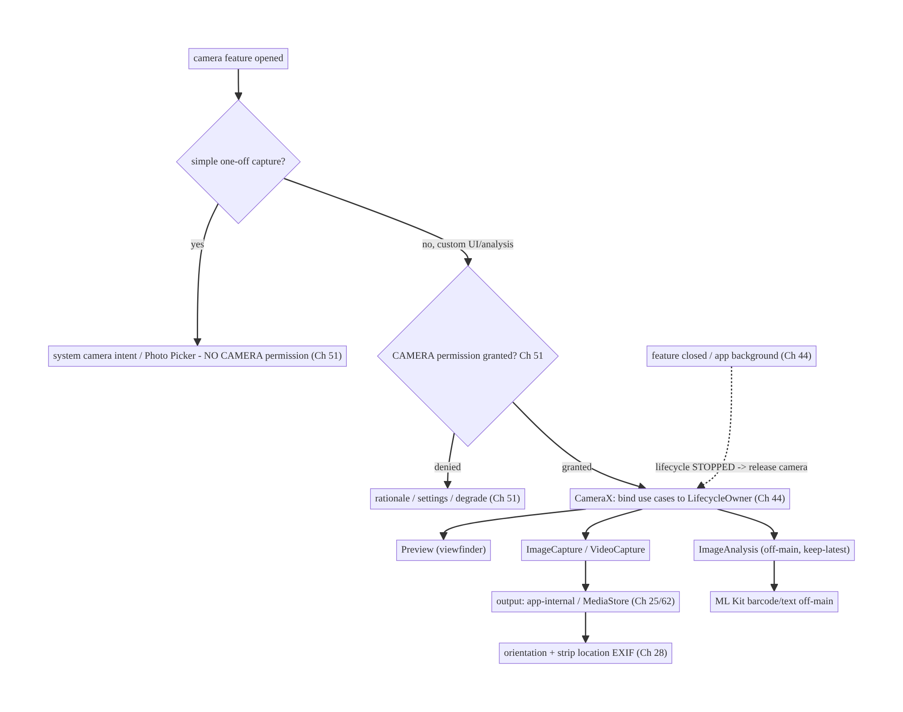
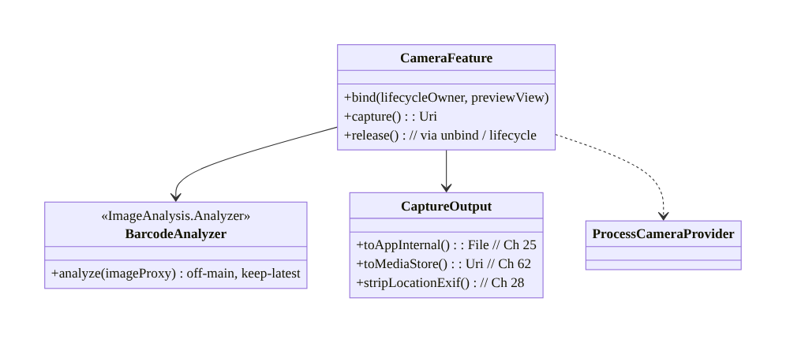
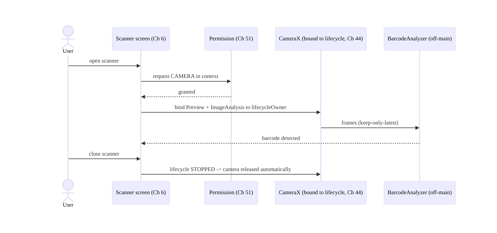
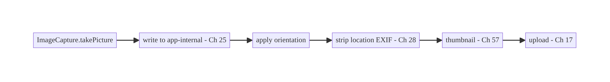
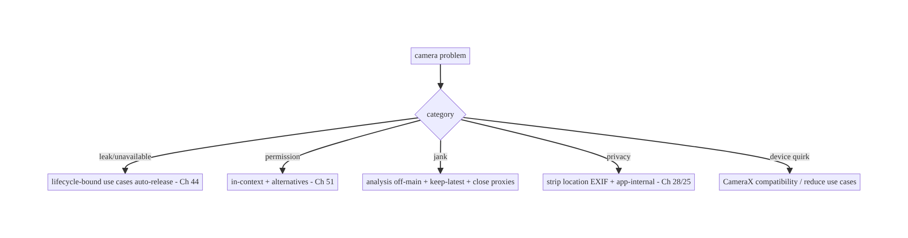

# Chapter 60 — Camera Capture Pipeline (CameraX)

> **Part VII — Media & Files** · Complexity: **Standard** (≥25 interview questions)
>
> **Prerequisites:** Ch 51 (runtime permissions), Ch 44 (lifecycle), Ch 25 (secure
> storage), Ch 17 (uploads), Ch 57 (thumbnails), Ch 28 (privacy). Pairs with Ch 61
> (large files), Ch 62 (SAF), Ch 6 (UI state).
>
> **Reference surface in StreamCart:** in-app camera features — scanning a product/QR
> code, capturing a photo for a review or profile, recording a short video, document
> capture — built on **CameraX** with correct lifecycle, permissions, output handling,
> and privacy.

---

## 60.1 Problem Definition and Real-World Context

The camera is one of the most **fragmented, lifecycle-sensitive, and privacy-laden**
subsystems on Android. The legacy `Camera2` API is powerful but extremely complex (manual
session/surface/threading management, device quirks). **CameraX** (Jetpack) is the modern,
lifecycle-aware, use-case-based abstraction that handles most of the complexity and device
compatibility — but you still must get **permissions** (Ch 51), **lifecycle binding**
(Ch 44), **output + storage** (Ch 25), **threading**, and **privacy** (Ch 28) right.

Concretely, teams hit:

- **Camera2 complexity.** Managing `CameraDevice`/`CaptureSession`/surfaces/threads
  manually across device quirks is error-prone — most apps should use **CameraX**, which
  provides **Preview**, **ImageCapture**, **VideoCapture**, and **ImageAnalysis** use
  cases bound to a lifecycle.
- **Lifecycle leaks / crashes.** The camera is a scarce, exclusive resource; not releasing
  it on background/destroy leaks it (other apps can't use it) and crashes; binding to the
  wrong lifecycle breaks preview. CameraX binds use cases to a **`LifecycleOwner`** so it
  opens/closes automatically (Ch 44).
- **Permissions (Ch 51).** `CAMERA` (and audio for video, location only if geotagging) are
  runtime permissions needing in-context request + graceful denial. Modern alternatives
  (the system camera intent, Photo Picker, Ch 51) avoid the permission entirely for simple
  capture.
- **Output & storage (Ch 25/62).** Where captured photos/videos go (app-internal vs
  shared/MediaStore), orientation/EXIF handling, and **privacy** (EXIF location leaks,
  Ch 28) matter.
- **Threading & performance.** Analysis (ML/QR) must run **off the main thread** with
  backpressure; preview must be smooth; capture must not block the UI.
- **Privacy & indicators.** Camera use shows a system indicator; apps must use the camera
  only while the user expects it, release promptly, and handle sensitive capture (ID docs)
  carefully.

The architecture: use **CameraX** with the right **use cases** — `Preview`,
`ImageCapture`, `VideoCapture`, `ImageAnalysis` — bound to a **`LifecycleOwner`** so the
camera opens/closes with the lifecycle (Ch 44); gate on the **`CAMERA` permission** (Ch 51)
with in-context request and graceful denial, preferring **no-permission alternatives**
(system camera intent / Photo Picker) for simple capture; handle **output** to
**app-internal or MediaStore** storage (Ch 25/62) with correct **orientation/EXIF** and
**privacy** (strip location, Ch 28); run **analysis off-main** with backpressure; and
manage **resources/privacy** (release promptly, use only when expected). This chapter is
about **a correct, lifecycle-safe, privacy-respecting camera pipeline with CameraX**.

### Three practical use cases

1. **QR/product scan (StreamCart).** CameraX `Preview` + `ImageAnalysis` running ML Kit
   barcode scanning off-main; releases the camera when the scanner closes.
2. **Review/profile photo.** For simple capture, prefer the **system camera intent**
   (`ACTION_IMAGE_CAPTURE`, no `CAMERA` permission); for an in-app custom UI, CameraX
   `ImageCapture` → app-internal file → thumbnail (Ch 57) → upload (Ch 17), EXIF location
   stripped (Ch 28).
3. **Short video.** CameraX `VideoCapture` with audio permission, bound to lifecycle,
   output to app-specific storage, size-limited.

### Why this is architectural

Camera work ties **permissions (Ch 51)**, **lifecycle (Ch 44)** (exclusive resource),
**storage/output (Ch 25/62)**, **threading/perf**, and **privacy (Ch 28)** together. The
decisions — CameraX use cases, lifecycle binding, permission strategy (including avoiding
it), output/EXIF handling, off-main analysis — determine reliability, resource safety, and
user trust.

---

## 60.2 Requirements Engineering

### Functional requirements

| ID | Requirement |
|----|-------------|
| F1 | Show a camera preview and capture photos/videos (or analyze frames). |
| F2 | Bind the camera to a lifecycle so it opens/closes automatically (Ch 44). |
| F3 | Gate on the CAMERA (and audio) permission with in-context request + graceful denial (Ch 51). |
| F4 | Handle output + storage (app-internal/MediaStore), orientation, EXIF (Ch 25/62). |
| F5 | Run frame analysis off the main thread with backpressure. |
| F6 | Respect privacy (strip location EXIF, release promptly, sensitive capture) (Ch 28). |

### Non-functional requirements

| Attribute | Policy |
|-----------|--------|
| **Resource safety** | Camera released on background/destroy (exclusive resource). |
| **Compatibility** | CameraX across device fragmentation; graceful fallback. |
| **Performance** | Smooth preview; off-main analysis with backpressure; non-blocking capture. |
| **Privacy** | Least privilege; strip location EXIF; use only when expected (Ch 28). |
| **UX** | In-context permission; prefer no-permission alternatives where possible. |

### Scope

- **In scope:** CameraX use cases (Preview/ImageCapture/VideoCapture/ImageAnalysis),
  lifecycle binding (Ch 44), CAMERA/audio permission (Ch 51) + no-permission alternatives
  (system camera intent, Photo Picker), output/storage (app-internal vs MediaStore, Ch 25/
  62), orientation/EXIF + privacy (Ch 28), off-main analysis + backpressure, resource
  release, Compose integration.
- **Out of scope:** permission state machine detail (Ch 51), upload (Ch 17), thumbnail
  generation (Ch 57), storage APIs (Ch 62), ML model detail, Camera2 low-level APIs.

### Assumptions & constraints

- **CameraX** (`androidx.camera`), Compose (`PreviewView`/`CameraController`), Hilt,
  ML Kit for analysis (barcode). `minSdk 24`. Camera is an **exclusive, scarce resource**;
  needs runtime permission; privacy indicators apply; device fragmentation is real
  (CameraX mitigates).

---

## 60.3 System Design Fundamentals

- **Use CameraX, not Camera2 (for most apps).** CameraX abstracts the brutal complexity of
  `Camera2` (session/surface/thread management, device quirks) into **lifecycle-aware use
  cases** with consistent behavior across devices. You use **Camera2 directly** only for
  advanced needs (manual exposure/RAW/custom sessions). Default to CameraX.
- **The four use cases (compose what you need):**
  - **`Preview`:** the live viewfinder (to a `PreviewView`/surface).
  - **`ImageCapture`:** take a still photo (to a file/MediaStore/in-memory).
  - **`VideoCapture`:** record video (with audio).
  - **`ImageAnalysis`:** a stream of frames for analysis (ML Kit barcode/face/text) —
    **off-main** with backpressure.
  Bind a subset (e.g., Preview + ImageAnalysis for a scanner; Preview + ImageCapture for a
  photo).
- **Lifecycle binding = automatic open/close (the key).** CameraX binds use cases to a
  **`LifecycleOwner`** (Ch 44): the camera **opens** when the lifecycle is STARTED and
  **closes/releases** when STOPPED/destroyed — automatically. This is what prevents the
  classic "camera not released" leak (other apps blocked) and crashes on rotation/
  background. You **never** manually open/close; you bind.
- **Permissions (Ch 51) and avoiding them:**
  - **CameraX requires `CAMERA`** (and `RECORD_AUDIO` for video); request **in context**
    (when the user opens the camera feature) with a rationale and graceful denial (Ch 51).
  - **Prefer no-permission alternatives** for simple cases: the **system camera intent**
    (`ACTION_IMAGE_CAPTURE` / `ACTION_VIDEO_CAPTURE`) launches the device camera app and
    returns the result **without your app holding `CAMERA`** — ideal for one-off capture;
    the **Photo Picker** (Ch 51) for choosing existing media. Use CameraX only when you
    need an **in-app custom camera UI** (scanner, custom controls, real-time analysis).
- **Output & storage (Ch 25/62):**
  - **App-internal** (private) for images the app owns/uploads (Ch 17) — default for
    sensitive/transient capture.
  - **MediaStore** (shared gallery) when the user should keep the photo in their gallery
    (scoped storage, Ch 62).
  - Handle **orientation** (CameraX provides target rotation) and **EXIF** — and **strip
    location/sensitive EXIF** before storing/uploading unless the user intends geotagging
    (Ch 28).
- **Off-main analysis + backpressure.** `ImageAnalysis` delivers frames to a background
  `Executor`; use **`STRATEGY_KEEP_ONLY_LATEST`** backpressure so a slow analyzer (ML)
  drops stale frames instead of queueing/lagging. Close each `ImageProxy` promptly (or
  frames stall). Never analyze on the main thread.
- **Resource management & privacy (Ch 28).** The camera is **exclusive** — release it
  (unbind / lifecycle stop) the moment the feature closes or the app backgrounds; the
  system shows a **privacy indicator** while active, so using it when the user doesn't
  expect it is a trust violation. For **sensitive capture** (ID docs), consider
  `FLAG_SECURE` and app-internal storage, and don't retain longer than needed.
- **Compose integration.** `PreviewView` via `AndroidView`, or the newer
  `CameraController` + Compose viewfinder; bind to the composition's `LifecycleOwner`.

Core insight: **use CameraX's lifecycle-aware use cases (Preview/ImageCapture/
VideoCapture/ImageAnalysis) bound to a `LifecycleOwner` so the exclusive camera resource
opens and releases automatically (Ch 44) — never manually; gate on the CAMERA/audio
permission in context (Ch 51) but prefer no-permission alternatives (system camera intent,
Photo Picker) for simple capture; handle output to app-internal or MediaStore storage with
correct orientation and privacy-stripped EXIF (Ch 25/62/28); run frame analysis off the
main thread with keep-only-latest backpressure; and release the camera promptly, using it
only when the user expects it.**

---

## 60.4 High-Level Architecture



**Components & ownership**

- **Decision gate:** simple capture → system intent/Photo Picker (no permission); custom
  → CameraX.
- **CameraX** binds use cases to the lifecycle (auto open/close).
- **Output** goes to app-internal/MediaStore with EXIF/orientation + privacy handling.
- **Analysis** runs off-main with backpressure.

**Direction:** feature → (intent vs CameraX) → permission → lifecycle-bound use cases →
capture/analyze → output (privacy-handled); camera released on lifecycle stop.

---

## 60.5 Detailed Component Design



| Component | Responsibility |
|-----------|----------------|
| `CameraFeature` | bind use cases to lifecycle; capture; release (CameraX) |
| `BarcodeAnalyzer` | off-main frame analysis (keep-latest, close proxies) |
| `CaptureOutput` | write to app-internal/MediaStore; orientation; strip EXIF (Ch 25/62/28) |
| Permission gate (Ch 51) | in-context CAMERA request / alternatives |

---

## 60.6 End-to-End Data Flow

### Scanner (Preview + ImageAnalysis)



### Photo capture + privacy



---

## 60.7 Complete Kotlin Implementation

Package: `com.streamcart.camera`.

### 60.7.1 No-permission alternative first (system camera intent)

```kotlin
// For simple one-off capture, avoid the CAMERA permission entirely (Ch 51).
@Composable
fun CaptureReviewPhoto(onCaptured: (Uri) -> Unit) {
    val context = LocalContext.current
    val outputUri = remember { context.appInternalImageUri() }    // app-provided file URI (FileProvider, Ch 62)
    val launcher = rememberLauncherForActivityResult(ActivityResultContracts.TakePicture()) { success ->
        if (success) onCaptured(outputUri)                        // device camera app handled capture; no CAMERA perm
    }
    Button(onClick = { launcher.launch(outputUri) }) { Text("Take photo") }
}
```

### 60.7.2 CameraX scanner (Preview + ImageAnalysis), lifecycle-bound

```kotlin
@Composable
fun ScannerScreen(onBarcode: (String) -> Unit, vm: ScannerViewModel = hiltViewModel()) {
    val lifecycleOwner = LocalLifecycleOwner.current
    val context = LocalContext.current
    // (CAMERA permission already granted in-context, Ch 51)
    AndroidView(factory = { ctx ->
        PreviewView(ctx).also { previewView ->
            val cameraProviderFuture = ProcessCameraProvider.getInstance(ctx)
            cameraProviderFuture.addListener({
                val provider = cameraProviderFuture.get()
                val preview = Preview.Builder().build().also { it.setSurfaceProvider(previewView.surfaceProvider) }
                val analysis = ImageAnalysis.Builder()
                    .setBackpressureStrategy(ImageAnalysis.STRATEGY_KEEP_ONLY_LATEST)   // drop stale frames
                    .build().also { it.setAnalyzer(vm.analysisExecutor, BarcodeAnalyzer(onBarcode)) }  // OFF-MAIN
                provider.unbindAll()
                provider.bindToLifecycle(lifecycleOwner, CameraSelector.DEFAULT_BACK_CAMERA, preview, analysis)
                // bound to lifecycle -> camera opens now, RELEASES automatically on STOP/destroy (Ch 44)
            }, ContextCompat.getMainExecutor(ctx))
        }
    })
}
```

### 60.7.3 Off-main analyzer (keep-latest, close proxies)

```kotlin
class BarcodeAnalyzer(private val onBarcode: (String) -> Unit) : ImageAnalysis.Analyzer {
    private val scanner = BarcodeScanning.getClient()
    @OptIn(ExperimentalGetImage::class)
    override fun analyze(imageProxy: ImageProxy) {
        val media = imageProxy.image ?: run { imageProxy.close(); return }
        val input = InputImage.fromMediaImage(media, imageProxy.imageInfo.rotationDegrees)
        scanner.process(input)
            .addOnSuccessListener { it.firstOrNull()?.rawValue?.let(onBarcode) }
            .addOnCompleteListener { imageProxy.close() }   // MUST close or frames stall (backpressure)
    }
}
```

### 60.7.4 Photo capture → app-internal + strip location EXIF (Ch 25/28)

```kotlin
fun ImageCapture.capture(context: Context, onSaved: (File) -> Unit) {
    val file = File(context.filesDir, "capture_${System.currentTimeMillis()}.jpg")   // app-internal (Ch 25)
    val options = ImageCapture.OutputFileOptions.Builder(file).build()
    takePicture(options, ContextCompat.getMainExecutor(context), object : ImageCapture.OnImageSavedCallback {
        override fun onImageSaved(output: ImageCapture.OutputFileResults) {
            stripLocationExif(file)        // PRIVACY: remove GPS tags (Ch 28) unless user intends geotag
            onSaved(file)                  // -> thumbnail (Ch 57), upload (Ch 17)
        }
        override fun onError(e: ImageCaptureException) { /* surface error */ }
    })
}

private fun stripLocationExif(file: File) {
    ExifInterface(file.absolutePath).apply {
        setAttribute(ExifInterface.TAG_GPS_LATITUDE, null); setAttribute(ExifInterface.TAG_GPS_LONGITUDE, null)
        setAttribute(ExifInterface.TAG_GPS_LATITUDE_REF, null); setAttribute(ExifInterface.TAG_GPS_LONGITUDE_REF, null)
        saveAttributes()
    }
}
```

### 60.7.5 Module structure

```
:feature:camera   ScannerScreen, CameraFeature (CameraX bind), BarcodeAnalyzer, capture + EXIF strip
:core:permissions in-context CAMERA request (Ch 51)
:core:storage     app-internal / MediaStore output + FileProvider (Ch 25/62)
# Thumbnails -> Ch 57; upload -> Ch 17; privacy -> Ch 28.
```

---

## 60.8 Concurrency and Race Conditions

| Scenario | Risk | Handling |
|----------|------|----------|
| Camera not released | resource leak / other apps blocked | lifecycle binding auto-releases (Ch 44); unbind on close |
| Analysis on main thread | jank/ANR | dedicated `Executor`; off-main |
| `ImageProxy` not closed | frame pipeline stalls | close in `onComplete`; keep-only-latest |
| Rotation during capture | wrong orientation/crash | CameraX target rotation; lifecycle rebind |
| Rapid open/close | camera-in-use errors | `unbindAll()` before rebind; serialize provider access |
| Capture on background | crash / privacy | bound to lifecycle (won't run when stopped) |

- **Lifecycle binding is the resource-safety mechanism:** because use cases are bound to a
  `LifecycleOwner`, the exclusive camera opens on STARTED and **releases on STOPPED/
  destroyed** automatically — eliminating the classic leak where the camera stays open
  (blocking other apps) after the user leaves. Never manually open/close.
- **Close every `ImageProxy`** in `ImageAnalysis` (and use keep-only-latest) or the frame
  pipeline backs up and the preview/analysis stalls.
- **`unbindAll()` before rebinding** avoids "camera in use" races on rapid open/close/
  rotation.

---

## 60.9 Failure Scenarios and Recovery

| Failure | Detection | Response | Outcome |
|---------|-----------|----------|---------|
| Camera leaked / unavailable | other apps fail / logs | lifecycle binding; unbind on close | released |
| Permission denied | Ch 51 | rationale → settings; prefer system intent | recoverable |
| Jank on preview/scan | frames | off-main analysis; keep-latest; close proxies | smooth |
| Wrong photo orientation | visual | CameraX target rotation / EXIF orientation | correct |
| Location leaked in EXIF | privacy review | strip GPS EXIF (Ch 28) | private |
| Device quirk / use-case unsupported | bind error | CameraX fallback; reduce use cases | works |
| Crash capturing on background | crash | lifecycle-bound (won't capture when stopped) | stable |



> **CameraX's lifecycle binding solves the two hardest camera bugs for free:** the
> resource leak (camera not released) and the crash-on-background — the camera opens and
> closes with the lifecycle. The remaining work is permissions (prefer avoiding them),
> off-main analysis, and privacy (strip EXIF) — not manual session/thread management.

---

## 60.10 Scaling the Implementation

- **Level 1.** Prefer system camera intent / Photo Picker (no permission) for simple
  capture.
- **Level 2.** CameraX Preview + ImageCapture (custom UI) bound to lifecycle; in-context
  permission (Ch 51); app-internal output + EXIF strip (Ch 25/28).
- **Level 3 — production.** ImageAnalysis off-main (ML Kit) with keep-latest; VideoCapture
  with audio; orientation; thumbnails (Ch 57) + upload (Ch 17).
- **Level 4 — large.** Multiple cameras/lenses, zoom/flash/torch controls, image quality
  tuning, MediaStore integration (Ch 62), document-capture flows (edge detection).
- **Level 5 — enterprise.** Camera governance (which features may use it), privacy review
  (Ch 28), capture-QoE analytics, Camera2 interop for advanced needs, accessibility.

**Avoid overengineering:** for simple capture, the **system intent** needs no permission
and no CameraX. Use CameraX when you need a custom in-app camera; use Camera2 only for
advanced control.

---

## 60.11 Alternative Approaches and Trade-offs

| Dimension | Option A | Option B | When |
|-----------|----------|----------|------|
| API | CameraX | Camera2 | CameraX (most apps); Camera2 for manual exposure/RAW/custom sessions |
| Simple capture | System camera intent (no permission) | in-app CameraX | Intent for one-off; CameraX for custom UI/analysis |
| Lifecycle | CameraX `bindToLifecycle` | manual open/close | CameraX (auto release, no leak) |
| Analysis backpressure | Keep-only-latest | queue all frames | Keep-latest (real-time, no lag) |
| Output | App-internal (Ch 25) | MediaStore (Ch 62) | App-internal for app-owned/sensitive; MediaStore for user gallery |
| EXIF location | Strip (default) | keep (geotag) | Strip unless user intends geotagging (Ch 28) |

**CameraX vs Camera2:** `Camera2` offers full manual control (exposure, RAW, custom capture
sessions) but at enormous complexity and device-fragmentation cost — manual session/surface/
thread management is a notorious source of bugs. **CameraX** provides lifecycle-aware use
cases with consistent cross-device behavior and solves open/close/threading for you. Use
CameraX unless you specifically need Camera2's manual controls; CameraX even offers Camera2
interop for targeted advanced needs.

**System camera intent vs in-app CameraX:** for a one-off photo/video, launching the
**system camera app** (`ACTION_IMAGE_CAPTURE`) returns a result **without your app holding
the CAMERA permission** — simpler, safer, and privacy-friendly. Use **CameraX** only when
you need an **in-app custom camera** (real-time scanning/analysis, custom controls,
branded UI). Don't take on the camera permission and pipeline for simple capture.

**Keep-only-latest vs queueing frames:** for real-time analysis (scanning), a slow analyzer
(ML inference) must not build a backlog — **keep-only-latest** drops stale frames so
detection stays current and the preview doesn't lag. Queueing all frames causes growing
latency and memory. Use keep-only-latest for analysis.

---

## 60.12 Security & Privacy Considerations

- **Least privilege (Ch 51):** prefer the **system camera intent / Photo Picker** (no
  `CAMERA` permission); request `CAMERA`/`RECORD_AUDIO` only for custom in-app camera,
  in context.
- **Strip location/sensitive EXIF (Ch 28):** captured photos carry GPS and device metadata
  — strip it before storing/uploading unless the user explicitly wants geotagging.
- **App-internal storage for sensitive capture (Ch 25):** ID documents, private photos go
  to app-internal storage, not shared/MediaStore where other apps can read them; consider
  `FLAG_SECURE` for sensitive capture screens.
- **Release the camera promptly:** it's exclusive and shows a **privacy indicator** — use
  it only while the user expects it; unbind on close/background (lifecycle does this).
- **Don't capture/retain more than needed:** no silent/background capture; delete transient
  captures after upload (Ch 17).
- **Validate output URIs (Ch 62):** when writing to a provided URI (system intent /
  MediaStore), use a proper `FileProvider`/scoped storage; don't expose internal paths.
- **Per-account (Ch 42):** captured media tied to the active account; clear on logout.
- Client vs backend: capture and EXIF-stripping are client concerns; the backend receives
  the uploaded (stripped) media over authed channels (Ch 17/19) and must not assume
  client-side privacy handling (strip server-side too if needed).

---

## 60.13 Performance and Resource Optimization

- **Release the camera** when done (lifecycle unbind) — exclusive resource + battery.
- **Off-main analysis + keep-only-latest** — smooth preview, current detection, no backlog.
- **Right-size capture/analysis resolution** — analyze at a lower resolution than capture
  (scanning doesn't need full res); set `ImageAnalysis` target resolution.
- **Close `ImageProxy` promptly** — avoid pipeline stalls.
- **Bind only needed use cases** — fewer surfaces = less overhead; don't bind
  ImageAnalysis if not analyzing.
- **Downsample/compress captured photos** before upload (Ch 17/57).
- **Profiling:** preview FPS, analysis latency/throughput, camera open/close balance,
  capture time, memory from frames.

---

## 60.14 Testing Strategy

Camera is hard to unit-test (hardware); test logic (EXIF strip, output, analyzer) in
isolation and the pipeline with instrumentation / CameraX test utilities.

```kotlin
class ExifStripTest {
    @Test fun `strips GPS tags`() {
        val file = sampleJpegWithGps()
        stripLocationExif(file)
        val exif = ExifInterface(file.absolutePath)
        assertNull(exif.getAttribute(ExifInterface.TAG_GPS_LATITUDE))   // privacy (Ch 28)
    }
}

class BarcodeAnalyzerTest {
    @Test fun `closes image proxy after analysis`() {
        val proxy = mockImageProxy()
        BarcodeAnalyzer {}.analyze(proxy)
        verify(proxy).close()   // or frames stall
    }
}

@RunWith(AndroidJUnit4::class)
class CameraLifecycleTest {
    @get:Rule val grant = GrantPermissionRule.grant(Manifest.permission.CAMERA)
    @Test fun `camera released when lifecycle stops`() { /* bind, move lifecycle to STOPPED, assert unbound */ }
}
```

What to test: EXIF stripping (privacy); analyzer closes proxies + keep-latest; output to
app-internal; permission gate (Ch 51) + system-intent alternative; camera released on
lifecycle stop (instrumentation); orientation. Use CameraX's `FakeCamera`/test APIs and
instrumentation for real hardware behavior.

---

## 60.15 Production Observability

- **Metrics:** camera open/close balance (leak detection); permission grant rate (Ch 51);
  capture success/error rate; analysis latency/FPS; capture time; EXIF-strip coverage;
  system-intent vs CameraX usage; crashes by device/OEM (fragmentation).
- **Logs:** `camera{use_cases, result, device, error}` — no image content/PII (Ch 28).
- **Debugging:** camera unavailable → not released (lifecycle) / other app; jank →
  on-main analysis / no keep-latest / proxies not closed; wrong orientation → target
  rotation; location leak → EXIF not stripped; device crash → quirk (CameraX fallback /
  reduce use cases).
- **Alerting:** camera-open leak (open without close); capture-failure spike on an OEM;
  EXIF-strip failures (privacy).
- **Dashboards:** camera reliability by device/OEM; capture success; permission funnel.

---

## 60.16 System Design Interview Preparation

> ≥25 questions.

**Fundamentals**

1. *CameraX vs Camera2?* Lifecycle-aware use cases + compatibility vs manual low-level
   control.
2. *Four use cases?* Preview, ImageCapture, VideoCapture, ImageAnalysis.
3. *Lifecycle binding?* `bindToLifecycle` → camera opens/closes automatically (Ch 44).
4. *Why binding matters?* Camera is exclusive — auto-release prevents leaks/crashes.
5. *When Camera2?* Manual exposure/RAW/custom sessions.

**Permissions**

6. *What permission?* `CAMERA` (+ `RECORD_AUDIO` for video) — runtime (Ch 51).
7. *Avoid it?* System camera intent / Photo Picker (no permission).
8. *When CameraX over intent?* Custom in-app camera / real-time analysis.
9. *Denied?* In-context rationale → settings; degrade (Ch 51).

**Analysis**

10. *ImageAnalysis thread?* Off-main (`Executor`).
11. *Backpressure?* Keep-only-latest (drop stale frames).
12. *ImageProxy?* Must close or pipeline stalls.
13. *Resolution?* Analyze at lower res than capture.

**Output/privacy**

14. *Output storage?* App-internal (sensitive) vs MediaStore (user gallery) (Ch 25/62).
15. *EXIF location?* Strip unless geotagging intended (Ch 28).
16. *Orientation?* CameraX target rotation / EXIF.
17. *Sensitive capture?* App-internal + `FLAG_SECURE`.

**Resource/lifecycle**

18. *Release camera?* Unbind / lifecycle stop — promptly.
19. *Privacy indicator?* Use only when expected.
20. *Rotation?* Rebind; target rotation.

**Testing/Production**

21. *Test EXIF strip?* Assert GPS tags removed.
22. *Test analyzer?* Closes proxies.
23. *Camera unavailable in prod?* Not released (lifecycle).
24. *Jank?* On-main analysis / no keep-latest.
25. *Device crashes?* Quirks — CameraX fallback.
26. *Key metric?* Open/close balance (leaks) + capture success by OEM.

### Design-change challenges
1. **QR scanner feature.** CameraX Preview + ImageAnalysis (ML Kit) off-main, keep-latest,
   lifecycle-bound.
2. **Simple profile photo without the camera permission.** System camera intent /
   Photo Picker (Ch 51).
3. **Photos leak GPS location.** Strip EXIF before store/upload (Ch 28).
4. **Camera stays locked after leaving the screen.** Lifecycle binding / unbind (Ch 44).
5. **Scanner lags on a slow device.** Keep-only-latest + lower analysis resolution +
   close proxies.

### Mock walkthrough (abridged)
Clarify (capture vs scan vs video, simple or custom UI, sensitive?) → prefer no-permission
(system intent/Photo Picker, Ch 51) → else CameraX use cases bound to lifecycle (Ch 44) →
in-context CAMERA permission → off-main analysis + keep-latest → output app-internal/
MediaStore + orientation + strip EXIF (Ch 25/62/28) → release promptly → testing
(instrumentation) → observability (open/close balance).

---

## 60.17 Practical Exercises

1. **Beginner.** Capture a profile photo via the system camera intent (no CAMERA
   permission) into an app-internal file. *Eval:* no permission needed; file saved.
2. **Intermediate.** Build a CameraX scanner (Preview + ImageAnalysis, ML Kit barcode)
   off-main with keep-only-latest, bound to the lifecycle. *Eval:* scans; releases camera
   on close.
3. **Advanced.** Add in-app photo capture (ImageCapture) to app-internal storage, strip
   location EXIF, generate a thumbnail (Ch 57), and upload (Ch 17). *Eval:* no GPS leak;
   thumbnail + upload.
4. **Production debugging.** Fix a camera leak (not released on leave) and scanner lag
   (proxies not closed / on-main). *Eval:* released via lifecycle; smooth.
5. **System design challenge.** Add per-account capture handling + `FLAG_SECURE` for
   document capture and an open/close-balance leak dashboard. *Eval:* secure; isolated;
   leaks detected.

*(Solutions withheld unless requested.)*

---

## 60.18 Chapter Summary & Reference Sheet

**Key decisions:** use **CameraX** (not Camera2, except for advanced manual control) with
the right **use cases** — `Preview`, `ImageCapture`, `VideoCapture`, `ImageAnalysis` —
**bound to a `LifecycleOwner`** so the **exclusive camera opens and releases automatically**
(Ch 44), eliminating the classic leak and background-crash; **prefer no-permission
alternatives** (the **system camera intent**, **Photo Picker**, Ch 51) for simple one-off
capture, and use CameraX only for a **custom in-app camera / real-time analysis**, gating
on the **`CAMERA`/`RECORD_AUDIO` permission in context** with graceful denial; run
**`ImageAnalysis` off the main thread with keep-only-latest backpressure** (and **close
every `ImageProxy`**); handle **output** to **app-internal** (sensitive/app-owned) or
**MediaStore** (user gallery) storage with correct **orientation** and **privacy-stripped
EXIF** (strip GPS unless geotagging is intended, Ch 25/62/28); and **release the camera
promptly**, using it only while the user expects it (privacy indicator). Sensitive capture
uses app-internal storage + `FLAG_SECURE`, per-account (Ch 42).

**Concepts:** CameraX use cases, lifecycle binding (auto open/close), permission strategy +
no-permission alternatives, off-main `ImageAnalysis` + keep-only-latest + proxy close,
output/storage (app-internal/MediaStore), orientation + EXIF privacy, resource release.

**Common mistakes:** using Camera2 when CameraX suffices (complexity); manual open/close
(leaks, crashes); taking the CAMERA permission for simple capture (should use the system
intent); analysis on the main thread / not closing `ImageProxy` (stall/jank); queueing
frames instead of keep-latest; leaking GPS EXIF; sensitive capture in shared storage; not
releasing the camera on background.

**Checklist:**

- [ ] prefer system intent / Photo Picker (no permission, Ch 51)
- [ ] CameraX use cases bound to lifecycle (auto release, Ch 44)
- [ ] in-context CAMERA/audio permission + graceful denial
- [ ] ImageAnalysis off-main + keep-only-latest + close proxies
- [ ] output app-internal/MediaStore + orientation (Ch 25/62)
- [ ] strip location EXIF (Ch 28)
- [ ] release camera promptly
- [ ] `FLAG_SECURE` + app-internal for sensitive capture
- [ ] per-account (Ch 42)
- [ ] open/close-balance + capture-success telemetry.

**Key APIs:** `ProcessCameraProvider`/`bindToLifecycle`/`unbindAll`, `Preview`/
`ImageCapture`/`VideoCapture`/`ImageAnalysis` (`STRATEGY_KEEP_ONLY_LATEST`/`setAnalyzer`),
`PreviewView`/`CameraController`, `ImageProxy.close`, `CameraSelector`,
`ImageCapture.OutputFileOptions`/`takePicture`, `ExifInterface` (strip GPS),
`ActivityResultContracts.TakePicture`/`TakeVideo` (system intent), `FileProvider`/
MediaStore (Ch 62), `GrantPermissionRule`/CameraX test APIs.

**References:**
- CameraX overview: https://developer.android.com/media/camera/camerax
- CameraX use cases / architecture: https://developer.android.com/media/camera/camerax/architecture
- Take a photo (intent): https://developer.android.com/media/camera/camera-intents
- ImageAnalysis: https://developer.android.com/media/camera/camerax/analyze
- (composes) Ch 51 Permissions, Ch 44 Lifecycle, Ch 25 Secure Storage, Ch 62 SAF/Storage, Ch 28 Privacy, Ch 57 Thumbnails, Ch 17 Uploads

### Chapter review (Phase 4)
- **Completeness:** all 18 sections; architecture/class/sequence/flow/failure diagrams;
  system-intent + CameraX scanner + off-main analyzer + capture/EXIF-strip code;
  concurrency (lifecycle release, proxy close, unbindAll); failure (lifecycle solves
  leak/crash); 5 levels; CameraX-vs-Camera2, intent-vs-CameraX, keep-latest trade-offs;
  security/privacy (least privilege, EXIF, app-internal, FLAG_SECURE); perf (release/
  off-main/resolution); EXIF/analyzer/lifecycle tests; observability (open-close balance);
  26 Q&A + 5 challenges. ✅
- **Expand later:** permissions (Ch 51), storage (Ch 62), thumbnails (Ch 57), uploads
  (Ch 17), privacy (Ch 28).
- **Interview coverage:** exceeds ≥25 bar.
