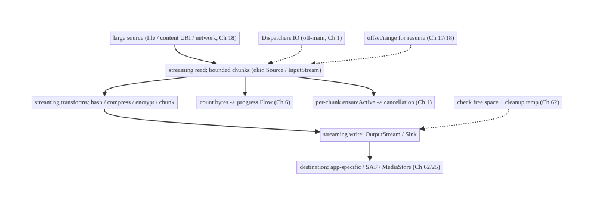
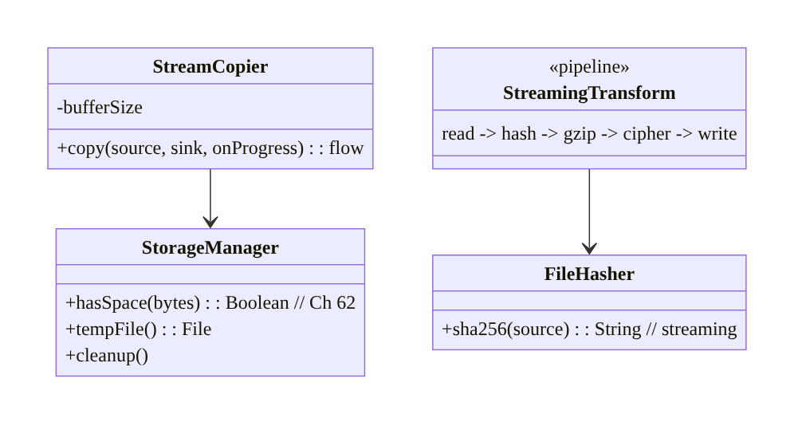
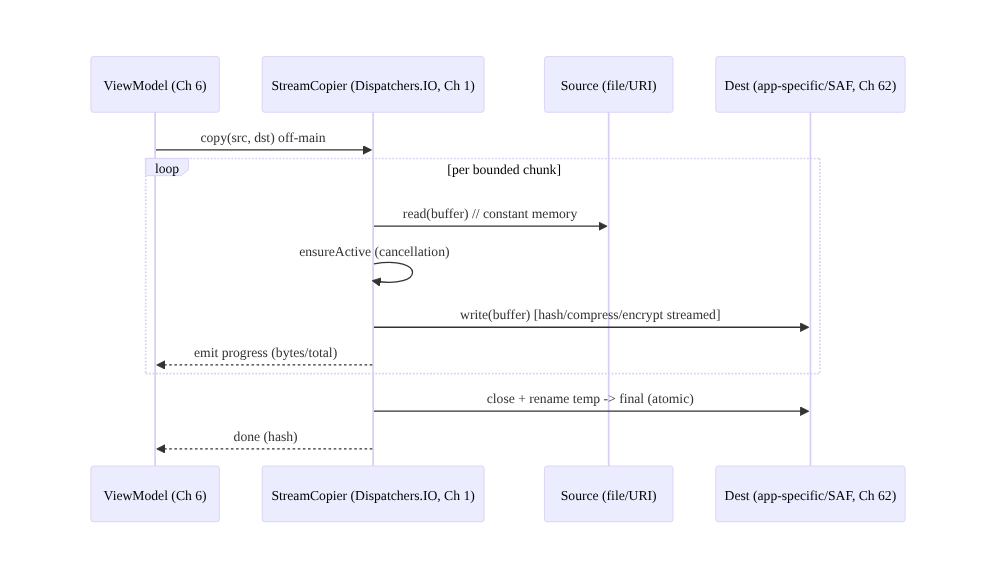
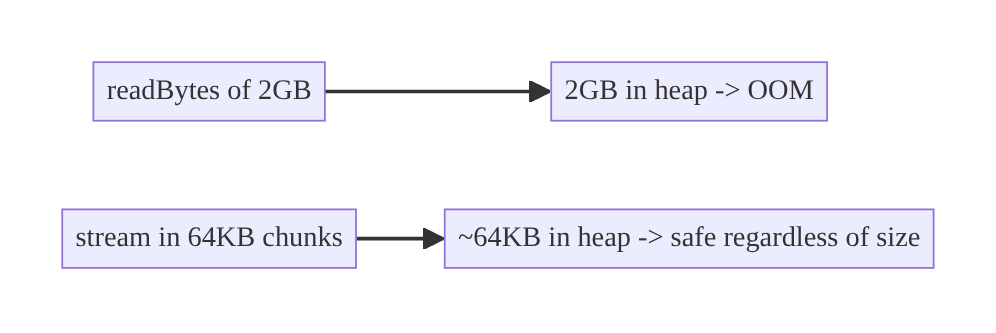
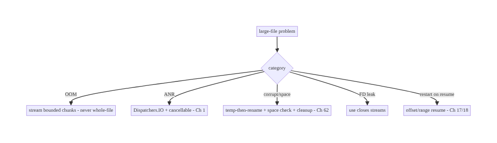

# Chapter 61 — Large File & Streaming Handling

> **Part VII — Media & Files** · Complexity: **Standard** (≥25 interview questions)
>
> **Prerequisites:** Ch 17 (uploads), Ch 18 (download manager), Ch 25 (secure storage),
> Ch 62 (SAF/storage), Ch 1 (networking), Ch 30 (WorkManager). Pairs with Ch 59 (offline
> media), Ch 60 (camera), Ch 57 (thumbnails).
>
> **Reference surface in StreamCart:** anything too big to hold in memory — exporting a
> large order history, processing a captured video, hashing a multi-GB file for an
> upload (Ch 17), reading/transforming a large CSV, or piping a download (Ch 18) to disk —
> done with **streaming** so the app never loads the whole thing into RAM.

---

## 61.1 Problem Definition and Real-World Context

The cardinal sin of file handling is **loading the whole file into memory**. A 2GB video,
a 500MB export, or even a 50MB image read as a single `ByteArray`/`String` causes **OOM**
on most devices. The correct discipline is **streaming**: process data in **bounded
chunks** through `InputStream`/`OutputStream`/`okio` sources and sinks, never holding more
than a small buffer at once. This applies to reading, writing, copying, hashing,
transforming, compressing, encrypting, uploading (Ch 17), and downloading (Ch 18) large
files.

Concretely, teams hit:

- **OOM from whole-file reads.** `file.readBytes()` / `readText()` / `bitmap of full
  image` on a large file → crash. Must stream.
- **Blocking the main thread.** Large file IO on the UI thread → ANR. Must be off-main
  (coroutines/`Dispatchers.IO`, Ch 1) with cancellation.
- **No progress / cancellation.** Long operations need **progress** and **cancellation**
  (Ch 17/18) — streaming makes both natural (count bytes, check cancellation per chunk).
- **Resource leaks.** Streams not closed (use `use {}`), temp files not cleaned up, file
  descriptors exhausted.
- **Storage location & limits.** Where large temp/output files go (app-specific vs SAF/
  MediaStore, Ch 62), running out of space, and cleaning up.
- **Transform pipelines.** Hashing (integrity, Ch 17), compressing (zip/gzip), encrypting
  (Ch 25), and chunking for upload — all should be **streamed and composable** (read →
  transform → write) without buffering the whole file.
- **Random access / partial reads.** Range requests (resumable download, Ch 18),
  seeking in a file, reading a slice — without reading everything.

The architecture: **always stream large data in bounded chunks** (never whole-file into
memory) using `InputStream`/`OutputStream` or **okio** `Source`/`Sink`/`Buffer`; run IO
**off the main thread** with **coroutines + cancellation** (Ch 1); emit **progress** and
support **cancellation/resume** (Ch 17/18); **compose transforms** (hash, compress,
encrypt, chunk) as streaming stages without full buffering; manage **storage/temp files**
(app-specific/SAF, cleanup, space checks, Ch 62/25); and use **range/partial reads** for
seeking and resumption. This chapter is about **handling arbitrarily large files with
bounded memory**.

### Three practical use cases

1. **Hash a file for upload (StreamCart).** Compute a SHA-256 of a multi-GB video by
   streaming it through a digest (bounded memory) to produce an integrity hash / dedup key
   (Ch 17) — never loading the file.
2. **Export large data.** Stream a large order-history export to a file (or SAF URI,
   Ch 62) chunk by chunk with progress, off-main, cancellable.
3. **Copy/transform with compression + encryption.** Stream a captured video (Ch 60)
   through gzip + encryption (Ch 25) to app-specific storage, bounded memory, with
   progress.

### Why this is architectural

Large-file handling is a **memory-and-streaming discipline** crossing IO, coroutines
(Ch 1), storage (Ch 25/62), uploads/downloads (Ch 17/18), and integrity (hashing). The
decisions — stream vs buffer, chunk size, off-main + cancellation, composable transforms,
temp/storage management — determine whether the app survives large files or OOMs/ANRs.

---

## 61.2 Requirements Engineering

### Functional requirements

| ID | Requirement |
|----|-------------|
| F1 | Read/write/copy/transform large files in bounded memory (streaming). |
| F2 | Run file IO off the main thread with cancellation (Ch 1). |
| F3 | Emit progress; support cancellation and resume where applicable (Ch 17/18). |
| F4 | Compose transforms (hash/compress/encrypt/chunk) as streaming stages. |
| F5 | Manage storage/temp files (app-specific/SAF), space checks, cleanup (Ch 62/25). |
| F6 | Support partial/range reads for seeking and resumption. |

### Non-functional requirements

| Attribute | Policy |
|-----------|--------|
| **Memory** | Bounded (small buffer) regardless of file size — no OOM. |
| **Responsiveness** | Off-main; no ANR; cancellable. |
| **Reliability** | Streams closed; temp cleaned; space checked; resumable. |
| **Composability** | Streaming transform stages (read→transform→write). |
| **Security** | Encrypt sensitive data streamed to storage (Ch 25). |

### Scope

- **In scope:** streaming read/write/copy with bounded buffers (`InputStream`/
  `OutputStream`/okio), off-main + cancellation (Ch 1), progress/cancel/resume (Ch 17/18),
  streaming transforms (hash/compress/encrypt/chunk), temp/output storage (app-specific/
  SAF, Ch 62/25), space checks + cleanup, range/partial reads, backpressure.
- **Out of scope:** upload protocol (Ch 17), download manager (Ch 18), storage APIs detail
  (Ch 62), encryption primitives (Ch 25), media playback streaming (Ch 58/59), networking
  (Ch 1).

### Assumptions & constraints

- Kotlin coroutines (`Dispatchers.IO`, Ch 1), **okio** (preferred for streaming) or
  `java.io` streams, app-specific/SAF storage (Ch 62), `MessageDigest`/`Cipher` (Ch 25),
  `GZIPOutputStream`/`ZipOutputStream`. `minSdk 24`. Files can exceed available RAM; main-
  thread IO ANRs; FDs/temp are finite.

---

## 61.3 System Design Fundamentals

- **Stream, never buffer the whole file (the core rule).** Process data in **bounded
  chunks** (e.g., 8–64KB buffer) via `InputStream.read(buffer)` → `OutputStream.write` (or
  okio `source.read(sink, chunk)`), so **memory is constant** regardless of file size.
  `readBytes()`/`readText()`/decoding a full image are only for **small, known-bounded**
  data — never for user files/media.
- **okio is the modern streaming toolkit.** `Source`/`Sink`/`Buffer`/`BufferedSource`/
  `BufferedSink` give ergonomic, efficient, composable streaming (OkHttp uses okio, Ch 1).
  It handles buffering, makes transforms composable (gzip, hashing via `HashingSink`), and
  integrates with coroutines. `java.io` streams work too but okio is cleaner.
- **Off-main + cancellation (Ch 1).** All large-file IO runs on `Dispatchers.IO` inside a
  coroutine; check `ensureActive()`/`isActive` **per chunk** so the operation **cancels
  promptly** (user cancels, scope cleared) — streaming's per-chunk loop is the natural
  cancellation point. Never do large IO on the main thread (ANR).
- **Progress & resume.** Count bytes copied per chunk → emit **progress** (a `Flow`,
  Ch 6). For resumable transfers (Ch 17/18), use **offsets/ranges** (`RandomAccessFile`/
  range requests) to continue from where you left off rather than restarting.
- **Composable streaming transforms.** Build pipelines where each stage streams:
  `read → hash → compress → encrypt → write`, each operating on chunks. okio makes this
  elegant (`HashingSink`, `GzipSink`, a `CipherSink`); with `java.io` you nest streams
  (`DigestInputStream`, `GZIPOutputStream`, `CipherOutputStream`). The key: **no stage
  buffers the whole file** — data flows through.
  - **Hashing** (integrity/dedup, Ch 17): stream through `MessageDigest`/`HashingSink`.
  - **Compression:** gzip/zip streaming.
  - **Encryption** (Ch 25): `CipherOutputStream`/`CipherSink` streaming to storage.
  - **Chunking** (upload, Ch 17): read fixed-size parts for multipart/resumable upload.
- **Resource management.** **Always `use {}`** (Kotlin) / try-with-resources so streams
  and file descriptors are **closed** (leaks exhaust FDs / lock files). Clean up **temp
  files** (process in a temp, rename on success; delete on failure) and react to **storage
  pressure**.
- **Storage & space (Ch 62/25).** Large temp/output files go to **app-specific** storage
  (internal `cacheDir`/`filesDir` or app-specific external) or a **SAF/MediaStore** URI
  the user chose (Ch 62). **Check free space** before large writes (`StatFs`/
  `getAllocatableBytes`); handle `ENOSPC`/`IOException` gracefully; don't fill the disk.
- **Partial / random access.** For seeking or resuming, use **`RandomAccessFile`** or
  **HTTP range requests** (Ch 18) to read/write a **slice** without touching the whole
  file. `FileChannel`/`mmap` for advanced random access (careful with large maps).
- **Backpressure.** When piping between a slow producer and consumer (network ↔ disk),
  the bounded buffer + suspending reads naturally apply backpressure (don't read faster
  than you can write).

Core insight: **never load a large file into memory — stream it in bounded chunks through
`InputStream`/`OutputStream` or okio `Source`/`Sink` so memory stays constant regardless
of size; run all large-file IO off the main thread with per-chunk cancellation (Ch 1),
emitting progress and supporting resume via offsets/ranges (Ch 17/18); compose transforms
(hash, compress, encrypt, chunk) as streaming stages that never buffer the whole file
(Ch 25/17); always close streams (`use {}`) and clean up temp files; and manage storage
location and free space (app-specific/SAF, Ch 62/25) so large files are handled safely
and responsively.**

---

## 61.4 High-Level Architecture



**Components & ownership**

- **Streaming read/write** in bounded chunks (okio/`java.io`) — constant memory.
- **Transform stages** (hash/compress/encrypt/chunk) stream, never buffer whole.
- **Off-main + per-chunk cancellation + progress** (Ch 1/6).
- **Storage** (app-specific/SAF) with space checks, temp cleanup, resume offsets.

**Direction:** source → streaming read → streaming transforms → streaming write → dest;
off-main, cancellable, progress-emitting, space-checked.

---

## 61.5 Detailed Component Design



| Component | Responsibility |
|-----------|----------------|
| `StreamCopier` | bounded-chunk copy with progress + cancellation (okio/`java.io`) |
| `FileHasher` | streaming hash (integrity/dedup, Ch 17) |
| `StreamingTransform` | composable pipeline (hash→compress→encrypt→write) |
| `StorageManager` | space checks, temp files, cleanup (Ch 62/25) |

---

## 61.6 End-to-End Data Flow

### Streaming copy with transform + progress



### Memory: streaming vs whole-file



---

## 61.7 Complete Kotlin Implementation

Package: `com.streamcart.files`.

### 61.7.1 Streaming copy with progress + cancellation (okio)

```kotlin
class StreamCopier @Inject constructor(private val dispatchers: DispatcherProvider) {   // Ch 1
    /** Copy source -> sink in bounded chunks; emit progress; cancellable; constant memory. */
    fun copy(source: Source, sink: Sink, totalBytes: Long): Flow<Float> = flow {
        source.buffer().use { src ->
            sink.buffer().use { dst ->
                val buffer = Buffer()
                var copied = 0L
                while (true) {
                    currentCoroutineContext().ensureActive()           // per-chunk cancellation (Ch 1)
                    val read = src.read(buffer, CHUNK)                 // bounded read (e.g., 64 KB)
                    if (read == -1L) break
                    dst.write(buffer, read)
                    copied += read
                    if (totalBytes > 0) emit(copied.toFloat() / totalBytes)   // progress (Ch 6)
                }
                dst.flush()
            }
        }
    }.flowOn(dispatchers.io)                                           // OFF-MAIN
    companion object { const val CHUNK = 64L * 1024 }
}
```

### 61.7.2 Streaming hash (integrity/dedup, Ch 17) — never loads the file

```kotlin
class FileHasher @Inject constructor(private val dispatchers: DispatcherProvider) {
    suspend fun sha256(source: Source): String = withContext(dispatchers.io) {
        val hashingSink = HashingSink.sha256(blackholeSink())          // okio: hash as data flows
        source.buffer().use { src -> src.readAll(hashingSink) }        // streams through, constant memory
        hashingSink.hash.hex()
    }
    // java.io equivalent: DigestInputStream over an 8-64KB read loop.
}
```

### 61.7.3 Composable streaming transform pipeline (hash → gzip → encrypt → write, Ch 25)

```kotlin
suspend fun exportEncryptedCompressed(
    input: Source, outFile: File, cipher: Cipher,       // Ch 25
    dispatchers: DispatcherProvider,
): String = withContext(dispatchers.io) {
    val hashingSink = HashingSink.sha256(
        // write -> encrypt -> gzip -> file, all STREAMING (no stage buffers the whole file)
        outFile.sink().cipherSink(cipher).gzip().buffer()              // okio composable sinks
    )
    input.buffer().use { src -> hashingSink.buffer().use { it.writeAll(src) } }
    hashingSink.hash.hex()                                             // integrity of the stream
}
// Each byte flows: source -> (hash) -> gzip -> cipher -> file. Memory stays ~a buffer.
```

### 61.7.4 Space check + temp-then-rename (atomic, cleanup)

```kotlin
class StorageManager @Inject constructor(@ApplicationContext private val ctx: Context) {
    fun hasSpace(bytes: Long): Boolean {                              // check BEFORE large write (Ch 62)
        val stat = StatFs(ctx.filesDir.path)
        return stat.availableBytes > bytes + MARGIN
    }
    fun tempFile(): File = File.createTempFile("op_", ".tmp", ctx.cacheDir)   // app-internal (Ch 25)

    /** Write to temp, then atomic rename on success; delete temp on failure. */
    suspend fun <T> writeAtomic(target: File, block: suspend (File) -> T): T {
        val temp = tempFile()
        return try {
            val result = block(temp)
            if (!temp.renameTo(target)) throw IOException("rename failed")   // atomic
            result
        } catch (e: Exception) { temp.delete(); throw e }                    // cleanup on failure
    }
}
```

### 61.7.5 Range / partial read (seek / resume, Ch 18)

```kotlin
/** Read a slice without touching the whole file (resume upload / seek). */
fun readRange(file: File, offset: Long, length: Long): ByteArray =
    RandomAccessFile(file, "r").use { raf ->
        raf.seek(offset)
        val buf = ByteArray(length.toInt()); raf.readFully(buf); buf   // for a BOUNDED length only
    }
// For upload resume (Ch 17): stream chunks from `offset` onward; for download resume (Ch 18): HTTP Range.
```

### 61.7.6 Module structure

```
:core:files   StreamCopier, FileHasher, StreamingTransform, StorageManager, range helpers
# Uploads -> Ch 17; downloads -> Ch 18; encryption -> Ch 25; SAF/MediaStore -> Ch 62.
```

---

## 61.8 Concurrency and Race Conditions

| Scenario | Risk | Handling |
|----------|------|----------|
| Whole-file read | OOM | stream in bounded chunks always |
| Main-thread IO | ANR | `Dispatchers.IO` + `flowOn` (Ch 1) |
| Cancellation ignored | wasted work/leak | `ensureActive()` per chunk |
| Streams not closed | FD exhaustion / locks | `use {}` always |
| Temp not cleaned on failure | disk bloat | delete temp in catch; temp-then-rename |
| Concurrent writers to a file | corruption | single writer / lock; temp-then-rename atomic |
| Partial write on crash | corrupt output | write temp, atomic rename on success |

- **Per-chunk cancellation** makes large operations responsive to cancel/scope-clear —
  the streaming loop is the natural checkpoint; without `ensureActive()` a cancelled
  export keeps running.
- **Temp-then-atomic-rename** guarantees the destination is never a half-written file: a
  crash mid-write leaves the temp (cleaned up), not a corrupt target.
- **`use {}` everywhere** prevents FD leaks — a top cause of "too many open files" in
  file-heavy apps.

---

## 61.9 Failure Scenarios and Recovery

| Failure | Detection | Response | Outcome |
|---------|-----------|----------|---------|
| OOM on large file | crash | stream (bounded chunks) | safe |
| ANR on IO | ANR | off-main (Ch 1) | responsive |
| Out of space | `IOException`/`ENOSPC` | check before; cleanup; prompt (Ch 62) | handled |
| Corrupt output on crash | integrity check | temp-then-atomic-rename | not corrupt |
| FD exhaustion | "too many open files" | `use {}` close | fixed |
| Cancelled op keeps running | wasted battery | per-chunk `ensureActive` | stops |
| Resume restarts from 0 | slow/data | offset/range resume (Ch 17/18) | resumes |
| Temp files accumulate | disk bloat | cleanup on success/failure/startup | clean |



> **One rule prevents the catastrophic failures: never hold a whole large file in
> memory.** Streaming in bounded chunks makes memory constant (no OOM), gives natural
> cancellation and progress points, and composes transforms without buffering. Add
> off-main execution, `use {}`, and temp-then-rename, and large files become routine.

---

## 61.10 Scaling the Implementation

- **Level 1.** Streaming copy/read/write in bounded chunks, off-main (Ch 1).
- **Level 2.** Progress + cancellation; `use {}`; temp-then-rename; space checks (Ch 62).
- **Level 3 — production.** Streaming transforms (hash/compress/encrypt, Ch 25/17); range/
  resume (Ch 17/18); cleanup policies; backpressure.
- **Level 4 — large.** Composable pipeline abstraction; parallel chunk processing where
  safe; SAF/MediaStore integration (Ch 62); storage-pressure strategies.
- **Level 5 — enterprise.** File-operation governance (size limits, formats), observability
  of IO cost/failures, resumable large transfers at scale (Ch 17/18), encryption-at-rest
  everywhere (Ch 25).

**Avoid overengineering:** bounded-chunk streaming + off-main + `use {}` + temp-then-rename
covers nearly everything. Don't build a complex pipeline framework for simple copies; don't
parallelize chunking without a real need.

---

## 61.11 Alternative Approaches and Trade-offs

| Dimension | Option A | Option B | When |
|-----------|----------|----------|------|
| Read strategy | Stream (bounded chunks) | whole-file (`readBytes`) | Stream for large/unknown; whole-file only for small bounded data |
| Toolkit | okio (Source/Sink) | `java.io` streams | okio (composable, efficient, OkHttp-aligned); java.io fine too |
| Thread | Off-main (`Dispatchers.IO`) | main thread | Off-main always for large IO |
| Transform | Streaming stages | buffer-then-transform | Streaming (constant memory) |
| Output safety | Temp-then-atomic-rename | write in place | Temp-then-rename (crash-safe) |
| Resume | Offset/range | restart | Offset/range for large transfers (Ch 17/18) |
| Random access | `RandomAccessFile`/range | read whole + slice | Range/RAF (don't read whole) |

**Streaming vs whole-file reads:** `readBytes()`/`readText()` are convenient but load the
**entire file into heap** — fine for a small config, fatal for user media/exports (OOM).
**Streaming** in bounded chunks keeps memory **constant** regardless of file size and is
the only safe approach for large or unknown-size data. Reserve whole-file reads for small,
known-bounded content.

**okio vs `java.io`:** both stream; **okio** (`Source`/`Sink`/`Buffer`) is more ergonomic
and composable (chained `gzip()`/`cipherSink()`/`HashingSink`), efficient, and aligned with
OkHttp (Ch 1) — the modern choice. `java.io` (`InputStream`/`OutputStream` with nested
`DigestInputStream`/`GZIPOutputStream`/`CipherOutputStream`) works and is universal. Prefer
okio for new code; the streaming discipline is identical.

**Temp-then-rename vs write-in-place:** writing directly to the destination means a crash
or error mid-write leaves a **corrupt** file. Writing to a **temp** then **atomically
renaming** on success guarantees the destination is either the old file or the complete new
one — never partial. Always use temp-then-rename for important outputs.

---

## 61.12 Security Considerations

- **Encrypt sensitive data streamed to storage (Ch 25):** pipe sensitive exports/captures
  through a `CipherSink`/`CipherOutputStream` to encrypted app-internal storage — never
  write plaintext sensitive data to disk.
- **App-internal / scoped storage (Ch 62/25):** large temp/output files go to app-specific
  or user-chosen SAF locations, not world-readable shared storage; clean up temps (they may
  contain sensitive data).
- **Validate sizes/sources:** cap maximum sizes you'll process; a hostile source could try
  to exhaust disk/memory (zip bombs — bound decompression output, decompression ratio).
- **Integrity via streaming hash (Ch 17):** verify large downloads/uploads with a streamed
  hash; don't trust size alone.
- **Don't leak paths/content in logs** (Ch 28); redact.
- **Clean up on failure/logout:** delete temp and sensitive output files; per-account
  isolation (Ch 42).
- Client vs backend: streaming/encryption/integrity are client-side handling; the backend
  validates uploaded integrity (hash, Ch 17) and enforces size limits server-side too.

---

## 61.13 Performance and Resource Optimization

- **Bounded buffer** (8–64KB typical) — constant memory; tune chunk size for throughput vs
  memory.
- **Off-main** (`Dispatchers.IO`) — no ANR.
- **Streaming transforms** — no double-buffering; one pass where possible (hash while
  copying).
- **Avoid redundant passes:** compute hash during copy, not in a separate read.
- **`FileChannel`/`transferTo`** for fast file-to-file copies where applicable.
- **Space checks** avoid failed large writes; **cleanup** prevents disk bloat.
- **Backpressure** (bounded buffer + suspending) matches producer/consumer speeds.
- **Profiling:** memory during large ops (should be flat), throughput (MB/s), IO time,
  temp disk usage, FD counts.

---

## 61.14 Testing Strategy

Streaming logic tests with in-memory/temp sources; assert **bounded memory** and
correctness.

```kotlin
class StreamCopierTest {
    @Test fun `copies large source in bounded memory`() = runTest {
        val src = largeFakeSource(sizeBytes = 500L * 1024 * 1024)   // 500MB fake
        val sink = Buffer()
        copier.copy(src, sink, totalBytes = 500L*1024*1024).collect { /* progress */ }
        // assert bytes copied; (instrument) heap stays bounded, not ~500MB
    }
    @Test fun `cancellation stops mid-copy`() = runTest {
        val job = launch { copier.copy(src, sink, total).collect() }
        job.cancel(); /* assert stopped, streams closed */
    }
}

class FileHasherTest {
    @Test fun `hashes without loading the file`() = runTest {
        assertEquals(knownSha256, hasher.sha256(sampleSource))      // streamed digest
    }
}

class StorageManagerTest {
    @Test fun `writeAtomic renames on success and deletes temp on failure`() = runTest { /* ... */ }
    @Test fun `hasSpace false when insufficient`() { /* ... */ }
}
```

What to test: streaming copy correctness + bounded memory (instrumentation heap check) +
progress + cancellation; streaming hash matches known digest; transform pipeline output
correctness; temp-then-rename (success rename, failure cleanup); space check; range read.
Use large fake sources; verify memory stays flat under profiling.

---

## 61.15 Production Observability

- **Metrics:** large-op memory (should be flat), throughput (MB/s), IO duration, OOM rate
  on file ops (→ 0 with streaming), ANR rate on IO (→ 0), out-of-space failures, temp disk
  usage, FD exhaustion incidents, resume rate.
- **Logs:** `fileop{type, bytes, duration, result}` — no paths/content/PII (Ch 28).
- **Debugging:** OOM → whole-file read somewhere (find `readBytes`/full decode); ANR →
  on-main IO; "too many open files" → unclosed streams (`use {}`); corrupt output → not
  temp-then-rename; out-of-space → no pre-check / no cleanup; slow → chunk size/double
  passes.
- **Alerting:** file-op OOM/ANR spike; out-of-space failures; FD exhaustion.
- **Dashboards:** file-op throughput + memory + failure reasons.

---

## 61.16 System Design Interview Preparation

> ≥25 questions.

**Fundamentals**
1. *Cardinal sin?* Loading a whole large file into memory (OOM).
2. *Correct approach?* Stream in bounded chunks (constant memory).
3. *Chunk size?* 8–64KB typical; tune throughput vs memory.
4. *When is whole-file read ok?* Small, known-bounded data only.
5. *Toolkit?* okio (`Source`/`Sink`/`Buffer`) or `java.io` streams.

**Threading/cancellation**
6. *Where does IO run?* Off-main (`Dispatchers.IO`, Ch 1).
7. *Why?* ANR otherwise.
8. *Cancellation?* `ensureActive()` per chunk — natural checkpoint.
9. *Progress?* Count bytes per chunk → Flow (Ch 6).

**Transforms**
10. *Compose transforms?* Streaming stages (hash→compress→encrypt→write), no full buffer.
11. *Hashing large file?* Stream through `MessageDigest`/`HashingSink` (Ch 17).
12. *Encrypt to disk?* `CipherSink`/`CipherOutputStream` streaming (Ch 25).
13. *Chunking for upload?* Fixed-size parts (Ch 17).

**Resources/storage**
14. *Close streams?* `use {}` always (FD leaks).
15. *Corrupt-safe output?* Temp-then-atomic-rename.
16. *Space?* Check before large write; cleanup; handle `ENOSPC` (Ch 62).
17. *Where do temp/output go?* App-specific/SAF (Ch 62/25).

**Partial/resume**
18. *Seek/slice?* `RandomAccessFile` / range — don't read whole.
19. *Resume transfer?* Offset/range (Ch 17/18).
20. *Backpressure?* Bounded buffer + suspending reads.

**Security**
21. *Sensitive data to disk?* Encrypt streaming (Ch 25).
22. *Zip bomb?* Bound decompression output/ratio.
23. *Integrity?* Streamed hash (Ch 17).

**Testing/Production**
24. *Test bounded memory?* Large fake source + heap profiling (flat).
25. *OOM in prod?* A whole-file read somewhere.
26. *"Too many open files"?* Unclosed streams.

### Design-change challenges
1. **Hash a multi-GB file for dedup/integrity.** Stream through a digest (Ch 17) — never
   load it.
2. **Export large data without OOM.** Stream to file/SAF in chunks, off-main, with
   progress (Ch 62).
3. **Encrypt a captured video to disk.** `CipherSink` streaming to app-internal (Ch 25/60).
4. **Output file is corrupt after a crash.** Temp-then-atomic-rename.
5. **Resume a large upload after interruption.** Offset/range chunking (Ch 17).

### Mock walkthrough (abridged)
Clarify (file sizes, transform needed, resume, sensitive?) → stream in bounded chunks
(never whole-file) → off-main + per-chunk cancellation + progress (Ch 1/6) → composable
streaming transforms (hash/compress/encrypt, Ch 17/25) → temp-then-rename + space check +
cleanup (Ch 62) → range/resume (Ch 17/18) → security (encrypt, bound sizes) →
observability (flat memory, throughput).

---

## 61.17 Practical Exercises

1. **Beginner.** Copy a large file in 64KB chunks off-main with a progress Flow; verify
   memory stays flat. *Eval:* no OOM; progress emitted.
2. **Intermediate.** Compute a streaming SHA-256 of a large file for an upload dedup key
   (Ch 17) without loading it. *Eval:* correct hash; bounded memory.
3. **Advanced.** Build a streaming pipeline that hashes, gzips, and encrypts (Ch 25) a file
   to app-internal storage in one pass. *Eval:* one pass; constant memory; decryptable.
4. **Production debugging.** Fix an OOM (a `readBytes` on user media) and an ANR (on-main
   IO) and an FD leak (unclosed streams). *Eval:* streamed; off-main; `use {}`.
5. **System design challenge.** Add temp-then-atomic-rename, free-space checks, and
   range-based resume for a large export/upload. *Eval:* crash-safe; space-aware; resumable.

*(Solutions withheld unless requested.)*

---

## 61.18 Chapter Summary & Reference Sheet

**Key decisions:** **never load a large file into memory** — **stream it in bounded chunks**
(8–64KB) through `InputStream`/`OutputStream` or **okio** `Source`/`Sink`/`Buffer` so
**memory stays constant** regardless of file size (the whole-file `readBytes()`/`readText()`
/full-decode path is only for small bounded data); run **all large-file IO off the main
thread** (`Dispatchers.IO`, Ch 1) with **per-chunk cancellation** (`ensureActive()`),
emitting **progress** and supporting **resume** via offsets/ranges (Ch 17/18); **compose
transforms** (hash, compress, encrypt, chunk) as **streaming stages** that never buffer the
whole file (okio `HashingSink`/`GzipSink`/`CipherSink` or nested `java.io` streams, Ch 17/
25); **always close streams** (`use {}`), write outputs **temp-then-atomic-rename** (crash-
safe), **check free space** and **clean up temps** (Ch 62); use **`RandomAccessFile`/range
requests** for seeking/resume; and **encrypt sensitive data** streamed to **app-specific**
storage (Ch 25/62), bounding sizes/decompression against abuse.

**Concepts:** streaming (bounded chunks), okio vs `java.io`, off-main + per-chunk
cancellation, progress/resume, composable streaming transforms (hash/compress/encrypt/
chunk), `use {}`, temp-then-atomic-rename, space checks/cleanup, range/random access,
backpressure.

**Common mistakes:** whole-file reads (OOM); on-main IO (ANR); ignoring cancellation;
unclosed streams (FD exhaustion); buffering a whole file to transform; write-in-place
(corrupt on crash); no space check / no temp cleanup; restarting instead of resuming;
plaintext sensitive data to shared storage.

**Checklist:** ☐ stream in bounded chunks (never whole-file) ☐ off-main (`Dispatchers.IO`)
☐ per-chunk `ensureActive()` cancellation ☐ progress Flow ☐ streaming transforms (hash/
compress/encrypt, Ch 17/25) ☐ `use {}` close ☐ temp-then-atomic-rename ☐ space check +
temp cleanup (Ch 62) ☐ range/offset resume (Ch 17/18) ☐ encrypt sensitive to app-specific
(Ch 25) ☐ bound sizes/decompression ☐ flat-memory + throughput telemetry.

**Key APIs:** okio `Source`/`Sink`/`Buffer`/`BufferedSource`/`BufferedSink`/`HashingSink`/
`GzipSink`/`cipherSink`/`readAll`/`writeAll`, `InputStream`/`OutputStream`/
`DigestInputStream`/`GZIPOutputStream`/`CipherOutputStream`, `use {}`, `RandomAccessFile`/
`FileChannel`/`transferTo`, `StatFs`/`getAllocatableBytes` (space), `File.createTempFile`/
`renameTo`, `MessageDigest`/`Cipher` (Ch 25), `Dispatchers.IO`/`ensureActive` (Ch 1).

**References:**
- okio: https://square.github.io/okio/
- Save files / app-specific storage: https://developer.android.com/training/data-storage/app-specific
- Coroutines IO + cancellation: https://developer.android.com/kotlin/coroutines/coroutines-best-practices
- (composes) Ch 17 Uploads, Ch 18 Downloads, Ch 25 Secure Storage, Ch 62 SAF/Storage, Ch 1 Networking, Ch 30 WorkManager

### Chapter review (Phase 4)
- **Completeness:** all 18 sections; architecture/class/sequence/memory/failure diagrams;
  StreamCopier + FileHasher + transform pipeline + temp-rename + range code; concurrency
  (per-chunk cancel, use, atomic rename); failure (never-whole-file rule); 5 levels;
  stream-vs-whole-file, okio-vs-java.io, temp-rename trade-offs; security (encrypt stream,
  scoped storage, zip bomb, integrity); perf (bounded buffer/one-pass/transferTo);
  streaming + atomic tests; observability (flat memory/throughput); 26 Q&A + 5 challenges. ✅
- **Expand later:** uploads (Ch 17), downloads (Ch 18), storage (Ch 62), encryption (Ch 25).
- **Interview coverage:** exceeds ≥25 bar.
