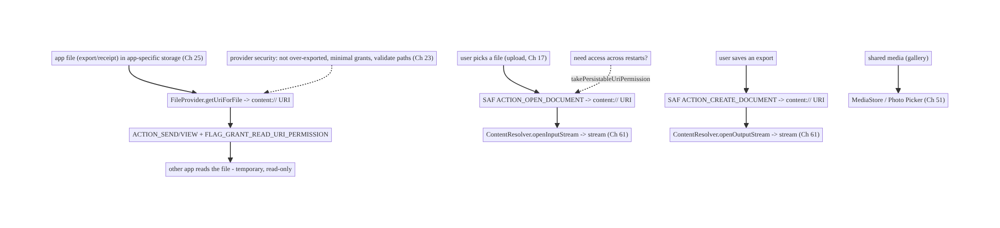
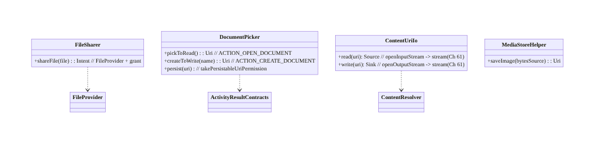
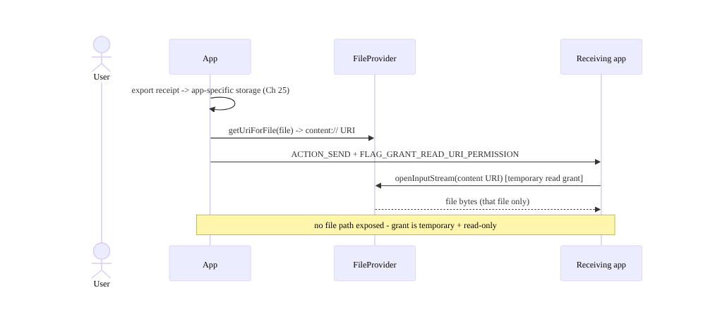
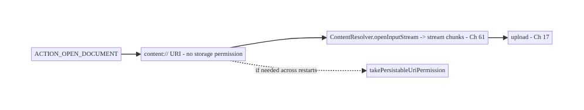
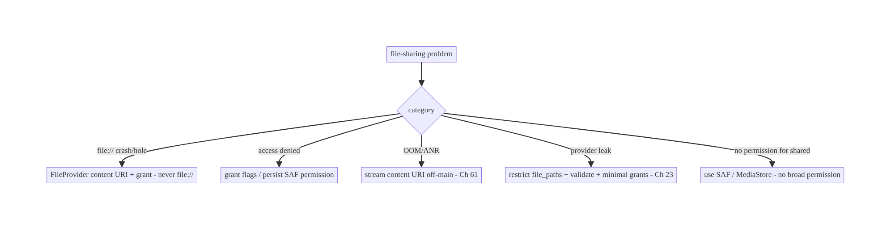

# Chapter 62 — File Sharing & Content Providers (Storage Access Framework)

> **Part VII — Media & Files** · Complexity: **Standard** (≥25 interview questions)
>
> **Prerequisites:** Ch 25 (secure file storage), Ch 61 (large files/streaming), Ch 60
> (camera), Ch 17 (uploads), Ch 51 (permissions), Ch 23 (security). Pairs with Ch 52
> (deep links), Ch 28 (privacy).
>
> **Reference surface in StreamCart:** moving files across the app boundary — sharing a
> receipt/invoice to another app, letting the user pick a file to upload (Ch 17), saving
> an export to the user's chosen location, exposing an app file to a viewer — all under
> **scoped storage**, via **`FileProvider`**, **Storage Access Framework (SAF)**, and
> content URIs, without the legacy `file://` permissions mess.

---

## 62.1 Problem Definition and Real-World Context

Android storage changed fundamentally with **scoped storage** (Android 10+): apps can no
longer freely read/write the shared filesystem with broad permissions, and sharing a raw
`file://` path to another app **throws `FileUriExposedException`** and is a security hole.
The modern model is **content URIs** (`content://`) brokered by **content providers**:
your app exposes its files via a **`FileProvider`** with **temporary, granular
permissions**, and reads others' files (or lets users pick/save) via the **Storage Access
Framework (SAF)** and the system document/photo pickers. Getting this wrong means crashes,
security holes, denied access, or a poor UX.

Concretely, teams hit:

- **`file://` exposure crash/hole.** Sharing or passing a `file://` URI to another app
  crashes (`FileUriExposedException`) and, if it worked, would leak a path with no access
  control. Must use a **`content://` URI** via `FileProvider` with **grant flags**.
- **Scoped storage confusion.** Legacy "request `WRITE_EXTERNAL_STORAGE` and read
  anywhere" is gone (Android 10+). App files live in **app-specific storage** (no
  permission); user-visible/shared files go through **MediaStore** (media) or **SAF**
  (documents) — and `MANAGE_EXTERNAL_STORAGE` is restricted to niche apps (Play-reviewed).
- **Picking/saving files.** To let the user **pick** a file (upload, Ch 17) or **save** an
  export to their chosen location, use **SAF** (`ACTION_OPEN_DOCUMENT`/`CREATE_DOCUMENT`/
  `OPEN_DOCUMENT_TREE`) — which returns a **content URI** you access without broad
  permissions, and can **persist** access across restarts.
- **Permission grants on URIs.** Content URIs carry **temporary read/write grants**
  (`FLAG_GRANT_READ/WRITE_URI_PERMISSION`); forgetting them → `SecurityException` in the
  receiving app. Persisted SAF URIs need `takePersistableUriPermission`.
- **Exposing app files to others (a provider).** When another app must read your file
  (share a receipt), expose it via `FileProvider` (or a custom `ContentProvider`) — never
  a path.
- **Security of your provider.** An exported/misconfigured provider can **leak** files or
  allow path traversal; grants must be minimal and validated (Ch 23).

The architecture: keep app files in **app-specific storage** (no permission, Ch 25);
**share** app files to other apps via a **`FileProvider`** that returns a **`content://`
URI** with **temporary grant flags** (never `file://`); let users **pick/save/browse**
files via **SAF** (`ACTION_OPEN_DOCUMENT`/`CREATE_DOCUMENT`/`OPEN_DOCUMENT_TREE`,
**persisting** access when needed), reading/writing the returned content URI with
**streaming** (Ch 61); use **MediaStore** for shared media; and **secure** providers
(not over-exported, minimal grants, validated, Ch 23). This chapter is about **moving
files across the app boundary correctly under scoped storage**.

### Three practical use cases

1. **Share a receipt (StreamCart).** Export a PDF to app-specific storage, expose it via
   `FileProvider`, and `ACTION_SEND` a **content URI** with read grant to the user's
   chosen app (email/drive).
2. **Pick a file to upload.** `ACTION_OPEN_DOCUMENT` (or Photo Picker, Ch 51) → a content
   URI → **stream** it (Ch 61) to the upload (Ch 17) — no storage permission.
3. **Save an export to the user's location.** `ACTION_CREATE_DOCUMENT` → a content URI in
   the user's chosen folder → stream the export to it (Ch 61).

### Why this is architectural

File sharing under scoped storage is a **cross-app boundary + security + permission-model**
problem spanning storage (Ch 25), streaming (Ch 61), uploads/camera (Ch 17/60),
permissions (Ch 51), and provider security (Ch 23). The decisions — content URIs vs paths,
`FileProvider`/SAF/MediaStore, grant flags, persisted access, provider hardening —
determine whether file flows work, are secure, and respect the user's storage.

---

## 62.2 Requirements Engineering

### Functional requirements

| ID | Requirement |
|----|-------------|
| F1 | Share app files to other apps via content URIs with temporary grants (not file://). |
| F2 | Let users pick/save/browse files via SAF; persist access when needed. |
| F3 | Read/write content URIs via streaming (Ch 61); no broad storage permissions. |
| F4 | Use MediaStore for shared media; app-specific storage for app files (Ch 25). |
| F5 | Secure providers (minimal export, minimal grants, validated) (Ch 23). |
| F6 | Handle scoped-storage rules across Android versions. |

### Non-functional requirements

| Attribute | Policy |
|-----------|--------|
| **Security** | Content URIs + minimal temporary grants; no path exposure; hardened provider. |
| **Correctness** | Works under scoped storage; grants present; persisted when needed. |
| **Least privilege** | No broad storage permissions; SAF/MediaStore/FileProvider. |
| **UX** | Native pickers; user chooses location; smooth share. |
| **Resilience** | Streaming (Ch 61); handle revoked/invalid URIs. |

### Scope

- **In scope:** scoped storage model, app-specific storage (Ch 25), `FileProvider`
  (expose app files + grant flags + `ACTION_SEND`), SAF (`ACTION_OPEN_DOCUMENT`/
  `CREATE_DOCUMENT`/`OPEN_DOCUMENT_TREE` + persistable permissions), MediaStore (shared
  media), reading/writing content URIs via streaming (Ch 61), custom `ContentProvider`
  basics, provider security (Ch 23), version differences.
- **Out of scope:** streaming internals (Ch 61), secure storage/encryption (Ch 25), upload
  (Ch 17), camera (Ch 60), permissions UX (Ch 51), deep-link security (Ch 52).

### Assumptions & constraints

- `minSdk 24`, `targetSdk` current (scoped storage enforced). AndroidX `FileProvider`,
  Activity Result API for SAF, `ContentResolver`, okio/streams (Ch 61). `file://` exposure
  is blocked; broad storage permissions are deprecated/restricted; content URIs carry
  grants.

---

## 62.3 System Design Fundamentals

- **Scoped storage (the model since Android 10+).** An app has **unrestricted** access to
  its **app-specific** storage (internal `filesDir`/`cacheDir`, app-specific external) with
  **no permission** (Ch 25). It does **not** have free access to the shared filesystem;
  user-visible/shared content goes through **MediaStore** (images/video/audio) or **SAF**
  (any document). Broad `READ/WRITE_EXTERNAL_STORAGE` is deprecated;
  `MANAGE_EXTERNAL_STORAGE` is restricted to niche, Play-reviewed apps (file managers).
- **Content URIs, not file paths (the cardinal rule).** Across the app boundary you pass
  **`content://` URIs**, never `file://` (which throws `FileUriExposedException` and has no
  access control). A content URI is brokered by a **content provider** and carries
  **granular, revocable permissions**.
- **`FileProvider` — expose your app's files.** To share an app file (receipt, export) with
  another app, wrap it in a **`FileProvider`** (a built-in `ContentProvider`): declare it in
  the manifest with a `file_paths` XML mapping, call `FileProvider.getUriForFile(...)` to
  get a `content://` URI, and attach **grant flags** (`FLAG_GRANT_READ_URI_PERMISSION`) when
  sending (`ACTION_SEND`/`ACTION_VIEW`). The receiving app gets **temporary** access to
  **that file only** — no path leak, no broad permission.
- **Storage Access Framework (SAF) — the user picks/saves.** SAF lets the **user** choose
  files/folders via system UI, returning a **content URI** your app can access **without
  storage permissions**:
  - **`ACTION_OPEN_DOCUMENT`:** pick a file to read (e.g., choose a file to upload, Ch 17).
  - **`ACTION_CREATE_DOCUMENT`:** create/save a file at a user-chosen location (export).
  - **`ACTION_OPEN_DOCUMENT_TREE`:** grant access to a whole **folder** (for apps managing
    many files there).
  - **Persisted access:** by default the grant is for the session; call
    **`takePersistableUriPermission`** (with the persistable flag) to keep access across
    restarts (store the URI).
  Use the **Activity Result API** (`OpenDocument`/`CreateDocument`/`OpenDocumentTree`
  contracts).
- **MediaStore — shared media.** To add/read **media** in the user's shared collections
  (photos/video/audio, e.g., save a photo to the gallery, Ch 60), use **MediaStore**
  (`MediaStore.Images`, etc.) — scoped-storage-friendly, no broad permission for your own
  inserts; the **Photo Picker** (Ch 51) reads media without permission.
- **Reading/writing content URIs = streaming (Ch 61).** You don't get a file path from a
  content URI — you open a **stream** via `ContentResolver.openInputStream(uri)` /
  `openOutputStream(uri)` (or `openFileDescriptor`) and **stream** (Ch 61) to/from it
  (upload, copy, export). Treat it like any stream; don't assume a path.
- **Custom `ContentProvider` (when needed).** For structured cross-app data sharing (beyond
  files) or exposing queryable data, implement a `ContentProvider` — but most file sharing
  needs only `FileProvider`. A custom provider must be **secured** (below).
- **Provider security (Ch 23).** A content provider is an **attack surface**:
  - **Don't over-export:** `FileProvider` is `exported="false"` + `grantUriPermissions="true"`
    (access only via explicit grants). A custom provider exposed to other apps needs
    careful permission/path checks.
  - **Minimal grants:** grant **read-only** when read suffices; grant per-URI, temporary
    (don't persist unless needed); revoke when done.
  - **Validate paths:** `file_paths` mapping restricts what can be shared; prevent **path
    traversal** (don't let a URI escape the allowed subtree).
  - **Treat incoming URIs as untrusted** (Ch 23/52): a URI from another app or a deep link
    could point anywhere — validate and open via `ContentResolver` (which enforces grants),
    don't assume it's yours.

Core insight: **under scoped storage, keep app files in app-specific storage (no
permission, Ch 25) and move files across the app boundary as `content://` URIs — never
`file://`: expose your files to other apps via a `FileProvider` with minimal temporary
grant flags, and let the user pick/save/browse via the Storage Access Framework
(`ACTION_OPEN_DOCUMENT`/`CREATE_DOCUMENT`/`OPEN_DOCUMENT_TREE`, persisting access only when
needed), reading/writing the returned content URI by streaming through `ContentResolver`
(Ch 61); use MediaStore/Photo Picker for shared media; and harden providers (not
over-exported, read-only minimal grants, path-validated, untrusted incoming URIs, Ch 23).**

---

## 62.4 High-Level Architecture



**Components & ownership**

- **App-specific storage** holds app files (no permission, Ch 25).
- **`FileProvider`** exposes app files as content URIs with temporary grants.
- **SAF** lets the user pick/save/browse → content URIs streamed via `ContentResolver`
  (Ch 61).
- **MediaStore/Photo Picker** for shared media.
- **Provider security** keeps it all hardened (Ch 23).

**Direction:** app files ↔ content URIs (FileProvider for sharing out, SAF for user pick/
save) ↔ streamed via ContentResolver; media via MediaStore; secured.

---

## 62.5 Detailed Component Design



| Component | Responsibility |
|-----------|----------------|
| `FileSharer` | expose app file via `FileProvider` + grant flags; build share intent |
| `DocumentPicker` | SAF open/create/tree + persist access |
| `ContentUriIo` | stream read/write a content URI via `ContentResolver` (Ch 61) |
| `MediaStoreHelper` | insert/read shared media |

---

## 62.6 End-to-End Data Flow

### Sharing an app file (FileProvider)



### Picking a file to upload (SAF) + streaming



---

## 62.7 Complete Kotlin Implementation

Package: `com.streamcart.sharing`.

### 62.7.1 FileProvider: manifest + sharing an app file

```xml
<provider
    android:name="androidx.core.content.FileProvider"
    android:authorities="${applicationId}.fileprovider"
    android:exported="false"
    android:grantUriPermissions="true">          <!-- access only via explicit grants -->
    <meta-data android:name="android.support.FILE_PROVIDER_PATHS" android:resource="@xml/file_paths" />
</provider>
```

```xml
<!-- res/xml/file_paths.xml: restricts WHAT can be shared (prevents traversal, Ch 23) -->
<paths>
    <cache-path name="shared" path="shared/" />      <!-- only files under cacheDir/shared/ -->
    <files-path name="exports" path="exports/" />
</paths>
```

```kotlin
class FileSharer @Inject constructor(@ApplicationContext private val ctx: Context) {
    fun shareIntent(file: File, mime: String): Intent {
        val uri = FileProvider.getUriForFile(ctx, "${ctx.packageName}.fileprovider", file)  // content:// URI
        return Intent(Intent.ACTION_SEND).apply {
            type = mime
            putExtra(Intent.EXTRA_STREAM, uri)
            addFlags(Intent.FLAG_GRANT_READ_URI_PERMISSION)       // TEMPORARY, read-only grant (minimal)
        }.let { Intent.createChooser(it, "Share") }
        // NEVER: Uri.fromFile(file) / file:// -> FileUriExposedException + security hole
    }
}
```

### 62.7.2 SAF: pick a file to read, create a file to write (Activity Result API)

```kotlin
@Composable
fun PickFileToUpload(onPicked: (Uri) -> Unit) {
    val launcher = rememberLauncherForActivityResult(ActivityResultContracts.OpenDocument()) { uri ->
        uri?.let { onPicked(it) }                                 // content:// URI; NO storage permission
    }
    Button(onClick = { launcher.launch(arrayOf("application/pdf", "image/*")) }) { Text("Choose file") }
}

@Composable
fun SaveExport(fileName: String, onLocation: (Uri) -> Unit) {
    val launcher = rememberLauncherForActivityResult(
        ActivityResultContracts.CreateDocument("text/csv")) { uri -> uri?.let(onLocation) }
    Button(onClick = { launcher.launch(fileName) }) { Text("Export to...") }   // user picks the location
}
```

### 62.7.3 Persist access across restarts (folder/tree)

```kotlin
class DocumentPicker @Inject constructor(@ApplicationContext private val ctx: Context) {
    /** Keep access to a user-granted URI across app restarts. */
    fun persist(uri: Uri, writable: Boolean) {
        val flags = Intent.FLAG_GRANT_READ_URI_PERMISSION or
            (if (writable) Intent.FLAG_GRANT_WRITE_URI_PERMISSION else 0)
        ctx.contentResolver.takePersistableUriPermission(uri, flags)   // store `uri` (DataStore, Ch 4) to reuse
    }
    // OPEN_DOCUMENT_TREE for a whole folder: ActivityResultContracts.OpenDocumentTree().
}
```

### 62.7.4 Read/write a content URI by STREAMING (Ch 61)

```kotlin
class ContentUriIo @Inject constructor(
    @ApplicationContext private val ctx: Context, private val dispatchers: DispatcherProvider,
) {
    /** Stream a picked URI to an upload/copy (Ch 61/17) — no path, no whole-file load. */
    suspend fun streamIn(uri: Uri, sink: Sink) = withContext(dispatchers.io) {
        ctx.contentResolver.openInputStream(uri)?.use { input ->      // grant enforced by resolver
            input.source().buffer().use { src -> sink.buffer().use { it.writeAll(src) } }   // stream (Ch 61)
        } ?: throw IOException("cannot open $uri")
    }
    /** Stream an export to a user-chosen location. */
    suspend fun streamOut(uri: Uri, source: Source) = withContext(dispatchers.io) {
        ctx.contentResolver.openOutputStream(uri)?.use { output ->
            source.buffer().use { src -> output.sink().buffer().use { it.writeAll(src) } }  // stream (Ch 61)
        } ?: throw IOException("cannot open $uri")
    }
}
```

### 62.7.5 MediaStore: save a photo to the gallery (Ch 60)

```kotlin
suspend fun saveToGallery(ctx: Context, source: Source, displayName: String): Uri = withContext(Dispatchers.IO) {
    val values = ContentValues().apply {
        put(MediaStore.Images.Media.DISPLAY_NAME, displayName)
        put(MediaStore.Images.Media.MIME_TYPE, "image/jpeg")
        put(MediaStore.Images.Media.RELATIVE_PATH, "Pictures/StreamCart")   // scoped storage
    }
    val uri = ctx.contentResolver.insert(MediaStore.Images.Media.EXTERNAL_CONTENT_URI, values)!!
    ctx.contentResolver.openOutputStream(uri)!!.use { out ->
        source.buffer().use { src -> out.sink().buffer().use { it.writeAll(src) } }   // stream (Ch 61)
    }
    uri   // no WRITE_EXTERNAL_STORAGE needed for your own insert
}
```

### 62.7.6 Module structure

```
:core:sharing   FileSharer (FileProvider), DocumentPicker (SAF), ContentUriIo (stream, Ch 61), MediaStoreHelper
# file_paths.xml restricts shareable paths (Ch 23). Streaming -> Ch 61; app storage -> Ch 25.
```

---

## 62.8 Concurrency and Race Conditions

| Scenario | Risk | Handling |
|----------|------|----------|
| `file://` passed to another app | crash/hole | always `FileProvider` content URI + grant |
| Missing grant flag | `SecurityException` in receiver | `FLAG_GRANT_READ_URI_PERMISSION` on send |
| SAF URI used after restart w/o persist | access denied | `takePersistableUriPermission` + store URI |
| Reading content URI off a path | wrong (no path) | stream via `ContentResolver` (Ch 61) |
| Large content URI read | OOM/ANR | stream in chunks off-main (Ch 61) |
| Revoked/invalid URI | exception | handle gracefully; re-prompt via SAF |
| Over-broad grant persisted | security | read-only, minimal, persist only if needed |

- **Content URIs have no file path** — always open a **stream** via `ContentResolver`
  (Ch 61); code that calls `uri.path` and opens a `File` is wrong and will fail under
  scoped storage.
- **Grants are required and minimal:** forgetting `FLAG_GRANT_READ_URI_PERMISSION` denies
  the receiver; persisting write access you don't need is a security risk — grant
  **read-only, temporary** by default.
- **Persisted SAF access must be taken and stored:** without `takePersistableUriPermission`
  a URI stops working after restart; store the URI (Ch 4) and handle revocation by
  re-prompting.

---

## 62.9 Failure Scenarios and Recovery

| Failure | Detection | Response | Outcome |
|---------|-----------|----------|---------|
| `FileUriExposedException` | crash | FileProvider content URI + grant | works |
| Receiver `SecurityException` | crash in other app | add grant flags | access granted |
| SAF access lost after restart | denied | persist + store URI; re-prompt | restored |
| OOM/ANR reading a big URI | crash | stream off-main (Ch 61) | safe |
| Provider leaks files (traversal) | security audit | restrict `file_paths`; validate (Ch 23) | contained |
| Broad storage permission denied | can't access | use SAF/MediaStore (no permission) | works |
| Incoming URI points elsewhere | security | treat untrusted; resolver enforces grant (Ch 23) | safe |



> **Scoped storage reduces to two rules:** keep your files in app-specific storage (no
> permission) and cross the app boundary only as **content URIs** — `FileProvider` (with
> minimal grants) to share out, **SAF**/MediaStore to let the user pick/save. `file://`
> and broad storage permissions are gone; content URIs + streaming (Ch 61) are the model.

---

## 62.10 Scaling the Implementation

- **Level 1.** App-specific storage (Ch 25); `FileProvider` to share app files with grants.
- **Level 2.** SAF open/create for pick/save; stream content URIs (Ch 61); MediaStore for
  media.
- **Level 3 — production.** Persisted SAF access (folders); Photo Picker (Ch 51); provider
  hardening (`file_paths`, minimal grants, Ch 23); version handling.
- **Level 4 — large.** Document-tree management (user folder of app files); custom
  `ContentProvider` for structured sharing; batch share/export; MIME negotiation.
- **Level 5 — enterprise.** Storage/sharing governance, DLP (what may leave the app),
  provider security review, cross-app integration contracts, enterprise managed-storage.

**Avoid overengineering:** `FileProvider` + SAF + MediaStore cover almost all needs; a
custom `ContentProvider` is rarely necessary for files. Don't request broad storage
permissions.

---

## 62.11 Alternative Approaches and Trade-offs

| Dimension | Option A | Option B | When |
|-----------|----------|----------|------|
| Cross-app file | `content://` via FileProvider | `file://` path | Always content URI (file:// crashes + insecure) |
| User pick/save | SAF (OPEN/CREATE_DOCUMENT) | request storage permission | SAF (no permission, user chooses) |
| Shared media | MediaStore / Photo Picker | SAF / broad permission | MediaStore/Picker for media (scoped-friendly) |
| App's own files | App-specific storage (no perm) | shared storage | App-specific (no permission, private, Ch 25) |
| Read content URI | Stream via ContentResolver (Ch 61) | get a path + File | Stream (no path exists under scoped storage) |
| Persisted access | `takePersistableUriPermission` | re-prompt each time | Persist for recurring folder access |
| Broad access | SAF tree | `MANAGE_EXTERNAL_STORAGE` | SAF tree; MANAGE only for file managers (Play-restricted) |

**Content URIs vs file paths:** passing a `file://` path across the app boundary throws
`FileUriExposedException` (since Android 7) and, historically, leaked a path with no access
control. **Content URIs** brokered by a provider carry **granular, temporary, revocable
permissions** and expose only the intended file. Always share via `content://`
(`FileProvider`); never `file://`.

**SAF vs storage permissions:** requesting `READ/WRITE_EXTERNAL_STORAGE` to access user
files is deprecated and over-broad; **SAF** lets the **user** pick exactly what to share
and returns a content URI your app accesses **with no permission** — better security and
UX. Use SAF (and MediaStore/Photo Picker for media); reserve broad permissions for nothing
(and `MANAGE_EXTERNAL_STORAGE` only for genuine file-manager apps that pass Play review).

**FileProvider vs custom ContentProvider:** for sharing **files**, `FileProvider` is a
ready-made, secure provider needing only a `file_paths` mapping — use it. A **custom
`ContentProvider`** is for exposing **structured/queryable data** across apps (or complex
file logic) and must be carefully secured; don't build one when `FileProvider` suffices.

---

## 62.12 Security Considerations

- **Never expose `file://`** — it crashes and leaks a path; always a `content://` URI with
  **minimal grants** (read-only, temporary; persist write only if truly needed).
- **Restrict `file_paths`** so the provider can only share files under intended subtrees —
  prevents **path traversal**/exfiltration of arbitrary app files (Ch 23).
- **`FileProvider` is `exported="false"` + `grantUriPermissions="true"`:** access only via
  explicit grants; a **custom provider** exposed to other apps needs permission checks and
  path validation.
- **Treat incoming URIs as untrusted (Ch 23/52):** a URI from another app or a deep link
  could point anywhere — open via `ContentResolver` (which enforces the grant), validate
  MIME/size, and don't assume it's safe or yours.
- **Minimal/temporary grants, revoke when done:** don't persist access you don't need;
  `revokeUriPermission` when finished; persisted grants are a standing capability.
- **Sensitive files (Ch 25/28):** keep sensitive app files in app-internal storage; think
  before sharing (DLP) — a shared receipt may contain PII; strip/limit what leaves.
- **Per-account (Ch 42):** don't share one account's file under another; clear persisted
  URIs on logout if account-scoped.
- Client vs backend: file sharing is a client/OS boundary concern; when files go to the
  backend (upload, Ch 17) normal auth/TLS/pinning apply (Ch 19/23).

---

## 62.13 Performance and Resource Optimization

- **Stream content URIs** (Ch 61) — never load a picked/shared file wholly into memory
  (OOM); off-main (ANR).
- **MediaStore/SAF inserts stream** too (open the output stream, write in chunks).
- **Minimal grants** reduce security surface and bookkeeping.
- **Persist only needed access;** revoke stale persisted URIs (they count against a limit).
- **Avoid copying when you can share a URI:** if another app just needs to read, grant a
  URI instead of copying the file.
- **Right MIME + size hints** for faster handling by receivers.
- **Profiling:** share/pick success rate, content-URI read throughput/memory (flat,
  Ch 61), persisted-grant count, provider errors.

---

## 62.14 Testing Strategy

Provider/SAF logic tests with `ContentResolver`/Robolectric; integration via intents.

```kotlin
class FileSharerTest {
    @Test fun `builds content uri with read grant - not file`() {
        val intent = FileSharer(ctx).shareIntent(File(ctx.cacheDir, "shared/receipt.pdf"), "application/pdf")
        val uri = intent.getParcelableExtra<Uri>(Intent.EXTRA_STREAM)!!
        assertEquals("content", uri.scheme)                        // not "file"
        assertTrue(intent.flags and Intent.FLAG_GRANT_READ_URI_PERMISSION != 0)
    }
}

class ContentUriIoTest {
    @Test fun `streams a content uri without loading whole file`() = runTest {
        // provide a fake ContentResolver returning a large stream; assert streamed (Ch 61), bounded memory
    }
}
// SAF: instrumentation with UiAutomator to drive the system picker; or fake the Activity Result.
```

What to test: share intent uses a `content://` URI + read grant (not `file://`); content
URI read/write streams (bounded memory, Ch 61); SAF persist (`takePersistableUriPermission`);
MediaStore insert; provider only shares allowed paths (`file_paths`); untrusted incoming
URI handled. Instrumentation/UiAutomator for the real system pickers.

---

## 62.15 Production Observability

- **Metrics:** share success rate; `FileUriExposedException`/`SecurityException` rate
  (→ 0); content-URI read throughput/memory (flat, Ch 61); SAF pick/create success;
  persisted-grant count; provider errors; broad-permission usage (should be none).
- **Logs:** `fileshare{action, scheme, mime, result}` — no URIs with PII/paths (Ch 28).
- **Debugging:** `FileUriExposedException` → a `file://` somewhere (use FileProvider);
  receiver `SecurityException` → missing grant; SAF denied after restart → not persisted;
  OOM/ANR → not streaming (Ch 61); provider leak → `file_paths` too broad (Ch 23).
- **Alerting:** `FileUriExposedException` or provider-security errors after a release.
- **Dashboards:** share/pick success; scoped-storage error trends.

---

## 62.16 System Design Interview Preparation

> ≥25 questions.

**Fundamentals**

1. *Scoped storage?* App-specific storage free (no permission); shared via MediaStore/SAF;
   no broad filesystem access.
2. *Cross-app file rule?* Pass `content://` URIs, never `file://`.
3. *`FileUriExposedException`?* Thrown when sharing a `file://` URI — use FileProvider.
4. *What's a content URI?* Provider-brokered URI with granular, revocable permissions.
5. *App's own files?* App-specific storage, no permission (Ch 25).

**FileProvider**

6. *Purpose?* Expose app files as content URIs to other apps.
7. *Grant flags?* `FLAG_GRANT_READ_URI_PERMISSION` (temporary, minimal).
8. *`file_paths`?* Restricts what can be shared (prevents traversal).
9. *Exported?* `false` + `grantUriPermissions=true` (access via grants only).

**SAF**

10. *What is SAF?* System UI for the user to pick/save/browse → content URI, no permission.
11. *OPEN vs CREATE vs TREE?* Pick file / save file / grant a folder.
12. *Persist access?* `takePersistableUriPermission` + store the URI.
13. *Read/write the URI?* Stream via `ContentResolver` (Ch 61) — no path.

**MediaStore**

14. *Shared media?* MediaStore (insert your own without broad permission).
15. *Read media without permission?* Photo Picker (Ch 51).

**Security**

16. *Why not file://?* Crash + no access control.
17. *Grant minimality?* Read-only, temporary; revoke; persist only if needed.
18. *Provider over-export?* Attack surface — restrict + validate (Ch 23).
19. *Incoming URIs?* Untrusted — resolver enforces grant; validate (Ch 52).
20. *Path traversal?* Restrict `file_paths`.

**Streaming/perf**

21. *Big content URI?* Stream off-main (Ch 61) — no path, no whole-file.
22. *Avoid copying?* Grant a URI instead of copying when read-only.

**Testing/Production**

23. *Test share?* Assert content URI + read grant (not file://).
24. *`FileUriExposedException` in prod?* A `file://` somewhere.
25. *SAF lost after restart?* Not persisted.
26. *Broad permission denied?* Use SAF/MediaStore instead.

### Design-change challenges
1. **Share a generated PDF receipt to another app.** FileProvider content URI + read grant
   (`ACTION_SEND`).
2. **Let the user pick a file to upload without storage permission.** SAF
   `ACTION_OPEN_DOCUMENT` → stream (Ch 61/17).
3. **Save an export to the user's chosen folder.** SAF `ACTION_CREATE_DOCUMENT` → stream
   out.
4. **App crashes with `FileUriExposedException`.** Replace `file://` with FileProvider
   content URI.
5. **Keep access to a user folder across restarts.** `OPEN_DOCUMENT_TREE` +
   `takePersistableUriPermission`.

### Mock walkthrough (abridged)
Clarify (sharing out, picking in, saving, media?) → scoped-storage model → app files in
app-specific storage (Ch 25) → share out via FileProvider content URI + minimal grant →
user pick/save via SAF (persist if needed) → media via MediaStore/Photo Picker → stream
content URIs via ContentResolver (Ch 61) → provider security (file_paths, minimal grants,
untrusted URIs, Ch 23) → observability (exposure/security errors).

---

## 62.17 Practical Exercises

1. **Beginner.** Share an app-internal PDF to another app via `FileProvider` with a
   read-only grant (no `file://`). *Eval:* content URI; receiver can read.
2. **Intermediate.** Let the user pick a file with SAF `ACTION_OPEN_DOCUMENT` and stream it
   to an upload (Ch 61/17) with no storage permission. *Eval:* no permission; streamed.
3. **Advanced.** Save an export via `ACTION_CREATE_DOCUMENT` and grant persistent access to
   a folder via `OPEN_DOCUMENT_TREE` + `takePersistableUriPermission`. *Eval:* saved;
   access survives restart.
4. **Production debugging.** Fix a `FileUriExposedException` (a `file://` share) and a
   receiver `SecurityException` (missing grant). *Eval:* content URI + grant.
5. **System design challenge.** Harden the provider (`file_paths` subtree, read-only
   minimal grants, untrusted-URI validation) and add scoped-storage error telemetry.
   *Eval:* no traversal; minimal grants; observable.

*(Solutions withheld unless requested.)*

---

## 62.18 Chapter Summary & Reference Sheet

**Key decisions:** work within **scoped storage** — keep app files in **app-specific
storage** (no permission, Ch 25) and cross the app boundary only as **`content://` URIs**,
**never `file://`** (which throws `FileUriExposedException` and leaks a path): **share your
files out** via a **`FileProvider`** (declared `exported=false`/`grantUriPermissions=true`,
with a **restrictive `file_paths` mapping**) returning a content URI with **minimal,
temporary, read-only grant flags**; let the **user pick/save/browse** via the **Storage
Access Framework** (`ACTION_OPEN_DOCUMENT`/`CREATE_DOCUMENT`/`OPEN_DOCUMENT_TREE`,
**persisting access** with `takePersistableUriPermission` only when needed) — no storage
permission required; use **MediaStore / Photo Picker** for shared media; and **read/write
content URIs by streaming** through `ContentResolver.openInputStream`/`openOutputStream`
(Ch 61) since there is **no file path**. **Harden** providers (not over-exported, minimal
grants, validated `file_paths`, **untrusted incoming URIs**, Ch 23/52), keep sensitive
files app-internal and per-account (Ch 25/42), and avoid broad storage permissions
entirely.

**Concepts:** scoped storage, content URIs vs file paths, `FileProvider` + grant flags +
`file_paths`, SAF (open/create/tree + persistable permissions), MediaStore/Photo Picker,
streaming content URIs via `ContentResolver` (Ch 61), custom `ContentProvider`, provider
security.

**Common mistakes:** sharing `file://` (`FileUriExposedException`/leak); requesting broad
storage permissions (deprecated/denied); missing grant flags (`SecurityException`); not
persisting SAF access (lost after restart); treating a content URI as a path (fails);
loading a content URI wholly into memory (OOM — stream it); over-broad `file_paths`
(traversal); trusting incoming URIs.

**Checklist:**

- [ ] app files in app-specific storage (Ch 25)
- [ ] share out via FileProvider content URI + minimal read grant (never file://)
- [ ] restrictive `file_paths`
- [ ] SAF for pick/save/tree; persist only if needed
- [ ] MediaStore/Photo Picker for media
- [ ] stream content URIs via ContentResolver (Ch 61)
- [ ] provider not over-exported + validated (Ch 23)
- [ ] untrusted incoming URIs
- [ ] sensitive files app-internal, per-account (Ch 25/42)
- [ ] no broad storage permissions
- [ ] exposure/security-error telemetry.

**Key APIs:** `FileProvider.getUriForFile`/`file_paths.xml`/`grantUriPermissions`,
`Intent.FLAG_GRANT_READ/WRITE_URI_PERMISSION`/`ACTION_SEND`, `ActivityResultContracts.
OpenDocument`/`CreateDocument`/`OpenDocumentTree`, `ContentResolver.takePersistableUriPermission`/
`openInputStream`/`openOutputStream`/`openFileDescriptor`/`insert`, `MediaStore`,
`ContentValues`/`RELATIVE_PATH`, custom `ContentProvider`, `revokeUriPermission`.

**References:**
- Sharing files (FileProvider): https://developer.android.com/training/secure-file-sharing
- Storage Access Framework: https://developer.android.com/guide/topics/providers/document-provider
- Scoped storage / data storage: https://developer.android.com/training/data-storage
- MediaStore: https://developer.android.com/training/data-storage/shared/media
- (composes) Ch 25 Secure Storage, Ch 61 Large Files/Streaming, Ch 60 Camera, Ch 17 Uploads, Ch 51 Permissions, Ch 23 Security

### Chapter review (Phase 4)
- **Completeness:** all 18 sections; architecture/class/sequence/flow/failure diagrams;
  FileProvider + SAF (open/create/tree/persist) + content-URI streaming + MediaStore code;
  concurrency (no-path/streaming, grants, persisted access); failure (two-rules model);
  5 levels; content-URI-vs-path, SAF-vs-permission, FileProvider-vs-custom trade-offs;
  security (no file://, file_paths, minimal grants, untrusted URIs); perf (stream/minimal
  grants/avoid copy); provider+streaming tests; observability (exposure errors); 26 Q&A +
  5 challenges. ✅
- **Expand later:** secure storage (Ch 25), large files (Ch 61), camera (Ch 60), uploads
  (Ch 17), security (Ch 23).
- **Interview coverage:** exceeds ≥25 bar.
