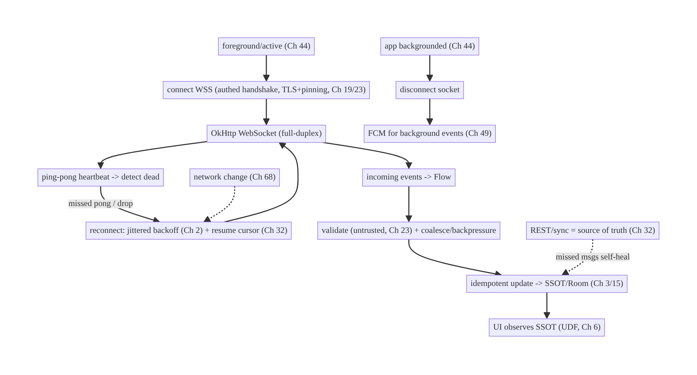
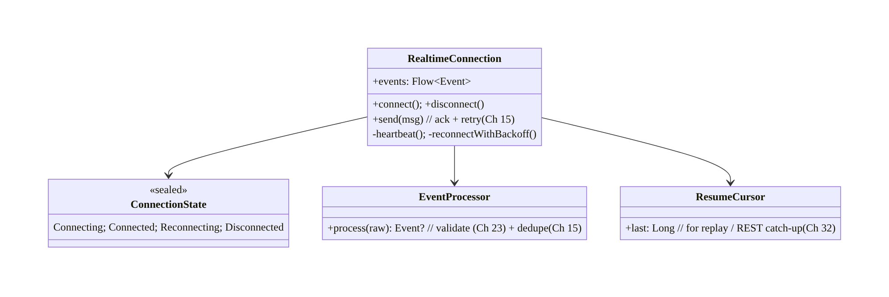
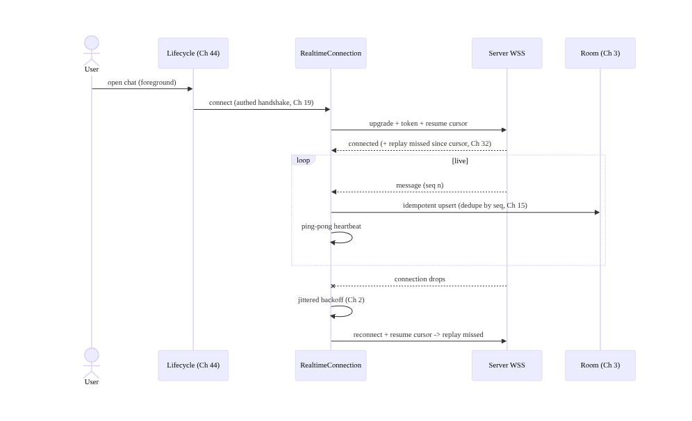
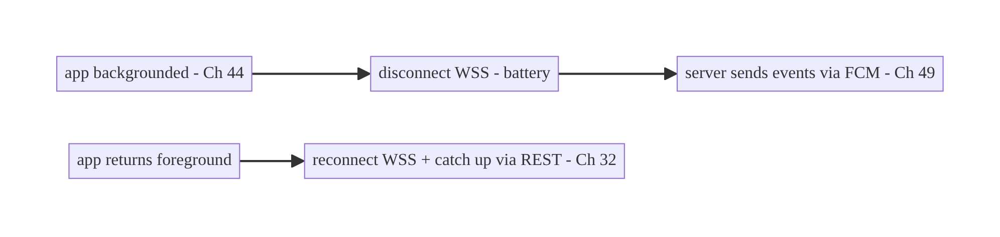
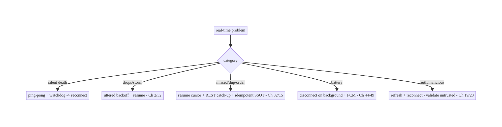

# Chapter 63 — Real-Time Communication over WebSocket

> **Part VIII — Real-Time & Connectivity** · Complexity: **Complex** (≥40 interview questions)
>
> **Prerequisites:** Ch 1 (networking/OkHttp), Ch 2 (retries/backoff), Ch 44 (lifecycle),
> Ch 49 (FCM), Ch 3 (SSOT), Ch 19 (auth), Ch 68 (network state). Pairs with Ch 64 (chat),
> Ch 65 (presence), Ch 66 (SSE/long-polling).
>
> **Reference surface in StreamCart:** live, bidirectional features while the app is
> foreground/active — chat (Ch 64), live-stream reactions/viewer counts, order-status
> ticks, live auctions — delivered over a persistent **WebSocket** with reconnection,
> heartbeats, auth, and a clean handoff to **FCM** (Ch 49) when backgrounded.

---

## 63.1 Problem Definition and Real-World Context

Some features need **low-latency, bidirectional, server-initiated** updates: a chat where
messages arrive instantly, a live stream showing reactions and viewer counts, an auction
with live bids. HTTP request/response (Ch 1) can't push; polling is laggy and wasteful
(Ch 66); and FCM (Ch 49) is for **background** wake-ups, not a live foreground stream. The
tool is a **WebSocket** — a single persistent, full-duplex TCP connection over which both
sides send messages anytime. But a WebSocket on mobile is a **stateful, fragile resource**
that must be managed carefully.

Concretely, teams hit:

- **Connection fragility.** Mobile networks drop, switch (Wi-Fi↔cellular, Ch 68), and
  idle-timeout constantly. A naive socket silently dies; you need **reconnection with
  backoff** (Ch 2), **heartbeats/ping-pong** to detect dead connections, and **resume**
  (catch up missed messages).
- **Lifecycle & battery (Ch 44/47).** A WebSocket must live only while it's useful —
  typically **foreground/active**; holding it open in the background drains battery and is
  killed by Doze (Ch 47). Connect on foreground, **disconnect on background**, and hand
  off to **FCM** (Ch 49) for background events.
- **State & consistency.** The socket delivers a **stream of events** that must update the
  **SSOT** (Ch 3) idempotently; a dropped/duplicated message must not corrupt state, and
  **truth must be reconcilable via REST/sync** (Ch 32) — the socket is a **fast path**, not
  the only path.
- **Auth & security.** The connection must be **authenticated** (token in the handshake,
  Ch 19), use **WSS (TLS)** with pinning (Ch 23), handle **token refresh/expiry** mid-
  connection, and treat inbound messages as **untrusted** (Ch 23).
- **Backpressure & ordering.** High-rate events (live reactions) can flood the client;
  you need **backpressure/coalescing**; message **ordering** and **delivery semantics**
  (at-least-once + idempotency, Ch 15) must be defined.
- **Reconnect storms & scaling.** Mass reconnects (server blip) can stampede; **jittered
  backoff** (Ch 2) and server-side scaling matter.

The architecture: open a single **authenticated WSS** connection (token in handshake,
TLS+pinning, Ch 19/23) **scoped to foreground/active** lifecycle (Ch 44), with
**heartbeat ping-pong** to detect death, **reconnection with jittered exponential
backoff** (Ch 2) and **resume** (catch up via a cursor/REST, Ch 32); expose incoming
events as a **`Flow`** that updates the **SSOT idempotently** (Ch 3/15) with
**backpressure/coalescing**; **hand off to FCM** (Ch 49) when backgrounded; refresh auth
mid-connection; and treat messages as **untrusted** (Ch 23). This chapter is about **a
robust, lifecycle-aware, secure real-time WebSocket layer**.

### Three practical use cases

1. **Live chat (StreamCart, Ch 64).** A WSS connection while the chat is open streams
   messages/typing (Ch 65); on background, disconnect and rely on FCM (Ch 49); on return,
   reconnect + catch up (Ch 32).
2. **Live-stream reactions / viewer count.** High-rate events coalesced (viewer count
   debounced; reactions sampled) to avoid flooding the UI; connection lives only while
   watching.
3. **Order/auction live ticks.** Server-pushed status/bid updates over WSS while the
   screen is open; reconciled via REST so a missed tick self-heals.

### Why this is architectural

Real-time over WebSocket is a **stateful connection-management + lifecycle + consistency +
security** problem crossing networking (Ch 1/2), lifecycle (Ch 44), background limits/FCM
(Ch 47/49), SSOT/sync (Ch 3/32), auth/security (Ch 19/23), and connectivity (Ch 68). The
decisions — WSS vs alternatives, lifecycle scoping, heartbeat/reconnect/resume, SSOT
reconciliation, auth, backpressure — determine whether real-time is reliable, battery-
sane, consistent, and secure.

---

## 63.2 Requirements Engineering

### Functional requirements

| ID | Requirement |
|----|-------------|
| F1 | Maintain an authenticated, full-duplex WSS connection for live events while active. |
| F2 | Detect dead connections (heartbeat) and reconnect with backoff + resume (Ch 2/32). |
| F3 | Scope the connection to foreground/active lifecycle; hand off to FCM on background (Ch 44/49). |
| F4 | Deliver events as a Flow; update the SSOT idempotently (Ch 3/15); reconcile via REST (Ch 32). |
| F5 | Handle auth (handshake token, refresh/expiry mid-connection) + security (WSS/pinning, untrusted) (Ch 19/23). |
| F6 | Apply backpressure/coalescing; define ordering + delivery semantics. |

### Non-functional requirements

| Attribute | Policy |
|-----------|--------|
| **Reliability** | Auto-reconnect + resume; missed messages self-heal via sync. |
| **Battery** | Connection only while active; disconnect on background; FCM for bg. |
| **Latency** | Low-latency push while connected. |
| **Consistency** | Idempotent SSOT updates; REST as source of truth. |
| **Security** | WSS+pinning, authed handshake, token refresh, untrusted messages. |
| **Scalability** | Jittered backoff (no reconnect storms); backpressure. |

### Scope

- **In scope:** WebSocket (OkHttp) connection management, authenticated WSS handshake +
  token refresh (Ch 19/23), lifecycle scoping (foreground/active) + FCM handoff (Ch 44/
  49), heartbeat/ping-pong, reconnection (jittered exponential backoff, Ch 2) + resume
  (cursor/REST, Ch 32), event `Flow` → idempotent SSOT (Ch 3/15), backpressure/coalescing,
  ordering/delivery semantics, network-change handling (Ch 68), WebSocket vs SSE/
  long-polling/FCM.
- **Out of scope:** chat app design (Ch 64), presence/typing (Ch 65), SSE/long-polling
  (Ch 66), network monitoring detail (Ch 68), FCM detail (Ch 49), sync algorithm (Ch 32),
  retries/backoff theory (Ch 2).

### Assumptions & constraints

- **OkHttp WebSocket** (`ws`/`wss`), Kotlin coroutines/Flow (Ch 1), Room SSOT (Ch 3),
  FCM (Ch 49). `minSdk 24`. The socket lives only foreground/active (Doze kills it, Ch 47);
  delivery is best-effort (reconcile via REST); messages are untrusted.

---

## 63.3 System Design Fundamentals

- **WebSocket = one persistent full-duplex connection.** After an HTTP **upgrade
  handshake**, the connection stays open and **both** sides send **messages** (text/binary)
  anytime — low-latency, server-initiated push without polling. It's a **stateful,
  long-lived resource** you must manage (unlike stateless REST, Ch 1).
- **When WebSocket vs alternatives:**

  | Need | Mechanism |
  |------|-----------|
  | Low-latency **bidirectional** live (chat, auctions) while foreground | **WebSocket** |
  | Server→client **one-way** stream (notifications feed) while foreground | **SSE** (Ch 66) — simpler, HTTP |
  | Occasional server→client with simple infra | **Long polling** (Ch 66) |
  | **Background/killed** wake-ups | **FCM** (Ch 49) — not a live socket |
  WebSocket is for **foreground bidirectional low-latency**; it is **not** a background
  transport (use FCM).
- **Lifecycle scoping (the battery crux, Ch 44/47).** A WebSocket should live only while
  it's useful — typically **foreground/active** (the relevant screen is visible).
  **Connect** on foreground/screen-open, **disconnect** on background (Ch 44) — holding it
  open in the background wastes battery and gets killed by Doze (Ch 47). For events that
  must reach a backgrounded user, **hand off to FCM** (Ch 49): the server sends a push;
  on return, the client reconnects and **catches up** (Ch 32).
- **Heartbeat / ping-pong (detect death).** Mobile connections die **silently** (NAT
  timeout, network drop). Send periodic **pings** (or app-level heartbeats) and expect
  **pongs**; if a pong is missed within a timeout, treat the connection as **dead** and
  reconnect. Don't rely on the OS to tell you promptly.
- **Reconnection with jittered backoff + resume (Ch 2/32).** On drop/error, **reconnect**
  with **exponential backoff + jitter** (Ch 2) to avoid **reconnect storms** after a
  server blip. On reconnect, **resume**: send the **last-seen cursor/sequence** so the
  server replays missed events, or **catch up via REST/sync** (Ch 32) — because events may
  have been missed while disconnected.
- **Events → Flow → idempotent SSOT (Ch 3/15).** Expose incoming messages as a **`Flow`**
  (Ch 1/6); each event updates the **SSOT (Room)** **idempotently** (dedupe by id/sequence,
  Ch 15) so a **duplicate** (at-least-once delivery / resume replay) or **out-of-order**
  message doesn't corrupt state. The UI observes the SSOT (UDF, Ch 6), not the socket
  directly.
- **The socket is a fast path, not the truth (reconcile via REST, Ch 32).** Because
  delivery is best-effort (drops, missed-while-disconnected), **never treat the socket as
  the sole source of truth**. The **REST/sync layer** (Ch 32) is authoritative; the socket
  is a **low-latency accelerator**. A missed message **self-heals** on the next
  sync/reconnect-catch-up. (Same principle as push-as-trigger, Ch 49.)
- **Auth & security (Ch 19/23).** Authenticate at the **handshake** (token in a header/
  query/subprotocol); use **WSS (TLS) + certificate pinning** (Ch 23); handle **token
  expiry mid-connection** (refresh and reconnect, or an app-level re-auth message, Ch 19);
  and treat **every inbound message as untrusted** (validate/allowlist types, authorize
  server-side, Ch 23) — a connected client can receive crafted messages.
- **Backpressure, ordering, delivery semantics.** For high-rate streams (reactions, viewer
  counts), **coalesce/sample/debounce** so the UI isn't flooded (conflate a viewer count;
  batch reactions). Define **ordering** (per-channel sequence) and **delivery semantics**
  (typically **at-least-once + idempotency**, Ch 15); for sends, use **ack + retry** with
  idempotency keys (Ch 15) so a dropped send isn't lost or duplicated.
- **Network changes (Ch 68).** On Wi-Fi↔cellular switch or connectivity loss, the socket
  breaks; observe **network state** (Ch 68) to reconnect promptly on recovery (and not
  thrash while offline).

Core insight: **use a single authenticated WSS connection (token-in-handshake, TLS+
pinning, Ch 19/23) scoped to the foreground/active lifecycle (connect on foreground,
disconnect on background, hand off to FCM for background events, Ch 44/49); keep it alive
with heartbeat ping-pong and reconnect with jittered exponential backoff + resume
(Ch 2/32) because mobile connections die silently; expose events as a Flow that updates
the SSOT idempotently (Ch 3/15) with backpressure/coalescing; and treat the socket as a
low-latency fast path over an authoritative REST/sync layer (Ch 32) — so dropped,
duplicated, or out-of-order messages self-heal — while validating all inbound messages as
untrusted (Ch 23).**

---

## 63.4 High-Level Architecture



**Components & ownership**

- **Connection manager** opens/closes the WSS scoped to lifecycle, with heartbeat +
  reconnect + resume.
- **Events** flow through validation/coalescing into the **SSOT idempotently**; the UI
  observes the SSOT.
- **REST/sync** is the authoritative backstop; **FCM** handles background.

**Direction:** foreground → authed WSS → heartbeat/reconnect/resume → events → validate/
coalesce → idempotent SSOT → UI; background → disconnect + FCM; REST reconciles.

---

## 63.5 Detailed Component Design



| Component | Responsibility |
|-----------|----------------|
| `RealtimeConnection` | lifecycle-scoped WSS: connect/disconnect, heartbeat, reconnect+resume, send(ack) |
| `ConnectionState` | observable connection status (for UI/retry) |
| `EventProcessor` | validate (untrusted, Ch 23) + dedupe (Ch 15) → typed events |
| `ResumeCursor` | last-seen sequence for replay / REST catch-up (Ch 32) |

---

## 63.6 End-to-End Data Flow

### Connect, stream, reconnect+resume



### Background handoff to FCM



---

## 63.7 Complete Kotlin Implementation

Package: `com.streamcart.realtime`.

### 63.7.1 Lifecycle-scoped connection with heartbeat + reconnect + resume

```kotlin
sealed interface ConnectionState { object Connecting: ConnectionState; object Connected: ConnectionState
    object Reconnecting: ConnectionState; object Disconnected: ConnectionState }

@Singleton
class RealtimeConnection @Inject constructor(
    private val okHttp: OkHttpClient,                 // WSS + pinning (Ch 1/23)
    private val auth: TokenProvider,                  // Ch 19
    private val processor: EventProcessor,
    private val cursorStore: ResumeCursorStore,       // Ch 3/32
    private val scope: CoroutineScope,                // app scope (Ch 5)
) {
    private val _events = MutableSharedFlow<Event>(extraBufferCapacity = 256, onBufferOverflow = BufferOverflow.DROP_OLDEST)  // backpressure
    val events: SharedFlow<Event> = _events.asSharedFlow()
    val state = MutableStateFlow<ConnectionState>(ConnectionState.Disconnected)
    private var webSocket: WebSocket? = null
    private var attempt = 0

    fun connect() {
        state.value = ConnectionState.Connecting
        val request = Request.Builder()
            .url("wss://rt.streamcart.com/stream?cursor=${cursorStore.last()}")   // resume cursor (Ch 32)
            .header("Authorization", "Bearer ${auth.current()}")                  // authed handshake (Ch 19)
            .build()
        webSocket = okHttp.newWebSocket(request, listener())
    }
    fun disconnect() { webSocket?.close(1000, "lifecycle"); webSocket = null; state.value = ConnectionState.Disconnected }

    private fun listener() = object : WebSocketListener() {
        override fun onOpen(ws: WebSocket, response: Response) { attempt = 0; state.value = ConnectionState.Connected; startHeartbeat(ws) }
        override fun onMessage(ws: WebSocket, text: String) {
            processor.process(text)?.let { ev ->                 // validate (Ch 23) + dedupe (Ch 15)
                cursorStore.advance(ev.seq); _events.tryEmit(ev)  // update resume cursor
            }
        }
        override fun onFailure(ws: WebSocket, t: Throwable, r: Response?) { scheduleReconnect() }
        override fun onClosed(ws: WebSocket, code: Int, reason: String) { if (code != 1000) scheduleReconnect() }
    }

    private fun startHeartbeat(ws: WebSocket) = scope.launch {
        while (isActive) {
            delay(HEARTBEAT_MS); ws.send("""{"type":"ping"}""")   // expect pong; miss -> reconnect (via timeout watchdog)
        }
    }
    private fun scheduleReconnect() {
        if (state.value == ConnectionState.Disconnected) return   // intentional disconnect (background) -> stop
        state.value = ConnectionState.Reconnecting
        scope.launch {
            val backoff = minOf(MAX_MS, BASE_MS * (1L shl attempt.coerceAtMost(6))) + Random.nextLong(JITTER_MS)  // jittered (Ch 2)
            attempt++; delay(backoff); connect()                  // reconnect + resume cursor
        }
    }
}
```

### 63.7.2 Event processing: validate (untrusted) + dedupe (idempotent)

```kotlin
@Singleton
class EventProcessor @Inject constructor(private val json: Json, private val seen: SeenSequences) {
    fun process(raw: String): Event? {
        val msg = runCatching { json.decodeFromString<WireMessage>(raw) }.getOrNull() ?: return null  // untrusted (Ch 23)
        if (msg.type !in KNOWN_TYPES) return null                 // allowlist
        if (!seen.firstTime(msg.seq)) return null                 // dedupe (idempotent, Ch 15)
        return msg.toEvent()
    }
    companion object { val KNOWN_TYPES = setOf("chat_message", "reaction", "viewer_count", "order_tick") }
}
```

### 63.7.3 Lifecycle scoping + FCM handoff (Ch 44/49)

```kotlin
// App-wide: connect on foreground, disconnect on background; FCM handles background (Ch 44/49).
@Singleton
class RealtimeLifecycleBinder @Inject constructor(
    private val connection: RealtimeConnection, private val activeScreens: ActiveScreenTracker,
) : DefaultLifecycleObserver {
    override fun onStart(owner: LifecycleOwner) { if (activeScreens.needsRealtime()) connection.connect() }  // foreground
    override fun onStop(owner: LifecycleOwner) { connection.disconnect() }   // background -> rely on FCM (Ch 49)
    // ProcessLifecycleOwner.get().lifecycle.addObserver(this) (Ch 44)
}
```

### 63.7.4 Events → idempotent SSOT; REST reconciles (Ch 3/32)

```kotlin
class ChatRepository @Inject constructor(
    private val connection: RealtimeConnection, private val dao: MessageDao,  // SSOT (Ch 3)
    private val api: ChatApi, private val scope: CoroutineScope,
) {
    init {
        scope.launch {
            connection.events.filterIsInstance<Event.ChatMessage>().collect { ev ->
                dao.upsert(ev.toEntity())   // idempotent upsert (dedupe by id, Ch 15) -> UI observes (Ch 6)
            }
        }
    }
    /** On reconnect/open: REST catch-up = source of truth (Ch 32) — missed socket msgs self-heal. */
    suspend fun catchUp(channelId: String) = dao.upsertAll(api.messagesSince(channelId, dao.lastSeq(channelId)))

    /** Send with ack + retry + idempotency key (Ch 15) so a dropped send isn't lost/duplicated. */
    suspend fun send(text: String) { /* optimistic SSOT insert (outbox, Ch 31) -> socket send -> await ack -> confirm */ }
}
```

### 63.7.5 High-rate coalescing (viewer count / reactions)

```kotlin
// Conflate a rapidly-changing viewer count so the UI isn't flooded (backpressure).
val viewerCount: Flow<Int> = connection.events
    .filterIsInstance<Event.ViewerCount>().map { it.count }
    .conflate()                                 // keep only the latest
    .sample(500.milliseconds)                   // at most ~2 updates/sec
// Reactions: buffer + batch render.
```

### 63.7.6 Module structure

```
:core:realtime   RealtimeConnection, ConnectionState, EventProcessor, ResumeCursorStore, RealtimeLifecycleBinder
:feature:chat    ChatRepository (events -> SSOT, REST catch-up, send+ack) [Ch 64]
# WSS client/pinning -> Ch 1/23; FCM -> Ch 49; network state -> Ch 68; sync -> Ch 32.
```

---

## 63.8 Concurrency and Race Conditions

| Scenario | Risk | Handling |
|----------|------|----------|
| Connection dies silently | stale/no updates | heartbeat ping-pong + watchdog → reconnect |
| Reconnect storm (server blip) | stampede | jittered exponential backoff (Ch 2) |
| Duplicate/replayed messages | corrupted state | idempotent SSOT + dedupe by seq/id (Ch 15) |
| Out-of-order messages | wrong state | sequence-ordered apply; SSOT is last-writer/merge (Ch 33) |
| Missed while disconnected | data loss | resume cursor replay + REST catch-up (Ch 32) |
| High-rate flood | UI jank/OOM | conflate/sample/buffer (backpressure) |
| Token expires mid-connection | silent auth failure | refresh + reconnect (Ch 19) |
| Background holds socket | battery/Doze kill | disconnect on background; FCM (Ch 44/47/49) |
| Dropped send | lost message | optimistic + ack + retry + idempotency key (Ch 15/31) |

- **Idempotency makes the fragile socket safe:** at-least-once delivery + resume replay +
  reconnect catch-up all produce **duplicates**; deduping by sequence/id (Ch 15) and
  upserting into the SSOT means duplicates and out-of-order arrivals never corrupt state.
- **Jittered backoff prevents reconnect storms:** when a server hiccups and thousands of
  clients drop, synchronized reconnects stampede it; **exponential backoff + jitter**
  (Ch 2) spreads them out.
- **Resume cursor + REST catch-up cover the gap:** anything missed while disconnected is
  replayed from the cursor or fetched authoritatively via REST (Ch 32) — the socket never
  has to be perfectly reliable.

---

## 63.9 Failure Scenarios and Recovery

| Failure | Detection | Response | Outcome |
|---------|-----------|----------|---------|
| Socket silently dead | missed pong | heartbeat → reconnect | restored |
| Frequent drops (bad network) | onFailure | backoff + resume; network-aware (Ch 68) | recovers |
| Reconnect storm | server load | jittered backoff (Ch 2) | spread out |
| Missed messages while disconnected | gap in seq | resume cursor + REST catch-up (Ch 32) | self-heals |
| Duplicates | repeated seq | idempotent dedupe (Ch 15) | single |
| Battery drain | socket in background | disconnect on background; FCM (Ch 49) | battery ok |
| Token expired | auth error frame | refresh + reconnect (Ch 19) | re-authed |
| UI flooded | jank | coalesce/sample (backpressure) | smooth |
| Malicious message | validation | untrusted validation + server authz (Ch 23) | safe |



> **A WebSocket is a fast accelerator over an authoritative REST/sync layer, not a
> reliable pipe.** Assume it dies silently (heartbeat), drops (backoff+resume), duplicates
> and reorders (idempotent SSOT), and is useless in the background (FCM) — build those in,
> and real-time becomes robust. Treating the socket as the source of truth is the root of
> most real-time bugs.

---

## 63.10 Scaling the Implementation

- **Level 1.** OkHttp WSS connection, events → Flow → SSOT; connect foreground/disconnect
  background (Ch 44).
- **Level 2.** Heartbeat + jittered-backoff reconnect (Ch 2) + resume cursor; idempotent
  dedupe (Ch 15); REST catch-up (Ch 32).
- **Level 3 — production.** FCM handoff for background (Ch 49); authed handshake + token
  refresh + WSS pinning (Ch 19/23); backpressure/coalescing; network-aware reconnect
  (Ch 68); untrusted-message validation.
- **Level 4 — large.** Multiplexed channels over one socket; send ack+retry+idempotency
  (Ch 15/31); per-feature coalescing policies; connection-quality metrics; graceful
  degradation to SSE/polling (Ch 66).
- **Level 5 — enterprise.** Real-time QoS SLOs (latency, reconnect rate), server-side
  scaling (sticky sessions/pub-sub), multi-region, protocol governance, fallback matrix
  (WS→SSE→polling→FCM).

**Avoid overengineering:** one lifecycle-scoped WSS with heartbeat, backoff, resume,
idempotent SSOT, and FCM handoff covers most real-time needs. Don't keep sockets open in
the background, and don't treat the socket as the source of truth.

---

## 63.11 Alternative Approaches and Trade-offs

| Dimension | Option A | Option B | When |
|-----------|----------|----------|------|
| Transport | WebSocket | SSE (Ch 66) | WS for bidirectional low-latency; SSE for one-way server→client |
| Transport | WebSocket | long polling (Ch 66) | WS for frequent/low-latency; long-poll for occasional/simple infra |
| Foreground vs background | WebSocket (foreground) | FCM (background, Ch 49) | WS while active; FCM for background — use both |
| Source of truth | REST/sync (Ch 32) | the socket | REST authoritative; socket is a fast path |
| Reconnect | Jittered exponential backoff (Ch 2) | fixed/immediate | Jittered (avoid storms) |
| Missed messages | Resume cursor + REST catch-up | hope nothing dropped | Resume+catch-up (self-heal) |
| High-rate | Coalesce/sample (backpressure) | render every event | Coalesce (UI/battery) |
| Delivery | At-least-once + idempotency (Ch 15) | exactly-once (hard) | At-least-once + idempotent (practical) |

**WebSocket vs SSE vs long polling (Ch 66):** **WebSocket** is full-duplex and lowest-
latency — the choice for **bidirectional** real-time (chat, auctions). **SSE** is a simpler
HTTP one-way server→client stream (good for feeds/notifications, auto-reconnect built in).
**Long polling** works with basic infra for occasional updates but is laggy/wasteful at
high rates. Pick WebSocket when you need to **send and receive** with low latency; SSE/
long-poll when one-way or simplicity matters (Ch 66 compares them directly).

**WebSocket vs FCM (Ch 49):** they solve different halves. A **WebSocket** is a **live
foreground** connection (low-latency, bidirectional) that **dies in the background**
(Doze). **FCM** wakes a **backgrounded/killed** app battery-efficiently but isn't a live
stream. Real apps use **both**: WebSocket while the user is active, FCM for background
events, with **REST/sync** (Ch 32) reconciling behind both.

**Socket as fast path vs source of truth:** treating the socket as authoritative makes a
dropped message a permanent loss and a duplicate a corruption. Treating it as a **low-
latency accelerator** over an **authoritative REST/sync layer** (Ch 32) — with idempotent
SSOT updates (Ch 15) and reconnect catch-up — makes real-time **self-healing**. This is the
central design decision (mirroring push-as-trigger, Ch 49).

---

## 63.12 Security Considerations

- **WSS (TLS) + certificate pinning (Ch 23):** always `wss://`, never `ws://`; pin as with
  REST (Ch 23) to prevent MITM on the persistent connection.
- **Authenticated handshake + token refresh (Ch 19):** authenticate at connect (token in
  header/subprotocol — avoid long-lived tokens in the URL where they can be logged);
  handle **token expiry mid-connection** (server sends an auth-expiry frame → client
  refreshes and reconnects); re-auth on reconnect.
- **Every inbound message is untrusted (Ch 23):** validate/allowlist message types and
  schema; **authorize server-side** (a connected client must only receive events it's
  entitled to — the server enforces channel membership); never act on a message that
  implies privilege without server authorization; beware injection via message content
  (Ch 52).
- **Authorization per channel:** subscribing to a channel (chat room, stream) must be
  **server-authorized** (Ch 23) — don't let a client subscribe to arbitrary channels.
- **Per-account isolation (Ch 42):** events are scoped to the authenticated user; on
  logout/switch, **close and reconnect** with the new identity; never deliver account A's
  events to account B.
- **Rate limiting / abuse:** the server rate-limits sends; the client shouldn't be
  trusted to self-limit for security.
- **No sensitive data beyond need; no PII in logs** (Ch 28).
- Client vs backend: the **backend authenticates the handshake, authorizes channels,
  enforces delivery/rate limits, and is the source of truth (REST)**; the client manages
  the connection, validates inbound messages, and reconciles — it never self-authorizes.

---

## 63.13 Performance and Resource Optimization

- **Lifecycle scoping is the top battery lever:** connect only while active; disconnect on
  background (Ch 44); FCM for background (Ch 49). A background socket drains battery and
  is killed anyway (Ch 47).
- **Heartbeat interval tuning:** frequent enough to detect death, infrequent enough to
  save battery/radio (align with keep-alive).
- **Backpressure/coalescing:** conflate/sample high-rate streams (viewer count, reactions)
  — don't render every event; batch UI updates (Ch 6).
- **One connection, multiplexed channels:** avoid N sockets; multiplex logical channels
  over one WSS.
- **Jittered backoff** avoids self-inflicted load and radio churn on reconnect.
- **Binary/compact framing** for high-throughput; avoid chatty tiny messages (batch).
- **Profiling:** connection uptime, reconnect rate, message latency, battery/radio during
  connection, dropped/coalesced events, send-ack latency.

---

## 63.14 Testing Strategy

WebSocket logic tests with a fake/mock `WebSocket` (OkHttp `MockWebServer` supports WS);
state machine + idempotency in isolation.

```kotlin
class EventProcessorTest {
    @Test fun `dedupes replayed sequence`() {
        val p = EventProcessor(json, InMemorySeen())
        assertNotNull(p.process(msg(seq = 5))); assertNull(p.process(msg(seq = 5)))   // idempotent (Ch 15)
    }
    @Test fun `rejects unknown/malformed message`() { assertNull(p.process("""{"type":"evil"}""")) }  // untrusted (Ch 23)
}

class ReconnectTest {
    @Test fun `uses jittered exponential backoff`() = runTest { /* assert increasing delays with jitter (Ch 2) */ }
    @Test fun `intentional disconnect does not reconnect`() { /* background disconnect -> no reconnect loop */ }
}

@Test fun `reconnect resumes from cursor and REST catch-up fills gap`() = runTest {
    // MockWebServer WS: drop, reconnect with cursor -> replay; assert SSOT has no gaps/dupes (Ch 32/15)
}
```

What to test: event validation (untrusted) + dedupe (idempotent); jittered backoff +
no-reconnect-on-intentional-disconnect; resume cursor + REST catch-up fills gaps; lifecycle
connect/disconnect + FCM handoff; heartbeat triggers reconnect on missed pong;
coalescing/backpressure; token-refresh-on-expiry. `MockWebServer` WebSocket for
integration; instrumentation for real network changes (Ch 68).

---

## 63.15 Production Observability

- **Metrics:** connection **uptime / reconnect rate / reconnect latency**; message
  **delivery latency**; dropped/coalesced event counts; resume-replay + REST-catch-up
  volume; send-ack latency/failure; battery/radio attributed to the socket; auth-refresh-
  mid-connection count; per-account mis-delivery (0).
- **Logs:** `realtime{state, reconnects, latency, channel}` — no message content/PII
  (Ch 28).
- **Debugging:** no updates → dead socket (heartbeat) / not reconnecting; storms →
  non-jittered backoff; missing/duplicate state → no resume/idempotency (Ch 32/15); battery
  → socket in background (Ch 44); flood → no coalescing; wrong-user events → channel authz/
  account isolation (Ch 23/42).
- **Alerting:** reconnect-rate or latency spike (server/network); reconnect storm; auth-
  failure spike; any cross-account delivery (security).
- **Dashboards:** connection health (uptime/reconnect/latency) by network type (Ch 68);
  delivery funnel; battery impact.

---

## 63.16 System Design Interview Preparation

> ≥40 questions.

**Fundamentals**

1. *What is a WebSocket?* A persistent full-duplex connection after an HTTP upgrade; both
   sides push anytime.
2. *WS vs REST?* Stateful persistent bidirectional push vs stateless request/response.
3. *When WebSocket?* Foreground low-latency bidirectional (chat, auctions).
4. *WS vs SSE vs long polling (Ch 66)?* Full-duplex vs one-way HTTP stream vs occasional
   polling.
5. *WS vs FCM (Ch 49)?* Live foreground vs background wake-up — use both.

**Lifecycle/battery**

6. *When to connect/disconnect?* Connect foreground/active; disconnect on background
   (Ch 44).
7. *Why not keep it open in background?* Battery + Doze kills it (Ch 47).
8. *Background events?* FCM (Ch 49); reconnect + catch up on return.

**Reliability**

9. *Detect dead connection?* Heartbeat ping-pong + watchdog.
10. *Why heartbeat?* Connections die silently (NAT/network).
11. *Reconnect strategy?* Jittered exponential backoff (Ch 2).
12. *Why jitter?* Avoid reconnect storms.
13. *Missed messages?* Resume cursor replay + REST catch-up (Ch 32).
14. *Duplicates/out-of-order?* Idempotent SSOT + dedupe by seq (Ch 15).

**Consistency**

15. *Source of truth?* REST/sync (Ch 32) — socket is a fast path.
16. *Why not socket-as-truth?* Drops = permanent loss; dup = corruption.
17. *Events → UI?* Flow → idempotent SSOT → UI observes (UDF, Ch 3/6).
18. *Delivery semantics?* At-least-once + idempotency (Ch 15).
19. *Send reliability?* Optimistic + ack + retry + idempotency key (Ch 15/31).

**Auth/security**

20. *Handshake auth?* Token in header/subprotocol (not long-lived in URL).
21. *Transport?* WSS (TLS) + pinning (Ch 23).
22. *Token expiry mid-connection?* Refresh + reconnect (Ch 19).
23. *Inbound messages?* Untrusted — validate/allowlist; server authorizes (Ch 23).
24. *Channel subscription?* Server-authorized (Ch 23).
25. *Per-account?* Reconnect with new identity on switch; no cross-account (Ch 42).

**Backpressure/scale**

26. *High-rate events?* Coalesce/sample/debounce (backpressure).
27. *Many channels?* Multiplex over one socket.
28. *Reconnect storms?* Jittered backoff + server scaling.
29. *Network change (Ch 68)?* Reconnect on recovery; don't thrash offline.

**Testing/Production**

30. *Test WS?* `MockWebServer` WS; dedupe/backoff/resume in isolation.
31. *Test idempotency?* Replay seq → one effect.
32. *No updates in prod?* Dead socket / not reconnecting.
33. *Storms?* Non-jittered backoff.
34. *Missing/dup state?* No resume/idempotency.
35. *Battery?* Socket in background.
36. *Wrong-user events?* Channel authz/account isolation.
37. *Key metrics?* Uptime, reconnect rate, latency, battery.
38. *Graceful degradation?* Fall back to SSE/polling/FCM (Ch 66/49).
39. *Ordering?* Per-channel sequence; SSOT merge (Ch 33).
40. *One connection or many?* One, multiplexed.
41. *What makes it robust?* Treat as fast path over REST truth + idempotent SSOT + FCM
    background.

### Design-change challenges
1. **Live chat.** Foreground WSS → events → idempotent SSOT; FCM background; reconnect +
   catch-up; send ack (Ch 64).
2. **Battery drain from a background socket.** Disconnect on background; FCM (Ch 44/49).
3. **Messages lost/duplicated after a drop.** Resume cursor + REST catch-up + idempotent
   SSOT (Ch 32/15).
4. **Reconnect storm takes down the server.** Jittered exponential backoff (Ch 2).
5. **Live viewer count floods the UI.** Conflate + sample (backpressure).

### Mock walkthrough (abridged)
Clarify (bidirectional?, rate, foreground-only?, consistency needs?) → WebSocket (vs SSE/
polling/FCM) → authed WSS + pinning (Ch 19/23) → lifecycle-scoped connect/disconnect + FCM
handoff (Ch 44/49) → heartbeat + jittered reconnect + resume (Ch 2/32) → events → idempotent
SSOT, REST as truth (Ch 3/15/32) → backpressure/coalescing → untrusted validation + channel
authz (Ch 23) → observability (uptime/reconnect/latency).

---

## 63.17 Practical Exercises

1. **Beginner.** Open an authenticated WSS with OkHttp, expose events as a Flow, and update
   the SSOT (Room); connect on foreground, disconnect on background. *Eval:* live updates;
   no background socket.
2. **Intermediate.** Add heartbeat ping-pong and jittered exponential-backoff reconnect; do
   not reconnect on intentional disconnect. *Eval:* detects death; backs off; no loop on
   background.
3. **Advanced.** Add a resume cursor + REST catch-up and idempotent dedupe so drops/
   duplicates self-heal; hand off to FCM when backgrounded. *Eval:* no gaps/dupes; FCM for
   background.
4. **Production debugging.** Fix a reconnect storm (no jitter) and UI flooding (no
   coalescing). *Eval:* spread reconnects; conflated stream.
5. **System design challenge.** Add authed handshake + mid-connection token refresh +
   per-channel server authz + per-account isolation, and a connection-health dashboard.
   *Eval:* secure; isolated; observable.

*(Solutions withheld unless requested.)*

---

## 63.18 Chapter Summary & Reference Sheet

**Key decisions:** use a single **authenticated WSS** connection (token-in-handshake,
**TLS + certificate pinning**, Ch 19/23) **scoped to the foreground/active lifecycle** —
**connect** on foreground, **disconnect** on background (a background socket drains battery
and is killed by Doze, Ch 44/47), and **hand off to FCM** (Ch 49) for background events;
keep it alive with **heartbeat ping-pong** (connections die silently) and **reconnect with
jittered exponential backoff** (Ch 2, to avoid storms) plus **resume** (last-seen cursor
replay + **REST catch-up**, Ch 32); expose incoming messages as a **`Flow`** that updates
the **SSOT idempotently** (dedupe by sequence/id, Ch 15) with **backpressure/coalescing**
for high-rate streams, and let the **UI observe the SSOT** (UDF, Ch 6); treat the socket as
a **low-latency fast path over an authoritative REST/sync layer** (Ch 32) so dropped,
duplicated, and out-of-order messages **self-heal**; and secure it — **validate every
inbound message as untrusted**, **authorize channels/sends server-side** (Ch 23), **refresh
tokens mid-connection** (Ch 19), and **isolate per account** (Ch 42). For sends, use
**optimistic + ack + retry + idempotency key** (Ch 15/31).

**Concepts:** WebSocket (full-duplex, stateful), WS vs SSE/long-polling/FCM, lifecycle
scoping + FCM handoff, heartbeat, jittered-backoff reconnect + resume cursor, events → Flow
→ idempotent SSOT, REST as source of truth, backpressure/coalescing, authed handshake +
token refresh + WSS pinning, untrusted-message validation + channel authz, delivery
semantics (at-least-once + idempotency).

**Common mistakes:** treating the socket as the source of truth (drops = loss, dups =
corruption); holding the socket open in the background (battery/Doze); no heartbeat (silent
death); fixed/immediate reconnect (storms); no resume/catch-up (gaps); no idempotency
(duplicate corruption); no backpressure (UI flood); `ws://` or unpinned; not refreshing
tokens; trusting inbound messages / client-side channel subscription; cross-account
delivery.

**Checklist:**

- [ ] authed WSS + TLS pinning (Ch 19/23)
- [ ] connect foreground / disconnect background + FCM handoff (Ch 44/49)
- [ ] heartbeat ping-pong
- [ ] jittered exponential-backoff reconnect (Ch 2)
- [ ] resume cursor + REST catch-up (Ch 32)
- [ ] events → Flow → idempotent SSOT (Ch 3/15)
- [ ] REST = source of truth
- [ ] backpressure/coalescing
- [ ] token refresh mid-connection
- [ ] untrusted-message validation + server channel authz (Ch 23)
- [ ] per-account isolation (Ch 42)
- [ ] send optimistic+ack+retry+idempotency (Ch 15/31)
- [ ] uptime/reconnect/latency telemetry.

**Key APIs:** OkHttp `newWebSocket`/`WebSocketListener` (`onOpen`/`onMessage`/`onFailure`/
`onClosed`)/`WebSocket.send`/`close`, `wss://`, `MutableSharedFlow`(`BufferOverflow`/
`extraBufferCapacity`)/`conflate`/`sample`/`buffer` (backpressure), `ProcessLifecycleOwner`
(Ch 44), FCM (Ch 49), Room SSOT (Ch 3), `MockWebServer` WebSocket (test), network callbacks
(Ch 68).

**References:**
- OkHttp WebSocket: https://square.github.io/okhttp/5.x/okhttp/okhttp3/-web-socket/
- WebSocket protocol (RFC 6455): https://datatracker.ietf.org/doc/html/rfc6455
- Coroutines Flow backpressure: https://kotlinlang.org/docs/flow.html#buffering
- (composes) Ch 1 Networking, Ch 2 Retries/Backoff, Ch 44 Lifecycle, Ch 49 FCM, Ch 32 Sync, Ch 3 SSOT, Ch 15 Idempotency, Ch 19/23 Auth/Security, Ch 66 SSE/Long-Polling, Ch 68 Network State

### Chapter review (Phase 4)
- **Completeness:** all 18 sections; architecture/class/2 sequence+flow/failure diagrams;
  lifecycle-scoped connection + heartbeat/backoff/resume + event processor (validate/dedupe)
  + FCM binder + idempotent-SSOT repo + coalescing code; concurrency (idempotency, jitter,
  resume, token refresh); failure (fast-path-over-REST-truth principle); 5 levels; WS-vs-
  SSE/polling/FCM, socket-as-fast-path trade-offs; security (WSS/pinning, handshake auth,
  untrusted, channel authz, per-account); perf (lifecycle scoping, coalescing, multiplex);
  MockWebServer + idempotency/backoff tests; observability (uptime/reconnect/latency); 41
  Q&A + 5 challenges. ✅ Opens Part VIII.
- **Expand later:** chat (Ch 64), presence (Ch 65), SSE/long-polling (Ch 66), network state
  (Ch 68).
- **Interview coverage:** exceeds ≥40 Complex bar.
