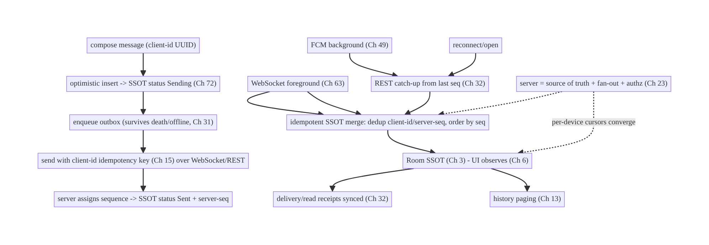
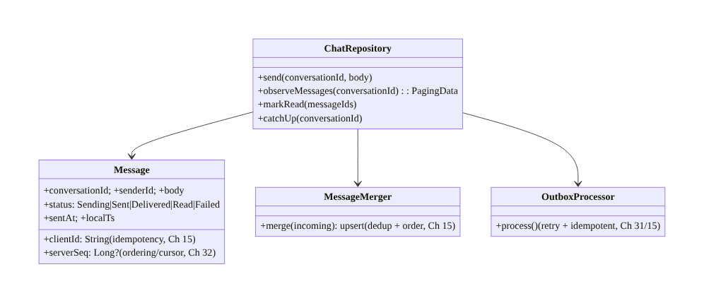
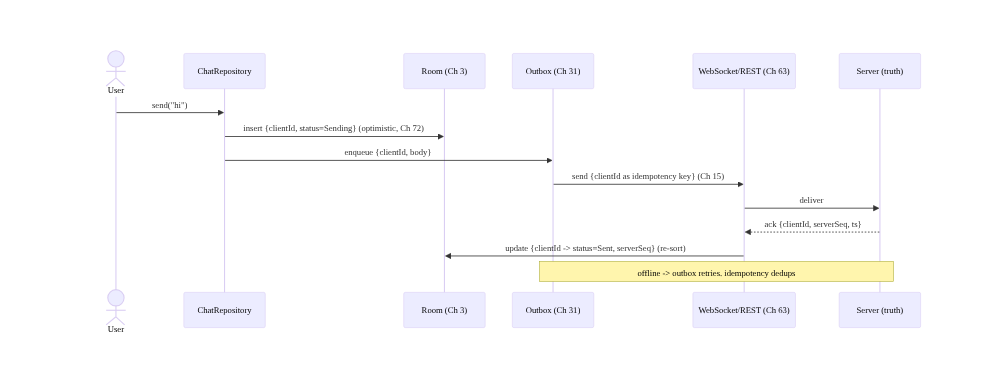
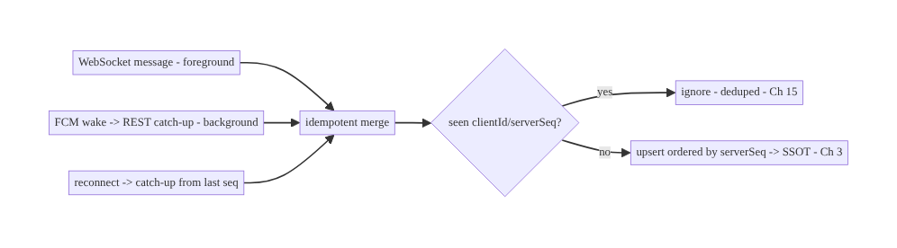
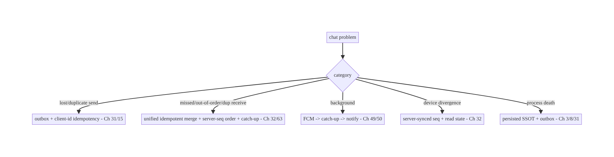

# Chapter 64 — Chat / Messaging Architecture

> **Part VIII — Real-Time & Connectivity** · Complexity: **Complex** (≥40 interview questions)
>
> **Prerequisites:** Ch 63 (WebSocket), Ch 49 (FCM), Ch 31 (outbox), Ch 32 (delta sync),
> Ch 15 (idempotency), Ch 3 (SSOT), Ch 13 (paging), Ch 44 (lifecycle). Pairs with Ch 65
> (presence/typing), Ch 66 (SSE/long-poll), Ch 72 (optimistic updates).
>
> **Reference surface in StreamCart:** buyer↔seller chat, support chat, and group
> conversations — messages that send reliably offline, arrive in real time, show
> correct delivery/read status, survive reconnects and process death, and stay
> consistent across devices.

---

## 64.1 Problem Definition and Real-World Context

Chat is the canonical "hard" mobile feature because it combines **every** distributed-
systems problem into one UI: reliable sending (offline, retries), real-time receiving
(WebSocket, Ch 63), background delivery (FCM, Ch 49), **ordering**, **deduplication**,
**delivery/read receipts**, **optimistic UI** (Ch 72), **pagination of history** (Ch 13),
**multi-device consistency** (Ch 32), and **process-death survival** (Ch 3/8). A naive
chat ("POST a message, append to a list") fails the moment the network blips, the app
backgrounds, two devices are used, or messages race.

Concretely, teams hit:

- **Unreliable sending.** A message sent while offline/flaky is lost, or double-sent on
  retry. Must use an **outbox** (Ch 31) with **idempotency keys** (Ch 15) and optimistic
  insert (Ch 72).
- **Ordering & dedup.** Messages arrive out of order (retries, multi-path WebSocket+FCM),
  or duplicated. Need a **server-assigned sequence/clock** and **dedup by client-id +
  server-seq** (Ch 15/63).
- **Real-time + background split.** Live delivery over WebSocket (Ch 63) while foreground;
  **FCM** (Ch 49) to notify/sync when backgrounded — one coherent pipeline, not two
  inconsistent ones.
- **Delivery & read receipts.** Sent → delivered → read status per message, synced both
  ways, is its own state machine and consistency problem.
- **History & sync.** Paginate history (Ch 13), **catch up** missed messages on reconnect
  via a cursor (Ch 32), and reconcile across devices — the socket is a fast path, the
  **SSOT + server are truth** (Ch 3/63).
- **Multi-device & groups.** The same conversation on phone + tablet must converge; group
  chats fan out to many participants (server concern) with per-user state.
- **Process death / offline-first.** Draft messages, unsent outbox, and history must
  survive process death and work offline (Ch 3/8/29).

The architecture: model chat as an **offline-first, SSOT-backed** feature (Room, Ch 3) —
**optimistically insert** a message with a **client-generated id** into the local store
and an **outbox** (Ch 31/72), **send with idempotency** (Ch 15) over the current transport,
and **confirm** with the server's assigned **sequence**; **receive** live via **WebSocket**
(Ch 63) while foreground and via **FCM** (Ch 49) when backgrounded, both funneling into
the **same idempotent SSOT merge** (dedup by client-id/server-seq, ordered by server
sequence); **catch up** missed messages on reconnect/open via a **cursor** (Ch 32);
maintain **delivery/read receipts** as synced per-message state; **paginate** history
(Ch 13); and keep it **consistent across devices** with the server as truth. This chapter
is the **end-to-end architecture of a reliable, real-time, offline-first chat**.

### Three practical use cases

1. **Buyer↔seller chat (StreamCart).** Send works offline (outbox, optimistic), delivers
   live via WebSocket, notifies via FCM when backgrounded, shows sent/delivered/read, and
   survives reconnect with catch-up.
2. **Support chat with history.** Paginated history (Ch 13), catch-up on reopen, read
   receipts, consistent across the user's devices.
3. **Group conversation.** Fan-out delivery (server), per-user read state, ordering by
   server sequence, dedup across WebSocket+FCM paths.

### Why this is architectural

Chat **composes** the whole book: networking (Ch 1), WebSocket (Ch 63), FCM (Ch 49),
outbox (Ch 31), idempotency (Ch 15), delta sync (Ch 32), SSOT (Ch 3), optimistic UI
(Ch 72), paging (Ch 13), lifecycle (Ch 44). Its decisions — client-id + server-seq,
unified real-time pipeline, receipts state machine, catch-up cursor, device convergence —
are a masterclass in mobile distributed consistency.

---

## 64.2 Requirements Engineering

### Functional requirements

| ID | Requirement |
|----|-------------|
| F1 | Send messages reliably: offline-capable, retried, idempotent, optimistic (Ch 31/15/72). |
| F2 | Receive in real time (WebSocket) foreground + via FCM background — one pipeline (Ch 63/49). |
| F3 | Order and dedup messages (client-id + server sequence) (Ch 15). |
| F4 | Delivery/read receipts per message, synced both ways. |
| F5 | Paginate history; catch up missed messages on reconnect/open (Ch 13/32). |
| F6 | Consistent across devices; survive process death; offline-first (Ch 3/8/29). |

### Non-functional requirements

| Attribute | Policy |
|-----------|--------|
| **Reliability** | No lost/duplicated messages; send survives offline/death. |
| **Latency** | Real-time delivery while connected; prompt FCM when bg. |
| **Consistency** | Server-ordered; SSOT truth; devices converge (Ch 32). |
| **Offline** | Compose/read/queue offline; sync on reconnect (Ch 29). |
| **Security** | Authed transport, per-conversation authz, (optional) E2E (Ch 19/23). |

### Scope

- **In scope:** message model (client-id + server-seq), send path (outbox + idempotency +
  optimistic, Ch 31/15/72), unified receive (WebSocket foreground + FCM background →
  idempotent SSOT merge, Ch 63/49/3), ordering/dedup, delivery/read receipts, history
  paging + catch-up cursor (Ch 13/32), multi-device convergence, offline-first + process
  death (Ch 29/8), conversation list, (overview) groups + E2E.
- **Out of scope:** WebSocket internals (Ch 63), FCM internals (Ch 49), presence/typing
  (Ch 65), SSE/long-poll (Ch 66), outbox/sync/idempotency mechanics (Ch 31/32/15),
  optimistic-UI detail (Ch 72), E2E crypto depth, server fan-out implementation.

### Assumptions & constraints

- WebSocket (Ch 63) + FCM (Ch 49), Room SSOT (Ch 3), outbox (Ch 31), WorkManager (Ch 30),
  Paging 3 (Ch 13). `minSdk 24`. Server assigns a **monotonic per-conversation sequence**
  and is the **source of truth**; transports are best-effort; messages carry a
  **client-generated id** for idempotency.

---

## 64.3 System Design Fundamentals

- **SSOT-backed, offline-first (Ch 3/29).** The **Room database is the source of truth**
  the UI renders (UDF, Ch 6). Sending and receiving both **mutate the SSOT**; the network
  (WebSocket/FCM/REST) **feeds** the SSOT, never the UI directly. This makes chat work
  offline, survive process death (Ch 8), and stay consistent.
- **Dual id scheme: client-id + server-seq (the backbone).** Every message has:
  - a **client-generated id** (UUID) created at compose time — used as the **idempotency
    key** (Ch 15) so retries/duplicates collapse, and to match the optimistic message to
    the server's confirmation.
  - a **server-assigned sequence** (monotonic per conversation) — the **ordering** key and
    the **catch-up cursor** (Ch 32). The client orders by server-seq; before confirmation,
    an optimistic message sorts by its local timestamp at the tail.
  Dedup = "seen this client-id or server-seq before? ignore." Ordering = "sort by
  server-seq." This pair solves the two hardest chat problems.
- **Send path (reliable, optimistic, Ch 31/15/72):**
  1. **Optimistically insert** the message into the SSOT with its client-id and a
     `status = Sending` → UI shows it instantly (Ch 72).
  2. **Enqueue in the outbox** (Ch 31) so it survives process death and offline.
  3. **Send** over the current transport (WebSocket if connected, else REST) with the
     **client-id as idempotency key** (Ch 15) → server dedups retries.
  4. **Confirm:** server returns the **assigned sequence + timestamp** → update the SSOT
     message `status = Sent`, set server-seq (re-sort). The ack flows back via WebSocket
     or the REST response.
  Offline/flaky: the outbox retries with backoff (Ch 2); idempotency makes retries safe.
- **Unified receive pipeline (WebSocket + FCM → one SSOT merge, Ch 63/49):**
  - **Foreground:** messages stream over **WebSocket** (Ch 63) → **idempotent upsert**
    into the SSOT (dedup by client-id/server-seq).
  - **Background:** a **high-priority FCM** (Ch 49) wakes the app → fetch new messages via
    REST catch-up (Ch 32) → same idempotent SSOT merge → notification (Ch 50).
  - **Crucially both paths converge on the same SSOT merge**, so a message delivered twice
    (WebSocket + FCM, or WebSocket + catch-up) is **deduped**, and the UI is consistent
    regardless of path.
- **Catch-up on reconnect/open (Ch 32).** Because transports drop, on reconnect/foreground
  the client sends its **last server-seq per conversation** and the server **replays
  missed messages** (or the client does a REST delta, Ch 32). This heals gaps from
  disconnection — the socket need not be perfectly reliable (Ch 63).
- **Delivery & read receipts (a mini state machine).** Each message tracks
  **Sending → Sent → Delivered → Read** (and **Failed**). *Outgoing:* the server reports
  delivered/read when recipients ack; the client updates status. *Incoming:* when the
  user sees a message, the client sends a **read receipt** (batched, Ch 14) that syncs to
  the sender. Receipts are **synced per-message state** (Ch 32), not ephemeral — and
  privacy-configurable (Ch 65/28).
- **History paging + conversation list (Ch 13).** History is **paged** (Paging 3 from the
  SSOT, backed by a REST history endpoint for older pages, Ch 13). The **conversation
  list** shows last message + unread count per conversation, all from the SSOT.
- **Multi-device convergence (Ch 32).** The server's per-conversation sequence + read
  state are **synced to every device**; each device catches up from its own cursor. The
  server is truth; devices converge (same as sync, Ch 32) — including read state (reading
  on one device marks read on others).
- **Groups & E2E (overview).** Group chat is **server fan-out** (one send → many
  recipients) with per-user delivery/read state; the client model is the same (messages
  with sender, server-seq). **End-to-end encryption** (optional) adds client-side crypto
  (e.g., Signal protocol) where the server can't read content — a large addition layered
  on this architecture (keys, device verification), out of scope to build here.
- **Security (Ch 19/23).** Authed transport (WebSocket handshake/REST bearer, Ch 19/63);
  **server authorizes conversation membership** (you only receive/join conversations
  you're in, Ch 23); treat message content as untrusted on render (Ch 52); per-account
  isolation (Ch 42).

Core insight: **build chat as an offline-first, SSOT-backed feature where every message
carries a client-generated id (idempotency key + optimistic match, Ch 15) and a
server-assigned per-conversation sequence (ordering + catch-up cursor, Ch 32); send via an
optimistic insert + outbox + idempotent send + server-seq confirmation (Ch 31/72); receive
through a unified pipeline where WebSocket (foreground, Ch 63) and FCM-triggered REST
catch-up (background, Ch 49/32) both converge on the same idempotent SSOT merge (so
duplicates dedup and order is server-defined); catch up missed messages on reconnect via
the sequence cursor; maintain delivery/read receipts as synced per-message state; page
history (Ch 13); and converge devices with the server as truth — the socket is a fast
path, the SSOT and server are the truth.**

---

## 64.4 High-Level Architecture



**Components & ownership**

- **Send:** optimistic insert → outbox → idempotent send → server-seq confirm.
- **Receive:** WebSocket (fg) + FCM→catch-up (bg) **both → one idempotent SSOT merge**.
- **SSOT** is truth the UI renders; **receipts** and **paging** read it.
- **Server** assigns sequence, fans out, authorizes, and is the convergence truth.

**Direction:** compose → optimistic/outbox/idempotent send → confirm; WebSocket/FCM/
catch-up → idempotent merge → SSOT → UI; server orders and reconciles.

---

## 64.5 Detailed Component Design



| Component | Responsibility |
|-----------|----------------|
| `Message` | SSOT row: client-id + server-seq + status + body (Ch 3) |
| `ChatRepository` | send/receive/paging/receipts over SSOT (Ch 3/13) |
| `MessageMerger` | idempotent upsert of incoming (WebSocket/FCM/catch-up), dedup+order (Ch 15) |
| `OutboxProcessor` | reliable send with retry + idempotency (Ch 31/15) |

---

## 64.6 End-to-End Data Flow

### Send (optimistic + outbox + idempotent + confirm)



### Unified receive + dedup



---

## 64.7 Complete Kotlin Implementation

Package: `com.streamcart.chat`.

### 64.7.1 Message model (client-id + server-seq + status)

```kotlin
@Entity(tableName = "messages", indices = [Index("conversationId", "serverSeq"), Index(value = ["clientId"], unique = true)])
data class Message(
    @PrimaryKey val clientId: String,          // UUID at compose; idempotency key (Ch 15) + optimistic match
    val serverSeq: Long?,                        // server-assigned ordering/cursor (Ch 32); null until confirmed
    val conversationId: String, val senderId: String, val body: String,
    val status: Status, val sentAt: Long?, val localTs: Long,
) { enum class Status { Sending, Sent, Delivered, Read, Failed } }

// Order: serverSeq when present, else localTs at the tail (optimistic).
```

### 64.7.2 Send: optimistic insert + outbox + idempotent + confirm

```kotlin
@Singleton
class ChatRepository @Inject constructor(
    private val dao: MessageDao, private val outbox: Outbox,           // Ch 31
    private val transport: ChatTransport, private val session: SessionManager,  // WebSocket/REST (Ch 63/19)
    private val scope: CoroutineScope,
) {
    suspend fun send(conversationId: String, body: String) {
        val msg = Message(clientId = UUID.randomUUID().toString(), serverSeq = null,
            conversationId = conversationId, senderId = session.userId, body = body,
            status = Status.Sending, sentAt = null, localTs = System.currentTimeMillis())
        dao.upsert(msg)                                                  // 1) optimistic -> UI instant (Ch 72)
        outbox.enqueue(OutboxOp.SendMessage(msg.clientId, conversationId, body))  // 2) survives death/offline (Ch 31)
    }

    // OutboxProcessor calls this; idempotent on the server via clientId (Ch 15).
    suspend fun deliver(op: OutboxOp.SendMessage): Result<Unit> = runCatching {
        val ack = transport.sendMessage(op.clientId, op.conversationId, op.body)   // clientId = idempotency key
        dao.confirm(op.clientId, serverSeq = ack.seq, sentAt = ack.ts, status = Status.Sent)  // 3) confirm + re-sort
    }.onFailure { dao.markStatus(op.clientId, Status.Failed) }                     // retry via outbox (Ch 31/2)
}
```

### 64.7.3 Unified merge: WebSocket + FCM + catch-up → idempotent SSOT

```kotlin
@Singleton
class MessageMerger @Inject constructor(private val dao: MessageDao) {
    /** All inbound paths (WebSocket Ch 63, FCM catch-up Ch 49/32) funnel here. */
    @Transaction
    suspend fun merge(incoming: List<WireMessage>) {
        for (m in incoming) {
            // Dedup: if we already have this clientId (our own echo) or serverSeq, upsert (idempotent, Ch 15).
            dao.upsertByClientIdOrSeq(
                Message(clientId = m.clientId, serverSeq = m.seq, conversationId = m.conversationId,
                    senderId = m.senderId, body = m.body, status = statusFrom(m), sentAt = m.ts, localTs = m.ts))
        }
    }
}

// WebSocket (foreground): connection.events.filterIsInstance<ChatEvent>().collect { merger.merge(listOf(it.toWire())) }
// FCM (background, Ch 49): PushSyncWorker -> catchUp(conversationId) -> merger.merge(restMessages)
```

### 64.7.4 Catch-up on reconnect/open (sequence cursor, Ch 32)

```kotlin
suspend fun ChatRepository.catchUp(conversationId: String) {
    val lastSeq = dao.maxSeq(conversationId) ?: 0L          // resume cursor (Ch 32/63)
    val missed = transport.messagesSince(conversationId, lastSeq)   // REST delta
    merger.merge(missed)                                     // same idempotent merge -> heals gaps
}
// Called on WebSocket reconnect (Ch 63) and on opening a conversation / app foreground (Ch 44).
```

### 64.7.5 Read receipts (batched, synced, Ch 14/32)

```kotlin
suspend fun ChatRepository.markRead(conversationId: String, upToSeq: Long) {
    dao.markReadLocally(conversationId, upToSeq)             // SSOT -> UI unread count updates
    outbox.enqueue(OutboxOp.ReadReceipt(conversationId, upToSeq))   // batched, idempotent sync (Ch 31/14)
    // Server propagates read state to the sender + the user's other devices (Ch 32).
}
// Incoming receipts (delivered/read for our sent messages) arrive via WebSocket/catch-up -> update status.
```

### 64.7.6 History paging + conversation list (Ch 13)

```kotlin
fun ChatRepository.messages(conversationId: String): Flow<PagingData<Message>> =
    Pager(PagingConfig(pageSize = 50), remoteMediator = ChatRemoteMediator(conversationId, transport, dao)) {
        dao.pagingSource(conversationId)                     // ordered by serverSeq (Ch 13), from SSOT
    }.flow
// Conversation list: dao.conversationsWithLastMessageAndUnreadCount() (all from SSOT, Ch 3).
```

### 64.7.7 Module structure

```
:feature:chat   ChatRepository, MessageMerger, Message/Dao, ChatRemoteMediator, chat + list UI (Ch 6/13)
:core:realtime  WebSocket transport (Ch 63); :feature:push FCM -> catch-up (Ch 49)
:core:outbox    Outbox + OutboxProcessor (Ch 31); :core:sync catch-up/receipts (Ch 32)
# Server: sequence assignment, fan-out, membership authz (Ch 23).
```

---

## 64.8 Concurrency and Race Conditions

| Scenario | Risk | Handling |
|----------|------|----------|
| Retry re-sends message | duplicate | client-id idempotency key (Ch 15); server dedups |
| Same message via WebSocket + FCM | duplicate in UI | unified merge dedups by client-id/server-seq |
| Out-of-order arrival | wrong order | order by server-seq; optimistic at tail by localTs |
| Our own message echoed back | duplicate of optimistic | merge matches by client-id → updates, not inserts |
| Concurrent sends | seq gaps | server assigns seq; client re-sorts on confirm |
| Read receipt races | flicker/over-count | mark up-to-seq (monotonic); idempotent (Ch 15) |
| Process death with unsent | lost message | outbox persisted (Ch 31); resumes |
| Multi-device read | divergent unread | server syncs read state; converge (Ch 32) |

- **client-id + server-seq is the race-killer:** the **client-id** makes sends and inbound
  merges **idempotent** (retries, WebSocket+FCM double-delivery, and our own echoed message
  all collapse), and the **server-seq** gives a **total order** independent of arrival
  time. Every chat race reduces to "dedup by id, order by seq."
- **Our own echo matches by client-id:** when the server broadcasts our message back (so
  other devices get it), the merge finds the existing optimistic row by client-id and
  **updates** it (sets server-seq) rather than inserting a duplicate.
- **Outbox + idempotency makes send death-proof:** the message is persisted before sending;
  a crash mid-send resumes from the outbox, and the idempotency key prevents a double-send.

---

## 64.9 Failure Scenarios and Recovery

| Failure | Detection | Response | Outcome |
|---------|-----------|----------|---------|
| Send while offline | no network | optimistic + outbox; send on reconnect (Ch 31/29) | not lost |
| Duplicate send on retry | — | client-id idempotency (Ch 15) | single |
| Missed messages (disconnect) | seq gap | catch-up from cursor (Ch 32/63) | healed |
| Dup across WebSocket+FCM | — | unified merge dedup | single |
| Out-of-order | — | order by server-seq | correct |
| Process death with drafts/outbox | restart | persisted SSOT/outbox (Ch 3/8/31) | survives |
| Devices show different unread | — | server-synced read state (Ch 32) | converge |
| Background delivery | app closed | FCM → catch-up → notification (Ch 49/50) | delivered |
| Send permanently fails | retries exhausted | status=Failed + manual retry (Ch 72) | visible |



> **Every chat reliability problem collapses to two primitives: client-id (idempotency)
> and server-seq (ordering + cursor).** Sends go through an outbox keyed by client-id;
> all inbound paths (WebSocket, FCM, catch-up) funnel through one idempotent merge ordered
> by server-seq. The socket is a fast path; the SSOT and server are the truth — so offline,
> retries, double-delivery, reordering, and process death all resolve cleanly.

---

## 64.10 Scaling the Implementation

- **Level 1.** SSOT messages (client-id + server-seq); optimistic send + outbox (Ch 31/72);
  WebSocket receive → idempotent merge (Ch 63).
- **Level 2.** FCM background → catch-up (Ch 49/32); reconnect catch-up cursor; delivery/
  read receipts; history paging (Ch 13).
- **Level 3 — production.** Multi-device convergence (Ch 32); conversation list + unread;
  failed-send retry UX (Ch 72); per-conversation authz (Ch 23); offline-first (Ch 29).
- **Level 4 — large.** Group chat (fan-out, per-user state); media messages (Ch 17/59);
  message search (Ch 35); receipts privacy (Ch 65/28); backpressure for busy chats (Ch 63).
- **Level 5 — enterprise.** End-to-end encryption (Signal-style, device keys); message
  reactions/edits/deletes (tombstones, Ch 33); huge-group scaling; cross-platform
  consistency; chat QoE SLOs (send success, delivery latency).

**Avoid overengineering:** the client-id + server-seq + outbox + unified-merge + catch-up
core is what every reliable chat needs. Don't build E2E or huge-group handling until the
core is solid; don't treat the socket as truth.

---

## 64.11 Alternative Approaches and Trade-offs

| Dimension | Option A | Option B | When |
|-----------|----------|----------|------|
| Truth | SSOT + server (socket is fast path) | the WebSocket stream | SSOT+server always (reliability) |
| Send | Optimistic + outbox + idempotent (Ch 31/15/72) | POST-and-wait | Optimistic+outbox (offline, instant UX) |
| Ordering | Server-assigned sequence | client timestamps | Server-seq (clocks skew; total order) |
| Dedup | client-id idempotency key (Ch 15) | server-id only | client-id (works pre-confirmation, across paths) |
| Receive | Unified WebSocket+FCM→merge | separate pipelines | Unified (dedup, consistency) |
| Background | FCM → catch-up (Ch 49/32) | keep socket open | FCM (battery/Doze, Ch 47) |
| History | Paging from SSOT + RemoteMediator (Ch 13) | load all | Paging (scale) |
| Multi-device | Server-synced seq + read state (Ch 32) | last-writer per device | Server-synced (converge) |

**SSOT+server as truth vs the socket stream as truth:** treating the live WebSocket as the
source of truth means a dropped/duplicated/reordered frame corrupts the chat. Making the
**SSOT the rendered truth** and the **server the ordering/convergence authority** — with
the socket as a **fast path** over catch-up (Ch 32) — makes chat self-healing: anything
missed is caught up, anything duplicated is deduped, order is server-defined. This is the
central decision (mirrors Ch 49/63).

**client-id + server-seq vs server-id alone:** relying only on a server-assigned id means
you can't dedup or match your **optimistic** message until the server responds — and you
can't dedup across WebSocket+FCM before confirmation. A **client-generated id** gives
idempotency from compose time (retries, echoes, multi-path), while the **server sequence**
gives total ordering and the catch-up cursor. Both are needed; neither alone suffices.

**Unified receive vs separate WebSocket/FCM pipelines:** handling WebSocket and FCM
messages in **separate** code paths leads to duplicates (both deliver the same message) and
inconsistency (different merge logic). Funneling **both** (plus reconnect catch-up) through
**one idempotent SSOT merge** guarantees dedup and a single consistent state regardless of
how a message arrived.

---

## 64.12 Security & Privacy Considerations

- **Authenticated transport + membership authz (Ch 19/23):** WebSocket handshake / REST
  bearer authenticates the user; the **server authorizes conversation membership** — you
  can only send to, receive from, and catch up on conversations you belong to (a client
  can't subscribe to arbitrary conversations, Ch 63/23).
- **Message content is untrusted on render (Ch 52):** sanitize/escape message bodies
  (links, markup) to prevent injection; validate media URLs; don't auto-execute content.
- **Per-account isolation (Ch 42):** messages/receipts scoped to the active account; on
  logout/switch, close the socket and clear/scope the SSOT.
- **Read-receipt privacy (Ch 65/28):** receipts reveal behavior (when you read) — make
  them **configurable** (send/receive receipts off) and respect the setting both ways.
- **End-to-end encryption (optional):** for private messaging, content is encrypted
  client-side so the server stores ciphertext (Signal-style); adds device key management,
  verification, and changes search/backup — a major addition, layered on this architecture.
- **Media messages (Ch 17/59):** upload/download over authed channels; access-controlled
  (signed URLs); scan/limit sizes.
- **Abuse/rate limiting:** server-side (spam, flooding); client can't be trusted to
  self-limit for security.
- **No sensitive content/PII in logs** (Ch 28).
- Client vs backend: the **server** assigns sequence, fans out, authorizes membership,
  enforces rate limits, and is the truth; the **client** sends idempotently, merges
  idempotently, renders untrusted content safely, and (for E2E) holds keys.

---

## 64.13 Performance and Resource Optimization

- **Paging** (Ch 13) — never load a whole conversation; page from SSOT + RemoteMediator.
- **Batch receipts** (Ch 14) — don't send a read receipt per message; batch up-to-seq.
- **Lifecycle-scoped socket** (Ch 63/44) — WebSocket only while active; FCM background.
- **Unified merge in a transaction** (Ch 3) — batch upserts; single DB write for a batch.
- **Backpressure** on busy chats (Ch 63) — coalesce rapid updates to the UI.
- **Efficient diffing** in the list (stable client-id keys) — smooth scrolling (Ch 6).
- **Media thumbnails** (Ch 57) and lazy media load (Ch 56).
- **Profiling:** send success rate/latency, delivery latency, catch-up volume, DB write
  rate, socket uptime (Ch 63), notification→open funnel.

---

## 64.14 Testing Strategy

Chat logic is highly testable in isolation (SSOT merge, outbox, ordering, receipts);
transports faked.

```kotlin
class MessageMergerTest {
    @Test fun `dedups our own echoed message by clientId`() = runTest {
        repo.send("c1", "hi")                                   // optimistic, clientId X
        merger.merge(listOf(wire(clientId = "X", seq = 10)))    // server echoes it back
        assertEquals(1, dao.count("c1"))                        // updated, not duplicated (Ch 15)
        assertEquals(Status.Sent, dao.byClientId("X").status)
    }
    @Test fun `dedups across WebSocket and FCM paths`() = runTest {
        merger.merge(listOf(wire(seq = 11))); merger.merge(listOf(wire(seq = 11)))
        assertEquals(1, dao.bySeq("c1", 11).let { 1 })          // single
    }
    @Test fun `orders by serverSeq`() = runTest { /* insert seq 12 then 11 -> list shows 11,12 */ }
}

class SendPathTest {
    @Test fun `send survives offline and retries idempotently`() = runTest {
        transport.offline = true; repo.send("c1", "hi")         // outbox holds it
        assertEquals(Status.Sending, dao.last("c1").status)
        transport.offline = false; outboxProcessor.process()    // retries -> Sent, idempotent
        assertEquals(Status.Sent, dao.last("c1").status)
    }
    @Test fun `catch-up heals missed messages from cursor`() = runTest { /* lastSeq=10, server has 11-13 -> merged */ }
}

class ReadReceiptTest {
    @Test fun `markRead is monotonic up-to-seq and idempotent`() { /* ... */ }
}
```

What to test: merge dedup (own echo, cross-path, by seq) + ordering; send optimistic +
outbox + idempotent retry + confirm; catch-up heals gaps; receipts monotonic/idempotent;
multi-device read convergence (fake server); process-death resume (outbox persisted);
per-conversation authz (integration — can't fetch others'). Fake WebSocket/FCM/REST; use
Room in-memory.

---

## 64.15 Production Observability

- **Metrics:** **send success rate** + send latency (compose→Sent); **delivery latency**
  (sent→delivered); read-receipt latency; catch-up message volume + gap frequency;
  duplicate-merge rate (should dedup); failed-send rate; notification→open (Ch 49); socket
  uptime (Ch 63); per-device divergence incidents (0).
- **Logs:** `chat{event, conversationId, status, seq, path(ws/fcm/catchup)}` — **no
  message content/PII** (Ch 28).
- **Debugging:** lost messages → outbox not retrying / catch-up gap (Ch 31/32); duplicates
  → merge not deduping (client-id/seq); out-of-order → not ordering by seq; bg not
  delivered → FCM/catch-up (Ch 49); device divergence → read-state sync (Ch 32); wrong
  conversation → membership authz (Ch 23).
- **Alerting:** send-success drop; delivery-latency spike; duplicate-rate spike; any
  cross-conversation leakage.
- **Dashboards:** send/delivery funnel + latency; catch-up/gap rate; socket vs FCM delivery
  split.

---

## 64.16 System Design Interview Preparation

> ≥40 questions.

**Fundamentals**

1. *Why is chat hard?* Combines reliable send, real-time receive, background, ordering,
   dedup, receipts, offline, multi-device.
2. *Source of truth?* SSOT (rendered) + server (ordering/convergence); socket is a fast
   path.
3. *Two id scheme?* client-id (idempotency + optimistic match) + server-seq (order +
   cursor).
4. *Why client-id?* Dedup/idempotency from compose time (retries, echo, multi-path).
5. *Why server-seq?* Total order (clocks skew) + catch-up cursor.

**Send**

6. *Send path?* Optimistic insert → outbox → idempotent send → server-seq confirm
   (Ch 72/31/15).
7. *Offline send?* Outbox persists; retries on reconnect (Ch 31/29).
8. *Duplicate on retry?* client-id idempotency key (Ch 15).
9. *Status states?* Sending→Sent→Delivered→Read (+Failed).
10. *Failed send?* status=Failed + manual retry.

**Receive**

11. *Foreground delivery?* WebSocket (Ch 63).
12. *Background delivery?* FCM wake → REST catch-up → notification (Ch 49/50).
13. *Why unified pipeline?* Dedup + consistency across WebSocket/FCM.
14. *Our own echo?* Matched by client-id → update optimistic row, not duplicate.
15. *Dedup across paths?* Same idempotent merge by client-id/server-seq.

**Ordering/catch-up**

16. *Ordering?* By server-seq; optimistic at tail by localTs.
17. *Missed messages?* Catch-up from last seq cursor (Ch 32/63).
18. *Out-of-order?* Re-sort by server-seq on merge.

**Receipts**

19. *Receipt states?* Delivered/read, synced per-message.
20. *Batching?* Up-to-seq, batched (Ch 14).
21. *Incoming receipts?* Update our sent messages' status.
22. *Privacy?* Configurable receipts (Ch 65/28).

**Multi-device/history**

23. *Device convergence?* Server-synced seq + read state; per-device cursors (Ch 32).
24. *Read on one device?* Syncs read state to others.
25. *History?* Paging from SSOT + RemoteMediator (Ch 13).
26. *Conversation list?* Last message + unread from SSOT.

**Groups/E2E**

27. *Group chat?* Server fan-out; per-user state; same client model.
28. *E2E?* Client-side crypto (Signal-style); server stores ciphertext; key management.

**Security**

29. *Transport auth?* WebSocket handshake / REST bearer (Ch 19/63).
30. *Membership authz?* Server authorizes conversations (Ch 23).
31. *Content safety?* Untrusted render; sanitize (Ch 52).
32. *Per-account?* Isolate; close socket + scope SSOT on switch (Ch 42).

**Process death/offline**

33. *Unsent on death?* Outbox persisted (Ch 31/8).
34. *Offline compose/read?* SSOT offline-first (Ch 29).

**Testing/Production**

35. *Test merge?* Dedup (echo/cross-path/seq) + ordering.
36. *Test send?* Offline + idempotent retry + confirm.
37. *Test catch-up?* Heals gaps from cursor.
38. *Lost in prod?* Outbox/catch-up gap.
39. *Duplicates?* Merge not deduping.
40. *Device divergence?* Read-state sync.
41. *Key metrics?* Send success/latency, delivery latency, dup rate, catch-up/gap.

### Design-change challenges
1. **Messages must send offline and never duplicate.** Optimistic + outbox + client-id
   idempotency (Ch 31/15/72).
2. **A message arrives via both WebSocket and FCM.** Unified idempotent merge dedups.
3. **Reopening shows missing messages.** Catch-up from seq cursor (Ch 32).
4. **Read count differs across phone and tablet.** Server-synced read state (Ch 32).
5. **Add delivery/read receipts.** Per-message synced status + batched read receipts.

### Mock walkthrough (abridged)
Clarify (1:1 or groups, offline, multi-device, receipts, E2E?) → SSOT + server as truth
(socket fast path) → message model (client-id + server-seq) → send (optimistic + outbox +
idempotent + confirm, Ch 72/31/15) → unified receive (WebSocket + FCM→catch-up → idempotent
merge, Ch 63/49/32) → ordering/dedup → receipts (synced, batched) → paging + device
convergence (Ch 13/32) → security (authz, untrusted content) → observability (send/delivery
funnel).

---

## 64.17 Practical Exercises

1. **Beginner.** Model messages with client-id + server-seq + status; render from the SSOT
   ordered by seq with optimistic tail. *Eval:* correct order; optimistic shows instantly.
2. **Intermediate.** Implement the send path (optimistic + outbox + idempotent + confirm)
   so sending works offline and never duplicates on retry. *Eval:* offline-capable;
   idempotent.
3. **Advanced.** Build the unified receive merge (WebSocket + FCM catch-up) with dedup and
   reconnect catch-up from the seq cursor. *Eval:* no dupes across paths; gaps heal.
4. **Production debugging.** Fix duplicate messages (own echo not matched by client-id) and
   divergent unread counts across devices (no read-state sync). *Eval:* single; converge.
5. **System design challenge.** Add delivery/read receipts (synced, batched, privacy-
   configurable) and a send/delivery-latency dashboard. *Eval:* receipts correct;
   measurable.

*(Solutions withheld unless requested.)*

---

## 64.18 Chapter Summary & Reference Sheet

**Key decisions:** build chat as an **offline-first, SSOT-backed** feature (Room is the
rendered truth, the server is the ordering/convergence authority, the socket is a **fast
path**, Ch 3/63); give every message a **client-generated id** (idempotency key +
optimistic match, Ch 15) and a **server-assigned per-conversation sequence** (total
ordering + catch-up cursor, Ch 32); **send** via **optimistic insert → outbox → idempotent
send → server-seq confirmation** (Ch 72/31/15) so sending works **offline**, survives
**process death**, and never **duplicates**; **receive** through a **unified pipeline**
where **WebSocket** (foreground, Ch 63) and **FCM-triggered REST catch-up** (background,
Ch 49/32) — plus **reconnect catch-up from the sequence cursor** — all converge on the
**same idempotent SSOT merge** (dedup by client-id/server-seq, order by server-seq), so
double-delivery dedups and gaps heal; maintain **delivery/read receipts** as **synced,
batched per-message state** (Ch 14/32, privacy-configurable, Ch 65/28); **page** history
(Ch 13); **converge devices** via server-synced sequence + read state (Ch 32); and secure
it with **authed transport + server-side membership authorization** (Ch 19/23), untrusted-
content rendering (Ch 52), and per-account isolation (Ch 42).

**Concepts:** SSOT+server truth, client-id + server-seq, optimistic+outbox+idempotent send,
unified WebSocket+FCM+catch-up receive → idempotent merge, ordering/dedup, delivery/read
receipts, history paging, multi-device convergence, offline-first, groups/E2E overview.

**Common mistakes:** treating the socket as truth (drops/dupes corrupt); POST-and-wait
sends (no offline/instant UX); server-id-only (can't dedup optimistic/cross-path); separate
WebSocket/FCM pipelines (dupes/inconsistency); client-timestamp ordering (skew); no
catch-up (gaps); unbatched receipts (spam); loading whole history (no paging); no
membership authz; rendering untrusted content unsafely.

**Checklist:**

- [ ] SSOT+server truth, socket = fast path
- [ ] client-id (idempotency) + server-seq (order/cursor)
- [ ] send: optimistic + outbox + idempotent + confirm (Ch 72/31/15)
- [ ] unified receive: WebSocket + FCM + catch-up → one idempotent merge (Ch 63/49/32)
- [ ] order by server-seq, dedup by id
- [ ] catch-up on reconnect/open
- [ ] delivery/read receipts synced + batched (Ch 14/32)
- [ ] history paging (Ch 13)
- [ ] device convergence (Ch 32)
- [ ] membership authz + untrusted content + per-account (Ch 23/52/42)
- [ ] send/delivery-latency telemetry.

**Key APIs:** Room `@Entity`/`@Dao`/`@Transaction` (unique client-id index, seq index,
Ch 3), `UUID.randomUUID` (client-id), Outbox (Ch 31), WebSocket transport (Ch 63), FCM +
`PushSyncWorker` (Ch 49), Paging 3 `Pager`/`RemoteMediator` (Ch 13), delta catch-up (Ch 32),
batched receipts (Ch 14), optimistic UI (Ch 72).

**References:**
- Offline-first / sync: https://developer.android.com/topic/architecture/data-layer/offline-first
- Paging 3: https://developer.android.com/topic/libraries/architecture/paging/v3-overview
- (composes) Ch 63 WebSocket, Ch 49 FCM, Ch 31 Outbox, Ch 32 Delta Sync, Ch 15 Idempotency, Ch 3 SSOT, Ch 13 Paging, Ch 72 Optimistic Updates, Ch 65 Presence/Typing

### Chapter review (Phase 4)
- **Completeness:** all 18 sections; architecture/class/sequence/flow/failure diagrams;
  message model + send path + unified merge + catch-up + receipts + paging code; concurrency
  (client-id+seq race-killer, echo match, outbox death-proof); failure (two-primitives
  principle); 5 levels; SSOT-truth, client-id+seq, unified-pipeline trade-offs; security
  (membership authz, untrusted content, E2E, per-account); perf (paging/batch receipts/
  lifecycle socket); merge+send+catch-up tests; observability (send/delivery funnel); 41
  Q&A + 5 challenges. ✅
- **Expand later:** presence/typing (Ch 65), SSE/long-poll (Ch 66), optimistic updates
  (Ch 72), WebSocket (Ch 63), FCM (Ch 49).
- **Interview coverage:** exceeds ≥40 Complex bar.
