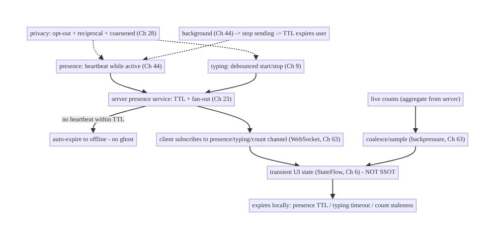
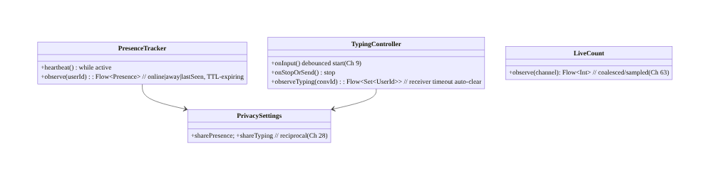
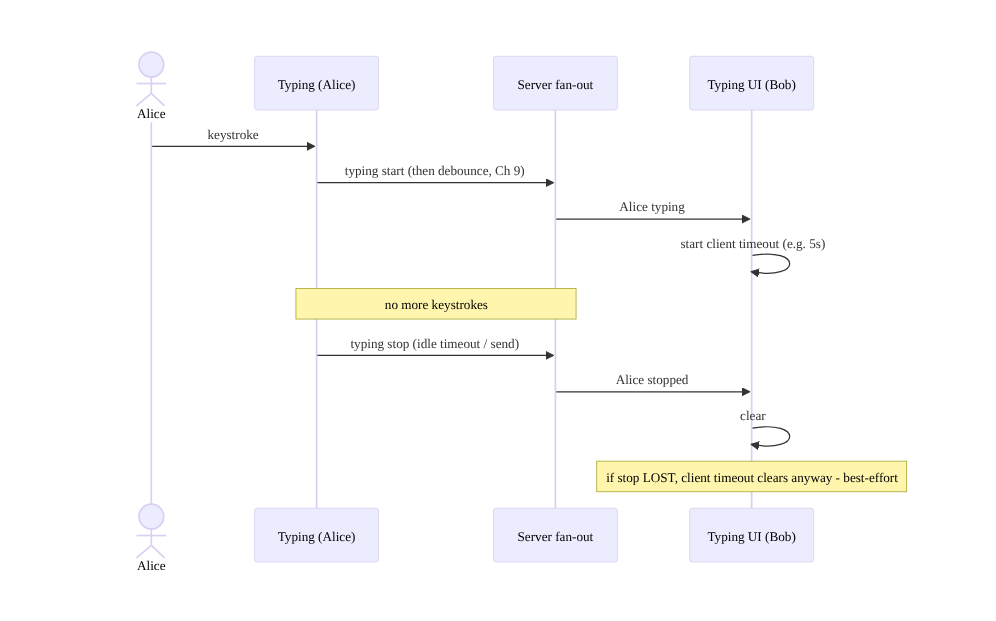
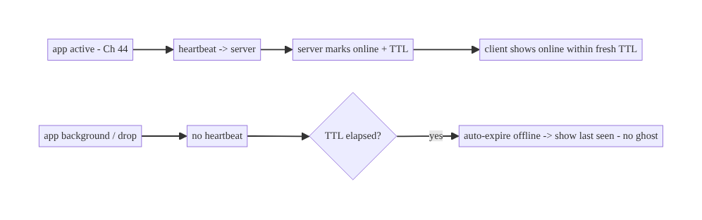
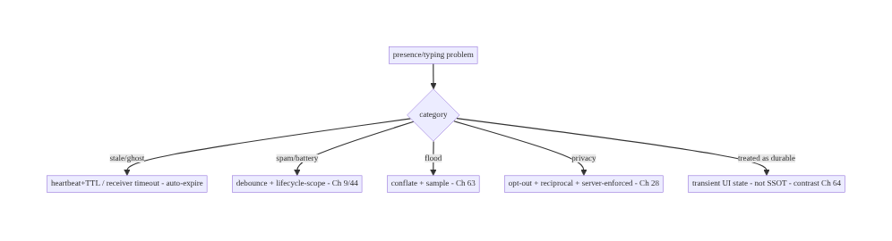

# Chapter 65 — Presence & Typing Indicators

> **Part VIII — Real-Time & Connectivity** · Complexity: **Standard** (≥25 interview questions)
>
> **Prerequisites:** Ch 63 (WebSocket), Ch 64 (chat), Ch 44 (lifecycle), Ch 9
> (debounce), Ch 3 (SSOT), Ch 28 (privacy). Pairs with Ch 49 (FCM), Ch 68 (network
> state).
>
> **Reference surface in StreamCart:** the "live" cues around chat (Ch 64) — "online /
> last seen", "typing…", and "viewers watching" on a live stream — delivered over the
> WebSocket (Ch 63) as **ephemeral, high-churn, best-effort** signals that must not be
> confused with durable state.

---

## 65.1 Problem Definition and Real-World Context

Presence ("online/away/last seen"), typing indicators ("Alice is typing…"), and live
counts (viewers, active users) are **ephemeral real-time signals**: they change
constantly, are only meaningful *right now*, and are **not durable data**. Treating them
like messages (Ch 64) — persisting every change, delivering reliably, showing stale values
— wastes battery/bandwidth, floods the UI, and misleads users. The engineering is about
**cheap, debounced, auto-expiring, best-effort** signals with the right privacy controls.

Concretely, teams hit:

- **Treating presence as durable state.** Persisting "online" and showing it after the
  connection dropped → **stale "online" ghosts**. Presence must **auto-expire** (heartbeat
  + TTL) and be treated as **transient** (not SSOT like messages, Ch 64).
- **Typing-event spam.** Sending a "typing" event per keystroke floods the socket; must be
  **debounced/throttled** (Ch 9) with a **start/stop + timeout** model (auto-clear if no
  update).
- **Stale indicators.** A "typing…" that never clears (sender dropped) or an "online" that
  lingers → must **expire client-side** on a timeout even without an explicit "stopped"
  event.
- **Battery/bandwidth.** High-churn signals over a mobile radio are costly; **coalesce**
  counts (sample/debounce), **don't over-send**, and scope to **active** lifecycle (Ch 44).
- **Privacy.** Presence and read/typing receipts reveal behavior; must be **opt-out/
  configurable** and **reciprocal** (if you hide yours, you don't see others' — a common
  product rule), per privacy settings (Ch 28).
- **Scale (fan-out).** "Viewers watching" or presence in a large group is a **fan-out**
  problem (server) — the client subscribes to a **presence channel** and renders coalesced
  updates; it never computes global presence itself.

The architecture: model presence/typing/counts as **ephemeral, best-effort** signals over
the **WebSocket** (Ch 63), **not** durable SSOT (contrast Ch 64): **heartbeat + TTL** for
presence (auto-expire "online"), **debounced start/stop + client-side timeout** for typing
(Ch 9), **coalesced/sampled** counts (backpressure, Ch 63); scope signals to **active
lifecycle** (Ch 44) and stop sending when backgrounded; render **transient UI state** that
**expires locally** if updates stop; and gate on **privacy settings** (opt-out,
reciprocal, Ch 28). This chapter is about **doing lightweight real-time cues correctly —
the opposite discipline from durable messaging**.

### Three practical use cases

1. **Typing indicator (StreamCart chat, Ch 64).** Debounced "typing" start on first
   keystroke, auto-"stopped" after a pause or send, with a **client-side timeout** so a
   dropped sender's "typing…" clears.
2. **Online / last seen.** Presence via **heartbeat + TTL**: a user is "online" only while
   heartbeats arrive; otherwise show "last seen" (coarsened for privacy, Ch 28), respecting
   opt-out.
3. **Live viewer count.** A coalesced/sampled count on a live stream — the client renders
   a smoothed number, never every tick (backpressure, Ch 63).

### Why this is architectural

Presence/typing/counts are the **ephemeral counterpart** to durable messaging (Ch 64) over
the same transport (Ch 63). The decisions — transient-not-durable, heartbeat/TTL,
debounce + client-side expiry, coalescing, lifecycle scoping, privacy — define a reusable
discipline for *all* "live cue" features and prevent the classic ghosts/spam/battery bugs.

---

## 65.2 Requirements Engineering

### Functional requirements

| ID | Requirement |
|----|-------------|
| F1 | Show presence (online/away/last seen) via heartbeat + TTL (auto-expire). |
| F2 | Show typing indicators (debounced start/stop + client-side timeout). |
| F3 | Show live counts (viewers/active) coalesced/sampled. |
| F4 | Treat all as ephemeral/best-effort (not durable SSOT); expire locally. |
| F5 | Scope signals to active lifecycle; stop when backgrounded (Ch 44). |
| F6 | Respect privacy settings (opt-out, reciprocal) (Ch 28). |

### Non-functional requirements

| Attribute | Policy |
|-----------|--------|
| **Freshness** | Reflects now; auto-expires stale (no ghosts). |
| **Efficiency** | Debounced/coalesced; low bandwidth/battery; active-only. |
| **Best-effort** | Loss is acceptable (unlike messages, Ch 64). |
| **Privacy** | Configurable + reciprocal; coarsened last-seen (Ch 28). |
| **Scale** | Server fan-out; client renders coalesced updates. |

### Scope

- **In scope:** presence (heartbeat + TTL, online/away/last-seen), typing (debounce +
  start/stop + client-side timeout, Ch 9), live counts (coalesce/sample, Ch 63), ephemeral
  transient state (not SSOT), lifecycle scoping (Ch 44), privacy (opt-out, reciprocal,
  coarsened, Ch 28), presence channels / fan-out (client side).
- **Out of scope:** WebSocket transport (Ch 63), chat/messages (Ch 64), FCM (Ch 49),
  debounce mechanics (Ch 9), network state (Ch 68), privacy framework (Ch 28), server
  fan-out implementation.

### Assumptions & constraints

- WebSocket (Ch 63) as transport; signals are **ephemeral** (lost signals are fine);
  server does presence **fan-out** and may compute aggregate presence/counts; `minSdk 24`.
  Presence/typing are **not** persisted as durable truth (contrast Ch 64); last-seen may be
  persisted coarsely server-side.

---

## 65.3 System Design Fundamentals

- **Ephemeral, best-effort — the opposite of messages (Ch 64).** Presence/typing/counts
  are only meaningful **now**; a lost update is **fine** (the next one corrects it). So —
  unlike chat (Ch 64) — **no outbox, no idempotency-for-durability, no persistent SSOT of
  truth, no catch-up.** They live as **transient UI state** that **expires** if updates
  stop. Conflating these with durable messaging is the root mistake.
- **Presence = heartbeat + TTL (auto-expire).** A client that's online sends periodic
  **heartbeats** (or the WebSocket's liveness, Ch 63, serves as one); the server marks the
  user **online** and sets a **TTL**. If no heartbeat arrives within the TTL (app closed,
  network dropped), the user **auto-expires to offline** — no explicit "I went offline"
  needed (which often never arrives). The client shows "online" only within a fresh TTL;
  otherwise **"last seen"** (coarsened, Ch 28). This prevents **stale "online" ghosts**.
- **Typing = debounced start/stop + client-side timeout (Ch 9):**
  - **Start:** on the first keystroke, send a **"typing start"** (then **debounce** —
    don't send again for a few seconds, Ch 9).
  - **Stop:** send **"typing stop"** on send, on clearing the field, or after an **idle
    timeout** (e.g., 3–5s of no typing).
  - **Client-side expiry (critical):** the *receiver* also runs a **timeout** — if no
    further "typing" within N seconds, **clear** the indicator anyway. This guarantees a
    "typing…" clears even if the "stop" event is lost or the sender dropped (best-effort).
  So typing is **two throttled events + a receiver-side auto-clear**, not a stream.
- **Live counts = coalesce/sample (backpressure, Ch 63).** A rapidly-changing count
  (viewers) should be **conflated/sampled** so the UI updates at most a few times/second
  (Ch 63 backpressure) — render the **latest**, not every tick. The server typically sends
  **aggregate** counts (it does the fan-out/counting); the client just smooths rendering.
- **Transient UI state that expires locally.** Presence/typing/counts are held in
  **in-memory UI state** (a `StateFlow`, Ch 6), **not** persisted as truth. Each has an
  **expiry**: presence TTL, typing timeout, count staleness. On expiry (or disconnect),
  the UI **falls back** (presence→last-seen/unknown, typing→cleared, count→last-known or
  hidden). On reconnect (Ch 63), fresh signals repopulate.
- **Lifecycle scoping (Ch 44).** Send presence/typing only while the relevant screen is
  **active**; **stop** when backgrounded (the socket disconnects anyway, Ch 63) — the
  server's TTL then expires the user to offline. Don't send typing for a backgrounded
  chat. This is the main battery/bandwidth lever.
- **Privacy (opt-out + reciprocal, Ch 28).** Presence and typing/read receipts (Ch 64)
  **reveal behavior**. Make them **configurable**: a user can **hide** their online status/
  last-seen/typing; a common rule is **reciprocity** — if you hide yours, you **don't see**
  others' (symmetry). **Coarsen "last seen"** (e.g., "today", "this week") for privacy.
  Respect the setting **both ways** and server-enforce it (Ch 28).
- **Scale / fan-out (server).** In a large group or stream, presence/counts are a
  **fan-out** problem solved server-side (presence service, pub/sub). The client
  **subscribes** to a presence/count **channel** (authorized, Ch 63/23) and renders
  coalesced updates — it never computes global presence itself.

Core insight: **presence, typing, and live counts are ephemeral, best-effort real-time
signals — the opposite discipline from durable messaging (Ch 64): no persistence/outbox/
idempotency-for-truth, just transient UI state that auto-expires. Use heartbeat + TTL so
presence auto-expires to offline (no ghosts), debounced start/stop plus a receiver-side
timeout so typing clears even when the stop event is lost, and coalescing/sampling for
high-churn counts (Ch 63); scope sending to the active lifecycle (stop when backgrounded,
Ch 44) as the main battery lever; and gate everything on privacy settings (opt-out,
reciprocal, coarsened last-seen, Ch 28), with the server doing fan-out.**

---

## 65.4 High-Level Architecture



**Components & ownership**

- **Presence:** heartbeat (active) → server TTL → auto-expire; client subscribes.
- **Typing:** debounced start/stop → server fan-out → receiver auto-clears on timeout.
- **Counts:** server aggregate → client coalesces/samples.
- **All → transient UI state** that expires locally; **privacy** gates send/receive;
  **lifecycle** stops sending in background.

**Direction:** active signals → server (TTL/fan-out) → subscribe → coalesced transient UI
state → local expiry; privacy + lifecycle gate it.

---

## 65.5 Detailed Component Design



| Component | Responsibility |
|-----------|----------------|
| `PresenceTracker` | heartbeat (active); observe TTL-expiring presence |
| `TypingController` | debounced start/stop; receiver-side timeout auto-clear (Ch 9) |
| `LiveCount` | coalesced/sampled aggregate count (Ch 63) |
| `PrivacySettings` | opt-out + reciprocal gating (Ch 28) |

---

## 65.6 End-to-End Data Flow

### Typing: debounce + receiver timeout



### Presence: heartbeat + TTL auto-expire



---

## 65.7 Complete Kotlin Implementation

Package: `com.streamcart.presence`.

### 65.7.1 Presence: heartbeat (active) + TTL-expiring observation

```kotlin
@Singleton
class PresenceTracker @Inject constructor(
    private val transport: RealtimeTransport,     // WebSocket (Ch 63)
    private val privacy: PrivacySettings, private val scope: CoroutineScope,
) {
    private var heartbeatJob: Job? = null
    /** Send heartbeats only while active (Ch 44); server TTL auto-expires us when we stop. */
    fun startHeartbeat() {
        if (!privacy.sharePresence()) return                    // opt-out (Ch 28)
        heartbeatJob = scope.launch {
            while (isActive) { transport.send(Presence.Heartbeat); delay(HEARTBEAT_MS) }
        }
    }
    fun stopHeartbeat() { heartbeatJob?.cancel() }              // background -> stop -> server TTL expires us

    /** Observe another user's presence; render online only within a fresh TTL, else last-seen. */
    fun observe(userId: String): Flow<Presence> = transport.presenceUpdates(userId)
        .filter { privacy.canSeePresence() }                    // reciprocal (Ch 28)
        .map { update -> if (update.ageMs < TTL_MS) Presence.Online else Presence.LastSeen(update.lastSeenCoarse) }
}
```

### 65.7.2 Typing: debounced start/stop (Ch 9)

```kotlin
class TypingController @Inject constructor(
    private val transport: RealtimeTransport, private val privacy: PrivacySettings,
) {
    private val input = MutableSharedFlow<Unit>(extraBufferCapacity = 64)
    fun bind(conversationId: String, scope: CoroutineScope) {
        if (!privacy.shareTyping()) return
        scope.launch {
            input
                .onEach { transport.send(Typing.Start(conversationId)) }   // start on first input
                .debounce(TYPING_DEBOUNCE_MS)                              // throttle (Ch 9) - don't spam per keystroke
                .collect { }                                               // (start already sent; debounce gates frequency)
        }
        scope.launch {
            input.debounce(TYPING_IDLE_MS)                                 // idle -> stop (Ch 9)
                .collect { transport.send(Typing.Stop(conversationId)) }
        }
    }
    fun onInput() { input.tryEmit(Unit) }
    fun onSendOrClear(conversationId: String) { transport.send(Typing.Stop(conversationId)) }  // explicit stop
}
```

### 65.7.3 Receiver-side typing with client timeout (auto-clear)

```kotlin
class TypingReceiver @Inject constructor(private val transport: RealtimeTransport) {
    /** Clear a user's "typing" if no update within the timeout — even if "stop" was lost. */
    fun observeTyping(conversationId: String): Flow<Set<String>> = channelFlow {
        val typing = mutableMapOf<String, Job>()
        val state = MutableStateFlow<Set<String>>(emptySet())
        launch { state.collect { send(it) } }
        transport.typingUpdates(conversationId).collect { ev ->
            when (ev) {
                is Typing.Start -> {
                    typing[ev.userId]?.cancel()
                    typing[ev.userId] = launch {                         // client-side expiry (best-effort)
                        delay(TYPING_RECEIVER_TIMEOUT_MS); state.update { it - ev.userId }  // auto-clear
                    }
                    state.update { it + ev.userId }
                }
                is Typing.Stop -> { typing.remove(ev.userId)?.cancel(); state.update { it - ev.userId } }
            }
        }
    }
}
```

### 65.7.4 Live count: coalesce/sample (backpressure, Ch 63)

```kotlin
fun RealtimeTransport.viewerCount(channel: String): Flow<Int> =
    countUpdates(channel)                 // server sends aggregate
        .conflate()                       // keep latest only
        .sample(500.milliseconds)         // at most ~2 updates/sec (Ch 63 backpressure)
// Transient: on disconnect, show last-known or hide; repopulates on reconnect.
```

### 65.7.5 Lifecycle scoping + transient UI state (not SSOT)

```kotlin
// Presence/typing are transient StateFlow (Ch 6), NOT persisted as truth (contrast Ch 64).
@Composable
fun ChatHeader(userId: String, vm: ChatViewModel = hiltViewModel()) {
    val presence by vm.presence(userId).collectAsStateWithLifecycle(Presence.Unknown)  // expires to LastSeen/Unknown
    val typing by vm.typing.collectAsStateWithLifecycle(emptySet())                     // auto-clears on timeout
    // Start/stop heartbeat with lifecycle (Ch 44): onStart -> startHeartbeat(); onStop -> stopHeartbeat()
    Text(when (presence) { Presence.Online -> "Online"; is Presence.LastSeen -> "Last seen ${presence.text}"; else -> "" })
    if (typing.isNotEmpty()) Text("typing…")
}
```

### 65.7.6 Module structure

```
:core:presence  PresenceTracker, TypingController, TypingReceiver, LiveCount, PrivacySettings
# Transport -> :core:realtime WebSocket (Ch 63). Lifecycle -> Ch 44. Privacy -> Ch 28.
# NOT persisted as SSOT (contrast chat messages, Ch 64).
```

---

## 65.8 Concurrency and Race Conditions

| Scenario | Risk | Handling |
|----------|------|----------|
| Presence "online" ghost after drop | stale UI | heartbeat + TTL auto-expire (server + client age check) |
| Typing "…" never clears | stuck UI | receiver-side timeout auto-clear (best-effort) |
| Typing-event spam | flood/battery | debounce start + idle-stop (Ch 9) |
| Count flood | UI jank | conflate + sample (Ch 63) |
| Lost stop/heartbeat | stale | local expiry handles it (don't rely on explicit stop) |
| Sending while backgrounded | battery | stop on background; socket disconnects (Ch 44/63) |
| Privacy mismatch | leak | reciprocal gate both ways; server-enforced (Ch 28) |

- **Local expiry is the key safety net:** because signals are best-effort, the **receiver**
  (not just the sender) enforces expiry — presence ages out via TTL, typing clears on a
  timer. This means a **lost "stop"/heartbeat never leaves a stuck indicator** (the classic
  ghost/stuck-typing bug).
- **Debounce prevents spam without losing meaning:** a "typing start" + idle "stop" (Ch 9)
  conveys the state in 2 events instead of one-per-keystroke, saving radio/battery.
- **Conflation handles high-churn counts:** render the latest sampled value; dropping
  intermediate counts is correct for an ephemeral signal.

---

## 65.9 Failure Scenarios and Recovery

| Failure | Detection | Response | Outcome |
|---------|-----------|----------|---------|
| Stale "online" | user report | heartbeat + TTL (no explicit offline needed) | accurate |
| Stuck "typing…" | user report | receiver timeout auto-clear | clears |
| Event spam/battery | metrics | debounce/throttle (Ch 9) | efficient |
| Count flicker/flood | jank | conflate + sample (Ch 63) | smooth |
| Signals sent in background | battery | lifecycle-scoped; stop (Ch 44) | battery ok |
| Presence leaks despite opt-out | privacy audit | reciprocal + server-enforced (Ch 28) | private |
| Disconnect clears cues | UX | show last-known/last-seen; repopulate on reconnect | graceful |



> **The whole discipline is "ephemeral, auto-expiring, best-effort" — the inverse of chat
> (Ch 64).** No persistence, no delivery guarantees; instead heartbeat+TTL (presence),
> debounce + receiver-timeout (typing), and conflate+sample (counts), all scoped to the
> active lifecycle and gated by privacy. Get expiry right and ghosts/stuck-indicators/spam
> all disappear.

---

## 65.10 Scaling the Implementation

- **Level 1.** Typing: debounced start/stop + receiver timeout; presence: online/offline
  via WebSocket liveness.
- **Level 2.** Presence heartbeat + TTL + coarsened last-seen; live counts coalesced
  (Ch 63); lifecycle scoping (Ch 44).
- **Level 3 — production.** Privacy (opt-out + reciprocal, Ch 28); transient UI state with
  local expiry; presence channels (authorized subscribe, Ch 63/23).
- **Level 4 — large.** Server-side presence fan-out/pub-sub at scale; group presence
  (member lists); aggregate counts; per-feature coalescing policies.
- **Level 5 — enterprise.** Presence-service SLOs, privacy governance (regulatory),
  cross-platform consistency, presence analytics (engagement), abuse protection.

**Avoid overengineering:** typing (debounce + timeout) and presence (heartbeat + TTL) are
small; don't persist them or build delivery guarantees. Reuse the same transient/expiry
pattern for all live cues.

---

## 65.11 Alternative Approaches and Trade-offs

| Dimension | Option A | Option B | When |
|-----------|----------|----------|------|
| Model | Ephemeral transient (expire locally) | durable SSOT like messages (Ch 64) | Ephemeral always (presence/typing/counts) |
| Presence | Heartbeat + TTL (auto-expire) | explicit online/offline events | Heartbeat+TTL (offline event often lost) |
| Typing | Debounce start/stop + receiver timeout | per-keystroke stream | Debounce+timeout (spam/battery) |
| Counts | Coalesce + sample (Ch 63) | render every tick | Coalesce (UI/battery) |
| Expiry | Receiver-side timeout | trust explicit stop | Receiver timeout (best-effort; stop can be lost) |
| Sending | Active lifecycle only | always | Active-only (battery, Ch 44) |
| Privacy | Opt-out + reciprocal (Ch 28) | always share | Opt-out+reciprocal (trust) |

**Ephemeral vs durable modeling:** the biggest mistake is treating presence/typing like
**messages** (Ch 64) — persisting them, guaranteeing delivery, showing last value. They're
**ephemeral**: meaningful only now, cheap to lose, must **auto-expire**. Modeling them as
**transient UI state with local expiry** (not SSOT, no outbox/idempotency-for-truth) is
simpler, cheaper, and correct; durable modeling causes ghosts, spam, and wasted storage.

**Heartbeat+TTL vs explicit online/offline events:** sending an explicit "I'm offline" when
the app closes is unreliable — the app may be killed, the network dropped, before it can
send. **Heartbeat + server TTL** needs **no** reliable offline event: absence of heartbeats
expires the user. Always use heartbeat+TTL for presence; never depend on a graceful offline
signal.

**Receiver-side timeout vs trusting "stop":** if a "typing stop" (or a user drop) is lost,
trusting the explicit stop leaves a **stuck "typing…"**. A **receiver-side timeout** that
clears after N seconds of silence guarantees the indicator clears regardless — the standard
best-effort pattern for all ephemeral cues.

---

## 65.12 Security & Privacy Considerations

- **Presence/typing/read receipts reveal behavior (Ch 28):** when you're online, when you
  read/typed. Make them **opt-out** and respect the setting; **server-enforce** it (a
  client can't be trusted to hide another user's view).
- **Reciprocity:** a common, user-trusted rule — if you **hide** your presence/receipts,
  you **don't see** others' (symmetry). Implement both directions.
- **Coarsen last-seen (Ch 28):** show "today"/"this week" rather than an exact timestamp to
  reduce behavioral tracking; let users hide it entirely.
- **Authorized channels (Ch 63/23):** subscribing to a presence/typing channel for a
  conversation/stream must be **server-authorized** (membership, Ch 64/23) — you can't
  watch arbitrary users' presence.
- **Per-account isolation (Ch 42):** presence/typing scoped to the active account; stop on
  switch/logout.
- **No presence/behavior data in logs** (Ch 28); aggregate counts only.
- Client vs backend: the **server** enforces privacy settings, authorizes channels, does
  fan-out, and computes aggregate presence/counts; the **client** gates send/display by
  settings and renders transient, expiring state — it never computes or exposes others'
  presence against their settings.

---

## 65.13 Performance and Resource Optimization

- **Lifecycle scoping (Ch 44)** — send presence/typing only while active; stop on
  background (the top battery lever; the socket disconnects anyway, Ch 63).
- **Debounce/throttle** typing (Ch 9) — 2 events, not one-per-keystroke.
- **Heartbeat interval** tuned — frequent enough for accurate presence, infrequent enough
  to save radio (align with socket keep-alive, Ch 63).
- **Coalesce/sample counts** (Ch 63) — render latest; drop intermediate ticks.
- **No persistence** — transient in-memory state; no DB writes for high-churn signals.
- **Batch presence for lists** — one subscription per conversation list, aggregate render.
- **Profiling:** presence/typing event rate, battery/radio from signals, count update
  frequency, ghost/stuck-indicator incidents (→ 0), subscription count.

---

## 65.14 Testing Strategy

Expiry/debounce logic is very testable with virtual time; transport faked.

```kotlin
class TypingReceiverTest {
    @Test fun `clears typing after timeout even if stop is lost`() = runTest {
        val flow = receiver.observeTyping("c1")
        transport.emit(Typing.Start("alice"))
        advanceTimeBy(TYPING_RECEIVER_TIMEOUT_MS + 1)           // no stop sent
        assertEquals(emptySet<String>(), flow.first { it.isEmpty() })   // auto-cleared (best-effort)
    }
    @Test fun `debounces typing to start + idle-stop, not per keystroke`() = runTest {
        repeat(10) { controller.onInput(); advanceTimeBy(100) } // rapid typing
        assertEquals(1, transport.sent.count { it is Typing.Start })    // one start (Ch 9)
        advanceTimeBy(TYPING_IDLE_MS); assertTrue(transport.sent.any { it is Typing.Stop })  // idle stop
    }
}

class PresenceTest {
    @Test fun `shows last-seen when heartbeat older than TTL`() = runTest {
        val p = tracker.observe("bob").first()                 // update age > TTL
        assertTrue(p is Presence.LastSeen)                      // no ghost
    }
    @Test fun `respects presence opt-out and reciprocity`() { /* sharePresence=false -> no heartbeat, canSee=false */ }
}

class LiveCountTest { @Test fun `samples rapid counts`() = runTest { /* 100 ticks -> few emissions */ } }
```

What to test: typing debounce (start + idle-stop, Ch 9) + receiver timeout auto-clear
(lost-stop case); presence TTL → last-seen (no ghost); privacy opt-out + reciprocity; count
conflate/sample; lifecycle stop on background (no sends). Use `runTest` virtual time; fake
transport.

---

## 65.15 Production Observability

- **Metrics:** presence/typing **event rate** (and battery/radio attributed); ghost-
  presence + stuck-typing incidents (→ 0); count update frequency; privacy opt-out rate;
  subscription count; background-send incidents (should be 0, Ch 44).
- **Logs:** `presence{event, expired}` / `typing{event, source}` — **no per-user behavior/
  PII** (Ch 28); aggregates only.
- **Debugging:** stale "online" → TTL/heartbeat (server or client age check); stuck
  "typing" → receiver timeout missing; spam/battery → no debounce / not lifecycle-scoped;
  count jank → no coalescing; privacy leak → reciprocity/server enforcement (Ch 28).
- **Alerting:** signal-event-rate spike (spam regression); battery attributed to presence;
  any privacy-setting bypass.
- **Dashboards:** signal rate + battery; ghost/stuck incident trend.

---

## 65.16 System Design Interview Preparation

> ≥25 questions.

**Fundamentals**
1. *Presence/typing/counts vs messages (Ch 64)?* Ephemeral/best-effort vs durable.
2. *Persist them?* No — transient UI state that expires.
3. *Why best-effort?* Only meaningful now; loss is fine (next update corrects).
4. *Transport?* WebSocket (Ch 63).
5. *Biggest mistake?* Treating them as durable (ghosts/spam).

**Presence**
6. *Model?* Heartbeat + TTL (auto-expire).
7. *Why not explicit offline event?* Often lost (app killed/network drop).
8. *Show online when?* Within a fresh TTL; else last-seen.
9. *Last-seen privacy?* Coarsen (today/this week); hideable (Ch 28).

**Typing**
10. *Model?* Debounced start + idle/explicit stop + receiver timeout.
11. *Why debounce?* Per-keystroke floods the socket (Ch 9).
12. *Why receiver timeout?* Stop event / sender can be lost → clear anyway.
13. *When stop?* Send, clear field, idle timeout.

**Counts**
14. *High-churn counts?* Coalesce + sample (Ch 63).
15. *Who computes them?* Server aggregate; client smooths.

**Lifecycle/efficiency**
16. *When to send?* Active only; stop on background (Ch 44).
17. *Main battery lever?* Lifecycle scoping + debounce.
18. *Heartbeat interval?* Tuned vs accuracy/battery.

**Privacy**
19. *Why privacy-sensitive?* Reveals behavior.
20. *Opt-out?* Yes, both ways; server-enforced (Ch 28).
21. *Reciprocity?* Hide yours → don't see others'.
22. *Channel authz?* Server-authorized subscription (Ch 23).

**Testing/Production**
23. *Test expiry?* Virtual time: lost-stop clears; TTL → last-seen.
24. *Ghost "online"?* TTL/heartbeat bug.
25. *Stuck "typing"?* Missing receiver timeout.
26. *Spam/battery?* No debounce / not lifecycle-scoped.

### Design-change challenges
1. **"Online" lingers after users leave.** Heartbeat + TTL auto-expire.
2. **"Typing…" gets stuck.** Receiver-side timeout auto-clear.
3. **Typing floods the socket.** Debounce start + idle-stop (Ch 9).
4. **Viewer count flickers.** Conflate + sample (Ch 63).
5. **Let users hide online status.** Opt-out + reciprocal, server-enforced (Ch 28).

### Mock walkthrough (abridged)
Clarify (presence/typing/counts, scale, privacy?) → ephemeral/best-effort (not SSOT,
contrast Ch 64) → presence heartbeat+TTL → typing debounce start/stop + receiver timeout
(Ch 9) → counts coalesce/sample (Ch 63) → transient UI state with local expiry → lifecycle
scoping (Ch 44) → privacy opt-out+reciprocal (Ch 28) → server fan-out → observability
(event rate, ghosts).

---

## 65.17 Practical Exercises

1. **Beginner.** Add a typing indicator: debounced start, idle/explicit stop, and a
   receiver-side timeout that clears even if "stop" is lost. *Eval:* no spam; never stuck.
2. **Intermediate.** Implement presence via heartbeat + TTL showing online within a fresh
   TTL, else coarsened last-seen. *Eval:* no ghost; privacy-coarsened.
3. **Advanced.** Add a coalesced/sampled live viewer count and scope all signals to the
   active lifecycle (stop on background). *Eval:* smooth count; no background sends.
4. **Production debugging.** Fix a stuck "typing…" (no receiver timeout) and a stale
   "online" (no TTL). *Eval:* both auto-expire.
5. **System design challenge.** Add opt-out + reciprocal privacy (server-enforced) for
   presence/typing. *Eval:* hidden both ways; can't see others' when hidden.

*(Solutions withheld unless requested.)*

---

## 65.18 Chapter Summary & Reference Sheet

**Key decisions:** treat presence, typing, and live counts as **ephemeral, best-effort
real-time signals** over the **WebSocket** (Ch 63) — the **opposite discipline from
durable messaging** (Ch 64): **no persistence, no outbox, no idempotency-for-truth, no
catch-up**, just **transient UI state that auto-expires**. Do **presence** with **heartbeat
+ server TTL** so a user **auto-expires to offline** (no stale "online" ghosts — never
depend on an explicit offline event); do **typing** with a **debounced start + idle/
explicit stop** (Ch 9) **plus a receiver-side timeout** that clears the indicator even when
the "stop" is lost; do **live counts** with **coalescing/sampling** (Ch 63 backpressure,
rendering the server's aggregate). **Scope sending to the active lifecycle** and **stop on
background** (Ch 44) as the main battery lever; render **transient state with local
expiry** (presence→last-seen, typing→cleared, count→last-known); and gate everything on
**privacy** — **opt-out**, **reciprocal** (hide yours → don't see others'), **coarsened
last-seen**, **server-enforced** (Ch 28) — with the **server doing fan-out** and the client
subscribing to authorized channels (Ch 23).

**Concepts:** ephemeral vs durable (contrast Ch 64), heartbeat + TTL presence, debounced
typing + receiver timeout, coalesced counts, transient UI state with local expiry,
lifecycle scoping, privacy (opt-out/reciprocal/coarsened), server fan-out.

**Common mistakes:** modeling presence/typing as durable (ghosts, spam, wasted storage);
relying on explicit offline/stop events (lost → stuck); per-keystroke typing (flood);
rendering every count tick (jank); sending while backgrounded (battery); no local expiry
(stuck indicators); ignoring privacy/reciprocity; computing global presence client-side.

**Checklist:** ☐ ephemeral/transient (not SSOT) ☐ presence: heartbeat + TTL auto-expire ☐
typing: debounce start/stop (Ch 9) + receiver timeout auto-clear ☐ counts: conflate +
sample (Ch 63) ☐ local expiry (presence/typing/count) ☐ lifecycle-scoped send; stop on
background (Ch 44) ☐ privacy opt-out + reciprocal + coarsened + server-enforced (Ch 28) ☐
authorized channels (Ch 23) ☐ per-account (Ch 42) ☐ no persistence/PII logging ☐ event-rate
+ ghost/stuck telemetry.

**Key APIs:** WebSocket transport (Ch 63), `Flow.debounce`/`sample`/`conflate` (Ch 9/63),
`MutableStateFlow`/`channelFlow` (transient state, Ch 6), coroutine timeouts (`delay`/
cancel for receiver expiry), `ProcessLifecycleOwner`/lifecycle (Ch 44), privacy settings
(Ch 28), `collectAsStateWithLifecycle`.

**References:**
- Flow operators (debounce/sample/conflate): https://kotlinlang.org/api/kotlinx.coroutines/kotlinx-coroutines-core/kotlinx.coroutines.flow/
- (composes) Ch 63 WebSocket, Ch 64 Chat, Ch 9 Debounce, Ch 44 Lifecycle, Ch 28 Privacy, Ch 6 UI State

### Chapter review (Phase 4)
- **Completeness:** all 18 sections; architecture/class/sequence/flow/failure diagrams;
  presence heartbeat+TTL + typing debounce + receiver-timeout + count coalesce + privacy
  code; concurrency (local expiry safety net, debounce, conflation); failure (ephemeral-
  discipline principle); 5 levels; ephemeral-vs-durable, heartbeat+TTL, receiver-timeout
  trade-offs; security/privacy (opt-out, reciprocal, coarsened, channel authz); perf
  (lifecycle/debounce/coalesce/no-persist); virtual-time tests; observability (event rate,
  ghosts); 26 Q&A + 5 challenges. ✅
- **Expand later:** WebSocket (Ch 63), chat (Ch 64), privacy (Ch 28), network state (Ch 68).
- **Interview coverage:** exceeds ≥25 bar.
