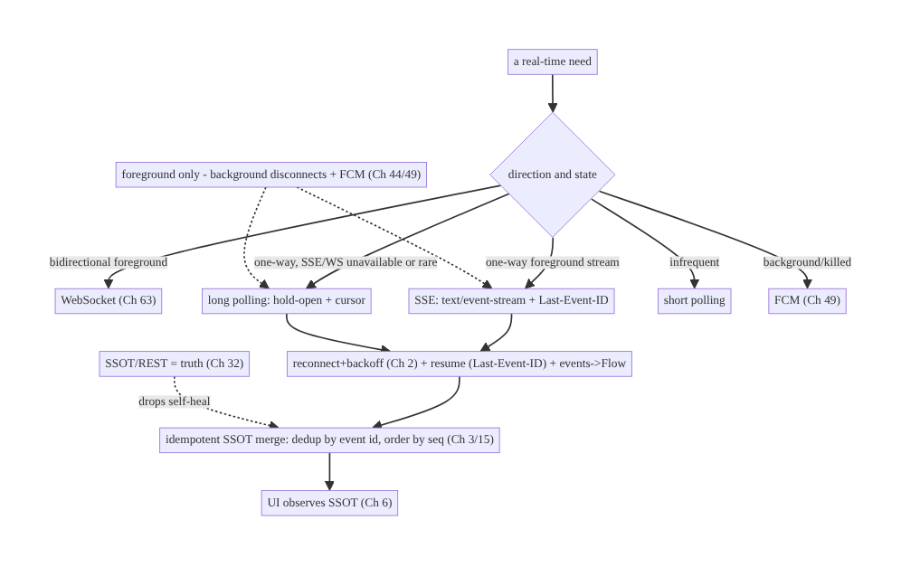
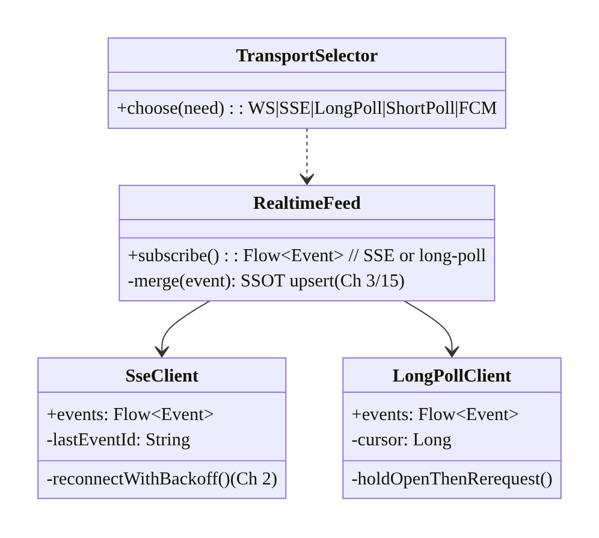
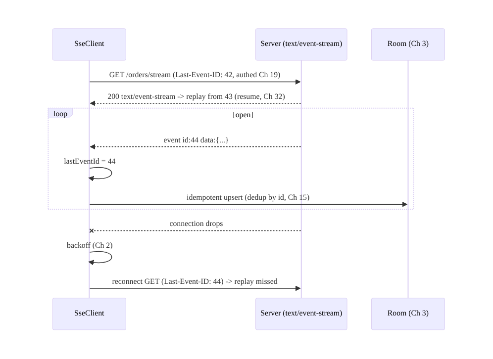
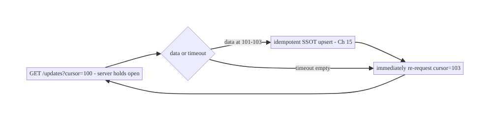
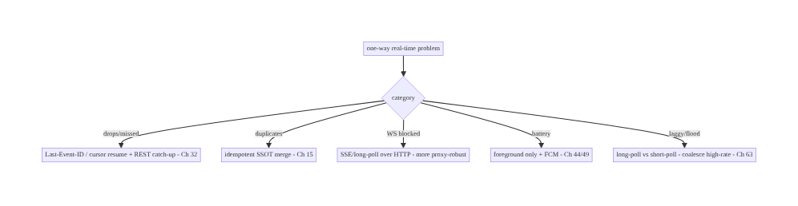

# Chapter 66 — Server-Sent Events & Long Polling

> **Part VIII — Real-Time & Connectivity** · Complexity: **Standard** (≥25 interview questions)
>
> **Prerequisites:** Ch 63 (WebSocket), Ch 1 (networking/OkHttp), Ch 2 (retries/backoff),
> Ch 49 (FCM), Ch 3 (SSOT), Ch 44 (lifecycle). Pairs with Ch 64 (chat), Ch 32 (sync),
> Ch 68 (network state).
>
> **Reference surface in StreamCart:** the **one-way, server→client** real-time cases —
> an order-status feed, a live scoreboard/price ticker, notifications stream — where a
> full WebSocket (Ch 63) is more than needed, and where **SSE** or **long polling** are
> the simpler, HTTP-native fit.

---

## 66.1 Problem Definition and Real-World Context

Not every real-time feature needs the full bidirectional WebSocket (Ch 63). Many are
**one-way**: the server pushes updates, the client only listens (order status, live
scores, a price ticker, a notifications feed). For these, two HTTP-native mechanisms are
often **simpler and more robust** than a WebSocket: **Server-Sent Events (SSE)** — a
long-lived HTTP response streaming `text/event-stream` events, with **built-in
auto-reconnect and event ids** — and **long polling** — the client makes a request the
server holds open until there's data (or a timeout), then immediately re-requests. Picking
the wrong transport (WebSocket where SSE suffices, or naive short polling where nothing
scales) costs complexity, battery, or server load.

Concretely, teams hit:

- **Over-using WebSocket.** A WebSocket is bidirectional, stateful, and needs its own
  heartbeat/reconnect/backpressure machinery (Ch 63). For **server→client-only** feeds,
  **SSE** gives you streaming + auto-reconnect + resume (`Last-Event-ID`) over plain HTTP
  with far less code.
- **Naive short polling.** Polling every few seconds is laggy, wasteful, and scales
  terribly. **Long polling** (hold the request open) gives near-real-time with simple
  infra; **short polling** is a fallback only for infrequent, non-urgent data.
- **Reconnection & resume.** A dropped stream must reconnect (backoff, Ch 2) and **resume
  from the last event** so nothing is missed. SSE standardizes this (`id:` + `Last-Event-
  ID` header); long polling uses a **cursor**; both must reconcile via the SSOT/REST
  (Ch 3/32).
- **Lifecycle & background (Ch 44/47).** Like WebSocket, these are **foreground**
  transports — hold them only while active; **FCM** (Ch 49) handles background.
- **Choosing among WS / SSE / long poll / FCM.** The decision depends on directionality,
  frequency, infra, and app state — getting it right is the core skill.

The architecture: for **one-way server→client** streams, prefer **SSE** (streaming HTTP +
built-in reconnect + `Last-Event-ID` resume) and use **long polling** when SSE isn't
available or events are infrequent; manage them like any real-time transport — **reconnect
with backoff** (Ch 2), **resume from the last event id/cursor** (Ch 32), **feed a `Flow`
that updates the SSOT idempotently** (Ch 3/15), **scope to the active lifecycle** and hand
off to **FCM** (Ch 49) in the background (Ch 44); and **choose WS vs SSE vs long poll vs
FCM** by directionality/frequency/app-state. This chapter is about **the simpler one-way
real-time transports and when to use each**.

### Three practical use cases

1. **Order-status feed (StreamCart).** SSE stream of order updates while the order screen
   is open — auto-reconnects, resumes via `Last-Event-ID`, updates the SSOT; FCM when
   backgrounded (Ch 49).
2. **Live scoreboard / price ticker.** SSE one-way stream of frequent updates, coalesced
   for the UI (Ch 63 backpressure) — simpler than a WebSocket for a read-only ticker.
3. **Long-poll fallback.** Where SSE/WebSocket are blocked (restrictive proxy) or events
   are rare, long polling with a cursor delivers near-real-time with basic HTTP infra.

### Why this is architectural

Transport choice (WS vs SSE vs long poll vs FCM) is a **cross-cutting real-time decision**
spanning directionality, frequency, infra, battery, and app state (Ch 63/49/44). SSE and
long polling are the **simpler one-way options**; knowing when each beats a WebSocket — and
reusing the same reconnect/resume/SSOT discipline (Ch 2/32/3) — is essential real-time
design.

---

## 66.2 Requirements Engineering

### Functional requirements

| ID | Requirement |
|----|-------------|
| F1 | Receive one-way server→client updates in near real time (SSE or long polling). |
| F2 | Reconnect with backoff; resume from last event id / cursor (no missed events) (Ch 2/32). |
| F3 | Feed updates into the SSOT idempotently; reconcile via REST (Ch 3/15/32). |
| F4 | Scope to active lifecycle; hand off to FCM in background (Ch 44/49). |
| F5 | Choose the right transport (WS / SSE / long poll / FCM) per need. |
| F6 | Authenticated + secure stream (Ch 19/23); untrusted events. |

### Non-functional requirements

| Attribute | Policy |
|-----------|--------|
| **Simplicity** | SSE/long-poll over HTTP; less machinery than WebSocket for one-way. |
| **Reliability** | Reconnect + resume; missed events self-heal via SSOT/REST. |
| **Battery** | Foreground only; FCM for background (Ch 47/49). |
| **Latency** | Near-real-time (SSE streaming / long-poll hold). |
| **Robustness** | Works through proxies better than WS in some networks. |

### Scope

- **In scope:** SSE (`text/event-stream`, event ids, `Last-Event-ID` resume, auto-
  reconnect), long polling (hold-open request + cursor + immediate re-request), short
  polling (fallback), reconnect/backoff (Ch 2), resume/cursor (Ch 32), events→idempotent
  SSOT (Ch 3/15), lifecycle scoping + FCM handoff (Ch 44/49), transport selection (WS/SSE/
  long poll/FCM), auth/security (Ch 19/23).
- **Out of scope:** WebSocket internals (Ch 63), FCM internals (Ch 49), sync algorithm
  (Ch 32), backoff theory (Ch 2), networking stack (Ch 1), chat (Ch 64).

### Assumptions & constraints

- OkHttp (Ch 1) for SSE (streaming response / `okhttp-sse`) and long polling; Kotlin
  coroutines/Flow; Room SSOT (Ch 3); FCM (Ch 49). `minSdk 24`. These are **foreground,
  one-way** transports; delivery is best-effort (reconcile via SSOT/REST); events are
  untrusted.

---

## 66.3 System Design Fundamentals

- **Server-Sent Events (SSE).** A single long-lived **HTTP GET** whose response is
  `Content-Type: text/event-stream`; the server streams **events** (`data:` lines,
  optional `event:` type and `id:`) and keeps the connection open. Key built-ins:
  - **One-way** (server→client only) — simpler than WebSocket's full duplex.
  - **Auto-reconnect:** the SSE client reconnects automatically on drop (with a server-
    suggestable `retry:` interval).
  - **Resume via `Last-Event-ID`:** the client remembers the last event `id:` and sends it
    as the `Last-Event-ID` header on reconnect; the server **replays from there** — missed
    events self-heal (standardized catch-up, Ch 32).
  - **HTTP-native:** works over normal HTTP/1.1 and HTTP/2, through most proxies/CDNs,
    with existing auth (Ch 19) — often **more robust** than WebSocket in restrictive
    networks.
- **Long polling.** The client sends a request; the **server holds it open** until there's
  data (or a timeout), then responds; the client **immediately re-requests** (with an
  updated **cursor**). Near-real-time with **basic HTTP infra** (no streaming/WebSocket
  support needed). Costs: a request per event batch, careful timeout/cursor handling.
  **Short polling** (fixed interval, respond immediately even if empty) is the laggy,
  wasteful fallback — only for **infrequent, non-urgent** data.
- **The decision matrix (the core skill):**

  | Need | Transport |
  |------|-----------|
  | Bidirectional, low-latency, foreground (chat, auctions) | **WebSocket** (Ch 63) |
  | **One-way** server→client stream, foreground (status, ticker, feed) | **SSE** |
  | One-way, SSE/WS unavailable or events rare, basic infra | **Long polling** |
  | Infrequent, non-urgent | **Short polling** (simplest) |
  | **Background/killed** wake-ups | **FCM** (Ch 49) |
  Default to **SSE for one-way**; **WebSocket only when you need to send too**; **FCM for
  background**.
- **Same real-time discipline as WebSocket (Ch 63).** SSE/long-poll are managed like any
  real-time transport:
  - **Reconnect with backoff + jitter** (Ch 2) — SSE does basic reconnect; add jittered
    backoff for storms.
  - **Resume** — SSE via `Last-Event-ID`; long poll via a **cursor** in each request.
  - **Events → `Flow` → idempotent SSOT** (Ch 3/15) — dedup by event id, order by
    sequence; the UI observes the SSOT (UDF, Ch 6).
  - **SSOT/REST is truth** (Ch 32) — the stream is a **fast path**; missed events are
    caught up via resume or a REST delta, so drops self-heal.
- **Lifecycle & background (Ch 44/47/49).** SSE/long-poll are **foreground** transports
  (a held-open HTTP connection drains battery and is killed by Doze, Ch 47). **Connect on
  foreground, disconnect on background** (Ch 44); hand off to **FCM** (Ch 49) for
  background events; reconnect + catch up on return.
- **Backpressure for high-rate SSE** (Ch 63): coalesce/sample frequent events (ticker,
  scoreboard) so the UI isn't flooded.
- **Auth & security (Ch 19/23).** SSE is a normal authed HTTPS GET (bearer, cookies) over
  **TLS + pinning** (Ch 23) — reuses the REST auth stack (an advantage over WebSocket's
  custom handshake). Long polling likewise. Treat every event as **untrusted** (validate/
  allowlist, Ch 23/52); the server authorizes **which stream** you may subscribe to.

Core insight: **for one-way server→client real-time, prefer SSE — a long-lived HTTP
`text/event-stream` with built-in auto-reconnect and `Last-Event-ID` resume that reuses the
REST auth stack and traverses proxies well — and use long polling (hold-open request +
cursor) when SSE/WebSocket are unavailable or events are rare (short polling only for
infrequent data); manage them with the same discipline as WebSocket (jittered-backoff
reconnect, resume via event-id/cursor, events→idempotent SSOT with SSOT/REST as truth so
drops self-heal, Ch 2/32/3/15), scope them to the foreground lifecycle and hand off to FCM
in the background (Ch 44/49); and choose WS vs SSE vs long-poll vs FCM by directionality,
frequency, infra, and app state — reserving WebSocket for when the client must also send.**

---

## 66.4 High-Level Architecture



**Components & ownership**

- **Transport selector** picks WS/SSE/long-poll/short-poll/FCM by direction/frequency/
  state.
- **SSE / long-poll** stream events, reconnect with backoff, resume via `Last-Event-ID`/
  cursor.
- **Events → idempotent SSOT merge** (dedup/order); the UI observes the SSOT.
- **SSOT/REST** is truth; **FCM** handles background; **lifecycle** scopes it.

**Direction:** need → transport choice → managed stream (reconnect/resume) → idempotent
SSOT → UI; foreground-scoped with FCM background.

---

## 66.5 Detailed Component Design



| Component | Responsibility |
|-----------|----------------|
| `SseClient` | stream `text/event-stream`; `Last-Event-ID` resume; backoff reconnect |
| `LongPollClient` | hold-open request + cursor + immediate re-request |
| `RealtimeFeed` | expose events as Flow → idempotent SSOT merge (Ch 3/15) |
| `TransportSelector` | choose WS/SSE/long-poll/short-poll/FCM (decision matrix) |

---

## 66.6 End-to-End Data Flow

### SSE: stream + resume



### Long polling



---

## 66.7 Complete Kotlin Implementation

Package: `com.streamcart.feed`.

### 66.7.1 SSE client (OkHttp), resume via Last-Event-ID + backoff

```kotlin
@Singleton
class SseClient @Inject constructor(
    private val okHttp: OkHttpClient,            // TLS + pinning + auth (Ch 1/19/23)
    private val cursorStore: LastEventIdStore,   // persist last id (Ch 3/32)
) {
    fun stream(url: String): Flow<SseEvent> = callbackFlow {
        var attempt = 0
        fun connect() {
            val req = Request.Builder().url(url)
                .header("Accept", "text/event-stream")
                .apply { cursorStore.last()?.let { header("Last-Event-ID", it) } }   // resume (Ch 32)
                .build()
            val es = EventSources.createFactory(okHttp).newEventSource(req, object : EventSourceListener() {
                override fun onOpen(es: EventSource, r: Response) { attempt = 0 }
                override fun onEvent(es: EventSource, id: String?, type: String?, data: String) {
                    id?.let { cursorStore.save(it) }                                  // remember last id
                    trySend(SseEvent(id, type, data))
                }
                override fun onFailure(es: EventSource, t: Throwable?, r: Response?) {
                    // jittered backoff reconnect (Ch 2) -> resume from Last-Event-ID
                    launch { delay(backoff(attempt++)); connect() }
                }
            })
            awaitClose { es.cancel() }
        }
        connect()
    }
    private fun backoff(a: Int) = minOf(30_000L, 500L * (1L shl a.coerceAtMost(6))) + Random.nextLong(500)  // (Ch 2)
}
```

### 66.7.2 Long-poll client (hold-open + cursor + re-request)

```kotlin
@Singleton
class LongPollClient @Inject constructor(private val api: FeedApi, private val cursorStore: CursorStore) {
    fun stream(channel: String): Flow<Event> = flow {
        while (currentCoroutineContext().isActive) {
            val resp = runCatching { api.longPoll(channel, cursor = cursorStore.get(channel), timeoutSec = 30) }  // server holds open
                .getOrElse { delay(backoff()); continue }                 // error -> backoff (Ch 2), retry
            resp.events.forEach { emit(it); cursorStore.set(channel, it.seq) }   // advance cursor
            // loop immediately re-requests with the new cursor (near-real-time)
        }
    }.flowOn(Dispatchers.IO)
}
```

### 66.7.3 Feed: events → idempotent SSOT merge (Ch 3/15); REST reconciles

```kotlin
@Singleton
class OrderFeed @Inject constructor(
    private val sse: SseClient, private val dao: OrderDao,    // SSOT (Ch 3)
    private val api: OrderApi, private val scope: CoroutineScope,
) {
    fun start() = scope.launch {
        sse.stream("https://api.streamcart.com/orders/stream").collect { ev ->
            val update = parseOrder(ev.data) ?: return@collect     // untrusted (Ch 23)
            dao.upsertIfNewer(update)                              // idempotent: dedup by id/seq (Ch 15)
        }
    }
    /** On (re)connect/open: REST catch-up = truth (Ch 32) — drops self-heal. */
    suspend fun catchUp() = dao.upsertAll(api.ordersSince(dao.maxSeq()))
}
// UI observes dao.observeOrders() (Ch 6). SSE is a fast path; SSOT/REST is truth.
```

### 66.7.4 Transport selection (the decision)

```kotlin
object TransportSelector {
    fun choose(need: RealtimeNeed): Transport = when {
        need.bidirectional && need.foreground -> Transport.WebSocket   // must send too (Ch 63)
        need.oneWay && need.foreground && need.sseSupported -> Transport.Sse          // DEFAULT one-way
        need.oneWay && need.foreground -> Transport.LongPoll           // SSE/WS unavailable
        need.infrequent -> Transport.ShortPoll
        need.background -> Transport.Fcm                               // Ch 49
        else -> Transport.Sse
    }
}
```

### 66.7.5 Lifecycle scoping + FCM handoff (Ch 44/49)

```kotlin
// Foreground-only (held-open HTTP drains battery + Doze-killed, Ch 47). FCM for background (Ch 49).
class FeedLifecycleBinder @Inject constructor(private val feed: OrderFeed) : DefaultLifecycleObserver {
    private var job: Job? = null
    override fun onStart(owner: LifecycleOwner) { job = feed.start() }   // connect SSE
    override fun onStop(owner: LifecycleOwner) { job?.cancel() }         // disconnect -> FCM handles bg
}
```

### 66.7.6 Module structure

```
:core:feed   SseClient, LongPollClient, OrderFeed, TransportSelector, cursor/LastEventId stores
# OkHttp/SSE -> Ch 1; backoff -> Ch 2; SSOT -> Ch 3; catch-up -> Ch 32; FCM -> Ch 49; lifecycle -> Ch 44.
```

---

## 66.8 Concurrency and Race Conditions

| Scenario | Risk | Handling |
|----------|------|----------|
| Reconnect loses events | gaps | `Last-Event-ID`/cursor resume (Ch 32) |
| Duplicate on resume replay | dup state | idempotent SSOT upsert (dedup by id, Ch 15) |
| Reconnect storm | server load | jittered backoff (Ch 2) |
| Long-poll overlapping requests | double work | single in-flight per channel; advance cursor |
| High-rate SSE floods UI | jank | coalesce/sample (Ch 63) |
| Held connection in background | battery/Doze | foreground-only; disconnect (Ch 44/47) |
| Stale cursor after reinstall | re-replay | server tolerates; idempotent merge dedups |

- **Resume + idempotency mirror WebSocket (Ch 63):** SSE's `Last-Event-ID` (or the
  long-poll cursor) replays missed events on reconnect, and the **idempotent SSOT merge**
  (dedup by id, Ch 15) makes the inevitable **replayed duplicates** harmless — so drops
  self-heal without corruption.
- **Single in-flight long-poll per channel:** the loop must not launch overlapping
  requests; one request at a time, advancing the cursor from each response.
- **Jittered backoff** prevents reconnect storms just as for WebSocket (Ch 2/63).

---

## 66.9 Failure Scenarios and Recovery

| Failure | Detection | Response | Outcome |
|---------|-----------|----------|---------|
| Stream drops | onFailure | backoff reconnect + resume (Ch 2/32) | heals |
| Missed events | gap in id/seq | `Last-Event-ID`/cursor replay + REST catch-up | self-heals |
| Duplicates on replay | repeated id | idempotent SSOT (Ch 15) | single |
| WebSocket blocked by proxy | connect fail | SSE/long-poll (HTTP-native) fallback | works |
| High-rate flood | jank | coalesce/sample (Ch 63) | smooth |
| Battery drain | held connection bg | foreground-only + FCM (Ch 44/49) | battery ok |
| Short-poll too laggy | user report | switch to SSE/long-poll | near-real-time |



> **SSE and long polling reuse the same real-time principles as WebSocket (Ch 63) —
> reconnect, resume, idempotent-SSOT, SSOT/REST-as-truth, foreground-scope + FCM — but over
> plain HTTP and one-way, so they're simpler and more proxy-robust.** The real skill is
> **choosing the right transport**: SSE for one-way streams, WebSocket only when the client
> must send, long-poll as the HTTP fallback, FCM for background.

---

## 66.10 Scaling the Implementation

- **Level 1.** SSE for a one-way feed → idempotent SSOT; auto-reconnect.
- **Level 2.** `Last-Event-ID`/cursor resume + jittered backoff (Ch 2/32); REST catch-up;
  lifecycle scoping + FCM background (Ch 44/49).
- **Level 3 — production.** Transport selection (WS/SSE/long-poll/FCM); backpressure for
  high-rate (Ch 63); long-poll fallback where SSE/WS blocked; auth/pinning (Ch 19/23).
- **Level 4 — large.** Multiplexed SSE channels; adaptive transport (fall back WS→SSE→
  long-poll); per-feed coalescing; connection-quality metrics.
- **Level 5 — enterprise.** Real-time transport governance + fallback matrix, QoS SLOs,
  server-side streaming scale (SSE fan-out), multi-region, HTTP/2 multiplexing tuning.

**Avoid overengineering:** for a read-only feed, **SSE + idempotent SSOT + FCM background**
is the whole story — don't reach for a WebSocket. Don't short-poll frequent data; don't
hold connections in the background.

---

## 66.11 Alternative Approaches and Trade-offs

| Dimension | Option A | Option B | When |
|-----------|----------|----------|------|
| One-way stream | **SSE** | WebSocket (Ch 63) | SSE (simpler, HTTP-native, auto-reconnect/resume); WS only if bidirectional |
| No SSE/WS infra | Long polling | short polling | Long poll (near-real-time); short poll only infrequent |
| Resume | `Last-Event-ID` (SSE) / cursor (long-poll) | none | Always resume (Ch 32) |
| Reconnect | Jittered backoff (Ch 2) | immediate/fixed | Jittered (avoid storms) |
| Truth | SSOT/REST (fast path) | the stream | SSOT/REST (self-heal) |
| Background | FCM (Ch 49) | hold connection | FCM (battery/Doze, Ch 47) |
| Proxy-restrictive nets | SSE/long-poll (HTTP) | WebSocket | SSE/long-poll (traverse proxies better) |

**SSE vs WebSocket (Ch 63):** a WebSocket is **bidirectional and stateful**, needing custom
handshake, heartbeat, and reconnect machinery. **SSE** is **one-way** over plain HTTP with
**built-in auto-reconnect and `Last-Event-ID` resume**, reuses the **REST auth stack**
(Ch 19), and traverses proxies/CDNs more reliably. For **server→client-only** feeds (status,
ticker, notifications), SSE is simpler and often more robust; use a **WebSocket only when
the client must also send** (chat, auctions). Many apps use SSE for feeds and WS only where
duplex is genuinely needed.

**Long polling vs short polling vs SSE:** **short polling** (fixed interval) is laggy and
wasteful — fine only for **infrequent, non-urgent** data. **Long polling** (server holds the
request open) gives **near-real-time** with basic HTTP infra and is the fallback when SSE/WS
aren't available or events are rare. **SSE** is better than both for a true stream (one
connection, many events, standardized resume). Prefer SSE; long-poll as fallback; short-poll
only for rare updates.

**Stream-as-truth vs SSOT/REST-as-truth:** as with WebSocket (Ch 63), treating the SSE/
long-poll stream as authoritative makes a dropped event a permanent loss. Treating it as a
**fast path** over an **authoritative SSOT/REST** (Ch 32) — with resume + idempotent merge —
makes it self-healing. Same principle across all real-time transports.

---

## 66.12 Security Considerations

- **Authed HTTPS + pinning (Ch 19/23):** SSE/long-poll are normal authenticated HTTPS
  requests over **TLS + certificate pinning** (Ch 23) — they reuse the REST auth stack
  (bearer/cookies), an advantage over WebSocket's custom handshake. Never plain HTTP.
- **Stream authorization (Ch 23):** the server authorizes **which feed/channel** you may
  subscribe to (your orders, a stream you're watching) — a client can't request arbitrary
  streams.
- **Events are untrusted (Ch 23/52):** validate/allowlist event types and schema; don't act
  on an event implying privilege without server authorization; sanitize content; beware
  injection.
- **Per-account isolation (Ch 42):** feeds scoped to the active account; on logout/switch,
  disconnect + scope.
- **`Last-Event-ID`/cursor are not secrets** but shouldn't leak another user's position;
  they're validated server-side against the authed user.
- **No sensitive data/PII in event logs** (Ch 28).
- Client vs backend: the **server** authenticates, authorizes the stream, assigns event
  ids/cursors, and is the truth (REST catch-up); the **client** manages reconnect/resume,
  validates untrusted events, and reconciles into the SSOT.

---

## 66.13 Performance and Resource Optimization

- **SSE over WebSocket for one-way** — less machinery, HTTP/2 multiplexing, proxy-friendly.
- **Foreground-only** (Ch 44) — don't hold SSE/long-poll in the background (battery/Doze,
  Ch 47); FCM for background (Ch 49).
- **Jittered backoff** (Ch 2) — avoid reconnect storms + radio churn.
- **Coalesce/sample high-rate** streams (Ch 63) — ticker/scoreboard.
- **Resume, don't refetch all** — `Last-Event-ID`/cursor replays only missed events.
- **Long-poll timeout tuning** — balance latency vs request overhead; single in-flight.
- **HTTP/2** — multiplex multiple SSE streams over one connection.
- **Profiling:** stream uptime, reconnect rate, event latency, battery/radio, catch-up
  volume, request count (long-poll).

---

## 66.14 Testing Strategy

SSE/long-poll test with `MockWebServer` (stream responses / held requests); resume + merge
in isolation.

```kotlin
class SseResumeTest {
    @Test fun `sends Last-Event-ID on reconnect and dedups replay`() = runTest {
        // MockWebServer: stream events 1-3 then drop; assert reconnect carries Last-Event-ID=3,
        // server replays 3-5, SSOT has 1-5 once (idempotent, Ch 15)
    }
}

class LongPollTest {
    @Test fun `advances cursor and re-requests`() = runTest {
        // held response returns seq 101-102 -> next request carries cursor=102
    }
    @Test fun `backs off on error then retries`() = runTest { /* error -> delay -> retry (Ch 2) */ }
}

class TransportSelectorTest {
    @Test fun `one-way foreground picks SSE`() =
        assertEquals(Transport.Sse, TransportSelector.choose(RealtimeNeed(oneWay = true, foreground = true, sseSupported = true)))
    @Test fun `bidirectional picks WebSocket`() = assertEquals(Transport.WebSocket, /* ... */ )
    @Test fun `background picks FCM`() = assertEquals(Transport.Fcm, /* ... */ )
}
```

What to test: SSE resume (`Last-Event-ID`) + idempotent dedup of replay; long-poll cursor
advance + backoff; transport selection matrix; REST catch-up heals gaps; lifecycle
connect/disconnect (no background hold); untrusted-event rejection. `MockWebServer` for
streaming/held responses.

---

## 66.15 Production Observability

- **Metrics:** stream **uptime / reconnect rate / reconnect latency**; event **delivery
  latency**; catch-up/replay volume + gap frequency; long-poll request rate; duplicate-
  merge rate (deduped); battery/radio attributed; transport mix (SSE/long-poll/WS/FCM).
- **Logs:** `feed{transport, state, reconnects, lastEventId}` — no event content/PII
  (Ch 28).
- **Debugging:** missed events → resume not sent / cursor bug (Ch 32); duplicates → merge
  not idempotent (Ch 15); storms → non-jittered backoff; WS-blocked network → fall back to
  SSE/long-poll; battery → held connection in background (Ch 44); laggy → short-poll where
  long-poll/SSE needed.
- **Alerting:** reconnect-rate/latency spike; SSE failure spike (server/proxy); transport-
  fallback surge (infra issue).
- **Dashboards:** stream health (uptime/reconnect/latency) by transport; delivery funnel.

---

## 66.16 System Design Interview Preparation

> ≥25 questions.

**Fundamentals**
1. *SSE?* A long-lived HTTP `text/event-stream`; server streams events one-way.
2. *SSE built-ins?* Auto-reconnect + `Last-Event-ID` resume + HTTP-native.
3. *Long polling?* Client request the server holds open until data/timeout, then re-request.
4. *Short polling?* Fixed-interval polling — laggy/wasteful; infrequent data only.
5. *Direction of SSE?* One-way (server→client).

**Choosing**
6. *SSE vs WebSocket (Ch 63)?* One-way HTTP+resume vs bidirectional stateful.
7. *When WebSocket?* Client must also send (chat/auctions).
8. *When long poll?* SSE/WS unavailable or events rare; basic infra.
9. *When FCM?* Background (Ch 49).
10. *Default for a read-only feed?* SSE.

**Reliability**
11. *Resume (SSE)?* `Last-Event-ID` header → server replays from there.
12. *Resume (long-poll)?* Cursor in each request.
13. *Reconnect?* Jittered backoff (Ch 2).
14. *Duplicates on replay?* Idempotent SSOT merge (Ch 15).
15. *Truth?* SSOT/REST (Ch 32); stream is a fast path.
16. *Missed events?* Resume + REST catch-up self-heal.

**Lifecycle/efficiency**
17. *Foreground only?* Yes — held connection drains battery, Doze-killed (Ch 47).
18. *Background?* FCM handoff (Ch 49).
19. *High-rate?* Coalesce/sample (Ch 63).
20. *Proxy-restrictive nets?* SSE/long-poll traverse better than WS.

**Security**
21. *Auth?* Normal authed HTTPS + pinning (Ch 19/23); reuses REST stack.
22. *Stream authz?* Server authorizes which feed (Ch 23).
23. *Events trust?* Untrusted — validate (Ch 52).

**Testing/Production**
24. *Test SSE?* `MockWebServer` stream + resume/dedup.
25. *Test selection?* Matrix (one-way→SSE, bidir→WS, bg→FCM).
26. *WS blocked in prod?* Fall back to SSE/long-poll.

### Design-change challenges
1. **One-way order-status feed.** SSE + idempotent SSOT + `Last-Event-ID` resume; FCM
   background.
2. **WebSocket blocked by a corporate proxy.** SSE or long-poll (HTTP-native).
3. **Rare updates, simple backend.** Long polling with a cursor (or short poll if very
   rare).
4. **Live ticker floods the UI.** SSE + coalesce/sample (Ch 63).
5. **Feed misses events after a drop.** `Last-Event-ID`/cursor resume + REST catch-up
   (Ch 32).

### Mock walkthrough (abridged)
Clarify (one-way or bidirectional, frequency, infra, app state?) → transport matrix (SSE
for one-way, WS for bidirectional, long-poll fallback, FCM background) → manage like
real-time (reconnect+backoff, resume via Last-Event-ID/cursor, events→idempotent SSOT,
SSOT/REST truth, Ch 2/32/3/15) → foreground scope + FCM (Ch 44/49) → backpressure for
high-rate → auth/pinning + untrusted events (Ch 19/23) → observability.

---

## 66.17 Practical Exercises

1. **Beginner.** Consume an SSE order-status feed with OkHttp, updating the SSOT; render
   from the SSOT. *Eval:* streams; UI updates.
2. **Intermediate.** Add `Last-Event-ID` resume + jittered-backoff reconnect so drops heal
   and replays dedup idempotently. *Eval:* no gaps/dupes.
3. **Advanced.** Implement a long-poll fallback (hold-open + cursor) and a `TransportSelector`
   choosing WS/SSE/long-poll/FCM. *Eval:* correct choice; near-real-time long-poll.
4. **Production debugging.** Fix missed events (resume not sent) and a reconnect storm (no
   jitter). *Eval:* resumes; spread reconnects.
5. **System design challenge.** Scope the feed to foreground with FCM background, add
   coalescing for a high-rate ticker, and a stream-health dashboard. *Eval:* battery-sane;
   smooth; observable.

*(Solutions withheld unless requested.)*

---

## 66.18 Chapter Summary & Reference Sheet

**Key decisions:** for **one-way server→client** real-time, prefer **SSE** — a long-lived
HTTP `text/event-stream` with **built-in auto-reconnect and `Last-Event-ID` resume** that
**reuses the REST auth stack** (Ch 19) and **traverses proxies/CDNs** better than a
WebSocket — and use **long polling** (server holds the request open + a cursor + immediate
re-request) when SSE/WebSocket are unavailable or events are rare (**short polling** only
for infrequent data); manage these with the **same discipline as WebSocket** (Ch 63) —
**jittered-backoff reconnect** (Ch 2), **resume** via `Last-Event-ID`/cursor (Ch 32),
**events → idempotent SSOT merge** (dedup by id, Ch 3/15) with **SSOT/REST as the truth**
so drops self-heal, **foreground-scoped** with **FCM for background** (Ch 44/49) — and
**choose the transport by directionality, frequency, infra, and app state** (SSE one-way,
**WebSocket only when the client must also send**, long-poll fallback, FCM background);
secure with **authed HTTPS + pinning + server stream authorization + untrusted-event
validation** (Ch 19/23/52).

**Concepts:** SSE (`text/event-stream`, event ids, `Last-Event-ID`, auto-reconnect), long
polling (hold-open + cursor), short polling, transport selection matrix, reconnect/backoff
+ resume, events→idempotent SSOT, SSOT/REST truth, foreground scope + FCM, backpressure.

**Common mistakes:** using a WebSocket for a one-way feed (needless complexity); short-
polling frequent data (laggy/wasteful); no resume (gaps); no idempotent merge (duplicates
on replay); treating the stream as truth; holding SSE/long-poll in the background (battery/
Doze); plain HTTP / no stream authz; non-jittered reconnect (storms).

**Checklist:** ☐ pick transport by matrix (SSE one-way / WS bidirectional / long-poll
fallback / FCM background) ☐ SSE with `Last-Event-ID` resume + auto-reconnect ☐ long-poll
hold-open + cursor (single in-flight) ☐ jittered backoff (Ch 2) ☐ events → idempotent SSOT
merge (Ch 3/15) ☐ SSOT/REST = truth; catch-up (Ch 32) ☐ foreground-scoped + FCM background
(Ch 44/49) ☐ coalesce high-rate (Ch 63) ☐ authed HTTPS + pinning + stream authz + untrusted
events (Ch 19/23/52) ☐ stream-health telemetry.

**Key APIs:** OkHttp `EventSources`/`EventSource`/`EventSourceListener` (`onEvent`/`onFailure`)
+ `Accept: text/event-stream` + `Last-Event-ID` header, OkHttp long-poll (held GET + cursor),
`callbackFlow`/`flow` (Ch 1), jittered backoff (Ch 2), Room idempotent upsert (Ch 3/15),
REST catch-up (Ch 32), `ProcessLifecycleOwner` (Ch 44), FCM (Ch 49), `MockWebServer` (test).

**References:**
- Server-Sent Events (WHATWG/MDN): https://developer.mozilla.org/en-US/docs/Web/API/Server-sent_events
- OkHttp SSE (okhttp-sse): https://square.github.io/okhttp/features/events/
- (composes) Ch 63 WebSocket, Ch 1 Networking, Ch 2 Retries/Backoff, Ch 49 FCM, Ch 32 Sync, Ch 3 SSOT, Ch 44 Lifecycle, Ch 68 Network State

### Chapter review (Phase 4)
- **Completeness:** all 18 sections; architecture/class/sequence/flow/failure diagrams;
  SSE client (Last-Event-ID + backoff) + long-poll + feed merge + selector + lifecycle
  code; concurrency (resume+idempotency, single in-flight, jitter); failure (reuse-WS-
  principles + choose-transport); 5 levels; SSE-vs-WS, long-vs-short-poll, stream-vs-truth
  trade-offs; security (authed HTTPS, stream authz, untrusted); perf (SSE/foreground/
  coalesce); MockWebServer + selector tests; observability (stream health); 26 Q&A + 5
  challenges. ✅
- **Expand later:** WebSocket (Ch 63), FCM (Ch 49), sync (Ch 32), network state (Ch 68).
- **Interview coverage:** exceeds ≥25 bar.
