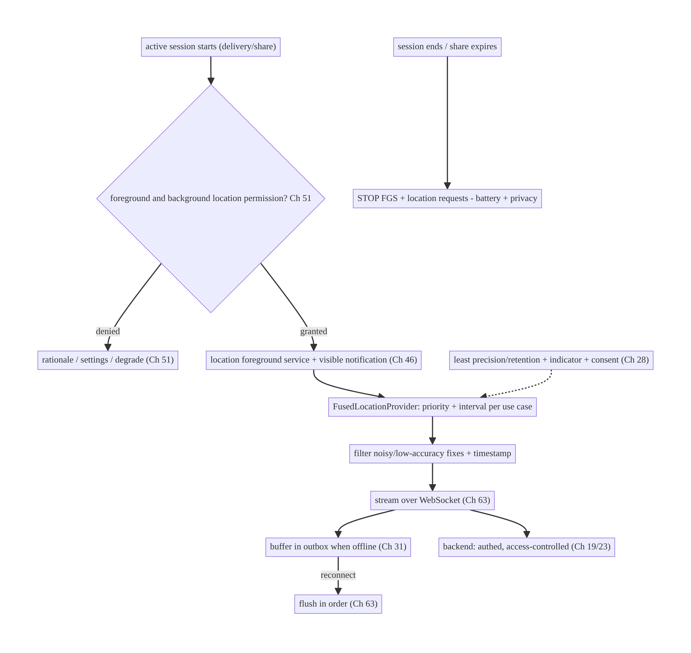
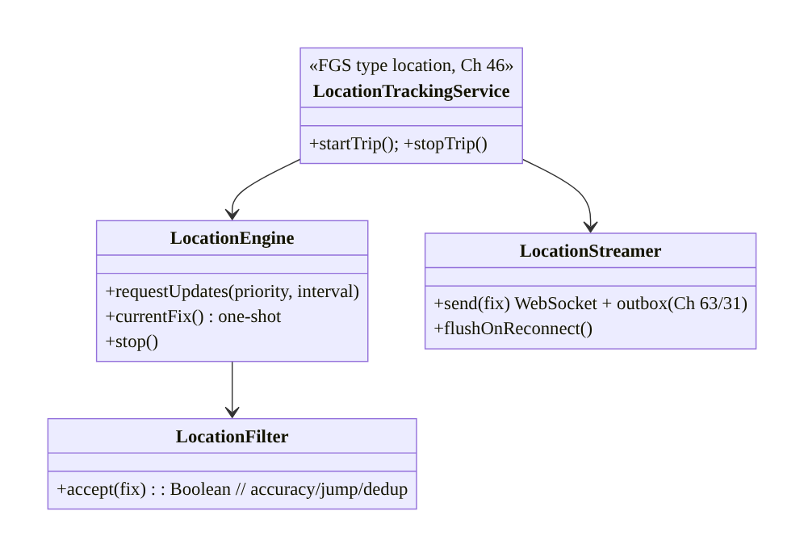
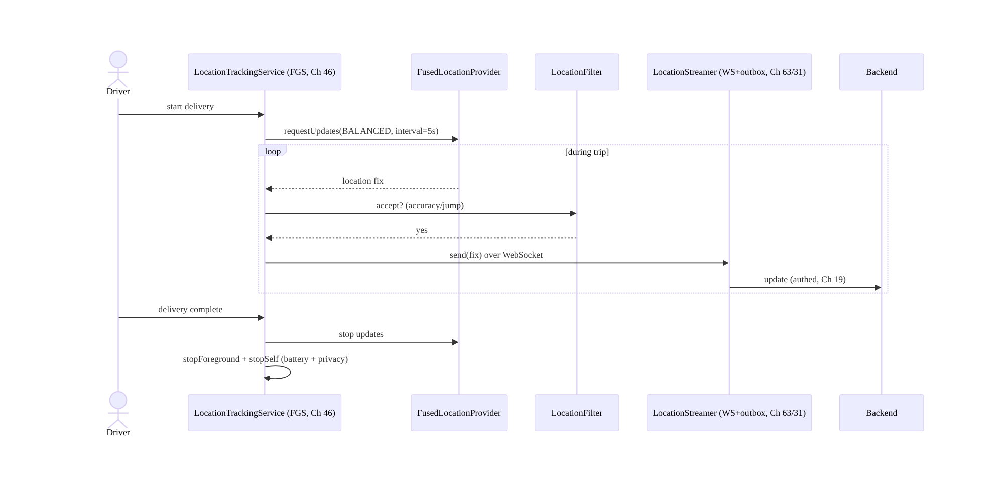
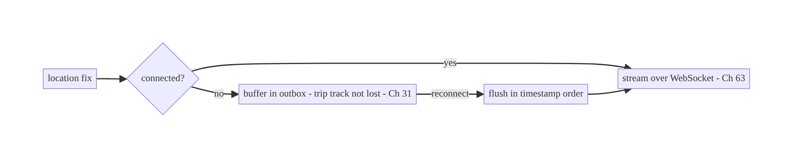
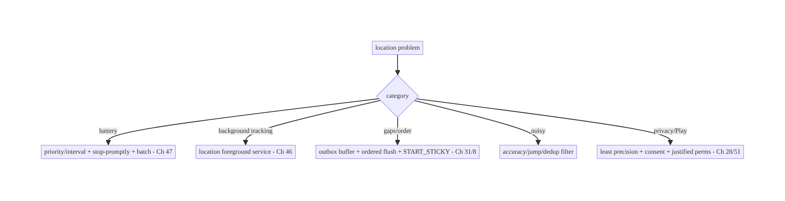

# Chapter 67 — Live Location Tracking

> **Part VIII — Real-Time & Connectivity** · Complexity: **Standard** (≥25 interview questions)
>
> **Prerequisites:** Ch 46 (foreground services), Ch 51 (permissions), Ch 47 (Doze/
> background limits), Ch 63 (WebSocket), Ch 31 (outbox), Ch 44 (lifecycle), Ch 28
> (privacy). Pairs with Ch 68 (network state), Ch 30 (WorkManager).
>
> **Reference surface in StreamCart:** delivery/driver tracking and "share my live
> location" — acquiring the device's location efficiently, streaming it to the backend
> during an **active trip**, and doing so within Android's strict **location permission**
> and **background-execution** rules, with privacy front and center.

---

## 67.1 Problem Definition and Real-World Context

Live location is Android's most **permission-, battery-, and privacy-sensitive** feature.
Tracking a delivery driver or sharing a user's location in real time means **continuously
acquiring GPS** (expensive), **running during an active trip even when backgrounded** (a
foreground service, Ch 46), **streaming updates** to the server (Ch 63/31), and navigating
the **foreground/background location permission split**, **approximate-vs-precise**, and
**Doze/background-location limits** (Ch 51/47) — all while treating location as **highly
sensitive data** (Ch 28). Get it wrong and you drain the battery, get killed by the OS,
leak location, or get rejected by Play.

Concretely, teams hit:

- **Battery drain from naive GPS.** Requesting high-accuracy location at max frequency
  continuously destroys the battery. You must use the **Fused Location Provider** with the
  **right priority and interval** for the use case, and stop when not needed.
- **Permission complexity (Ch 51).** Foreground location (`ACCESS_FINE/COARSE_LOCATION`)
  vs **background location** (`ACCESS_BACKGROUND_LOCATION`, requested **separately/after**,
  heavily scrutinized by Play), **approximate vs precise** (Android 12+), and **"only this
  time"** grants — all with in-context requests and graceful denial.
- **Background execution (Ch 46/47).** Tracking during an active trip while the app is
  backgrounded **requires a foreground service** (type `location`, Ch 46) with a visible
  notification — you **cannot** silently track in the background; Doze/limits (Ch 47) kill
  unprivileged background location.
- **Streaming reliably (Ch 63/31).** Location updates stream to the backend over a
  **WebSocket** (Ch 63) while connected, buffered in an **outbox** (Ch 31) when offline so
  the trip's track isn't lost, reconciled on reconnect.
- **Privacy & trust (Ch 28).** Location is deeply personal. Track **only during an active,
  user-understood session**, show a clear indicator, stop promptly, **minimize precision/
  retention**, and honor consent — misuse is both a Play violation and a trust breach.
- **Accuracy/consistency.** Noisy GPS needs filtering/smoothing; updates need timestamps
  and ordering; a trip's path must be coherent.

The architecture: acquire location via the **Fused Location Provider** with a **priority/
interval matched to the use case** (balanced vs high accuracy), only during an **active
session**; run active-trip tracking in a **foreground service** (type `location`, Ch 46)
with a visible notification; gate on the **foreground then background location
permissions** (Ch 51), preferring **least precision**; **stream** updates over a
**WebSocket** (Ch 63) with an **outbox** buffer (Ch 31) and reconnect/catch-up; **stop
promptly** when the session ends; and treat location as **sensitive** — minimal precision/
retention, clear indicator, consent (Ch 28). This chapter is about **efficient, compliant,
privacy-respecting live location**.

### Three practical use cases

1. **Delivery driver tracking (StreamCart).** During an active delivery, a `location`
   foreground service (Ch 46) streams the driver's position (balanced priority) to the
   backend over a WebSocket (Ch 63); stops when the delivery completes.
2. **"Share my live location."** A user shares location for a bounded time/trip; precise,
   foreground-service-backed, with a clear stop control and auto-expiry.
3. **Nearby stores (foreground, one-shot).** A single coarse location fix
   (`getCurrentLocation`) to show nearby stores — no background, no continuous tracking,
   least precision.

### Why this is architectural

Live location composes **permissions (Ch 51)**, **foreground services (Ch 46)**,
**background limits (Ch 47)**, **real-time streaming (Ch 63/31)**, **lifecycle (Ch 44)**,
and **privacy (Ch 28)** — with the strictest OS and Play constraints of any feature. The
decisions — provider/priority/interval, foreground-service-for-active-trips, permission
strategy, streaming+buffering, stop-promptly, least-precision — determine battery, legality,
reliability, and user trust.

---

## 67.2 Requirements Engineering

### Functional requirements

| ID | Requirement |
|----|-------------|
| F1 | Acquire location efficiently (Fused provider, priority/interval per use case). |
| F2 | Track during an active trip even when backgrounded, via a `location` foreground service (Ch 46). |
| F3 | Gate on foreground + background location permissions; least precision (Ch 51). |
| F4 | Stream updates to the backend reliably (WebSocket + outbox buffer) (Ch 63/31). |
| F5 | Stop promptly when the session ends; auto-expire shares. |
| F6 | Treat location as sensitive: minimal precision/retention, indicator, consent (Ch 28). |

### Non-functional requirements

| Attribute | Policy |
|-----------|--------|
| **Battery** | Right priority/interval; stop when idle; the top constraint. |
| **Compliance** | `location` FGS for background; Play-justified permissions (Ch 46/51). |
| **Reliability** | Trip track not lost (outbox); reconnect/catch-up (Ch 31/63). |
| **Privacy** | Active-session-only; least precision; clear indicator; consent (Ch 28). |
| **Accuracy** | Filtered/smoothed; timestamped/ordered updates. |

### Scope

- **In scope:** Fused Location Provider (priority/interval, one-shot vs continuous),
  `location` foreground service for active trips (Ch 46), foreground/background + approximate/
  precise permissions (Ch 51), streaming via WebSocket + outbox buffering + reconnect
  (Ch 63/31), lifecycle/stop-promptly (Ch 44), accuracy filtering, privacy (precision/
  retention/indicator/consent, Ch 28), geofencing (overview).
- **Out of scope:** FGS mechanics (Ch 46), permission state machine (Ch 51), Doze detail
  (Ch 47), WebSocket internals (Ch 63), outbox (Ch 31), maps rendering, privacy framework
  (Ch 28).

### Assumptions & constraints

- **Fused Location Provider** (Play services) / `LocationManager`, `location` FGS (Ch 46),
  WebSocket (Ch 63), outbox (Ch 31). `minSdk 24`, `targetSdk` current (background-location
  separate request, approximate/precise). Continuous background tracking **requires** a
  foreground service; location is sensitive (Ch 28); Play scrutinizes location use.

---

## 67.3 System Design Fundamentals

- **Fused Location Provider + right priority/interval (the battery lever).** Use
  **`FusedLocationProviderClient`** (fuses GPS/Wi-Fi/cell/sensors) with a **`Priority`**
  and **interval** matched to the use case:
  - **`PRIORITY_HIGH_ACCURACY`** (GPS) for navigation/active-trip precise tracking —
    battery-heavy.
  - **`PRIORITY_BALANCED_POWER_ACCURACY`** (~city-block, Wi-Fi/cell) for most tracking —
    good enough, far cheaper.
  - **`PRIORITY_LOW_POWER` / `PRIORITY_PASSIVE`** for coarse/opportunistic.
  Set the **interval** (and `minUpdateInterval`, `maxUpdateDelay` for batching) to the
  slowest that meets the need. **One-shot** (`getCurrentLocation`) for a single fix (nearby
  stores) — don't start continuous tracking for a one-time need. **Match priority/interval
  to the use case** is the dominant battery decision.
- **Active-trip tracking = foreground service (Ch 46).** Continuous location while the app
  is **backgrounded** requires a **foreground service** of type **`location`** (Ch 46) with
  a **visible, persistent notification** ("Tracking your delivery"). You **cannot** track
  continuously in the background without it (Doze/background-location limits kill it,
  Ch 47), and Play forbids silent background tracking. Start the FGS when the trip starts,
  **stop it when the trip ends** (battery + trust).
- **Permissions (Ch 51), least precision:**
  - **Foreground:** `ACCESS_FINE_LOCATION` (precise) or `ACCESS_COARSE_LOCATION`
    (approximate) — request **coarse** unless you truly need precise.
  - **Background:** `ACCESS_BACKGROUND_LOCATION` must be requested **separately and after**
    foreground (Android 10+), with a strong rationale; Play heavily scrutinizes it — only
    request it if the feature genuinely tracks in the background (active trips do; nearby-
    stores doesn't).
  - **Approximate vs precise (Android 12+):** the user may grant only approximate; handle
    both.
  - **"Only this time":** an ephemeral grant; handle revocation on next use (Ch 51).
  Request **in context** with graceful denial (Ch 51); the FGS notification itself signals
  tracking.
- **Streaming reliably (Ch 63/31).** Location updates are a **real-time stream to the
  server**: send over a **WebSocket** (Ch 63) while connected; **buffer in an outbox**
  (Ch 31) when offline so the **trip's track isn't lost** (a delivery path must be complete);
  on reconnect, **flush** the buffer in order. This mirrors chat's reliable-send
  (Ch 64/31). Updates carry **timestamps** for ordering.
- **Accuracy filtering.** GPS is noisy: **filter** out low-accuracy fixes (large accuracy
  radius), **smooth** the path (e.g., discard physically-impossible jumps), and **dedup**
  near-identical points. Timestamp and order updates for a coherent track.
- **Stop promptly + auto-expire (battery + privacy).** The #1 battery and trust lever:
  **stop location requests and the FGS the moment the session ends** (delivery complete,
  share stopped). Time-bounded shares **auto-expire**. Never leave tracking running.
- **Privacy & trust (Ch 28).** Location is deeply sensitive:
  - **Active-session-only:** track only during a user-understood session with a clear
    indicator (the FGS notification + system location indicator).
  - **Least precision/retention:** collect the coarsest precision that works; retain the
    minimum; coarsen/aggregate where possible.
  - **Consent:** explicit, revocable; honor "stop sharing".
  - **Secure transmission/storage:** authed WebSocket/REST (Ch 19/23), access-controlled
    server-side.
- **Geofencing (overview).** For "notify when near X" (geofences), use the **Geofencing
  API** (OS-managed, battery-efficient, triggers a broadcast) rather than continuous
  tracking — a related but distinct mechanism.

Core insight: **acquire location with the Fused provider at the lowest priority/interval
(and coarsest precision) that meets the use case, and only during an active session; run
continuous active-trip tracking in a `location` foreground service with a visible
notification (Ch 46) — never silently in the background (Doze/Play forbid it, Ch 47) —
gated by foreground-then-background location permissions requested in context (Ch 51);
stream updates over a WebSocket buffered by an outbox so the trip track survives offline
and reconnect (Ch 63/31); filter noisy GPS; stop the FGS and requests the moment the
session ends (the top battery and privacy lever); and treat location as highly sensitive —
least precision/retention, clear indicator, revocable consent (Ch 28).**

---

## 67.4 High-Level Architecture



**Components & ownership**

- **Permission gate** (Ch 51) → **`location` FGS** (Ch 46) runs active-trip tracking with a
  visible notification.
- **Fused provider** acquires at the right priority/interval; **filter** cleans fixes.
- **Stream** (WebSocket) + **outbox** (Ch 31) deliver reliably; **backend** is authed/
  access-controlled.
- **Stop-promptly** + **privacy** (least precision/consent) govern everything.

**Direction:** session → permission → FGS + Fused provider → filter → stream (+outbox) →
backend; stop on session end; privacy throughout.

---

## 67.5 Detailed Component Design



| Component | Responsibility |
|-----------|----------------|
| `LocationTrackingService` | `location` FGS: run/stop active-trip tracking (Ch 46) |
| `LocationEngine` | Fused provider: updates (priority/interval) + one-shot + stop |
| `LocationFilter` | drop low-accuracy/impossible/duplicate fixes |
| `LocationStreamer` | stream over WebSocket + outbox buffer + flush (Ch 63/31) |

---

## 67.6 End-to-End Data Flow

### Active-trip tracking



### Offline buffering + flush



---

## 67.7 Complete Kotlin Implementation

Package: `com.streamcart.location`.

### 67.7.1 location foreground service (Ch 46)

```xml
<uses-permission android:name="android.permission.ACCESS_FINE_LOCATION" />
<uses-permission android:name="android.permission.ACCESS_COARSE_LOCATION" />
<uses-permission android:name="android.permission.ACCESS_BACKGROUND_LOCATION" />   <!-- requested separately (Ch 51) -->
<uses-permission android:name="android.permission.FOREGROUND_SERVICE" />
<uses-permission android:name="android.permission.FOREGROUND_SERVICE_LOCATION" />
<service android:name=".location.LocationTrackingService" android:foregroundServiceType="location" android:exported="false" />
```

```kotlin
@AndroidEntryPoint
class LocationTrackingService : Service() {
    @Inject lateinit var engine: LocationEngine
    @Inject lateinit var streamer: LocationStreamer      // WebSocket + outbox (Ch 63/31)
    @Inject lateinit var filter: LocationFilter

    override fun onStartCommand(intent: Intent?, flags: Int, startId: Int): Int {
        startForeground(NOTIF_ID, trackingNotification(), ServiceInfo.FOREGROUND_SERVICE_TYPE_LOCATION)  // visible (Ch 46)
        engine.requestUpdates(Priority.PRIORITY_BALANCED_POWER_ACCURACY, intervalMs = 5_000) { fix ->
            if (filter.accept(fix)) streamer.send(fix.toUpdate())        // filter + stream
        }
        return START_STICKY   // resume tracking if killed mid-trip (Ch 8)
    }
    override fun onDestroy() { engine.stop(); super.onDestroy() }         // STOP requests (battery/privacy)
    override fun onBind(intent: Intent?): IBinder? = null
    // stopTrip(): stopForeground(true); stopSelf()
}
```

### 67.7.2 LocationEngine: Fused provider, priority/interval, one-shot

```kotlin
@Singleton
class LocationEngine @Inject constructor(@ApplicationContext private val ctx: Context) {
    private val client = LocationServices.getFusedLocationProviderClient(ctx)
    private var callback: LocationCallback? = null

    @SuppressLint("MissingPermission")   // permission checked before start (Ch 51)
    fun requestUpdates(priority: Int, intervalMs: Long, onFix: (Location) -> Unit) {
        val request = LocationRequest.Builder(priority, intervalMs)
            .setMinUpdateIntervalMillis(intervalMs / 2)
            .setMaxUpdateDelayMillis(intervalMs * 2)      // allow batching (battery, Ch 47)
            .build()
        callback = object : LocationCallback() {
            override fun onLocationResult(result: LocationResult) { result.lastLocation?.let(onFix) }
        }
        client.requestLocationUpdates(request, callback!!, Looper.getMainLooper())
    }
    fun stop() { callback?.let { client.removeLocationUpdates(it) }; callback = null }   // STOP promptly

    /** One-shot fix (nearby stores) — no continuous tracking. */
    @SuppressLint("MissingPermission")
    suspend fun currentFix(): Location? =
        client.getCurrentLocation(Priority.PRIORITY_BALANCED_POWER_ACCURACY, null).await()
}
```

### 67.7.3 Filter noisy GPS

```kotlin
@Singleton
class LocationFilter @Inject constructor() {
    private var last: Location? = null
    fun accept(fix: Location): Boolean {
        if (fix.accuracy > MAX_ACCURACY_M) return false              // drop low-accuracy
        last?.let {
            val dt = (fix.time - it.time).coerceAtLeast(1)
            val speed = fix.distanceTo(it) / (dt / 1000.0)           // m/s
            if (speed > MAX_PLAUSIBLE_SPEED) return false            // discard impossible jump
            if (fix.distanceTo(it) < MIN_MOVE_M) return false        // dedup near-identical
        }
        last = fix; return true
    }
}
```

### 67.7.4 Streamer: WebSocket + outbox buffer (Ch 63/31)

```kotlin
@Singleton
class LocationStreamer @Inject constructor(
    private val connection: RealtimeConnection,     // WebSocket (Ch 63)
    private val outbox: LocationOutbox,              // buffer (Ch 31)
    private val scope: CoroutineScope,
) {
    fun send(update: LocationUpdate) {
        if (connection.isConnected()) connection.send(update)        // stream live (Ch 63)
        else outbox.buffer(update)                                   // offline -> trip track not lost (Ch 31)
    }
    fun flushOnReconnect() = scope.launch {
        outbox.drainInOrder { update -> connection.send(update) }    // flush by timestamp on reconnect
    }
    // Backend stores the ordered track, authed + access-controlled (Ch 19/23).
}
```

### 67.7.5 Permission gating (Ch 51) — foreground then background

```kotlin
// 1) Request foreground (fine/coarse) in context; prefer coarse if precise not needed (Ch 51).
// 2) ONLY if the feature tracks in the background, request ACCESS_BACKGROUND_LOCATION
//    separately/after, with a strong rationale; handle "approximate" and "only this time".
fun startTrackingIfPermitted(activity: Activity) {
    when {
        hasForeground(activity) && hasBackground(activity) -> startService()   // active-trip tracking
        hasForeground(activity) -> requestBackgroundRationaleThenPermission()   // separate step (Ch 51)
        else -> requestForegroundInContext()
    }
}
```

### 67.7.6 Module structure

```
:feature:tracking  LocationTrackingService (FGS location), start/stop trip, permission flow (Ch 51)
:core:location     LocationEngine (Fused), LocationFilter, LocationStreamer, LocationOutbox (Ch 31)
# WebSocket -> Ch 63; FGS -> Ch 46; privacy -> Ch 28; geofencing -> Geofencing API.
```

---

## 67.8 Concurrency and Race Conditions

| Scenario | Risk | Handling |
|----------|------|----------|
| Tracking not stopped | battery drain + privacy | stop FGS + removeUpdates on session end/destroy |
| Service killed mid-trip | gap in track | `START_STICKY` resume (Ch 8); outbox buffers |
| Offline fixes lost | incomplete path | outbox buffer + flush on reconnect (Ch 31) |
| Out-of-order after flush | wrong path | timestamp + order on flush/server |
| Noisy/impossible fix | bad track | filter (accuracy/jump/dedup) |
| Permission revoked mid-trip | SecurityException | check at use; stop + re-request (Ch 51) |
| Duplicate FGS starts | double tracking | single service instance / idempotent start |

- **Stop-promptly is both correctness and battery:** on session end or `onDestroy`, **remove
  location updates and stop the FGS** — a lingering tracker is the top battery drain and a
  privacy/trust violation (and a Play risk).
- **Outbox + ordering makes the track complete:** offline fixes buffer (Ch 31) and flush in
  **timestamp order** on reconnect so a delivery path has no gaps and no reordering (mirrors
  chat send, Ch 64/31).
- **Check permission at use + `START_STICKY`:** a revoked permission mid-trip must stop
  gracefully (Ch 51); a killed service resumes tracking (Ch 8) so the trip isn't dropped.

---

## 67.9 Failure Scenarios and Recovery

| Failure | Detection | Response | Outcome |
|---------|-----------|----------|---------|
| Battery drain | vitals | right priority/interval; stop when idle; batch (Ch 47) | battery ok |
| Can't track in background | updates stop | `location` FGS + notification (Ch 46) | tracks |
| Trip track has gaps | server audit | outbox buffer + flush (Ch 31); `START_STICKY` | complete |
| Noisy/jumpy path | bad UX | filter accuracy/jumps | smooth |
| Permission denied/revoked | Ch 51 | rationale → settings; degrade; stop | recoverable |
| Play rejection | review | justify + `location` FGS + background separate (Ch 46/51) | approved |
| Location leaked | privacy audit | least precision/retention; authed transport (Ch 28/19) | safe |
| Share never stops | user report | auto-expire + explicit stop | bounded |



> **Two non-negotiables dominate live location: run background tracking only in a
> `location` foreground service (Ch 46), and stop the moment the session ends (Ch 47/28).**
> The first keeps you alive and compliant; the second protects battery and trust. Around
> them, tune priority/interval, buffer with an outbox, filter noise, and minimize precision.

---

## 67.10 Scaling the Implementation

- **Level 1.** Fused one-shot fix (nearby); foreground tracking with right priority/
  interval; stop promptly.
- **Level 2.** `location` FGS for active-trip background tracking (Ch 46); foreground+
  background permission flow (Ch 51); filter.
- **Level 3 — production.** Stream over WebSocket + outbox buffering + reconnect flush
  (Ch 63/31); privacy (least precision/consent/indicator, Ch 28); auto-expire shares;
  `START_STICKY` resume.
- **Level 4 — large.** Adaptive priority/interval (speed/battery-aware); batching in Doze
  windows (Ch 47); geofencing for proximity; multi-trip; map ETA.
- **Level 5 — enterprise.** Fleet tracking scale, location-data governance/retention
  (regulatory, Ch 28), privacy SLOs, on-device trip summarization, cross-platform parity.

**Avoid overengineering:** for a one-time location (nearby stores), a **single coarse fix**
needs no FGS, no background permission, no streaming. Reserve the full FGS+stream+outbox
stack for genuine **active-trip** tracking.

---

## 67.11 Alternative Approaches and Trade-offs

| Dimension | Option A | Option B | When |
|-----------|----------|----------|------|
| Provider | Fused Location Provider | raw `LocationManager`/GPS | Fused (fuses sensors, battery-smart); raw for no-Play-services |
| Precision | Balanced / coarse | high-accuracy GPS | Lowest that works (battery/privacy); high only for navigation |
| Background tracking | `location` FGS (Ch 46) | background job / silent | FGS (required + compliant); silent is killed/forbidden |
| One-time location | One-shot `getCurrentLocation` | continuous updates | One-shot (nearby stores) — don't track continuously |
| Streaming | WebSocket + outbox (Ch 63/31) | periodic REST batch | WS+outbox for live; REST batch for non-live trails |
| Proximity | Geofencing API | continuous tracking | Geofencing (OS-managed, cheap) for "near X" |
| Permission | Foreground; background only if needed | background always | Least (Play scrutiny, Ch 51) |

**Fused provider vs raw GPS:** the **Fused Location Provider** intelligently combines GPS,
Wi-Fi, cell, and sensors and picks the cheapest source meeting your accuracy need — far more
battery-efficient and simpler than driving raw `LocationManager`/GPS. Use Fused (Play
services); reserve raw providers for devices without Play services.

**`location` FGS vs silent background tracking:** continuous background location is **only**
allowed via a **`location` foreground service** with a visible notification (Ch 46) — the OS
(Doze/background-location limits, Ch 47) and Play forbid silent background tracking. Trying
to track in a plain background job fails and risks rejection. Use the FGS for active trips;
for one-time needs, a foreground one-shot fix suffices.

**One-shot vs continuous:** a single `getCurrentLocation` for "nearby stores" needs **no**
continuous updates, FGS, or background permission — starting continuous tracking for a
one-time need wastes battery and over-asks permissions. Match the mechanism to the need:
one-shot for a fix, continuous (FGS) only for an active trip.

---

## 67.12 Security & Privacy Considerations

- **Location is highly sensitive (Ch 28) — minimize everything:** collect the **coarsest
  precision** that works (approximate over precise), track **only during an active, user-
  understood session**, retain the **minimum**, and coarsen/aggregate where possible.
- **Clear indicator + consent:** the **`location` FGS notification** + the **system
  location indicator** make tracking visible; obtain **explicit, revocable consent**; honor
  **"stop sharing"** immediately; **auto-expire** time-bounded shares.
- **Least-privilege permissions (Ch 51):** request **background location only if genuinely
  needed** (active trips), separately/after foreground, with a strong Play-justified
  rationale; handle approximate/"only this time".
- **Secure transmission + access control (Ch 19/23):** stream over **authed WebSocket/REST**
  with **TLS + pinning** (Ch 23); the backend **access-controls** who can see a location
  (only the customer tracking their delivery, per authz) — never a public endpoint.
- **Per-account isolation (Ch 42):** location scoped to the active account/trip; stop on
  logout/switch.
- **No location in logs/analytics** (Ch 28); aggregate/coarsen if needed.
- **Play policy:** location use must be disclosed, justified, and necessary; background
  location is heavily reviewed — misuse → rejection.
- Client vs backend: the **client** minimizes/consents/streams securely; the **backend**
  access-controls, retains minimally per policy, and never exposes raw location without
  authorization.

---

## 67.13 Performance and Resource Optimization

- **Priority/interval matched to use case** — the dominant battery lever (balanced over
  high-accuracy; slowest interval that works).
- **Stop promptly** — remove updates + stop FGS the instant the session ends.
- **Batch updates** (`maxUpdateDelay`) so the OS coalesces fixes (Ch 47) in Doze windows.
- **One-shot for one-time needs** — never continuous for a single fix.
- **Filter/dedup** — fewer streamed points, less bandwidth/CPU.
- **Adaptive tracking** — lower frequency when stationary/low battery.
- **Outbox batching** — flush buffered fixes in batches, not one-by-one.
- **Profiling:** battery/location attribution (Battery Historian), fix frequency, stream
  bandwidth, FGS runtime, track completeness.

---

## 67.14 Testing Strategy

Location logic (filter, streamer, outbox) tests in isolation with faked providers;
FGS/permissions via instrumentation.

```kotlin
class LocationFilterTest {
    @Test fun `drops low-accuracy fix`() { assertFalse(filter.accept(loc(accuracy = 200f))) }
    @Test fun `discards impossible jump`() {
        filter.accept(loc(lat = 0.0, lon = 0.0, t = 0))
        assertFalse(filter.accept(loc(lat = 1.0, lon = 1.0, t = 1000)))   // ~157km in 1s
    }
    @Test fun `dedups near-identical`() { /* within MIN_MOVE_M -> false */ }
}

class LocationStreamerTest {
    @Test fun `buffers offline and flushes in order on reconnect`() = runTest {
        connection.connected = false; streamer.send(u(t=1)); streamer.send(u(t=2))
        assertEquals(2, outbox.size())                                    // trip not lost (Ch 31)
        connection.connected = true; streamer.flushOnReconnect()
        assertEquals(listOf(1L, 2L), connection.sent.map { it.t })        // ordered
    }
}
// Instrumentation: FGS starts/stops, permission flow (fore then back), stop-on-complete.
```

What to test: filter (accuracy/jump/dedup); streamer buffer+ordered flush (outbox, Ch 31);
one-shot vs continuous; FGS start/stop + stop-on-session-end (battery/privacy);
foreground-then-background permission flow + check-at-use (Ch 51); `START_STICKY` resume.
Use fake Fused provider emitting scripted fixes; instrumentation for real FGS/permissions.

---

## 67.15 Production Observability

- **Metrics:** battery/location attribution; fix frequency; **FGS runtime per trip**;
  stream bandwidth; **track completeness** (gaps); outbox buffer/flush volume; permission
  grant rates (fore/back, Ch 51); stop-on-complete success (no lingering trackers);
  Play-policy flags.
- **Logs:** `tracking{trip, priority, interval, fixes, stopped}` — **no coordinates/PII**
  (Ch 28).
- **Debugging:** battery → wrong priority/interval / not stopped (Ch 47); background stops →
  no `location` FGS (Ch 46); track gaps → outbox/`START_STICKY` (Ch 31/8); jumpy path →
  filter; privacy leak → precision/retention/transport (Ch 28/23); Play rejection →
  background-permission justification (Ch 51).
- **Alerting:** lingering-tracker (FGS running without an active trip); battery spike;
  track-completeness drop.
- **Dashboards:** FGS runtime + battery per trip; track completeness; permission funnel.

---

## 67.16 System Design Interview Preparation

> ≥25 questions.

**Fundamentals**

1. *Provider?* Fused Location Provider (fuses GPS/Wi-Fi/cell/sensors, battery-smart).
2. *Battery lever?* Priority + interval matched to use case (balanced over high-accuracy).
3. *Priorities?* HIGH_ACCURACY / BALANCED / LOW_POWER / PASSIVE.
4. *One-shot vs continuous?* `getCurrentLocation` for a single fix; continuous only for a
   trip.
5. *Biggest non-negotiable?* Background tracking only via a `location` FGS.

**Background/FGS**

6. *Background continuous tracking?* `location` foreground service + visible notification
   (Ch 46).
7. *Why not a background job?* Doze/background-location limits kill it; Play forbids silent
   (Ch 47).
8. *Stop when?* Session end/`onDestroy` — the top battery+privacy lever.
9. *Killed mid-trip?* `START_STICKY` resume (Ch 8).

**Permissions (Ch 51)**

10. *Foreground perms?* `ACCESS_FINE/COARSE_LOCATION`; prefer coarse.
11. *Background perm?* `ACCESS_BACKGROUND_LOCATION`, separate/after, Play-scrutinized.
12. *Approximate vs precise?* Android 12+; handle both; least precision.
13. *"Only this time"?* Ephemeral; handle revocation (Ch 51).

**Streaming**

14. *Stream to backend?* WebSocket (Ch 63).
15. *Offline?* Outbox buffer; flush ordered on reconnect (Ch 31).
16. *Ordering?* Timestamps; order on flush/server.
17. *Trip track not lost?* Outbox + `START_STICKY`.

**Accuracy**

18. *Noisy GPS?* Filter accuracy/impossible jumps; dedup.
19. *Smoothing?* Discard low-accuracy/implausible; coherent track.

**Privacy (Ch 28)**

20. *Sensitivity?* Highly sensitive — least precision/retention, active-session-only.
21. *Indicator/consent?* FGS notification + system indicator; explicit, revocable; auto-
    expire.
22. *Secure transport?* Authed WS/REST + pinning (Ch 19/23); server access-controlled.
23. *Play compliance?* Disclosed, justified, necessary; background heavily reviewed.

**Testing/Production**

24. *Test filter/streamer?* Faked provider; accuracy/jump/dedup + outbox flush order.
25. *Battery in prod?* Wrong priority/interval / not stopped.
26. *Lingering tracker?* FGS running without an active trip (alert).

### Design-change challenges
1. **Track a delivery driver in the background.** `location` FGS (Ch 46) + Fused
   (balanced) + stream (Ch 63); stop on complete.
2. **Nearby stores without continuous tracking.** One-shot coarse `getCurrentLocation`; no
   background perm.
3. **Trip path has gaps when offline.** Outbox buffer + ordered flush + `START_STICKY`
   (Ch 31/8).
4. **Battery complaints.** Lower priority/interval; stop promptly; batch (Ch 47).
5. **"Stop sharing my location" must work instantly.** Stop FGS + removeUpdates;
   auto-expire; consent (Ch 28).

### Mock walkthrough (abridged)
Clarify (one-time or active-trip, background needed, precision, who sees it?) → Fused
provider priority/interval per use case → one-shot vs continuous → `location` FGS for
background trips (Ch 46) → foreground-then-background permissions, least precision (Ch 51) →
stream over WebSocket + outbox buffer + reconnect flush (Ch 63/31) → filter noise → stop
promptly → privacy (least precision/consent/indicator/secure transport, Ch 28/19/23) →
observability (battery, track completeness).

---

## 67.17 Practical Exercises

1. **Beginner.** Get a single coarse location fix for "nearby stores" with the Fused
   provider — no FGS, no background permission. *Eval:* one-shot; least precision.
2. **Intermediate.** Build a `location` FGS (Ch 46) that tracks at balanced priority during
   an active trip and stops on completion. *Eval:* tracks backgrounded; stops promptly.
3. **Advanced.** Stream fixes over a WebSocket with an outbox buffer that flushes in order
   on reconnect, and filter noisy fixes. *Eval:* no gaps; ordered; smooth.
4. **Production debugging.** Fix battery drain (high-accuracy + never stopped) and gaps in
   an offline trip (no outbox). *Eval:* battery-sane; complete track.
5. **System design challenge.** Add foreground-then-background permission flow (least
   precision), consent + auto-expiry, and a lingering-tracker alert. *Eval:* compliant;
   private; no lingering FGS.

*(Solutions withheld unless requested.)*

---

## 67.18 Chapter Summary & Reference Sheet

**Key decisions:** acquire location with the **Fused Location Provider** at the **lowest
priority/interval and coarsest precision** that meets the use case (balanced over
high-accuracy; `getCurrentLocation` one-shot for single fixes), and **only during an active
session**; run **continuous active-trip tracking in a `location` foreground service** with
a **visible notification** (Ch 46) — **never silently in the background** (Doze/Play forbid
it, Ch 47) — gated by **foreground-then-background location permissions** requested in
context with least precision (Ch 51); **stream** updates over a **WebSocket** buffered by an
**outbox** so the trip track survives **offline** and flushes **in order** on reconnect
(Ch 63/31), with `START_STICKY` resume (Ch 8); **filter** noisy/implausible/duplicate fixes;
**stop the FGS and location requests the moment the session ends** (the top battery and
privacy lever); and treat location as **highly sensitive** — least precision/retention,
clear indicator + revocable consent + auto-expiry, authed+pinned transport, server access
control, per-account isolation, no coordinates in logs (Ch 28/19/23/42).

**Concepts:** Fused provider (priority/interval, one-shot vs continuous), `location` FGS
(Ch 46), foreground/background + approximate/precise permissions (Ch 51), streaming +
outbox + reconnect flush (Ch 63/31), accuracy filtering, stop-promptly, privacy (least
precision/consent/indicator), geofencing (overview).

**Common mistakes:** high-accuracy at max frequency (battery); never stopping tracking
(battery/privacy/Play); silent background tracking (killed/forbidden — needs `location`
FGS); continuous tracking for a one-time fix; losing offline fixes (no outbox); unfiltered
noisy path; over-requesting precise/background permission; leaking location (precision/
retention/insecure transport); no consent/indicator/auto-expiry.

**Checklist:**

- [ ] Fused provider, priority/interval per use case
- [ ] one-shot for single fix / continuous only for trips
- [ ] `location` FGS + visible notification for background (Ch 46)
- [ ] foreground-then-background perms, least precision (Ch 51)
- [ ] stream over WebSocket + outbox buffer + ordered reconnect flush (Ch 63/31)
- [ ] `START_STICKY` resume (Ch 8)
- [ ] filter accuracy/jump/dedup
- [ ] stop FGS + removeUpdates on session end
- [ ] least precision/retention + indicator + revocable consent + auto-expiry (Ch 28)
- [ ] authed+pinned transport + server access control (Ch 19/23)
- [ ] per-account (Ch 42)
- [ ] no coordinates in logs
- [ ] battery + track- completeness telemetry.

**Key APIs:** `FusedLocationProviderClient`/`LocationServices`, `LocationRequest.Builder`
(`Priority.PRIORITY_*`, interval/`minUpdateInterval`/`maxUpdateDelay`), `LocationCallback`/
`requestLocationUpdates`/`removeLocationUpdates`, `getCurrentLocation` (one-shot), `Service`
+ `foregroundServiceType="location"` + `FOREGROUND_SERVICE_LOCATION` (Ch 46),
`ACCESS_FINE/COARSE/BACKGROUND_LOCATION` (Ch 51), WebSocket (Ch 63) + outbox (Ch 31),
Geofencing API, `START_STICKY` (Ch 8).

**References:**
- Request location updates: https://developer.android.com/develop/sensors-and-location/location/request-updates
- Background location limits: https://developer.android.com/develop/sensors-and-location/location/permissions#background
- Foreground service location type: https://developer.android.com/develop/background-work/services/foreground-services
- Location privacy best practices: https://developer.android.com/develop/sensors-and-location/location/privacy
- (composes) Ch 46 Foreground Services, Ch 51 Permissions, Ch 47 Doze/Limits, Ch 63 WebSocket, Ch 31 Outbox, Ch 28 Privacy

### Chapter review (Phase 4)
- **Completeness:** all 18 sections; architecture/class/sequence/flow/failure diagrams;
  location FGS + Fused engine + filter + streamer(outbox) + permission-flow code;
  concurrency (stop-promptly, outbox-order, START_STICKY, check-at-use); failure (two
  non-negotiables: FGS + stop); 5 levels; Fused-vs-raw, FGS-vs-silent, one-shot-vs-
  continuous trade-offs; security/privacy (least precision, consent, indicator, secure
  transport, Play); perf (priority/interval, stop, batch); filter+streamer tests;
  observability (battery, track completeness, lingering tracker); 26 Q&A + 5 challenges. ✅
- **Expand later:** FGS (Ch 46), permissions (Ch 51), Doze (Ch 47), WebSocket (Ch 63),
  privacy (Ch 28).
- **Interview coverage:** exceeds ≥25 bar.
