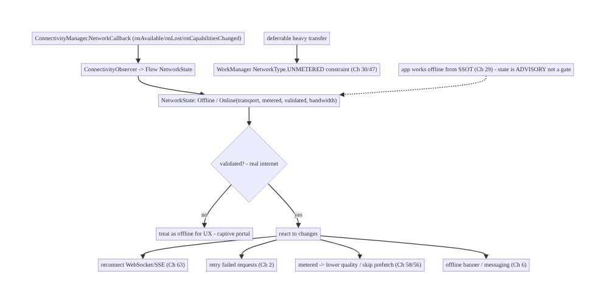
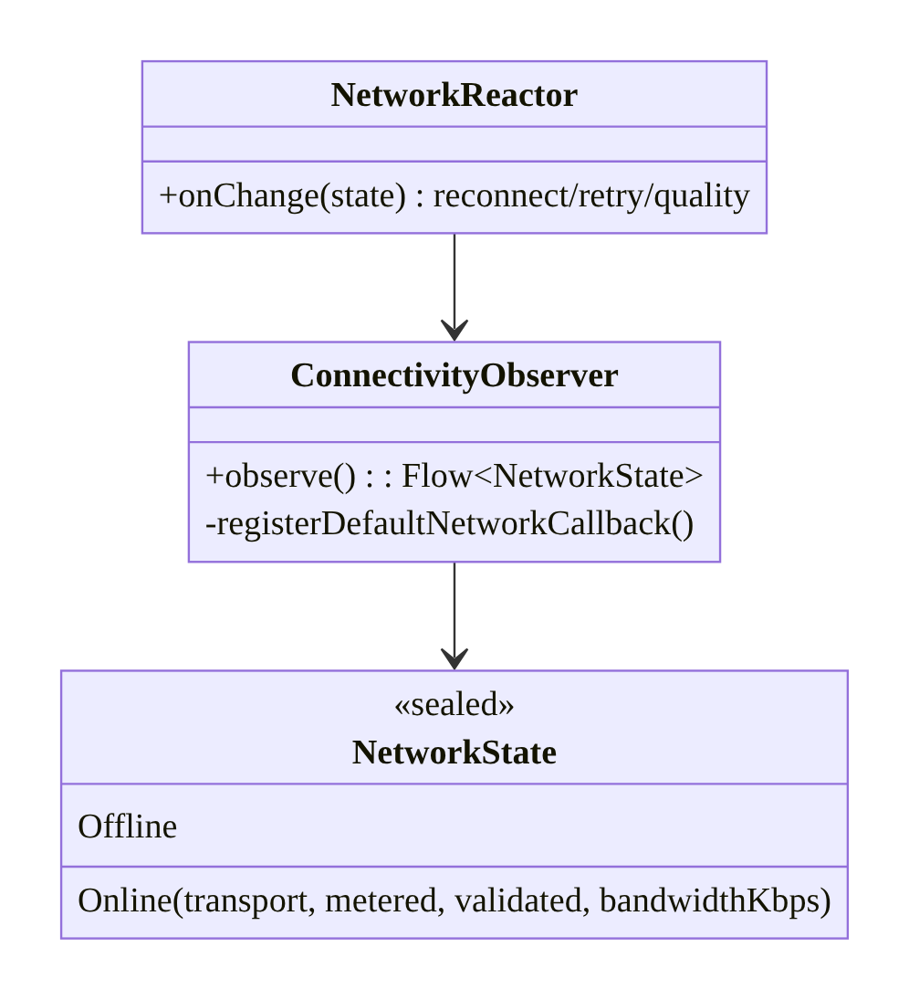
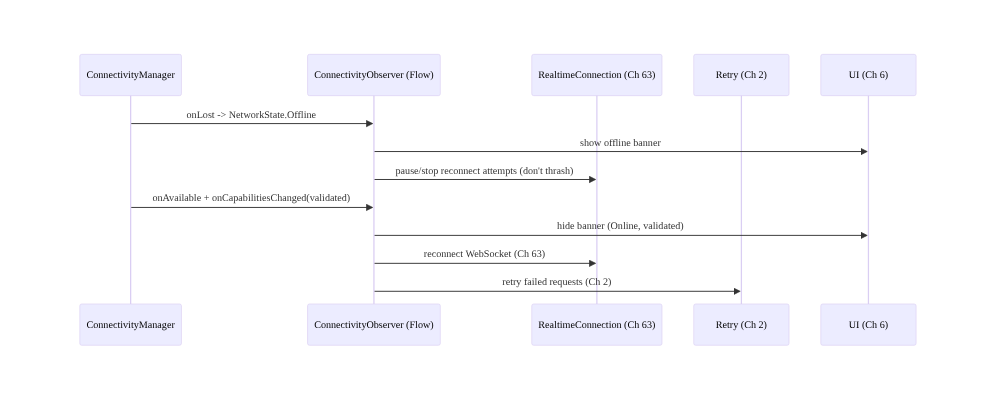
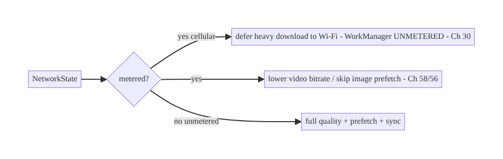
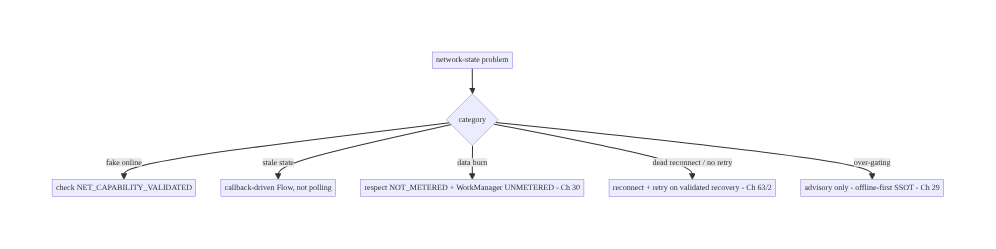

# Chapter 68 — Network State Monitoring (Wi-Fi / Cellular / Metered)

> **Part VIII — Real-Time & Connectivity** · Complexity: **Standard** (≥25 interview questions)
>
> **Prerequisites:** Ch 1 (networking), Ch 2 (retries), Ch 29 (offline-first), Ch 30
> (WorkManager), Ch 63 (WebSocket), Ch 44 (lifecycle), Ch 6 (UI state). Pairs with Ch 17/18
> (uploads/downloads), Ch 32 (sync), Ch 56 (images).
>
> **Reference surface in StreamCart:** knowing the network's real state — connected or
> not, Wi-Fi vs cellular, **metered** or unmetered, **validated** (actually has
> internet) — so the app reconnects promptly, defers heavy transfers to Wi-Fi, shows an
> offline banner, and reacts to Wi-Fi↔cellular switches, via one `ConnectivityManager`
> abstraction.

---

## 68.1 Problem Definition and Real-World Context

Apps constantly need to know the **network state** and **react** to changes: reconnect a
WebSocket when connectivity returns (Ch 63), defer a large download to Wi-Fi (Ch 18),
avoid auto-playing video on **metered** cellular (Ch 58), show an offline banner, retry a
failed request when the network recovers (Ch 2). But network state on Android is subtle:
"connected" doesn't mean "has internet" (captive portals), the network **transport** (Wi-Fi/
cellular/ethernet) and **capabilities** (**metered**, **validated**, bandwidth) matter, and
networks **switch** constantly (Wi-Fi↔cellular hand-off). Getting this wrong means stale
offline banners, data-plan burn, failed-but-not-retried requests, or dead real-time
connections.

Concretely, teams hit:

- **"Connected" ≠ "has internet".** A device on Wi-Fi behind a **captive portal** or a
  dead router is "connected" but has no real internet. You must check **`NET_CAPABILITY_
  VALIDATED`**, not just connectivity.
- **Deprecated/polling APIs.** Old `ConnectivityManager.activeNetworkInfo` and broadcast
  `CONNECTIVITY_ACTION` are deprecated/unreliable; the modern approach is a
  **`NetworkCallback`** observing the active network's **capabilities** as a **`Flow`**.
- **Ignoring metered.** Streaming video, large downloads (Ch 18), prefetch (Ch 56), and
  sync (Ch 32) on a **metered** cellular connection burn the user's data plan — respect
  `NET_CAPABILITY_NOT_METERED` and let WorkManager constrain to unmetered (Ch 30/47).
- **Not reacting to changes.** On Wi-Fi↔cellular switch or recovery, a WebSocket (Ch 63)
  dies and a failed request (Ch 2) should retry — the app must **observe** transitions and
  react, not assume a static network.
- **Per-screen ad-hoc checks.** Scattered connectivity checks drift and misbehave; one
  **observable abstraction** feeding UI state (Ch 6) and background decisions is needed.
- **Don't gate on connectivity for correctness.** Offline-first (Ch 29) means the app
  **works offline** from the SSOT (Ch 3); network state informs **UX and scheduling**, not
  whether a feature functions.

The architecture: expose network state as a **`Flow`** via a single
**`ConnectivityManager.NetworkCallback`** abstraction reporting **connected + transport
(Wi-Fi/cellular) + metered + validated**; **react** to changes — reconnect real-time
(Ch 63), retry failed requests (Ch 2), **defer heavy transfers to unmetered** (WorkManager
constraints, Ch 30/47), adjust quality (Ch 58/56), show an offline banner (Ch 6); treat the
state as **advisory for UX/scheduling**, not a correctness gate (offline-first, Ch 29); and
feed it to the UI and background layers from **one source**. This chapter is about **a
correct, reactive, single-source network-state abstraction**.

### Three practical use cases

1. **Offline banner + auto-reconnect (StreamCart).** An observable network state drives an
   offline banner (Ch 6) and triggers WebSocket reconnect (Ch 63) + failed-request retry
   (Ch 2) on recovery.
2. **Defer heavy transfer to Wi-Fi.** Large downloads (Ch 18/59) and backups wait for
   **unmetered** via WorkManager constraints (Ch 30/47); the UI explains "will download on
   Wi-Fi".
3. **Metered-aware quality.** On metered cellular, lower video bitrate (Ch 58), skip image
   prefetch (Ch 56), and pause non-essential sync (Ch 32).

### Why this is architectural

Network state is a **cross-cutting signal** every connectivity feature consumes —
real-time (Ch 63), transfers (Ch 17/18), sync (Ch 32), media (Ch 58/56), UI (Ch 6),
background scheduling (Ch 30/47). The decisions — modern `NetworkCallback` Flow, validated/
metered/transport awareness, react-to-changes, advisory-not-gating, single source —
determine data-plan respect, reconnection correctness, and UX accuracy.

---

## 68.2 Requirements Engineering

### Functional requirements

| ID | Requirement |
|----|-------------|
| F1 | Expose network state (connected, transport, metered, validated) as an observable Flow. |
| F2 | React to changes: reconnect real-time (Ch 63), retry failed requests (Ch 2). |
| F3 | Defer heavy transfers to unmetered (WorkManager constraints) (Ch 30/47). |
| F4 | Adjust behavior by metered/transport (quality, prefetch, sync) (Ch 58/56/32). |
| F5 | Drive UI (offline banner) from one source (Ch 6). |
| F6 | Treat state as advisory for UX/scheduling, not a correctness gate (offline-first, Ch 29). |

### Non-functional requirements

| Attribute | Policy |
|-----------|--------|
| **Correctness** | Validated (real internet), not just connected; metered respected. |
| **Reactivity** | Observe changes (callback), not poll; react promptly. |
| **Data respect** | Defer heavy work on metered; user data plan honored. |
| **Consistency** | Single source feeding UI + background. |
| **Resilience** | Offline-first; network state never blocks core features (Ch 29). |

### Scope

- **In scope:** `ConnectivityManager.NetworkCallback` as a Flow, capabilities (transport
  Wi-Fi/cellular/ethernet, `NOT_METERED`, `VALIDATED`, bandwidth), reacting (reconnect,
  retry, defer, quality), WorkManager network constraints (Ch 30/47), offline banner (Ch 6),
  advisory-not-gating (Ch 29), captive-portal/validated handling, single abstraction.
- **Out of scope:** networking stack (Ch 1), retry/backoff (Ch 2), offline-first (Ch 29),
  WorkManager internals (Ch 30), WebSocket (Ch 63), media quality (Ch 58/56), sync (Ch 32).

### Assumptions & constraints

- `ConnectivityManager` + `NetworkCallback` (`registerDefaultNetworkCallback`), Kotlin
  Flow (`callbackFlow`), WorkManager (Ch 30). `minSdk 24`. Deprecated `activeNetworkInfo`/
  `CONNECTIVITY_ACTION` avoided. "Connected" ≠ validated; networks switch; metered matters.

---

## 68.3 System Design Fundamentals

- **Observe, don't poll — `NetworkCallback` as a Flow.** The modern API is
  **`ConnectivityManager.registerDefaultNetworkCallback`** (or `registerNetworkCallback`
  with a `NetworkRequest`), which **pushes** `onAvailable`/`onLost`/`onCapabilitiesChanged`
  callbacks. Wrap it in a **`callbackFlow`** to expose a **`Flow<NetworkState>`** the whole
  app observes (Ch 6). The deprecated `activeNetworkInfo` polling and `CONNECTIVITY_ACTION`
  broadcast are unreliable — don't use them.
- **"Connected" ≠ "has internet" — check `VALIDATED`.** `onAvailable` means a network
  exists, **not** that it reaches the internet (captive portals, dead routers). Check
  **`NetworkCapabilities.NET_CAPABILITY_VALIDATED`** (the OS verified real connectivity).
  Treat "connected but not validated" as effectively offline for UX, and let the OS's
  captive-portal flow handle sign-in. This is the most-missed subtlety.
- **Capabilities that matter:**
  - **Transport:** `TRANSPORT_WIFI`, `TRANSPORT_CELLULAR`, `TRANSPORT_ETHERNET` — what kind
    of network.
  - **Metered:** **`NET_CAPABILITY_NOT_METERED`** — whether the user **pays per byte**
    (cellular usually metered; some Wi-Fi is metered too — use the capability, not "is
    Wi-Fi"). The key signal for deferring heavy transfers.
  - **Validated:** real internet (above).
  - **Bandwidth:** `linkDownstreamBandwidthKbps` (rough) for adaptive decisions.
  Derive a clean **`NetworkState`** (`Offline` / `Online(transport, metered, validated,
  bandwidth)`) from these.
- **React to changes (the point):**
  - **Reconnect real-time** (Ch 63): on recovery, reconnect the WebSocket/SSE promptly
    (don't thrash while offline).
  - **Retry failed requests** (Ch 2): a request that failed for connectivity should retry
    on recovery (WorkManager/backoff).
  - **Defer heavy transfers to unmetered** (Ch 30/47): large downloads (Ch 18/59), backups,
    prefetch wait for `NOT_METERED` — ideally via **WorkManager network constraints**
    (`NetworkType.UNMETERED`), which the OS enforces, rather than manual checks.
  - **Adjust quality** (Ch 58/56): lower bitrate / skip prefetch on metered; full quality on
    unmetered.
  - **UI** (Ch 6): offline banner / "will sync on Wi-Fi" messaging.
- **Advisory, not a correctness gate (offline-first, Ch 29).** Network state informs
  **UX and scheduling**, it does **not** decide whether a feature **works** — the app
  functions offline from the **SSOT** (Ch 3/29), queues mutations in the outbox (Ch 31),
  and syncs when online (Ch 32). Don't block reads/composing on connectivity; don't show a
  blocking "no internet" wall for features that work offline. (Many apps over-gate on
  connectivity — avoid it.)
- **Prefer WorkManager constraints over manual checks for background work (Ch 30/47).**
  For deferrable transfers, **declare** a `NetworkType.UNMETERED`/`CONNECTED` constraint and
  let WorkManager schedule it — it handles connectivity waiting, Doze, and retries (Ch 47).
  Use the live `Flow` for **foreground UX** (banner, reconnect, quality) and **immediate**
  decisions.
- **Single source of truth for network state.** One `ConnectivityObserver` emitting the
  `Flow` — injected everywhere (UI, real-time, transfers). Scattered per-screen
  connectivity checks drift and misbehave; centralize.
- **Lifecycle (Ch 44).** Observe the callback app-wide (it's cheap and app-global); the UI
  collects the `Flow` lifecycle-aware (Ch 6); unregister the callback when truly done
  (usually app-scoped for the lifetime).

Core insight: **expose network state as a single observable `Flow` built on
`ConnectivityManager.NetworkCallback` (not deprecated polling), reporting connected +
transport + metered + validated — and critically check `VALIDATED` because "connected" ≠
"has internet"; react to changes by reconnecting real-time (Ch 63), retrying failed
requests (Ch 2), deferring heavy transfers to unmetered (preferably via WorkManager
constraints, Ch 30/47), and adjusting quality/UI; and treat network state as advisory for
UX and scheduling, never as a correctness gate — the app works offline from the SSOT
(Ch 29) and syncs when connectivity (validated, suitable) returns.**

---

## 68.4 High-Level Architecture



**Components & ownership**

- **`ConnectivityObserver`** wraps `NetworkCallback` into one `Flow<NetworkState>` (single
  source).
- **`NetworkState`** carries connected + transport + metered + validated + bandwidth.
- **Consumers react:** real-time reconnect (Ch 63), retry (Ch 2), quality (Ch 58/56), UI
  (Ch 6); **heavy transfers** use WorkManager constraints (Ch 30/47).
- **Advisory, not gating** — offline-first (Ch 29) underlies it.

**Direction:** `NetworkCallback` → one `Flow` → validated/metered-aware state → consumers
react (reconnect/retry/quality/UI); heavy work via WorkManager constraints; advisory only.

---

## 68.5 Detailed Component Design



| Component | Responsibility |
|-----------|----------------|
| `ConnectivityObserver` | single `Flow<NetworkState>` from `NetworkCallback` |
| `NetworkState` | connected + transport + metered + validated + bandwidth |
| `NetworkReactor` | react: reconnect (Ch 63), retry (Ch 2), quality (Ch 58/56) |
| WorkManager constraints | defer heavy transfers to unmetered (Ch 30/47) |

---

## 68.6 End-to-End Data Flow

### Observe + react to recovery



### Metered-aware decision



---

## 68.7 Complete Kotlin Implementation

Package: `com.streamcart.connectivity`.

### 68.7.1 ConnectivityObserver: NetworkCallback → Flow (validated + metered + transport)

```kotlin
sealed interface NetworkState {
    data object Offline : NetworkState
    data class Online(val transport: Transport, val metered: Boolean, val validated: Boolean, val bandwidthKbps: Int) : NetworkState
    enum class Transport { WIFI, CELLULAR, ETHERNET, OTHER }
}

@Singleton
class ConnectivityObserver @Inject constructor(@ApplicationContext private val ctx: Context) {
    private val cm = ctx.getSystemService(ConnectivityManager::class.java)

    fun observe(): Flow<NetworkState> = callbackFlow {
        fun emitState() {
            val caps = cm.activeNetwork?.let { cm.getNetworkCapabilities(it) }
            trySend(caps?.toState() ?: NetworkState.Offline)
        }
        val callback = object : ConnectivityManager.NetworkCallback() {
            override fun onAvailable(network: Network) = emitState()
            override fun onLost(network: Network) = emitState()
            override fun onCapabilitiesChanged(n: Network, c: NetworkCapabilities) = trySend(c.toState()).let {}
            override fun onUnavailable() { trySend(NetworkState.Offline) }
        }
        cm.registerDefaultNetworkCallback(callback)   // modern API (not deprecated polling/broadcast)
        emitState()                                    // initial
        awaitClose { cm.unregisterNetworkCallback(callback) }
    }.distinctUntilChanged().conflate()               // de-dup transitions

    private fun NetworkCapabilities.toState(): NetworkState {
        val hasInternet = hasCapability(NetworkCapabilities.NET_CAPABILITY_INTERNET)
        if (!hasInternet) return NetworkState.Offline
        return NetworkState.Online(
            transport = when {
                hasTransport(NetworkCapabilities.TRANSPORT_WIFI) -> NetworkState.Transport.WIFI
                hasTransport(NetworkCapabilities.TRANSPORT_CELLULAR) -> NetworkState.Transport.CELLULAR
                hasTransport(NetworkCapabilities.TRANSPORT_ETHERNET) -> NetworkState.Transport.ETHERNET
                else -> NetworkState.Transport.OTHER
            },
            metered = !hasCapability(NetworkCapabilities.NET_CAPABILITY_NOT_METERED),   // KEY signal
            validated = hasCapability(NetworkCapabilities.NET_CAPABILITY_VALIDATED),    // real internet, not captive
            bandwidthKbps = linkDownstreamBandwidthKbps,
        )
    }
}
```

### 68.7.2 React: reconnect + retry + offline banner (Ch 63/2/6)

```kotlin
@Singleton
class NetworkReactor @Inject constructor(
    private val observer: ConnectivityObserver, private val realtime: RealtimeConnection,  // Ch 63
    private val retryScheduler: RetryScheduler, private val scope: CoroutineScope,          // Ch 2
) {
    fun start() = scope.launch {
        observer.observe().collect { state ->
            when (state) {
                is NetworkState.Online -> if (state.validated) {    // "connected" is not enough
                    realtime.reconnect()                            // reconnect WebSocket (Ch 63)
                    retryScheduler.retryPending()                   // retry failed requests (Ch 2)
                } // not validated -> treat as offline for UX (captive portal)
                NetworkState.Offline -> realtime.pause()            // don't thrash reconnect while offline
            }
        }
    }
}

// UI (Ch 6): val net by observer.observe().collectAsStateWithLifecycle(NetworkState.Offline)
//            if (net !is Online || !net.validated) OfflineBanner()
```

### 68.7.3 Metered-aware behavior (quality/prefetch, Ch 58/56)

```kotlin
fun videoBitrateCap(state: NetworkState): Int = when {
    state is NetworkState.Online && !state.metered -> Int.MAX_VALUE       // unmetered -> full (Ch 58)
    state is NetworkState.Online && state.metered -> 720                  // metered -> cap (data respect)
    else -> 0                                                             // offline -> downloaded only (Ch 59)
}
fun shouldPrefetchImages(state: NetworkState): Boolean =
    state is NetworkState.Online && !state.metered                        // skip prefetch on metered (Ch 56)
```

### 68.7.4 Defer heavy transfers to unmetered — WorkManager constraints (Ch 30/47)

```kotlin
// PREFER OS-enforced constraints over manual checks for deferrable background transfers.
fun scheduleBackup(workManager: WorkManager) = workManager.enqueue(
    OneTimeWorkRequestBuilder<BackupWorker>()
        .setConstraints(Constraints.Builder()
            .setRequiredNetworkType(NetworkType.UNMETERED)       // waits for Wi-Fi (Ch 30/47)
            .setRequiresBatteryNotLow(true).build())
        .build())
// Live Flow is for FOREGROUND/immediate decisions (banner, reconnect, quality);
// WorkManager constraints are for deferrable background work.
```

### 68.7.5 Advisory, not a gate (offline-first, Ch 29)

```kotlin
// WRONG: if (!online) { showNoInternetWall(); return }   // over-gating
// RIGHT: feature works offline from SSOT (Ch 3/29); network state only informs UX/scheduling.
@Composable
fun FeedScreen(vm: FeedViewModel = hiltViewModel()) {
    val feed by vm.feed.collectAsStateWithLifecycle()        // from SSOT (Ch 3) - works offline
    val net by vm.network.collectAsStateWithLifecycle(NetworkState.Offline)
    Column {
        if (net is NetworkState.Offline) OfflineBanner()     // advisory only
        FeedList(feed)                                       // renders regardless of connectivity
    }
}
```

### 68.7.6 Module structure

```
:core:connectivity  ConnectivityObserver (Flow), NetworkState, NetworkReactor
# Consumers: real-time (Ch 63), retry (Ch 2), media quality (Ch 58/56), UI (Ch 6),
# WorkManager constraints (Ch 30/47). Offline-first underlies it (Ch 29).
```

---

## 68.8 Concurrency and Race Conditions

| Scenario | Risk | Handling |
|----------|------|----------|
| Rapid Wi-Fi↔cellular flaps | thrash (reconnect storms) | `distinctUntilChanged` + debounce; jittered reconnect (Ch 2/63) |
| "Connected" but captive portal | fake online | check `VALIDATED`; treat non-validated as offline |
| Poll-based stale state | wrong decisions | callback-driven Flow (not polling) |
| Multiple observers register | leak/duplicate callbacks | single shared `Flow` (`shareIn`) |
| Reconnect while offline | wasted attempts | pause reconnect on Offline; resume on validated Online |
| Metered mis-detected as Wi-Fi | data burn | use `NOT_METERED` capability, not "is Wi-Fi" |
| Callback not unregistered | leak | `awaitClose` unregister; app-scoped |

- **`VALIDATED` prevents the captive-portal false-online:** acting on `onAvailable` alone
  reconnects/retries against a network with no real internet; gating reactions on
  **`NET_CAPABILITY_VALIDATED`** avoids wasted attempts and wrong "online" UI.
- **Debounce flaps + jittered reconnect:** Wi-Fi↔cellular hand-offs flap quickly;
  `distinctUntilChanged`/conflate the state and use jittered reconnect (Ch 2/63) so you
  don't thrash connections.
- **One shared Flow:** multiple independent callback registrations leak and duplicate; share
  a single `Flow` (`shareIn`/singleton) across all consumers.

---

## 68.9 Failure Scenarios and Recovery

| Failure | Detection | Response | Outcome |
|---------|-----------|----------|---------|
| Fake "online" (captive portal) | validated=false | treat as offline for UX | correct |
| Stale offline banner | polling/no callback | callback-driven Flow | accurate |
| Data-plan burn | metered ignored | respect `NOT_METERED`; defer/lower (Ch 30/58) | data saved |
| WebSocket stays dead after recovery | no reaction | reconnect on validated Online (Ch 63) | reconnects |
| Failed request never retried | no reaction | retry on recovery (Ch 2) | completes |
| Reconnect storm on flaps | thrash | debounce + jittered reconnect | stable |
| Feature blocked offline | over-gating | advisory-only; offline-first SSOT (Ch 29) | works |
| Callback leak | memory | unregister in `awaitClose` | no leak |



> **Two rules fix most network-state bugs: check `VALIDATED` (connected ≠ internet) and
> treat state as advisory, not a gate (offline-first, Ch 29).** Build one callback-driven
> `Flow`, react to validated transitions (reconnect/retry/quality), respect `metered`
> (prefer WorkManager constraints for deferrable work), and never block an offline-capable
> feature on connectivity.

---

## 68.10 Scaling the Implementation

- **Level 1.** `ConnectivityObserver` Flow (connected/offline); offline banner (Ch 6).
- **Level 2.** Validated + metered + transport awareness; react (reconnect Ch 63, retry
  Ch 2); metered-aware quality (Ch 58/56).
- **Level 3 — production.** WorkManager constraints for deferrable transfers (Ch 30/47);
  debounced flaps + jittered reconnect; single shared Flow; advisory-not-gating (Ch 29).
- **Level 4 — large.** Bandwidth-adaptive behavior; per-feature network policies; captive-
  portal handling; data-saver mode respect.
- **Level 5 — enterprise.** Connectivity analytics (transport mix, validated rate, metered
  usage), network-policy governance, adaptive sync/transfer strategies, cross-platform
  parity.

**Avoid overengineering:** one observable `NetworkState` + validated/metered checks +
WorkManager constraints covers most needs. Don't poll, don't gate offline-capable features,
don't scatter checks.

---

## 68.11 Alternative Approaches and Trade-offs

| Dimension | Option A | Option B | When |
|-----------|----------|----------|------|
| Observe | `NetworkCallback` Flow | `activeNetworkInfo` polling / broadcast | Callback (modern, reactive); polling deprecated/stale |
| Online check | `VALIDATED` capability | connected only | Validated (connected ≠ internet) |
| Metered | `NOT_METERED` capability | "is Wi-Fi?" | Capability (some Wi-Fi metered, some cellular not) |
| Deferrable transfers | WorkManager constraints (Ch 30) | manual Flow checks | WorkManager (OS-enforced, Doze-aware, Ch 47) |
| Immediate decisions | Live Flow (reconnect/quality/UI) | WorkManager | Flow for foreground/immediate |
| Role | Advisory (UX/scheduling) | correctness gate | Advisory (offline-first, Ch 29) |
| Source | Single shared observer | per-screen checks | Single (consistency) |

**Callback Flow vs polling/broadcast:** the deprecated `activeNetworkInfo` polling and
`CONNECTIVITY_ACTION` broadcast are unreliable and stale — they miss transitions and
capability details. A **`NetworkCallback`** wrapped in a `callbackFlow` **pushes** accurate,
capability-rich state (transport/metered/validated) reactively. Always use the callback Flow.

**Validated/metered capabilities vs naive checks:** checking "connected" misses captive
portals (fake online); checking "is Wi-Fi?" misses **metered Wi-Fi** and **unmetered
cellular**. The OS **capabilities** (`VALIDATED`, `NOT_METERED`) are the correct signals —
use them, not transport-type heuristics.

**WorkManager constraints vs manual Flow checks for background transfers:** for a deferrable
transfer, **declaring** a `NetworkType.UNMETERED` constraint lets the **OS** wait for Wi-Fi,
handle Doze, and retry (Ch 30/47) — far more robust than manually observing the Flow and
launching work. Use WorkManager constraints for **deferrable background** work; reserve the
live Flow for **immediate foreground** decisions (banner, reconnect, quality).

---

## 68.12 Security Considerations

- **Don't trust the network type for security:** being on "Wi-Fi" or "a trusted network"
  is **not** a security boundary — always use **TLS + certificate pinning** (Ch 23)
  regardless of transport; a hostile Wi-Fi is a MITM risk.
- **Captive portals (`VALIDATED`):** a captive portal can intercept traffic; treat
  non-validated networks as untrusted/offline and rely on the OS captive-portal flow — don't
  send sensitive requests assuming a clean path.
- **Metered awareness is a user-cost concern, not security**, but respect it (data plans).
- **No sensitive data in connectivity logs** (Ch 28); network state itself (transport/
  metered) is low-sensitivity but don't log identifiers.
- **Data-saver mode:** respect the user's Data Saver setting
  (`ConnectivityManager.getRestrictBackgroundStatus`) — don't do background data when the
  user restricted it.
- Client vs backend: network state is a client concern for UX/scheduling; the backend
  enforces auth/TLS regardless of the client's transport (Ch 19/23) — never assume a
  "trusted network".

---

## 68.13 Performance and Resource Optimization

- **Callback over polling** — no wasted periodic checks; react only on change.
- **Single shared Flow** (`shareIn`) — one callback for the whole app, not many.
- **Debounce flaps** (`distinctUntilChanged`/conflate) — avoid reconnect storms on hand-off
  (Ch 63).
- **WorkManager constraints** — OS schedules transfers in good conditions (unmetered/
  charging, Ch 30/47) instead of the app spinning.
- **Metered-aware** — defer/lower on metered saves the user's data and battery (radio).
- **Bandwidth-adaptive** — scale quality/prefetch to `bandwidthKbps` where useful.
- **Profiling:** reconnect frequency, metered-vs-unmetered data usage, validated rate,
  callback overhead (negligible), transfer deferral effectiveness.

---

## 68.14 Testing Strategy

`ConnectivityObserver` tests with a fake `ConnectivityManager`/shadow; reactions in
isolation.

```kotlin
class ConnectivityObserverTest {
    @Test fun `emits offline when no internet capability`() = runTest {
        shadowCm.setNoNetwork()
        assertEquals(NetworkState.Offline, observer.observe().first())
    }
    @Test fun `online but not validated is treated as offline for UX`() = runTest {
        shadowCm.setCapabilities(internet = true, validated = false)
        val s = observer.observe().first()
        assertTrue(s is NetworkState.Online && !(s).validated)   // consumer treats as offline
    }
    @Test fun `detects metered cellular`() = runTest {
        shadowCm.setCapabilities(internet = true, validated = true, transport = CELLULAR, notMetered = false)
        assertTrue((observer.observe().first() as NetworkState.Online).metered)
    }
}

class NetworkReactorTest {
    @Test fun `reconnects and retries on validated recovery`() = runTest {
        emit(NetworkState.Offline); emit(online(validated = true))
        assertTrue(realtime.reconnected && retry.retried)
    }
    @Test fun `does not reconnect when not validated`() = runTest { /* captive portal -> no reconnect */ }
}

class MeteredPolicyTest { @Test fun `skips prefetch and caps bitrate on metered`() { /* ... */ } }
```

What to test: observer maps capabilities → state (offline/validated/metered/transport);
reactor reconnects+retries only on **validated** recovery (not captive portal); metered-
aware quality/prefetch; WorkManager UNMETERED constraint on deferrable work; advisory-not-
gating (feature renders offline); flap debounce. Use Robolectric shadow `ConnectivityManager`;
instrumentation for real transitions.

---

## 68.15 Production Observability

- **Metrics:** validated rate (captive-portal frequency); **metered vs unmetered data
  usage**; reconnect frequency (flaps); transport mix (Wi-Fi/cellular); failed-request
  retry-on-recovery success; transfer-deferral effectiveness (how much heavy work ran on
  Wi-Fi); offline-banner accuracy.
- **Logs:** `net{transport, metered, validated, event}` — no identifiers/PII (Ch 28).
- **Debugging:** fake online → not checking `VALIDATED`; stale banner → polling / not
  callback-driven; data burn → metered ignored / not using WorkManager constraints;
  dead reconnect → not reacting to recovery (Ch 63); over-gating → blocking offline-capable
  features (Ch 29); reconnect storm → no flap debounce.
- **Alerting:** reconnect-storm spike; metered-data-usage spike (deferral regression);
  low validated rate (connectivity issues).
- **Dashboards:** transport mix + validated rate; metered data usage; reconnect frequency.

---

## 68.16 System Design Interview Preparation

> ≥25 questions.

**Fundamentals**
1. *Modern API?* `ConnectivityManager.NetworkCallback` (wrap in a Flow); not deprecated
   polling/broadcast.
2. *Why not polling?* Stale, misses transitions/capabilities.
3. *"Connected" vs "has internet"?* Check `NET_CAPABILITY_VALIDATED` (captive portals).
4. *Capabilities that matter?* Transport, `NOT_METERED`, `VALIDATED`, bandwidth.
5. *Derive what?* A clean `NetworkState` (Offline / Online(transport, metered, validated,
   bandwidth)).

**Metered/transport**
6. *Metered signal?* `NET_CAPABILITY_NOT_METERED` — not "is Wi-Fi".
7. *Why not "is Wi-Fi"?* Some Wi-Fi is metered; some cellular isn't.
8. *On metered?* Defer heavy transfers; lower quality; skip prefetch (Ch 30/58/56).

**Reacting**
9. *On recovery?* Reconnect real-time (Ch 63) + retry failed requests (Ch 2) — if
   validated.
10. *While offline?* Pause reconnect (don't thrash); show banner.
11. *Deferrable transfers?* WorkManager `NetworkType.UNMETERED` constraint (Ch 30/47).
12. *Flow vs WorkManager?* Flow for immediate/foreground; constraints for deferrable
    background.

**Advisory**
13. *Is network state a correctness gate?* No — advisory for UX/scheduling (offline-first,
    Ch 29).
14. *Over-gating?* Blocking offline-capable features on connectivity — avoid.
15. *Offline features work how?* From the SSOT (Ch 3); sync when online (Ch 32).

**Correctness**
16. *Captive portal?* Non-validated → treat as offline for UX.
17. *Flaps?* Debounce (`distinctUntilChanged`) + jittered reconnect.
18. *Single source?* One shared observer Flow.

**Security**
19. *Trust the network type?* No — TLS + pinning regardless (Ch 23).
20. *Data Saver?* Respect `getRestrictBackgroundStatus`.

**Testing/Production**
21. *Test observer?* Shadow `ConnectivityManager` → capabilities → state.
22. *Test reactor?* Reconnect/retry only on validated.
23. *Fake online in prod?* Not checking validated.
24. *Data burn?* Metered ignored / no WorkManager constraint.
25. *Stale banner?* Polling not callback.
26. *Key metrics?* Validated rate, metered data usage, reconnect frequency.

### Design-change challenges
1. **Offline banner + auto-reconnect.** Observer Flow → banner (Ch 6) + reconnect on
   validated recovery (Ch 63).
2. **Don't burn data on cellular.** Respect `NOT_METERED`; defer downloads (WorkManager
   UNMETERED), cap bitrate (Ch 30/58).
3. **App shows "online" on a captive-portal Wi-Fi.** Check `VALIDATED`.
4. **Failed requests don't retry when Wi-Fi returns.** React to recovery → retry (Ch 2).
5. **Feature blocked with a "no internet" wall though it works offline.** Make state
   advisory; offline-first SSOT (Ch 29).

### Mock walkthrough (abridged)
Clarify (what reacts to network, metered-sensitive, offline-capable?) → one
`ConnectivityObserver` Flow from `NetworkCallback` → `NetworkState` (transport/metered/
**validated**) → react (reconnect Ch 63, retry Ch 2, quality Ch 58/56, banner Ch 6) → defer
heavy work via WorkManager constraints (Ch 30/47) → advisory-not-gating (offline-first,
Ch 29) → security (TLS regardless, Data Saver) → observability (validated rate, metered
usage).

---

## 68.17 Practical Exercises

1. **Beginner.** Build a `ConnectivityObserver` Flow from `registerDefaultNetworkCallback`
   emitting Offline/Online, and drive an offline banner (Ch 6). *Eval:* reactive; accurate.
2. **Intermediate.** Extend `NetworkState` with transport + metered + **validated**; treat
   non-validated (captive portal) as offline for UX. *Eval:* correct online detection.
3. **Advanced.** React to validated recovery by reconnecting the WebSocket (Ch 63) and
   retrying failed requests (Ch 2); debounce flaps. *Eval:* reconnects; no storm.
4. **Production debugging.** Fix data-plan burn (metered ignored → add WorkManager UNMETERED
   + bitrate cap) and a "no internet" wall on an offline-capable feature. *Eval:* data
   saved; feature works offline.
5. **System design challenge.** Make one shared observer feed UI + real-time + transfers,
   add bandwidth-adaptive quality, and a validated-rate/metered-usage dashboard. *Eval:*
   single source; adaptive; observable.

*(Solutions withheld unless requested.)*

---

## 68.18 Chapter Summary & Reference Sheet

**Key decisions:** expose network state as a **single observable `Flow`** built on
**`ConnectivityManager.NetworkCallback`** (`registerDefaultNetworkCallback`, wrapped in a
`callbackFlow` and shared) — **never** the deprecated `activeNetworkInfo` polling or
`CONNECTIVITY_ACTION` broadcast — reporting **connected + transport (Wi-Fi/cellular) +
metered + validated + bandwidth**, and **critically check `NET_CAPABILITY_VALIDATED`**
because "connected" ≠ "has internet" (captive portals) and use **`NET_CAPABILITY_NOT_
METERED`** (not "is Wi-Fi") for the metered signal; **react** to **validated** transitions —
reconnect real-time (Ch 63), retry failed requests (Ch 2), adjust quality/prefetch on
metered (Ch 58/56), show an offline banner (Ch 6) — while **deferring heavy background
transfers to unmetered via WorkManager constraints** (`NetworkType.UNMETERED`, OS-enforced,
Ch 30/47) rather than manual checks; **debounce flaps** and use jittered reconnect to avoid
storms (Ch 2/63); and treat network state as **advisory for UX and scheduling, never a
correctness gate** — the app **works offline from the SSOT** (Ch 29) and syncs when suitable
connectivity returns. Never trust the network type as a security boundary — **TLS + pinning
regardless** (Ch 23) — and respect **Data Saver**.

**Concepts:** `NetworkCallback` Flow, capabilities (transport/`NOT_METERED`/`VALIDATED`/
bandwidth), validated (connected ≠ internet), metered-aware behavior, react (reconnect/
retry/quality/UI), WorkManager constraints for deferrable work, advisory-not-gating
(offline-first), single source, flap debounce.

**Common mistakes:** polling/deprecated APIs (stale); treating "connected" as online
(captive portal — missing `VALIDATED`); using "is Wi-Fi" for metered (missing
`NOT_METERED`); not reacting to recovery (dead reconnect/no retry); manual checks instead of
WorkManager constraints for background transfers; gating offline-capable features on
connectivity (over-gating); scattered per-screen checks; no flap debounce (reconnect
storms); trusting the network type for security.

**Checklist:** ☐ `NetworkCallback` Flow (single shared source), not polling ☐ check
`VALIDATED` (connected ≠ internet) ☐ use `NOT_METERED` capability (not "is Wi-Fi") ☐ react
to validated recovery: reconnect (Ch 63) + retry (Ch 2) ☐ metered-aware quality/prefetch
(Ch 58/56) ☐ defer heavy transfers via WorkManager UNMETERED (Ch 30/47) ☐ debounce flaps +
jittered reconnect ☐ advisory, not a gate — offline-first SSOT (Ch 29) ☐ TLS+pinning
regardless of transport (Ch 23) ☐ respect Data Saver ☐ validated-rate + metered-usage
telemetry.

**Key APIs:** `ConnectivityManager.registerDefaultNetworkCallback`/`registerNetworkCallback`/
`unregisterNetworkCallback`, `NetworkCallback` (`onAvailable`/`onLost`/
`onCapabilitiesChanged`/`onUnavailable`), `NetworkCapabilities` (`NET_CAPABILITY_VALIDATED`/
`NET_CAPABILITY_NOT_METERED`/`NET_CAPABILITY_INTERNET`/`TRANSPORT_*`/
`linkDownstreamBandwidthKbps`), `callbackFlow`/`distinctUntilChanged`/`shareIn`,
WorkManager `Constraints`/`NetworkType.UNMETERED` (Ch 30), `getRestrictBackgroundStatus`
(Data Saver).

**References:**
- Monitor connectivity: https://developer.android.com/training/monitoring-device-state/connectivity-status-type
- NetworkCapabilities: https://developer.android.com/reference/android/net/NetworkCapabilities
- WorkManager constraints: https://developer.android.com/develop/background-work/background-tasks/persistent/getting-started/define-work#work-constraints
- (composes) Ch 1 Networking, Ch 2 Retries, Ch 29 Offline-First, Ch 30 WorkManager, Ch 63 WebSocket, Ch 58/56 Media, Ch 23 Security

### Chapter review (Phase 4)
- **Completeness:** all 18 sections; architecture/class/sequence/flow/failure diagrams;
  ConnectivityObserver (callback→Flow, validated/metered) + reactor + metered policy +
  WorkManager constraints + advisory-not-gating code; concurrency (validated, flap debounce,
  single Flow); failure (check-validated + advisory principles); 5 levels; callback-vs-
  polling, capabilities-vs-heuristics, WorkManager-vs-manual trade-offs; security (no
  network trust, Data Saver); perf (callback/shared/debounce/constraints); shadow tests;
  observability (validated/metered/reconnect); 26 Q&A + 5 challenges. ✅
- **Expand later:** networking (Ch 1), retries (Ch 2), offline-first (Ch 29), WorkManager
  (Ch 30), WebSocket (Ch 63).
- **Interview coverage:** exceeds ≥25 bar.
