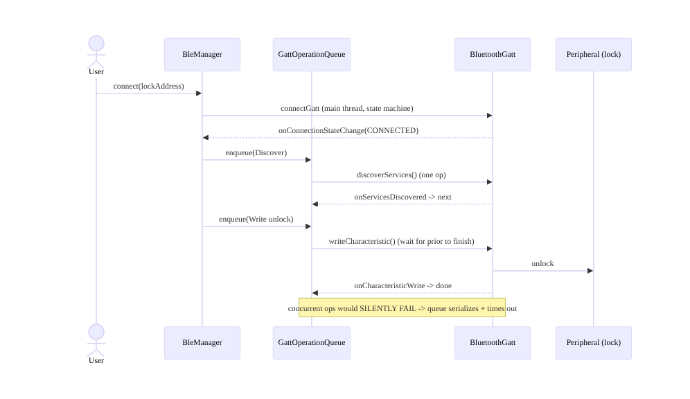
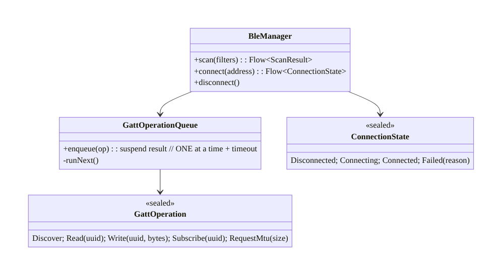
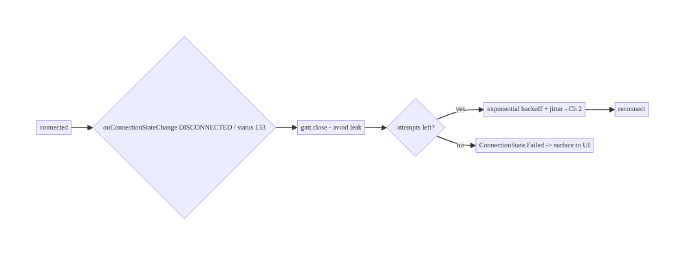
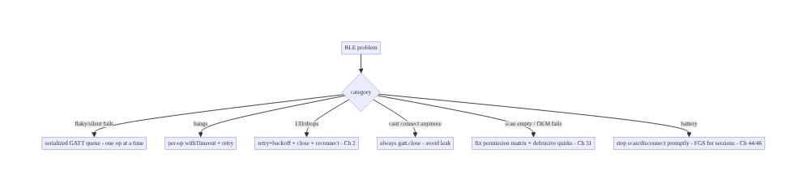

# Chapter 69 — Bluetooth Low Energy (BLE) Connectivity

> **Part VIII — Real-Time & Connectivity** · Complexity: **Complex** (≥40 interview questions)
>
> **Prerequisites:** Ch 51 (runtime permissions), Ch 46 (foreground services), Ch 44
> (lifecycle), Ch 2 (retries/backoff), Ch 3 (SSOT), Ch 1 (coroutines), Ch 28 (privacy).
> Pairs with Ch 70 (Nearby/P2P), Ch 67 (location), Ch 68 (network state).
>
> **Reference surface in StreamCart:** connecting to BLE peripherals — a delivery
> scanner, a smart lock for pickup lockers, a fitness/wearable accessory, a beacon for
> in-store proximity — through Android's notoriously complex, callback-heavy, permission-
> and lifecycle-sensitive BLE stack, wrapped into a reliable coroutine/Flow API.

---

## 69.1 Problem Definition and Real-World Context

Bluetooth Low Energy is one of the **hardest, most device-fragmented, most callback-
driven** APIs on Android. The platform `BluetoothGatt` API is a maze of asynchronous
callbacks, strict **operation serialization** (you must do one GATT operation at a time),
**permission changes** across OS versions (Ch 51), **location coupling** (scanning
historically needed location, Ch 67), aggressive **OEM/radio quirks**, and fragile
connection lifecycles. A naive BLE integration (scan, connect, read) works on the
developer's phone and fails everywhere else — dropped connections, 133 errors, out-of-order
operations, permission denials, and battery drain.

Concretely, teams hit:

- **Callback hell + operation serialization.** `BluetoothGatt` requires every operation
  (connect, discover services, read/write characteristic, enable notifications, request
  MTU) to be issued **one at a time**, each completing via a callback before the next —
  issuing two concurrently **silently fails**. You must **queue and serialize** GATT
  operations.
- **Permission churn (Ch 51).** Pre-Android-12 scanning needed **location** permission
  (Ch 67); Android 12+ introduced **`BLUETOOTH_SCAN`/`BLUETOOTH_CONNECT`/
  `BLUETOOTH_ADVERTISE`** runtime permissions (with a `neverForLocation` scan flag to
  decouple from location). Getting the per-version matrix wrong → denied scans/connections.
- **Fragile connections + the dreaded 133.** BLE connections drop constantly (range,
  interference, device sleep); `GATT_ERROR` (status 133) is a catch-all. You need
  **retry with backoff** (Ch 2), **connection state management**, and **reconnection**.
- **Lifecycle & background (Ch 44/46).** Scanning/connections drain battery; background BLE
  is restricted. Scope to **active sessions**; use a **foreground service** (Ch 46,
  `connectedDevice`) for ongoing connections (e.g., a live scanner session).
- **Device fragmentation.** OEM Bluetooth stacks differ wildly (connection params, MTU,
  caching bugs, bonding quirks) — you must be defensive (retries, timeouts, `refresh`
  hacks) and test on a device matrix.
- **GATT concepts.** Central vs peripheral, services/characteristics/descriptors,
  read/write/notify/indicate, MTU, bonding/pairing — the domain model to get right.

The architecture: wrap the callback-heavy `BluetoothGatt` in a **coroutine/Flow API** with
a **serialized GATT operation queue** (one op at a time) and **timeouts**; manage the
**permission matrix** (Ch 51, `BLUETOOTH_SCAN`/`CONNECT`, `neverForLocation`, legacy
location); model the **connection as a state machine** with **retry/backoff** (Ch 2) and
reconnection; **scope to active lifecycle** and use a **`connectedDevice` foreground
service** (Ch 46) for ongoing sessions; handle **GATT operations** (discover, read/write,
notify, MTU, bonding) correctly; be **defensive about device fragmentation**; and treat
device data/identity as **sensitive** (Ch 28). This chapter is about **taming BLE into a
reliable, coroutine-friendly connectivity layer**.

### Three practical use cases

1. **Delivery/pickup smart lock (StreamCart).** Scan for the locker's BLE peripheral,
   connect (serialized GATT), authenticate, write an "unlock" characteristic — with
   retry/backoff and a `connectedDevice` FGS during the session.
2. **Wearable/accessory.** Connect to a fitness band, subscribe to notifications
   (heart-rate characteristic), stream readings into the SSOT (Ch 3), reconnect on drop.
3. **Beacon proximity (scan-only).** Passive scan for in-store beacons (with
   `neverForLocation` where appropriate) to show contextual offers — scan-only, no GATT
   connection.

### Why this is architectural

BLE composes **permissions (Ch 51)**, **foreground services (Ch 46)**, **lifecycle
(Ch 44)**, **retries (Ch 2)**, **SSOT (Ch 3)**, and **coroutines (Ch 1)**, against the
**most fragmented, callback-driven, quirk-ridden** API in the platform. The decisions —
coroutine-wrapped serialized GATT queue, permission matrix, connection state machine +
retry, lifecycle/FGS scoping, defensive fragmentation handling — determine whether BLE is
reliable at all across real devices.

---

## 69.2 Requirements Engineering

### Functional requirements

| ID | Requirement |
|----|-------------|
| F1 | Scan for peripherals (filtered), connect, discover services (serialized GATT). |
| F2 | Read/write characteristics, subscribe to notifications, negotiate MTU, bond. |
| F3 | Serialize all GATT operations (one at a time) with timeouts; expose as coroutines/Flow. |
| F4 | Handle the permission matrix (BLUETOOTH_SCAN/CONNECT, neverForLocation, legacy location) (Ch 51). |
| F5 | Manage connection state + retry/backoff + reconnection (Ch 2); scope to lifecycle/FGS (Ch 44/46). |
| F6 | Be defensive about device fragmentation; treat device data as sensitive (Ch 28). |

### Non-functional requirements

| Attribute | Policy |
|-----------|--------|
| **Reliability** | Serialized ops; retry 133/drops; reconnection; works across OEMs. |
| **Battery** | Scan/connect only when needed; FGS for sessions; stop promptly (Ch 46/44). |
| **Correctness** | One GATT op at a time; timeouts; state machine. |
| **Compatibility** | Defensive against device/OEM quirks; device-matrix tested. |
| **Security/Privacy** | Permission-gated; bonding/auth; device identity sensitive (Ch 28). |

### Scope

- **In scope:** BLE domain (central/peripheral, GATT services/characteristics/descriptors,
  read/write/notify/indicate, MTU, bonding), scanning (filters, `neverForLocation`),
  **serialized GATT operation queue** + coroutine/Flow wrapper + timeouts, connection state
  machine + retry/backoff (Ch 2) + reconnection, permission matrix (Ch 51), lifecycle +
  `connectedDevice` FGS (Ch 44/46), fragmentation defensiveness, SSOT for device data
  (Ch 3), privacy (Ch 28).
- **Out of scope:** Classic Bluetooth (BR/EDR), BLE peripheral/advertiser role detail,
  Nearby/P2P (Ch 70), permission state machine (Ch 51), FGS mechanics (Ch 46), backoff
  theory (Ch 2), specific GATT profiles.

### Assumptions & constraints

- Android `BluetoothGatt`/`BluetoothLeScanner`, Kotlin coroutines/Flow (Ch 1), `minSdk 24`,
  `targetSdk` current (Android 12+ Bluetooth permissions). The device is **central**
  (phone) connecting to **peripherals**. GATT requires **strict serialization**; BLE is
  **fragile** and **fragmented**; location coupling varies by version.

---

## 69.3 System Design Fundamentals

- **BLE domain model (central/peripheral/GATT).**
  - **Roles:** the phone is usually the **central** (initiates); the accessory is the
    **peripheral** (advertises, exposes data). (Android can also be a peripheral/advertiser
    — out of scope here.)
  - **GATT:** a peripheral exposes **services**, each with **characteristics** (the data
    values), each with optional **descriptors** (metadata, notably the CCCD to enable
    notifications). You **read/write** characteristics, **subscribe** to **notify**/
    **indicate** (peripheral pushes changes), and may negotiate **MTU** (larger packets)
    and **bond** (pair for security).
- **GATT operations MUST be serialized (the #1 correctness rule).** `BluetoothGatt` allows
  **one outstanding operation at a time** — issue `readCharacteristic`, wait for
  `onCharacteristicRead`, *then* the next. Issuing two concurrently (e.g., read + write, or
  two reads) **silently fails** (the second is dropped). So you must maintain a
  **serialized operation queue**: enqueue each op, run it, wait for its callback (with a
  **timeout** for the ones that never call back — common on buggy stacks), then dequeue the
  next. This is the core of any usable BLE wrapper.
- **Wrap callbacks in coroutines/Flow (Ch 1).** The raw API is a `BluetoothGattCallback`
  with ~15 callbacks. Wrap each operation as a **`suspendCancellableCoroutine`** (resumes
  on its callback) behind the serialized queue, and expose **notifications as a `Flow`**
  (`callbackFlow`). This turns callback hell into sequential, cancellable coroutine code:
  `connect() → discoverServices() → read(...) → subscribe(...).collect { }`.
- **Connection state machine + retry (Ch 2).** Model connection as
  **Disconnected → Connecting → Connected → (Disconnecting)**, driven by
  `onConnectionStateChange`. BLE connections **drop constantly** and throw **`GATT_ERROR`
  (status 133)** — a catch-all for "something went wrong." Handle it with **retry +
  exponential backoff** (Ch 2), bounded attempts, and **reconnection** when a session
  should persist. Always `close()` the `BluetoothGatt` on disconnect (leaking GATT clients
  is a classic bug that exhausts the stack).
- **Permission matrix (Ch 51) — version-dependent:**
  - **Android 12+ (API 31+):** **`BLUETOOTH_SCAN`**, **`BLUETOOTH_CONNECT`** (and
    `BLUETOOTH_ADVERTISE` for peripheral) are **runtime** permissions (Ch 51). Add
    **`android:usesPermissionFlags="neverForLocation"`** to `BLUETOOTH_SCAN` if you **don't**
    derive location from BLE — this **decouples scanning from location permission**.
  - **Pre-Android-12:** scanning required **`ACCESS_FINE_LOCATION`** (Ch 67) plus
    `BLUETOOTH`/`BLUETOOTH_ADMIN`.
  - Request **in context** with graceful denial (Ch 51); the matrix is a frequent source of
    "scan returns nothing" bugs.
- **Scanning efficiently.** Use **`ScanFilter`** (by service UUID/name/address) to only
  wake for relevant devices, and **`ScanSettings`** balancing latency vs power
  (`SCAN_MODE_LOW_POWER`/`BALANCED`/`LOW_LATENCY`). **Stop scanning** once you find/connect
  (scanning is battery-heavy). Avoid continuous background scanning.
- **Lifecycle & background (Ch 44/46).** BLE scanning/connections drain battery and are
  background-restricted. **Scope to active sessions** (Ch 44): scan when the user initiates,
  stop when done. For an **ongoing connected session** (streaming from a wearable, holding a
  lock connection), use a **`connectedDevice` foreground service** (Ch 46) with a
  notification — don't hold BLE silently in the background.
- **Device fragmentation (be defensive).** OEM stacks vary enormously: connection
  parameters, MTU support, **GATT caching bugs** (sometimes needing a hidden `refresh()`),
  **bonding** quirks, `autoConnect` behavior, and timing. Be defensive: **timeouts** on
  every op, **retries** (Ch 2), **bounded assumptions**, connect on the **main thread** (a
  known requirement on some devices), and **device-matrix testing** — BLE that works on a
  Pixel often fails on specific OEMs.
- **Data into the SSOT (Ch 3).** Readings/state from the peripheral flow into the **SSOT**
  (Room, Ch 3); the UI observes it (UDF, Ch 6). Device connection state is transient UI
  state.
- **Security/bonding (Ch 28).** For sensitive peripherals (locks, medical), use **bonding/
  pairing** (encrypted link) and **authenticate** at the app layer (don't trust proximity
  alone); device identity/data is **sensitive** (Ch 28) — minimize, secure, don't log.

Core insight: **tame BLE by wrapping the callback-heavy `BluetoothGatt` in a coroutine/Flow
API built on a strictly serialized GATT operation queue (one operation at a time, each
awaited via `suspendCancellableCoroutine` with a timeout — concurrent ops silently fail);
model the connection as a state machine with retry + exponential backoff for the inevitable
drops and status-133 errors (Ch 2), always closing the GATT client; navigate the
version-dependent permission matrix (`BLUETOOTH_SCAN`/`CONNECT` + `neverForLocation` on
Android 12+, legacy location before, Ch 51); scan with filters and stop promptly; scope to
the active lifecycle and use a `connectedDevice` foreground service for ongoing sessions
(Ch 44/46); be defensive about severe device/OEM fragmentation (timeouts, retries, matrix
testing); and treat device identity/data as sensitive with bonding + app-layer auth
(Ch 28).**

---

## 69.4 High-Level Architecture



**Components & ownership**

- **Permission gate** (Ch 51) → **scan** (filtered, stop promptly) → **connect** (state
  machine + retry 133, Ch 2).
- **Serialized GATT queue** runs one op at a time (discover/read/write/notify/MTU/bond),
  each coroutine-awaited with a timeout.
- **Notifications → Flow → SSOT** (Ch 3); **`connectedDevice` FGS** for ongoing sessions
  (Ch 46); **lifecycle** scopes it.

**Direction:** session → permission → scan → connect (state machine + retry) → serialized
GATT ops (coroutine/Flow) → SSOT; FGS for sessions; defensive + lifecycle-scoped.

---

## 69.5 Detailed Component Design



| Component | Responsibility |
|-----------|----------------|
| `BleManager` | scan/connect/disconnect; expose coroutine/Flow API |
| `GattOperationQueue` | serialize GATT ops (one at a time) + timeouts (the crux) |
| `ConnectionState` | state machine driven by `onConnectionStateChange` + retry (Ch 2) |
| `GattOperation` | typed ops (discover/read/write/subscribe/MTU/bond) |

---

## 69.6 End-to-End Data Flow

### Connect + serialized operations


### Drop + retry (133)



---

## 69.7 Complete Kotlin Implementation

Package: `com.streamcart.ble`.

### 69.7.1 Permissions (Android 12+ matrix, Ch 51)

```xml
<!-- Android 12+ (API 31+): runtime permissions -->
<uses-permission android:name="android.permission.BLUETOOTH_SCAN"
    android:usesPermissionFlags="neverForLocation" />   <!-- decouple scan from location (Ch 67) -->
<uses-permission android:name="android.permission.BLUETOOTH_CONNECT" />
<!-- Pre-12: legacy -->
<uses-permission android:name="android.permission.BLUETOOTH" android:maxSdkVersion="30" />
<uses-permission android:name="android.permission.BLUETOOTH_ADMIN" android:maxSdkVersion="30" />
<uses-permission android:name="android.permission.ACCESS_FINE_LOCATION" android:maxSdkVersion="30" />  <!-- legacy scan (Ch 67) -->
<uses-permission android:name="android.permission.FOREGROUND_SERVICE_CONNECTED_DEVICE" />  <!-- Ch 46 -->
```

### 69.7.2 Serialized GATT operation queue (the crux)

```kotlin
sealed interface GattOp {
    data object Discover : GattOp
    data class Read(val uuid: UUID) : GattOp
    data class Write(val uuid: UUID, val bytes: ByteArray) : GattOp
    data class Subscribe(val uuid: UUID) : GattOp
    data class RequestMtu(val size: Int) : GattOp
}

class GattOperationQueue(private val gatt: BluetoothGatt) {
    private val mutex = Mutex()
    private var pending: CancellableContinuation<ByteArray?>? = null

    /** Run ONE operation at a time; await its callback with a timeout (buggy stacks never call back). */
    suspend fun execute(op: GattOp): ByteArray? = mutex.withLock {          // serialize
        withTimeout(OP_TIMEOUT_MS) {                                         // defensive timeout
            suspendCancellableCoroutine { cont ->
                pending = cont
                val issued = when (op) {
                    is GattOp.Discover -> gatt.discoverServices()
                    is GattOp.Read -> gatt.readCharacteristic(gatt.characteristic(op.uuid))
                    is GattOp.Write -> gatt.writeCharacteristic(gatt.characteristic(op.uuid).apply { value = op.bytes })
                    is GattOp.Subscribe -> enableNotifications(op.uuid)      // setCharacteristicNotification + CCCD write
                    is GattOp.RequestMtu -> gatt.requestMtu(op.size)
                }
                if (!issued) cont.resumeWithException(BleException("op not issued"))  // stack rejected it
                cont.invokeOnCancellation { pending = null }
            }
        }
    }
    // Called from BluetoothGattCallback (onServicesDiscovered/onCharacteristicRead/Write/onMtuChanged):
    fun onResult(value: ByteArray?) { pending?.resume(value); pending = null }
    fun onError(status: Int) { pending?.resumeWithException(BleException("status $status")); pending = null }
}
```

### 69.7.3 BleManager: connect (state machine + retry 133), coroutine/Flow API

```kotlin
@Singleton
class BleManager @Inject constructor(@ApplicationContext private val ctx: Context) {
    private val adapter = ctx.getSystemService(BluetoothManager::class.java).adapter

    @SuppressLint("MissingPermission")   // BLUETOOTH_CONNECT checked first (Ch 51)
    fun connect(address: String): Flow<ConnectionState> = callbackFlow {
        var attempt = 0
        var gatt: BluetoothGatt? = null
        lateinit var queue: GattOperationQueue
        val callback = object : BluetoothGattCallback() {
            override fun onConnectionStateChange(g: BluetoothGatt, status: Int, newState: Int) {
                when {
                    status != BluetoothGatt.GATT_SUCCESS -> {                // status 133 etc.
                        g.close()                                            // ALWAYS close (avoid leak)
                        if (attempt++ < MAX_RETRIES) launch { delay(backoff(attempt)); gatt = reconnect() }  // retry (Ch 2)
                        else trySend(ConnectionState.Failed("status $status"))
                    }
                    newState == BluetoothProfile.STATE_CONNECTED -> { attempt = 0; trySend(ConnectionState.Connected(queue)) }
                    newState == BluetoothProfile.STATE_DISCONNECTED -> { g.close(); trySend(ConnectionState.Disconnected) }
                }
            }
            override fun onServicesDiscovered(g: BluetoothGatt, status: Int) = routeResult(status, null)
            override fun onCharacteristicRead(g: BluetoothGatt, c: BluetoothGattCharacteristic, status: Int) = routeResult(status, c.value)
            override fun onCharacteristicWrite(g: BluetoothGatt, c: BluetoothGattCharacteristic, status: Int) = routeResult(status, null)
            override fun onMtuChanged(g: BluetoothGatt, mtu: Int, status: Int) = routeResult(status, null)
            override fun onCharacteristicChanged(g: BluetoothGatt, c: BluetoothGattCharacteristic) {
                trySend(ConnectionState.Notification(c.uuid, c.value))       // notifications -> Flow
            }
            private fun routeResult(status: Int, value: ByteArray?) =
                if (status == BluetoothGatt.GATT_SUCCESS) queue.onResult(value) else queue.onError(status)
        }
        trySend(ConnectionState.Connecting)
        gatt = adapter.getRemoteDevice(address).connectGatt(ctx, /*autoConnect*/ false, callback, BluetoothDevice.TRANSPORT_LE)
        queue = GattOperationQueue(gatt!!)
        awaitClose { gatt?.close() }                                         // close on cancel (lifecycle, Ch 44)
    }
}
```

### 69.7.4 Using it: sequential coroutine flow (unlock a lock)

```kotlin
suspend fun unlockLocker(ble: BleManager, address: String, token: ByteArray) {
    ble.connect(address).collect { state ->
        when (state) {
            is ConnectionState.Connected -> {
                val q = state.queue
                q.execute(GattOp.Discover)                                   // 1) discover (awaited)
                q.execute(GattOp.RequestMtu(185))                            // 2) bigger MTU (awaited)
                q.execute(GattOp.Write(UNLOCK_CHAR, token))                  // 3) authenticate + unlock (awaited)
                // Each awaits the prior's callback (serialized) — no silent failures.
            }
            is ConnectionState.Failed -> { /* surface error (Ch 2 exhausted) */ }
            else -> {}
        }
    }
}
```

### 69.7.5 Scanning (filtered, stop promptly) + connectedDevice FGS (Ch 46)

```kotlin
@SuppressLint("MissingPermission")   // BLUETOOTH_SCAN checked (Ch 51)
fun BleManager.scan(serviceUuid: UUID): Flow<ScanResult> = callbackFlow {
    val scanner = adapter.bluetoothLeScanner
    val filters = listOf(ScanFilter.Builder().setServiceUuid(ParcelUuid(serviceUuid)).build())  // only relevant devices
    val settings = ScanSettings.Builder().setScanMode(ScanSettings.SCAN_MODE_BALANCED).build()   // battery
    val cb = object : ScanCallback() { override fun onScanResult(type: Int, r: ScanResult) { trySend(r) } }
    scanner.startScan(filters, settings, cb)
    awaitClose { scanner.stopScan(cb) }       // STOP scanning when done/found (battery)
}
// Ongoing connected session -> run inside a connectedDevice foreground service (Ch 46) with a notification.
```

### 69.7.6 Module structure

```
:core:ble   BleManager, GattOperationQueue, ConnectionState, GattOp, scan
:feature:lock  connectedDevice FGS session (Ch 46), unlock flow
# Permissions -> Ch 51; retries -> Ch 2; device data -> SSOT (Ch 3); lifecycle -> Ch 44.
```

---

## 69.8 Concurrency and Race Conditions

| Scenario | Risk | Handling |
|----------|------|----------|
| Concurrent GATT ops | silent failure (second dropped) | serialized queue (Mutex) — one at a time |
| Op never calls back (buggy stack) | queue stalls forever | per-op timeout (`withTimeout`) |
| GATT not closed on disconnect | stack exhaustion / can't reconnect | always `gatt.close()` |
| Status 133 / random drop | connection fails | retry + backoff (Ch 2); bounded |
| Notifications before CCCD enabled | no data | enable notifications (setCharacteristicNotification + CCCD write) serialized |
| Connect off main thread (some OEMs) | fails | connect on main thread |
| Scan never stopped | battery drain | stop on found/done; lifecycle-scoped (Ch 44) |
| Double connect to same device | undefined | single GATT client per device; close before reconnect |

- **Serialization is the whole game:** `BluetoothGatt` processes **one** operation at a
  time; a second concurrent op is **silently dropped**. The **Mutex-guarded queue** (each
  op awaited via `suspendCancellableCoroutine`) guarantees ordering. Without it, BLE is
  flaky and "works sometimes."
- **Timeouts are mandatory (fragmentation):** buggy OEM stacks sometimes **never fire the
  callback**; a per-op `withTimeout` fails the op (and lets you retry/reset) instead of
  deadlocking the queue forever.
- **Always `close()` the GATT:** leaking `BluetoothGatt` clients exhausts the Android
  Bluetooth stack (a hard limit on concurrent clients) and causes "can't connect anymore"
  until the Bluetooth is toggled — close on disconnect, failure, and cancellation.

---

## 69.9 Failure Scenarios and Recovery

| Failure | Detection | Response | Outcome |
|---------|-----------|----------|---------|
| Status 133 / connection fails | callback status | retry + backoff; close + reconnect (Ch 2) | connects |
| Concurrent-op silent failure | missing result | serialized queue | reliable |
| Op hangs (no callback) | timeout | `withTimeout` fail + retry | no deadlock |
| GATT leak → can't connect | repeated failures | always `close()` | recovers |
| Scan returns nothing | no results | fix permission matrix (Ch 51); correct filters | scans |
| Works on Pixel, fails on OEM | device-matrix | defensive timeouts/retries/refresh; test matrix | compatible |
| Battery drain | vitals | stop scan/disconnect promptly; FGS only for sessions (Ch 44/46) | battery ok |
| Permission denied | Ch 51 | rationale → settings; degrade | recoverable |



> **BLE reliability rests on three mechanics: serialize every GATT operation (concurrent
> ops silently fail), time out each operation (buggy stacks never call back), and always
> close the GATT client (leaks exhaust the stack) — all wrapped in retry+backoff for the
> inevitable status-133 drops.** Get those right, be defensive about OEM fragmentation, and
> gate on the correct permission matrix, and BLE becomes usable.

---

## 69.10 Scaling the Implementation

- **Level 1.** Scan (filtered) + connect + serialized GATT queue + coroutine/Flow wrapper;
  read/write.
- **Level 2.** Connection state machine + retry/backoff for 133/drops (Ch 2); notifications
  as Flow → SSOT (Ch 3); MTU/bonding; always-close.
- **Level 3 — production.** Permission matrix (Ch 51); lifecycle scoping + `connectedDevice`
  FGS for sessions (Ch 44/46); stop-scan-promptly; defensive timeouts; device-matrix
  testing.
- **Level 4 — large.** Multiple peripherals; reconnection policies; firmware (OTA) over
  BLE; bonding management; fragmentation workarounds (refresh hack) behind feature flags.
- **Level 5 — enterprise.** BLE QoS/reliability SLOs by OEM; fleet device management;
  secure provisioning; cross-platform (iOS parity); BLE analytics (connect success by
  device).

**Avoid overengineering:** the serialized-queue + state-machine + retry + always-close core
is what makes BLE work; use a battle-tested wrapper library (e.g., Nordic's) if you can
rather than hand-rolling all of it. Don't scan continuously in the background.

---

## 69.11 Alternative Approaches and Trade-offs

| Dimension | Option A | Option B | When |
|-----------|----------|----------|------|
| API | Coroutine/Flow wrapper over GATT | raw `BluetoothGattCallback` | Wrapper always (callback hell); consider a library (Nordic) |
| GATT ops | Serialized queue (one at a time) | fire concurrently | Serialized always (concurrent silently fail) |
| Op safety | Per-op timeout | wait indefinitely | Timeout (buggy stacks never call back) |
| Connection | State machine + retry/backoff (Ch 2) | connect once | Retry (133/drops inevitable) |
| `autoConnect` | false + manual reconnect | true | false (predictable); true is slow/quirky |
| Scan→location | `neverForLocation` (Android 12+) | FINE_LOCATION | neverForLocation if not deriving location (Ch 67) |
| Background session | `connectedDevice` FGS (Ch 46) | silent background | FGS (restricted + compliant) |
| Build vs library | Nordic BLE library | hand-roll | Library for complex needs (handles quirks) |

**Coroutine/Flow wrapper (or a library) vs raw GATT:** the raw `BluetoothGattCallback` API
is callback-heavy, requires manual serialization, and is riddled with device quirks.
Wrapping it in **coroutines/Flow with a serialized queue** turns it into sequential,
cancellable code — or use a **mature library** (e.g., Nordic's Android-BLE-Library,
Kable) that already handles serialization, timeouts, and quirks. Hand-rolling the full
quirk matrix is a large effort; a wrapper or library is strongly preferred over raw GATT.

**Serialized queue vs concurrent ops:** `BluetoothGatt` executes one operation at a time
and **silently drops** a concurrent second — the single biggest cause of "flaky BLE." A
**serialized queue** (await each callback before the next) is non-negotiable; there is no
valid "fire multiple GATT ops at once" approach.

**`autoConnect` false vs true:** `autoConnect=true` lets the stack reconnect opportunistically
but is **slow** and behaves inconsistently across OEMs; `autoConnect=false` with **explicit
retry+backoff** (Ch 2) gives predictable, faster, controllable connection behavior. Prefer
`false` + manual reconnection for most apps.

---

## 69.12 Security & Privacy Considerations

- **Bonding/pairing for sensitive peripherals (Ch 28):** locks, medical, payment accessories
  must use **bonding** (encrypted, authenticated link) — don't send sensitive commands over
  an unencrypted BLE link.
- **App-layer authentication:** proximity/connection is **not** authorization — a lock must
  verify an **app-layer auth token/challenge** (Ch 19) before acting (an attacker in range
  must not unlock by connecting). Don't trust "connected" as "authorized."
- **Device identity is sensitive (Ch 28):** BLE MAC addresses (and the `neverForLocation`
  concern) can track users; Android randomizes scan addresses, but treat device identifiers
  as **PII** — minimize, don't log (Ch 28), scope per account (Ch 42).
- **`neverForLocation` (Ch 67):** declare it on `BLUETOOTH_SCAN` if you don't derive
  location from beacons — reduces permission scope and privacy risk; if you **do** use BLE
  for location/proximity, the location-permission implications apply.
- **Least permission (Ch 51):** request `BLUETOOTH_SCAN`/`CONNECT` in context; don't request
  `ADVERTISE` or location unless needed.
- **Validate peripheral data as untrusted:** a peripheral (or a spoofed one) can send
  malformed/malicious data — validate characteristic payloads (Ch 23); don't trust a device
  claiming to be your lock without authentication.
- **MITM/relay attacks:** for high-security use (locks), consider challenge-response and
  distance bounding; BLE relay attacks are real.
- Client vs backend: BLE is a client↔peripheral link; the **backend** issues/verifies
  auth tokens for actions (unlock, Ch 19) and the client authenticates the peripheral at the
  app layer — proximity is never authorization.

---

## 69.13 Performance and Resource Optimization

- **Stop scanning promptly** — scanning is the top BLE battery cost; filter + stop on found;
  use `SCAN_MODE_LOW_POWER/BALANCED` unless you need `LOW_LATENCY`.
- **Scope connections to sessions** (Ch 44) — disconnect + close when done; `connectedDevice`
  FGS only for genuine ongoing sessions (Ch 46).
- **Negotiate MTU** for bulk transfers (fewer round-trips) where supported.
- **Serialized queue avoids retries from silent failures** — ironically faster than
  "concurrent" ops that drop and need redoing.
- **Tune connection parameters** (interval/latency) for the use case where the peripheral
  allows.
- **Avoid continuous background scanning** (battery + restrictions).
- **Profiling:** connect success rate by OEM, connection time, scan battery, GATT op
  latency/timeout rate, reconnect frequency, GATT-client leak count (→ 0).

---

## 69.14 Testing Strategy

BLE is hard to unit-test (hardware); test the **queue/state machine/retry** logic in
isolation with a fake GATT, and do **device-matrix** instrumentation.

```kotlin
class GattOperationQueueTest {
    @Test fun `serializes operations - second waits for first`() = runTest {
        val q = GattOperationQueue(fakeGatt)
        val first = launch { q.execute(GattOp.Read(UUID_A)) }
        val second = launch { q.execute(GattOp.Read(UUID_B)) }
        advanceUntilIdle()
        assertEquals(listOf(UUID_A, UUID_B), fakeGatt.issuedOrder)   // not concurrent
    }
    @Test fun `times out when callback never arrives`() = runTest {
        fakeGatt.silent = true
        assertFailsWith<TimeoutCancellationException> { q.execute(GattOp.Discover) }  // defensive
    }
}

class ConnectionRetryTest {
    @Test fun `retries on status 133 with backoff then fails`() = runTest {
        fakeGatt.failWith133(times = MAX_RETRIES + 1)
        val states = ble.connect("AA:BB").toList()
        assertTrue(states.last() is ConnectionState.Failed)          // bounded retry (Ch 2)
    }
    @Test fun `always closes gatt on disconnect`() = runTest { /* assert fakeGatt.closed */ }
}
```

What to test: queue serialization (ops run in order, not concurrent); per-op timeout; retry
on 133 + bounded + backoff (Ch 2); always-close on disconnect/cancel; notification Flow;
permission-gated scan (Ch 51). Use a **fake `BluetoothGatt`**; run **instrumentation on a
device matrix** (multiple OEMs) for real behavior — unit tests can't catch stack quirks.

---

## 69.15 Production Observability

- **Metrics:** **connect success rate by device/OEM** (the key fragmentation signal);
  connection time; **status-133 / retry rate**; GATT op latency + **timeout rate**;
  reconnect frequency; scan battery; **GATT-client leak count** (should be 0); permission
  grant rate (Ch 51).
- **Logs:** `ble{event, device_model, status, op, latency}` — **no MAC/device identity/PII**
  (Ch 28).
- **Debugging:** flaky/missing results → concurrent ops (serialize); hangs → missing
  timeout; "can't connect anymore" → GATT leak (not closing); scan empty → permission matrix
  (Ch 51) / filters; fails on one OEM → fragmentation (defensive + matrix); battery → scan
  not stopped / background (Ch 44).
- **Alerting:** connect-success drop on an OEM/OS update; 133/timeout spike; GATT-leak
  detection.
- **Dashboards:** connect success + 133 rate **by OEM/OS** (the fragmentation matrix);
  op-timeout rate; scan battery.

---

## 69.16 System Design Interview Preparation

> ≥40 questions.

**Fundamentals**
1. *BLE roles?* Central (phone, initiates) vs peripheral (advertises/exposes data).
2. *GATT?* Services → characteristics → descriptors; read/write/notify/indicate.
3. *Enable notifications?* `setCharacteristicNotification` + write the CCCD descriptor.
4. *MTU?* Negotiated max packet size (larger = fewer round-trips).
5. *Bonding?* Pairing → encrypted/authenticated link.

**Serialization (the crux)**
6. *Can you fire concurrent GATT ops?* No — one at a time; a second is silently dropped.
7. *Solution?* A serialized operation queue (await each callback).
8. *Why a timeout per op?* Buggy stacks sometimes never call back → avoid deadlock.
9. *Wrapper?* Coroutines/Flow over `BluetoothGattCallback` (or a library).

**Connection**
10. *State machine?* Disconnected/Connecting/Connected via `onConnectionStateChange`.
11. *Status 133?* `GATT_ERROR` catch-all — retry + backoff (Ch 2).
12. *Always do what on disconnect?* `gatt.close()` (avoid stack exhaustion).
13. *`autoConnect`?* Prefer false + manual retry (predictable, faster).
14. *GATT leak symptom?* "Can't connect anymore" until Bluetooth toggled.

**Permissions (Ch 51)**
15. *Android 12+?* `BLUETOOTH_SCAN`/`BLUETOOTH_CONNECT` runtime permissions.
16. *`neverForLocation`?* Scan flag decoupling scanning from location (Ch 67).
17. *Pre-12 scanning?* Needed `ACCESS_FINE_LOCATION`.
18. *Scan empty bug?* Usually the permission matrix.

**Scanning**
19. *Efficient scan?* `ScanFilter` + `ScanSettings` (power mode); stop on found.
20. *Battery?* Scanning is heavy — stop promptly; no continuous background scan.

**Lifecycle/background**
21. *Scope?* Active sessions (Ch 44); disconnect when done.
22. *Ongoing connected session?* `connectedDevice` FGS (Ch 46).
23. *Connect thread?* Main thread (some OEMs require it).

**Fragmentation**
24. *Why so hard?* OEM stack quirks (params, MTU, caching, bonding, timing).
25. *Defensive measures?* Timeouts, retries, always-close, refresh hack, matrix testing.
26. *Testing?* Device matrix instrumentation (unit tests miss quirks).

**Security (Ch 28)**
27. *Sensitive peripheral?* Bonding (encrypted) + app-layer auth.
28. *Is proximity authorization?* No — verify an auth token/challenge (Ch 19).
29. *Device identity?* MAC = PII; minimize, don't log; `neverForLocation` (Ch 28/67).
30. *Untrusted data?* Validate peripheral payloads (Ch 23).
31. *Relay attacks?* Challenge-response for high-security (locks).

**Data/SSOT**
32. *Device readings?* Into the SSOT (Ch 3); UI observes (Ch 6).
33. *Connection state?* Transient UI state.

**Testing/Production**
34. *Test the queue?* Fake GATT; assert serialization + timeout.
35. *Test retry?* 133 → bounded backoff → Failed.
36. *Flaky in prod?* Concurrent ops (serialize).
37. *Hangs?* Missing timeout.
38. *Can't connect?* GATT leak.
39. *One OEM fails?* Fragmentation.
40. *Key metric?* Connect success by OEM + 133/timeout rate.
41. *Build or library?* Prefer a mature BLE library (handles quirks).

### Design-change challenges
1. **Unlock a smart locker over BLE.** Scan → connect (state machine + retry) → serialized
   GATT write + app-layer auth; `connectedDevice` FGS (Ch 46/19).
2. **BLE works on Pixel, fails on Samsung.** Defensive timeouts/retries/refresh; device-
   matrix test; always-close.
3. **"Can't connect anymore" after a while.** GATT-client leak — always `gatt.close()`.
4. **Scan returns nothing on Android 12+.** Fix `BLUETOOTH_SCAN` permission + filters
   (Ch 51).
5. **Stream heart-rate from a wearable.** Subscribe (CCCD) → notifications Flow → SSOT;
   reconnect on drop (Ch 3/2).

### Mock walkthrough (abridged)
Clarify (peripheral type, scan-only or connect, ongoing session, security?) → BLE domain
(central/GATT) → coroutine/Flow wrapper over a **serialized GATT queue** with timeouts →
connection state machine + retry 133 + always-close (Ch 2) → permission matrix
(`BLUETOOTH_SCAN`/`CONNECT`, `neverForLocation`, legacy location, Ch 51) → scan filters +
stop promptly → lifecycle scope + `connectedDevice` FGS (Ch 44/46) → defensive
fragmentation handling + matrix testing → security (bonding + app-layer auth, untrusted
data, Ch 28/19/23) → data→SSOT (Ch 3) → observability (connect success by OEM).

---

## 69.17 Practical Exercises

1. **Beginner.** Scan with a `ScanFilter` for a service UUID and stop on first match; gate
   on `BLUETOOTH_SCAN` (Ch 51). *Eval:* finds device; stops; permission-correct.
2. **Intermediate.** Build a serialized GATT operation queue (one op at a time, per-op
   timeout) and connect → discover → read via coroutines. *Eval:* ops serialized; timeouts
   fire.
3. **Advanced.** Add a connection state machine with status-133 retry+backoff and
   always-close, plus notifications as a Flow into the SSOT. *Eval:* reconnects; no leak;
   streams.
4. **Production debugging.** Fix "works on Pixel, fails on OEM" (add timeouts/retries/
   always-close) and a GATT leak ("can't connect anymore"). *Eval:* compatible; recovers.
5. **System design challenge.** Secure a smart-lock unlock (bonding + app-layer challenge-
   response, not proximity) and add a connect-success-by-OEM dashboard. *Eval:* can't unlock
   by proximity alone; fragmentation visible.

*(Solutions withheld unless requested.)*

---

## 69.18 Chapter Summary & Reference Sheet

**Key decisions:** tame BLE by wrapping the callback-heavy `BluetoothGatt` in a
**coroutine/Flow API** (or use a mature library like Nordic's) built on a **strictly
serialized GATT operation queue** — **one operation at a time**, each awaited via
`suspendCancellableCoroutine` with a **per-op timeout** (concurrent ops silently fail;
buggy stacks never call back); model the connection as a **state machine** with
**retry + exponential backoff** for the inevitable drops and **status-133** errors (Ch 2),
and **always `gatt.close()`** on disconnect/failure/cancel (leaked GATT clients exhaust the
stack → "can't connect anymore"); navigate the **version-dependent permission matrix**
(`BLUETOOTH_SCAN`/`BLUETOOTH_CONNECT` + `neverForLocation` on Android 12+, legacy
`ACCESS_FINE_LOCATION` before, Ch 51/67); **scan with filters** and **stop promptly**
(battery); **scope to the active lifecycle** and use a **`connectedDevice` foreground
service** for ongoing sessions (Ch 44/46); be **defensive about severe device/OEM
fragmentation** (timeouts, retries, refresh hacks, main-thread connect, device-matrix
testing); route device data into the **SSOT** (Ch 3); and secure sensitive peripherals with
**bonding + app-layer authentication** (proximity is never authorization), treating device
identity/data as **PII** (Ch 28/19/23).

**Concepts:** BLE domain (central/peripheral/GATT/characteristics/notify/MTU/bonding),
serialized GATT operation queue + coroutine/Flow wrapper + timeouts, connection state
machine + retry (133) + always-close, permission matrix (`BLUETOOTH_SCAN`/`CONNECT`/
`neverForLocation`/legacy location), scanning (filters/power/stop), lifecycle +
`connectedDevice` FGS, device fragmentation defensiveness, bonding + app-layer auth.

**Common mistakes:** firing concurrent GATT ops (silent failure); no per-op timeout
(deadlock on buggy stacks); not closing the GATT (stack exhaustion); no retry for 133/drops;
wrong permission matrix (empty scans); `autoConnect=true` (slow/quirky); continuous
background scanning (battery/restrictions); trusting proximity as authorization; not
device-matrix testing; logging device identity.

**Checklist:** ☐ coroutine/Flow wrapper (or library) over GATT ☐ serialized op queue (one
at a time) + per-op timeout ☐ connection state machine + retry 133 + backoff (Ch 2) ☐
always `gatt.close()` ☐ permission matrix (`BLUETOOTH_SCAN`/`CONNECT` + `neverForLocation` /
legacy location, Ch 51) ☐ scan filters + stop promptly ☐ lifecycle scope + `connectedDevice`
FGS for sessions (Ch 44/46) ☐ defensive timeouts/retries + device-matrix testing ☐ data →
SSOT (Ch 3) ☐ bonding + app-layer auth (proximity ≠ authorization, Ch 19) ☐ device identity
as PII (Ch 28) ☐ connect-success-by-OEM telemetry.

**Key APIs:** `BluetoothManager`/`BluetoothAdapter`, `BluetoothDevice.connectGatt`
(autoConnect=false, `TRANSPORT_LE`), `BluetoothGatt` (`discoverServices`/`readCharacteristic`/
`writeCharacteristic`/`setCharacteristicNotification`/CCCD write/`requestMtu`/`close`),
`BluetoothGattCallback` (`onConnectionStateChange`/`onServicesDiscovered`/`onCharacteristicRead/
Write/Changed`/`onMtuChanged`), `BluetoothLeScanner`/`ScanFilter`/`ScanSettings`/`ScanCallback`,
`suspendCancellableCoroutine`/`withTimeout`/`Mutex`/`callbackFlow` (Ch 1),
`BLUETOOTH_SCAN`(`neverForLocation`)/`BLUETOOTH_CONNECT` (Ch 51), `connectedDevice` FGS (Ch 46).

**References:**
- BLE overview: https://developer.android.com/develop/connectivity/bluetooth/ble/ble-overview
- Connect to a GATT server: https://developer.android.com/develop/connectivity/bluetooth/ble/connect-gatt-server
- Bluetooth permissions (Android 12+): https://developer.android.com/develop/connectivity/bluetooth/bt-permissions
- Nordic Android-BLE-Library: https://github.com/NordicSemiconductor/Android-BLE-Library
- (composes) Ch 51 Permissions, Ch 46 Foreground Services, Ch 44 Lifecycle, Ch 2 Retries, Ch 3 SSOT, Ch 67 Location, Ch 28 Privacy

### Chapter review (Phase 4)
- **Completeness:** all 18 sections; architecture/class/sequence/flow/failure diagrams;
  serialized GATT queue + BleManager (state machine, retry 133, always-close) + coroutine
  usage + scan + permission matrix code; concurrency (serialization, timeout, always-close);
  failure (three-mechanics principle); 5 levels; wrapper-vs-raw, serialized-queue,
  autoConnect trade-offs; security (bonding, app-layer auth, device PII, untrusted data,
  relay); perf (stop scan, session scope, MTU); fake-GATT + matrix tests; observability
  (connect success by OEM); 41 Q&A + 5 challenges. ✅
- **Expand later:** Nearby/P2P (Ch 70), permissions (Ch 51), FGS (Ch 46), location (Ch 67).
- **Interview coverage:** exceeds ≥40 Complex bar.
