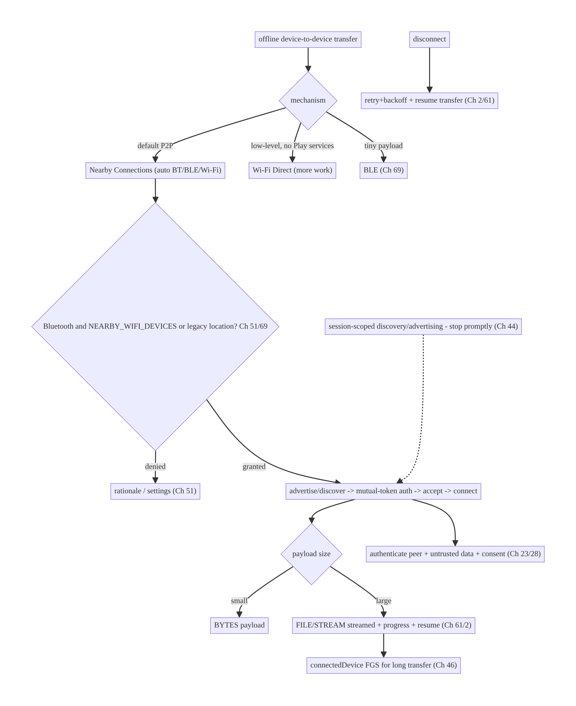
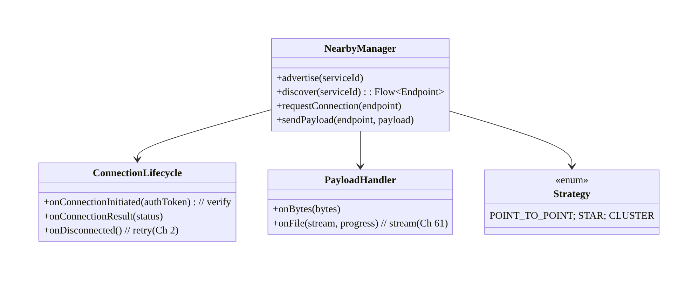
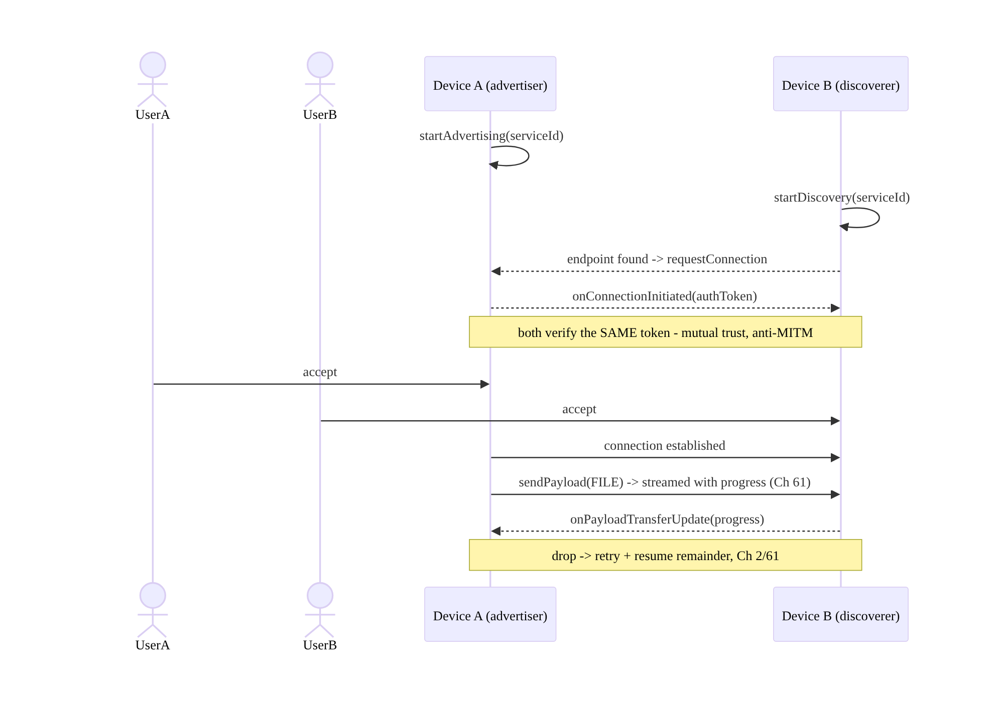
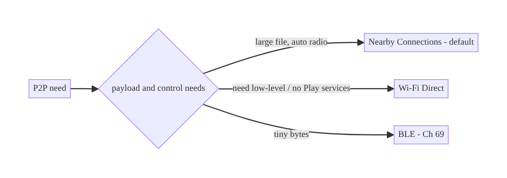
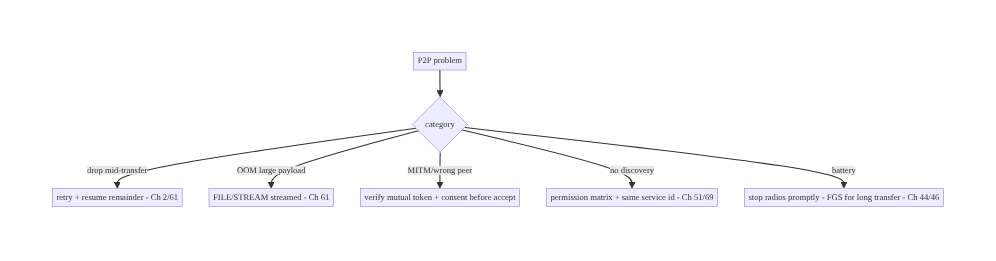

# Chapter 70 — Peer-to-Peer / Nearby Connections

> **Part VIII — Real-Time & Connectivity** · Complexity: **Standard** (≥25 interview questions)
>
> **Prerequisites:** Ch 69 (BLE), Ch 51 (permissions), Ch 46 (foreground services), Ch 61
> (large files/streaming), Ch 2 (retries), Ch 44 (lifecycle), Ch 28 (privacy). Pairs with
> Ch 68 (network state), Ch 17 (uploads).
>
> **Reference surface in StreamCart:** offline, device-to-device features — sharing a
> product/receipt or a large media file directly between two nearby phones, a cashier
> handoff, a "nearby" multiplayer or group action — using **Nearby Connections** (or
> Wi-Fi Direct) so data moves **peer-to-peer without the internet**.
>
> **Note:** this chapter completes **Part VIII — Real-Time & Connectivity (Ch 63–70)**.

---

## 70.1 Problem Definition and Real-World Context

Sometimes two devices need to exchange data **directly, nearby, without a server or the
internet**: sharing a large file at a trade show with no Wi-Fi, a cashier handing off a
cart to a customer's phone, a quick "send to the person next to me," or local multiplayer.
Routing this through the backend is wasteful (or impossible offline) and slow for big
payloads. The platform answer is **peer-to-peer (P2P)** connectivity — primarily Google's
**Nearby Connections API** (which transparently uses Bluetooth, BLE, and Wi-Fi under the
hood), or lower-level **Wi-Fi Direct (Wi-Fi P2P)** — to **discover, connect, and transfer**
between nearby devices directly.

Concretely, teams hit:

- **Choosing the mechanism.** **Nearby Connections** (high-level, auto-selects radios,
  handles discovery/connection/transfer) vs **Wi-Fi Direct** (lower-level, more control,
  more work) vs just **BLE** (Ch 69, tiny payloads). Picking wrong means reinventing what
  Nearby gives you, or using a heavyweight API for a trivial need.
- **Discovery + connection model.** Advertise/discover, request/accept a connection with a
  **mutual authentication token** (both sides verify the same code), then exchange payloads
  — a specific handshake to get right.
- **Payload types & large transfers.** Nearby supports **BYTES** (small), **FILE**, and
  **STREAM** payloads; large files must be **streamed** (Ch 61) with **progress** and
  **resume**, not loaded into memory.
- **Permissions (Ch 51).** Nearby needs a combination of **Bluetooth** (`BLUETOOTH_SCAN`/
  `ADVERTISE`/`CONNECT`, Ch 69), **Wi-Fi/`NEARBY_WIFI_DEVICES`** (Android 13+), and
  historically **location** — a matrix much like BLE (Ch 69).
- **Topology & reliability.** Point-to-point vs star vs cluster strategies; connections
  drop (range/interference) and need **retry** (Ch 2); transfers must survive and resume.
- **Security & trust.** No server mediates, so **authenticate the peer** (the mutual token),
  treat received data as **untrusted** (Ch 23), and get **user consent** — P2P is a
  physical-proximity trust model.
- **Lifecycle/battery (Ch 44/46).** Discovery/advertising and active transfers drain
  battery; scope to the session and use a **foreground service** (Ch 46) for ongoing
  transfers.

The architecture: prefer **Nearby Connections** for P2P (it auto-selects Bluetooth/BLE/
Wi-Fi and handles discovery/connection/transfer) over hand-rolling Wi-Fi Direct; implement
the **advertise/discover → authenticated connect (mutual token) → payload exchange**
handshake; **stream large payloads** (FILE/STREAM) with progress/resume (Ch 61); manage the
**permission matrix** (Bluetooth + Wi-Fi/nearby + legacy location, Ch 51/69); choose a
**strategy/topology** (P2P_POINT_TO_POINT/STAR/CLUSTER); handle **drops with retry** (Ch 2)
and **scope to lifecycle/FGS** (Ch 44/46); and **secure** it — authenticate the peer,
untrusted data, consent (Ch 23/28). This chapter is about **direct device-to-device data
transfer without the internet**.

### Three practical use cases

1. **Share a large media file (StreamCart).** Two nearby phones transfer a big video
   offline via a Nearby **FILE** payload, streamed with progress (Ch 61) — no server, no
   data plan.
2. **Cashier → customer cart handoff.** A store device advertises; the customer's phone
   discovers and connects (authenticated token shown on both), receives the cart as a BYTES
   payload.
3. **Nearby group action / local multiplayer.** A STAR topology where one host connects to
   several nearby devices for a shared local session.

### Why this is architectural

P2P/Nearby composes **radio selection (BLE/Wi-Fi, Ch 69/68)**, **permissions (Ch 51)**,
**foreground services (Ch 46)**, **streaming (Ch 61)**, **retries (Ch 2)**, and a
**proximity trust model (Ch 23/28)** — a distinct connectivity paradigm (no server). The
decisions — Nearby vs Wi-Fi Direct vs BLE, authenticated handshake, payload streaming,
permission matrix, topology, security — determine whether offline device-to-device transfer
is reliable and safe.

---

## 70.2 Requirements Engineering

### Functional requirements

| ID | Requirement |
|----|-------------|
| F1 | Discover and connect to nearby devices directly (no internet). |
| F2 | Authenticate the connection (mutual token both sides verify). |
| F3 | Exchange payloads: small (BYTES) and large (FILE/STREAM, streamed + progress/resume) (Ch 61). |
| F4 | Handle the permission matrix (Bluetooth + Wi-Fi/nearby + legacy location) (Ch 51/69). |
| F5 | Choose topology/strategy; handle drops with retry; scope to lifecycle/FGS (Ch 2/44/46). |
| F6 | Secure: authenticate peer, untrusted data, user consent (Ch 23/28). |

### Non-functional requirements

| Attribute | Policy |
|-----------|--------|
| **Offline** | Works with no internet (direct radios). |
| **Throughput** | Large files stream efficiently (Wi-Fi radio); progress/resume (Ch 61). |
| **Reliability** | Retry drops; resume transfers (Ch 2). |
| **Battery** | Discovery/advertising/transfer scoped to session; FGS for ongoing (Ch 44/46). |
| **Security** | Peer authenticated; data untrusted; consent (proximity trust, Ch 23/28). |

### Scope

- **In scope:** Nearby Connections (strategies/topologies, advertise/discover,
  authenticated connect, payload types BYTES/FILE/STREAM, streaming large + progress),
  Wi-Fi Direct (overview/when), BLE for tiny payloads (contrast Ch 69), permission matrix
  (Ch 51/69), retry/reconnect (Ch 2), lifecycle + FGS (Ch 44/46), security (peer auth,
  untrusted data, consent, Ch 23/28).
- **Out of scope:** BLE GATT detail (Ch 69), streaming internals (Ch 61), permission state
  machine (Ch 51), FGS mechanics (Ch 46), network state (Ch 68), server-mediated transfer
  (Ch 17).

### Assumptions & constraints

- **Nearby Connections API** (Google Play services) as primary; Wi-Fi Direct/BLE as
  alternatives; `minSdk 24`, `targetSdk` current (Android 13+ `NEARBY_WIFI_DEVICES`). P2P
  is **physical-proximity** trust with **no server**; large payloads need streaming (Ch 61);
  radios drop.

---

## 70.3 System Design Fundamentals

- **Prefer Nearby Connections (high-level) over raw Wi-Fi Direct/BLE.** Google's **Nearby
  Connections API** abstracts P2P: it **auto-selects** the best radio (Bluetooth, BLE for
  discovery, **Wi-Fi** for high-throughput transfer), and handles **discovery, connection,
  authentication, and payload transfer** with a clean callback API. Hand-rolling **Wi-Fi
  Direct (Wi-Fi P2P)** gives more control (and works without Play services) but is far more
  work (group formation, sockets, IP). Use **BLE** (Ch 69) only for **tiny** payloads.
  Default to **Nearby Connections**.
- **Strategies / topology.** Nearby offers **strategies**:
  - **`P2P_POINT_TO_POINT`:** one-to-one, highest bandwidth (large file transfer).
  - **`P2P_STAR`:** one host ↔ many clients (group/host session).
  - **`P2P_CLUSTER`:** many-to-many mesh (flexible, lower bandwidth).
  Choose by use case (file share → point-to-point; local multiplayer → star/cluster).
- **The handshake: advertise/discover → authenticate → connect → transfer.**
  1. One device **advertises** (`startAdvertising`), the other **discovers**
     (`startDiscovery`) by a shared **service id**.
  2. On finding, one **requests a connection**; both sides receive an **authentication
     token** and must **verify it matches** (shown to users / auto-verified) — this
     establishes **mutual trust** (anti-MITM for the pairing).
  3. On both **accepting**, the connection is established; then **payloads** flow.
- **Payload types (small vs large):**
  - **BYTES:** small (≤ a few KB) — a cart, a message, metadata.
  - **FILE:** a file — Nearby transfers it efficiently (over Wi-Fi), with **progress**
    callbacks.
  - **STREAM:** a continuous stream (e.g., audio/sensor).
  Large files must be handled as **FILE/STREAM streamed** (Ch 61) — never loaded wholly into
  memory — with **progress** and ideally **resume** on reconnect (Ch 2/61).
- **Permission matrix (Ch 51/69).** Nearby needs a combination:
  - **Bluetooth:** `BLUETOOTH_SCAN`/`BLUETOOTH_ADVERTISE`/`BLUETOOTH_CONNECT` (Android 12+,
    Ch 69).
  - **Wi-Fi:** **`NEARBY_WIFI_DEVICES`** (Android 13+, with `neverForLocation` if not
    deriving location), else historically **`ACCESS_FINE_LOCATION`** (Ch 67).
  Much like BLE's matrix (Ch 69); request **in context** with graceful denial (Ch 51).
- **Reliability: drops + retry + resume (Ch 2).** P2P links drop (range, interference,
  device sleep). Handle **disconnection** (`onDisconnected`), **retry** connection with
  backoff (Ch 2), and **resume large transfers** (track bytes transferred; re-send the
  remainder, Ch 61) so a dropped multi-GB transfer doesn't restart from zero.
- **Lifecycle & battery (Ch 44/46).** Discovery/advertising and active transfers are
  battery-heavy and should be **scoped to the session** (Ch 44): advertise/discover only
  while the share UI is open; **stop promptly**. For a **long transfer**, use a **foreground
  service** (Ch 46, `connectedDevice`/`dataSync`) with progress so it survives backgrounding.
- **Security: proximity trust + authenticate + untrusted (Ch 23/28).** There's **no server**
  mediating, so:
  - **Authenticate the peer:** verify the **mutual authentication token** (users confirm
    the same code, or app-layer verification) — don't accept connections blindly.
  - **Treat received data as untrusted** (Ch 23): validate payloads; a nearby device could
    be malicious (sending malware, spoofing).
  - **User consent:** both users explicitly accept the connection/transfer; show what's
    being shared.
  - Device identity/proximity is **sensitive** (Ch 28) — minimize, don't log.

Core insight: **for offline device-to-device transfer, prefer the Nearby Connections API —
it auto-selects Bluetooth/BLE/Wi-Fi and handles discovery, authenticated connection, and
payload transfer — over hand-rolling Wi-Fi Direct (more control, more work) or using BLE
(Ch 69, tiny payloads only); run the advertise/discover → mutual-token-authenticated
connect → payload-exchange handshake, choosing a strategy (point-to-point for big files,
star/cluster for groups); stream large FILE/STREAM payloads with progress and resume
(Ch 61); navigate the Bluetooth + Wi-Fi(`NEARBY_WIFI_DEVICES`)/legacy-location permission
matrix (Ch 51/69); handle drops with retry/backoff and resume (Ch 2), scoped to the active
lifecycle with a foreground service for long transfers (Ch 44/46); and secure it as a
physical-proximity trust model — authenticate the peer, treat received data as untrusted,
require explicit consent (Ch 23/28).**

---

## 70.4 High-Level Architecture



**Components & ownership**

- **Mechanism choice:** Nearby (default) vs Wi-Fi Direct vs BLE.
- **Permission gate** (Ch 51/69) → **authenticated handshake** (mutual token) → **payload
  exchange** (BYTES small / FILE-STREAM streamed, Ch 61).
- **FGS** for long transfers (Ch 46); **retry/resume** on drop (Ch 2/61); **lifecycle**
  scopes discovery; **security** (peer auth, untrusted, consent).

**Direction:** need → Nearby → permissions → authenticated connect → payload (stream large)
→ FGS/retry/resume; session-scoped; secured by proximity trust.

---

## 70.5 Detailed Component Design



| Component | Responsibility |
|-----------|----------------|
| `NearbyManager` | advertise/discover/connect/send via Nearby Connections |
| `ConnectionLifecycle` | authenticate (token), handle result/disconnect + retry (Ch 2) |
| `PayloadHandler` | BYTES (small) + FILE/STREAM (streamed + progress, Ch 61) |
| `Strategy` | point-to-point / star / cluster topology |

---

## 70.6 End-to-End Data Flow

### Authenticated connect + file transfer



### Mechanism choice



---

## 70.7 Complete Kotlin Implementation

Package: `com.streamcart.nearby`.

### 70.7.1 Permissions (Nearby matrix, Ch 51/69)

```xml
<!-- Bluetooth (Ch 69) -->
<uses-permission android:name="android.permission.BLUETOOTH_SCAN" android:usesPermissionFlags="neverForLocation" />
<uses-permission android:name="android.permission.BLUETOOTH_ADVERTISE" />
<uses-permission android:name="android.permission.BLUETOOTH_CONNECT" />
<!-- Wi-Fi (Android 13+) -->
<uses-permission android:name="android.permission.NEARBY_WIFI_DEVICES" android:usesPermissionFlags="neverForLocation" />
<!-- Legacy (pre-13) Wi-Fi scan needed location (Ch 67) -->
<uses-permission android:name="android.permission.ACCESS_FINE_LOCATION" android:maxSdkVersion="32" />
<uses-permission android:name="android.permission.FOREGROUND_SERVICE_CONNECTED_DEVICE" />  <!-- Ch 46 -->
```

### 70.7.2 NearbyManager: advertise/discover + authenticated connect

```kotlin
@Singleton
class NearbyManager @Inject constructor(@ApplicationContext private val ctx: Context) {
    private val client = Nearby.getConnectionsClient(ctx)
    private val strategy = Strategy.P2P_POINT_TO_POINT     // highest bandwidth for file share

    fun advertise(name: String) = client.startAdvertising(
        name, SERVICE_ID, connectionLifecycle, AdvertisingOptions.Builder().setStrategy(strategy).build())

    fun discover(): Flow<DiscoveredEndpoint> = callbackFlow {
        val cb = object : EndpointDiscoveryCallback() {
            override fun onEndpointFound(id: String, info: DiscoveredEndpointInfo) =
                trySend(DiscoveredEndpoint(id, info.endpointName)).let {}
            override fun onEndpointLost(id: String) {}
        }
        client.startDiscovery(SERVICE_ID, cb, DiscoveryOptions.Builder().setStrategy(strategy).build())
        awaitClose { client.stopDiscovery() }              // stop promptly (battery, Ch 44)
    }

    fun requestConnection(name: String, endpointId: String) =
        client.requestConnection(name, endpointId, connectionLifecycle)

    private val connectionLifecycle = object : ConnectionLifecycleCallback() {
        override fun onConnectionInitiated(endpointId: String, info: ConnectionInfo) {
            // AUTHENTICATE: verify the SAME token on both sides (show to user / app-layer) — anti-MITM.
            val token = info.authenticationDigits          // both devices see the same digits
            // ... present token for user confirmation, then:
            client.acceptConnection(endpointId, payloadCallback)   // only after mutual verification/consent
        }
        override fun onConnectionResult(endpointId: String, result: ConnectionResolution) {
            if (result.status.statusCode == ConnectionsStatusCodes.STATUS_OK) { /* connected */ }
        }
        override fun onDisconnected(endpointId: String) { /* retry + resume (Ch 2/61) */ }
    }
}
```

### 70.7.3 Payloads: BYTES (small) + FILE streamed with progress (Ch 61)

```kotlin
private val payloadCallback = object : PayloadCallback() {
    override fun onPayloadReceived(endpointId: String, payload: Payload) {
        when (payload.type) {
            Payload.Type.BYTES -> handleBytes(payload.asBytes()!!)           // small (untrusted! Ch 23)
            Payload.Type.FILE -> {
                val uri = payload.asFile()?.asUri()                          // large -> stream, don't load (Ch 61)
                // copy/stream from uri to app storage via ContentResolver (Ch 61/62)
            }
            Payload.Type.STREAM -> handleStream(payload.asStream())          // continuous
        }
    }
    override fun onPayloadTransferUpdate(endpointId: String, update: PayloadTransferUpdate) {
        val progress = update.bytesTransferred.toFloat() / update.totalBytes  // progress (Ch 61)
        // update UI; on FAILURE -> retry + resume remainder (Ch 2/61)
    }
}

// Send a large file as a FILE payload (Nearby streams it over Wi-Fi):
fun sendFile(endpointId: String, file: File) =
    client.sendPayload(endpointId, Payload.fromFile(file))   // streamed; progress via onPayloadTransferUpdate
```

### 70.7.4 Long transfer in a foreground service (Ch 46)

```kotlin
// A multi-GB transfer runs inside a connectedDevice/dataSync FGS (Ch 46) with a progress notification,
// so it survives backgrounding; stop the FGS + stopAll endpoints when the transfer completes.
@AndroidEntryPoint
class NearbyTransferService : Service() {
    @Inject lateinit var nearby: NearbyManager
    override fun onStartCommand(intent: Intent?, flags: Int, startId: Int): Int {
        startForeground(NOTIF_ID, transferNotification(0), ServiceInfo.FOREGROUND_SERVICE_TYPE_CONNECTED_DEVICE)
        // run transfer; update notification from onPayloadTransferUpdate; stopSelf on complete
        return START_NOT_STICKY
    }
    override fun onBind(i: Intent?): IBinder? = null
}
```

### 70.7.5 Lifecycle + stop promptly

```kotlin
// Scope discovery/advertising to the share session (Ch 44); stop when done (battery).
fun stopSession() {
    client.stopAdvertising(); client.stopDiscovery(); client.stopAllEndpoints()   // release radios
}
```

### 70.7.6 Module structure

```
:feature:nearby  NearbyManager, ConnectionLifecycle, PayloadHandler, NearbyTransferService (FGS, Ch 46)
# Permissions -> Ch 51/69; streaming large payloads -> Ch 61/62; retries -> Ch 2; lifecycle -> Ch 44.
```

---

## 70.8 Concurrency and Race Conditions

| Scenario | Risk | Handling |
|----------|------|----------|
| Accept before token verified | MITM/unauthorized | verify mutual token + consent before `acceptConnection` |
| Large payload loaded into memory | OOM | FILE/STREAM streamed (Ch 61), not BYTES |
| Transfer drops mid-file | restart from 0 | track bytes; retry + resume remainder (Ch 2/61) |
| Discovery/advertising left on | battery drain | stop promptly; session-scoped (Ch 44) |
| Multiple simultaneous connections | contention | choose strategy (point-to-point limits to one) |
| Received data trusted | malware/spoof | validate untrusted payloads (Ch 23) |
| Permission missing | discovery/connect fails | permission matrix (Ch 51/69) |

- **Authenticate before accepting:** `acceptConnection` must come **after** both sides
  verify the **same authentication token** and the users consent — accepting blindly allows
  a MITM or unwanted peer (the proximity trust model's core safeguard).
- **Stream large payloads, don't BYTES them:** a big file as a BYTES payload OOMs; use
  **FILE/STREAM** which Nearby transfers efficiently (over Wi-Fi) and stream it to storage
  (Ch 61/62).
- **Resume, don't restart:** track `bytesTransferred` and on a drop resume the remainder
  (Ch 2/61) so a large transfer survives interruptions.

---

## 70.9 Failure Scenarios and Recovery

| Failure | Detection | Response | Outcome |
|---------|-----------|----------|---------|
| Connection drops mid-transfer | `onDisconnected`/FAILURE | retry + resume remainder (Ch 2/61) | completes |
| OOM on large payload | crash | FILE/STREAM streamed (Ch 61) | safe |
| MITM / wrong peer | token mismatch | verify mutual token + consent before accept | blocked |
| Discovery finds nothing | no endpoints | fix permission matrix (Ch 51/69); same service id | connects |
| Battery drain | radios left on | stop advertising/discovery/endpoints promptly (Ch 44) | battery ok |
| No Play services | Nearby unavailable | Wi-Fi Direct fallback | works |
| Malicious data | validation | treat received payloads as untrusted (Ch 23) | safe |



> **Nearby does the hard radio work; your job is the handshake, streaming, and trust.**
> Authenticate the peer with the mutual token before accepting, stream large payloads
> (FILE/STREAM) with progress and resume, get the permission matrix right, scope radios to
> the session (FGS for long transfers), and validate received data as untrusted — then
> offline device-to-device transfer is reliable and safe.

---

## 70.10 Scaling the Implementation

- **Level 1.** Nearby advertise/discover + authenticated connect (verify token) + BYTES
  payload.
- **Level 2.** FILE/STREAM payloads streamed with progress (Ch 61); permission matrix
  (Ch 51/69); stop radios promptly.
- **Level 3 — production.** Retry/backoff + resume on drop (Ch 2/61); `connectedDevice` FGS
  for long transfers (Ch 46); strategy selection; consent + peer auth (Ch 23).
- **Level 4 — large.** STAR/CLUSTER group sessions; multi-file transfers; Wi-Fi Direct
  fallback (no Play services); transfer analytics.
- **Level 5 — enterprise.** P2P governance, offline-mesh scenarios, secure provisioning,
  cross-platform (iOS via a common protocol), throughput SLOs.

**Avoid overengineering:** for most "share nearby" needs, **Nearby Connections +
authenticated connect + FILE payload streamed** is enough. Don't hand-roll Wi-Fi Direct
unless you lack Play services or need low-level control; don't use BYTES for large files.

---

## 70.11 Alternative Approaches and Trade-offs

| Dimension | Option A | Option B | When |
|-----------|----------|----------|------|
| Mechanism | Nearby Connections | Wi-Fi Direct | Nearby (auto-radio, handles handshake/transfer); Wi-Fi Direct for low-level / no Play services |
| Mechanism | Nearby Connections | BLE (Ch 69) | Nearby for real transfers; BLE for tiny payloads only |
| Payload (large) | FILE/STREAM streamed (Ch 61) | BYTES | FILE/STREAM (BYTES OOMs for large) |
| Strategy | Point-to-point (file) / star (group) | one for all | Match to use case |
| Transfer | Via P2P (offline, fast local) | via backend (Ch 17) | P2P when offline/local/large; backend when server needs it |
| Drop handling | Retry + resume (Ch 2/61) | restart | Resume (large transfers) |
| Trust | Authenticated token + consent | accept blindly | Authenticate (proximity trust, Ch 23) |

**Nearby Connections vs Wi-Fi Direct:** **Nearby** auto-selects the best radio (BLE for
discovery, Wi-Fi for throughput), handles discovery/authentication/transfer with a clean
API, and "just works" — but needs **Play services**. **Wi-Fi Direct (Wi-Fi P2P)** is
lower-level (you manage group formation, sockets, IP), more work, but available without Play
services and offers more control. Default to **Nearby**; use Wi-Fi Direct only when you lack
Play services or need that control.

**P2P vs backend transfer (Ch 17):** routing a large nearby transfer through the **backend**
(upload then download, Ch 17) requires internet, burns data, and is slow for big files
between co-located devices. **P2P** moves it **directly** (offline, over the local Wi-Fi
radio) — ideal when devices are nearby and especially when offline. Use P2P for local/
offline/large transfers; the backend when the server must see/process the data.

**FILE/STREAM vs BYTES for large payloads:** a BYTES payload holds everything in memory
(OOM for large files); **FILE**/**STREAM** payloads let Nearby transfer efficiently over
Wi-Fi with progress and let you **stream** to storage (Ch 61). Use BYTES only for small
metadata; FILE/STREAM for anything large.

---

## 70.12 Security & Privacy Considerations

- **Proximity trust + authenticate the peer (Ch 23):** no server mediates, so verify the
  **mutual authentication token** (both devices show the same digits; users confirm, or
  app-layer verification) **before accepting** — this is the anti-MITM safeguard. Never
  accept connections blindly.
- **Treat all received data as untrusted (Ch 23):** a nearby device could send malware,
  spoofed content, or malformed payloads — validate/sanitize everything received; don't
  auto-execute or trust a received file.
- **Explicit consent (Ch 28):** both users explicitly accept the connection and the
  transfer; show **what** is being shared and with **whom** — surprise P2P transfers are a
  trust/abuse risk.
- **Least permission (Ch 51/69):** request Bluetooth + `NEARBY_WIFI_DEVICES` (with
  `neverForLocation` if not deriving location) in context; avoid legacy location where
  possible.
- **Device identity is sensitive (Ch 28):** endpoint names/ids can identify users —
  minimize, don't log; use non-identifying advertise names.
- **Encrypt sensitive payloads:** Nearby encrypts the link, but for highly sensitive data,
  add app-layer encryption (Ch 25) and authenticate at the app layer.
- **Stop radios promptly:** leaving advertising/discovery on is a discoverability/privacy
  concern as well as battery.
- Client vs backend: P2P is serverless; there's **no backend to authorize** the transfer,
  so the **peer authentication + user consent + untrusted-data handling** carry the entire
  trust burden — design them carefully.

---

## 70.13 Performance and Resource Optimization

- **Nearby uses Wi-Fi for throughput** automatically — large files transfer fast locally
  (far faster than cellular upload/download).
- **Stop advertising/discovery/endpoints promptly** (Ch 44) — the top battery lever;
  radios on = drain.
- **Stream large payloads** (FILE/STREAM, Ch 61) — no OOM; progress-driven.
- **Resume, don't restart** (Ch 2/61) — don't re-transfer gigabytes on a drop.
- **Choose strategy by need** — point-to-point maximizes a single transfer's bandwidth.
- **FGS for long transfers** (Ch 46) so they complete backgrounded without the user holding
  the screen.
- **Profiling:** transfer throughput, connect success rate, drop/resume rate, radio battery,
  discovery time.

---

## 70.14 Testing Strategy

Nearby is hard to unit-test (needs two real devices + Play services); test the **handshake/
payload/resume logic** in isolation with a fake client, and do **two-device
instrumentation**.

```kotlin
class ConnectionAuthTest {
    @Test fun `does not accept before token verified`() {
        lifecycle.onConnectionInitiated("E1", connectionInfo(token = "1234"))
        assertFalse(fakeClient.accepted("E1"))              // waits for verification/consent
        lifecycle.userConfirmsToken("E1", "1234")
        assertTrue(fakeClient.accepted("E1"))
    }
    @Test fun `rejects on token mismatch`() { /* user sees different digits -> reject */ }
}

class PayloadTest {
    @Test fun `large file sent as FILE streamed, not BYTES`() { /* assert Payload.Type.FILE */ }
    @Test fun `resumes remainder after drop`() = runTest { /* bytesTransferred tracked -> resume (Ch 61) */ }
    @Test fun `received payload validated as untrusted`() { /* malformed -> rejected (Ch 23) */ }
}
```

What to test: authenticated connect (accept only after token verify + consent; reject on
mismatch); large payload uses FILE/STREAM (not BYTES); resume after drop (Ch 2/61);
untrusted-payload validation (Ch 23); permission-gated discovery (Ch 51/69); stop-radios.
Fake the Nearby client for logic; **two real devices with Play services** for end-to-end.

---

## 70.15 Production Observability

- **Metrics:** connect success rate; **transfer throughput** + completion rate; drop/resume
  rate; discovery time; radio battery; permission grant rate (Ch 51/69); rejected-connection
  (token-mismatch) count; Play-services-unavailable rate (→ Wi-Fi Direct fallback).
- **Logs:** `nearby{event, strategy, payload_type, bytes, result}` — **no endpoint names/
  device identity/PII** (Ch 28).
- **Debugging:** no discovery → permission matrix (Ch 51/69) / mismatched service id; OOM →
  BYTES for large (use FILE, Ch 61); transfer restarts → no resume (Ch 2/61); battery →
  radios not stopped (Ch 44); MITM concern → accepting before token verify; Play-services
  missing → fallback.
- **Alerting:** connect-success drop; transfer-completion drop; rejected-connection spike
  (possible abuse).
- **Dashboards:** connect/transfer success + throughput; drop/resume rate; permission funnel.

---

## 70.16 System Design Interview Preparation

> ≥25 questions.

**Fundamentals**

1. *What is P2P/Nearby for?* Offline, direct device-to-device transfer (no server/internet).
2. *Primary API?* Nearby Connections (auto-selects BT/BLE/Wi-Fi).
3. *Nearby vs Wi-Fi Direct?* High-level auto-radio vs low-level control / no Play services.
4. *Nearby vs BLE (Ch 69)?* Real transfers vs tiny payloads.
5. *Radios used?* BLE for discovery, Wi-Fi for throughput (Nearby picks).

**Handshake**

6. *Steps?* Advertise/discover → request connection → verify mutual token → accept →
   transfer.
7. *Authentication?* Both sides verify the same token (anti-MITM) + consent.
8. *Service id?* Shared id both sides advertise/discover on.

**Payloads**

9. *Types?* BYTES (small), FILE (file), STREAM (continuous).
10. *Large files?* FILE/STREAM streamed (Ch 61) — never BYTES (OOM).
11. *Progress?* `onPayloadTransferUpdate`.
12. *Drop mid-file?* Resume remainder (Ch 2/61).

**Strategy**

13. *Strategies?* P2P_POINT_TO_POINT / STAR / CLUSTER.
14. *File share?* Point-to-point (bandwidth).
15. *Group/multiplayer?* Star/cluster.

**Permissions (Ch 51/69)**

16. *Matrix?* Bluetooth (`SCAN`/`ADVERTISE`/`CONNECT`) + `NEARBY_WIFI_DEVICES` (13+) /
    legacy location.
17. *`neverForLocation`?* If not deriving location (Ch 67).

**Lifecycle/battery**

18. *Scope?* Session; stop advertising/discovery/endpoints promptly (Ch 44).
19. *Long transfer?* `connectedDevice` FGS (Ch 46).

**Security (Ch 23/28)**

20. *Trust model?* Physical proximity + authenticate peer + consent (no server).
21. *Received data?* Untrusted — validate.
22. *Device identity?* Sensitive — minimize/don't log.
23. *Sensitive payloads?* App-layer encryption (Ch 25).

**Testing/Production**

24. *Test end-to-end?* Two real devices + Play services.
25. *No discovery?* Permission matrix / service id.
26. *OOM?* BYTES for large (use FILE).

### Design-change challenges
1. **Share a large video between two phones offline.** Nearby point-to-point + FILE payload
   streamed + progress (Ch 61).
2. **Prevent connecting to the wrong/malicious device.** Verify mutual token + consent
   before accept (Ch 23).
3. **Transfer restarts from 0 on a drop.** Track bytes; resume remainder (Ch 2/61).
4. **No discovery on Android 13.** Add `NEARBY_WIFI_DEVICES` (Ch 51).
5. **No Play services on the device.** Wi-Fi Direct fallback.

### Mock walkthrough (abridged)
Clarify (offline?, payload size, group or 1:1, security?) → Nearby Connections (vs Wi-Fi
Direct/BLE) → strategy (point-to-point/star) → permission matrix (Ch 51/69) → handshake
(advertise/discover → verify token → accept) → payloads (BYTES small / FILE-STREAM streamed
+ progress + resume, Ch 61/2) → FGS for long transfer + stop radios (Ch 46/44) → security
(authenticate peer, untrusted data, consent, Ch 23/28) → observability.

---

## 70.17 Practical Exercises

1. **Beginner.** Advertise/discover with Nearby on a shared service id and exchange a small
   BYTES payload after verifying the mutual token. *Eval:* connects; token-verified.
2. **Intermediate.** Send a large file as a FILE payload, streamed with a progress bar (not
   BYTES); handle the permission matrix (Ch 51/69). *Eval:* no OOM; progress; permission-
   correct.
3. **Advanced.** Add retry + resume on disconnect (resume the remaining bytes) and run the
   transfer in a `connectedDevice` FGS (Ch 46). *Eval:* survives drops/background.
4. **Production debugging.** Fix "no discovery on Android 13" (missing `NEARBY_WIFI_DEVICES`)
   and an OOM (BYTES for a large file → FILE). *Eval:* discovers; streams.
5. **System design challenge.** Secure the pairing (mutual token + consent + untrusted-data
   validation) and add a Wi-Fi Direct fallback for no-Play-services devices. *Eval:* no
   blind accept; works without Play services.

*(Solutions withheld unless requested.)*

---

## 70.18 Chapter Summary & Reference Sheet

**Key decisions:** for **offline, direct device-to-device transfer**, prefer the **Nearby
Connections API** — it **auto-selects Bluetooth/BLE/Wi-Fi** and handles **discovery,
authenticated connection, and payload transfer** — over hand-rolling **Wi-Fi Direct** (more
control, more work, but no Play services needed) or using **BLE** (Ch 69, tiny payloads
only); run the **advertise/discover → mutual-token-authenticated connect (verify the same
token + consent before `acceptConnection`) → payload exchange** handshake, choosing a
**strategy** (point-to-point for big files, star/cluster for groups); send small data as
**BYTES** and **large files as FILE/STREAM payloads streamed** with **progress and resume**
(never BYTES — OOM; Ch 61/2); navigate the **Bluetooth + `NEARBY_WIFI_DEVICES`(13+)/legacy-
location permission matrix** (Ch 51/69); handle **drops with retry/backoff and resume the
remainder** (Ch 2/61); **scope radios to the active session and stop promptly**, using a
**`connectedDevice` foreground service** for long transfers (Ch 44/46); and secure it as a
**physical-proximity trust model with no server** — **authenticate the peer, treat received
data as untrusted, require explicit consent**, and minimize device identity (Ch 23/28).

**Concepts:** Nearby Connections (strategies/topologies, auto-radio), advertise/discover →
authenticated connect (mutual token) → payload (BYTES/FILE/STREAM), streaming large payloads
+ progress + resume, Wi-Fi Direct/BLE alternatives, permission matrix, lifecycle + FGS,
proximity trust (authenticate/untrusted/consent).

**Common mistakes:** hand-rolling Wi-Fi Direct when Nearby suffices; BYTES for large files
(OOM); accepting connections without verifying the mutual token (MITM); no resume (restart
on drop); wrong permission matrix (no discovery); leaving radios on (battery); trusting
received data; no consent; logging device identity.

**Checklist:**

- [ ] Nearby Connections (default) vs Wi-Fi Direct / BLE
- [ ] strategy per use case (point-to-point/star/cluster)
- [ ] advertise/discover → verify mutual token + consent → accept
- [ ] BYTES small / FILE-STREAM streamed + progress + resume (Ch 61/2)
- [ ] permission matrix (Bluetooth + `NEARBY_WIFI_DEVICES`/legacy location, Ch 51/69)
- [ ] retry + resume on drop (Ch 2/61)
- [ ] session-scoped radios + stop promptly + FGS for long transfer (Ch 44/46)
- [ ] authenticate peer + untrusted data + consent (Ch 23/28)
- [ ] device identity minimized/not logged
- [ ] Wi-Fi Direct fallback (no Play services)
- [ ] connect/transfer telemetry.

**Key APIs:** `Nearby.getConnectionsClient`, `startAdvertising`/`startDiscovery`/
`stopAdvertising`/`stopDiscovery`/`stopAllEndpoints`, `requestConnection`/`acceptConnection`,
`ConnectionLifecycleCallback` (`onConnectionInitiated`/`onConnectionResult`/`onDisconnected`),
`ConnectionInfo.authenticationDigits`, `Payload.fromFile`/`fromBytes`/`fromStream`/
`Payload.Type`, `PayloadCallback` (`onPayloadReceived`/`onPayloadTransferUpdate`), `Strategy`
(`P2P_POINT_TO_POINT`/`STAR`/`CLUSTER`), `NEARBY_WIFI_DEVICES`/Bluetooth perms (Ch 51/69),
`connectedDevice` FGS (Ch 46), Wi-Fi Direct (`WifiP2pManager`).

**References:**
- Nearby Connections: https://developers.google.com/nearby/connections/overview
- Nearby Connections strategies: https://developers.google.com/nearby/connections/strategies
- Wi-Fi Direct (Wi-Fi P2P): https://developer.android.com/develop/connectivity/wifi/wifi-direct
- NEARBY_WIFI_DEVICES: https://developer.android.com/develop/connectivity/wifi/wifi-permissions
- (composes) Ch 69 BLE, Ch 51 Permissions, Ch 46 Foreground Services, Ch 61 Large Files, Ch 2 Retries, Ch 44 Lifecycle, Ch 23/28 Security/Privacy

### Chapter review (Phase 4)
- **Completeness:** all 18 sections; architecture/class/sequence/flow/failure diagrams;
  NearbyManager (advertise/discover/auth connect) + payload handler (BYTES/FILE streamed) +
  FGS + stop-radios code; concurrency (auth-before-accept, stream-large, resume); failure
  (Nearby-does-radio-you-do-handshake/trust principle); 5 levels; Nearby-vs-Wi-Fi-Direct,
  P2P-vs-backend, FILE-vs-BYTES trade-offs; security (proximity trust, authenticate,
  untrusted, consent); perf (Wi-Fi throughput, stop radios, resume); fake-client + two-device
  tests; observability (connect/transfer success); 26 Q&A + 5 challenges. ✅ Completes
  Part VIII.
- **Expand later:** BLE (Ch 69), large files (Ch 61), permissions (Ch 51), FGS (Ch 46).
- **Interview coverage:** exceeds ≥25 bar.
