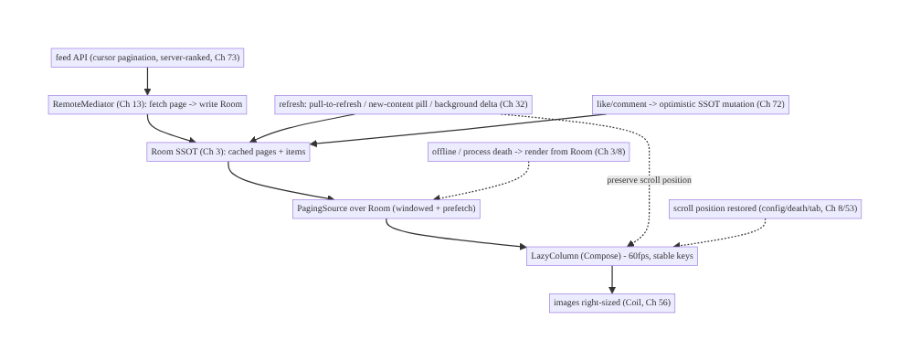
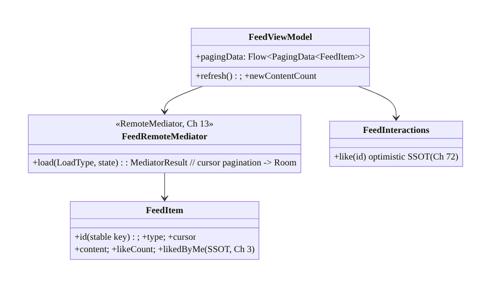
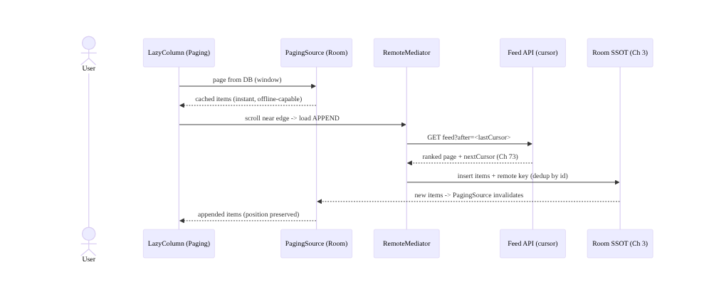
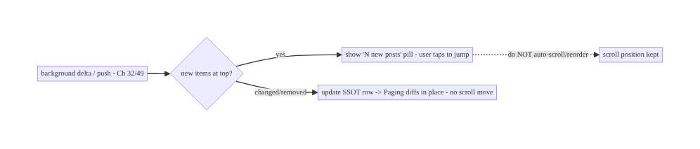
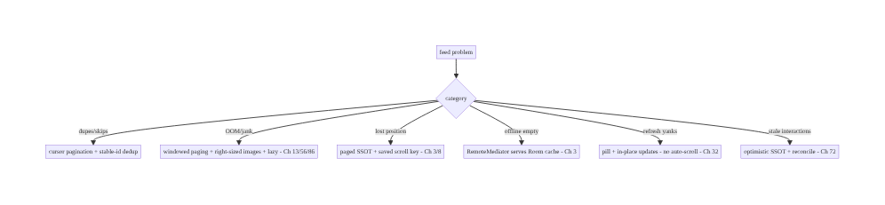

# Chapter 71 — Infinite Scrolling Feed (Social)

> **Part IX — Feature Architectures** · Complexity: **Complex** (≥40 interview questions)
>
> **Prerequisites:** Ch 13 (Paging 3), Ch 3 (SSOT/Room), Ch 32 (delta sync), Ch 12
> (caching), Ch 56 (images), Ch 6 (UI state), Ch 72 (optimistic updates), Ch 60/86
> (perf). Pairs with Ch 73 (recommendations), Ch 49 (push).
>
> **Reference surface in StreamCart:** the social/home feed — an endless, mixed-content
> stream (products, posts, videos, ads) that loads page by page, caches for offline,
> stays fresh, scrolls at 60fps, preserves position, and handles likes/comments
> optimistically.

---

## 71.1 Problem Definition and Real-World Context

An infinite feed looks simple ("load more at the bottom") but is one of the most
**composite, performance-critical** features in a consumer app. It must: **paginate**
endlessly (Ch 13) without loading everything; **cache** pages so the feed works offline
and survives process death (Ch 3/12); stay **fresh** (new items at top, deletions, updates)
without jarring the user; **scroll at 60fps** with heterogeneous item types and images
(Ch 56/60); **preserve scroll position** across config change, process death, and tab
switches; handle **optimistic interactions** (like/comment, Ch 72); and deal with
**pagination correctness** (offset drift, duplicates, gaps) as the underlying data changes.
Done naively it OOMs, janks, loses position, shows duplicates, or re-fetches constantly.

Concretely, teams hit:

- **Loading everything / offset pagination drift.** Loading all items OOMs; naive
  **offset** pagination (`?page=N`) **drifts** when items are inserted/deleted between page
  loads (duplicates/skips). **Keyset/cursor** pagination is stable; **Paging 3** (Ch 13)
  manages windows and prefetch.
- **No cache / network-coupled.** A feed that only works online and reloads from scratch
  on every open is slow and offline-broken. The feed should be **SSOT-backed** (Room,
  Ch 3) via Paging's **RemoteMediator** (network + DB) so it's cached, offline-capable, and
  survives process death.
- **Freshness vs stability.** New content must appear and stale content update, but
  **not** by yanking the user's scroll position. Need **refresh strategies** (pull-to-
  refresh, "new posts" pill, background delta, Ch 32) that respect position.
- **Jank at 60fps.** Heterogeneous item types, images (Ch 56), video autoplay (Ch 58/60),
  and heavy binds drop frames. Need efficient diffing (stable keys), item-type view
  recycling, image right-sizing (Ch 56), and lazy/off-screen work (Ch 86).
- **Scroll position preservation.** Rotation, process death (Ch 8), and tab switches must
  **restore scroll position** — losing it is a top UX complaint.
- **Interactions + consistency.** Likes/comments must update **optimistically** (Ch 72)
  and reconcile; the same item on multiple screens must stay consistent (SSOT, Ch 3).
- **Mixed content & ranking.** Feeds mix content types and are **server-ranked** (Ch 73);
  the client renders what the server orders, with dedup and insert/remove handling.

The architecture: build the feed on **Paging 3** (Ch 13) with a **RemoteMediator** backing
it with the **SSOT (Room)** so it **paginates, caches, works offline, and survives process
death**; use **cursor/keyset pagination** (not offset) for stability; apply **refresh
strategies** that preserve scroll position (pull-to-refresh, "new content" pill, background
delta sync, Ch 32); optimize for **60fps** (stable keys, item-type recycling, image
right-sizing Ch 56, lazy off-screen work Ch 86); **preserve scroll position** across config/
process death (Ch 8); handle **optimistic interactions** via the SSOT (Ch 72); and render
**server-ranked mixed content** (Ch 73) with dedup. This chapter is the **end-to-end
architecture of a fast, cached, fresh, position-stable infinite feed**.

### Three practical use cases

1. **Home feed (StreamCart).** Endless mixed feed (products/posts/video/ads), Paging 3 +
   RemoteMediator + Room, cursor pagination, offline from cache, "new posts" pill on
   refresh, 60fps.
2. **Offline + process death.** User scrolls, backgrounds; process dies; on return the feed
   restores from the SSOT at the **same scroll position** with cached content, then refreshes
   in the background.
3. **Optimistic like/comment.** Liking an item updates instantly (Ch 72) in the SSOT,
   reflected everywhere the item appears; reconciled with the server.

### Why this is architectural

The feed **composes** Paging (Ch 13), SSOT (Ch 3), sync (Ch 32), caching (Ch 12), images
(Ch 56), optimistic UI (Ch 72), process death (Ch 8), and performance (Ch 86) into one
demanding surface. The decisions — Paging+RemoteMediator+SSOT, cursor pagination, position-
preserving refresh, 60fps optimization, scroll restoration — are a capstone of mobile data +
UI engineering.

---

## 71.2 Requirements Engineering

### Functional requirements

| ID | Requirement |
|----|-------------|
| F1 | Paginate endlessly (load more at the edge) without loading everything (Ch 13). |
| F2 | Cache pages in the SSOT; work offline; survive process death (Ch 3/12/8). |
| F3 | Stay fresh (new/updated/removed) without disrupting scroll position (Ch 32). |
| F4 | Scroll at 60fps with mixed item types + images/video (Ch 56/58/86). |
| F5 | Preserve scroll position across config change / process death / tab switch (Ch 8). |
| F6 | Optimistic interactions (like/comment) via the SSOT; consistent everywhere (Ch 72/3). |

### Non-functional requirements

| Attribute | Policy |
|-----------|--------|
| **Performance** | 60fps scroll; fast first content (cache-first, Ch 45). |
| **Memory** | Windowed paging (no load-all); bounded images (Ch 56). |
| **Offline** | Cache-backed; works offline (Ch 29). |
| **Resilience** | Survives process death; restores position (Ch 8). |
| **Correctness** | Stable pagination (cursor); dedup; consistent items (Ch 3). |
| **Freshness** | Timely updates; position-preserving refresh. |

### Scope

- **In scope:** Paging 3 + RemoteMediator + Room SSOT (Ch 13/3), cursor/keyset pagination,
  prefetch/placeholders, refresh strategies (pull-to-refresh, new-content pill, background
  delta, Ch 32) preserving position, 60fps optimization (stable keys, item-type recycling,
  image right-sizing Ch 56, lazy off-screen Ch 86), scroll restoration (config/process
  death, Ch 8), optimistic interactions (Ch 72), mixed content + server ranking (Ch 73),
  dedup/insert/remove.
- **Out of scope:** Paging internals (Ch 13), SSOT internals (Ch 3), sync algorithm
  (Ch 32), image pipeline (Ch 56), optimistic-UI mechanics (Ch 72), ranking/recommendations
  (Ch 73), perf profiling (Ch 86).

### Assumptions & constraints

- **Paging 3** (`PagingSource`/`RemoteMediator`), Room SSOT (Ch 3), Compose `LazyColumn`/
  Paging compose, Coil (Ch 56). `minSdk 24`. Server supports **cursor pagination** and
  **ranks** the feed (Ch 73); content is heterogeneous; the feed must work offline and
  survive process death.

---

## 71.3 System Design Fundamentals

- **Paging 3 + RemoteMediator + SSOT (the backbone, Ch 13/3).** The feed is **not** a list
  you hold in memory — it's a **paged, cached** stream:
  - **Room is the SSOT** (Ch 3); the UI pages **from the database** (`PagingSource` over
    Room).
  - A **`RemoteMediator`** (Ch 13) fetches pages from the network and **writes them into
    Room**; Paging then pages from Room. This gives **caching, offline, and process-death
    survival for free** — the feed renders from the DB whether online or not.
  - Paging handles **windowing** (only a window of items in memory), **prefetch** (load
    ahead of the scroll edge), and **placeholders**.
  This "network → DB → UI" (single source of truth) is the correct feed architecture; a
  network-only `PagingSource` loses offline/caching.
- **Cursor/keyset pagination, not offset (stability).** Offset pagination (`?offset=40`)
  **drifts** when items are inserted/removed between loads → **duplicates or skipped
  items**. **Cursor/keyset** pagination (`?after=<lastItemCursor>`) is **stable** under
  insertion/deletion — the server returns "items after this cursor." Store the cursor
  (RemoteMediator keys) per page. Always prefer cursor pagination for feeds.
- **Freshness without disrupting position (the UX crux).**
  - **Pull-to-refresh / RemoteMediator REFRESH:** reload from the top (Ch 13).
  - **"New content" pill:** detect new items (via a background delta/push, Ch 32/49) and
    show a **"N new posts"** pill the user taps to jump up — **don't** auto-scroll or reorder
    under them.
  - **Background delta sync** (Ch 32): update changed/removed items in the SSOT; Paging
    diffs and updates the list **in place** (stable keys) without moving position.
  - **In-place updates:** because items live in the SSOT, a like-count change or edit
    updates the row and the UI reflects it **where the item is**, no reload.
  The rule: **never yank the user's scroll position**; surface freshness via a pill/
  in-place updates.
- **60fps optimization (Ch 86/56).**
  - **Stable keys:** give each item a stable id (`key`) so diffing/recycling is correct and
    minimal (no full rebinds).
  - **Item-type recycling:** heterogeneous types (product/post/video/ad) each bind
    efficiently; avoid heavy work in bind.
  - **Image right-sizing** (Ch 56): load CDN-sized images, downsample, placeholder/
    crossfade — the top feed-jank cause.
  - **Lazy / off-screen:** defer expensive work (video autoplay only for the visible item,
    Ch 58; don't compute off-screen).
  - **Avoid nested scroll/overdraw;** flatten layouts; measure with the jank profiler
    (Ch 86).
- **Scroll position preservation (Ch 8).** Rotation and process death must **restore
  position**: Compose `LazyColumn` + Paging restore scroll via `rememberLazyListState`
  (config change) and Paging's state restoration; for process death, the paged SSOT means
  content is still there and the saved scroll key/position restores (Ch 8). Tab switches use
  saved state (Ch 53). Losing position is a top complaint — design for restoration.
- **Optimistic interactions (Ch 72).** Likes/comments update the **SSOT optimistically**
  (Ch 72) → the item updates **instantly everywhere it appears** (feed, detail) because it's
  one SSOT row (Ch 3); reconcile with the server (outbox, Ch 31). The feed doesn't special-
  case interactions — they're SSOT mutations.
- **Mixed content + server ranking (Ch 73).** The feed mixes content types and is
  **ranked by the server** (Ch 73) — the client renders the server's order, **dedups**
  (by id), and handles **inserts/removes**. The client doesn't rank; it presents and
  interacts. Ads/sponsored items are inserted by the server at ranked positions.

Core insight: **build the infinite feed as a paged, SSOT-backed stream — Paging 3 with a
RemoteMediator that writes network pages into Room, so the UI pages from the database and
gets caching, offline, and process-death survival for free (Ch 13/3); use cursor/keyset
pagination (not offset) for stability under inserts/deletes; keep it fresh without ever
yanking scroll position (pull-to-refresh, a "new content" pill, and in-place SSOT updates
from background delta sync, Ch 32); optimize hard for 60fps (stable keys, item-type
recycling, image right-sizing Ch 56, lazy off-screen work Ch 86); preserve and restore
scroll position across config change, process death, and tab switches (Ch 8); apply
interactions as optimistic SSOT mutations so they reflect everywhere (Ch 72/3); and render
server-ranked mixed content (Ch 73) with dedup — the client presents and interacts, the
server ranks.**

---

## 71.4 High-Level Architecture



**Components & ownership**

- **RemoteMediator** fetches cursor pages → **Room SSOT**; **PagingSource** pages from Room
  (windowed) → **LazyColumn** (60fps).
- **Refresh** (pull/pill/delta) and **interactions** (optimistic) mutate the **SSOT**;
  position is **preserved/restored**.
- **Server ranks** mixed content (Ch 73); client presents + dedups.

**Direction:** cursor API → RemoteMediator → Room (cache/offline/death) → PagingSource →
LazyColumn (60fps); refresh + interactions via SSOT, position-preserving.

---

## 71.5 Detailed Component Design



| Component | Responsibility |
|-----------|----------------|
| `FeedRemoteMediator` | fetch cursor pages → write Room; manage remote keys (Ch 13) |
| `FeedItem` | SSOT row: stable id + type + cursor + content + interaction state (Ch 3) |
| `FeedViewModel` | expose `PagingData` from Room; refresh; new-content count |
| `FeedInteractions` | optimistic like/comment via SSOT (Ch 72) |

---

## 71.6 End-to-End Data Flow

### Paged load (network → Room → UI)



### Freshness without yanking position



---

## 71.7 Complete Kotlin Implementation

Package: `com.streamcart.feed`.

### 71.7.1 FeedItem (SSOT, stable key + cursor)

```kotlin
@Entity(tableName = "feed_items", indices = [Index("position")])
data class FeedItem(
    @PrimaryKey val id: String,          // stable key (diffing/recycling + dedup)
    val position: Int,                    // server rank order (Ch 73)
    val type: String,                     // product/post/video/ad
    val cursor: String,                   // keyset cursor for pagination
    val contentJson: String,
    val likeCount: Int, val likedByMe: Boolean,   // interaction state (optimistic, Ch 72)
)

@Entity(tableName = "feed_remote_keys")
data class RemoteKey(@PrimaryKey val id: String, val prevCursor: String?, val nextCursor: String?)
```

### 71.7.2 RemoteMediator: cursor pagination → Room (Ch 13)

```kotlin
@OptIn(ExperimentalPagingApi::class)
class FeedRemoteMediator @Inject constructor(
    private val api: FeedApi, private val db: FeedDatabase,   // SSOT (Ch 3)
) : RemoteMediator<Int, FeedItem>() {
    override suspend fun load(loadType: LoadType, state: PagingState<Int, FeedItem>): MediatorResult {
        val cursor = when (loadType) {
            LoadType.REFRESH -> null                                   // from top
            LoadType.PREPEND -> return MediatorResult.Success(endOfPaginationReached = true)
            LoadType.APPEND -> db.remoteKeys().last()?.nextCursor
                ?: return MediatorResult.Success(endOfPaginationReached = true)
        }
        return runCatching {
            val page = api.feed(after = cursor, limit = PAGE_SIZE)     // CURSOR pagination (stable)
            db.withTransaction {
                if (loadType == LoadType.REFRESH) { db.feed().clear(); db.remoteKeys().clear() }
                db.feed().upsertAll(page.items.map { it.toEntity() })  // dedup by id (stable key)
                db.remoteKeys().upsertAll(page.items.map { RemoteKey(it.id, cursor, page.nextCursor) })
            }
            MediatorResult.Success(endOfPaginationReached = page.nextCursor == null)
        }.getOrElse { MediatorResult.Error(it) }   // offline -> Paging serves cached Room items (Ch 3)
    }
}
```

### 71.7.3 ViewModel: PagingData from Room (cache-first, offline, death-safe)

```kotlin
@HiltViewModel
class FeedViewModel @Inject constructor(
    private val db: FeedDatabase, private val mediator: FeedRemoteMediator,
    private val freshness: FeedFreshness,     // new-content detection (Ch 32/49)
) : ViewModel() {
    @OptIn(ExperimentalPagingApi::class)
    val pagingData: Flow<PagingData<FeedItem>> = Pager(
        config = PagingConfig(pageSize = PAGE_SIZE, prefetchDistance = 10, enablePlaceholders = false),
        remoteMediator = mediator,                                   // network -> Room
    ) { db.feed().pagingSource() }                                    // page from Room (Ch 3/13)
        .flow.cachedIn(viewModelScope)                               // survive config change

    val newContentCount: StateFlow<Int> = freshness.newCountAtTop()  // drives the "N new posts" pill
}
```

### 71.7.4 60fps LazyColumn (stable keys, item types, right-sized images, position restore)

```kotlin
@Composable
fun FeedScreen(vm: FeedViewModel = hiltViewModel()) {
    val items = vm.pagingData.collectAsLazyPagingItems()
    val listState = rememberLazyListState()                          // restores position on config change
    val newCount by vm.newContentCount.collectAsStateWithLifecycle()

    Box {
        LazyColumn(state = listState) {
            items(count = items.itemCount, key = items.itemKey { it.id }) { index ->   // STABLE keys
                when (val item = items[index]) {
                    is FeedItem -> when (item.type) {                // item-type recycling
                        "product" -> ProductCard(item)               // right-sized images (Ch 56)
                        "post" -> PostCard(item)
                        "video" -> VideoCard(item, autoplay = /* only if visible */ false)  // lazy (Ch 58/86)
                        "ad" -> AdCard(item)
                        else -> {}
                    }
                    null -> PlaceholderCard()
                }
            }
        }
        if (newCount > 0) NewContentPill(count = newCount, onClick = {   // freshness WITHOUT yanking position
            vm.refresh(); scope.launch { listState.animateScrollToItem(0) }   // only on user tap
        })
    }
    // Process death: paged SSOT (Ch 3) + saved scroll key restore content + position (Ch 8).
}
```

### 71.7.5 Optimistic interaction (like) via SSOT (Ch 72/3)

```kotlin
class FeedInteractions @Inject constructor(private val db: FeedDatabase, private val outbox: Outbox) {  // Ch 31
    suspend fun like(id: String) {
        db.feed().updateLike(id, liked = true, delta = +1)           // optimistic SSOT -> reflects EVERYWHERE (Ch 3/72)
        outbox.enqueue(OutboxOp.Like(id))                            // reconcile with server; rollback on failure (Ch 72/31)
    }
    // Because the item is one SSOT row, feed + detail + profile all show the new like instantly.
}
```

### 71.7.6 Module structure

```
:feature:feed   FeedRemoteMediator, FeedItem/RemoteKey/Dao, FeedViewModel, FeedScreen, FeedInteractions, FeedFreshness
:core:data      Room SSOT (Ch 3); :core:images Coil (Ch 56); :core:outbox (Ch 31)
# Pagination -> Ch 13; delta/freshness -> Ch 32/49; optimistic -> Ch 72; ranking -> server (Ch 73).
```

---

## 71.8 Concurrency and Race Conditions

| Scenario | Risk | Handling |
|----------|------|----------|
| Offset drift on insert/delete | duplicates/skips | cursor/keyset pagination (stable) |
| Refresh yanks scroll position | jarring UX | pill + in-place updates; don't auto-scroll/reorder |
| Duplicate items across pages | repeated rows | dedup by stable id (upsert) |
| Interaction vs incoming update race | stale like count | SSOT single-row; optimistic + reconcile (Ch 72) |
| Process death mid-scroll | lost content/position | paged SSOT + saved scroll key (Ch 3/8) |
| Heavy bind on fast scroll | jank | stable keys + item-type recycling + lazy work (Ch 86) |
| Large images decoded | OOM/jank | right-size/downsample (Ch 56) |
| Concurrent RemoteMediator loads | double fetch | Paging serializes load types; transactional DB write |

- **Cursor pagination + stable-id dedup kills the two classic feed bugs** (offset drift →
  duplicates/skips; repeated items) — the server returns "after cursor," and upserting by
  stable id dedups.
- **The SSOT single-row model makes interactions and updates consistent:** a like or an
  incoming edit mutates one row, so the item is identical everywhere it appears (feed/
  detail), and optimistic+reconcile (Ch 72) handles the interaction race.
- **Position preservation = paged SSOT + saved scroll key:** content survives process death
  (it's in Room, Ch 3) and the scroll position restores from a saved key (Ch 8) — never
  rebuild the feed from scratch and jump to top.

---

## 71.9 Failure Scenarios and Recovery

| Failure | Detection | Response | Outcome |
|---------|-----------|----------|---------|
| Duplicates/skips | QA | cursor pagination + stable-id dedup | correct |
| OOM on scroll | crash | windowed paging + right-sized images (Ch 13/56) | safe |
| Jank | frame metrics | stable keys, recycling, lazy off-screen (Ch 86) | 60fps |
| Lost scroll position | user report | paged SSOT + saved scroll key (Ch 3/8) | restored |
| Feed empty offline | no network | RemoteMediator serves cached Room items (Ch 3) | works offline |
| Refresh jumps user to top | complaint | pill + in-place updates (not auto-scroll) | position kept |
| Stale like count | user report | optimistic SSOT + reconcile (Ch 72) | consistent |
| Slow first content | vitals | cache-first from Room (Ch 45); background refresh | fast |



> **The feed's correctness and resilience come from one architecture: Paging 3 +
> RemoteMediator + Room SSOT, with cursor pagination.** That single decision delivers
> windowed memory, offline/cache, process-death survival, stable pagination, in-place
> freshness, and consistent interactions. Performance (60fps) layers on image right-sizing
> and lazy work; UX layers on position-preserving refresh.

---

## 71.10 Scaling the Implementation

- **Level 1.** Paging 3 + RemoteMediator + Room SSOT; cursor pagination; LazyColumn with
  stable keys.
- **Level 2.** Image right-sizing (Ch 56); item-type recycling; pull-to-refresh; offline
  from cache; scroll restoration (Ch 8).
- **Level 3 — production.** "New content" pill + background delta (Ch 32/49); optimistic
  interactions (Ch 72); in-place updates; jank profiling (Ch 86).
- **Level 4 — large.** Mixed content + server ranking (Ch 73); video autoplay (visible-only,
  Ch 58); ads insertion; prefetch tuning; LQIP/blur-hash placeholders (Ch 56).
- **Level 5 — enterprise.** Feed ranking experiments (Ch 73), engagement analytics,
  per-content-type QoE, feed-freshness SLOs, personalization (Ch 43), A/B of refresh UX.

**Avoid overengineering:** Paging 3 + RemoteMediator + Room + cursor pagination + stable
keys + right-sized images covers the vast majority. Don't hand-roll paging/caching; don't
auto-scroll on refresh.

---

## 71.11 Alternative Approaches and Trade-offs

| Dimension | Option A | Option B | When |
|-----------|----------|----------|------|
| Architecture | Paging 3 + RemoteMediator + Room SSOT | network-only PagingSource / manual list | SSOT always (offline/cache/death); network-only loses them |
| Pagination | Cursor/keyset | offset (`?page=N`) | Cursor always (offset drifts on insert/delete) |
| Freshness | Pill + in-place updates | auto-scroll/reorder on refresh | Pill/in-place (never yank position) |
| Memory | Windowed paging | load all | Windowed (no OOM) |
| Images | Right-sized/downsampled (Ch 56) | full-res | Right-sized (jank/OOM) |
| Interactions | Optimistic SSOT (Ch 72) | wait for server | Optimistic (instant, consistent) |
| Ranking | Server-ranked (Ch 73) | client-ranked | Server (data/scale); client presents |

**Paging+RemoteMediator+SSOT vs network-only paging:** a network-only `PagingSource` paginates
but has **no cache** — the feed is empty offline, reloads from scratch on every open, and
loses everything on process death. Backing paging with a **RemoteMediator writing to Room**
(the SSOT) makes the feed **cached, offline-capable, and process-death-survivable**, and
lets interactions/updates mutate items in place. The SSOT-backed approach is the correct feed
architecture.

**Cursor vs offset pagination:** offset pagination (`?offset=40`) assumes a stable list, but
feeds constantly gain/lose items — so between loading page 2 and page 3, offsets **drift**,
causing **duplicate or skipped items**. **Cursor/keyset** pagination ("items after this
cursor") is **stable** under inserts/deletes. Always use cursor pagination for a feed.

**Pill/in-place vs auto-scroll on refresh:** auto-scrolling to new content (or reordering)
when the user is mid-scroll is **jarring and loses their place** — a top complaint. Surface
freshness with a **"N new posts" pill** (user taps to jump) and **in-place updates** (changed
items update where they are, stable keys). **Never yank the scroll position.**

---

## 71.12 Security & Privacy Considerations

- **Server-side authorization for feed content (Ch 23/19):** the feed only contains items
  the user is allowed to see — the **server** enforces visibility/privacy (blocked users,
  private posts); the client renders what the authed API returns, doesn't filter for
  security.
- **Content rendered as untrusted (Ch 52):** feed items (user posts, links, media) are
  **untrusted** — sanitize text/links, validate media URLs, don't auto-execute; guard
  against injection in rich content.
- **Interaction authorization (Ch 72/23):** likes/comments are **server-authorized**;
  optimistic UI is client convenience, the server validates the action (can this user
  comment here?).
- **Per-account isolation (Ch 42):** the feed cache is per-account; clear/scope on logout/
  switch (don't show account A's cached feed to B).
- **Privacy of engagement (Ch 28):** what the user views/likes is sensitive; log/analyze
  per policy and consent; don't leak.
- **Ad/sponsored transparency:** sponsored items should be labeled (policy/trust).
- Client vs backend: the **server** authorizes visibility, ranks (Ch 73), and validates
  interactions; the **client** paginates/caches/renders untrusted content safely and applies
  optimistic interactions pending server confirmation.

---

## 71.13 Performance and Resource Optimization

- **Windowed paging** (Ch 13) — only a window in memory; never load-all.
- **Image right-sizing + downsampling** (Ch 56) — the #1 feed jank/OOM lever; CDN-sized,
  placeholder/crossfade.
- **Stable keys + item-type recycling** — minimal, correct diffing; avoid full rebinds.
- **Lazy off-screen work** (Ch 86) — autoplay only the visible video (Ch 58); no off-screen
  computation.
- **Cache-first first content** (Ch 45/3) — render from Room instantly; refresh in
  background.
- **Prefetch distance tuned** — load ahead of the edge without over-fetching.
- **Flatten layouts / reduce overdraw** (Ch 86).
- **LQIP/blur-hash placeholders** for perceived speed (Ch 56).
- **Profiling:** scroll jank (frozen/dropped frames, Ch 86), image decode time + cache hit
  (Ch 56), paging load latency, memory, first-content time.

---

## 71.14 Testing Strategy

Feed logic (RemoteMediator, dedup, cursor keys, interactions) tests in isolation; UI/jank
via Paging test + Macrobenchmark (Ch 86).

```kotlin
class FeedRemoteMediatorTest {
    @Test fun `APPEND uses next cursor and dedups by id`() = runTest {
        val result = mediator.load(LoadType.APPEND, pagingState(lastCursor = "c1"))
        assertTrue(result is RemoteMediator.MediatorResult.Success)
        assertEquals(expectedIds.distinct().size, db.feed().count())   // no duplicates (stable id)
    }
    @Test fun `REFRESH clears and reloads from top`() = runTest { /* ... */ }
    @Test fun `offline error serves cached Room items`() = runTest { /* Error -> Paging shows cache (Ch 3) */ }
}

class FeedInteractionsTest {
    @Test fun `like updates SSOT optimistically and enqueues outbox`() = runTest {
        interactions.like("p1")
        assertTrue(db.feed().byId("p1").likedByMe)                     // instant (Ch 72)
        assertTrue(outbox.contains(OutboxOp.Like("p1")))
    }
}
// UI: Paging test (snapshot), scroll restoration (recreate -> position kept), Macrobenchmark jank (Ch 86).
```

What to test: RemoteMediator cursor paging + dedup + REFRESH clear + offline-serves-cache;
interactions optimistic SSOT + outbox (Ch 72); scroll restoration across recreation (Ch 8);
no-auto-scroll on refresh (pill); item-type rendering. Macrobenchmark for scroll jank
(Ch 86); Paging snapshot tests.

---

## 71.15 Production Observability

- **Metrics:** **scroll jank** (frozen/dropped frame rate, Ch 86); first-content time
  (cache-first); paging load latency + error rate; image cache hit + decode time (Ch 56);
  offline-render rate; scroll-restoration success; interaction optimistic-vs-confirmed +
  rollback rate (Ch 72); duplicate/skip incidents (→ 0); feed freshness (staleness).
- **Logs:** `feed{event, load_type, cursor, items, cache}` — no content/PII (Ch 28).
- **Debugging:** jank → images/heavy bind/off-screen work (Ch 56/86); OOM → not windowed/
  full-res images; dupes/skips → offset pagination (use cursor); lost position → not
  restoring scroll key (Ch 8); empty offline → network-only PagingSource (use RemoteMediator);
  refresh-yank → auto-scroll (use pill).
- **Alerting:** jank regression; paging error spike; duplicate/skip detection.
- **Dashboards:** scroll jank + first-content time; paging latency; interaction rollback;
  offline-render rate.

---

## 71.16 System Design Interview Preparation

> ≥40 questions.

**Fundamentals**
1. *Feed architecture?* Paging 3 + RemoteMediator + Room SSOT (network→DB→UI).
2. *Why SSOT-backed?* Caching, offline, process-death survival, in-place updates.
3. *Network-only paging drawback?* No cache/offline; reloads; loses state.
4. *Why Paging 3?* Windowing, prefetch, placeholders, RemoteMediator.
5. *Memory?* Windowed — only a window in memory, never load-all.

**Pagination**
6. *Cursor vs offset?* Cursor stable; offset drifts (dupes/skips) on insert/delete.
7. *Why offset drifts?* Items change between page loads → offsets shift.
8. *Dedup?* Stable id upsert.
9. *RemoteMediator keys?* Store cursors (remote keys table).
10. *REFRESH?* Clear + reload from top (transactional).

**Freshness**
11. *How fresh without yanking position?* Pill + in-place updates (not auto-scroll).
12. *"New content" pill?* Detect new top items (delta/push); user taps to jump.
13. *In-place updates?* SSOT row changes → Paging diffs in place (stable keys).
14. *Background delta?* Update changed/removed in SSOT (Ch 32).

**Performance (Ch 86/56)**
15. *60fps levers?* Stable keys, item-type recycling, image right-sizing, lazy off-screen.
16. *Top jank cause?* Images — right-size/downsample (Ch 56).
17. *Video autoplay?* Visible item only (Ch 58).
18. *First content fast?* Cache-first from Room (Ch 45).
19. *Measure jank?* Macrobenchmark / frame metrics (Ch 86).

**Scroll position**
20. *Restore across config?* `rememberLazyListState` + Paging state.
21. *Process death?* Paged SSOT + saved scroll key (Ch 8).
22. *Tab switch?* Saved state (Ch 53).

**Interactions**
23. *Like/comment?* Optimistic SSOT mutation (Ch 72) → everywhere.
24. *Consistency across screens?* One SSOT row (Ch 3).
25. *Reconcile?* Outbox + server; rollback on failure (Ch 72/31).

**Content/ranking**
26. *Mixed content?* Item types; server-ranked (Ch 73); client presents + dedups.
27. *Who ranks?* The server (Ch 73).
28. *Ads?* Server inserts at ranked positions; label.

**Offline**
29. *Offline feed?* RemoteMediator serves cached Room items (Ch 3).
30. *Error on load?* Serve cache; show error affordance.

**Security**
31. *Content visibility?* Server-authorized (Ch 23); client doesn't filter for security.
32. *Untrusted content?* Sanitize/validate (Ch 52).
33. *Per-account cache?* Isolate; clear on switch (Ch 42).

**Testing/Production**
34. *Test RemoteMediator?* Cursor paging + dedup + REFRESH + offline-cache.
35. *Test restoration?* Recreate → position kept.
36. *Jank in prod?* Images/bind/off-screen.
37. *Dupes/skips?* Offset pagination.
38. *Lost position?* Not restoring scroll key.
39. *Empty offline?* Network-only paging.
40. *Refresh yanks?* Auto-scroll (use pill).
41. *Key metrics?* Scroll jank, first-content time, dupes, restoration success.

### Design-change challenges
1. **Endless feed that works offline and survives process death.** Paging 3 + RemoteMediator
   + Room SSOT (Ch 13/3).
2. **Feed shows duplicate/skipped posts.** Cursor pagination + stable-id dedup.
3. **Refresh jumps the user to the top.** "New posts" pill + in-place updates (no
   auto-scroll).
4. **Scroll janks with images.** Right-size/downsample images + stable keys + lazy (Ch 56/
   86).
5. **Like count differs between feed and detail.** One SSOT row + optimistic (Ch 3/72).

### Mock walkthrough (abridged)
Clarify (offline?, mixed content?, interactions?, freshness UX?) → Paging 3 + RemoteMediator
+ Room SSOT (network→DB→UI, Ch 13/3) → cursor pagination + stable-id dedup → freshness via
pill + in-place updates (no yank, Ch 32) → 60fps (stable keys, image right-sizing Ch 56,
lazy off-screen Ch 86) → scroll restoration (config/death/tab, Ch 8/53) → optimistic
interactions via SSOT (Ch 72) → server-ranked mixed content (Ch 73) → security (authorized
visibility, untrusted content) → observability (jank, first-content).

---

## 71.17 Practical Exercises

1. **Beginner.** Build the feed with Paging 3 + RemoteMediator + Room SSOT using cursor
   pagination; render a LazyColumn with stable keys. *Eval:* paginates; cached; offline-
   capable.
2. **Intermediate.** Add image right-sizing (Ch 56), item-type recycling, and scroll-
   position restoration across config change and process death. *Eval:* 60fps; position
   restored.
3. **Advanced.** Add a "N new posts" pill (background delta) and in-place updates that never
   yank scroll position; optimistic like via the SSOT (Ch 32/72). *Eval:* fresh without
   jumping; like reflects everywhere.
4. **Production debugging.** Fix duplicates/skips (offset → cursor) and scroll jank
   (full-res images → right-sized + lazy). *Eval:* no dupes; 60fps.
5. **System design challenge.** Render server-ranked mixed content (products/posts/video/
   ads) with dedup and a jank dashboard (Macrobenchmark, Ch 86). *Eval:* mixed + ranked;
   measured.

*(Solutions withheld unless requested.)*

---

## 71.18 Chapter Summary & Reference Sheet

**Key decisions:** build the infinite feed as a **paged, SSOT-backed stream** — **Paging 3
with a RemoteMediator that writes network pages into Room**, so the UI **pages from the
database** and gains **caching, offline, and process-death survival** for free (network→DB→UI,
Ch 13/3); use **cursor/keyset pagination (never offset)** with **stable-id dedup** for
stability under inserts/deletes; keep it **fresh without ever yanking scroll position** —
pull-to-refresh, a **"N new posts" pill**, and **in-place SSOT updates** from background
delta sync (Ch 32); optimize hard for **60fps** (stable keys, item-type recycling, **image
right-sizing/downsampling** Ch 56, **lazy off-screen work** incl. visible-only video autoplay
Ch 58/86); **preserve and restore scroll position** across config change, process death, and
tab switches (Ch 8/53); apply **interactions as optimistic SSOT mutations** so a like/comment
reflects **everywhere the item appears** and reconciles via the outbox (Ch 72/31/3); and
render **server-ranked mixed content** (Ch 73) with dedup — **the client presents and
interacts, the server ranks and authorizes** (Ch 23). Content is rendered as **untrusted**
(Ch 52) and the cache is **per-account** (Ch 42).

**Concepts:** Paging 3 + RemoteMediator + Room SSOT, cursor/keyset pagination + dedup,
position-preserving freshness (pill/in-place/delta), 60fps (stable keys/recycling/image
right-sizing/lazy), scroll restoration (config/death/tab), optimistic interactions via SSOT,
server-ranked mixed content, offline-from-cache.

**Common mistakes:** network-only paging (no cache/offline/death survival); offset pagination
(dupes/skips); auto-scrolling/reordering on refresh (yanks position); loading all items
(OOM); full-res images (jank/OOM); losing scroll position; treating interactions specially
instead of SSOT mutations; client-side ranking; rendering untrusted content unsafely;
shared cache across accounts.

**Checklist:** ☐ Paging 3 + RemoteMediator + Room SSOT (network→DB→UI, Ch 13/3) ☐ cursor
pagination + stable-id dedup ☐ offline from Room cache; survives process death (Ch 8) ☐
freshness via pill + in-place updates (no auto-scroll, Ch 32) ☐ 60fps: stable keys +
item-type recycling + image right-sizing (Ch 56) + lazy off-screen (Ch 86) ☐ scroll
restoration (config/death/tab, Ch 8/53) ☐ optimistic interactions via SSOT (Ch 72) ☐
server-ranked mixed content + dedup (Ch 73) ☐ authorized visibility + untrusted content
(Ch 23/52) ☐ per-account cache (Ch 42) ☐ jank + first-content telemetry (Ch 86).

**Key APIs:** Paging 3 `Pager`/`PagingConfig`/`RemoteMediator`/`PagingSource`/`LoadType`/
`MediatorResult`/`cachedIn` (Ch 13), Room `@Dao` `pagingSource()`/`@Transaction`/upsert
(Ch 3), Compose `collectAsLazyPagingItems`/`LazyColumn`/`items(key = ...)`/
`rememberLazyListState` (Ch 6), Coil right-sized images (Ch 56), Outbox (Ch 31), optimistic
updates (Ch 72), Macrobenchmark (Ch 86).

**References:**
- Paging 3 + network & database (RemoteMediator): https://developer.android.com/topic/libraries/architecture/paging/v3-network-db
- Paging in Compose: https://developer.android.com/develop/ui/compose/lists#paging
- App startup / scroll performance: https://developer.android.com/topic/performance/vitals/render
- (composes) Ch 13 Paging, Ch 3 SSOT, Ch 32 Delta Sync, Ch 56 Images, Ch 72 Optimistic Updates, Ch 8 Process Death, Ch 73 Recommendations, Ch 86 Performance

### Chapter review (Phase 4)
- **Completeness:** all 18 sections; architecture/class/sequence/flow/failure diagrams;
  FeedItem/RemoteKey + RemoteMediator (cursor) + ViewModel (PagingData from Room) +
  LazyColumn (stable keys/types/pill) + optimistic interaction code; concurrency (cursor+
  dedup, SSOT single-row, position restore); failure (Paging+RemoteMediator+SSOT principle);
  5 levels; SSOT-vs-network-only, cursor-vs-offset, pill-vs-auto-scroll trade-offs; security
  (authorized visibility, untrusted content, per-account); perf (windowed/images/lazy/
  cache-first); RemoteMediator + restoration + Macrobenchmark tests; observability (jank/
  first-content); 41 Q&A + 5 challenges. ✅ Opens Part IX.
- **Expand later:** Paging (Ch 13), optimistic (Ch 72), recommendations (Ch 73), images
  (Ch 56), perf (Ch 86).
- **Interview coverage:** exceeds ≥40 Complex bar.
