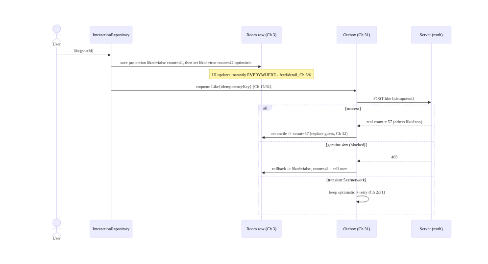
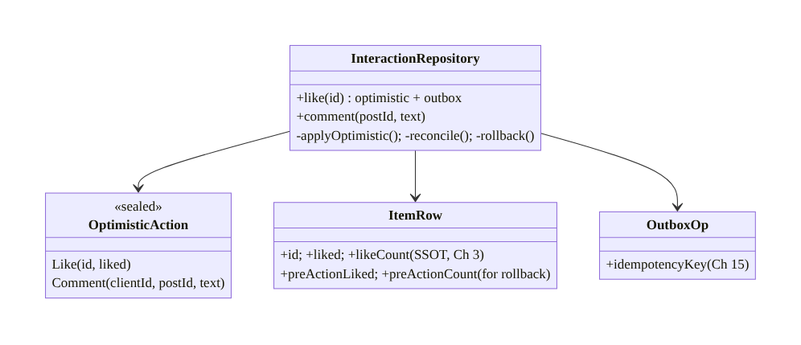
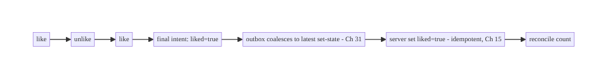
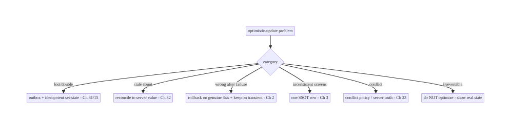

# Chapter 72 — Optimistic Updates (Likes / Comments)

> **Part IX — Feature Architectures** · Complexity: **Complex** (≥40 interview questions)
>
> **Prerequisites:** Ch 3 (SSOT/Room), Ch 31 (outbox), Ch 15 (idempotency), Ch 2
> (retries), Ch 6 (UI state/UDF), Ch 32 (sync), Ch 29 (offline-first). Pairs with Ch 71
> (feed), Ch 64 (chat), Ch 33 (conflict resolution).
>
> **Reference surface in StreamCart:** instant-feeling interactions — like/unlike,
> favorite, follow, add-to-cart, post a comment, rate — that update the UI immediately,
> persist and retry reliably, reconcile with the server, and roll back cleanly on
> failure, all while staying consistent across every screen the item appears on.

---

## 72.1 Problem Definition and Real-World Context

An **optimistic update** applies a user action to the UI **immediately**, assuming it will
succeed, then confirms (or rolls back) once the server responds. It's what makes likes,
follows, and comments feel **instant** instead of showing a spinner on every tap. But doing
it correctly is deceptively hard: the update must **persist** (survive process death and
work offline), **retry** reliably, be **idempotent** (double-taps, retries), **reconcile**
with the server's authoritative value, **roll back** cleanly on genuine failure, stay
**consistent** across every screen the item appears on, and handle **concurrent** actions
(rapid like/unlike) and **conflicts** (server state diverged). Naive optimistic UI
("flip a boolean in memory, fire a POST") loses updates on death, double-counts on
double-tap, shows the wrong state after failure, and diverges across screens.

Concretely, teams hit:

- **In-memory only → lost on death/offline.** Flipping a UI flag without persisting means a
  like is lost on process death or if offline. The optimistic change must go into the
  **SSOT** (Room, Ch 3) and an **outbox** (Ch 31), not just memory.
- **Double-count / non-idempotent.** Rapid double-taps or retries fire multiple requests;
  without **idempotency** (Ch 15) the like counts twice or the comment posts twice.
- **No reconciliation.** The optimistic value is a **guess**; the server's response is
  **authoritative** (the real like count may differ due to others' actions). You must
  **reconcile** to the server value, not keep the guess.
- **Bad rollback.** On genuine failure, the UI must revert to the **pre-action** state
  (and ideally tell the user) — but only for real failures, not transient retries.
- **Inconsistency across screens.** The same item appears in the feed (Ch 71), detail,
  profile; an optimistic like must update **all** of them — only possible if it's one
  **SSOT row** (Ch 3), not per-screen state.
- **Concurrency / conflicts.** Rapid like→unlike→like, or the server state changing
  underneath, needs ordering, idempotency (Ch 15), and conflict handling (Ch 33).
- **Which actions to optimize.** Likes/follows (cheap, reversible) are great candidates;
  **payments/irreversible** actions should **not** be optimistic (show real state).

The architecture: apply the action **optimistically to the SSOT** (Room, Ch 3) so the UI
updates instantly **everywhere the item appears** (UDF, Ch 6); record the intent in an
**outbox** (Ch 31) with an **idempotency key** (Ch 15) so it **persists, retries, and
dedups**; **reconcile** with the server's authoritative response (don't keep the guess);
**roll back** the SSOT to the pre-action value on genuine failure (with user feedback);
handle **concurrency** (rapid toggles) and **conflicts** (Ch 33); and **don't** apply
optimism to **irreversible/high-stakes** actions. This chapter is the **end-to-end pattern
for reliable, consistent, reversible optimistic interactions**.

### Three practical use cases

1. **Like/unlike (StreamCart feed, Ch 71).** Tap like → SSOT updates instantly (count+1,
   likedByMe=true) across feed/detail; outbox syncs with idempotency; reconcile to server
   count; roll back on failure.
2. **Post a comment.** Comment appears immediately (status "sending") in the SSOT; outbox
   posts it idempotently; on success it's confirmed (server id/timestamp), on failure
   marked "failed" with retry.
3. **Follow / add-to-cart.** Instant toggle; offline-capable; reconciled; rolled back if
   the server rejects (e.g., blocked, out of stock).

### Why this is architectural

Optimistic updates **compose** SSOT (Ch 3), outbox (Ch 31), idempotency (Ch 15), retries
(Ch 2), sync/reconciliation (Ch 32), conflict resolution (Ch 33), and UDF (Ch 6) into a
reusable interaction pattern used across the whole app (feed Ch 71, chat Ch 64, cart Ch 38).
The decisions — SSOT-not-memory, outbox+idempotency, reconcile-don't-keep-guess, clean
rollback, consistency-via-one-row, don't-optimize-irreversible — determine whether
interactions feel instant *and* stay correct.

---

## 72.2 Requirements Engineering

### Functional requirements

| ID | Requirement |
|----|-------------|
| F1 | Apply the action to the UI instantly (optimistic), via the SSOT (Ch 3/6). |
| F2 | Persist the intent (outbox) so it survives process death and works offline (Ch 31/29). |
| F3 | Send idempotently with retry; dedup double-taps/retries (Ch 15/2). |
| F4 | Reconcile with the server's authoritative value (don't keep the guess). |
| F5 | Roll back to pre-action state on genuine failure, with user feedback. |
| F6 | Stay consistent across all screens (one SSOT row); handle concurrency/conflicts (Ch 3/33). |

### Non-functional requirements

| Attribute | Policy |
|-----------|--------|
| **Instant UX** | UI updates immediately; no spinner for reversible actions. |
| **Reliability** | Persists (death/offline); retries; never lost (Ch 31/29). |
| **Correctness** | Idempotent; reconciled to server truth; clean rollback (Ch 15). |
| **Consistency** | One SSOT row → all screens consistent (Ch 3). |
| **Safety** | Not applied to irreversible/high-stakes actions. |

### Scope

- **In scope:** the optimistic pattern (SSOT apply → outbox → idempotent send → reconcile /
  rollback), consistency via one SSOT row (Ch 3/6), outbox + idempotency + retry (Ch 31/15/
  2), reconciliation to server truth, rollback UX, concurrency (rapid toggles), conflicts
  (Ch 33), offline (Ch 29), when-not-to-optimize (irreversible), count vs boolean vs
  create (like/comment) shapes.
- **Out of scope:** SSOT internals (Ch 3), outbox/sync/idempotency mechanics (Ch 31/32/15),
  conflict resolution depth (Ch 33), feed (Ch 71), chat send (Ch 64), UDF (Ch 6).

### Assumptions & constraints

- Room SSOT (Ch 3), outbox (Ch 31), WorkManager (Ch 30), UDF/StateFlow (Ch 6). `minSdk 24`.
  The **server is authoritative** for the real value (like counts, comment ids); actions
  have **idempotency keys**; optimistic UI is for **reversible** actions.

---

## 72.3 System Design Fundamentals

- **Optimistic = apply now, confirm/revert later.** On the user action, **immediately**
  apply the expected result to local state, show it, and send the request in the
  background; when the server responds, **confirm** (replace the guess with the real value)
  or **roll back** (revert) on failure. This removes the per-tap spinner and makes the app
  feel instant.
- **Apply to the SSOT, not memory (the consistency key, Ch 3/6).** The optimistic change
  must mutate the **SSOT (Room row)** — not a screen-local variable. Because the item is
  **one row** rendered by every screen (feed Ch 71, detail, profile) via UDF (Ch 6), a
  single SSOT mutation makes the like appear **everywhere at once** and stay consistent.
  In-memory optimism diverges across screens and is lost on death.
- **Persist the intent in an outbox (Ch 31).** Record the action (like X, comment Y) in an
  **outbox** so it **survives process death and offline** and is **retried** reliably
  (Ch 2). The outbox op carries an **idempotency key** (Ch 15). (Same reliable-send pattern
  as chat, Ch 64, and cart mutations, Ch 38.)
- **Idempotency (Ch 15) — mandatory.** Rapid double-taps, retries, and the outbox re-sending
  must **not** double-apply. Use an **idempotency key** (per action) so the server dedups:
  a like is "set liked=true" (idempotent) not "increment" (not idempotent); a comment
  carries a client-generated id so a retry doesn't post twice (Ch 15/64). Model actions
  idempotently.
- **Reconcile with the server's authoritative value (don't keep the guess).** The
  optimistic value is an **estimate** — the real like count depends on **everyone's**
  actions, so the server's response is **truth**. On confirmation, **replace** the local
  guess with the server value (e.g., the real count), not just "mark confirmed." This
  corrects drift (your +1 guess vs the actual count). Background sync (Ch 32) also
  reconciles.
- **Rollback on genuine failure (not transient).** Distinguish:
  - **Transient failure** (network, 5xx): **keep** the optimistic state and **retry**
    (outbox/backoff, Ch 2/31) — don't roll back on a blip.
  - **Genuine failure** (4xx: forbidden, blocked, out-of-stock, validation): **roll back**
    the SSOT to the **pre-action** value and **tell the user** (toast/snackbar). Store the
    pre-action value so rollback is exact.
  Rolling back on every transient error causes flicker; never rolling back leaves wrong
  state — distinguish by response.
- **Consistency across screens = one SSOT row (Ch 3).** Don't special-case the feed's like
  vs the detail's like — they read the **same row**. Optimistic mutation + reconciliation
  happen on that row; every observer updates. This is why SSOT-backing (not per-screen
  state) is non-negotiable.
- **Concurrency & conflicts (Ch 33).** Rapid **like→unlike→like** must end in the correct
  final state: model as **idempotent set-state** (last intent wins) with the outbox
  coalescing/ordering (Ch 31), not racing increments. Server-state **conflicts** (someone
  else changed it; your offline action conflicts) reconcile via the server value / conflict
  policy (Ch 33) — typically the **server's count** wins for counts, **last-writer** for
  booleans, with the user's own action honored.
- **Action shapes:**
  - **Boolean toggle** (like/follow/favorite): optimistic `liked=true/false`; reconcile the
    **count** to server; idempotent set-state.
  - **Create** (comment/review): optimistic insert with status **Sending → Sent/Failed**
    and a client id (Ch 64); reconcile to the server-assigned id/timestamp.
  - **Counter**: never optimistic-increment blindly; set-state + reconcile to server count.
- **When NOT to be optimistic (safety).** **Irreversible or high-stakes** actions —
  **payments, placing an order, deleting data, money transfer** — should **not** be
  optimistic; show the **real** state (confirmed by the server) because a rollback after the
  user believed it succeeded is unacceptable. Optimism is for **cheap, reversible** actions
  (likes, follows, comments, cart toggles).

Core insight: **apply the user's reversible action optimistically to the SSOT (one Room row,
Ch 3) so the UI updates instantly and consistently across every screen (UDF, Ch 6); persist
the intent in an outbox with an idempotency key (Ch 31/15) so it survives process death and
offline, retries reliably, and dedups double-taps/retries; reconcile with the server's
authoritative value (replace the guess — the real count depends on everyone, Ch 32);
distinguish transient failures (keep + retry) from genuine ones (roll back to the stored
pre-action value + tell the user); model actions as idempotent set-state and resolve
concurrency/conflicts via the server value (Ch 33); and never apply optimism to
irreversible or high-stakes actions (payments/orders/deletes) — show real state there.**

---

## 72.4 High-Level Architecture



**Components & ownership**

- **Optimistic apply** mutates the **SSOT row** (storing the pre-action value) → UI instant
  + consistent.
- **Outbox + idempotency** persist/retry/dedup the intent (Ch 31/15).
- **Reconcile** replaces the guess with server truth; **rollback** reverts on genuine
  failure; **conflict policy** (Ch 33) resolves divergence.
- **Irreversible actions bypass** optimism.

**Direction:** tap → optimistic SSOT apply (+pre-value) → instant UI + outbox(idempotent) →
server → reconcile / keep-retry / rollback → SSOT truth; conflicts via policy; irreversible
excluded.

---

## 72.5 Detailed Component Design



| Component | Responsibility |
|-----------|----------------|
| `InteractionRepository` | optimistic apply → outbox → reconcile/rollback over SSOT |
| `ItemRow` | SSOT row with current + **pre-action** values (rollback) |
| `OptimisticAction` | typed actions (toggle / create) |
| `OutboxOp` | persisted intent + idempotency key (Ch 31/15) |

---

## 72.6 End-to-End Data Flow

### Like: optimistic → reconcile / rollback


### Rapid toggle (idempotent set-state)



---

## 72.7 Complete Kotlin Implementation

Package: `com.streamcart.interactions`.

### 72.7.1 SSOT row with pre-action values (for rollback)

```kotlin
@Entity(tableName = "posts")
data class PostRow(
    @PrimaryKey val id: String, val likeCount: Int, val likedByMe: Boolean,
    // pre-action snapshot for exact rollback (or store in the outbox op):
    val pendingLike: Boolean = false,
)
```

### 72.7.2 Optimistic like: apply to SSOT → outbox (idempotent)

```kotlin
@Singleton
class InteractionRepository @Inject constructor(
    private val dao: PostDao, private val outbox: Outbox, private val api: InteractionApi,  // Ch 31
) {
    suspend fun like(postId: String, like: Boolean) {
        val current = dao.byId(postId) ?: return
        val preLiked = current.likedByMe; val preCount = current.likeCount
        // 1) Optimistic SSOT mutation -> UI instant EVERYWHERE (Ch 3/6). Idempotent SET-STATE (not increment).
        dao.setLike(postId, liked = like, count = preCount + if (like && !preLiked) 1 else if (!like && preLiked) -1 else 0)
        // 2) Persist intent with idempotency key; survives death/offline; retried (Ch 31/15/2).
        outbox.enqueue(OutboxOp.SetLike(postId, like, idempotencyKey = "$postId:like:$like", preLiked, preCount))
    }

    // OutboxProcessor calls this.
    suspend fun syncSetLike(op: OutboxOp.SetLike): OutboxResult = runCatching {
        val serverCount = api.setLike(op.postId, op.like, op.idempotencyKey)   // idempotent set-state (Ch 15)
        dao.reconcileCount(op.postId, serverCount)                              // 3) RECONCILE to server truth (Ch 32)
        OutboxResult.Done
    }.getOrElse { e ->
        when {
            e.isTransient() -> OutboxResult.Retry                               // 5xx/network: keep + retry (Ch 2)
            else -> { dao.setLike(op.postId, op.preLiked, op.preCount); OutboxResult.Failed(e) }  // 4) ROLLBACK (4xx) + user feedback
        }
    }
}
```

### 72.7.3 Optimistic create (comment): Sending → Sent/Failed (Ch 64 pattern)

```kotlin
suspend fun InteractionRepository.comment(postId: String, text: String) {
    val clientId = UUID.randomUUID().toString()                      // idempotency + optimistic match (Ch 15/64)
    dao.insertComment(Comment(clientId, postId, text, status = Status.Sending, serverId = null))  // optimistic insert
    outbox.enqueue(OutboxOp.PostComment(clientId, postId, text))
}
suspend fun InteractionRepository.syncComment(op: OutboxOp.PostComment): OutboxResult = runCatching {
    val posted = api.postComment(op.postId, op.text, idempotencyKey = op.clientId)   // idempotent (Ch 15)
    dao.confirmComment(op.clientId, serverId = posted.id, status = Status.Sent)       // reconcile to server id
    OutboxResult.Done
}.getOrElse { e ->
    if (e.isTransient()) OutboxResult.Retry
    else { dao.markComment(op.clientId, Status.Failed); OutboxResult.Failed(e) }      // show "failed" + manual retry
}
```

### 72.7.4 UI: render SSOT (instant + consistent), failure feedback (Ch 6)

```kotlin
@Composable
fun LikeButton(post: PostRow, vm: PostViewModel = hiltViewModel()) {
    // Reads the SSOT row -> same state in feed/detail/profile (Ch 3). Tap updates instantly.
    IconToggleButton(checked = post.likedByMe, onCheckedChange = { vm.like(post.id, it) }) {
        Icon(if (post.likedByMe) Icons.Filled.Favorite else Icons.Outlined.FavoriteBorder, null)
    }
    Text("${post.likeCount}")   // reconciled to server truth after sync (Ch 32)
    // Genuine-failure rollback surfaces a snackbar ("Couldn't like — try again") via a one-time event (Ch 7).
}
```

### 72.7.5 When NOT to be optimistic (irreversible)

```kotlin
// Payments/orders/deletes: show REAL state (server-confirmed), not optimistic.
suspend fun placeOrder(cart: Cart): Outcome<Order> {
    // NO optimistic "order placed". Show "Placing…" -> await server -> show confirmed/failed.
    return api.placeOrder(cart)   // real state only; a rollback after "order placed" is unacceptable
}
```

### 72.7.6 Module structure

```
:core:interactions  InteractionRepository, OptimisticAction, OutboxOp (idempotency), reconcile/rollback
:core:data          SSOT rows (Ch 3); :core:outbox Outbox + processor (Ch 31)
# Idempotency -> Ch 15; retries -> Ch 2; reconcile/sync -> Ch 32; conflicts -> Ch 33. Used by feed (Ch 71), chat (Ch 64), cart (Ch 38).
```

---

## 72.8 Concurrency and Race Conditions

| Scenario | Risk | Handling |
|----------|------|----------|
| Double-tap / retry | double-count/post | idempotency key + set-state (not increment) (Ch 15) |
| Rapid like→unlike→like | wrong final state | idempotent set-state (latest intent); outbox coalesces (Ch 31) |
| Server count diverges | stale guess | reconcile to server value (Ch 32) |
| Process death mid-action | lost action | outbox persisted (Ch 31) |
| Transient failure | false rollback/flicker | keep + retry; roll back only on genuine 4xx (Ch 2) |
| Same item on many screens | divergent state | one SSOT row (Ch 3) |
| Offline action then conflict | divergence | queue; reconcile/conflict policy on sync (Ch 29/33) |

- **Idempotent set-state beats increments:** modeling a like as "set liked=true" (not
  "increment count") makes double-taps, retries, and re-sends **idempotent** (Ch 15); the
  **count** is then reconciled to the **server's** authoritative value (which reflects
  everyone). Increment-based optimism double-counts and can't reconcile cleanly.
- **Latest-intent wins for rapid toggles:** like→unlike→like should send the **final**
  set-state; the outbox **coalesces** rapid toggles to the latest (Ch 31) rather than
  racing N requests, and idempotency makes any that do go out safe.
- **One SSOT row = inherent cross-screen consistency:** because feed/detail/profile read the
  same row (Ch 3), there's no multi-screen sync problem — the optimistic mutation and
  reconciliation happen once.

---

## 72.9 Failure Scenarios and Recovery

| Failure | Detection | Response | Outcome |
|---------|-----------|----------|---------|
| Lost on process death | action gone | outbox persisted (Ch 31) | survives |
| Double-count on double-tap | wrong count | idempotent set-state (Ch 15) | single |
| Stale count vs server | drift | reconcile to server value (Ch 32) | correct |
| Genuine failure (blocked/4xx) | response | roll back to pre-action + tell user | reverted |
| Transient failure | 5xx/network | keep optimistic + retry (Ch 2/31) | eventually sent |
| Divergent across screens | inconsistency | one SSOT row (Ch 3) | consistent |
| Offline conflict | server diverged | conflict policy / server value (Ch 33) | resolved |
| Optimistic on a payment | wrong "success" | don't optimize irreversible; show real state | safe |



> **Optimistic updates are "guess, persist, reconcile, revert" — not "flip a boolean."**
> Apply to the SSOT (one row → consistent + death-safe), persist in an outbox with an
> idempotency key (reliable + dedup), reconcile to the server's authoritative value (not
> your guess), and roll back only on genuine failure. Model actions as idempotent set-state,
> and never optimize irreversible actions.

---

## 72.10 Scaling the Implementation

- **Level 1.** Optimistic SSOT mutation + instant UI (one row); basic send.
- **Level 2.** Outbox + idempotency key + retry (Ch 31/15/2); reconcile to server value;
  rollback on genuine failure.
- **Level 3 — production.** Transient-vs-genuine failure distinction + user feedback;
  comment create (Sending/Sent/Failed); rapid-toggle coalescing; offline (Ch 29).
- **Level 4 — large.** Conflict resolution (Ch 33); cross-device consistency (Ch 32);
  per-action-type policies; analytics (optimistic success/rollback rate); reusable
  optimistic framework across features (feed Ch 71, chat Ch 64, cart Ch 38).
- **Level 5 — enterprise.** Interaction QoE SLOs, A/B of optimistic behavior, abuse/rate-
  limit handling, consistency guarantees, irreversible-action governance.

**Avoid overengineering:** SSOT apply + outbox + idempotency + reconcile + rollback is the
reusable core. Don't build optimism for irreversible actions; don't hand-roll per-feature —
reuse one pattern.

---

## 72.11 Alternative Approaches and Trade-offs

| Dimension | Option A | Option B | When |
|-----------|----------|----------|------|
| State location | SSOT row (Ch 3) | screen-local memory | SSOT (consistent, death-safe); memory diverges/loses |
| Persistence | Outbox (Ch 31) | fire-and-forget POST | Outbox (survives death/offline, retries) |
| Action model | Idempotent set-state (Ch 15) | increment / non-idempotent | Set-state (double-tap/retry safe) |
| Server value | Reconcile (replace guess) | keep optimistic value | Reconcile (count reflects everyone, Ch 32) |
| Failure | Roll back on genuine, keep on transient | roll back on any error | Distinguish (avoid flicker vs wrong state) |
| Candidates | Reversible (like/follow/comment) | everything incl. payments | Reversible only; never irreversible |
| Create | Status Sending/Sent/Failed + client id (Ch 64) | optimistic with no status | Status + client id (reconcile, retry) |

**SSOT vs in-memory optimistic state:** flipping a screen-local boolean is the common naive
approach — it diverges across screens (feed vs detail show different like states), is lost on
process death, and can't reconcile. Applying to the **SSOT row** (Ch 3) makes the change
**consistent everywhere** (one row, UDF Ch 6), **death-safe**, and reconcilable. Always
optimize the SSOT, never memory.

**Reconcile vs keep-the-guess:** the optimistic "+1" is a **guess** — the real like count
changes as **others** act, so keeping your guess drifts from reality. **Reconciling** to the
server's authoritative value on confirmation (and via background sync, Ch 32) keeps counts
correct. Model booleans as your-own-state (honored) but counts as **server truth**.

**Idempotent set-state vs increment:** "increment the like count" is **not idempotent** —
double-taps and retries double-count. "**Set** liked=true/false" is **idempotent** (Ch 15):
applying it twice is the same as once, and the server dedups via the idempotency key. Model
toggles as set-state and reconcile the derived count.

**Optimistic vs real-state for irreversible actions:** optimism is great for **cheap,
reversible** actions, but for **payments, orders, deletes, transfers** a rollback after the
user believed it succeeded is **unacceptable** (they think they paid/ordered). Show the
**real, server-confirmed** state for irreversible/high-stakes actions; reserve optimism for
likes/follows/comments/cart-toggles.

---

## 72.12 Security Considerations

- **Server authorizes the action (Ch 23/19):** optimistic UI is **client convenience**; the
  **server** validates and authorizes (can this user like/comment/follow? blocked? rate-
  limited?). A genuine 4xx (forbidden) triggers rollback — never treat the optimistic state
  as authorization.
- **Idempotency key integrity (Ch 15):** the key dedups retries; the server enforces
  idempotency so a replayed request can't double-apply (also prevents some abuse).
- **Untrusted content (Ch 52):** optimistically-inserted comments are user content — sanitize
  on render; the server validates/moderates (don't trust client text).
- **Rate limiting / abuse:** rapid toggles and spam are **server-rate-limited**; the client's
  optimism must handle server rejections (rollback) gracefully — don't let optimism mask
  abuse controls.
- **Per-account isolation (Ch 42):** interaction state (likedByMe) is per-account; clear/
  scope on logout.
- **Don't optimize security-relevant or irreversible actions:** permission changes, payments,
  deletes show real state (above).
- Client vs backend: the **server** is authoritative (validates, authorizes, dedups, ranks
  counts), the **client** applies optimistically and reconciles/rolls back to the server's
  verdict — optimism never overrides server authority.

---

## 72.13 Performance and Resource Optimization

- **Instant UI** is the whole point — no network round-trip blocking the tap (SSOT mutation
  is local/fast).
- **Coalesce rapid toggles** (Ch 31) — send the final set-state, not N requests (battery/
  server load).
- **Batch reconciliations** where possible (e.g., sync counts for visible items, Ch 32).
- **Idempotent set-state** avoids wasted re-work from retries/duplicates.
- **Outbox efficiency** — debounce/dedupe ops (Ch 31); don't spam.
- **Reconcile visible items** (don't fetch counts for off-screen).
- **Profiling:** optimistic→confirmed latency, rollback rate, double-send rate (→ 0),
  outbox depth, reconcile frequency.

---

## 72.14 Testing Strategy

Highly unit-testable (SSOT apply, idempotency, reconcile, rollback) with fakes.

```kotlin
class OptimisticLikeTest {
    @Test fun `applies optimistically and enqueues idempotent outbox op`() = runTest {
        repo.like("p1", true)
        assertTrue(dao.byId("p1").likedByMe)                         // instant (Ch 3)
        assertEquals("p1:like:true", outbox.last().idempotencyKey)   // idempotent (Ch 15)
    }
    @Test fun `reconciles count to server value`() = runTest {
        api.nextCount = 57; repo.syncSetLike(opLike("p1"))
        assertEquals(57, dao.byId("p1").likeCount)                   // replace guess (Ch 32)
    }
    @Test fun `rolls back on genuine 4xx, keeps on transient`() = runTest {
        api.failWith(403); repo.syncSetLike(opLike("p1", preCount = 41))
        assertEquals(41, dao.byId("p1").likeCount)                   // rolled back
        api.failWith(503); val r = repo.syncSetLike(opLike("p2"))
        assertTrue(r is OutboxResult.Retry)                          // kept + retry (Ch 2)
    }
    @Test fun `double-tap does not double-count`() = runTest {
        repo.like("p1", true); repo.like("p1", true)                 // idempotent set-state
        assertEquals(1, dao.byId("p1").likeCount - baseCount)
    }
}

class OptimisticCommentTest {
    @Test fun `comment shows Sending then Sent with server id`() = runTest { /* reconcile to server id (Ch 64) */ }
    @Test fun `comment marks Failed on genuine error`() = runTest { /* ... */ }
}
```

What to test: optimistic SSOT apply (instant) + idempotent outbox op; reconcile to server
value; rollback on genuine 4xx vs keep+retry on transient; double-tap/rapid-toggle
idempotency; comment Sending→Sent/Failed; cross-screen consistency (same row); process-death
resume (outbox). Fake API/outbox; Room in-memory.

---

## 72.15 Production Observability

- **Metrics:** optimistic→confirmed **latency**; **rollback rate** (by reason: 4xx/validation);
  double-send/double-count rate (→ 0); reconcile corrections (guess vs server delta); outbox
  depth + retry rate; offline-queued actions; per-action-type success.
- **Logs:** `interaction{type, action, result(confirmed/rolledback/retry)}` — no content/PII
  (Ch 28).
- **Debugging:** lost actions → not using outbox (Ch 31); double-count → non-idempotent
  (increment vs set-state, Ch 15); wrong count → not reconciling (Ch 32); flicker → rolling
  back on transient; inconsistent screens → not SSOT-backed (Ch 3); "success" then gone →
  optimistic on an irreversible action.
- **Alerting:** rollback-rate spike (server rejecting — bug/abuse); double-count detection;
  reconcile-correction spike (guess drift).
- **Dashboards:** rollback rate by reason; optimistic latency; outbox depth.

---

## 72.16 System Design Interview Preparation

> ≥40 questions.

**Fundamentals**
1. *Optimistic update?* Apply the action to the UI immediately, confirm/revert on server
   response.
2. *Why?* Instant feel; no per-tap spinner.
3. *Apply where?* The SSOT row (Ch 3), not memory.
4. *Why SSOT not memory?* Consistent across screens + death-safe + reconcilable.
5. *Persist how?* Outbox (Ch 31) with an idempotency key (Ch 15).

**Idempotency/model**
6. *Why idempotency?* Double-tap/retry must not double-apply (Ch 15).
7. *Set-state vs increment?* Set-state is idempotent; increment double-counts.
8. *Comment idempotency?* Client-generated id (Ch 64).
9. *Rapid like→unlike→like?* Latest set-state wins; outbox coalesces (Ch 31).

**Reconciliation**
10. *Is the optimistic value truth?* No — a guess; server is authoritative.
11. *Reconcile?* Replace guess with server value (real count, Ch 32).
12. *Why counts differ?* Others act too; server reflects everyone.
13. *Boolean vs count?* Your boolean honored; count reconciled to server.

**Rollback**
14. *When roll back?* Genuine failure (4xx: forbidden/blocked/validation).
15. *When keep?* Transient (5xx/network) → retry (Ch 2).
16. *Why distinguish?* Rolling back on transient causes flicker; never rolling back leaves
    wrong state.
17. *Rollback to what?* The stored pre-action value.
18. *User feedback?* Snackbar/toast on rollback.

**Consistency/concurrency**
19. *Same item many screens?* One SSOT row → all consistent (Ch 3).
20. *Process death?* Outbox persisted (Ch 31).
21. *Offline?* Queue; reconcile/conflict on sync (Ch 29/33).
22. *Conflicts?* Server value / conflict policy (Ch 33).

**Create (comment)**
23. *Comment states?* Sending → Sent/Failed; client id; reconcile to server id.
24. *Failed comment?* Mark failed + manual retry.

**Safety**
25. *Don't optimize what?* Irreversible/high-stakes (payments/orders/deletes).
26. *Why?* Rollback after perceived success is unacceptable.
27. *Server role?* Authorize/validate/dedup (Ch 23); optimism is client convenience.

**Testing/Production**
28. *Test optimistic?* Instant SSOT apply + idempotent op.
29. *Test reconcile?* Count → server value.
30. *Test rollback?* Genuine 4xx reverts; transient retries.
31. *Test double-tap?* No double-count.
32. *Lost in prod?* Not using outbox.
33. *Double-count?* Non-idempotent.
34. *Wrong count?* Not reconciling.
35. *Flicker?* Rollback on transient.
36. *Inconsistent screens?* Not SSOT-backed.
37. *Key metrics?* Rollback rate, optimistic latency, double-count.

**Composition**
38. *Used by?* Feed (Ch 71), chat send (Ch 64), cart (Ch 38).
39. *Reuse?* One pattern (SSOT+outbox+idempotency+reconcile+rollback).
40. *Cross-device?* Reconcile via sync (Ch 32).
41. *Abuse?* Server rate-limits; client handles rejection (rollback).

### Design-change challenges
1. **Make likes feel instant but correct.** Optimistic SSOT set-state + outbox idempotency +
   reconcile count + rollback (Ch 3/31/15/32).
2. **Double-tap double-counts.** Idempotent set-state + idempotency key (Ch 15).
3. **Like count wrong vs server.** Reconcile to server value (Ch 32).
4. **UI flickers on flaky network.** Keep on transient, roll back only on genuine 4xx (Ch 2).
5. **Optimistic "order placed" then it failed.** Don't optimize irreversible; show real
   state.

### Mock walkthrough (abridged)
Clarify (which actions, reversible?, offline?, multi-screen?) → optimistic SSOT apply (one
row, store pre-value, Ch 3) → outbox + idempotency key (persist/retry/dedup, Ch 31/15) →
idempotent set-state model → reconcile to server value (Ch 32) → rollback on genuine 4xx vs
keep+retry on transient (Ch 2) → consistency via one row + conflicts (Ch 3/33) → exclude
irreversible actions → security (server authorizes) → observability (rollback rate).

---

## 72.17 Practical Exercises

1. **Beginner.** Make like/unlike optimistic via an SSOT set-state mutation so it updates
   instantly in both the feed and detail (one row). *Eval:* instant; consistent.
2. **Intermediate.** Add an outbox op with an idempotency key, retry, and reconcile the
   count to the server value. *Eval:* survives death/offline; count correct; double-tap
   safe.
3. **Advanced.** Implement rollback on genuine 4xx (revert to pre-action + snackbar) vs
   keep+retry on transient; handle rapid like→unlike→like via coalescing. *Eval:* no
   flicker; correct final state.
4. **Production debugging.** Fix double-counting (increment → idempotent set-state) and a
   count that drifts from the server (add reconciliation). *Eval:* single count; reconciled.
5. **System design challenge.** Add optimistic comment create (Sending/Sent/Failed + client
   id) and ensure a payment is **not** optimistic (real state). *Eval:* comments reconcile;
   payment shows confirmed-only.

*(Solutions withheld unless requested.)*

---

## 72.18 Chapter Summary & Reference Sheet

**Key decisions:** apply the user's **reversible** action **optimistically to the SSOT**
(one Room row, Ch 3) so the UI updates **instantly and consistently across every screen**
(UDF, Ch 6) and survives process death; **persist the intent in an outbox with an
idempotency key** (Ch 31/15) so it works **offline**, **retries** reliably (Ch 2), and
**dedups** double-taps/retries — modeling actions as **idempotent set-state** (not
increments); **reconcile with the server's authoritative value** (replace the guess — the
real count reflects everyone, Ch 32); **distinguish transient failures** (keep the
optimistic state + retry) from **genuine failures** (4xx → **roll back to the stored
pre-action value** + tell the user), avoiding both flicker and wrong state; resolve
**concurrency** (rapid toggles → latest set-state, coalesced) and **conflicts** via the
server value / policy (Ch 33); and **never apply optimism to irreversible or high-stakes
actions** (payments, orders, deletes) — show **real, server-confirmed** state there. The
**server is authoritative** (validates/authorizes/dedups, Ch 23); optimism is client
convenience.

**Concepts:** optimistic apply to SSOT (one row), outbox + idempotency (persist/retry/
dedup), idempotent set-state, reconcile-to-server-truth, transient-vs-genuine rollback,
cross-screen consistency, concurrency/conflict (Ch 33), create (Sending/Sent/Failed),
irreversible-exclusion.

**Common mistakes:** in-memory optimism (diverges across screens, lost on death); fire-and-
forget (lost offline/on death); increment instead of set-state (double-count); keeping the
guess (count drifts); rolling back on transient errors (flicker); never rolling back (wrong
state); not reconciling; optimizing irreversible actions (unacceptable rollback);
per-screen state instead of SSOT; ignoring server authorization.

**Checklist:** ☐ optimistic apply to the SSOT row (store pre-action value, Ch 3) ☐ instant +
consistent across screens (one row, UDF Ch 6) ☐ outbox + idempotency key (Ch 31/15) ☐
idempotent set-state (not increment) ☐ reconcile count/id to server value (Ch 32) ☐ roll
back on genuine 4xx (+ user feedback); keep+retry on transient (Ch 2) ☐ rapid-toggle
coalescing (Ch 31) ☐ conflicts via server/policy (Ch 33) ☐ offline-capable (Ch 29) ☐ NOT
optimistic for irreversible/high-stakes actions ☐ server authorizes (Ch 23) ☐ rollback-rate
+ double-count telemetry.

**Key APIs:** Room `@Dao` set-state mutation + reconcile (Ch 3), Outbox + `OutboxOp` +
idempotency key (Ch 31/15), WorkManager retry (Ch 30/2), `UUID.randomUUID` (comment client
id, Ch 64), UDF `StateFlow` (Ch 6), one-time events for failure feedback (Ch 7), sync
reconcile (Ch 32), conflict policy (Ch 33).

**References:**
- Offline-first mutations: https://developer.android.com/topic/architecture/data-layer/offline-first#create-update-delete
- (composes) Ch 3 SSOT, Ch 31 Outbox, Ch 15 Idempotency, Ch 2 Retries, Ch 32 Delta Sync, Ch 33 Conflict Resolution, Ch 6 UI State, Ch 71 Feed, Ch 64 Chat, Ch 38 Cart

### Chapter review (Phase 4)
- **Completeness:** all 18 sections; architecture/class/sequence/flow/failure diagrams;
  SSOT row (pre-action) + optimistic like + comment create + reconcile/rollback + irreversible
  exclusion code; concurrency (idempotent set-state, coalesce, one-row consistency); failure
  (guess-persist-reconcile-revert principle); 5 levels; SSOT-vs-memory, reconcile-vs-guess,
  set-state-vs-increment, optimistic-vs-real trade-offs; security (server authority, idempotency,
  untrusted content, irreversible exclusion); perf (instant/coalesce/batch); idempotency+
  reconcile+rollback tests; observability (rollback rate); 41 Q&A + 5 challenges. ✅
- **Expand later:** feed (Ch 71), chat (Ch 64), conflict resolution (Ch 33), outbox (Ch 31),
  sync (Ch 32).
- **Interview coverage:** exceeds ≥40 Complex bar.
