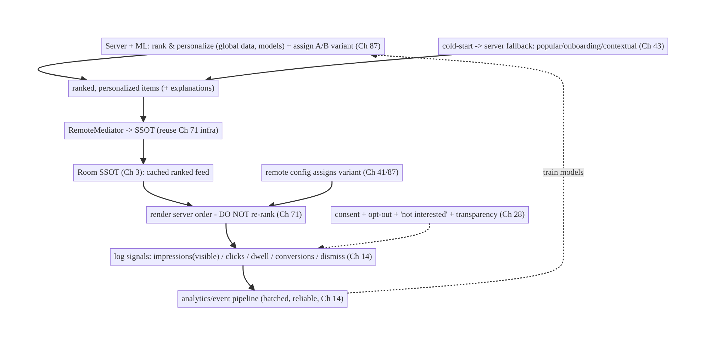
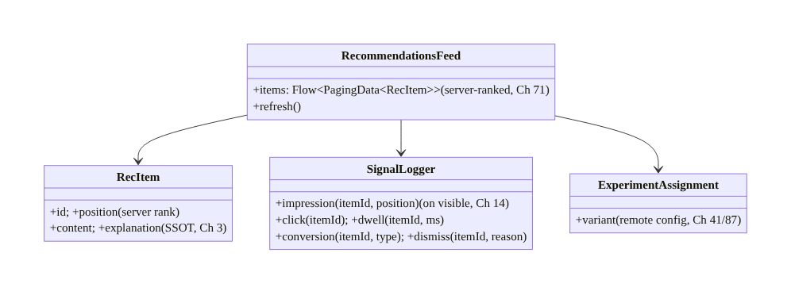
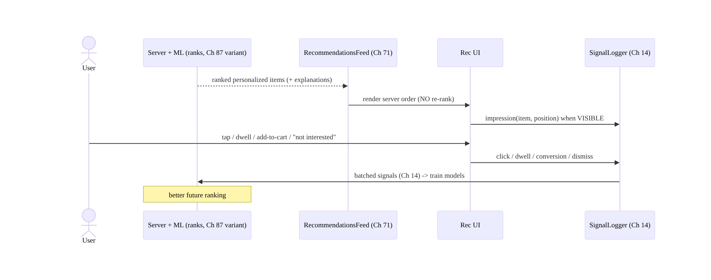
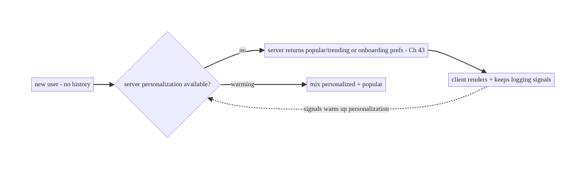
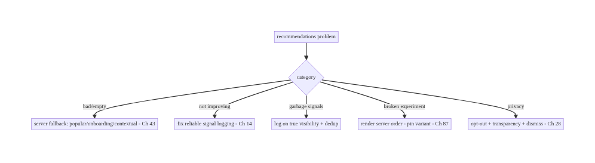

# Chapter 73 — Recommendations Feed

> **Part IX — Feature Architectures** · Complexity: **Standard** (≥25 interview questions)
>
> **Prerequisites:** Ch 71 (infinite feed), Ch 13 (paging), Ch 3 (SSOT), Ch 41 (remote
> config), Ch 14 (analytics/events), Ch 43 (personalization), Ch 28 (privacy). Pairs with
> Ch 72 (interactions), Ch 87 (A/B & experiments).
>
> **Reference surface in StreamCart:** the "Recommended for you" / "You might like"
> surfaces — a personalized, **server-ranked** feed of products/content, where the
> **client's job is to render, log signals, and experiment**, and the **server (and ML)
> does the ranking** — with graceful cold-start, freshness, and privacy.

---

## 73.1 Problem Definition and Real-World Context

A recommendations feed ("Recommended for you", "Because you watched…", "You might like")
is a **personalized, ranked** surface. The crucial architectural truth is a **division of
labor**: the **server (and its ML models)** does the **ranking and personalization**; the
**client renders the ranked results, logs the behavioral signals that feed the models, and
runs experiments**. Teams that try to rank on the client, or that fail to log the right
signals, or that mishandle cold-start/freshness/privacy, end up with poor, stale, or
creepy recommendations and no ability to improve them.

Concretely, teams hit:

- **Trying to rank on the client.** Recommendation ranking needs global data (everyone's
  behavior, catalog, ML models) the client doesn't have. The **server ranks**; the client
  **must not** reorder/re-rank (beyond trivial client-side filters) — it renders the
  server's order (like the feed, Ch 71).
- **Not logging the right signals.** Models improve from **behavioral signals** —
  impressions (what was shown), clicks, dwell time, add-to-cart, purchases, likes (Ch 72),
  dismissals ("not interested"). If the client doesn't **log these reliably** (Ch 14), the
  models can't learn. Signal logging is a first-class client responsibility.
- **Cold-start.** A new user (or new item) has no history → recommendations are empty/bad.
  Need **fallbacks**: popular/trending, onboarding preferences (Ch 43), contextual
  (category) until personalization kicks in.
- **Freshness & caching.** Recommendations go stale (user's interests change, new items);
  the client caches for offline/instant (Ch 3/71) but must **refresh** appropriately and
  not show day-old recs as fresh.
- **Experimentation (A/B).** Recommendation strategies are **A/B tested** (Ch 87) via
  remote config (Ch 41); the client renders the assigned variant and logs outcomes so the
  server measures which ranking wins.
- **Privacy & transparency (Ch 28).** Personalization uses behavioral data — handle with
  **consent**, allow **opt-out/"not interested"**, and be transparent ("Recommended because
  you viewed X"); regulatory constraints apply.
- **Diversity & feedback loops.** Over-optimizing engagement creates filter bubbles/
  repetition; the server manages diversity, but the client surfaces **controls** (dismiss,
  "show less").

The architecture: treat recommendations as a **server-ranked feed** (built on the Ch 71
infra — Paging + SSOT) where the **client renders the server's ranking** and does **not**
re-rank; **log behavioral signals reliably** (impressions, clicks, dwell, conversions,
dismissals) via the analytics/event pipeline (Ch 14) to feed the models; handle **cold-start**
with fallbacks (popular/onboarding/contextual, Ch 43); **cache + refresh** appropriately
(Ch 3/71); render the **A/B-assigned variant** (remote config, Ch 41/87) and log outcomes;
and respect **privacy** (consent, opt-out, transparency, Ch 28). This chapter is about the
**client side of recommendations: render, log, experiment — the server ranks**.

### Three practical use cases

1. **"Recommended for you" (StreamCart).** A server-ranked product feed rendered via the
   Ch 71 infra; the client logs impressions/clicks/add-to-cart; handles cold-start with
   trending; refreshes periodically.
2. **"Because you watched…" row.** A contextual rec row on a detail screen; client renders
   the server's ranked items + the explanation; logs dwell/clicks; "not interested"
   dismissal.
3. **A/B of ranking strategies.** Remote config assigns a ranking variant (Ch 41/87); the
   client renders it and logs conversions so the server picks the winner.

### Why this is architectural

Recommendations define a **client/server division of labor** (server ranks, client renders/
logs/experiments) built on the feed infra (Ch 71), the analytics pipeline (Ch 14),
personalization (Ch 43), remote config/experiments (Ch 41/87), and privacy (Ch 28). The
decisions — don't-rank-on-client, reliable-signal-logging, cold-start fallbacks, cache/
refresh, A/B rendering, privacy/transparency — determine whether recommendations are good,
improvable, and trustworthy.

---

## 73.2 Requirements Engineering

### Functional requirements

| ID | Requirement |
|----|-------------|
| F1 | Render a server-ranked, personalized feed (reuse Ch 71 infra); don't re-rank on client. |
| F2 | Log behavioral signals reliably (impressions, clicks, dwell, conversions, dismissals) (Ch 14). |
| F3 | Handle cold-start with fallbacks (popular/onboarding/contextual) (Ch 43). |
| F4 | Cache for offline/instant; refresh appropriately (not stale-as-fresh) (Ch 3/71). |
| F5 | Render the A/B-assigned variant; log outcomes (Ch 41/87). |
| F6 | Respect privacy (consent, opt-out/"not interested", transparency) (Ch 28). |

### Non-functional requirements

| Attribute | Policy |
|-----------|--------|
| **Division of labor** | Server ranks; client renders/logs/experiments. |
| **Signal fidelity** | Reliable, accurate signals (impressions counted correctly). |
| **Freshness** | Timely refresh; cached for instant/offline; not stale. |
| **Experimentation** | Correct variant rendering + outcome logging (Ch 87). |
| **Privacy** | Consent, opt-out, transparency; regulatory (Ch 28). |

### Scope

- **In scope:** server-ranked rec feed on Ch 71 infra (render, don't re-rank), **signal
  logging** (impression/click/dwell/conversion/dismiss via Ch 14), cold-start fallbacks
  (popular/onboarding/contextual, Ch 43), cache/refresh (Ch 3/71), A/B variant rendering +
  outcome logging (Ch 41/87), privacy (consent/opt-out/transparency, Ch 28), diversity
  controls (dismiss/"show less"), explanations.
- **Out of scope:** ML/ranking algorithms (server-side), feed infra detail (Ch 71), paging
  (Ch 13), analytics pipeline internals (Ch 14), personalization sync (Ch 43),
  experimentation platform (Ch 87), privacy framework (Ch 28).

### Assumptions & constraints

- Built on the **Ch 71 feed** (Paging + SSOT); **server/ML ranks** and returns ordered,
  personalized items; the **analytics/event pipeline** (Ch 14) carries signals; remote
  config (Ch 41) assigns experiments. `minSdk 24`. The **client does not rank**; signals
  drive server-side learning; personalization uses consented behavioral data.

---

## 73.3 System Design Fundamentals

- **Division of labor: server ranks, client renders/logs/experiments (the core truth).**
  Recommendation **ranking/personalization** requires **global data** (all users' behavior,
  the full catalog, trained ML models) that lives **server-side**. So:
  - **Server:** ranks and personalizes, returns an **ordered list** of items (+ optional
    explanations), runs the models, assigns experiments.
  - **Client:** **renders the server's order** (reusing the feed infra, Ch 71), **logs
    behavioral signals** that feed the models, **renders the assigned A/B variant**, and
    surfaces **controls** (dismiss/"not interested").
  The client **must not re-rank** (it lacks the data/model); client-side reordering breaks
  the experiment and the personalization. (Trivial client filters — hide already-purchased —
  are fine if the server allows.)
- **Built on the feed infra (Ch 71).** A recommendations feed **is** a feed: Paging 3 +
  RemoteMediator + SSOT (Ch 71/13/3) for caching, offline, process-death survival, 60fps,
  and position. The *difference* is the content is **server-ranked/personalized** and the
  client **logs signals**. Reuse Ch 71; don't reinvent.
- **Signal logging is a first-class responsibility (Ch 14).** Models learn from **what
  users do**, so the client must **reliably log**:
  - **Impressions:** which items were actually **shown** (viewport-visible, not just
    loaded) — critical and easy to get wrong (log on visible, dedup per session).
  - **Engagement:** clicks/taps, **dwell time** (how long viewed), scroll-past.
  - **Conversions:** add-to-cart, purchase, like (Ch 72), save, watch.
  - **Negative signals:** dismiss, "not interested", hide — strong model inputs.
  These go through the **analytics/event pipeline** (Ch 14: batched, reliable, offline-
  queued). **Bad signal logging = bad recommendations** (garbage in). Impressions
  especially must be accurate (count only truly-visible items).
- **Cold-start (new user/item).** With no history, personalization is empty/weak. **Fallbacks:**
  - **Popular/trending** (global or category) — a safe default.
  - **Onboarding preferences** (Ch 43) — ask interests up front.
  - **Contextual** — based on the current item/category ("because you're viewing X") or
    coarse signals (location/time).
  The **server** decides the fallback strategy; the client renders it and keeps logging so
  personalization warms up.
- **Cache + refresh (Ch 3/71).** Cache the ranked feed (SSOT) for **instant/offline** render
  (Ch 71), but recommendations **go stale** (interests change, new items, model updates).
  **Refresh** on a sensible cadence (app open, pull-to-refresh, after significant actions)
  and **don't present day-old recs as live** — the server controls recency; the client
  refreshes and shows fresh content without yanking position (Ch 71).
- **Experimentation / A/B (Ch 41/87).** Recommendation strategies are **A/B tested**: the
  **server/remote config** (Ch 41) assigns the user a **variant** (ranking model/UX); the
  **client renders the assigned variant** and **logs outcomes** (engagement/conversion) so
  the platform (Ch 87) measures which ranking wins. The client **must render the assigned
  variant faithfully** and log consistently — a client that ignores the assignment or logs
  inconsistently invalidates the experiment.
- **Privacy & transparency (Ch 28).** Personalization uses **behavioral data** →
  **consent** (especially for cross-context/tracking), **opt-out** (turn off
  personalization), **"not interested"/dismiss** controls, and **transparency**
  ("Recommended because you viewed X"). Respect regulatory constraints (GDPR/CCPA: the
  user can opt out, see why, delete data). Signals are **sensitive** (Ch 28) — minimize,
  consent, don't leak.
- **Diversity / feedback loops (server-managed, client controls).** Pure engagement
  optimization causes **filter bubbles/repetition**; the **server** manages diversity/
  exploration, but the **client** surfaces **controls** (dismiss, "show less of this") whose
  signals feed back. The client doesn't fix diversity itself (no ranking) but provides the
  feedback mechanism.

Core insight: **a recommendations feed is a server-ranked, personalized feed built on the
Ch 71 feed infra (Paging + SSOT) — the server (and its ML models) does the ranking and
personalization with global data the client lacks, and the client's job is to render the
server's order (never re-rank), reliably log the behavioral signals that train the models
(impressions on true visibility, clicks, dwell, conversions, and negative signals via the
Ch 14 pipeline), handle cold-start with server-chosen fallbacks (popular/onboarding/
contextual, Ch 43), cache and refresh for instant/offline-yet-fresh content (Ch 3/71),
faithfully render the A/B-assigned variant and log outcomes (Ch 41/87), and respect privacy
with consent, opt-out, dismiss controls, and transparency (Ch 28).**

---

## 73.4 High-Level Architecture



**Components & ownership**

- **Server + ML** ranks/personalizes, assigns experiments, chooses cold-start fallbacks —
  with **global data the client lacks**.
- **Client** renders the server order (reusing Ch 71), **logs signals** (Ch 14) that train
  the models, renders the **assigned variant** (Ch 41/87), and surfaces **privacy/diversity
  controls** (Ch 28).

**Direction:** server ranks → client renders (no re-rank) + logs signals → pipeline trains
models → better ranks; cold-start/experiment/privacy layered on.

---

## 73.5 Detailed Component Design



| Component | Responsibility |
|-----------|----------------|
| `RecommendationsFeed` | render server-ranked feed (Ch 71 infra); refresh; no re-rank |
| `SignalLogger` | log impressions(visible)/clicks/dwell/conversions/dismissals (Ch 14) |
| `RecItem` | SSOT row: server rank position + content + explanation (Ch 3) |
| `ExperimentAssignment` | the assigned A/B variant to render (Ch 41/87) |

---

## 73.6 End-to-End Data Flow

### Render + signal logging → model training



### Cold-start fallback



---

## 73.7 Complete Kotlin Implementation

Package: `com.streamcart.recommendations`.

### 73.7.1 Rec feed on the Ch 71 infra (server-ranked, no re-rank)

```kotlin
@Entity(tableName = "recommendations")
data class RecItem(
    @PrimaryKey val id: String, val position: Int,   // SERVER rank order (Ch 3) - client renders as-is
    val contentJson: String, val explanation: String?,   // "Because you viewed X" (transparency, Ch 28)
    val requestId: String,                                // ties impressions/clicks to this rec request
)

@HiltViewModel
class RecommendationsViewModel @Inject constructor(
    private val db: RecDatabase, private val mediator: RecRemoteMediator,   // reuse Ch 71 infra
    private val experiments: ExperimentConfig,            // Ch 41/87
) : ViewModel() {
    val variant = experiments.recommendationVariant()     // render the ASSIGNED variant (Ch 87)
    @OptIn(ExperimentalPagingApi::class)
    val items: Flow<PagingData<RecItem>> = Pager(
        PagingConfig(pageSize = 20), remoteMediator = mediator,
    ) { db.recs().pagingSource() }.flow.cachedIn(viewModelScope)   // ordered by server `position` - NO client re-rank
}
```

### 73.7.2 Signal logging — impressions on true visibility (Ch 14)

```kotlin
@Singleton
class SignalLogger @Inject constructor(private val analytics: AnalyticsBatcher) {   // Ch 14
    private val impressed = mutableSetOf<String>()        // dedup per session
    fun impression(item: RecItem) {
        if (impressed.add(item.id))                        // log once when truly visible
            analytics.log("rec_impression", mapOf("id" to item.id, "pos" to item.position, "req" to item.requestId))
    }
    fun click(item: RecItem) = analytics.log("rec_click", mapOf("id" to item.id, "pos" to item.position, "req" to item.requestId))
    fun dwell(item: RecItem, ms: Long) = analytics.log("rec_dwell", mapOf("id" to item.id, "ms" to ms))
    fun conversion(item: RecItem, type: String) = analytics.log("rec_conversion", mapOf("id" to item.id, "type" to type))
    fun dismiss(item: RecItem, reason: String) = analytics.log("rec_dismiss", mapOf("id" to item.id, "reason" to reason))  // negative signal
}
```

### 73.7.3 Log impression only when actually visible (viewport)

```kotlin
@Composable
fun RecCard(item: RecItem, logger: SignalLogger, onClick: () -> Unit) {
    // Log an impression when the card is actually ON SCREEN (not merely composed/loaded).
    val visible by rememberIsVisible()                    // viewport visibility helper
    LaunchedEffect(visible) { if (visible) logger.impression(item) }   // accurate impressions (Ch 14)
    Column(Modifier.clickable { logger.click(item); onClick() }) {
        // content...
        item.explanation?.let { Text(it, style = MaterialTheme.typography.labelSmall) }  // transparency (Ch 28)
        DismissButton(onClick = { logger.dismiss(item, "not_interested") })               // negative signal + control
    }
}
```

### 73.7.4 Cold-start + refresh (server-driven)

```kotlin
// The SERVER returns the cold-start fallback (popular/onboarding/contextual, Ch 43) — the client
// just renders whatever the feed API returns and keeps logging signals.
class RecRemoteMediator @Inject constructor(private val api: RecApi, private val db: RecDatabase, private val prefs: UserPrefs) {
    suspend fun load(/* ... */): MediatorResult {
        val recs = api.recommendations(
            context = currentContextOrNull(),            // e.g., viewing category X (contextual)
            onboardingPrefs = prefs.interests(),         // cold-start hint (Ch 43)
            variant = experiments.recommendationVariant(),  // A/B (Ch 87)
        )
        db.recs().replaceAll(recs)                        // server order; refreshable (Ch 71)
        return MediatorResult.Success(endOfPaginationReached = recs.isEmpty())
    }
}
// Refresh on app open / pull-to-refresh / after significant actions (don't show day-old as fresh).
```

### 73.7.5 Privacy: opt-out + transparency (Ch 28)

```kotlin
class RecommendationSettings @Inject constructor(private val prefs: UserPrefs, private val api: RecApi) {
    suspend fun setPersonalization(enabled: Boolean) {
        prefs.setPersonalization(enabled)
        api.setPersonalization(enabled)   // server stops personalizing -> popular/non-personalized (Ch 28)
    }
    // "Not interested" dismiss -> negative signal (SignalLogger) -> server adjusts.
    // Explanations ("Because you viewed X") render from RecItem.explanation (transparency).
}
```

### 73.7.6 Module structure

```
:feature:recommendations  RecommendationsViewModel, RecItem/Dao, RecRemoteMediator, SignalLogger, RecommendationSettings
:core:feed   reuse Paging + SSOT infra (Ch 71/13/3)
:core:analytics  event pipeline (Ch 14); :core:config remote config/experiments (Ch 41/87)
# Ranking/personalization/cold-start/diversity -> SERVER. Privacy -> Ch 28; prefs -> Ch 43.
```

---

## 73.8 Concurrency and Race Conditions

| Scenario | Risk | Handling |
|----------|------|----------|
| Impression logged when not visible | garbage signals | log on true viewport visibility; dedup per session |
| Duplicate impressions | inflated signals | dedup set per request/session |
| Client re-ranks | breaks experiment/personalization | render server order only; no client sort |
| Stale cache shown as fresh | bad recs | refresh cadence; server recency |
| Variant changes mid-session | inconsistent experiment | pin variant per session (Ch 87) |
| Signals lost offline | missing training data | analytics pipeline queues offline (Ch 14) |
| Opt-out not honored | privacy violation | server + client stop personalizing (Ch 28) |

- **Impression accuracy is the signal-quality crux:** logging an impression when an item is
  merely **loaded/composed** (but off-screen) floods the models with false "shown" signals.
  Log only when the item is **actually visible** in the viewport, deduped per request/session
  — accurate impressions are what make click-through and ranking meaningful.
- **Never re-rank on the client:** the client lacks the data/model and would **break the
  A/B experiment** and personalization. Render the server's `position` order; client-side
  reordering is the cardinal recommendations mistake.
- **Signals must survive offline** (Ch 14): queue them in the analytics pipeline so training
  data isn't lost — missing signals = worse recommendations.

---

## 73.9 Failure Scenarios and Recovery

| Failure | Detection | Response | Outcome |
|---------|-----------|----------|---------|
| Bad/empty recs (cold-start) | new user | server fallback (popular/onboarding/contextual, Ch 43) | useful |
| Models not improving | flat metrics | fix signal logging (impressions/clicks/conversions, Ch 14) | learns |
| Inflated/garbage signals | metric anomalies | log impressions on true visibility + dedup | accurate |
| Client re-ranks | broken experiment | render server order only | valid |
| Stale recs | user report | refresh cadence; server recency | fresh |
| Experiment invalid | skewed results | pin variant; consistent logging (Ch 87) | measurable |
| Privacy complaint | opt-out ignored | honor opt-out + transparency + dismiss (Ch 28) | compliant |
| Signals lost offline | gaps | pipeline offline queue (Ch 14) | retained |



> **The client's leverage over recommendation quality is signal logging, not ranking.**
> Render the server's order (never re-rank), log accurate behavioral signals (impressions on
> true visibility, clicks, dwell, conversions, dismissals) that train the models, handle
> cold-start via server fallbacks, faithfully render the assigned experiment variant, and
> respect privacy. Good signals → good recommendations; the server does the ML.

---

## 73.10 Scaling the Implementation

- **Level 1.** Render server-ranked recs on the Ch 71 feed infra (no re-rank); basic click
  logging.
- **Level 2.** Full signal logging (impressions-on-visible/dwell/conversions/dismissals,
  Ch 14); cold-start fallback render; cache/refresh (Ch 71).
- **Level 3 — production.** A/B variant rendering + outcome logging (Ch 41/87); privacy
  (opt-out/transparency/dismiss, Ch 28); explanations; negative-signal controls.
- **Level 4 — large.** Multiple rec surfaces (home/detail/category); contextual recs;
  personalization signals (Ch 43); on-device lightweight re-ranking **only if** the server
  provides it (rare); diversity controls.
- **Level 5 — enterprise.** Rec-quality metrics (CTR, conversion, diversity), experiment
  platform integration (Ch 87), privacy governance (consent/regulatory), real-time signal
  streaming, fairness/diversity monitoring.

**Avoid overengineering:** render + log + cold-start + experiment + privacy is the client's
whole job. **Don't** build ranking/ML on the client; don't re-rank; don't skimp on signal
accuracy.

---

## 73.11 Alternative Approaches and Trade-offs

| Dimension | Option A | Option B | When |
|-----------|----------|----------|------|
| Ranking | Server/ML ranks | client ranks | Server always (global data/models; client can't) |
| Client role | Render + log + experiment | re-rank/personalize | Render/log only (don't re-rank) |
| Signals | Reliable pipeline (Ch 14) | ad-hoc/none | Reliable pipeline (models need signals) |
| Impressions | On true visibility | on load/compose | On visible (accurate) |
| Cold-start | Server fallback (popular/onboarding/contextual) | empty | Fallback (Ch 43) |
| Freshness | Cache + refresh (Ch 71) | always-live / always-stale | Cache + refresh (instant yet fresh) |
| Experiment | Render assigned variant + log (Ch 87) | ignore assignment | Faithful render + log |
| Privacy | Consent/opt-out/transparency (Ch 28) | silent tracking | Consent/opt-out (trust/regulatory) |

**Server ranks vs client ranks:** recommendation quality depends on **global data** (all
users' behavior, full catalog, trained models) that only the **server** has. A client can't
meaningfully rank (it sees one user, a page of items) and client re-ranking **breaks
experiments and personalization**. The server ranks; the client **renders and logs**. (Rare
exception: the server may ship a tiny on-device model for a specific signal — but the
client still doesn't invent ranking.)

**Signal logging quality is the client's real contribution:** models are only as good as the
signals they train on, so **accurate, reliable signal logging** (impressions on true
visibility, clicks, dwell, conversions, negative signals) via the Ch 14 pipeline is the
client's highest-leverage responsibility. Sloppy signals (false impressions, lost events)
directly degrade recommendations — far more than any client UI tweak.

**Cache + refresh vs always-live/always-stale:** recommendations should render **instantly**
(cached SSOT, offline-capable, Ch 71) but not be **stale** (interests change, new items).
Always-live (fetch every time) is slow/offline-broken; always-stale (never refresh) shows
day-old recs. **Cache for instant render + refresh on sensible triggers** (open, pull,
significant action) is the balance; the server controls recency.

---

## 73.12 Security & Privacy Considerations

- **Consent for personalization (Ch 28):** personalization uses behavioral data; obtain
  **consent** (especially for cross-context tracking), honor **opt-out** (server + client
  stop personalizing → non-personalized/popular), and respect regulatory rights (GDPR/CCPA:
  opt out, see why, delete).
- **Transparency:** show **why** ("Recommended because you viewed X") and provide
  **controls** ("not interested"/"show less") — builds trust and feeds negative signals.
- **Signals are sensitive (Ch 28):** behavioral data (what you view/buy) is PII-adjacent —
  **minimize**, log per consent, secure the pipeline (Ch 14/19), don't leak; don't log raw
  sensitive content.
- **Server authorizes content (Ch 23):** recommended items the user is allowed to see;
  server-side visibility (like the feed, Ch 71).
- **Per-account isolation (Ch 42):** recs + signals per account; clear/scope on logout.
- **No manipulation/dark patterns:** don't fabricate signals or mislead; sponsored recs
  labeled.
- Client vs backend: the **server** ranks, personalizes, decides cold-start/diversity, and
  enforces consent/authorization; the **client** logs signals (per consent), renders
  faithfully (incl. experiments), and surfaces privacy/diversity controls.

---

## 73.13 Performance and Resource Optimization

- **Reuse the feed infra (Ch 71)** — paging, cache-first instant render, 60fps, offline all
  come free.
- **Batch signals (Ch 14)** — don't fire a request per impression; batch + offline-queue.
- **Accurate, cheap impression tracking** — viewport visibility without jank (debounce).
- **Cache + refresh** — instant render from SSOT; refresh in background (Ch 71/45).
- **Right-sized images** (Ch 56) for rec cards.
- **Don't over-log** — log meaningful signals, not every micro-event (cost/noise).
- **Profiling:** signal-logging overhead, impression accuracy, rec render/first-content time,
  CTR/conversion (product metrics), cache hit.

---

## 73.14 Testing Strategy

Client logic (rendering server order, signal logging, cold-start render, variant) is
testable; ranking/ML is server-side (out of scope).

```kotlin
class SignalLoggerTest {
    @Test fun `logs impression once when visible, deduped`() {
        logger.impression(rec("r1")); logger.impression(rec("r1"))
        assertEquals(1, analytics.events("rec_impression").size)   // dedup (accurate signals)
    }
    @Test fun `logs click, conversion, dismiss`() { /* ... */ }
}

class RecFeedTest {
    @Test fun `renders server order - does not re-rank`() = runTest {
        db.recs().replaceAll(listOf(rec("a", pos=0), rec("b", pos=1)))
        val items = vm.items.first().collectToList()
        assertEquals(listOf("a", "b"), items.map { it.id })        // server order preserved
    }
    @Test fun `renders assigned A-B variant`() = runTest { assertEquals("variantB", vm.variant) }  // Ch 87
    @Test fun `cold-start renders server fallback`() = runTest { /* popular items rendered */ }
}

class PrivacyTest { @Test fun `opt-out stops personalization (server + client)`() = runTest { /* ... */ } }
```

What to test: impression logged **once on visibility** (deduped); click/conversion/dismiss
logged; feed renders **server order** (no re-rank); assigned variant rendered (Ch 87);
cold-start fallback rendered; opt-out honored (Ch 28); offline signals queued (Ch 14). Fake
analytics/API; reuse Ch 71 test infra.

---

## 73.15 Production Observability

- **Metrics (product + client):** **CTR** (click/impression), **conversion rate**, dwell,
  dismiss rate, cold-start coverage; **signal-logging reliability** (impression accuracy,
  event delivery rate, offline-queue drain); experiment variant exposure + outcomes (Ch 87);
  rec render/first-content time; opt-out rate; diversity (repetition).
- **Logs:** `rec{event, variant, position}` — signals go through the analytics pipeline;
  **no raw sensitive content/PII** (Ch 28).
- **Debugging:** models not improving → signal gaps/inaccuracy (impressions, Ch 14); garbage
  CTR → impressions logged off-screen; broken experiment → client re-ranking / inconsistent
  logging (Ch 87); stale recs → refresh cadence; privacy complaint → opt-out/transparency
  (Ch 28).
- **Alerting:** signal-delivery drop (training data loss); impression-accuracy anomaly;
  experiment-exposure imbalance; opt-out spike.
- **Dashboards:** CTR/conversion by variant (Ch 87); signal reliability; cold-start coverage.

---

## 73.16 System Design Interview Preparation

> ≥25 questions.

**Fundamentals**

1. *Division of labor?* Server/ML ranks + personalizes; client renders + logs +
   experiments.
2. *Why not rank on client?* Needs global data/models the client lacks; breaks experiments.
3. *Built on?* The feed infra (Paging + SSOT, Ch 71) — recs are a server-ranked feed.
4. *Client's highest-leverage job?* Reliable signal logging (Ch 14).
5. *Can the client re-order?* No (beyond trivial allowed filters) — render server order.

**Signals**

6. *What signals?* Impressions, clicks, dwell, conversions (add-to-cart/purchase/like),
   dismissals.
7. *Impression accuracy?* Log on **true visibility** (viewport), deduped — not on load.
8. *Negative signals?* Dismiss/"not interested" — strong inputs.
9. *Pipeline?* Analytics/event pipeline (batched, offline-queued, Ch 14).
10. *Bad signals →?* Bad recommendations (garbage in).

**Cold-start**

11. *New user?* Server fallback: popular/trending, onboarding prefs (Ch 43), contextual.
12. *Who decides fallback?* The server; client renders + logs.
13. *Warming up?* Signals personalize over time.

**Freshness**

14. *Cache?* SSOT for instant/offline (Ch 71).
15. *Refresh?* On open/pull/significant action; don't show stale as fresh.
16. *Who controls recency?* Server.

**Experiments**

17. *A/B?* Remote config assigns variant (Ch 41/87); client renders it + logs outcomes.
18. *Client must?* Render assigned variant faithfully; log consistently.
19. *Breaking an experiment?* Client re-ranking / ignoring assignment / inconsistent
    logging.

**Privacy (Ch 28)**

20. *Consent?* For behavioral personalization; honor opt-out.
21. *Transparency?* "Because you viewed X" + controls.
22. *Signals sensitivity?* PII-adjacent — minimize, consent, secure.
23. *Regulatory?* GDPR/CCPA opt-out/see-why/delete.

**Testing/Production**

24. *Test logging?* Impression once-on-visible deduped; click/conversion/dismiss.
25. *Test rendering?* Server order preserved; assigned variant.
26. *Models not improving?* Signal gaps/inaccuracy.

### Design-change challenges
1. **Build "Recommended for you".** Server-ranked feed on Ch 71 infra; client renders + logs
   signals (Ch 14).
2. **Recommendations aren't improving.** Fix signal logging (accurate impressions, Ch 14).
3. **New users see nothing.** Server cold-start fallback (popular/onboarding, Ch 43).
4. **A/B of ranking.** Remote-config variant (Ch 41/87); render + log outcomes; no client
   re-rank.
5. **Let users opt out / say "not interested".** Opt-out (server+client) + dismiss negative
   signal + transparency (Ch 28).

### Mock walkthrough (abridged)
Clarify (surface, personalized?, cold-start, experiments, privacy?) → division of labor
(server ranks, client renders/logs/experiments) → build on Ch 71 feed infra → render server
order (no re-rank) → reliable signal logging (impressions-on-visible/clicks/dwell/conversions/
dismiss via Ch 14) → cold-start server fallback (Ch 43) → cache + refresh (Ch 71) → A/B
variant render + outcome logging (Ch 41/87) → privacy (consent/opt-out/transparency, Ch 28)
→ observability (CTR/conversion, signal reliability).

---

## 73.17 Practical Exercises

1. **Beginner.** Render a server-ranked "Recommended for you" feed on the Ch 71 infra,
   preserving the server's order (no client re-rank). *Eval:* order preserved; cached.
2. **Intermediate.** Add signal logging: impressions on **true visibility** (deduped),
   clicks, and conversions via the analytics pipeline (Ch 14). *Eval:* accurate impressions;
   events delivered/offline-queued.
3. **Advanced.** Render an A/B-assigned variant (remote config, Ch 41/87), add "not
   interested" dismissal (negative signal), and explanations. *Eval:* variant faithful;
   dismiss logged; transparent.
4. **Production debugging.** Fix garbage CTR (impressions logged off-screen) and recs not
   improving (missing conversion signals). *Eval:* impressions accurate; signals complete.
5. **System design challenge.** Add personalization opt-out (server + client) + cold-start
   fallback + a CTR/conversion-by-variant dashboard. *Eval:* opt-out honored; cold-start
   useful; measurable.

*(Solutions withheld unless requested.)*

---

## 73.18 Chapter Summary & Reference Sheet

**Key decisions:** treat a recommendations feed as a **server-ranked, personalized feed
built on the Ch 71 feed infra** (Paging + SSOT for caching/offline/60fps/position) with a
clear **division of labor** — the **server (and its ML models) ranks and personalizes** using
**global data the client lacks**, assigns experiments, and chooses cold-start fallbacks,
while the **client renders the server's order (never re-ranks), reliably logs the behavioral
signals that train the models, renders the assigned A/B variant, and surfaces privacy/
diversity controls**; the client's **highest-leverage job is accurate signal logging** —
**impressions on true viewport visibility (deduped)**, clicks, dwell, conversions (add-to-
cart/purchase/like, Ch 72), and **negative signals** (dismiss/"not interested") — through the
**batched, offline-queued analytics pipeline** (Ch 14), because **good signals → good
recommendations**; handle **cold-start** with server fallbacks (popular/onboarding/
contextual, Ch 43); **cache + refresh** for instant-yet-fresh content (Ch 3/71); **faithfully
render the A/B-assigned variant and log outcomes** (Ch 41/87) so experiments are valid; and
respect **privacy** — **consent, opt-out, transparency ("because you viewed X"), and
dismiss controls** (Ch 28), with signals treated as sensitive and content server-authorized
(Ch 23/42).

**Concepts:** division of labor (server ranks / client renders-logs-experiments), feed infra
reuse (Ch 71), reliable signal logging (impressions-on-visibility/clicks/dwell/conversions/
negative, Ch 14), cold-start fallbacks, cache + refresh, A/B variant rendering + outcome
logging (Ch 41/87), privacy (consent/opt-out/transparency), diversity controls.

**Common mistakes:** re-ranking/personalizing on the client (breaks experiments, lacks
data); logging impressions on load instead of visibility (garbage signals); missing/lost
signals (models can't learn); no cold-start fallback (empty for new users); showing stale
recs as fresh; ignoring the experiment assignment or inconsistent logging (invalid A/B); no
consent/opt-out/transparency (trust/regulatory); treating ranking as a client problem.

**Checklist:**

- [ ] server ranks; client renders server order (no re-rank)
- [ ] built on Ch 71 feed infra (Paging + SSOT)
- [ ] reliable signal logging via Ch 14 (impressions-on-visible deduped, clicks, dwell, conversions, dismiss)
- [ ] cold-start server fallback (popular/onboarding/contextual, Ch 43)
- [ ] cache + refresh (instant yet fresh, Ch 71)
- [ ] render assigned A/B variant + log outcomes (Ch 41/87)
- [ ] privacy: consent + opt-out + transparency + "not interested" (Ch 28)
- [ ] server-authorized content + per-account (Ch 23/42)
- [ ] CTR/conversion + signal-reliability telemetry.

**Key APIs:** reuse Paging 3 + RemoteMediator + Room SSOT (Ch 71/13/3), analytics/event
pipeline (Ch 14) for signals, viewport-visibility impression tracking (Compose
`LaunchedEffect` on visibility), remote config / experiment assignment (Ch 41/87), user
preferences/opt-out (Ch 43/28), right-sized images (Ch 56).

**References:**
- Recommendations (concepts, Play/general): https://developers.google.com/machine-learning/recommendation
- Logging & analytics events: https://developer.android.com/topic/architecture (data layer) + Ch 14
- (composes) Ch 71 Infinite Feed, Ch 13 Paging, Ch 3 SSOT, Ch 14 Analytics/Events, Ch 43 Personalization, Ch 41 Remote Config, Ch 87 A/B & Experiments, Ch 28 Privacy, Ch 72 Interactions

### Chapter review (Phase 4)
- **Completeness:** all 18 sections; architecture/class/sequence/flow/failure diagrams;
  rec feed (server order, no re-rank) + SignalLogger (impression-on-visible) + cold-start
  mediator + privacy code; concurrency (impression accuracy, no-re-rank, offline signals);
  failure (signal-logging-is-client-leverage principle); 5 levels; server-vs-client-ranking,
  signal-quality, cache-refresh trade-offs; security/privacy (consent/opt-out/transparency,
  sensitive signals); perf (reuse feed, batch signals); logger + render + privacy tests;
  observability (CTR/conversion, signal reliability); 26 Q&A + 5 challenges. ✅
- **Expand later:** feed (Ch 71), analytics (Ch 14), personalization (Ch 43), experiments
  (Ch 87), privacy (Ch 28).
- **Interview coverage:** exceeds ≥25 bar.
