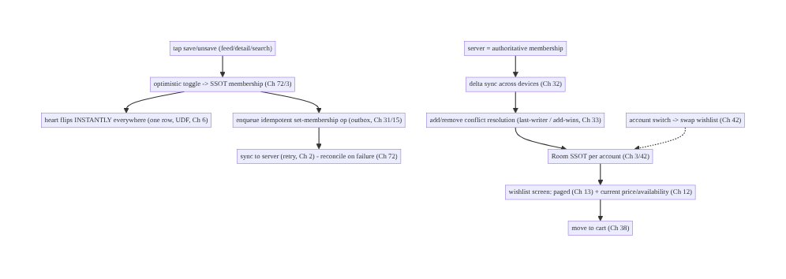
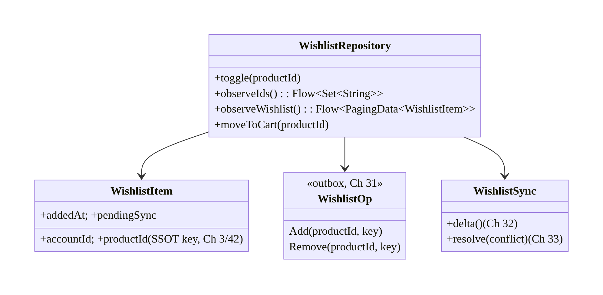
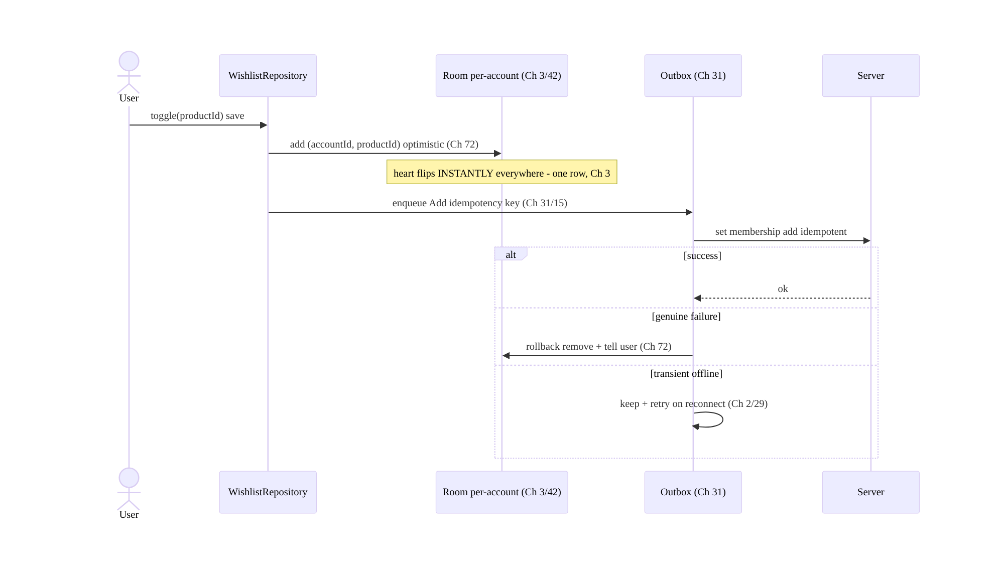
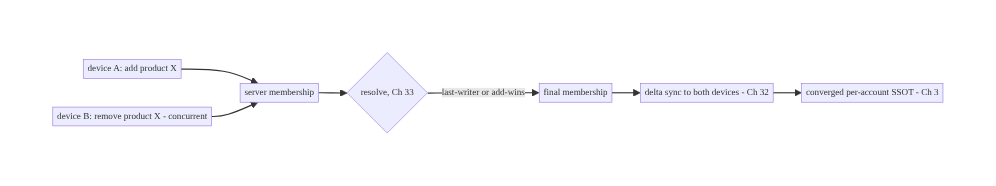
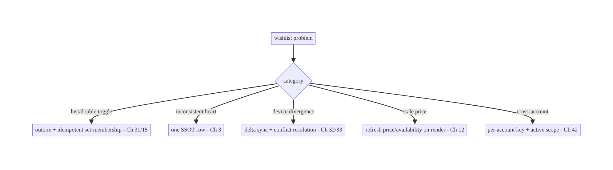

# Chapter 74 — Wishlist

> **Part IX — Feature Architectures** · Complexity: **Standard** (≥25 interview questions)
>
> **Prerequisites:** Ch 3 (SSOT/Room), Ch 72 (optimistic updates), Ch 31 (outbox), Ch 32
> (delta sync), Ch 29 (offline-first), Ch 42 (multi-account), Ch 15 (idempotency). Pairs
> with Ch 38 (cart), Ch 71 (feed), Ch 43 (personalization).
>
> **Reference surface in StreamCart:** the "Save for later" / wishlist / favorites — a
> per-user collection of products (and watchlist content) that toggles instantly, works
> offline, syncs across devices, and stays consistent everywhere the item appears.

---

## 74.1 Problem Definition and Real-World Context

A wishlist looks trivial ("a list of saved items") but is a clean, recurring **synced-
collection** feature that composes the book's offline/sync/optimistic machinery. It must:
toggle **instantly** (optimistic, Ch 72) from anywhere the product appears (feed Ch 71,
detail, search); work **offline** (Ch 29); **sync across devices** (save on the phone →
appears on the tablet, Ch 32); stay **consistent** everywhere the item shows a
saved/unsaved state (Ch 3); be **per-account** (Ch 42); and reconcile with the server
(idempotent, Ch 15). Done naively (an in-memory set, a fire-and-forget POST) it loses
saves offline/on death, diverges across screens and devices, and double-toggles.

Concretely, teams hit:

- **In-memory / network-coupled.** A wishlist held in memory or requiring the network to
  toggle loses saves offline and on process death, and can't render instantly. It must be
  **SSOT-backed** (Room, Ch 3) and **offline-first** (Ch 29).
- **Inconsistent toggle state.** The same product's heart icon shows "saved" in the feed
  but "unsaved" on detail because each screen holds its own state — only fixable with a
  **single SSOT** (Ch 3) and **optimistic toggle** (Ch 72).
- **No cross-device sync.** Saving on one device doesn't appear on another; removing on one
  leaves it on another. Wishlist membership is **synced state** (Ch 32) with
  **conflict handling** (Ch 33) for concurrent add/remove.
- **Double-toggle / lost toggle.** Rapid taps or retries add/remove twice; offline saves
  are lost. Needs **idempotent set-membership** (Ch 15) + **outbox** (Ch 31).
- **Per-account leakage.** One account's wishlist shows under another; switching accounts
  must swap wishlists (Ch 42).
- **Scale & presentation.** A large wishlist needs paging (Ch 13); items need current
  price/availability (they may change after saving); "move to cart" ties to Ch 38.

The architecture: model the wishlist as a **per-account, SSOT-backed, offline-first synced
collection** — toggle membership **optimistically** (Ch 72) in the **SSOT** (Room, Ch 3) so
the UI updates **instantly everywhere** the item appears (UDF, Ch 6); persist the toggle in
an **outbox** with an **idempotent set-membership** key (Ch 31/15) so it survives offline/
death, retries, and dedups; **sync** membership across devices (Ch 32) with **conflict
resolution** (add/remove, Ch 33); scope **per-account** (Ch 42); **page** a large list
(Ch 13); and refresh item **price/availability** (they drift after saving). This chapter is
a focused application of the offline/optimistic/sync stack to a saved collection.

### Three practical use cases

1. **Toggle save from anywhere (StreamCart).** Tapping the heart in the feed/detail/search
   toggles the SSOT instantly and consistently everywhere; syncs across devices; works
   offline.
2. **Offline save → sync.** Save items in airplane mode; they persist (SSOT + outbox) and
   sync when back online (Ch 29/31/32); a concurrent remove on another device reconciles
   (Ch 33).
3. **Wishlist screen + move to cart.** A paged wishlist (Ch 13) showing current price/
   availability; "move to cart" integrates with Ch 38.

### Why this is architectural

The wishlist is a **compact composition** of SSOT (Ch 3), optimistic updates (Ch 72),
outbox + idempotency (Ch 31/15), delta sync + conflict resolution (Ch 32/33), offline-first
(Ch 29), multi-account (Ch 42), and paging (Ch 13). It demonstrates the **synced-collection
pattern** reused for favorites, follows, saved searches, and watchlists — the decisions
(SSOT toggle, idempotent set-membership, cross-device sync, per-account) recur across the
app.

---

## 74.2 Requirements Engineering

### Functional requirements

| ID | Requirement |
|----|-------------|
| F1 | Toggle wishlist membership instantly (optimistic) from any surface, via the SSOT (Ch 72/3). |
| F2 | Work offline; persist and retry toggles (outbox + idempotency) (Ch 29/31/15). |
| F3 | Sync membership across devices; resolve concurrent add/remove conflicts (Ch 32/33). |
| F4 | Stay consistent everywhere the item appears (one SSOT row) (Ch 3). |
| F5 | Scope per-account; swap on account switch (Ch 42). |
| F6 | Show current price/availability; page a large list; move-to-cart (Ch 13/38). |

### Non-functional requirements

| Attribute | Policy |
|-----------|--------|
| **Instant UX** | Toggle updates immediately (optimistic). |
| **Offline** | Save/remove offline; works from cache (Ch 29). |
| **Consistency** | One SSOT row → consistent everywhere + cross-device (Ch 3/32). |
| **Correctness** | Idempotent set-membership; conflict-resolved; no double-toggle. |
| **Isolation** | Per-account (Ch 42). |

### Scope

- **In scope:** wishlist as a per-account SSOT-backed offline-first synced collection,
  optimistic toggle (Ch 72), outbox + idempotent set-membership (Ch 31/15), delta sync +
  add/remove conflict resolution (Ch 32/33), consistency via one SSOT row (Ch 3), per-
  account (Ch 42), paging a large list (Ch 13), price/availability refresh, move-to-cart
  (Ch 38).
- **Out of scope:** optimistic-update mechanics (Ch 72), outbox/sync/conflict internals
  (Ch 31/32/33), SSOT internals (Ch 3), cart (Ch 38), paging internals (Ch 13), feed
  (Ch 71).

### Assumptions & constraints

- Room SSOT (Ch 3), outbox (Ch 31), WorkManager (Ch 30), Paging 3 (Ch 13). `minSdk 24`.
  Wishlist membership is **synced** (server-backed, cross-device); toggles are **idempotent
  set-membership**; the server is authoritative for membership on conflict.

---

## 74.3 System Design Fundamentals

- **Wishlist = a per-account, SSOT-backed, offline-first synced set of item ids.** Model
  membership in **Room** (the SSOT, Ch 3): a `wishlist_items` table keyed by
  `(accountId, productId)`. The UI (heart icon everywhere the product appears) **observes
  the SSOT** (UDF, Ch 6), so saved/unsaved state is **consistent across all screens** and
  survives process death and offline (Ch 29). In-memory sets and network-coupled toggles
  are the anti-patterns.
- **Optimistic toggle (Ch 72).** Tapping save/unsave **immediately** mutates the SSOT
  membership → the heart flips **instantly everywhere** (one row, Ch 3). Then the toggle is
  persisted and synced; on genuine failure it rolls back (Ch 72). This is a direct
  application of the optimistic-update pattern (Ch 72) to set membership.
- **Idempotent set-membership + outbox (Ch 15/31).** Model the toggle as **set-membership**
  (`add` / `remove`), **not** a counter or a non-idempotent op, so rapid taps and retries
  are **idempotent** (Ch 15): "add product X" applied twice = once. Persist the intent in an
  **outbox** (Ch 31) so an **offline** save survives process death and is **retried** — the
  same reliable-send pattern as cart (Ch 38) and interactions (Ch 72). Use the **latest
  intent** for rapid add→remove→add (coalesced, Ch 31).
- **Cross-device sync + conflict resolution (Ch 32/33).** Wishlist membership is **synced
  state**: a delta sync (Ch 32) reconciles the local SSOT with the server so a save on one
  device appears on another. **Conflicts** (add on device A, remove on device B, or an
  offline toggle vs server) resolve by policy (Ch 33) — a wishlist is a **set**, so
  typically **last-writer-wins per item** (the latest add/remove timestamp wins), or
  **add-wins** (a product-chosen bias toward keeping saves). The **server is authoritative**
  for the reconciled membership.
- **Per-account (Ch 42).** The wishlist is **per account**: keyed by `accountId`, the UI
  observes the **active** account's wishlist, and **account switch** swaps to the other
  account's list (clear/scope, Ch 42). Never show account A's saves under B.
- **Price/availability drift.** Items saved days ago may have **changed price, gone out of
  stock, or been removed**. The wishlist stores membership (ids); product details
  (price/availability) are **refreshed** from the catalog (SSOT/cache, Ch 12/3) when
  rendering the wishlist screen — show current state, flag unavailable/removed items,
  handle "price dropped" (a common wishlist notification, Ch 49).
- **Paging a large wishlist (Ch 13).** A long wishlist pages from the SSOT (Paging 3,
  Ch 13) rather than loading all — same infra as the feed (Ch 71).
- **Move to cart (Ch 38).** "Move to cart" / "add to cart" from the wishlist integrates
  with the cart (Ch 38) — optionally removing from the wishlist on add.

Core insight: **a wishlist is a per-account, SSOT-backed, offline-first synced set — toggle
membership optimistically in the SSOT (one Room row per item, Ch 72/3) so the heart flips
instantly and consistently everywhere the product appears, persist the toggle as an
idempotent set-membership op in an outbox (survives offline/death, retries, dedups, Ch 31/
15), sync membership across devices with add/remove conflict resolution (last-writer or
add-wins, server authoritative, Ch 32/33), scope strictly per-account (Ch 42), refresh
item price/availability on render (membership is ids; details drift), and page a large list
(Ch 13) — it is the reusable synced-collection pattern (favorites, follows, watchlist).**

---

## 74.4 High-Level Architecture



**Components & ownership**

- **Optimistic toggle** mutates the **per-account SSOT** membership → instant + consistent
  (Ch 72/3/42).
- **Outbox + idempotent set-membership** persist/retry/dedup (Ch 31/15); **delta sync +
  conflict resolution** converge devices (Ch 32/33).
- **Wishlist screen** pages (Ch 13) and refreshes price/availability (Ch 12); **move-to-
  cart** → Ch 38.

**Direction:** tap → optimistic SSOT toggle → instant UI + outbox(idempotent) → server;
delta sync + conflict → converged per-account SSOT → paged screen with fresh details.

---

## 74.5 Detailed Component Design



| Component | Responsibility |
|-----------|----------------|
| `WishlistRepository` | optimistic toggle; observe ids/list; move-to-cart over SSOT |
| `WishlistItem` | per-account SSOT row `(accountId, productId)` (Ch 3/42) |
| `WishlistOp` | outbox idempotent set-membership op (Ch 31/15) |
| `WishlistSync` | delta sync + add/remove conflict resolution (Ch 32/33) |

---

## 74.6 End-to-End Data Flow

### Optimistic toggle (offline-capable)



### Cross-device sync + conflict



---

## 74.7 Complete Kotlin Implementation

Package: `com.streamcart.wishlist`.

### 74.7.1 Per-account SSOT membership (Ch 3/42)

```kotlin
@Entity(tableName = "wishlist_items", primaryKeys = ["accountId", "productId"])
data class WishlistItem(
    val accountId: String, val productId: String,     // per-account key (Ch 42)
    val addedAt: Long, val pendingSync: Boolean = false,
)

@Dao interface WishlistDao {
    @Query("SELECT productId FROM wishlist_items WHERE accountId = :acct")
    fun observeIds(acct: String): Flow<List<String>>                 // UI observes -> consistent everywhere (Ch 3)
    @Query("SELECT EXISTS(SELECT 1 FROM wishlist_items WHERE accountId=:acct AND productId=:id)")
    fun isSaved(acct: String, id: String): Flow<Boolean>
    @Upsert suspend fun add(item: WishlistItem)
    @Query("DELETE FROM wishlist_items WHERE accountId=:acct AND productId=:id") suspend fun remove(acct: String, id: String)
    @Query("SELECT * FROM wishlist_items WHERE accountId=:acct ORDER BY addedAt DESC") fun pagingSource(acct: String): PagingSource<Int, WishlistItem>
}
```

### 74.7.2 Optimistic toggle → outbox (idempotent set-membership, Ch 72/31/15)

```kotlin
@Singleton
class WishlistRepository @Inject constructor(
    private val dao: WishlistDao, private val outbox: Outbox,          // Ch 31
    private val activeAccount: ActiveAccountProvider,                  // Ch 42
) {
    fun isSaved(productId: String): Flow<Boolean> = dao.isSaved(activeAccount.require().id, productId)

    suspend fun toggle(productId: String) {
        val acct = activeAccount.require().id
        val saved = dao.isSaved(acct, productId).first()
        if (saved) {
            dao.remove(acct, productId)                                // optimistic (Ch 72) -> instant everywhere (Ch 3)
            outbox.enqueue(WishlistOp.Remove(productId, key = "$acct:wl:$productId:remove"))   // idempotent set-membership (Ch 15)
        } else {
            dao.add(WishlistItem(acct, productId, addedAt = System.currentTimeMillis(), pendingSync = true))
            outbox.enqueue(WishlistOp.Add(productId, key = "$acct:wl:$productId:add"))
        }
    }

    // OutboxProcessor -> server; idempotent; rollback on genuine failure (Ch 72).
    suspend fun sync(op: WishlistOp): OutboxResult = runCatching {
        when (op) { is WishlistOp.Add -> api.addToWishlist(op.productId, op.key)
                    is WishlistOp.Remove -> api.removeFromWishlist(op.productId, op.key) }
        OutboxResult.Done
    }.getOrElse { e ->
        if (e.isTransient()) OutboxResult.Retry                        // offline/5xx -> keep + retry (Ch 2/29)
        else { rollback(op); OutboxResult.Failed(e) }                  // genuine -> revert SSOT (Ch 72)
    }
}
```

### 74.7.3 UI: heart observes SSOT (instant + consistent, Ch 6)

```kotlin
@Composable
fun SaveButton(productId: String, vm: WishlistViewModel = hiltViewModel()) {
    val saved by vm.isSaved(productId).collectAsStateWithLifecycle(false)   // same SSOT row in feed/detail/search (Ch 3)
    IconToggleButton(checked = saved, onCheckedChange = { vm.toggle(productId) }) {
        Icon(if (saved) Icons.Filled.Favorite else Icons.Outlined.FavoriteBorder, contentDescription = "Wishlist")
    }
    // Toggling anywhere flips the heart EVERYWHERE instantly (optimistic SSOT, Ch 72/3).
}
```

### 74.7.4 Sync + conflict resolution (Ch 32/33)

```kotlin
@Singleton
class WishlistSync @Inject constructor(private val dao: WishlistDao, private val api: WishlistApi, private val activeAccount: ActiveAccountProvider) {
    /** Delta sync membership; server authoritative; add/remove conflict policy (Ch 32/33). */
    suspend fun sync() {
        val acct = activeAccount.require().id
        val server = api.wishlistSince(dao.lastSyncCursor(acct))       // delta (Ch 32)
        db.withTransaction {
            server.added.forEach { dao.add(WishlistItem(acct, it.productId, it.addedAt)) }   // last-writer / add-wins (Ch 33)
            server.removed.forEach { dao.remove(acct, it.productId) }
            // local pendingSync items not yet on server are pushed via outbox (Ch 31); server reconciles.
        }
    }
}
```

### 74.7.5 Wishlist screen: paged + current price/availability (Ch 13/12)

```kotlin
fun WishlistRepository.observeWishlist(): Flow<PagingData<WishlistEntry>> =
    Pager(PagingConfig(pageSize = 30)) { dao.pagingSource(activeAccount.require().id) }.flow
        .map { paging -> paging.map { item ->
            val product = catalog.current(item.productId)              // refresh price/availability (Ch 12/3)
            WishlistEntry(item, product, available = product?.inStock == true, priceDropped = product?.priceDropped == true)
        } }

suspend fun WishlistRepository.moveToCart(productId: String) {
    cart.add(productId)                                                // Ch 38
    toggle(productId)                                                  // optionally remove from wishlist
}
```

### 74.7.6 Module structure

```
:feature:wishlist  WishlistRepository, WishlistItem/Dao, WishlistOp, WishlistSync, SaveButton, wishlist screen
:core:data  SSOT (Ch 3); :core:outbox (Ch 31); :core:sync (Ch 32/33); :feature:cart (Ch 38); catalog (Ch 12)
# Optimistic -> Ch 72; idempotency -> Ch 15; per-account -> Ch 42; paging -> Ch 13.
```

---

## 74.8 Concurrency and Race Conditions

| Scenario | Risk | Handling |
|----------|------|----------|
| Rapid toggle (save→unsave→save) | wrong final state | idempotent set-membership + latest-intent coalesce (Ch 15/31) |
| Double-tap | double add | idempotent add (set-membership) (Ch 15) |
| Offline toggle then death | lost save | outbox persisted (Ch 31) |
| Add on A, remove on B | divergence | conflict resolution (last-writer/add-wins, server authoritative, Ch 33) |
| Same product many screens | inconsistent heart | one SSOT row (Ch 3) |
| Account switch mid-toggle | cross-account | key by accountId; observe active (Ch 42) |
| Stale price shown | wrong info | refresh price/availability on render (Ch 12) |

- **Idempotent set-membership + one SSOT row** kill the two classic wishlist bugs: rapid
  toggles/double-taps dedup to the latest membership (Ch 15/31), and the heart is consistent
  on every screen because they all read the **same row** (Ch 3).
- **Conflict resolution for concurrent devices** (Ch 33): a set tolerates **last-writer** or
  **add-wins** cleanly; the **server is authoritative** for the reconciled membership, and
  local pending ops push via the outbox.
- **Per-account keying** prevents cross-account leakage; observing the **active** account's
  rows means switching accounts swaps the wishlist automatically.

---

## 74.9 Failure Scenarios and Recovery

| Failure | Detection | Response | Outcome |
|---------|-----------|----------|---------|
| Save lost offline/on death | missing | outbox persisted + retry (Ch 31/29) | not lost |
| Double add on double-tap | duplicate | idempotent set-membership (Ch 15) | single |
| Inconsistent heart across screens | UX | one SSOT row (Ch 3) | consistent |
| Devices diverge | user report | delta sync + conflict (Ch 32/33) | converge |
| Genuine toggle failure | server reject | rollback + tell user (Ch 72) | reverted |
| Saved item out of stock/removed | render | refresh + flag unavailable (Ch 12) | accurate |
| Cross-account wishlist | privacy | per-account key + active scope (Ch 42) | isolated |



> **A wishlist is the synced-collection pattern: optimistic SSOT toggle + idempotent
> set-membership outbox + cross-device delta sync, all per-account.** Every wishlist bug
> (lost/double toggle, inconsistent heart, device divergence) resolves through that stack —
> the same one powering cart (Ch 38), favorites, and follows.

---

## 74.10 Scaling the Implementation

- **Level 1.** Per-account SSOT membership; optimistic toggle (Ch 72); heart observes SSOT
  (consistent).
- **Level 2.** Outbox + idempotent set-membership + offline (Ch 31/15/29); wishlist screen
  (paged, Ch 13) with current price/availability (Ch 12).
- **Level 3 — production.** Cross-device delta sync + conflict resolution (Ch 32/33);
  per-account swap (Ch 42); move-to-cart (Ch 38); rollback on genuine failure (Ch 72).
- **Level 4 — large.** Price-drop notifications (Ch 49); wishlist sharing; multiple named
  lists; stock alerts; recommendations from wishlist (Ch 73).
- **Level 5 — enterprise.** Wishlist analytics, cross-platform consistency, large-list
  performance, personalization signals (Ch 43/73), gifting/registry features.

**Avoid overengineering:** the optimistic-SSOT + idempotent-outbox + delta-sync core is a
small, reusable pattern. Don't hold wishlists in memory; don't re-invent sync — reuse the
Ch 31/32 stack.

---

## 74.11 Alternative Approaches and Trade-offs

| Dimension | Option A | Option B | When |
|-----------|----------|----------|------|
| Storage | SSOT (Room, per-account) | in-memory / network-only | SSOT always (offline/consistent/death-safe) |
| Toggle | Optimistic (Ch 72) | wait-for-server | Optimistic (instant); server-wait feels laggy |
| Op model | Idempotent set-membership (Ch 15) | non-idempotent add/remove | Set-membership (double-tap/retry safe) |
| Cross-device | Delta sync + conflict (Ch 32/33) | local only | Sync (users expect cross-device) |
| Conflict | Last-writer / add-wins (Ch 33) | manual merge | Last-writer/add-wins (a set tolerates it) |
| Details | Refresh price/availability (Ch 12) | store snapshot at save | Refresh (prices drift) |
| Large list | Paging (Ch 13) | load all | Paging |

**SSOT vs in-memory/network-only:** an in-memory wishlist loses saves on death and can't work
offline; a network-only toggle is laggy and offline-broken. A **per-account SSOT** (Room,
Ch 3) makes the wishlist **instant, offline-capable, consistent across screens, and death-
safe**, and syncs (Ch 32). Always SSOT-back it.

**Idempotent set-membership vs non-idempotent toggle:** a non-idempotent "toggle" or a
counter double-applies on rapid taps/retries. **Set-membership** (`add`/`remove` with an
idempotency key) is **idempotent** (Ch 15) — applying twice equals once — and reconciles
cleanly as a set on sync (Ch 33). Model membership, not toggles.

**Refresh details vs snapshot at save:** storing the price at save time shows **stale**
prices later (and misses out-of-stock/removed). The wishlist stores **ids** (membership);
**current** price/availability is refreshed from the catalog on render (Ch 12/3) — enabling
"price dropped" and out-of-stock flags. Store membership, refresh details.

---

## 74.12 Security & Privacy Considerations

- **Per-account authorization (Ch 42/23):** the wishlist is **per user**; the **server**
  authorizes that a user can only read/modify **their own** wishlist; the client scopes by
  active account and never shows one account's saves under another.
- **A wishlist is personal data (Ch 28):** what a user saves reveals intent/interests —
  treat as **private** (consent for sharing/recommendations use, Ch 73), don't leak, log
  ids not content.
- **Idempotency key integrity (Ch 15):** prevents double-apply and some abuse; the server
  enforces idempotency.
- **Validate on move-to-cart (Ch 38):** price/availability are re-checked server-side at
  cart/checkout (Ch 75) — the wishlist price is informational, not authoritative.
- **Per-account isolation on switch/logout (Ch 42):** swap/clear the active wishlist; don't
  retain another account's.
- Client vs backend: the **server** owns authoritative membership, authorizes per-user
  access, and reconciles conflicts; the **client** toggles optimistically, syncs, and scopes
  per-account.

---

## 74.13 Performance and Resource Optimization

- **Instant optimistic toggle** (local SSOT write, no network block).
- **Observe membership as a set/boolean Flow** (Ch 6) — cheap `isSaved` per product; don't
  query the whole list for a heart.
- **Page the wishlist** (Ch 13); refresh details for **visible** items only (Ch 12).
- **Coalesce rapid toggles** (Ch 31) — send the final set-membership, not N ops.
- **Batch sync** (Ch 32) — delta, not full-list fetch.
- **Cache product details** (Ch 12) for wishlist rendering.
- **Profiling:** toggle latency (instant), sync frequency/conflict rate, outbox depth,
  wishlist render time.

---

## 74.14 Testing Strategy

Wishlist logic (toggle, idempotency, sync, conflict, per-account) is highly unit-testable.

```kotlin
class WishlistToggleTest {
    @Test fun `toggle adds optimistically and enqueues idempotent op`() = runTest {
        repo.toggle("p1")
        assertTrue(dao.isSaved(acct, "p1").first())                   // instant (Ch 72/3)
        assertEquals("$acct:wl:p1:add", outbox.last().key)            // idempotent (Ch 15)
    }
    @Test fun `double-tap does not double-add`() = runTest {
        repo.toggle("p1"); repo.toggle("p1")                          // save then unsave (set-membership)
        assertFalse(dao.isSaved(acct, "p1").first())
    }
    @Test fun `rollback on genuine failure`() = runTest {
        api.failWith(403); repo.toggle("p1"); repo.sync(WishlistOp.Add("p1", key))
        assertFalse(dao.isSaved(acct, "p1").first())                  // reverted (Ch 72)
    }
}

class WishlistSyncTest {
    @Test fun `delta sync converges membership`() = runTest { /* server added/removed -> SSOT matches */ }
    @Test fun `add-remove conflict resolves by policy`() = runTest { /* Ch 33 */ }
    @Test fun `wishlist scoped per account`() = runTest { /* acct A vs B isolated (Ch 42) */ }
}
```

What to test: optimistic toggle + idempotent op; double-tap/rapid-toggle idempotency;
rollback on genuine failure (Ch 72); delta sync convergence + conflict (Ch 32/33); per-
account isolation (Ch 42); consistency across screens (same row); offline persistence
(outbox). Fake API/outbox; Room in-memory.

---

## 74.15 Production Observability

- **Metrics:** toggle rate + optimistic→confirmed latency; rollback rate; double-toggle rate
  (→ 0); sync frequency + conflict rate; outbox depth; cross-device convergence; per-account
  mis-scope (0); out-of-stock/removed wishlist items; move-to-cart conversion.
- **Logs:** `wishlist{action, result, account}` — ids not content; no PII (Ch 28).
- **Debugging:** lost saves → outbox/offline (Ch 31); double → non-idempotent (Ch 15);
  inconsistent heart → not SSOT-backed (Ch 3); device divergence → sync/conflict (Ch 32/33);
  stale price → not refreshing (Ch 12); cross-account → per-account scope (Ch 42).
- **Alerting:** rollback/double-toggle spike; sync-conflict spike; cross-account leak.
- **Dashboards:** toggle latency + rollback; convergence; move-to-cart conversion.

---

## 74.16 System Design Interview Preparation

> ≥25 questions.

**Fundamentals**

1. *Wishlist model?* Per-account, SSOT-backed, offline-first synced set of product ids.
2. *Storage?* Room SSOT keyed by `(accountId, productId)` (Ch 3/42).
3. *Why SSOT?* Instant, offline, consistent across screens, death-safe, syncable.
4. *Toggle?* Optimistic SSOT mutation (Ch 72) → instant everywhere.
5. *Consistency across screens?* One SSOT row (Ch 3).

**Reliability**

6. *Offline toggle?* Outbox persists + retries (Ch 31/29).
7. *Double-tap/rapid toggle?* Idempotent set-membership (Ch 15) + coalesce (Ch 31).
8. *Op model?* `add`/`remove` set-membership (idempotent), not a counter.
9. *Genuine failure?* Rollback + tell user (Ch 72).

**Cross-device**

10. *Sync?* Delta sync membership (Ch 32); server authoritative.
11. *Conflict (add A / remove B)?* Last-writer or add-wins (set tolerates, Ch 33).
12. *Offline toggle vs server?* Reconcile on sync (Ch 32/33).

**Per-account**

13. *Isolation?* Key by accountId; observe active; swap on switch (Ch 42).
14. *Leakage?* Never show A's saves under B.

**Details**

15. *Price/availability?* Refresh on render (Ch 12) — membership is ids; prices drift.
16. *Out-of-stock/removed?* Flag on render.
17. *Price drop?* Notify (Ch 49).

**Scale/integration**

18. *Large list?* Paging (Ch 13).
19. *Move to cart?* Integrate with cart (Ch 38).
20. *Reuse pattern?* Favorites/follows/watchlist (same synced-collection).

**Security**

21. *Authorization?* Server, per-user (Ch 23/42).
22. *Privacy?* Wishlist is personal data (Ch 28).

**Testing/Production**

23. *Test toggle?* Optimistic + idempotent op; double-tap safe.
24. *Test sync?* Convergence + conflict.
25. *Lost saves in prod?* Outbox/offline.
26. *Inconsistent heart?* Not SSOT-backed.

### Design-change challenges
1. **Save works offline and syncs across devices.** SSOT + outbox + delta sync (Ch 3/31/32).
2. **Heart inconsistent between feed and detail.** One SSOT row (Ch 3).
3. **Double-tap saves twice.** Idempotent set-membership (Ch 15).
4. **Saved item now out of stock.** Refresh price/availability on render (Ch 12).
5. **Add on phone / remove on tablet.** Conflict resolution (last-writer/add-wins, Ch 33).

### Mock walkthrough (abridged)
Clarify (offline?, cross-device?, per-account?, large list?) → per-account SSOT membership
(Ch 3/42) → optimistic toggle (Ch 72) → idempotent set-membership outbox (Ch 31/15) →
delta sync + conflict (Ch 32/33) → consistency via one row + page large list (Ch 3/13) →
refresh price/availability (Ch 12) → move-to-cart (Ch 38) → security (per-user authz,
privacy) → observability.

---

## 74.17 Practical Exercises

1. **Beginner.** Model a per-account wishlist in Room and make the heart observe the SSOT so
   it's consistent in feed and detail. *Eval:* consistent; per-account.
2. **Intermediate.** Add optimistic toggle + idempotent set-membership outbox so saving works
   offline and double-tap is safe. *Eval:* instant; offline; no double-add.
3. **Advanced.** Add cross-device delta sync with add/remove conflict resolution and rollback
   on genuine failure. *Eval:* converges; conflict-resolved; reverts on reject.
4. **Production debugging.** Fix lost offline saves (no outbox) and stale wishlist prices (no
   refresh). *Eval:* persisted; current prices.
5. **System design challenge.** Add a paged wishlist screen, move-to-cart (Ch 38), and
   price-drop detection; ensure per-account swap. *Eval:* paged; integrated; isolated.

*(Solutions withheld unless requested.)*

---

## 74.18 Chapter Summary & Reference Sheet

**Key decisions:** model the wishlist as a **per-account, SSOT-backed, offline-first synced
set** of product ids — **toggle membership optimistically in the SSOT** (one Room row per
`(accountId, productId)`, Ch 72/3) so the heart flips **instantly and consistently
everywhere** the product appears (UDF, Ch 6); persist each toggle as an **idempotent
set-membership op in an outbox** (Ch 31/15) so it survives **offline/process death**,
**retries**, and **dedups** double-taps/rapid toggles (latest-intent coalesced); **sync
membership across devices** via delta sync with **add/remove conflict resolution**
(last-writer or add-wins, **server authoritative**, Ch 32/33); scope strictly **per-account**
(swap on switch, Ch 42); **refresh item price/availability on render** (membership is ids;
details drift — enabling out-of-stock/price-drop flags, Ch 12/49); **page** a large list
(Ch 13); and **roll back** on genuine failure (Ch 72). It is the reusable **synced-collection
pattern** (favorites, follows, watchlist) and composes the same stack as cart (Ch 38).

**Concepts:** per-account SSOT membership, optimistic toggle, idempotent set-membership +
outbox, delta sync + add/remove conflict resolution, consistency via one row, per-account
isolation, price/availability refresh, paging, move-to-cart.

**Common mistakes:** in-memory/network-only wishlist (lost offline/on death, laggy);
per-screen state (inconsistent heart); non-idempotent toggle (double-add); no outbox (lost
offline saves); no cross-device sync/conflict (divergence); snapshotting price at save
(stale); cross-account leakage; loading the whole list (no paging).

**Checklist:**

- [ ] per-account SSOT membership `(accountId, productId)` (Ch 3/42)
- [ ] optimistic toggle (Ch 72)
- [ ] heart observes SSOT (consistent everywhere)
- [ ] idempotent set-membership outbox op (Ch 31/15)
- [ ] offline-capable + rollback on genuine failure (Ch 29/72)
- [ ] cross-device delta sync + conflict (last-writer/add-wins, Ch 32/33)
- [ ] per-account swap (Ch 42)
- [ ] refresh price/availability on render (Ch 12)
- [ ] page large list (Ch 13)
- [ ] move-to-cart (Ch 38)
- [ ] per-user authz + privacy (Ch 23/28)
- [ ] toggle-latency + convergence telemetry.

**Key APIs:** Room `@Entity` composite key `(accountId, productId)` + `@Dao` (`isSaved`
Flow / `observeIds` / `pagingSource`, Ch 3/13), Outbox + idempotency key (Ch 31/15),
optimistic update + rollback (Ch 72), delta sync + conflict policy (Ch 32/33),
`ActiveAccountProvider` (Ch 42), catalog refresh (Ch 12), cart integration (Ch 38).

**References:**
- Offline-first data layer: https://developer.android.com/topic/architecture/data-layer/offline-first
- (composes) Ch 3 SSOT, Ch 72 Optimistic Updates, Ch 31 Outbox, Ch 15 Idempotency, Ch 32 Delta Sync, Ch 33 Conflict Resolution, Ch 42 Multi-Account, Ch 13 Paging, Ch 38 Cart, Ch 12 Caching

### Chapter review (Phase 4)
- **Completeness:** all 18 sections; architecture/class/sequence/flow/failure diagrams;
  per-account SSOT + optimistic toggle + idempotent outbox op + sync/conflict + paged screen
  code; concurrency (idempotent set-membership, one-row consistency, per-account); failure
  (synced-collection-pattern principle); 5 levels; SSOT-vs-memory, set-membership-vs-toggle,
  refresh-vs-snapshot trade-offs; security (per-user authz, privacy); perf (instant/coalesce/
  page); toggle+sync+per-account tests; observability (toggle latency, convergence); 26 Q&A
  + 5 challenges. ✅
- **Expand later:** cart (Ch 38), optimistic (Ch 72), sync/conflict (Ch 32/33),
  recommendations (Ch 73).
- **Interview coverage:** exceeds ≥25 bar.
