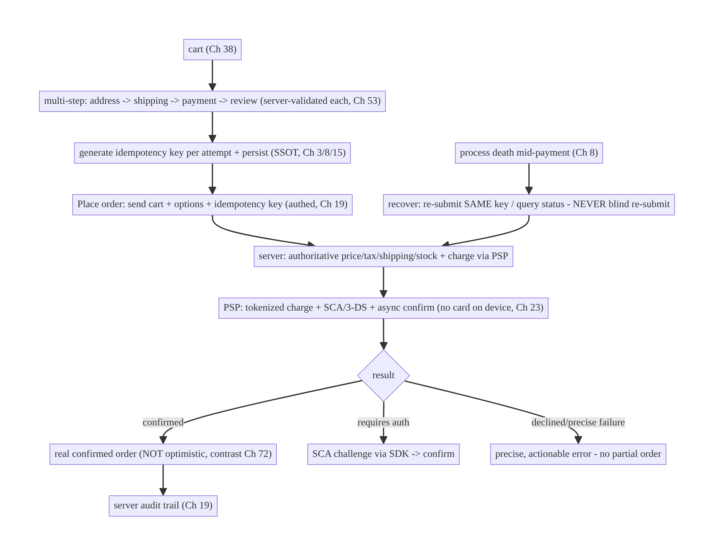
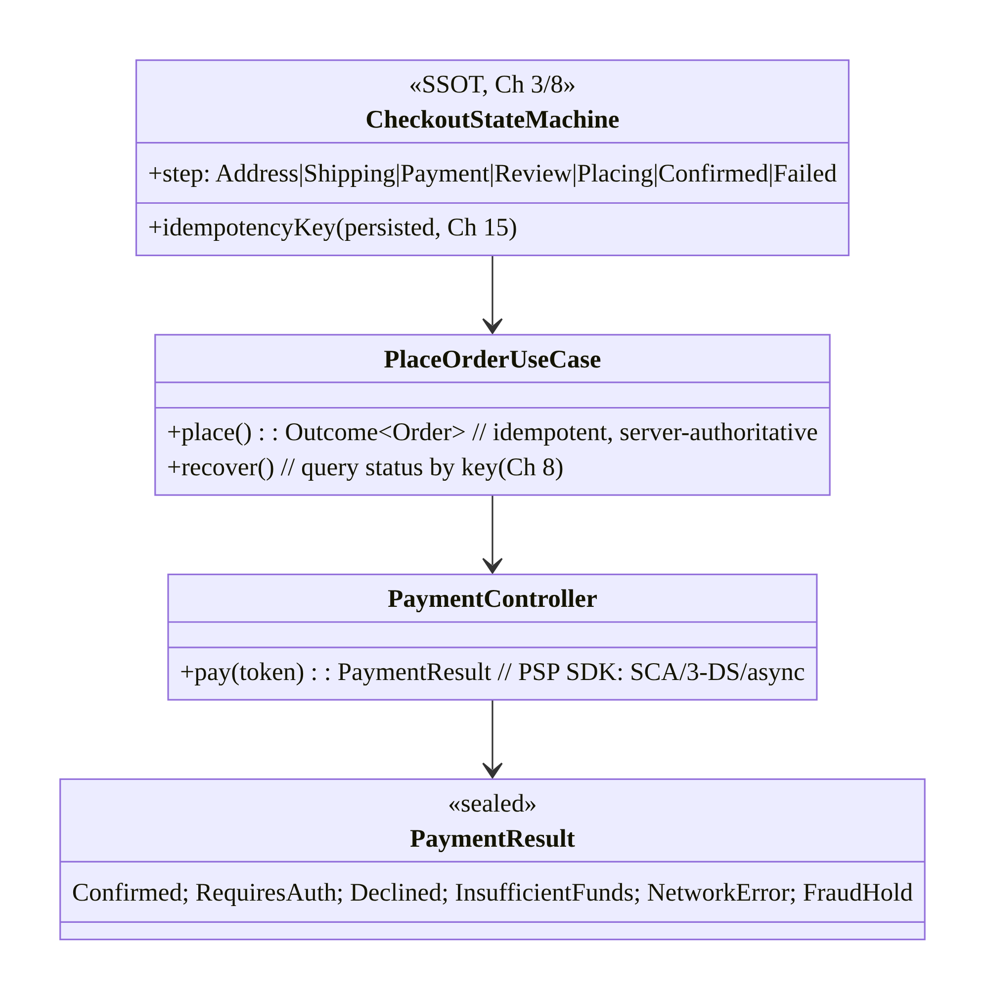
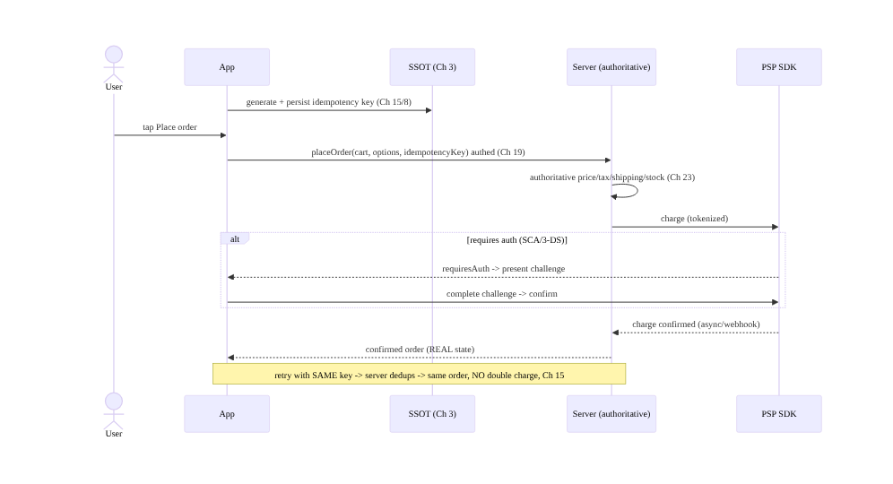
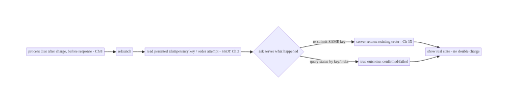
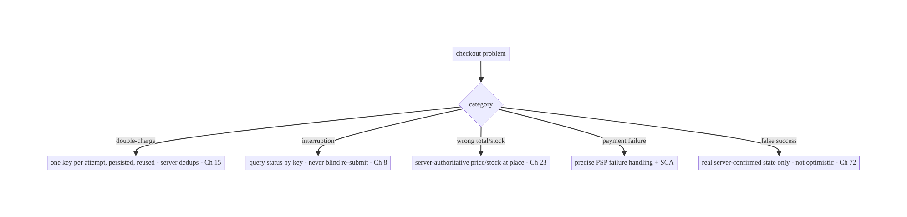

# Chapter 75 — Checkout Flow (Fintech-Grade)

> **Part IX — Feature Architectures** · Complexity: **Complex** (≥40 interview questions)
>
> **Prerequisites:** Ch 15 (idempotency), Ch 38 (cart), Ch 3 (SSOT), Ch 31 (outbox), Ch 2
> (retries), Ch 53 (navigation), Ch 8 (process death), Ch 19/23 (auth/security), Ch 72
> (optimistic — and when NOT to). Pairs with Ch 76/77 (billing/wallet), Ch 78 (order
> tracking).
>
> **Reference surface in StreamCart:** placing an order — a **money-moving,
> irreversible, multi-step** flow (cart → address → shipping → payment → review →
> place) that must be **exactly-once** (never double-charge), survive interruptions,
> handle payment failures precisely, and be auditable — the opposite discipline from
> optimistic UI (Ch 72).

---

## 75.1 Problem Definition and Real-World Context

Checkout is where the app **moves money and creates an irreversible commitment** (an
order, a charge). It is the **highest-stakes flow** in the app and demands a different
discipline from the rest of the book: **not optimistic** (Ch 72), **exactly-once**
(idempotency, Ch 15), **server-authoritative** at every step, **resilient to
interruption** (process death mid-payment, Ch 8), and **auditable**. The cardinal sin is a
**double-charge** (or a double-order) from a retry, a double-tap, a reconnect, or a
process restart — a bug that directly costs users money and trust.

Concretely, teams hit:

- **Double-charge / double-order.** A "Place order" tap that retries (network blip,
  reconnect, process restart) **without an idempotency key** charges twice. Every money-
  moving request **must carry an idempotency key** (Ch 15) the server dedups on.
- **Optimistic checkout (wrong).** Showing "Order placed!" before the server confirms —
  then it failed — is unacceptable (the user believes they paid). Checkout shows **real,
  server-confirmed state only** (contrast Ch 72).
- **Interruption mid-flow.** The process dies after the charge but before the client sees
  the response → the client must **recover** (query order status by idempotency key, not
  blindly re-submit) to avoid double-charging and to show the true outcome (Ch 8).
- **Multi-step state.** Cart → address → shipping → payment method → review → place:
  server-validated at each step (price/stock/tax/shipping change), navigable (back/edit,
  Ch 53), resumable, and the final place-order is the only money-moving, idempotent step.
- **Payment complexity.** Payment goes through a **PSP/SDK** (Stripe/Adyen/Play Billing
  Ch 76), often with **3-D Secure / SCA** challenges, async confirmation, and precise
  failure states (declined vs network vs insufficient funds) — each handled differently.
- **Price/stock/total integrity.** Totals, taxes, shipping, discounts, and stock are
  **computed and validated server-side** at place time (never trust client totals) —
  prices/stock can change between cart and checkout.
- **Auditability & security.** Orders/payments need an **audit trail**, strict **auth**
  (Ch 19), **no card data on the device** (PCI — use PSP tokenization, Ch 23), and fraud/
  risk checks (server).

The architecture: treat place-order as an **idempotent, server-authoritative, exactly-once
transaction** — generate an **idempotency key** for the attempt (Ch 15) and **reuse it
across retries/restarts** so the server dedups; show **only real, server-confirmed state**
(not optimistic, contrast Ch 72); **validate every step server-side** (price/stock/tax/
shipping) and compute the **authoritative total** at place time; integrate the **PSP/SDK**
for tokenized payment + **SCA/3-DS** + async confirmation with **precise failure
handling**; **recover from interruption** by querying order status via the idempotency key
(never blind re-submit, Ch 8); keep card data **off the device** (PCI tokenization, Ch 23)
and the flow **authed and auditable** (Ch 19). This chapter is the **fintech-grade,
exactly-once checkout** — the book's strictest correctness bar.

### Three practical use cases

1. **Place an order (StreamCart).** Multi-step checkout; the final "Place order" carries an
   idempotency key; the server validates totals/stock, charges via the PSP (with SCA if
   needed), and returns a confirmed order — exactly once, even on retry/restart.
2. **Process dies mid-payment.** The app is killed after the charge; on relaunch it
   **recovers** by querying the order/payment status (by idempotency key) and shows the
   true outcome — no double-charge (Ch 8).
3. **Payment declined / SCA required.** The PSP returns "requires authentication" (3-DS) or
   "declined" — the client handles the challenge or shows a precise, actionable error, with
   no partial order.

### Why this is architectural

Checkout is the book's **exactly-once, irreversible, server-authoritative** capstone,
composing idempotency (Ch 15), SSOT (Ch 3), outbox (Ch 31), retries (Ch 2), process death
(Ch 8), navigation (Ch 53), auth/security/PCI (Ch 19/23), and the deliberate **non-use** of
optimistic UI (Ch 72). The decisions — idempotency-key reuse, server-authoritative totals,
interruption recovery, precise payment failure handling, no-card-on-device — determine
whether money moves correctly exactly once.

---

## 75.2 Requirements Engineering

### Functional requirements

| ID | Requirement |
|----|-------------|
| F1 | Multi-step checkout (cart → address → shipping → payment → review → place), server-validated each step. |
| F2 | Place order exactly-once via an idempotency key reused across retries/restarts (Ch 15). |
| F3 | Show only real, server-confirmed state (not optimistic) (contrast Ch 72). |
| F4 | Integrate PSP/SDK for tokenized payment + SCA/3-DS + async confirmation; precise failure handling. |
| F5 | Recover from interruption by querying status (never blind re-submit) (Ch 8). |
| F6 | Server-authoritative totals/stock; no card data on device (PCI); authed + auditable (Ch 19/23). |

### Non-functional requirements

| Attribute | Policy |
|-----------|--------|
| **Exactly-once** | Never double-charge/double-order; idempotent (Ch 15). |
| **Integrity** | Server-authoritative totals/stock/tax; no trusted client totals. |
| **Resilience** | Survives process death mid-payment; recovers true outcome (Ch 8). |
| **Security/PCI** | No PAN on device; PSP tokenization; authed; auditable (Ch 23/19). |
| **UX** | Real state only; precise, actionable failures; resumable. |

### Scope

- **In scope:** multi-step checkout + per-step server validation + navigation (Ch 53),
  idempotent exactly-once place-order (key reuse across retry/restart, Ch 15), real-state-
  not-optimistic (contrast Ch 72), PSP/SDK integration (tokenization, SCA/3-DS, async
  confirmation, precise failures), interruption recovery via status query (Ch 8),
  server-authoritative totals/stock (Ch 23), PCI (no card on device), auth/audit (Ch 19/23),
  SSOT for order/checkout state (Ch 3).
- **Out of scope:** Play Billing / IAP specifics (Ch 76), wallet/payment methods (Ch 77),
  order tracking (Ch 78), cart internals (Ch 38), idempotency mechanics (Ch 15), process-
  death detail (Ch 8).

### Assumptions & constraints

- A **PSP/payment SDK** (Stripe/Adyen or Play Billing Ch 76) handles card tokenization + SCA;
  the **server** owns totals/charging/orders and **dedups on an idempotency key** (Ch 15);
  **no raw card data** touches the app (PCI, Ch 23). `minSdk 24`. Place-order is
  **irreversible** → **not optimistic**.

---

## 75.3 System Design Fundamentals

- **Checkout is NOT optimistic (the opposite of Ch 72).** For likes/cart (Ch 72/38),
  optimism is right; for **placing an order / charging**, it is **wrong** — never show
  "Order placed!" before the server confirms, because a rollback after the user believes
  they paid is unacceptable. Checkout shows **"Placing…"** then the **real, server-confirmed
  outcome** (confirmed / declined / needs-auth). Real state only.
- **Exactly-once via an idempotency key (the core, Ch 15).** The money-moving **place-order**
  request carries an **idempotency key** generated **once per checkout attempt** and
  **reused on every retry and after a process restart**. The server **dedups** on this key:
  a retried/replayed request returns the **same result** (the already-created order/charge),
  never a second charge. This is the single most important checkout mechanic — generate the
  key at the start of the place-order attempt, persist it (SSOT, Ch 3/8), and reuse it.
- **Server-authoritative everything (Ch 23).** The **server** computes and validates:
  **price, tax, shipping, discounts, the total, and stock** — at **place time**, not from
  client-sent totals (which can be stale or tampered). The client displays what the server
  returns; the **place-order** sends the **cart + chosen options + idempotency key**, and
  the server authoritatively prices, checks stock, and charges. Never trust client totals
  (price tampering, Ch 23).
- **Multi-step flow, per-step validation (Ch 53).** Cart → **address** → **shipping method**
  → **payment method** → **review** → **place**. Each step is **server-validated** (address
  serviceable? shipping options + cost? price/stock still valid?) and **navigable**
  (back/edit, Ch 53). Only **place** moves money. The flow is **resumable** (persist
  checkout state in the SSOT so a return/restart resumes, Ch 8). Prices/stock may change
  mid-flow → re-validate and surface changes before place.
- **PSP/SDK: tokenization + SCA/3-DS + async confirmation + precise failures.**
  - **Tokenization (PCI):** the PSP SDK collects card details and returns a **token**; the
    **raw card number never touches your app or server** (PCI scope minimization, Ch 23).
  - **SCA / 3-D Secure:** regulations (PSD2) may require a **challenge** (the SDK presents
    it); payment is **async** — "requires action" → challenge → confirm.
  - **Confirmation:** the charge is confirmed by the **PSP + your server** (often via a
    webhook to your server); the client **polls/receives** the final order state.
  - **Precise failure states:** **declined**, **insufficient funds**, **network**,
    **requires-authentication**, **fraud-hold** — each handled distinctly (retry vs
    re-enter card vs challenge vs show error). Don't collapse to "payment failed."
- **Interruption recovery (Ch 8) — never blind re-submit.** If the process dies **after**
  the charge but **before** the client sees the response, the client must **not** re-submit
  blindly (risking a double-charge if the key weren't reused). Because the idempotency key
  is **persisted** (Ch 3/8), recovery **re-submits with the same key** (server dedups →
  returns the existing order) **or** **queries order/payment status by the key/order id** to
  learn the true outcome. Design recovery as **"ask the server what happened,"** not
  "try again."
- **SSOT + audit (Ch 3/19).** Checkout/order state lives in the **SSOT** (Ch 3) so it
  survives process death and the UI reflects truth; orders/payments are **audited**
  server-side (immutable record, Ch 19) for support/disputes. The client keeps an **authed**
  session throughout (re-auth for sensitive steps if needed, Ch 21).
- **Outbox nuance (Ch 31).** Unlike cart/wishlist, place-order is **not** fire-and-forget
  from an outbox while offline — **you cannot place an order offline** (the server must
  authorize/charge). Checkout requires **connectivity**; if offline, **block place** with a
  clear message. (Non-money steps can be prepared offline, but **place requires the
  server**.) The idempotency key makes **online retries** safe, not offline queuing of
  charges.

Core insight: **checkout is an exactly-once, server-authoritative, irreversible transaction
— the opposite of optimistic UI: show only real server-confirmed state, and make the money-
moving place-order idempotent by generating one idempotency key per attempt, persisting it
(Ch 3/8), and reusing it across every retry and process restart so the server dedups and
never double-charges; validate every step and compute the authoritative total/stock
server-side (never trust client totals, Ch 23); integrate the PSP SDK for tokenized payment
(no card data on device, PCI), SCA/3-DS challenges, async confirmation, and precise failure
handling; recover from interruption by asking the server what happened (re-submit with the
same key or query status) rather than blindly re-submitting (Ch 8); and keep the flow authed
and auditable (Ch 19/23). Checkout requires connectivity — you cannot charge offline.**

---

## 75.4 High-Level Architecture



**Components & ownership**

- **Multi-step flow** (Ch 53), each **server-validated**; an **idempotency key** generated
  once per attempt and **persisted** (Ch 3/8/15).
- **Place-order** sends cart + options + key; the **server** authoritatively prices/checks
  stock/charges via the **PSP** (tokenized, SCA, async, no card on device).
- **Outcome** is **real** (confirmed/needs-auth/declined — not optimistic); **recovery**
  asks the server; **audit** server-side.

**Direction:** cart → validated steps → idempotency key → authed place-order → server
authoritative + PSP → real outcome; interruption recovers by asking the server.

---

## 75.5 Detailed Component Design



| Component | Responsibility |
|-----------|----------------|
| `CheckoutStateMachine` | SSOT checkout step + **persisted idempotency key** (Ch 3/8/15) |
| `PlaceOrderUseCase` | idempotent place + interruption recovery (query by key, Ch 8) |
| `PaymentController` | PSP SDK: tokenized charge, SCA/3-DS, async confirm |
| `PaymentResult` | **precise** outcomes (confirmed/requires-auth/declined/…) |

---

## 75.6 End-to-End Data Flow

### Place order exactly-once (with SCA)



### Interruption recovery (never blind re-submit)



---

## 75.7 Complete Kotlin Implementation

Package: `com.streamcart.checkout`.

### 75.7.1 Checkout state machine + persisted idempotency key (SSOT, Ch 3/8/15)

```kotlin
sealed interface CheckoutStep {
    data object Address : CheckoutStep; data object Shipping : CheckoutStep
    data object Payment : CheckoutStep; data object Review : CheckoutStep
    data object Placing : CheckoutStep                           // "Placing…" - real state, NOT "placed"
    data class Confirmed(val order: Order) : CheckoutStep
    data class Failed(val reason: PaymentResult) : CheckoutStep  // precise failure
}

@Entity(tableName = "checkout_session")   // SSOT -> survives process death (Ch 3/8)
data class CheckoutSession(
    @PrimaryKey val id: String, val step: String,
    val idempotencyKey: String,            // generated once per attempt, REUSED across retry/restart (Ch 15)
    val cartSnapshot: String, val options: String,
)
```

### 75.7.2 PlaceOrderUseCase: idempotent place + recovery (Ch 15/8)

```kotlin
@Singleton
class PlaceOrderUseCase @Inject constructor(
    private val api: CheckoutApi, private val dao: CheckoutDao, private val payment: PaymentController,
) {
    suspend fun place(session: CheckoutSession): CheckoutStep {
        dao.setStep(session.id, "Placing")                        // show "Placing…" (real state, NOT optimistic, Ch 72)
        return runCatching {
            // Server is authoritative: it prices, checks stock, charges; dedups on idempotencyKey (Ch 15/23).
            val result = api.placeOrder(session.cartSnapshot, session.options, session.idempotencyKey)
            when (result) {
                is PlaceResult.Confirmed -> CheckoutStep.Confirmed(result.order)
                is PlaceResult.RequiresAuth -> {                  // SCA/3-DS
                    val after = payment.completeChallenge(result.clientSecret)   // PSP SDK
                    confirmAfterChallenge(session, after)
                }
                is PlaceResult.Failed -> CheckoutStep.Failed(result.reason)       // precise failure
            }
        }.getOrElse { e ->
            // Network error AFTER sending: DO NOT blindly re-charge. Recover by asking the server (Ch 8).
            if (e.isTransient()) recover(session) else CheckoutStep.Failed(PaymentResult.NetworkError)
        }.also { dao.setStep(session.id, it.name()) }
    }

    /** Interruption recovery: ask the server what happened using the SAME idempotency key (Ch 8/15). */
    suspend fun recover(session: CheckoutSession): CheckoutStep {
        val status = api.orderStatusByIdempotencyKey(session.idempotencyKey)      // query, not blind re-submit
        return when (status) {
            is OrderStatus.Placed -> CheckoutStep.Confirmed(status.order)         // it DID succeed -> show real
            is OrderStatus.NotPlaced -> // safe to re-submit with the SAME key (server dedups if it later landed)
                place(session)
            is OrderStatus.Failed -> CheckoutStep.Failed(status.reason)
        }
    }
}
```

### 75.7.3 Idempotency key: generate once, persist, reuse (Ch 15/8)

```kotlin
suspend fun startCheckoutAttempt(cart: Cart, options: CheckoutOptions, dao: CheckoutDao): CheckoutSession {
    val session = CheckoutSession(
        id = UUID.randomUUID().toString(),
        step = "Review",
        idempotencyKey = UUID.randomUUID().toString(),   // ONE key per attempt (Ch 15)
        cartSnapshot = cart.toJson(), options = options.toJson(),
    )
    dao.upsert(session)                                   // PERSIST so retry/restart reuse the SAME key (Ch 8)
    return session
}
// NEVER regenerate the key on retry — reuse it so the server dedups (the anti-double-charge guarantee).
```

### 75.7.4 PaymentController: PSP SDK (tokenize, SCA/3-DS, precise failures, no card on device)

```kotlin
sealed interface PaymentResult {
    data object Confirmed : PaymentResult; data class RequiresAuth(val clientSecret: String) : PaymentResult
    data object Declined : PaymentResult; data object InsufficientFunds : PaymentResult
    data object NetworkError : PaymentResult; data object FraudHold : PaymentResult
}

class PaymentController @Inject constructor(private val psp: PspSdk) {   // Stripe/Adyen (or Play Billing, Ch 76)
    // Card details collected by the PSP SDK -> TOKEN; raw PAN never touches app/server (PCI, Ch 23).
    suspend fun completeChallenge(clientSecret: String): PaymentResult =
        psp.handleNextAction(clientSecret)   // presents 3-DS/SCA; returns precise result
    // Map PSP error codes to PRECISE states (declined vs insufficient vs network vs fraud) — not "failed".
}
```

### 75.7.5 UI: real state only (not optimistic), precise failures, resumable (Ch 53/8)

```kotlin
@Composable
fun CheckoutScreen(vm: CheckoutViewModel = hiltViewModel()) {
    val step by vm.step.collectAsStateWithLifecycle()
    when (val s = step) {
        is CheckoutStep.Placing -> PlacingSpinner("Placing your order…")   // REAL state, not "Order placed!"
        is CheckoutStep.Confirmed -> OrderConfirmed(s.order)               // only AFTER server confirms
        is CheckoutStep.Failed -> PreciseError(s.reason, onRetry = { vm.retrySameKey() })  // reuse key (Ch 15)
        else -> CheckoutSteps(step = s, onNext = vm::next, onBack = vm::back)   // multi-step (Ch 53), server-validated
    }
    // On launch after death: vm.recover() queries status by key (Ch 8) -> shows true outcome.
}
```

### 75.7.6 Module structure

```
:feature:checkout  CheckoutStateMachine/Session (SSOT, Ch 3), PlaceOrderUseCase (idempotent + recover),
                   PaymentController (PSP SDK), multi-step UI (Ch 53)
:core:payments  PSP SDK integration (tokenize/SCA); Play Billing -> Ch 76; wallet -> Ch 77
# Server: authoritative totals/stock/charge + idempotency dedup + audit (Ch 15/23/19). Order tracking -> Ch 78.
```

---

## 75.8 Concurrency and Race Conditions

| Scenario | Risk | Handling |
|----------|------|----------|
| Double-tap "Place order" | double-charge | disable button + same idempotency key (server dedups, Ch 15) |
| Retry after network blip | double-charge | reuse SAME key (never regenerate) |
| Process death after charge | double-charge / wrong state | persisted key; recover by querying status (Ch 8) — never blind re-submit |
| Optimistic "placed" then fail | user thinks paid | real state only (not optimistic, Ch 72) |
| Stale client total | price tampering/mismatch | server-authoritative total at place time (Ch 23) |
| Concurrent stock | oversell | server stock check at place time |
| SCA challenge interrupted | stuck payment | resume/recover via status; re-present challenge |

- **Idempotency-key reuse is the double-charge guarantee (Ch 15):** generate the key **once
  per attempt**, **persist** it (Ch 8), and **reuse** it on every retry/restart — the server
  dedups, so a double-tap, a retried blip, or a process restart yields the **same single
  order/charge**, never two. Regenerating the key on retry is the catastrophic bug.
- **Recover by asking, not re-submitting (Ch 8):** after an interruption where the outcome
  is unknown, **query order status by the key** (or re-submit with the same key, which
  dedups) — blindly re-submitting with a *new* key double-charges.
- **Server-authoritative totals** prevent client price tampering and stale-total mismatches
  (Ch 23) — the client never computes the charged amount.

---

## 75.9 Failure Scenarios and Recovery

| Failure | Detection | Response | Outcome |
|---------|-----------|----------|---------|
| Double-charge from retry/tap | billing | idempotency-key reuse (server dedups, Ch 15) | single charge |
| Process death mid-payment | relaunch | recover by status query (Ch 8); same key | true outcome, no dup |
| Payment declined | PSP result | precise error + re-enter/retry | no partial order |
| SCA required | PSP "requires action" | present challenge → confirm | authenticated |
| Price/stock changed mid-flow | server validation | re-validate + surface before place | correct total |
| Client total tampered/stale | server mismatch | server-authoritative total (Ch 23) | server wins |
| Offline at place | no network | block place + clear message (can't charge offline) | no silent fail |
| Optimistic "placed" | wrong state | real state only (Ch 72) | honest |



> **The one rule that defines fintech-grade checkout: exactly-once via a persisted,
> reused idempotency key, with real server-confirmed state only.** Generate the key once,
> persist it, reuse it on every retry/restart so the server dedups (no double-charge);
> recover from interruption by asking the server, not re-submitting; keep totals/stock
> server-authoritative; and never show "placed" before the server confirms.

---

## 75.10 Scaling the Implementation

- **Level 1.** Multi-step flow (Ch 53); server-authoritative totals; place-order with an
  idempotency key (Ch 15); real-state-only UI.
- **Level 2.** Persist the key + checkout state (SSOT, Ch 3/8); interruption recovery via
  status query; precise PSP failure states.
- **Level 3 — production.** Full PSP integration (tokenization/SCA/3-DS/async + webhook
  confirmation); per-step re-validation; audit trail (Ch 19); no-card-on-device (Ch 23).
- **Level 4 — large.** Multiple payment methods (Ch 77) + Play Billing (Ch 76); saved
  payment tokens; fraud/risk integration; promo/discount validation; address/tax services;
  partial captures/refunds.
- **Level 5 — enterprise.** Checkout funnel analytics + conversion, A/B of flow (Ch 87),
  multi-currency, regulatory (SCA/PSD2, tax), dispute/chargeback handling, exactly-once SLOs.

**Avoid overengineering:** the idempotency-key + server-authoritative + real-state core is
non-negotiable; build it first. Don't add optimism to checkout; don't trust client totals;
don't handle card data yourself.

---

## 75.11 Alternative Approaches and Trade-offs

| Dimension | Option A | Option B | When |
|-----------|----------|----------|------|
| UI state | Real server-confirmed only | optimistic ("placed") | Real only (irreversible; contrast Ch 72) |
| Exactly-once | Idempotency key reused (Ch 15) | no key / new key per retry | Reused key always (anti-double-charge) |
| Totals | Server-authoritative (Ch 23) | client-computed | Server (tampering/stale) |
| Interruption | Query status by key (Ch 8) | blind re-submit | Query (blind re-submit double-charges) |
| Card data | PSP tokenization (no PAN on device) | handle card in app | Tokenization (PCI, Ch 23) |
| Payment result | Precise states | "payment failed" | Precise (retry vs re-enter vs challenge) |
| Offline | Block place (needs server) | queue charge offline | Block (can't charge offline) |

**Real-state vs optimistic for checkout:** optimistic UI (Ch 72) is correct for reversible
actions but **catastrophic for checkout** — showing "Order placed!" before confirmation, then
failing, makes the user believe they paid when they didn't (or vice-versa). Checkout shows
**"Placing…"** and then the **real, server-confirmed** outcome. This is the deliberate
**inverse** of Ch 72: optimism everywhere *except* money/irreversible actions.

**Idempotency-key reuse vs new-key/no-key:** without an idempotency key (or with a **new**
key on each retry), a retried/replayed/double-tapped place-order **double-charges**. A
**single key per attempt, persisted and reused** across retries and restarts lets the server
**dedup** — the same request yields the same order. This is the **defining** checkout
mechanic (Ch 15); everything else supports it.

**Server-authoritative vs client-computed totals:** trusting the client's total invites
**price tampering** (a modified client charging $0) and **stale totals** (price changed since
cart). The **server** computes and validates **price/tax/shipping/discount/stock at place
time** and charges the **authoritative** amount; the client only **displays** it. Never charge
a client-sent amount (Ch 23).

---

## 75.12 Security & PCI Considerations

- **No card data on the device (PCI, Ch 23):** use the **PSP SDK's tokenization** — card
  details go directly to the PSP, which returns a **token**; your app and server **never
  handle the raw PAN**, minimizing PCI scope. Never log/store card numbers.
- **Server-authoritative + authenticated (Ch 19/23):** place-order is **authed** (bearer,
  re-auth for sensitive steps if needed, Ch 21); the **server** authorizes the user, prices
  authoritatively, and charges — the client cannot set the amount or bypass validation.
- **Idempotency prevents replay/double-charge (Ch 15):** the server enforces idempotency
  (same key → same result), which also mitigates replay attacks on the charge endpoint.
- **SCA/3-DS (PSD2):** handle **strong customer authentication** challenges via the SDK where
  required — a regulatory + fraud control.
- **Audit trail (Ch 19):** orders/payments are an **immutable server-side audit record** for
  support, disputes, and compliance; the client doesn't own the record of truth.
- **Fraud/risk (server):** risk checks, velocity limits, and holds are **server-side**; the
  client surfaces outcomes (e.g., fraud-hold).
- **No sensitive data in logs** (Ch 28): no PAN, CVV, tokens, or amounts tied to identity.
- **Per-account (Ch 42):** checkout/orders scoped to the authenticated user.
- Client vs backend: the **server** is the authority for pricing, charging, idempotency,
  audit, and fraud; the **PSP** handles card data; the **client** drives the flow, tokenizes
  via the SDK, shows real state, and recovers — it never holds card data or authoritative
  totals.

---

## 75.13 Performance and Resource Optimization

- **Fast step validation** — validate each step server-side promptly; cache serviceable
  addresses/shipping options where safe.
- **Persist minimal checkout state** (SSOT, Ch 3) for resume/recovery — not the whole UI.
- **Disable "Place order" immediately** on tap (prevent double-tap) while the single
  idempotent request is in flight.
- **Efficient recovery** — one status query by key (Ch 8), not a heavy reload.
- **Async confirmation** — don't block the UI on webhook confirmation; poll/subscribe for
  the final state (show "Placing…").
- **Prefetch** payment methods/addresses while earlier steps complete.
- **Profiling:** place-order latency, recovery frequency, double-charge rate (→ 0, the key
  KPI), step drop-off (funnel), SCA/decline rates.

---

## 75.14 Testing Strategy

Exactly-once and recovery are the critical tests; PSP faked.

```kotlin
class ExactlyOnceTest {
    @Test fun `retry reuses same key - server dedups - single order`() = runTest {
        val session = startAttempt()
        placeUseCase.place(session); placeUseCase.place(session)      // retry
        assertEquals(1, fakeApi.ordersCreatedWith(session.idempotencyKey))   // ONE order (Ch 15)
    }
    @Test fun `double-tap does not double-charge`() = runTest { /* same key -> dedup */ }
    @Test fun `key persisted and reused across restart`() = runTest { /* reload session -> same key */ }
}

class RecoveryTest {
    @Test fun `after interruption, queries status by key - no blind re-submit`() = runTest {
        fakeApi.orderPlaced(session.idempotencyKey)                   // it DID land
        val step = placeUseCase.recover(session)
        assertTrue(step is CheckoutStep.Confirmed)                    // shows real outcome, no second charge (Ch 8)
    }
}

class CheckoutStateTest {
    @Test fun `shows Placing then real Confirmed - never optimistic placed`() = runTest { /* ... */ }
    @Test fun `maps PSP results to precise failures`() = runTest { /* declined/insufficient/network/sca */ }
    @Test fun `blocks place when offline`() = runTest { /* no network -> blocked message */ }
}
```

What to test: **exactly-once** (retry/double-tap/restart → one order via reused key, Ch 15);
**recovery** (query status by key, no blind re-submit, Ch 8); **real-state-only** (Placing →
Confirmed, never premature "placed"); **precise failure mapping** (declined/insufficient/
network/SCA); server-authoritative total (reject client total mismatch); offline blocks
place. Fake PSP + server with idempotency dedup.

---

## 75.15 Production Observability

- **Metrics:** **double-charge rate (→ 0, the critical KPI)**; place-order success/latency;
  recovery frequency (interruptions); decline/SCA/fraud-hold rates; checkout **funnel
  conversion** + step drop-off; total-mismatch rejections (tampering/stale); offline-blocked
  places.
- **Logs:** `checkout{step, result, idempotency_key_hash}` — **no card/PAN/CVV/token/amount-
  with-identity** (PCI, Ch 28); audit on the server.
- **Debugging:** double-charge → key not reused/persisted (Ch 15/8); wrong state after
  interruption → blind re-submit instead of status query (Ch 8); false "placed" → optimistic
  UI (should be real); total mismatch → trusting client total (Ch 23); stuck payment → SCA
  not handled.
- **Alerting:** **any double-charge** (page immediately); place-order error/decline spike;
  recovery-rate anomaly.
- **Dashboards:** double-charge rate (must be 0), funnel conversion, decline/SCA rates,
  recovery rate.

---

## 75.16 System Design Interview Preparation

> ≥40 questions.

**Fundamentals**

1. *Is checkout optimistic?* No — real server-confirmed state only (opposite of Ch 72).
2. *The cardinal sin?* Double-charge / double-order.
3. *Exactly-once mechanism?* Idempotency key, generated once, persisted, reused (Ch 15).
4. *Who owns totals/stock?* The server (authoritative at place time, Ch 23).
5. *Card data on device?* No — PSP tokenization (PCI, Ch 23).

**Idempotency (Ch 15)**

6. *Generate the key when?* Once per checkout attempt.
7. *Reuse when?* Every retry and after process restart.
8. *Persist why?* So a restart reuses the same key (Ch 8).
9. *Regenerate on retry?* Never (double-charges).
10. *Server behavior?* Dedups — same key → same order.

**Interruption (Ch 8)**

11. *Process dies after charge?* Recover by querying status by key — not blind re-submit.
12. *Safe re-submit?* Only with the SAME key (server dedups).
13. *Why not blind re-submit?* New/unknown state → double-charge.

**Totals/validation**

14. *Trust client total?* Never — server computes authoritative total (Ch 23).
15. *Per-step validation?* Address/shipping/price/stock server-validated (Ch 53).
16. *Price/stock changed mid-flow?* Re-validate + surface before place.

**Payment/PSP**

17. *Tokenization?* PSP SDK → token; no PAN on app/server (PCI).
18. *SCA/3-DS?* Present challenge via SDK; async confirm.
19. *Async confirmation?* PSP + server (webhook); client polls/receives final state.
20. *Precise failures?* Declined/insufficient/network/requires-auth/fraud — handled
    distinctly.
21. *Collapse to "failed"?* No — precise, actionable.

**UI/state**

22. *Show "placed" when?* Only after server confirms (real state).
23. *During?* "Placing…".
24. *Resumable?* Persist checkout state (SSOT, Ch 3/8).

**Offline**

25. *Place offline?* Can't — block (server must charge); clear message.
26. *Outbox for charges?* No — not fire-and-forget; needs connectivity.

**Security/PCI**

27. *PCI scope?* Minimized via tokenization (no PAN).
28. *Auth?* Authed place; re-auth sensitive (Ch 21).
29. *Audit?* Server-side immutable record (Ch 19).
30. *Fraud?* Server-side risk/holds.
31. *Logging?* No card/token/amount-with-identity (Ch 28).

**Testing/Production**

32. *Test exactly-once?* Retry/double-tap/restart → one order.
33. *Test recovery?* Query by key, no blind re-submit.
34. *Test real-state?* Placing → Confirmed, never premature.
35. *Double-charge in prod?* Key not reused/persisted.
36. *Wrong state after death?* Blind re-submit.
37. *Key KPI?* Double-charge rate (0).
38. *Funnel?* Conversion + step drop-off.
39. *Total mismatch?* Trusting client total.
40. *Stuck payment?* SCA not handled.
41. *Alert priority?* Any double-charge pages immediately.

### Design-change challenges
1. **Ensure placing an order never double-charges.** Idempotency key: once per attempt,
   persisted, reused; server dedups (Ch 15).
2. **App killed mid-payment.** Recover by querying status by key (Ch 8) — no blind
   re-submit.
3. **Don't show "placed" before it's confirmed.** Real state only (Placing → Confirmed,
   contrast Ch 72).
4. **Client could tamper with the total.** Server-authoritative total at place time (Ch 23).
5. **Handle a declined card vs SCA-required.** Precise PSP failure states; present challenge
   for SCA.

### Mock walkthrough (abridged)
Clarify (steps, payment provider, SCA, offline?) → checkout is exactly-once + server-
authoritative + real-state (not optimistic, Ch 72) → multi-step server-validated flow
(Ch 53) → idempotency key once/persisted/reused (Ch 15/8) → place-order: server prices/
checks stock/charges via PSP (tokenized, SCA, async; no card on device, Ch 23) → precise
failure handling → interruption recovery by status query (Ch 8) → auth/audit/PCI (Ch 19/23)
→ offline blocks place → observability (double-charge rate = 0).

---

## 75.17 Practical Exercises

1. **Beginner.** Build a multi-step checkout (address→shipping→payment→review→place),
   server-validated, with real-state-only UI ("Placing…" then "Confirmed"). *Eval:*
   server-validated; never premature "placed".
2. **Intermediate.** Add an idempotency key generated once per attempt, persisted, and
   reused on retry/double-tap so the server dedups. *Eval:* retry/double-tap → one order.
3. **Advanced.** Add interruption recovery: on relaunch, query order status by the key (no
   blind re-submit) and show the true outcome. *Eval:* process-death → correct state, no
   double-charge.
4. **Production debugging.** Fix a double-charge (key regenerated on retry) and a false
   "placed" (optimistic UI). *Eval:* single charge; real state.
5. **System design challenge.** Integrate PSP tokenization + SCA/3-DS + precise failure
   states (declined/insufficient/network), and block place when offline. *Eval:* no card on
   device; precise errors; offline-safe.

*(Solutions withheld unless requested.)*

---

## 75.18 Chapter Summary & Reference Sheet

**Key decisions:** treat place-order as an **exactly-once, server-authoritative,
irreversible transaction** — the **opposite of optimistic UI** (Ch 72): show only **real,
server-confirmed state** ("Placing…" → "Confirmed", never a premature "placed"); guarantee
**exactly-once** by generating **one idempotency key per attempt**, **persisting** it
(SSOT, Ch 3/8), and **reusing it on every retry and after a process restart** so the server
**dedups** and **never double-charges** (Ch 15) — the defining mechanic; **validate every
step and compute the authoritative total/stock server-side** (never trust client totals —
price tampering/stale, Ch 23); integrate the **PSP SDK** for **tokenized payment (no card
data on the device — PCI)**, **SCA/3-DS** challenges, **async confirmation**, and **precise
failure handling** (declined/insufficient/network/requires-auth/fraud — not "failed");
**recover from interruption** (process death mid-payment, Ch 8) by **asking the server what
happened** (query status by key, or re-submit with the **same** key) — **never blindly
re-submit**; keep the flow **authed and auditable** (Ch 19/23), **per-account** (Ch 42), and
**block place when offline** (you cannot charge offline — it is not an outbox/fire-and-forget
operation). The critical KPI is a **double-charge rate of zero**.

**Concepts:** exactly-once idempotency (key once/persisted/reused), server-authoritative
totals/stock, real-state-not-optimistic, multi-step server-validated flow, PSP tokenization
+ SCA/3-DS + async + precise failures, interruption recovery (query by key), PCI (no card on
device), audit/auth, connectivity-required.

**Common mistakes:** optimistic "placed" (false success); no idempotency key / new key per
retry (double-charge); not persisting the key (restart double-charges); blind re-submit on
interruption (double-charge); trusting client totals (tampering/stale); handling card data in
the app (PCI violation); collapsing payment failures to "failed"; queuing charges offline.

**Checklist:**

- [ ] real server-confirmed state only (not optimistic, Ch 72)
- [ ] one idempotency key per attempt, **persisted**, **reused** on retry/restart (Ch 15/8)
- [ ] server dedups → zero double-charge
- [ ] server-authoritative totals/stock at place time (Ch 23)
- [ ] multi-step server-validated flow (Ch 53)
- [ ] PSP tokenization (no card on device, PCI) + SCA/3-DS + async confirm
- [ ] precise failure states (declined/insufficient/network/requires-auth/fraud)
- [ ] interruption recovery via status query (never blind re-submit, Ch 8)
- [ ] authed + auditable (Ch 19)
- [ ] block place when offline
- [ ] per-account (Ch 42)
- [ ] double-charge-rate alert (page on any).

**Key APIs:** idempotency key (`UUID`, persisted in SSOT, Ch 15/3/8), `CheckoutApi.placeOrder(…,
idempotencyKey)` / `orderStatusByIdempotencyKey` (recovery, Ch 8), PSP SDK (tokenize /
`handleNextAction` for SCA/3-DS), sealed `PaymentResult` (precise states), checkout state
machine (SSOT, Ch 3), Navigation (Ch 53), authed session (Ch 19/21), Play Billing (Ch 76) /
wallet (Ch 77) for payment methods.

**References:**
- Idempotency for payments (general PSP docs, e.g., Stripe): https://stripe.com/docs/api/idempotent_requests
- Strong Customer Authentication (SCA/3-DS): https://stripe.com/docs/strong-customer-authentication
- Android security / data safety (PCI context): https://developer.android.com/privacy-and-security/security-tips
- (composes) Ch 15 Idempotency, Ch 38 Cart, Ch 3 SSOT, Ch 8 Process Death, Ch 53 Navigation, Ch 19/23 Auth/Security, Ch 72 Optimistic (contrast), Ch 76 Play Billing, Ch 77 Wallet, Ch 78 Order Tracking

### Chapter review (Phase 4)
- **Completeness:** all 18 sections; architecture/class/sequence/recovery/failure diagrams;
  checkout state machine + idempotent PlaceOrderUseCase + recovery + PaymentController +
  real-state UI code; concurrency (key reuse, recover-not-resubmit, server totals); failure
  (exactly-once + real-state principle); 5 levels; real-vs-optimistic, key-reuse, server-
  authoritative trade-offs; security/PCI (tokenization, no card, audit, SCA, fraud); perf
  (disable-tap, async confirm); exactly-once + recovery tests; observability (double-charge
  rate = 0); 41 Q&A + 5 challenges. ✅
- **Expand later:** Play Billing (Ch 76), wallet (Ch 77), order tracking (Ch 78), cart
  (Ch 38).
- **Interview coverage:** exceeds ≥40 Complex bar.
