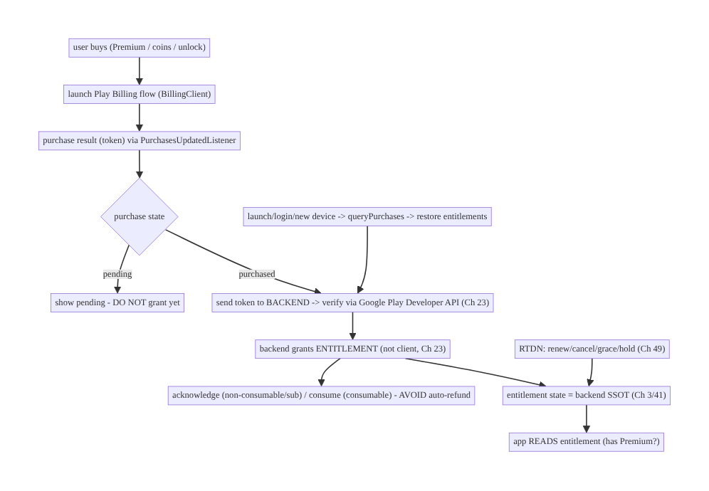
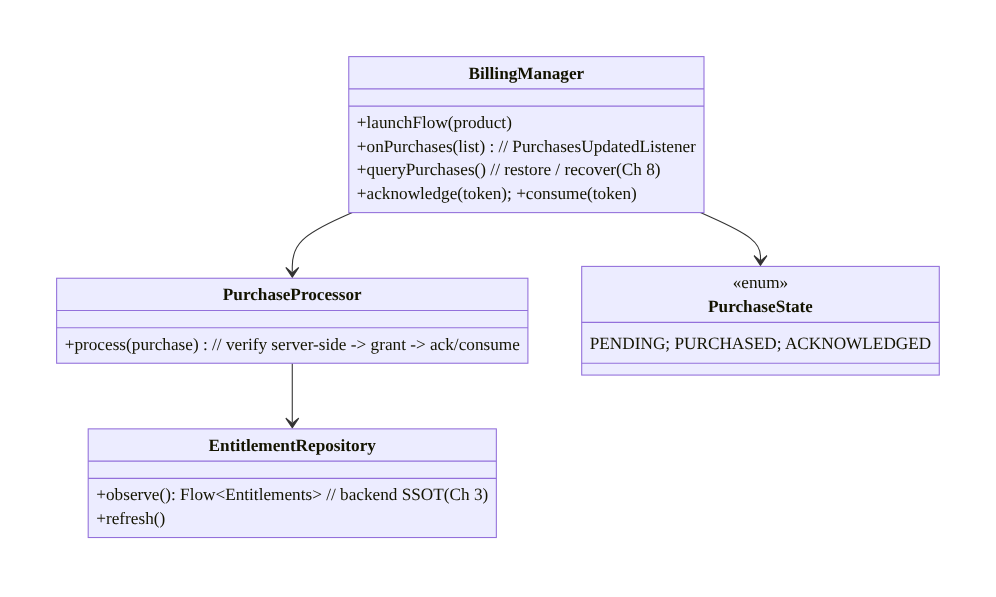
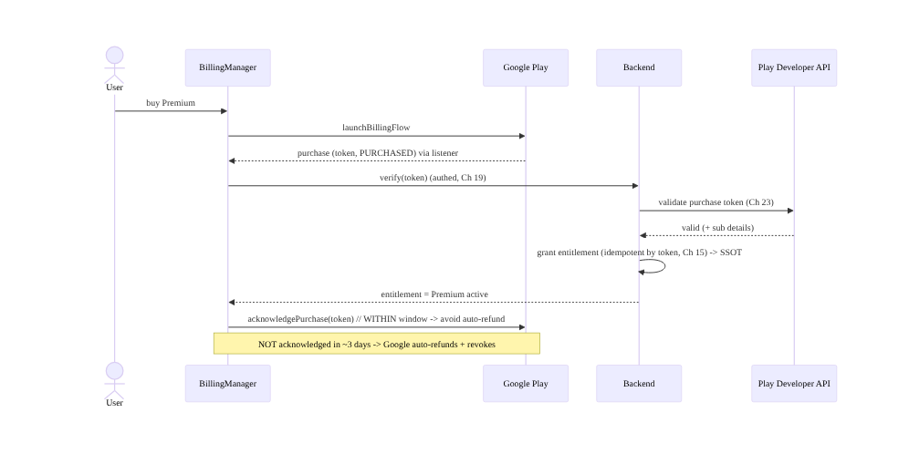
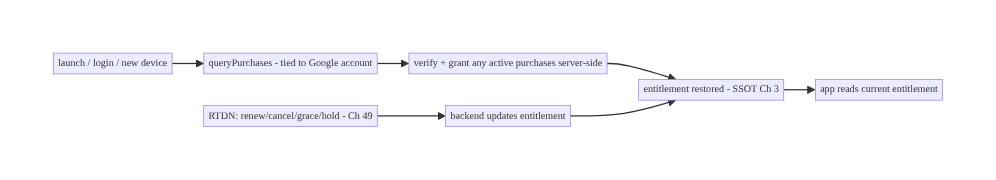
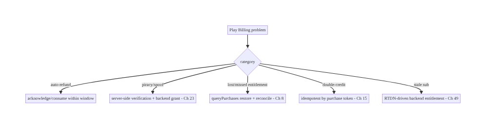

# Chapter 76 — In-App Purchases / Play Billing

> **Part IX — Feature Architectures** · Complexity: **Complex** (≥40 interview questions)
>
> **Prerequisites:** Ch 15 (idempotency), Ch 75 (checkout), Ch 19/23 (auth/security), Ch 3
> (SSOT), Ch 2 (retries), Ch 8 (process death), Ch 49 (push/RTDN). Pairs with Ch 77
> (wallet), Ch 41 (entitlements/config).
>
> **Reference surface in StreamCart:** digital goods and subscriptions — StreamCart
> Premium (ad-free streaming), coins/credits, unlock-a-show — sold through **Google Play
> Billing**, where Google (not your PSP, Ch 75) processes payment, and the engineering is
> about **acknowledging, verifying, entitling, and restoring** purchases correctly.

---

## 76.1 Problem Definition and Real-World Context

In-app purchases of **digital goods and subscriptions** on Android **must** go through
**Google Play Billing** (Play policy, with narrow exceptions) — you **cannot** use a
regular PSP (Ch 75) for digital content. This is a fundamentally different flow: **Google
processes the payment and owns the purchase record**; your app's job is to **launch the
billing flow, acknowledge/consume purchases, verify them server-side, grant entitlements,
and restore them** across devices and reinstalls. The failure modes are distinct and
costly: an **unacknowledged purchase is auto-refunded** (the user paid but you took the
money back), a purchase **not verified server-side** is spoofable (fraud/piracy), and
**lost entitlements** on reinstall/new device anger paying customers.

Concretely, teams hit:

- **PSP vs Play Billing confusion.** Digital goods/subscriptions → **Play Billing**
  (mandatory); physical goods/services → your **PSP checkout** (Ch 75). Using the wrong
  one violates policy or law.
- **Not acknowledging → auto-refund.** Play **requires acknowledging** a purchase (consume
  for consumables, acknowledge for non-consumables/subs) within a window (~3 days) — **an
  unacknowledged purchase is automatically refunded and revoked**. This is the #1 Play
  Billing bug: user pays, gets nothing, and you lose the sale.
- **Client-side entitlement (spoofable).** Granting Premium because the **client** says
  "purchased" is **insecure** — purchases must be **verified server-side** (Google Play
  Developer API / Real-time Developer Notifications, RTDN) and the **entitlement granted by
  your backend** (Ch 23). Client-only entitlement is trivially pirated.
- **Lost entitlements / no restore.** A user reinstalls or switches devices and loses their
  subscription/purchase because the app doesn't **query existing purchases**
  (`queryPurchases`) and restore entitlements. Purchases are **tied to the Google account**
  and must be restorable.
- **Subscription lifecycle.** Subs have **renewals, cancellations, grace periods, account
  holds, upgrades/downgrades, pauses, refunds** — a lifecycle your **backend must track**
  (via RTDN) and reflect as entitlement state.
- **Pending/deferred purchases.** Some payments are **pending** (e.g., cash/slow methods) —
  the purchase isn't complete until it clears; granting early is wrong.
- **Exactly-once + interruption.** Like checkout (Ch 75), purchase flows must be
  **idempotent** and survive interruption (process death mid-purchase) — Play's purchase
  record + `queryPurchases` provide the recovery mechanism.

The architecture: use **Play Billing** for digital goods/subscriptions; **launch the
billing flow**, then on a purchase **verify server-side** (Developer API/RTDN) and
**grant the entitlement from your backend** (never client-only, Ch 23); **acknowledge**
(or **consume** consumables) promptly to avoid **auto-refund**; **restore** entitlements by
**querying existing purchases** on launch/login and across devices; have the **backend
track the subscription lifecycle via RTDN** (renewals/cancellations/holds, Ch 49) and
expose **entitlement state** the app reads (SSOT, Ch 3); handle **pending** purchases; and
make it **idempotent/interruption-safe** (Ch 15/8). This chapter is about **selling digital
goods through Play correctly — acknowledge, verify, entitle, restore**.

### Three practical use cases

1. **StreamCart Premium (subscription).** User subscribes via Play Billing → backend
   verifies (Developer API) → grants the Premium entitlement → app reads entitlement from
   the backend (SSOT); renewals/cancellations tracked via RTDN; restored on reinstall.
2. **Coins (consumable).** Buy 500 coins → **consume** the purchase (so it can be bought
   again) → backend credits coins after verification → idempotent (no double-credit).
3. **Unlock a show (non-consumable).** One-time unlock → **acknowledge** → backend grants
   permanent entitlement → restored via `queryPurchases` on a new device.

### Why this is architectural

Play Billing is a **distinct, policy-mandated purchase system** with its own correctness
model (acknowledge-or-refund, server-verify-or-spoofable, restore-or-lose-entitlements,
subscription lifecycle via RTDN) composing idempotency (Ch 15), server-side verification/
auth (Ch 23/19), SSOT entitlements (Ch 3), push (RTDN, Ch 49), and interruption recovery
(Ch 8). Getting it wrong auto-refunds paying users, enables piracy, or loses subscriptions.

---

## 76.2 Requirements Engineering

### Functional requirements

| ID | Requirement |
|----|-------------|
| F1 | Sell digital goods/subscriptions via Play Billing (not a PSP). |
| F2 | Verify purchases server-side (Developer API/RTDN); grant entitlements from the backend (Ch 23). |
| F3 | Acknowledge non-consumables/subs and consume consumables promptly (avoid auto-refund). |
| F4 | Restore entitlements across reinstall/devices via `queryPurchases` (tied to Google account). |
| F5 | Track subscription lifecycle (renew/cancel/grace/hold) via RTDN; expose entitlement state (Ch 3/49). |
| F6 | Handle pending purchases; be idempotent and interruption-safe (Ch 15/8). |

### Non-functional requirements

| Attribute | Policy |
|-----------|--------|
| **No auto-refund** | Acknowledge/consume within the window (always). |
| **Anti-fraud** | Server-side verification; backend-granted entitlement (never client-only). |
| **Restorability** | Entitlements survive reinstall/device switch (query purchases). |
| **Exactly-once** | No double-credit/double-grant; idempotent (Ch 15). |
| **Lifecycle** | Subscription state accurate (RTDN-driven). |

### Scope

- **In scope:** Play Billing flow (BillingClient, products/offers, launch flow, purchase
  updates), **acknowledge/consume** (avoid auto-refund), **server-side verification**
  (Developer API) + **RTDN** (lifecycle, Ch 49), **backend-granted entitlements** + SSOT
  (Ch 3/23), **restore** (`queryPurchases`), pending purchases, subscription lifecycle
  (renew/cancel/grace/hold/upgrade), idempotency + interruption recovery (Ch 15/8), PSP-vs-
  Play decision.
- **Out of scope:** PSP checkout for physical goods (Ch 75), wallet/payment methods (Ch 77),
  idempotency mechanics (Ch 15), push/RTDN transport detail (Ch 49), entitlement config
  (Ch 41).

### Assumptions & constraints

- **Google Play Billing Library** (client), **Google Play Developer API** + **RTDN**
  (server verification/lifecycle), a **backend** that verifies, grants entitlements, and is
  the **source of truth** for entitlement state. `minSdk 24`. Digital goods/subs **must**
  use Play Billing (policy); **unacknowledged purchases auto-refund**; purchases tie to the
  **Google account**.

---

## 76.3 System Design Fundamentals

- **Play Billing is mandatory for digital goods/subscriptions (and different from a PSP,
  Ch 75).** Play policy requires **Google Play Billing** for in-app digital content and
  subscriptions; your **PSP checkout** (Ch 75) is for **physical** goods/services. **Google
  processes the payment and owns the purchase record** — your app doesn't handle card data
  or charge; it **launches Google's flow** and then **processes the resulting purchase**.
- **Product types: consumable / non-consumable / subscription.**
  - **Consumable** (coins, credits): can be bought repeatedly → you **consume** it after
    granting, so Play lets it be purchased again.
  - **Non-consumable** (unlock a show, remove ads one-time): bought once, permanent → you
    **acknowledge** it.
  - **Subscription** (Premium): recurring → you **acknowledge** it; the **lifecycle**
    (renew/cancel/grace/hold) is tracked via RTDN.
- **Acknowledge/consume promptly or it auto-refunds (the #1 rule).** Play **requires** you
  to **acknowledge** (`acknowledgePurchase` for non-consumables/subs) or **consume**
  (`consumeAsync` for consumables) a purchase within **~3 days**, or Google **automatically
  refunds and revokes** it. So: purchase → **verify server-side** → **grant entitlement** →
  **acknowledge/consume**. Acknowledge **after** granting (so you don't acknowledge a
  purchase you failed to honor), but **within the window**. Missing this means the user
  **paid and got nothing** (auto-refunded).
- **Server-side verification + backend-granted entitlement (anti-fraud, Ch 23).** A
  client claiming "purchased" is **spoofable** (rooted device, patched app). The **backend
  must verify** the purchase with the **Google Play Developer API** (validate the purchase
  token) and **grant the entitlement itself** — the app then reads the **backend's
  entitlement state** (SSOT, Ch 3), not the local purchase. **Client-only entitlement is
  trivially pirated.** The purchase token flows: client → your backend → Google (verify) →
  backend grants → app reads entitlement.
- **Entitlement = backend state, not a purchase (the key abstraction).** Model an
  **entitlement** ("has Premium", "owns show X", "coin balance") as **backend-owned state**
  (Ch 3/41) derived from verified purchases + lifecycle. The app **reads entitlements**
  (does the user have Premium right now?), decoupled from the raw purchase. This makes
  **cross-device**, **restore**, **subscription lifecycle**, and **server authority** clean.
- **Restore across reinstall/devices (`queryPurchases`).** Purchases tie to the **Google
  account**, not the install. On **launch/login**, call **`queryPurchases`** to find
  existing (active) purchases and **restore entitlements** (verify + grant server-side if
  not already). A reinstall or new device must **recover** the user's subscription/unlocks —
  not asking is the "lost my subscription" bug. Also expose an explicit **"Restore
  purchases"** action.
- **Subscription lifecycle via RTDN (Ch 49).** Subscriptions **renew, cancel, enter grace
  periods, go on account hold, pause, upgrade/downgrade, refund** — events the client
  rarely sees directly. **Real-time Developer Notifications (RTDN)** push these to your
  **backend** (Pub/Sub), which updates **entitlement state**; the app reads current
  entitlement (active/grace/expired). Don't infer sub state from the client alone.
- **Pending purchases.** Some payments are **PENDING** (slow/cash methods) — the purchase
  isn't complete. **Do not grant** the entitlement until it's **PURCHASED**; handle the
  pending state (show "pending") and grant when it clears (via `queryPurchases`/RTDN).
- **Idempotent + interruption-safe (Ch 15/8).** Like checkout (Ch 75), grant/consume must
  be **idempotent** (verify by **purchase token**; grant once — no double-credit) and
  **interruption-safe**: Play's **purchase record** + **`queryPurchases`** are the recovery
  mechanism — on relaunch, re-query and reconcile (grant/acknowledge anything outstanding).
  Handle the `PurchasesUpdatedListener` and also `queryPurchases` (purchases can arrive when
  the app wasn't listening).

Core insight: **sell digital goods/subscriptions through Google Play Billing (not a PSP) —
Google processes payment and owns the purchase record; your app launches the flow and then
must verify the purchase server-side (Developer API) and grant the entitlement from the
backend (never client-only — spoofable), acknowledge non-consumables/subs or consume
consumables promptly (or Google auto-refunds within ~3 days), and restore entitlements
across reinstall/devices via queryPurchases (purchases tie to the Google account); model
entitlement as backend-owned state (SSOT, Ch 3) driven by verified purchases plus the
subscription lifecycle tracked via RTDN (Ch 49), handle pending purchases, and make
grant/consume idempotent and interruption-safe using the purchase token and queryPurchases
(Ch 15/8).**

---

## 76.4 High-Level Architecture



**Components & ownership**

- **Client** launches the Play flow and receives the **purchase token**; it does **not**
  grant entitlement.
- **Backend** **verifies** (Developer API), **grants the entitlement**, tracks the
  **subscription lifecycle** via **RTDN**, and is the **entitlement SSOT** (Ch 3/41).
- **Acknowledge/consume** promptly (auto-refund avoidance); **`queryPurchases`** restores;
  the **app reads entitlement state**.

**Direction:** buy → Play flow → token → backend verify → backend grant entitlement →
acknowledge/consume → app reads entitlement; RTDN drives lifecycle; queryPurchases restores.

---

## 76.5 Detailed Component Design



| Component | Responsibility |
|-----------|----------------|
| `BillingManager` | BillingClient: launch flow, receive purchases, query, acknowledge/consume |
| `PurchaseProcessor` | verify server-side → grant (backend) → acknowledge/consume (idempotent, Ch 15) |
| `EntitlementRepository` | read backend-owned entitlement state (SSOT, Ch 3), RTDN-driven |
| `PurchaseState` | pending vs purchased vs acknowledged |

---

## 76.6 End-to-End Data Flow

### Purchase → verify → grant → acknowledge



### Restore + RTDN lifecycle



---

## 76.7 Complete Kotlin Implementation

Package: `com.streamcart.billing`.

### 76.7.1 BillingManager: flow + purchases + query + acknowledge/consume

```kotlin
@Singleton
class BillingManager @Inject constructor(
    @ApplicationContext ctx: Context, private val processor: PurchaseProcessor,
) : PurchasesUpdatedListener {
    private val client = BillingClient.newBuilder(ctx)
        .setListener(this).enablePendingPurchases().build()   // handle PENDING purchases

    fun launchFlow(activity: Activity, productDetails: ProductDetails, offerToken: String) {
        val params = BillingFlowParams.newBuilder().setProductDetailsParamsList(listOf(
            BillingFlowParams.ProductDetailsParams.newBuilder()
                .setProductDetails(productDetails).setOfferToken(offerToken).build())).build()
        client.launchBillingFlow(activity, params)
    }

    override fun onPurchasesUpdated(result: BillingResult, purchases: List<Purchase>?) {
        if (result.responseCode == BillingClient.BillingResponseCode.OK)
            purchases?.forEach { scope.launch { processor.process(it) } }   // verify -> grant -> ack/consume
    }

    /** Restore / recover: purchases can arrive when not listening, and on reinstall/new device (Ch 8). */
    suspend fun restore() {
        val subs = client.queryPurchasesAsync(QueryPurchasesParams.newBuilder().setProductType(ProductType.SUBS).build())
        val inapp = client.queryPurchasesAsync(QueryPurchasesParams.newBuilder().setProductType(ProductType.INAPP).build())
        (subs.purchasesList + inapp.purchasesList).forEach { processor.process(it) }   // reconcile outstanding
    }
    suspend fun acknowledge(token: String) = client.acknowledgePurchase(
        AcknowledgePurchaseParams.newBuilder().setPurchaseToken(token).build())
    suspend fun consume(token: String) = client.consumePurchase(
        ConsumeParams.newBuilder().setPurchaseToken(token).build())
}
```

### 76.7.2 PurchaseProcessor: verify server-side → grant → acknowledge/consume (idempotent)

```kotlin
@Singleton
class PurchaseProcessor @Inject constructor(
    private val billing: BillingManager, private val backend: BillingApi, private val entitlements: EntitlementRepository,
) {
    suspend fun process(purchase: Purchase) {
        if (purchase.purchaseState == Purchase.PurchaseState.PENDING) {   // DO NOT grant pending
            entitlements.markPending(purchase); return
        }
        if (purchase.purchaseState != Purchase.PurchaseState.PURCHASED) return

        // 1) SERVER-SIDE verification + grant (never client-only, Ch 23). Idempotent by purchase token (Ch 15).
        val grant = backend.verifyAndGrant(purchase.purchaseToken, purchase.products)   // backend -> Google Developer API
        if (!grant.ok) return   // verification failed -> do NOT grant/acknowledge

        entitlements.refresh()   // app reads backend entitlement SSOT (Ch 3)

        // 2) Acknowledge/consume WITHIN the window to avoid auto-refund.
        if (grant.consumable) billing.consume(purchase.purchaseToken)     // consumable (coins) -> buy again
        else if (!purchase.isAcknowledged) billing.acknowledge(purchase.purchaseToken)   // non-consumable/sub
    }
}
```

### 76.7.3 EntitlementRepository: backend-owned entitlement state (SSOT, Ch 3)

```kotlin
@Singleton
class EntitlementRepository @Inject constructor(private val backend: BillingApi, private val dao: EntitlementDao) {
    /** App reads ENTITLEMENT (not raw purchase). Backend is the source of truth, RTDN-driven. */
    fun observe(): Flow<Entitlements> = dao.observe()   // e.g., { premium: active|grace|expired, coins: 500, unlockedShows: [...] }
    suspend fun refresh() = dao.upsert(backend.entitlements())   // pull current entitlement state
    suspend fun markPending(p: Purchase) { /* reflect "pending" in UI; grant only when PURCHASED */ }
}
// Gate features on entitlement: if (entitlements.premium.isActive()) showAdFree() else showAds()
```

### 76.7.4 Restore on launch/login + explicit action (Ch 8)

```kotlin
// On app start / login / "Restore purchases" button: reconcile with Play + backend.
class RestoreUseCase @Inject constructor(private val billing: BillingManager, private val entitlements: EntitlementRepository) {
    suspend operator fun invoke() {
        entitlements.refresh()     // backend entitlement state (covers RTDN-driven sub lifecycle)
        billing.restore()          // queryPurchases -> verify+grant any active purchases (reinstall/new device)
    }
}
```

### 76.7.5 PSP vs Play decision

```kotlin
// Digital goods/subscriptions -> Play Billing (this chapter). Physical goods/services -> PSP checkout (Ch 75).
fun purchaseRoute(item: Item): Route = when (item.kind) {
    ItemKind.DigitalOrSubscription -> Route.PlayBilling     // Premium, coins, unlock (policy-mandated)
    ItemKind.PhysicalOrService -> Route.PspCheckout         // products, shipping (Ch 75)
}
```

### 76.7.6 Module structure

```
:feature:billing  BillingManager (BillingClient), PurchaseProcessor, EntitlementRepository, RestoreUseCase
:core:data  entitlement SSOT (Ch 3)
# Backend: verify via Google Play Developer API + grant + RTDN lifecycle (Ch 23/49). PSP checkout -> Ch 75.
```

---

## 76.8 Concurrency and Race Conditions

| Scenario | Risk | Handling |
|----------|------|----------|
| Not acknowledged in window | auto-refund (user paid, got nothing) | acknowledge/consume promptly after grant |
| Client-only entitlement | piracy/spoof | verify server-side; backend grants (Ch 23) |
| Purchase arrives when not listening | missed grant | `queryPurchases` on launch/resume (Ch 8) |
| Double-grant (retry/replay) | double-credit | idempotent by purchase token (Ch 15) |
| Pending granted early | wrong entitlement | grant only on PURCHASED |
| Reinstall/new device | lost entitlement | `queryPurchases` + backend entitlement restore |
| Sub state stale on client | wrong gating | RTDN-driven backend entitlement (Ch 49) |

- **Acknowledge/consume within the window is non-negotiable:** an unacknowledged purchase is
  **auto-refunded** by Google — the user paid and lost it. Always: verify → grant →
  acknowledge/consume (idempotently). This is the single most common and costly Play Billing
  bug.
- **`queryPurchases` is both restore and recovery:** purchases can land when the app isn't
  listening (killed mid-purchase, Ch 8), on another device, or after reinstall — **always
  reconcile via `queryPurchases`** (plus the listener), not just the listener.
- **Idempotent-by-token grant** (Ch 15) prevents double-credit when the same purchase is
  processed via both the listener and `queryPurchases`, or on retry.

---

## 76.9 Failure Scenarios and Recovery

| Failure | Detection | Response | Outcome |
|---------|-----------|----------|---------|
| Auto-refund | revenue loss / revoked | acknowledge/consume within window | retained |
| Spoofed entitlement | fraud/piracy | server-side verification + backend grant (Ch 23) | blocked |
| Lost sub on reinstall | user report | `queryPurchases` + restore entitlement | restored |
| Missed purchase (not listening) | user paid, no grant | `queryPurchases` on launch (Ch 8) | granted |
| Double-credit | billing | idempotent by token (Ch 15) | single |
| Pending granted | wrong access | grant only PURCHASED | correct |
| Stale sub state | wrong gating | RTDN backend entitlement (Ch 49) | accurate |
| Process death mid-purchase | unknown state | `queryPurchases` reconcile (Ch 8) | recovered |



> **Four rules define correct Play Billing: acknowledge-or-auto-refund, verify-server-side-
> or-be-spoofed, queryPurchases-or-lose-entitlements, and entitlement-is-backend-state.**
> Google owns payment and the purchase record; your app launches the flow, then verifies,
> grants (server-side), acknowledges, and restores — reading entitlement from the backend,
> never trusting the client.

---

## 76.10 Scaling the Implementation

- **Level 1.** Launch Play flow; on purchase, **verify server-side + grant** entitlement;
  **acknowledge/consume** promptly.
- **Level 2.** `queryPurchases` restore on launch/login + explicit "Restore"; pending
  handling; idempotent-by-token grant (Ch 15/8).
- **Level 3 — production.** RTDN subscription lifecycle → backend entitlement (Ch 49);
  entitlement SSOT the app reads (Ch 3); PSP-vs-Play routing (Ch 75).
- **Level 4 — large.** Upgrades/downgrades/proration, grace/hold/pause handling, offers/
  promos, multiple SKUs/base-plans, server-side entitlement across platforms (iOS/web
  parity).
- **Level 5 — enterprise.** Subscription analytics (churn, LTV), entitlement governance,
  refund/dispute handling, price changes, regional pricing, fraud monitoring, exactly-once
  SLOs.

**Avoid overengineering:** the verify→grant→acknowledge→restore core + backend entitlement
is mandatory; build it first. Don't grant client-side; don't skip acknowledge; don't infer
sub state on the client.

---

## 76.11 Alternative Approaches and Trade-offs

| Dimension | Option A | Option B | When |
|-----------|----------|----------|------|
| Payment system | Play Billing (digital/subs) | PSP (Ch 75) | Play for digital/subs (policy); PSP for physical |
| Entitlement | Backend-granted (verified) | client-side | Backend always (anti-piracy, Ch 23) |
| Acknowledge | Promptly after grant | skip/late | Promptly (else auto-refund) |
| Restore | `queryPurchases` + backend | none | Always (reinstall/device) |
| Sub lifecycle | RTDN → backend (Ch 49) | client polling / inference | RTDN (accurate, timely) |
| Consumable | consume after grant | acknowledge | consume (re-purchasable) |
| Purchase detection | listener + `queryPurchases` | listener only | Both (purchases arrive off-listener) |

**Play Billing vs PSP (Ch 75):** Play policy **mandates** Google Play Billing for **digital
goods and subscriptions** — you cannot route them through your PSP; conversely, **physical
goods/services** must use your **PSP checkout** (Ch 75), not Play Billing. The systems differ
fundamentally: with Play, **Google processes payment and owns the record**, so your work is
**verify/grant/acknowledge/restore**, not charging. Route by item kind.

**Backend-granted vs client-side entitlement:** granting access because the **client** reports
a purchase is **trivially pirated** (patched app, replayed token). The **backend must verify**
the purchase token with Google's Developer API and **grant the entitlement itself**, which the
app then reads (Ch 3/23). Client-side entitlement is the classic Play Billing security hole.

**Acknowledge vs skip:** Play **auto-refunds** any purchase **not acknowledged/consumed within
~3 days** — a skipped or delayed acknowledgement means the **user paid and lost the purchase**
(and you lost revenue). Always acknowledge non-consumables/subs and consume consumables, after
granting, within the window.

**Listener + `queryPurchases` vs listener only:** relying only on `PurchasesUpdatedListener`
misses purchases that complete when the app isn't listening (killed mid-flow, Ch 8), on other
devices, or after reinstall. **`queryPurchases`** on launch/login **reconciles** and
**restores** — use **both** the listener (live) and `queryPurchases` (reconcile/restore).

---

## 76.12 Security Considerations

- **Server-side verification is the anti-piracy core (Ch 23):** verify every purchase token
  with the **Google Play Developer API** on the **backend** and **grant entitlement
  server-side** — never trust the client's claim of ownership. This defeats patched apps and
  replayed/spoofed purchases.
- **Entitlement is backend state (Ch 3):** gate premium features on the **backend's**
  entitlement, not a local flag, so a modified client can't unlock Premium.
- **Idempotency by purchase token (Ch 15):** the backend grants **once per token** —
  replaying a token can't double-credit or re-grant.
- **RTDN authenticity (Ch 49):** validate RTDN messages (from Google Pub/Sub) server-side;
  don't trust unverified lifecycle events.
- **No sensitive purchase data in logs** (Ch 28); the app never handles card data (Google
  does).
- **Account binding (Ch 42):** entitlements tie to the **user account** (and the Google
  account for restore); handle account switches and the Google-account-vs-app-account mapping
  carefully (a shared device, family sharing).
- **Refund/revocation:** honor refunds/chargebacks (RTDN) by **revoking entitlement**
  server-side — a refunded sub must lose access.
- Client vs backend: the **backend** verifies, grants, tracks lifecycle (RTDN), and owns
  entitlement truth; the **client** launches the flow, acknowledges/consumes, restores via
  `queryPurchases`, and **reads** entitlement — it never grants or trusts local purchase
  state for access.

---

## 76.13 Performance and Resource Optimization

- **Acknowledge/consume promptly** — not a perf issue but a revenue one (auto-refund).
- **Cache entitlement state** (SSOT, Ch 3) so feature-gating is instant/offline (re-verify/
  refresh periodically + on RTDN).
- **Query purchases on launch** (cheap) to reconcile; don't poll continuously.
- **Lazy-load product details** (`queryProductDetails`) when the store screen is shown.
- **Backend does verification** (not the client) — keeps the client light and secure.
- **RTDN push** (Ch 49) avoids client polling for sub state.
- **Profiling:** purchase success/latency, auto-refund rate (→ 0), restore success,
  entitlement-refresh cost, RTDN processing lag.

---

## 76.14 Testing Strategy

Play Billing tests use **license testers / test tracks** and faked BillingClient; backend
verification + idempotency unit-tested.

```kotlin
class PurchaseProcessorTest {
    @Test fun `grants then acknowledges a verified non-consumable`() = runTest {
        backend.verifyResult = Grant(ok = true, consumable = false)
        processor.process(purchase(PURCHASED, acknowledged = false))
        assertTrue(backend.granted); assertTrue(billing.acknowledged)   // avoid auto-refund
    }
    @Test fun `does not grant pending`() = runTest {
        processor.process(purchase(PENDING)); assertFalse(backend.granted)
    }
    @Test fun `does not acknowledge if verification fails`() = runTest {
        backend.verifyResult = Grant(ok = false); processor.process(purchase(PURCHASED))
        assertFalse(billing.acknowledged)   // don't ack an unhonored purchase
    }
    @Test fun `grant is idempotent by token`() = runTest {
        processor.process(p); processor.process(p)                      // listener + queryPurchases
        assertEquals(1, backend.grantsFor(p.purchaseToken))             // single (Ch 15)
    }
}

class RestoreTest {
    @Test fun `queryPurchases restores entitlement on reinstall`() = runTest { /* active sub -> entitlement granted */ }
}
```

What to test: verify→grant→acknowledge (non-consumable/sub) and consume (consumable);
**don't grant pending**; **don't acknowledge on failed verification**; idempotent-by-token
grant (listener + queryPurchases); restore via `queryPurchases`; entitlement read from
backend (not client). Use license testers / Play test tracks for end-to-end; fake backend
with idempotency.

---

## 76.15 Production Observability

- **Metrics:** **auto-refund rate (→ 0, critical)**; purchase success/latency; **server-side
  verification** success/failure; restore success; entitlement-grant idempotency (double-
  grant → 0); subscription state distribution (active/grace/hold/expired); RTDN processing
  lag; pending→purchased conversion.
- **Logs:** `billing{product, state, verified, acknowledged, granted}` — no sensitive purchase
  data (Ch 28); backend holds the record.
- **Debugging:** auto-refunds → not acknowledging in window; piracy/spoof → client-side
  entitlement (verify server-side); lost subs → no `queryPurchases` restore; double-credit →
  non-idempotent grant; stale sub → not RTDN-driven; missed purchase → listener-only (add
  queryPurchases).
- **Alerting:** **auto-refund spike** (acknowledge bug — revenue loss); verification-failure
  spike (fraud or integration); RTDN lag.
- **Dashboards:** auto-refund rate (must be ~0), verification success, restore success,
  subscription funnel/churn.

---

## 76.16 System Design Interview Preparation

> ≥40 questions.

**Fundamentals**
1. *Play Billing vs PSP (Ch 75)?* Digital goods/subs via Play (policy); physical via PSP.
2. *Who processes payment?* Google (owns the purchase record) — not your app/PSP.
3. *App's job?* Launch flow, verify server-side, grant entitlement, acknowledge/consume,
   restore.
4. *Product types?* Consumable (consume), non-consumable (acknowledge), subscription
   (acknowledge + lifecycle).
5. *Entitlement?* Backend-owned state the app reads (Ch 3), not the raw purchase.

**Acknowledge/consume**
6. *Acknowledge rule?* Must acknowledge/consume within ~3 days or Google auto-refunds.
7. *Consumable?* `consumeAsync` (re-purchasable).
8. *Non-consumable/sub?* `acknowledgePurchase`.
9. *Order?* Verify → grant → acknowledge (don't ack an unhonored purchase).
10. *#1 bug?* Not acknowledging → auto-refund.

**Verification/entitlement**
11. *Why server-side verify?* Client is spoofable (piracy) — verify token via Developer API
    (Ch 23).
12. *Who grants?* The backend (not the client).
13. *Gate features on?* Backend entitlement state (Ch 3).
14. *Client-only entitlement?* Trivially pirated.

**Restore**
15. *Reinstall/new device?* `queryPurchases` → verify+grant → restore (tied to Google
    account).
16. *Listener only?* No — also `queryPurchases` (purchases arrive off-listener).
17. *Explicit restore?* Provide a "Restore purchases" action.

**Subscriptions**
18. *Lifecycle events?* Renew/cancel/grace/hold/pause/upgrade/refund.
19. *How tracked?* RTDN → backend → entitlement (Ch 49).
20. *Client infer sub state?* No — read backend entitlement.
21. *Grace/hold?* Entitlement states the backend reflects.

**Pending/idempotency**
22. *Pending purchase?* Don't grant until PURCHASED.
23. *Idempotency?* Grant once per purchase token (Ch 15).
24. *Interruption (Ch 8)?* `queryPurchases` reconcile on launch.
25. *Double-grant source?* Listener + queryPurchases both processing → idempotent-by-token.

**Security**
26. *Anti-piracy?* Server-side verification + backend grant (Ch 23).
27. *RTDN authenticity?* Validate server-side.
28. *Refund?* Revoke entitlement (RTDN).
29. *Account binding?* Entitlement per app user + Google account (Ch 42).
30. *Card data?* App never handles it (Google does).

**Testing/Production**
31. *Test purchases?* License testers / test tracks.
32. *Test acknowledge?* Granted then acknowledged; not on failed verify.
33. *Test restore?* `queryPurchases` grants entitlement.
34. *Auto-refunds in prod?* Not acknowledging.
35. *Piracy?* Client-side entitlement.
36. *Lost subs?* No restore.
37. *Double-credit?* Non-idempotent grant.
38. *Key KPI?* Auto-refund rate (0).
39. *Stale sub?* Not RTDN-driven.
40. *Missed purchase?* Listener-only.
41. *Alert priority?* Auto-refund spike (revenue).

### Design-change challenges
1. **Sell a Premium subscription.** Play Billing + server verify + backend entitlement + RTDN
   lifecycle + restore.
2. **Users lose Premium on reinstall.** `queryPurchases` + backend entitlement restore.
3. **A rooted device unlocks Premium free.** Server-side verification + backend-granted
   entitlement (Ch 23).
4. **Users paid but got auto-refunded.** Acknowledge/consume within the window.
5. **Buy coins (consumable) without double-crediting.** Consume + idempotent-by-token grant
   (Ch 15).

### Mock walkthrough (abridged)
Clarify (digital or physical, consumable/sub, cross-device?) → Play Billing for digital/subs
(policy; PSP for physical, Ch 75) → launch flow → on purchase **verify server-side + grant
entitlement (backend, Ch 23)** → **acknowledge/consume within window** (auto-refund) →
**entitlement = backend SSOT** the app reads (Ch 3) → **restore via queryPurchases**
(reinstall/device) → **RTDN** subscription lifecycle (Ch 49) → pending handling + idempotent-
by-token + interruption recovery (Ch 15/8) → security (anti-piracy, refunds) → observability
(auto-refund rate 0).

---

## 76.17 Practical Exercises

1. **Beginner.** Launch a Play Billing flow for Premium and, on purchase, acknowledge it —
   verifying the acknowledge happens within the window. *Eval:* purchase acknowledged (no
   auto-refund).
2. **Intermediate.** Verify the purchase **server-side** and grant the entitlement from the
   backend; gate Premium on the backend entitlement (not the client). *Eval:* a spoofed
   client can't unlock Premium.
3. **Advanced.** Restore entitlements via `queryPurchases` on launch/reinstall and make the
   grant idempotent by purchase token. *Eval:* reinstall restores; no double-grant.
4. **Production debugging.** Fix auto-refunds (missing acknowledge) and lost subscriptions on
   new devices (no restore). *Eval:* retained; restored.
5. **System design challenge.** Add RTDN-driven subscription lifecycle (renew/cancel/grace)
   to backend entitlement + handle pending purchases + consumable coins. *Eval:* sub state
   accurate; pending not granted; coins idempotent.

*(Solutions withheld unless requested.)*

---

## 76.18 Chapter Summary & Reference Sheet

**Key decisions:** sell **digital goods and subscriptions through Google Play Billing** (Play
policy mandates it; your **PSP checkout** (Ch 75) is for **physical** goods) — **Google
processes payment and owns the purchase record**, so the app **launches the flow** and then
must: **verify the purchase token server-side** (Google Play Developer API) and **grant the
entitlement from the backend** (never client-side — spoofable/pirated, Ch 23); **acknowledge
non-consumables/subscriptions or consume consumables promptly** (verify → grant →
acknowledge, within ~3 days, or **Google auto-refunds and revokes**); **restore entitlements
across reinstall/devices via `queryPurchases`** (purchases tie to the Google account — plus
an explicit "Restore"); model **entitlement as backend-owned SSOT state** the app **reads**
(Ch 3), driven by verified purchases plus the **subscription lifecycle tracked via RTDN**
(renew/cancel/grace/hold, Ch 49); **don't grant PENDING** purchases; and make grant/consume
**idempotent by purchase token** and **interruption-safe** (reconcile via `queryPurchases` on
launch, Ch 15/8). The critical KPI is an **auto-refund rate of zero**.

**Concepts:** Play Billing (BillingClient, product types), acknowledge/consume (auto-refund
avoidance), server-side verification (Developer API) + backend-granted entitlement (anti-
piracy), entitlement-as-backend-SSOT, restore via `queryPurchases`, RTDN subscription
lifecycle, pending purchases, idempotency-by-token + interruption recovery, Play-vs-PSP.

**Common mistakes:** using a PSP for digital goods (policy violation); client-side entitlement
(piracy); not acknowledging/consuming (auto-refund — paid-but-got-nothing); listener-only
(missed purchases); no `queryPurchases` restore (lost subs on reinstall); granting PENDING;
non-idempotent grant (double-credit); inferring subscription state on the client instead of
RTDN-driven backend entitlement.

**Checklist:** ☐ Play Billing for digital/subs (PSP for physical, Ch 75) ☐ verify purchase
token server-side + grant entitlement on backend (Ch 23) ☐ acknowledge (non-consumable/sub) /
consume (consumable) within window ☐ entitlement = backend SSOT the app reads (Ch 3) ☐ restore
via `queryPurchases` on launch/login/new device + explicit action ☐ RTDN → backend subscription
lifecycle (Ch 49) ☐ don't grant PENDING ☐ idempotent grant by purchase token (Ch 15) ☐
interruption recovery via queryPurchases (Ch 8) ☐ per-account/Google-account binding (Ch 42) ☐
revoke on refund ☐ auto-refund-rate alert (→ 0).

**Key APIs:** Play Billing `BillingClient`/`enablePendingPurchases`/`launchBillingFlow`/
`PurchasesUpdatedListener`/`queryPurchasesAsync`/`queryProductDetailsAsync`/
`acknowledgePurchase`/`consumePurchase`, `Purchase.PurchaseState` (PENDING/PURCHASED),
Google Play Developer API (server verify), RTDN / Pub/Sub (Ch 49), entitlement SSOT (Ch 3),
idempotency by purchase token (Ch 15).

**References:**
- Play Billing overview: https://developer.android.com/google/play/billing/integrate
- Process purchases (acknowledge/consume): https://developer.android.com/google/play/billing/integrate#process
- Verify purchases server-side: https://developer.android.com/google/play/billing/security
- Real-time developer notifications: https://developer.android.com/google/play/billing/rtdn-reference
- (composes) Ch 75 Checkout, Ch 15 Idempotency, Ch 23 Security, Ch 3 SSOT, Ch 49 Push/RTDN, Ch 8 Process Death, Ch 42 Multi-Account, Ch 41 Entitlements/Config, Ch 77 Wallet

### Chapter review (Phase 4)
- **Completeness:** all 18 sections; architecture/class/sequence/restore/failure diagrams;
  BillingManager (flow/query/ack/consume) + PurchaseProcessor (verify→grant→ack) +
  EntitlementRepository + restore + PSP-vs-Play code; concurrency (acknowledge window,
  queryPurchases, idempotent-by-token, pending); failure (four-rules principle); 5 levels;
  Play-vs-PSP, backend-vs-client-entitlement, acknowledge, listener+query trade-offs;
  security (server verify, backend entitlement, RTDN, refunds); perf (cache entitlement,
  RTDN); license-tester + idempotency tests; observability (auto-refund rate 0); 41 Q&A + 5
  challenges. ✅
- **Expand later:** checkout (Ch 75), wallet (Ch 77), RTDN/push (Ch 49), entitlements
  (Ch 41).
- **Interview coverage:** exceeds ≥40 Complex bar.
