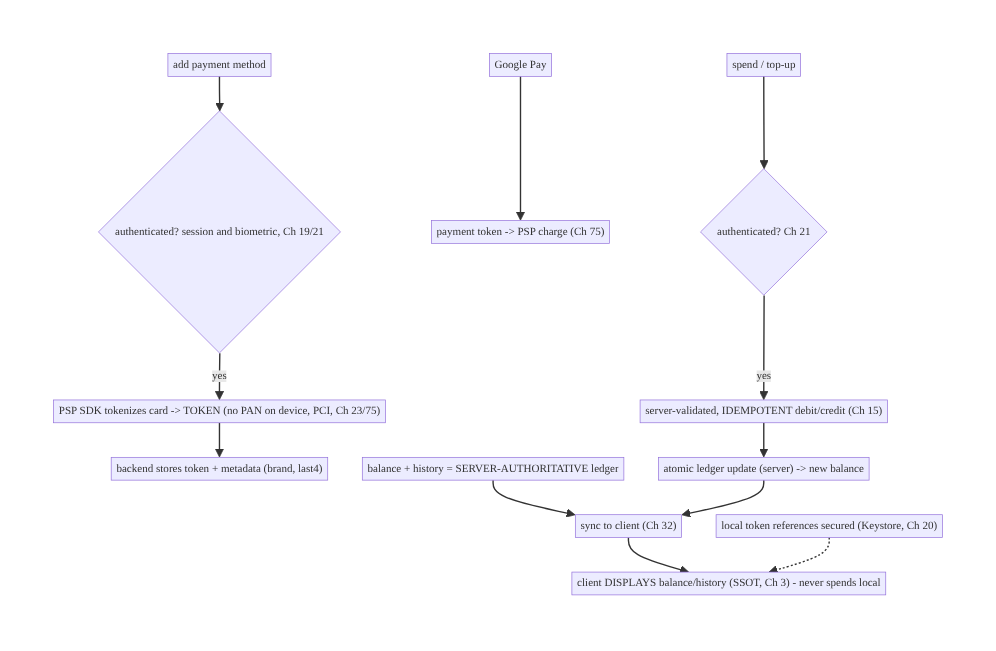
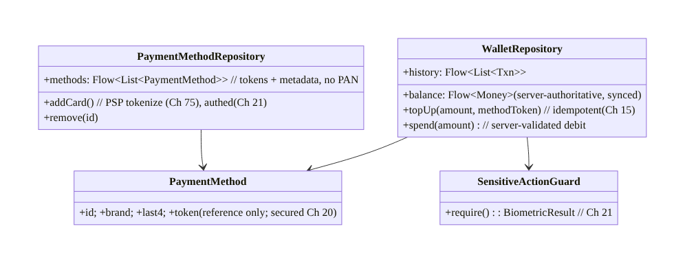
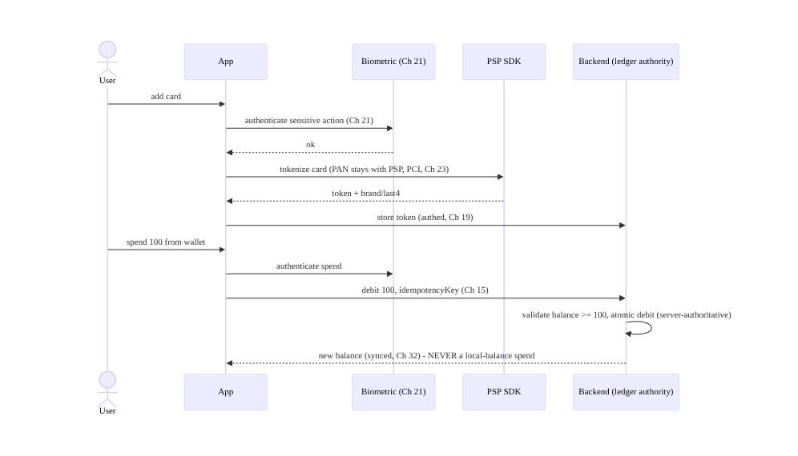
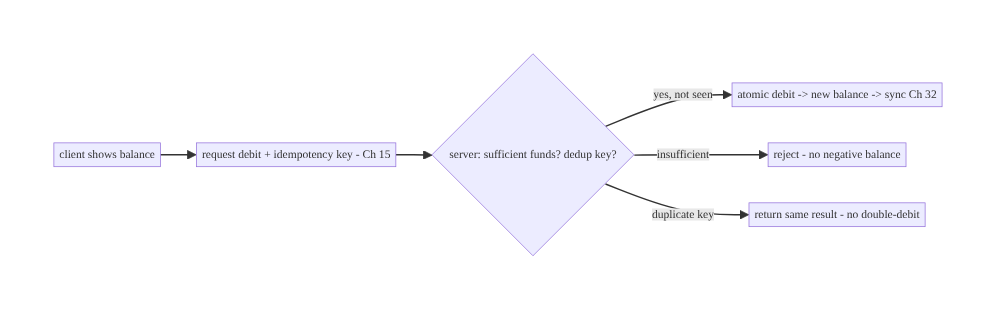
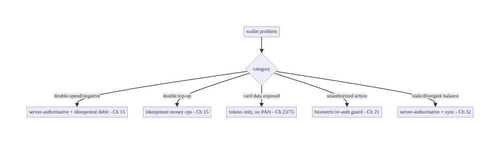

# Chapter 77 — Wallet & Payments

> **Part IX — Feature Architectures** · Complexity: **Standard** (≥25 interview questions)
>
> **Prerequisites:** Ch 75 (checkout), Ch 76 (Play Billing), Ch 15 (idempotency), Ch 3
> (SSOT), Ch 19/23 (auth/security), Ch 20 (Keystore), Ch 21 (biometric). Pairs with Ch 32
> (sync), Ch 78 (order tracking).
>
> **Reference surface in StreamCart:** the user's **payment methods and in-app wallet** —
> saved cards (tokenized), a stored-value balance (StreamCart Cash), Google Pay, and
> transaction history — managed so that **no card data touches the device**, balances are
> **server-authoritative**, and sensitive actions are **authenticated**.

---

## 77.1 Problem Definition and Real-World Context

A wallet feature manages the user's **payment methods** (saved cards, Google Pay, bank
accounts) and an **in-app stored-value balance** (wallet/credits/cash), plus
**transaction history**. The non-negotiable truths: **no raw card data (PAN) ever lives on
the device** (PCI — only PSP tokens, Ch 23); the **balance is server-authoritative** (the
client never computes or trusts a local balance — double-spend/fraud risk); payment-method
and balance mutations are **idempotent** (Ch 15); and **sensitive actions** (adding a card,
spending, viewing full history) are **authenticated** (Ch 19/21). Done wrong, it leaks card
data, allows double-spend or negative balances, or exposes one user's wallet to another.

Concretely, teams hit:

- **Card data on device.** Storing or handling the **PAN/CVV** locally is a PCI violation
  and breach risk. Only **PSP tokens** (Ch 75) or **Google Pay tokens** may be referenced;
  the real card details live with the PSP/network.
- **Client-trusted balance.** Showing/trusting a **locally computed** balance invites
  **double-spend** (spend the same balance twice offline), negative balances, and tampering.
  The **server is authoritative** for the balance; the client **displays** it and
  **requests** debits/credits the server validates.
- **Non-idempotent money ops.** Adding funds, spending, or saving a card without an
  **idempotency key** double-applies on retry/double-tap (double-charge top-up, double-
  spend) — same discipline as checkout (Ch 75).
- **Weak auth on sensitive actions.** Adding a payment method, spending wallet balance, or
  viewing full card/transaction details must be **authenticated** (session + often
  **biometric/re-auth**, Ch 21) — not freely accessible.
- **Google Pay integration.** Google Pay returns a **payment token** (not card data) to
  charge via your PSP — a distinct, tokenized flow to integrate correctly.
- **Consistency & history.** Balance and transactions must be **consistent across devices**
  (server-synced, Ch 32), with an **auditable** transaction history (server-owned).

The architecture: keep **no card data on the device** — reference **PSP/Google Pay tokens**
only (Ch 23/75); make the **balance server-authoritative** (display it, request server-
validated debits/credits — never spend a local balance); make all **money mutations
idempotent** (Ch 15); **authenticate sensitive actions** (session + biometric/re-auth,
Ch 19/21); integrate **Google Pay** (tokenized) and the **PSP** (Ch 75) for payment
methods; keep **transaction history server-owned and auditable**, synced to the client
(Ch 32/3); and store any references securely (Keystore, Ch 20). This chapter is about **a
secure, server-authoritative wallet with tokenized payment methods**.

### Three practical use cases

1. **Saved cards (StreamCart).** Add a card via the PSP SDK → a **token** is stored
   server-side; the app shows "Visa ••1234" from the token metadata (no PAN); charging uses
   the token (Ch 75); adding/removing requires auth (Ch 21).
2. **StreamCart Cash (stored value).** A server-authoritative balance; top-up (idempotent
   charge, Ch 15) credits it; spending at checkout (Ch 75) **debits server-side** (never a
   local balance); history is auditable.
3. **Google Pay.** One-tap payment returning a payment token charged via the PSP — no card
   details on the device.

### Why this is architectural

The wallet is a **security- and correctness-critical** feature: **no-card-on-device**
(PCI, Ch 23), **server-authoritative balance** (anti-double-spend), **idempotent money ops**
(Ch 15), **authenticated sensitive actions** (Ch 19/21), tokenized PSP/Google Pay (Ch 75),
and auditable server-owned history (Ch 3/32). The decisions determine whether money and
card data are handled safely and exactly-once.

---

## 77.2 Requirements Engineering

### Functional requirements

| ID | Requirement |
|----|-------------|
| F1 | Manage payment methods as PSP/Google Pay tokens; no card data on device (Ch 23/75). |
| F2 | Show a server-authoritative balance; debit/credit server-side (no local-balance spend). |
| F3 | Make money mutations (top-up, spend, save/remove card) idempotent (Ch 15). |
| F4 | Authenticate sensitive actions (session + biometric/re-auth) (Ch 19/21). |
| F5 | Integrate Google Pay (tokenized) + PSP for charging (Ch 75). |
| F6 | Keep transaction history server-owned, auditable, synced to the client (Ch 3/32). |

### Non-functional requirements

| Attribute | Policy |
|-----------|--------|
| **PCI / security** | No PAN/CVV on device; tokens only; secure references (Ch 20/23). |
| **Integrity** | Server-authoritative balance; no double-spend/negative. |
| **Exactly-once** | Idempotent money ops (Ch 15). |
| **Auth** | Sensitive actions authenticated (biometric/re-auth, Ch 21). |
| **Consistency** | Balance/history server-synced + auditable (Ch 32/3). |

### Scope

- **In scope:** payment methods as tokens (PSP/Google Pay, no card on device), server-
  authoritative balance (display + server-validated debit/credit), idempotent money ops
  (Ch 15), auth for sensitive actions (Ch 19/21), Google Pay integration, transaction
  history (server-owned, synced, Ch 3/32), secure reference storage (Ch 20), PCI
  considerations.
- **Out of scope:** checkout flow (Ch 75), Play Billing (Ch 76), idempotency mechanics
  (Ch 15), auth/biometric internals (Ch 19/21), Keystore internals (Ch 20), sync (Ch 32).

### Assumptions & constraints

- A **PSP** (Stripe/Adyen) tokenizes cards; **Google Pay API** returns payment tokens; the
  **backend owns the wallet balance, payment-method tokens, and transaction history** and is
  **authoritative**. `minSdk 24`. **No raw card data** on the device (PCI, Ch 23); money ops
  are **idempotent** and **authenticated**.

---

## 77.3 System Design Fundamentals

- **No card data on the device — tokens only (PCI, Ch 23/75).** The app **never** stores or
  handles the **PAN or CVV**. Adding a card goes through the **PSP SDK**, which tokenizes it;
  the **token** (and display metadata like brand + last4) is stored **server-side**. The app
  shows "Visa ••1234" from metadata and **charges by token** (Ch 75). This minimizes PCI
  scope and breach impact — a compromised device has **no card numbers**. Any token
  reference kept locally is non-sensitive display data; secrets go in **Keystore** (Ch 20).
- **Server-authoritative balance (anti-double-spend, the core).** The wallet **balance** is
  **owned and computed by the server**. The client **displays** the balance (synced, Ch 32)
  but **never spends a local balance** — spending **requests a server-side debit** that the
  server **validates** (sufficient funds? idempotent?) and applies **atomically**. A
  client-trusted balance enables **double-spend** (spend offline twice), **negative
  balances**, and **tampering**. The server is the ledger; the client is a view + request
  initiator.
- **Idempotent money operations (Ch 15).** Every money mutation — **top-up** (charge →
  credit), **spend** (debit), **save/remove card** — carries an **idempotency key** so a
  retry/double-tap/reconnect doesn't **double-charge the top-up**, **double-debit**, or
  **duplicate a card**. Same exactly-once discipline as checkout (Ch 75): generate the key
  once per operation, persist it, reuse on retry; the server dedups.
- **Authenticate sensitive actions (Ch 19/21).** Wallet actions are sensitive:
  **adding/removing a payment method**, **spending balance**, **topping up**, and **viewing
  full card/transaction details** require **authentication** — a valid session (Ch 19) and
  often a **biometric/re-auth** step (Ch 21) for the sensitive action itself (even within an
  authed session). Don't let a borrowed-unlocked phone spend the wallet freely.
- **Google Pay (tokenized).** The **Google Pay API** presents the user's Google-stored
  payment methods and returns a **payment token** (a tokenized representation), which your
  **PSP charges** (Ch 75) — the app never sees card data. It's a fast, tokenized path to
  pay or add a method.
- **Transaction history: server-owned, auditable, synced (Ch 3/32).** The **ledger**
  (top-ups, spends, refunds, adjustments) is **server-owned** and **auditable** (immutable
  record for disputes/support, Ch 19). The client **syncs and displays** history (SSOT,
  Ch 3; delta sync, Ch 32) but is **not** the record of truth. Balance = derived from the
  server ledger.
- **Consistency across devices (Ch 32).** Balance, payment methods, and history are
  **server-synced** so all the user's devices show the same wallet; a spend on one device
  reflects on another (the server is authoritative, so convergence is straightforward).
- **Refunds/adjustments.** Handled **server-side** (credit the balance / reverse a charge),
  reflected as new ledger entries the client syncs — the client doesn't mutate the ledger.

Core insight: **a wallet keeps no card data on the device (PSP/Google Pay tokens only, PCI,
Ch 23/75) and treats the balance and transaction ledger as server-authoritative — the client
displays the balance (synced, Ch 32) but never spends a local balance; it requests
server-validated, idempotent debits/credits (Ch 15) so top-ups never double-charge and
spends never double-debit or go negative; sensitive actions (add/remove card, spend, top-up,
view details) are authenticated with the session plus a biometric/re-auth step (Ch 19/21);
payment methods are tokenized via the PSP and Google Pay and charged by token (Ch 75); and
the auditable transaction history is server-owned and synced to the client (Ch 3/32), with
any local references secured in the Keystore (Ch 20).**

---

## 77.4 High-Level Architecture



**Components & ownership**

- **Payment methods** are **tokens** (PSP/Google Pay); the **backend** stores tokens +
  display metadata — **no card data on device** (Ch 23/75).
- **Balance + history** are a **server-authoritative ledger**; the client **displays**
  (synced, Ch 32) and **requests idempotent debits/credits** the server validates (Ch 15).
- **Sensitive actions authenticated** (session + biometric, Ch 19/21); references secured in
  **Keystore** (Ch 20).

**Direction:** add card → auth → PSP token (no PAN) → backend; balance/history server-
authoritative → synced display; spend/top-up → auth → idempotent server-validated ledger op.

---

## 77.5 Detailed Component Design



| Component | Responsibility |
|-----------|----------------|
| `WalletRepository` | display server-authoritative balance/history; idempotent server-validated top-up/spend |
| `PaymentMethodRepository` | tokenized payment methods (PSP/Google Pay); add/remove (authed) |
| `PaymentMethod` | token + display metadata (brand/last4) — **no PAN** (Ch 20/23) |
| `SensitiveActionGuard` | biometric/re-auth for sensitive actions (Ch 21) |

---

## 77.6 End-to-End Data Flow

### Add a card (tokenized, authed) + spend (server-validated, idempotent)



### Server-authoritative balance (anti-double-spend)



---

## 77.7 Complete Kotlin Implementation

Package: `com.streamcart.wallet`.

### 77.7.1 Payment methods as tokens (no card data on device, Ch 23/75)

```kotlin
data class PaymentMethod(
    val id: String, val brand: String, val last4: String,   // DISPLAY metadata only
    // NO PAN/CVV. The actual card lives with the PSP; we reference a token server-side.
)

@Singleton
class PaymentMethodRepository @Inject constructor(
    private val psp: PspSdk, private val api: WalletApi, private val guard: SensitiveActionGuard,  // Ch 21
) {
    val methods: Flow<List<PaymentMethod>> = api.paymentMethodsFlow()   // from backend (tokens + metadata)

    suspend fun addCard(activity: Activity): Outcome<PaymentMethod> {
        if (!guard.require(activity)) return Outcome.Failure(AppError.Unauthorized)   // biometric (Ch 21)
        val token = psp.tokenizeCard(activity)   // PSP SDK; PAN never touches app/server (PCI, Ch 23)
        return api.savePaymentMethod(token)       // backend stores token; returns brand/last4
    }
    suspend fun remove(id: String, activity: Activity) {
        if (!guard.require(activity)) return
        api.removePaymentMethod(id)
    }
}
```

### 77.7.2 WalletRepository: server-authoritative balance + idempotent ops (Ch 15)

```kotlin
@Singleton
class WalletRepository @Inject constructor(
    private val api: WalletApi, private val dao: WalletDao,   // SSOT cache of server state (Ch 3)
    private val guard: SensitiveActionGuard,                  // Ch 21
) {
    /** Balance is SERVER-AUTHORITATIVE; the client only DISPLAYS it (synced, Ch 32). */
    val balance: Flow<Money> = dao.balanceFlow()
    val history: Flow<List<Txn>> = dao.historyFlow()

    suspend fun refresh() { dao.put(api.wallet()) }   // pull authoritative balance + history

    /** Top-up: idempotent charge -> credit. NEVER credit locally. */
    suspend fun topUp(amount: Money, methodId: String, activity: Activity): Outcome<Money> {
        if (!guard.require(activity)) return Outcome.Failure(AppError.Unauthorized)   // authed (Ch 21)
        return api.topUp(amount, methodId, idempotencyKey = "topup:${UUID.randomUUID()}")   // idempotent (Ch 15)
            .onSuccess { dao.put(it) }   // server returns new authoritative balance/history
    }

    /** Spend: request a SERVER-VALIDATED debit; server checks funds + dedups. NO local-balance spend. */
    suspend fun spend(amount: Money, idempotencyKey: String, activity: Activity): Outcome<Money> {
        if (!guard.require(activity)) return Outcome.Failure(AppError.Unauthorized)
        return api.debit(amount, idempotencyKey)   // server: balance>=amount? atomic debit; dedup key (Ch 15)
            .onSuccess { dao.put(it) }             // new balance from server (authoritative)
    }
    // There is NO client method that mutates the balance directly — only server-validated requests.
}
```

### 77.7.3 Google Pay (tokenized → PSP charge, Ch 75)

```kotlin
class GooglePayController @Inject constructor(private val paymentsClient: PaymentsClient) {
    fun requestPayment(activity: Activity, amount: Money) {
        val request = PaymentDataRequest.fromJson(buildGooglePayRequest(amount))   // tokenized spec
        AutoResolveHelper.resolveTask(paymentsClient.loadPaymentData(request), activity, GPAY_REQ)
    }
    // onActivityResult -> PaymentData.token -> send to backend -> PSP charge (Ch 75). No card data on device.
}
```

### 77.7.4 Sensitive-action guard (biometric/re-auth, Ch 21)

```kotlin
class SensitiveActionGuard @Inject constructor() {
    /** Require biometric/re-auth for sensitive wallet actions even within an authed session (Ch 21). */
    suspend fun require(activity: FragmentActivity): Boolean =
        BiometricAuthenticator.authenticate(activity, "Confirm it's you")   // Ch 21 (CryptoObject if gating a key)
    // Applied to: add/remove card, spend, top-up, view full details.
}
```

### 77.7.5 UI: display server balance; never compute locally (Ch 3)

```kotlin
@Composable
fun WalletScreen(vm: WalletViewModel = hiltViewModel()) {
    val balance by vm.balance.collectAsStateWithLifecycle(Money.ZERO)   // from server (synced, Ch 32)
    val methods by vm.methods.collectAsStateWithLifecycle(emptyList())
    Column {
        Text("Balance: ${balance.formatted()}")                         // DISPLAY only - not a source of truth
        methods.forEach { PaymentMethodRow(it) }                        // "Visa ••${it.last4}" - no PAN
        Button(onClick = { vm.topUp(/* amount, method */) }) { Text("Add funds") }   // -> authed, idempotent
    }
    // Spending at checkout (Ch 75) calls WalletRepository.spend -> server validates/debits.
}
```

### 77.7.6 Module structure

```
:feature:wallet  WalletRepository (server-authoritative balance + idempotent ops), PaymentMethodRepository (tokens),
                 GooglePayController, SensitiveActionGuard (Ch 21), wallet UI
:core:security  Keystore for local token references (Ch 20); PSP SDK (tokenize)
# Backend: ledger authority + idempotency + audit (Ch 15/19/23). Charging/checkout -> Ch 75; Play Billing -> Ch 76.
```

---

## 77.8 Concurrency and Race Conditions

| Scenario | Risk | Handling |
|----------|------|----------|
| Spend same balance twice (offline/double-tap) | double-spend / negative | server-authoritative debit + idempotency key (Ch 15) |
| Top-up retried | double-charge | idempotent top-up (Ch 15) |
| Card saved twice | duplicate method | idempotent save (Ch 15) |
| Local balance trusted | tampering/double-spend | never spend local; server validates |
| Concurrent spends (two devices) | overspend | server atomic debit (authoritative) |
| Sensitive action without auth | fraud on unlocked phone | biometric/re-auth guard (Ch 21) |
| Card data stored locally | PCI breach | tokens only; no PAN (Ch 23) |

- **Server-authoritative + idempotent debit is the anti-double-spend guarantee:** the client
  **requests** a debit with an idempotency key; the **server** checks funds, applies the
  debit **atomically**, and **dedups** — so double-taps, retries, and concurrent spends on
  two devices can't overspend or go negative (Ch 15). The client never holds the authority.
- **No card data on device** (Ch 23) means a compromised/rooted device leaks **tokens**
  (useless without your authenticated backend + PSP), not card numbers.
- **Biometric-guard sensitive actions** (Ch 21) so a borrowed-unlocked phone can't add a
  card or drain the wallet within an already-authed session.

---

## 77.9 Failure Scenarios and Recovery

| Failure | Detection | Response | Outcome |
|---------|-----------|----------|---------|
| Double-spend | balance/ledger | server-authoritative + idempotent debit (Ch 15) | single |
| Double top-up charge | billing | idempotent top-up (Ch 15) | single |
| Negative balance | ledger | server rejects insufficient funds | prevented |
| Card data exposed | security audit | tokens only; no PAN (Ch 23) | safe |
| Unauthorized wallet action | fraud report | biometric/re-auth guard (Ch 21) | blocked |
| Stale balance | user report | server-synced authoritative balance (Ch 32) | accurate |
| Device divergence | user report | server authority + sync (Ch 32) | converge |
| Lost payment method on reinstall | user report | server-stored tokens, synced | restored |



> **A wallet's correctness and security reduce to: no card data on the device (tokens only),
> a server-authoritative balance (never spend local), idempotent money ops, and
> authenticated sensitive actions.** The client displays and requests; the server is the
> ledger, the authority, and the record — so double-spend, negative balances, card leaks,
> and unauthorized spends are all prevented by design.

---

## 77.10 Scaling the Implementation

- **Level 1.** Tokenized payment methods (PSP, no card on device); display server-
  authoritative balance.
- **Level 2.** Idempotent top-up/spend (server-validated, Ch 15); biometric-guarded
  sensitive actions (Ch 21); transaction history (synced, Ch 3/32).
- **Level 3 — production.** Google Pay; multiple payment methods; refunds/adjustments
  (server ledger); cross-device consistency (Ch 32); secure token references (Ch 20).
- **Level 4 — large.** Multiple currencies, promotions/credits, split payments, auto-reload,
  wallet-to-wallet transfers, dispute handling.
- **Level 5 — enterprise.** Ledger-grade auditing/reconciliation, fraud/risk integration,
  regulatory (PCI-DSS, PSD2, KYC/AML), financial SLOs, multi-region.

**Avoid overengineering:** no-card-on-device + server-authoritative balance + idempotent ops
+ authed sensitive actions is the mandatory core. Don't store card data; don't trust a local
balance; don't skip auth or idempotency.

---

## 77.11 Alternative Approaches and Trade-offs

| Dimension | Option A | Option B | When |
|-----------|----------|----------|------|
| Card data | PSP token (no PAN on device) | handle card in app | Token always (PCI, Ch 23) |
| Balance | Server-authoritative | client-computed | Server always (anti-double-spend) |
| Money ops | Idempotent (Ch 15) | non-idempotent | Idempotent always |
| Sensitive actions | Biometric/re-auth (Ch 21) | session only | Biometric for spend/add-card |
| Payment method | PSP + Google Pay (tokenized) | manual card entry only | Tokenized (PCI, UX) |
| History/ledger | Server-owned + synced (Ch 3/32) | client-maintained | Server-owned (auditable) |
| Balance display | Synced server value | optimistic local | Synced (never optimistic for money) |

**Server-authoritative vs client-computed balance:** a client-computed/trusted balance is a
**double-spend and tampering** hazard — spend the same balance twice offline, or patch the
client to show funds it doesn't have. The **server owns the ledger**, validates every debit
(sufficient funds, atomic), and dedups via idempotency (Ch 15); the client **displays** the
synced balance and **requests** operations. Money is **never optimistic** (contrast Ch 72)
and never client-authoritative.

**Tokens vs card data on device:** storing/handling the **PAN/CVV** locally is a **PCI
violation** and a severe breach risk. Using **PSP/Google Pay tokens** (the real card stays
with the PSP/network) means a compromised device exposes **no card numbers**, minimizes PCI
scope, and still enables charging by token (Ch 75). Always tokenize; never hold card data.

**Biometric-guarded vs session-only sensitive actions:** a valid session (Ch 19) authorizes
general use, but **spending money, adding a card, or viewing full card/transaction details**
warrant a **biometric/re-auth** step (Ch 21) so a borrowed-unlocked phone can't drain the
wallet. Guard sensitive wallet actions explicitly, even within an authed session.

---

## 77.12 Security & PCI Considerations

- **No PAN/CVV on the device (PCI, Ch 23):** tokenize via the PSP/Google Pay; the app holds
  only **tokens + display metadata** (brand/last4). Never log/store card numbers. Secure any
  local token references in the **Keystore** (Ch 20).
- **Server-authoritative ledger (Ch 23):** the backend owns the balance and validates every
  debit/credit (funds, idempotency, atomicity) — the client cannot set the balance or
  overspend.
- **Authenticate sensitive actions (Ch 19/21):** session auth + **biometric/re-auth** for
  add/remove card, spend, top-up, view details; re-auth on sensitive flows even within a
  session.
- **Idempotency (Ch 15):** prevents double-charge/double-spend and mitigates replay on money
  endpoints.
- **Per-account isolation (Ch 42):** wallet/methods/history scoped to the authenticated user;
  never expose one user's wallet to another.
- **Audit trail (Ch 19):** the transaction ledger is an **immutable server record** for
  disputes/compliance; the client doesn't own it.
- **Fraud/risk + KYC/AML (server):** velocity limits, risk checks, and regulatory controls
  are server-side; the client surfaces outcomes.
- **No sensitive data in logs** (Ch 28): no card data, tokens, or balances tied to identity.
- Client vs backend: the **backend** is the ledger authority, validates/dedups money ops,
  owns tokens + audit, and enforces fraud/KYC; the **client** tokenizes via the SDK, displays
  synced state, authenticates sensitive actions, and requests server-validated operations —
  it never holds card data or authoritative balance.

---

## 77.13 Performance and Resource Optimization

- **Display cached balance/history** (SSOT, Ch 3) for instant/offline **viewing** (not
  spending); refresh from the server (Ch 32).
- **Idempotent server ops** avoid wasted re-work on retry.
- **Tokenization is a one-time SDK flow** per card; reuse the stored token for charges
  (Ch 75).
- **Google Pay** is a fast one-tap tokenized path (fewer steps).
- **Batch history sync** (delta, Ch 32); page long histories (Ch 13).
- **Biometric guard** adds a step only to sensitive actions, not general viewing.
- **Profiling:** money-op latency, double-spend rate (→ 0), top-up success, balance-sync
  freshness, biometric success rate.

---

## 77.14 Testing Strategy

Wallet logic (idempotency, server-authoritative behavior, auth gating) is unit-testable;
card data handling verified absent.

```kotlin
class WalletSpendTest {
    @Test fun `spend requests server-validated debit with idempotency key - no local mutation`() = runTest {
        api.balance = Money(500)
        wallet.spend(Money(100), key = "k1", activity)
        assertEquals("k1", api.lastDebit.idempotencyKey)             // idempotent (Ch 15)
        // the client did NOT compute/mutate the balance locally
    }
    @Test fun `duplicate spend key does not double-debit`() = runTest {
        wallet.spend(Money(100), key = "k1", activity); wallet.spend(Money(100), key = "k1", activity)
        assertEquals(1, api.debitsWith("k1"))                        // server dedups (Ch 15)
    }
    @Test fun `insufficient funds rejected by server`() = runTest { /* balance 50, spend 100 -> rejected, no negative */ }
    @Test fun `sensitive action requires biometric`() = runTest {
        guard.willSucceed = false
        assertTrue(wallet.spend(Money(10), "k2", activity) is Outcome.Failure)   // auth gate (Ch 21)
    }
}

class PaymentMethodTest {
    @Test fun `add card stores token not PAN`() = runTest { /* assert no PAN stored; token saved server-side */ }
}
```

What to test: spend requests a **server-validated** debit (no local balance mutation) +
idempotency; duplicate key → single debit; insufficient funds rejected (no negative);
sensitive actions require biometric (Ch 21); add-card stores **token not PAN** (Ch 23);
balance is displayed from synced server state. Fake PSP/backend with a ledger + idempotency;
assert **no card data** anywhere local.

---

## 77.15 Production Observability

- **Metrics:** **double-spend rate (→ 0)** and double-top-up rate; money-op success/latency;
  insufficient-funds rejects; biometric success/decline on sensitive actions; balance-sync
  freshness; payment-method add/remove success; Google Pay usage.
- **Logs:** `wallet{action, result, idempotency_key_hash}` — **no card data/tokens/balances-
  with-identity** (PCI, Ch 28); ledger on the server.
- **Debugging:** double-spend → client trusting local balance / non-idempotent (server-
  authoritative + Ch 15); card leak → handling card data (tokenize); unauthorized action →
  missing biometric guard (Ch 21); stale balance → not syncing (Ch 32); negative balance →
  server not validating funds.
- **Alerting:** **any double-spend/double-charge** (page); unauthorized-action spike; balance
  discrepancy (client vs server).
- **Dashboards:** double-spend rate (must be 0), money-op success, biometric rates, balance
  sync.

---

## 77.16 System Design Interview Preparation

> ≥25 questions.

**Fundamentals**
1. *Card data on device?* Never — PSP/Google Pay **tokens** only (PCI, Ch 23/75).
2. *Who owns the balance?* The server (authoritative ledger).
3. *Client's role?* Display synced balance/history; request server-validated ops.
4. *Money ops?* Idempotent (Ch 15) — top-up/spend/save-card.
5. *Sensitive actions?* Authenticated (session + biometric/re-auth, Ch 21).

**Balance/double-spend**
6. *Why server-authoritative?* Prevents double-spend, negative balance, tampering.
7. *Spend?* Request a server-validated, idempotent debit — never spend local.
8. *Concurrent spends two devices?* Server atomic debit (authoritative).
9. *Insufficient funds?* Server rejects; no negative.

**Tokens/cards**
10. *Add a card?* PSP SDK tokenizes; backend stores token + brand/last4.
11. *Display?* "Visa ••1234" from metadata (no PAN).
12. *Charge?* By token via PSP (Ch 75).
13. *Compromised device?* Leaks tokens (useless without authed backend), not PAN.

**Google Pay**
14. *Google Pay returns?* A payment token → PSP charge; no card data on device.

**Auth**
15. *Which actions need biometric?* Add/remove card, spend, top-up, view details.
16. *Why within a session?* Borrowed-unlocked phone shouldn't drain the wallet (Ch 21).

**History/consistency**
17. *History?* Server-owned, auditable ledger; client syncs/displays (Ch 3/32).
18. *Cross-device?* Server-authoritative + sync (Ch 32).
19. *Refunds?* Server ledger entries the client syncs.

**Security/PCI**
20. *PCI scope?* Minimized via tokenization (no PAN).
21. *Local token references?* Keystore (Ch 20).
22. *Per-account?* Wallet scoped to the user (Ch 42).
23. *Logging?* No card data/tokens/balances-with-identity (Ch 28).

**Testing/Production**
24. *Test spend?* Server-validated + idempotent; no local mutation; biometric gate.
25. *Double-spend in prod?* Client-trusted balance / non-idempotent.
26. *Key KPI?* Double-spend rate (0).

### Design-change challenges
1. **Save a card without PCI exposure.** PSP tokenization; store token not PAN (Ch 23/75).
2. **Prevent double-spend of wallet balance.** Server-authoritative + idempotent debit
   (Ch 15).
3. **Require confirmation to spend.** Biometric/re-auth guard (Ch 21).
4. **Add Google Pay.** Tokenized payment → PSP charge.
5. **Keep balance consistent across devices.** Server-authoritative + sync (Ch 32).

### Mock walkthrough (abridged)
Clarify (saved cards, stored-value balance, Google Pay?) → no card on device (tokens, PCI,
Ch 23/75) → server-authoritative balance + ledger (display + request, never spend local) →
idempotent money ops (Ch 15) → biometric-guard sensitive actions (Ch 19/21) → Google Pay/PSP
tokenized charging (Ch 75) → server-owned auditable history + sync (Ch 3/32) → Keystore for
local references (Ch 20) → observability (double-spend rate 0).

---

## 77.17 Practical Exercises

1. **Beginner.** Add a card via the PSP SDK storing only a token + brand/last4 (no PAN);
   display "Visa ••1234". *Eval:* no card data local; charges by token.
2. **Intermediate.** Show a server-authoritative balance and implement spend as a server-
   validated, idempotent debit (never a local mutation). *Eval:* no double-spend; no
   negative.
3. **Advanced.** Guard add-card/spend/top-up with biometric re-auth (Ch 21) and sync balance/
   history across devices (Ch 32). *Eval:* sensitive actions authed; consistent.
4. **Production debugging.** Fix a double-spend (client trusted a local balance) and card data
   stored locally (tokenize instead). *Eval:* server-authoritative; no PAN.
5. **System design challenge.** Add Google Pay (tokenized) + refunds (server ledger) + a
   double-spend-rate dashboard. *Eval:* tokenized pay; refunds reflected; rate = 0.

*(Solutions withheld unless requested.)*

---

## 77.18 Chapter Summary & Reference Sheet

**Key decisions:** keep **no card data on the device** — reference **PSP/Google Pay tokens
only** (the real card stays with the PSP/network; store token + brand/last4 server-side,
PCI, Ch 23/75) and secure any local references in the **Keystore** (Ch 20); treat the
**balance and transaction ledger as server-authoritative** — the client **displays** the
synced balance/history (Ch 3/32) but **never spends a local balance**, instead **requesting
server-validated debits/credits** that the server checks for **sufficient funds**, applies
**atomically**, and **dedups** via an **idempotency key** (Ch 15) so top-ups never
double-charge and spends never double-debit or go negative (even across devices);
**authenticate sensitive actions** (add/remove card, spend, top-up, view full details) with
the session **plus a biometric/re-auth** step (Ch 19/21); integrate **Google Pay and the
PSP** (tokenized charging, Ch 75); and keep the **transaction history server-owned and
auditable** (Ch 19), **per-account** (Ch 42). Money is **never optimistic** (contrast Ch 72)
and **never client-authoritative**; the critical KPI is a **double-spend rate of zero**.

**Concepts:** tokenized payment methods (no PAN on device), server-authoritative balance/
ledger (anti-double-spend), idempotent money ops, biometric-guarded sensitive actions,
Google Pay/PSP tokenized charging, server-owned auditable history + sync, Keystore
references.

**Common mistakes:** handling/storing card data on device (PCI breach); client-computed/
trusted balance (double-spend, negative, tampering); non-idempotent money ops (double-charge/
double-spend); session-only sensitive actions (borrowed-phone fraud); optimistic money UI;
client-owned ledger; per-account leakage; logging card data/balances.

**Checklist:** ☐ no card data on device — PSP/Google Pay tokens only (PCI, Ch 23/75) ☐
server-authoritative balance; never spend local ☐ server-validated + idempotent debit/credit
(Ch 15) ☐ biometric/re-auth on sensitive actions (Ch 19/21) ☐ Google Pay/PSP tokenized
charging (Ch 75) ☐ server-owned auditable history + sync (Ch 3/32) ☐ Keystore for local token
references (Ch 20) ☐ per-account isolation (Ch 42) ☐ no card data/tokens/balances in logs
(Ch 28) ☐ double-spend-rate alert (→ 0).

**Key APIs:** PSP SDK (tokenize card → token), Google Pay API (`PaymentsClient`/
`loadPaymentData` → payment token), idempotency key (Ch 15), `WalletApi` (server-authoritative
balance/debit/credit), `BiometricAuthenticator`/`CryptoObject` (Ch 21), Keystore (Ch 20),
SSOT + delta sync (Ch 3/32), charging via checkout (Ch 75).

**References:**
- Google Pay for Android: https://developers.google.com/pay/api/android/overview
- PCI tokenization (general PSP docs): https://stripe.com/docs/security/guide
- Android security tips (payments): https://developer.android.com/privacy-and-security/security-tips
- (composes) Ch 75 Checkout, Ch 76 Play Billing, Ch 15 Idempotency, Ch 23 Security, Ch 20 Keystore, Ch 21 Biometric, Ch 3 SSOT, Ch 32 Sync, Ch 19 Auth

### Chapter review (Phase 4)
- **Completeness:** all 18 sections; architecture/class/sequence/flow/failure diagrams;
  tokenized payment methods + server-authoritative WalletRepository (idempotent spend/top-up)
  + Google Pay + biometric guard code; concurrency (server-authoritative debit, idempotency,
  biometric); failure (no-card + server-authoritative + idempotent + authed principle); 5
  levels; token-vs-card, server-vs-client-balance, biometric-guard trade-offs; security/PCI
  (tokens, server ledger, biometric, audit, KYC); perf (cached display, idempotent);
  idempotency + auth + no-PAN tests; observability (double-spend rate 0); 26 Q&A + 5
  challenges. ✅
- **Expand later:** checkout (Ch 75), Play Billing (Ch 76), biometric (Ch 21), Keystore
  (Ch 20), sync (Ch 32).
- **Interview coverage:** exceeds ≥25 bar.
