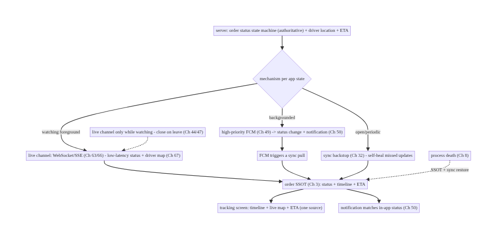
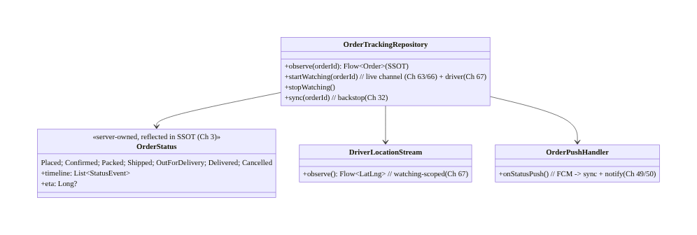
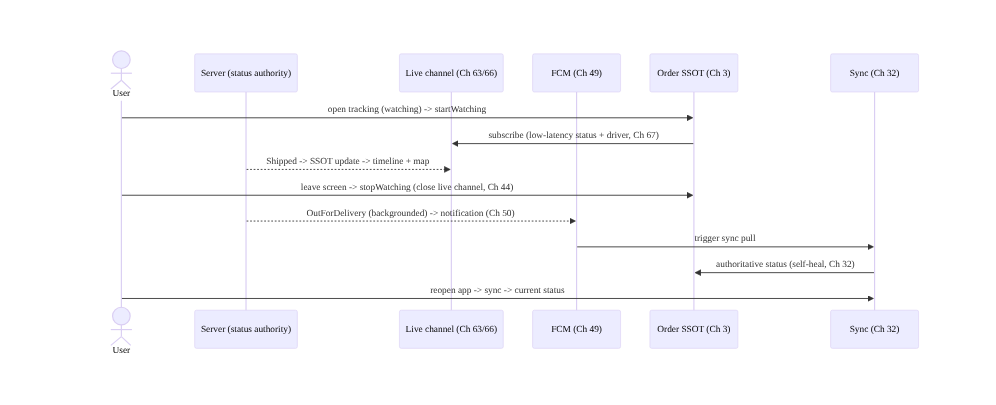
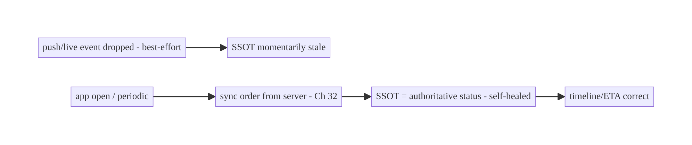
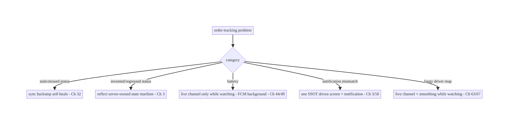

# Chapter 78 — Order Tracking & Live Status

> **Part IX — Feature Architectures** · Complexity: **Standard** (≥25 interview questions)
>
> **Prerequisites:** Ch 49 (FCM/push), Ch 63 (WebSocket), Ch 32 (sync), Ch 3 (SSOT), Ch 67
> (live location), Ch 50 (notifications), Ch 44 (lifecycle). Pairs with Ch 75 (checkout),
> Ch 66 (SSE).
>
> **Reference surface in StreamCart:** after checkout (Ch 75) — the order-status screen
> and live delivery tracking ("Confirmed → Packed → Shipped → Out for delivery →
> Delivered", plus a moving driver on a map) — a **server-driven status machine** kept
> fresh via push, sync, and (while watching) a live channel, with notifications.

---

## 78.1 Problem Definition and Real-World Context

After an order is placed (Ch 75), the user wants to **watch its progress**: a status
timeline (confirmed, packed, shipped, out-for-delivery, delivered) and, for delivery, a
**live driver location** on a map. The architecture is a composition of the book's
real-time and sync layers applied to a **server-owned status state machine**: the status
is **authoritative on the server**; the client **reflects** it, kept fresh by the right
**delivery mechanism per app state** — **push/FCM** (Ch 49) for background updates +
notifications, **sync** (Ch 32) as the reliable backstop, and a **live channel** (WebSocket
Ch 63 / SSE Ch 66) only **while the user is actively watching** for low-latency updates and
the moving driver (Ch 67).

Concretely, teams hit:

- **Polling for status.** Polling the order endpoint is laggy and wasteful; status updates
  should **push** (FCM, Ch 49) and the client should **sync** (Ch 32), with a **live
  channel** only while watching.
- **Client-invented status.** Inferring/advancing status on the client is wrong — status is
  a **server-owned state machine** (valid transitions, timestamps); the client **renders**
  it, never invents it.
- **Wrong mechanism per state.** Holding a WebSocket open in the background drains battery
  (Ch 63/47); not using a live channel while watching makes the driver map laggy. Match the
  mechanism to **app state**: live channel (foreground/watching) + FCM (background) + sync
  (reconcile).
- **Missed/stale updates.** A dropped push or missed live event must **self-heal** via sync
  (Ch 32) — the order SSOT (Ch 3) is reconciled against the server; status is never lost.
- **Notifications.** Status changes drive **notifications** (Ch 50) — "Your order shipped" —
  that must be consistent with the in-app status (one source), and work when backgrounded
  (FCM, Ch 49).
- **Live location (delivery).** The moving driver is **live location** (Ch 67) streamed
  server→client **only during active delivery while watching**, with smoothing and a map.
- **Consistency & history.** The order status + ETA + history must be **consistent**
  (SSOT), survive process death, and show accurately across devices.

The architecture: model order status as a **server-owned state machine** reflected in the
**SSOT** (Ch 3); keep it fresh with the **right mechanism per app state** — a **live
channel** (WebSocket Ch 63 / SSE Ch 66) **only while actively watching** (low-latency
status + driver map, Ch 67), **FCM** (Ch 49) for **background** status changes +
notifications (Ch 50), and **sync** (Ch 32) as the **reliable backstop** so dropped
updates self-heal; render the **status timeline + ETA + live map**; and keep it
**consistent, death-safe, and notification-driven**. This chapter composes the real-time
and sync stack onto a server-driven order lifecycle.

### Three practical use cases

1. **Order status timeline (StreamCart).** Confirmed → Packed → Shipped → Out-for-delivery
   → Delivered, server-owned, reflected in the SSOT; FCM + notification on each change;
   sync reconciles.
2. **Live delivery map.** While the user watches the "out for delivery" screen, a live
   channel (Ch 63/66) streams the driver's smoothed location (Ch 67) and ETA; closes when
   they leave.
3. **Background + reopen.** The app is closed when the order ships; FCM delivers the status +
   notification (Ch 49/50); on reopen, sync shows the current state (Ch 32).

### Why this is architectural

Order tracking is a **clean composition** of a server-owned status machine (Ch 3) with the
real-time/sync mechanism-selection discipline: FCM (Ch 49) + live channel (Ch 63/66) + sync
(Ch 32) + live location (Ch 67) + notifications (Ch 50), each used per app state. The
decisions — server-owned status, mechanism-per-state, sync-as-backstop, watching-scoped live
channel — determine freshness, battery, and correctness.

---

## 78.2 Requirements Engineering

### Functional requirements

| ID | Requirement |
|----|-------------|
| F1 | Reflect a server-owned order status state machine in the SSOT; never invent status (Ch 3). |
| F2 | Keep status fresh per app state: live channel (watching) + FCM (background) + sync (backstop) (Ch 63/49/32). |
| F3 | Drive notifications on status changes, consistent with in-app status (Ch 49/50). |
| F4 | Stream live driver location + ETA while actively watching (Ch 67). |
| F5 | Self-heal missed/dropped updates via sync; survive process death (Ch 32/8). |
| F6 | Consistent across devices; accurate timeline/ETA/history. |

### Non-functional requirements

| Attribute | Policy |
|-----------|--------|
| **Freshness** | Low-latency while watching; prompt when backgrounded (push). |
| **Battery** | Live channel only while watching; FCM for background (Ch 63/47/49). |
| **Correctness** | Server-owned status; sync backstop; no lost updates. |
| **Consistency** | One SSOT; notification matches in-app; cross-device (Ch 3/32). |
| **Resilience** | Survives process death; dropped updates self-heal. |

### Scope

- **In scope:** server-owned order status state machine reflected in SSOT (Ch 3),
  mechanism-per-state (live channel Ch 63/66 while watching + FCM Ch 49 background + sync
  Ch 32 backstop), status-change notifications (Ch 50), live driver location + ETA (Ch 67,
  watching-scoped), self-healing via sync (Ch 32), process death (Ch 8), cross-device
  consistency, timeline/history rendering.
- **Out of scope:** WebSocket/SSE internals (Ch 63/66), FCM internals (Ch 49), sync
  algorithm (Ch 32), live-location mechanics (Ch 67), notifications detail (Ch 50), checkout
  (Ch 75).

### Assumptions & constraints

- The **server owns order status** (state machine + timestamps) and emits changes via FCM
  (Ch 49) + a live channel (Ch 63/66); the client reflects it in the **SSOT** (Ch 3). Live
  channel + driver location only **while watching** (Ch 44/67). `minSdk 24`.

---

## 78.3 System Design Fundamentals

- **Order status is a server-owned state machine (the client reflects it, Ch 3).** The
  order moves through **defined states** (Placed → Confirmed → Packed → Shipped →
  Out-for-delivery → Delivered, plus Cancelled/Returned) with **valid transitions** and
  **timestamps**, all **authoritative on the server**. The client **renders** the current
  state + timeline from the **SSOT** (Room, Ch 3); it **never advances or infers** status
  itself (that's the server's job). This mirrors push-as-trigger (Ch 49) and
  socket-as-fast-path (Ch 63): the **server is truth**.
- **Mechanism per app state (the core decision, Ch 49/63/32):**
  - **Live channel (WebSocket Ch 63 / SSE Ch 66) — only while actively watching.** When the
    user is **on the tracking screen**, open a live channel for **low-latency** status
    updates and the **moving driver** (Ch 67); **close it** when they leave (battery, Ch 44/
    47). SSE (Ch 66) suffices for one-way status; WebSocket if bidirectional.
  - **FCM (Ch 49) — background status changes + notifications.** When the app is
    **backgrounded/closed**, status changes arrive via **high-priority FCM** (Ch 49),
    updating the SSOT (via a sync) and posting a **notification** (Ch 50) — "Your order
    shipped."
  - **Sync (Ch 32) — the reliable backstop.** On app open/foreground and periodically,
    **sync** the order from the server into the SSOT so **any missed push or live event
    self-heals**. The order status is never lost because sync reconciles against the
    authoritative server state.
  This is the same mechanism-selection discipline as Ch 63/66 applied to orders: **live
  channel (watching) + FCM (background) + sync (backstop)**.
- **Self-healing (Ch 32).** Because FCM and live channels are **best-effort**, a dropped
  status update **self-heals**: the next **sync** (on open/periodic) pulls the authoritative
  status into the SSOT. Push/live are **accelerators**; **sync is the guarantee** (the order
  SSOT always converges to server truth). (Same principle as Ch 49/63.)
- **Notifications consistent with in-app status (Ch 50/49).** Status-change notifications
  are driven by the **same server status** and the **same SSOT** — tapping a "shipped"
  notification deep-links (Ch 52) to the tracking screen showing the matching status. One
  source of status → notification and screen never disagree. Notifications work backgrounded
  (FCM, Ch 49).
- **Live driver location + ETA (Ch 67), watching-scoped.** For active delivery, the
  **driver's live location** (Ch 67) streams server→client over the live channel **only
  while the user watches** the map; it's **smoothed** (Ch 67) and paired with a
  server-computed **ETA**. Closing the screen closes the stream (battery). The driver side
  is a `location` FGS (Ch 67); the customer side is a watching-scoped subscriber.
- **SSOT, process death, cross-device (Ch 3/8/32).** Order status + timeline + ETA live in
  the **SSOT** (Ch 3) so the screen renders instantly, survives **process death** (Ch 8),
  and is **consistent across devices** (server-authoritative + sync, Ch 32). The timeline
  (with timestamps) is history the server owns and the client displays.
- **Lifecycle (Ch 44).** Open the live channel on the tracking screen's `onStart`, close on
  `onStop`; rely on FCM when backgrounded; sync on foreground. Never hold the live channel
  or driver stream in the background.

Core insight: **order tracking reflects a server-owned status state machine in the SSOT
(Ch 3) and keeps it fresh with the right mechanism per app state — a live channel (WebSocket
Ch 63 / SSE Ch 66) only while the user is actively watching (low-latency status + the
smoothed driver location and ETA, Ch 67), high-priority FCM (Ch 49) for background status
changes plus notifications (Ch 50), and periodic/on-open sync (Ch 32) as the reliable
backstop so any dropped push or live event self-heals — with the server as truth (the
client never invents status), the notification and screen sharing one SSOT, and the whole
thing surviving process death and consistent across devices (Ch 8/3/32).**

---

## 78.4 High-Level Architecture



**Components & ownership**

- **Server** owns the **status state machine** + driver location + ETA (authoritative).
- **Mechanism per app state:** **live channel** (watching, Ch 63/66 + driver Ch 67) + **FCM**
  (background + notification, Ch 49/50) + **sync** (backstop, Ch 32) — all into the **order
  SSOT** (Ch 3).
- **UI + notification share one SSOT**; **lifecycle** closes the live channel off-screen.

**Direction:** server status → (live channel watching / FCM background / sync backstop) →
order SSOT → timeline + map + ETA + consistent notification; self-healing + death-safe.

---

## 78.5 Detailed Component Design



| Component | Responsibility |
|-----------|----------------|
| `OrderStatus` | server-owned state machine + timeline + ETA, reflected in SSOT (Ch 3) |
| `OrderTrackingRepository` | observe SSOT; start/stop live channel (watching); sync backstop |
| `DriverLocationStream` | watching-scoped smoothed driver location (Ch 67) |
| `OrderPushHandler` | FCM status change → sync + notification (Ch 49/50) |

---

## 78.6 End-to-End Data Flow

### Status fresh across app states



### Self-healing missed update



---

## 78.7 Complete Kotlin Implementation

Package: `com.streamcart.ordertracking`.

### 78.7.1 Server-owned status reflected in the SSOT (Ch 3)

```kotlin
@Entity(tableName = "orders")
data class Order(
    @PrimaryKey val id: String,
    val status: OrderStatus,            // server-owned; client NEVER advances it
    val timelineJson: String,           // status events + timestamps (server history)
    val etaMillis: Long?, val driverId: String?, val updatedAt: Long,
)
enum class OrderStatus { Placed, Confirmed, Packed, Shipped, OutForDelivery, Delivered, Cancelled }
```

### 78.7.2 Repository: observe SSOT + watching-scoped live channel + sync backstop

```kotlin
@Singleton
class OrderTrackingRepository @Inject constructor(
    private val dao: OrderDao, private val api: OrderApi,             // sync (Ch 32)
    private val live: LiveChannel,                                    // WebSocket/SSE (Ch 63/66)
    private val scope: CoroutineScope,
) {
    fun observe(orderId: String): Flow<Order> = dao.observe(orderId)  // SSOT (Ch 3) -> UI

    private var watchJob: Job? = null
    /** While the user WATCHES: low-latency live channel (Ch 63/66) + driver location (Ch 67). */
    fun startWatching(orderId: String) {
        watchJob = scope.launch {
            live.subscribeOrder(orderId).collect { update -> dao.applyServerStatus(orderId, update) }  // server-owned; reflect only
        }
    }
    fun stopWatching() { watchJob?.cancel(); live.unsubscribe() }     // close on leave (battery, Ch 44/47)

    /** Backstop: pull authoritative status -> self-heal missed push/live (Ch 32). */
    suspend fun sync(orderId: String) = dao.applyServerStatus(orderId, api.order(orderId).toUpdate())
}
```

### 78.7.3 FCM status push → sync + notification (Ch 49/50)

```kotlin
// High-priority FCM delivers background status changes; trigger a sync + post a notification (Ch 49/50).
class OrderPushHandler @Inject constructor(
    private val repo: OrderTrackingRepository, private val notifier: Notifier,   // Ch 50
) {
    suspend fun onStatusPush(orderId: String) {
        repo.sync(orderId)                                          // pull authoritative status (self-heal, Ch 32)
        val order = repo.observe(orderId).first()
        notifier.notifyFor(orderStatusNotification(order))         // notification matches in-app status (one SSOT)
    }
    // Tapping the notification deep-links (Ch 52) to the tracking screen showing the SAME status.
}
```

### 78.7.4 Live driver location (watching-scoped, smoothed, Ch 67)

```kotlin
class DriverLocationStream @Inject constructor(private val live: LiveChannel) {
    /** Driver location streams ONLY while watching (Ch 44/67); smoothed; paired with server ETA. */
    fun observe(orderId: String): Flow<DriverPosition> = live.subscribeDriver(orderId)
        .map { it.smoothed() }                                      // filter/smooth (Ch 67)
    // Closing the tracking screen closes this stream (battery). Driver side = location FGS (Ch 67).
}
```

### 78.7.5 UI: timeline + map + ETA (one SSOT), lifecycle-scoped live channel (Ch 44)

```kotlin
@Composable
fun OrderTrackingScreen(orderId: String, vm: OrderTrackingViewModel = hiltViewModel()) {
    val order by vm.order(orderId).collectAsStateWithLifecycle(initialValue = null)   // SSOT (Ch 3)
    val lifecycleOwner = LocalLifecycleOwner.current
    DisposableEffect(lifecycleOwner) {                                                // live channel only while watching
        vm.startWatching(orderId); vm.syncOnOpen(orderId)                             // + sync backstop (Ch 32)
        onDispose { vm.stopWatching() }                                               // close on leave (Ch 44/47)
    }
    order?.let { o ->
        StatusTimeline(o.timeline, current = o.status)   // server-owned timeline; client renders, never invents
        if (o.status == OrderStatus.OutForDelivery) DriverMap(vm.driverLocation(orderId), eta = o.etaMillis)  // Ch 67
    }
    // Process death: SSOT (Ch 3/8) restores the screen; sync reconciles (Ch 32).
}
```

### 78.7.6 Module structure

```
:feature:ordertracking  Order/OrderStatus/Dao (SSOT, Ch 3), OrderTrackingRepository (live + sync), DriverLocationStream, OrderPushHandler
:core:realtime  live channel (WebSocket/SSE, Ch 63/66); :feature:push FCM (Ch 49); :core:sync (Ch 32); :core:notifications (Ch 50)
# Server owns status state machine + driver location + ETA. Checkout -> Ch 75; live location -> Ch 67.
```

---

## 78.8 Concurrency and Race Conditions

| Scenario | Risk | Handling |
|----------|------|----------|
| Client advances status | wrong/invalid state | server-owned; client reflects only (Ch 3) |
| Dropped push/live event | stale status | sync backstop self-heals (Ch 32) |
| Out-of-order status events | regress status | apply by server timestamp/sequence; server authoritative |
| Live channel held in background | battery | close on leave; FCM for background (Ch 44/47/49) |
| Notification vs screen mismatch | confusion | one SSOT drives both (Ch 3/50) |
| Process death on tracking screen | lost state | SSOT + sync restore (Ch 3/8/32) |
| Driver stream off-screen | battery | watching-scoped (Ch 67) |

- **Server-owned status + sync backstop** make tracking correct and self-healing: the client
  **never invents** status (invalid/regressed states), applies updates **by server
  timestamp/sequence**, and any missed push/live event is **reconciled by sync** (Ch 32) —
  the SSOT always converges to server truth.
- **Mechanism-per-state** keeps it battery-sane and fresh: the **live channel/driver stream
  run only while watching** (Ch 44/47), **FCM** handles background, **sync** backstops.
- **One SSOT** guarantees the **notification and the screen agree** (Ch 3/50).

---

## 78.9 Failure Scenarios and Recovery

| Failure | Detection | Response | Outcome |
|---------|-----------|----------|---------|
| Status stale/missed | gap | sync backstop (Ch 32) | self-heals |
| Client-invented status | wrong UI | reflect server-owned only (Ch 3) | correct |
| Battery drain | live channel in bg | close on leave; FCM background (Ch 44/49) | battery ok |
| Notification mismatches screen | confusion | one SSOT drives both (Ch 3/50) | consistent |
| Process death | lost screen | SSOT + sync restore (Ch 8/32) | restored |
| Driver map laggy | not live while watching | live channel + smoothing while watching (Ch 63/67) | smooth |
| Background status missed | user unaware | FCM + notification (Ch 49/50) | delivered |
| Device divergence | user report | server-authoritative + sync (Ch 32) | converge |



> **Order tracking is mechanism-selection over a server-owned status machine: live channel
> while watching, FCM when backgrounded, sync as the backstop — all into one SSOT.** The
> client reflects the server's status (never invents it), the live channel/driver stream run
> only while watching (battery), and sync guarantees no update is ever lost.

---

## 78.10 Scaling the Implementation

- **Level 1.** Server-owned status in the SSOT (Ch 3); sync on open (Ch 32); status
  timeline.
- **Level 2.** FCM status changes + notifications (Ch 49/50); live channel (Ch 63/66) while
  watching; sync backstop self-heals.
- **Level 3 — production.** Live driver location + ETA while watching (Ch 67); lifecycle-
  scoped channel (Ch 44); notification/screen consistency; process-death survival (Ch 8).
- **Level 4 — large.** Multi-order tracking; ETA refinement; map clustering; proactive
  alerts (delays); cross-device consistency (Ch 32).
- **Level 5 — enterprise.** Tracking SLOs (freshness/latency), delivery analytics, carrier
  integrations, real-time fleet scale, proactive issue detection.

**Avoid overengineering:** server-owned status + FCM + sync + a watching-scoped live channel
is the core. Don't poll; don't invent status; don't hold the live channel in the background.

---

## 78.11 Alternative Approaches and Trade-offs

| Dimension | Option A | Option B | When |
|-----------|----------|----------|------|
| Status source | Server-owned (client reflects) | client-inferred | Server always (authoritative state machine) |
| Freshness | Mechanism per state (live/FCM/sync) | polling | Per-state (fresh + battery-sane) |
| Live updates | Channel only while watching (Ch 63/66) | always-on socket | While-watching (battery, Ch 44/47) |
| Background | FCM (Ch 49) | keep socket open | FCM (battery/Doze) |
| Reliability | Sync backstop (Ch 32) | trust push/live | Sync backstop (self-heal) |
| Driver map | Live location while watching (Ch 67) | poll location | Live + smoothing while watching |
| Notification | One SSOT (Ch 3/50) | separate status | One SSOT (consistent) |

**Server-owned status vs client-inferred:** an order's status is a **server-owned state
machine** (valid transitions, authoritative timestamps) — the client **cannot** correctly
infer or advance it (it lacks fulfillment/logistics data). The client **reflects** the
server's status in the SSOT (Ch 3) and **renders** it; inventing status produces wrong or
regressed states.

**Mechanism per state vs polling vs always-on socket:** **polling** is laggy/wasteful; an
**always-on WebSocket** drains battery and is killed in the background (Ch 47). The right
design uses the **mechanism per app state** (as in Ch 63/66): a **live channel while
watching** (low-latency + driver map), **FCM for background** (+ notifications), and **sync
as the backstop**. This maximizes freshness while respecting battery.

**Sync backstop vs trusting push/live:** FCM and live channels are **best-effort** — a
dropped update would leave the status stale forever if trusted blindly. **Sync** (Ch 32) on
open/periodic reconciles the SSOT against the authoritative server status, so every missed
update **self-heals**. Push/live accelerate; **sync guarantees**.

---

## 78.12 Security & Privacy Considerations

- **Server-authorized order access (Ch 23/19):** a user can only track **their own** orders;
  the server authorizes access to status, timeline, and **driver location** — never a public
  endpoint. The live channel/FCM topic for an order is **authorized** (Ch 63/49).
- **Driver location privacy (Ch 67/28):** the driver's live location is **sensitive** —
  shared only **during active delivery**, only with the **authorized customer**, and
  **stops** on delivery; coarsen/limit as policy requires; don't log coordinates.
- **Notification content (Ch 50/28):** status notifications shouldn't leak sensitive details
  on the lock screen (public/private versions); don't include PII.
- **Per-account isolation (Ch 42):** orders/tracking scoped to the authenticated user; clear
  on logout.
- **Untrusted payloads (Ch 49/63/23):** push/live status messages are **untrusted triggers**
  — validate and reconcile via authed sync (the server status is truth), don't act on a
  payload's claimed status blindly.
- Client vs backend: the **server** owns status, authorizes access, computes ETA, and shares
  driver location under authorization; the **client** reflects, subscribes (authorized),
  and renders — it never owns status or exposes location beyond the authorized customer.

---

## 78.13 Performance and Resource Optimization

- **Live channel only while watching** (Ch 44/47) — the top battery lever; FCM for
  background.
- **Sync on open + sparingly periodic** (Ch 32) — not continuous polling.
- **Smooth + sample driver location** (Ch 67) — don't render every tick; coalesce (Ch 63).
- **Cache status/timeline** (SSOT, Ch 3) for instant render + offline view; refresh via sync.
- **FCM for background** avoids a held connection (Ch 49/47).
- **Efficient map rendering** — update the marker, don't rebuild the map.
- **Profiling:** status freshness/latency, live-channel uptime (while watching), battery,
  sync frequency, notification delivery, ETA accuracy.

---

## 78.14 Testing Strategy

Status reflection, mechanism-per-state, and self-healing are testable with fakes.

```kotlin
class OrderTrackingTest {
    @Test fun `reflects server status - never advances locally`() = runTest {
        repo.sync("o1")   // server says Shipped
        assertEquals(OrderStatus.Shipped, dao.observe("o1").first().status)
        // no client API advances status
    }
    @Test fun `sync self-heals a missed update`() = runTest {
        // live/FCM dropped Shipped; open -> sync -> SSOT = Shipped (Ch 32)
        repo.sync("o1"); assertEquals(OrderStatus.Shipped, dao.observe("o1").first().status)
    }
    @Test fun `live channel only while watching`() = runTest {
        repo.startWatching("o1"); assertTrue(live.subscribed)
        repo.stopWatching(); assertFalse(live.subscribed)   // closed on leave (Ch 44)
    }
    @Test fun `out-of-order status does not regress`() = runTest { /* apply by server timestamp */ }
}

class OrderPushTest {
    @Test fun `FCM status push syncs then notifies consistently`() = runTest {
        pushHandler.onStatusPush("o1")
        assertTrue(notifier.shown.any { it.orderId == "o1" })   // notification matches SSOT status (Ch 3/50)
    }
}
```

What to test: status reflected from server (never client-advanced); sync self-heals missed
updates (Ch 32); live channel start/stop with watching (Ch 44); out-of-order non-regression;
FCM push → sync + consistent notification (Ch 49/50); driver stream watching-scoped (Ch 67);
process-death restore (Ch 8). Fake live channel/FCM/sync.

---

## 78.15 Production Observability

- **Metrics:** status **freshness/latency** (server change → client reflects) by mechanism;
  live-channel uptime (while watching) + battery; sync frequency + self-heal rate (how often
  sync corrects a missed update); FCM status delivery + notification open; ETA accuracy;
  driver-location smoothness.
- **Logs:** `ordertracking{orderId, status, mechanism, synced}` — no coordinates/PII (Ch 28).
- **Debugging:** stale status → sync backstop not running / mechanism gap (Ch 32); invented
  status → client advancing (reflect server); battery → live channel in background (Ch 44/
  49); notification mismatch → not one-SSOT (Ch 3/50); laggy map → not live while watching
  (Ch 63/67); missed background update → FCM (Ch 49).
- **Alerting:** status-freshness regression; live-channel battery spike; FCM delivery drop.
- **Dashboards:** status freshness by mechanism; self-heal rate; ETA accuracy.

---

## 78.16 System Design Interview Preparation

> ≥25 questions.

**Fundamentals**

1. *Who owns order status?* The server (state machine) — the client reflects it (Ch 3).
2. *Client invent status?* No — renders server-owned status.
3. *Freshness mechanism?* Per app state: live channel (watching) + FCM (background) + sync
   (backstop).
4. *Why not poll?* Laggy, wasteful.
5. *Source of status truth?* Server; SSOT reflects it.

**Mechanism per state**

6. *While watching?* Live channel (WebSocket Ch 63 / SSE Ch 66) — low-latency + driver map.
7. *Backgrounded?* FCM (Ch 49) + notification (Ch 50).
8. *Backstop?* Sync (Ch 32) on open/periodic.
9. *Why close live channel on leave?* Battery/Doze (Ch 44/47).
10. *WebSocket vs SSE here?* SSE fine for one-way status; WebSocket if bidirectional.

**Reliability**

11. *Dropped push/live event?* Sync self-heals (Ch 32).
12. *Out-of-order?* Apply by server timestamp/sequence (no regress).
13. *Process death?* SSOT + sync restore (Ch 8/32).
14. *Cross-device?* Server-authoritative + sync (Ch 32).

**Notifications**

15. *Status notifications?* FCM-driven (Ch 49/50), consistent with in-app (one SSOT).
16. *Tap behavior?* Deep-link to tracking screen (Ch 52), same status.

**Live location**

17. *Driver map?* Live location (Ch 67) while watching; smoothed; server ETA.
18. *When streamed?* Only during active delivery while watching.
19. *Driver side?* `location` FGS (Ch 67).

**Security**

20. *Access?* Server-authorized (own orders only, Ch 23).
21. *Driver location privacy?* Sensitive — authorized customer only, during delivery
    (Ch 67/28).
22. *Payloads?* Untrusted triggers; reconcile via authed sync (Ch 49/63/23).

**Testing/Production**

23. *Test self-heal?* Dropped update → sync corrects (Ch 32).
24. *Test lifecycle?* Live channel start/stop with watching.
25. *Stale status in prod?* Sync backstop/mechanism gap.
26. *Key metric?* Status freshness/latency + self-heal rate.

### Design-change challenges
1. **Live order status without polling.** Server-owned status + FCM + live channel (watching)
   + sync backstop.
2. **Driver on a map.** Live location (Ch 67) while watching; smoothed; server ETA.
3. **Status missed while app closed.** FCM + notification; sync self-heals on reopen
   (Ch 49/32).
4. **Battery drain from tracking.** Live channel only while watching; FCM background (Ch 44/
   49).
5. **Notification says shipped but screen says packed.** One SSOT drives both (Ch 3/50).

### Mock walkthrough (abridged)
Clarify (status timeline, live map, background?) → server-owned status state machine in SSOT
(Ch 3) → mechanism per app state: live channel while watching (Ch 63/66 + driver Ch 67) + FCM
background + notification (Ch 49/50) + sync backstop (Ch 32) → self-healing + process death
(Ch 8) → notification/screen one SSOT → lifecycle closes live channel (Ch 44/47) → security
(authorized access, driver-location privacy) → observability (freshness, self-heal rate).

---

## 78.17 Practical Exercises

1. **Beginner.** Reflect a server-owned order status in the SSOT and render a timeline; sync
   on open. *Eval:* client never advances status; timeline correct.
2. **Intermediate.** Add FCM status changes + notifications (consistent with in-app) and a
   sync backstop that self-heals missed updates. *Eval:* background updates + notification;
   dropped update heals.
3. **Advanced.** Open a live channel (Ch 63/66) + smoothed driver location (Ch 67) only while
   watching; close on leave. *Eval:* low-latency map while watching; no background channel.
4. **Production debugging.** Fix stale status (no sync backstop) and battery drain (live
   channel held in background). *Eval:* fresh via sync; channel scoped to watching.
5. **System design challenge.** Ensure authorized order access + driver-location privacy and
   a status-freshness dashboard. *Eval:* own-orders-only; location authorized/time-boxed;
   freshness measured.

*(Solutions withheld unless requested.)*

---

## 78.18 Chapter Summary & Reference Sheet

**Key decisions:** model order status as a **server-owned state machine** (valid transitions
+ authoritative timestamps) **reflected in the SSOT** (Ch 3) — the client **renders, never
invents** status; keep it fresh with the **right mechanism per app state** — a **live
channel** (WebSocket Ch 63 / SSE Ch 66) **only while the user is actively watching**
(low-latency status + the **smoothed driver location and server ETA**, Ch 67, closed on
leave for battery, Ch 44/47), **high-priority FCM** (Ch 49) for **background** status changes
plus **notifications** (Ch 50), and **periodic/on-open sync** (Ch 32) as the **reliable
backstop** so any dropped push or live event **self-heals**; drive **notifications from the
same SSOT** so the notification and screen always agree (and deep-link to tracking, Ch 52);
**survive process death** and stay **consistent across devices** (Ch 8/3/32); and **authorize**
order access and **protect driver-location privacy** (own orders only, delivery-time-boxed,
Ch 23/67/28). Push/live are **accelerators**; **sync is the guarantee**; the **server is
truth**.

**Concepts:** server-owned status state machine reflected in SSOT, mechanism per app state
(live channel watching + FCM background + sync backstop), self-healing via sync,
notification/screen consistency (one SSOT), live driver location + ETA (watching-scoped),
process death, cross-device consistency, authorized access + location privacy.

**Common mistakes:** client-invented/advanced status; polling for status; always-on
WebSocket in the background (battery/Doze); trusting push/live without a sync backstop
(stale on drop); notification inconsistent with in-app status (two sources); holding the
driver stream off-screen; unauthorized order/location access.

**Checklist:**

- [ ] server-owned status reflected in SSOT (never invent, Ch 3)
- [ ] live channel (Ch 63/66) only while watching + driver location + ETA (Ch 67)
- [ ] FCM background status + notification (Ch 49/50)
- [ ] sync backstop self-heals missed updates (Ch 32)
- [ ] one SSOT drives screen + notification
- [ ] close live channel on leave (Ch 44/47)
- [ ] process-death survival + cross-device (Ch 8/32)
- [ ] authorized order access + driver-location privacy (Ch 23/67/28)
- [ ] untrusted payloads reconciled via authed sync
- [ ] status-freshness + self-heal telemetry.

**Key APIs:** Order SSOT (Room `@Entity`/`@Dao`, Ch 3), live channel (WebSocket/SSE, Ch 63/66)
watching-scoped via `DisposableEffect`/lifecycle (Ch 44), FCM high-priority (Ch 49) + Notifier
(Ch 50) + deep links (Ch 52), delta sync backstop (Ch 32), live driver location (Ch 67,
smoothed), server-computed ETA, authorized access (Ch 23).

**References:**
- Offline-first / sync: https://developer.android.com/topic/architecture/data-layer/offline-first
- (composes) Ch 49 FCM, Ch 63 WebSocket, Ch 66 SSE, Ch 32 Sync, Ch 3 SSOT, Ch 67 Live Location, Ch 50 Notifications, Ch 44 Lifecycle, Ch 75 Checkout

### Chapter review (Phase 4)
- **Completeness:** all 18 sections; architecture/class/sequence/flow/failure diagrams;
  server-owned status SSOT + watching-scoped live channel + sync backstop + FCM push handler
  + driver stream + lifecycle-scoped UI code; concurrency (server-owned, self-heal,
  mechanism-per-state, one-SSOT); failure (mechanism-selection-over-server-status principle);
  5 levels; server-vs-inferred, mechanism-per-state, sync-backstop trade-offs; security
  (authorized access, driver-location privacy, untrusted payloads); perf (live-while-watching,
  sync sparingly); self-heal + lifecycle + push tests; observability (freshness, self-heal
  rate); 26 Q&A + 5 challenges. ✅
- **Expand later:** FCM (Ch 49), WebSocket/SSE (Ch 63/66), sync (Ch 32), live location
  (Ch 67), notifications (Ch 50).
- **Interview coverage:** exceeds ≥25 bar.
