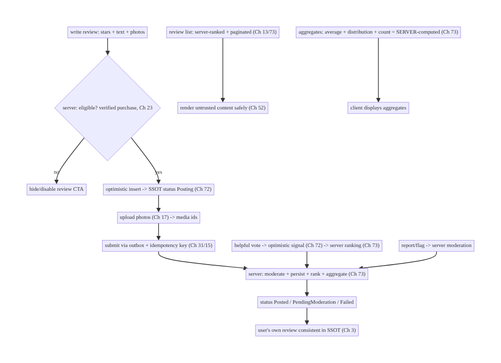
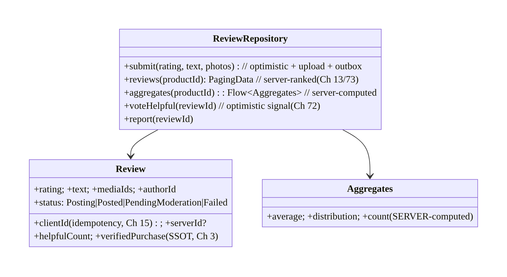
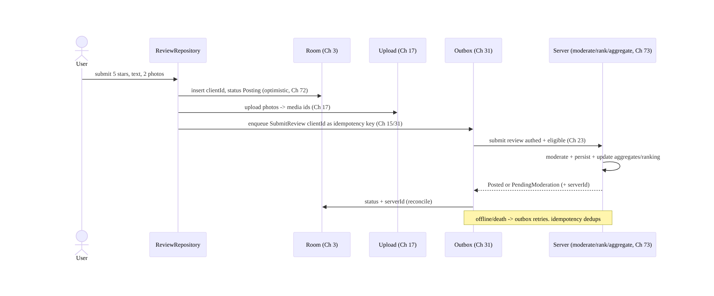
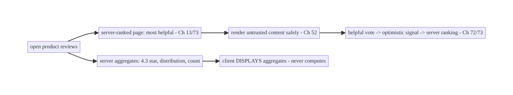
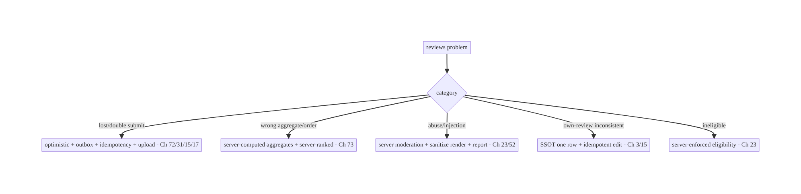

# Chapter 79 — Reviews & Ratings

> **Part IX — Feature Architectures** · Complexity: **Standard** (≥25 interview questions)
>
> **Prerequisites:** Ch 72 (optimistic updates), Ch 31 (outbox), Ch 15 (idempotency), Ch 3
> (SSOT), Ch 13 (paging), Ch 17 (uploads), Ch 73 (recommendations/ranking), Ch 23
> (security). Pairs with Ch 71 (feed), Ch 32 (sync).
>
> **Reference surface in StreamCart:** product/content reviews and star ratings — writing
> a review (text + photos + stars) reliably, displaying a **server-ranked** list of
> reviews with aggregates (average, distribution), handling moderation and abuse, and
> keeping the user's own review consistent.

---

## 79.1 Problem Definition and Real-World Context

Reviews and ratings combine several book patterns onto a **user-generated-content (UGC)**
feature: **submitting** a review reliably (text + optional photos + a star rating,
offline-capable, idempotent); **displaying** a **server-ranked, paginated** list of
reviews plus **server-computed aggregates** (average rating, star distribution, count);
**moderation** (UGC is untrusted and may be abusive/spam); and keeping the **user's own
review** consistent (edit/delete). The composition touches optimistic submit (Ch 72),
outbox + idempotency (Ch 31/15), media upload (Ch 17), paging + ranking (Ch 13/73), SSOT
(Ch 3), and UGC security/moderation (Ch 23).

Concretely, teams hit:

- **Unreliable submit.** A review submitted offline/flaky is lost or double-posted. It
  needs an **outbox** (Ch 31) + **idempotency key** (Ch 15) and optimistic display (Ch 72)
  with a "pending/posted/failed" status (like a comment, Ch 64).
- **Client-computed aggregates.** Computing the average rating / distribution on the client
  is wrong — aggregates span **all** reviews (which the client doesn't have) and must be
  **server-computed** (Ch 73). The client **displays** server aggregates.
- **Client-ranked reviews.** Review ordering ("most helpful", "recent", "critical") is a
  **server ranking** (helpfulness, recency, verified-purchase, Ch 73); the client renders
  the server's order + logs signals (helpful votes), it doesn't rank.
- **UGC is untrusted + needs moderation.** Reviews are user content → **render safely**
  (sanitize, Ch 52), **moderate** (spam/abuse/profanity — server-side), and handle
  **report/flag**. Photos need upload + moderation (Ch 17).
- **The user's own review consistency.** The author's review (edit/delete, pending state)
  must be consistent in the SSOT (Ch 3) and reflected in the list; "you already reviewed
  this" logic.
- **Media in reviews.** Review photos upload reliably (Ch 17) with progress; the review
  posts referencing uploaded media.
- **Verified purchase / eligibility.** Often only **purchasers** can review (server-
  enforced, Ch 23); "verified purchase" badges come from the server.

The architecture: **submit** a review optimistically via an **outbox + idempotency key**
(Ch 72/31/15) with **media upload** (Ch 17) and a pending/posted/failed status; **display**
a **server-ranked, paginated** review list (Ch 13/73) with **server-computed aggregates**
(average/distribution/count); **moderate** UGC server-side and **render untrusted content
safely** (Ch 52/23); keep the **user's own review** consistent in the SSOT (edit/delete,
Ch 3); and enforce **eligibility** (verified purchase) server-side. This chapter composes
the UGC-submit + ranked-list + aggregates + moderation stack.

### Three practical use cases

1. **Write a review (StreamCart).** Stars + text + photos → optimistic "posting…" →
   outbox + idempotent submit (Ch 31/15) + photo upload (Ch 17) → "posted" (or "failed" +
   retry); eligibility (verified purchase) enforced server-side.
2. **Review list + aggregates.** A product's reviews, **server-ranked** ("most helpful"),
   **paginated** (Ch 13), with the **server-computed** average (4.3★), distribution, and
   count; "helpful" votes are optimistic signals (Ch 72/73).
3. **Moderation & reporting.** Submitted reviews pass **server moderation**; users can
   **report** abusive reviews; rendered content is **sanitized** (Ch 52).

### Why this is architectural

Reviews compose **optimistic UGC submit** (Ch 72/31/15/17), **server-ranked paginated
lists + server aggregates** (Ch 13/73), **SSOT** (Ch 3), and **UGC security/moderation**
(Ch 23/52). The decisions — reliable idempotent submit, server-computed aggregates,
server-ranked list, moderation + safe rendering, verified-purchase eligibility — recur for
comments, Q&A, and any UGC feature.

---

## 79.2 Requirements Engineering

### Functional requirements

| ID | Requirement |
|----|-------------|
| F1 | Submit a review (stars + text + photos) reliably: optimistic + outbox + idempotent (Ch 72/31/15). |
| F2 | Upload review photos reliably with progress (Ch 17); review references uploaded media. |
| F3 | Display a server-ranked, paginated review list + server-computed aggregates (Ch 13/73). |
| F4 | Moderate UGC server-side; render untrusted content safely; report/flag (Ch 23/52). |
| F5 | Keep the user's own review consistent (edit/delete, pending state) in the SSOT (Ch 3). |
| F6 | Enforce eligibility (verified purchase) server-side; "helpful" votes as signals (Ch 23/73). |

### Non-functional requirements

| Attribute | Policy |
|-----------|--------|
| **Reliability** | Submit survives offline/death; idempotent; media uploaded. |
| **Correctness** | Server-computed aggregates; server-ranked list; no client math/ranking. |
| **Safety** | UGC moderated + sanitized; eligibility + abuse handled (Ch 23). |
| **Consistency** | User's own review consistent (SSOT); list reflects it (Ch 3). |
| **Scale** | Paged list; aggregates efficient (server). |

### Scope

- **In scope:** review submit (optimistic + outbox + idempotency + media upload, Ch 72/31/
  15/17), server-ranked paginated list (Ch 13/73), server-computed aggregates (average/
  distribution/count), moderation (server) + safe rendering (Ch 52) + report/flag, user's
  own review consistency (edit/delete/pending, Ch 3), eligibility (verified purchase,
  Ch 23), "helpful" votes (optimistic signals, Ch 72/73).
- **Out of scope:** optimistic-update mechanics (Ch 72), outbox/idempotency (Ch 31/15),
  upload (Ch 17), paging/ranking internals (Ch 13/73), SSOT (Ch 3), moderation ML/backend.

### Assumptions & constraints

- Room SSOT (Ch 3), outbox (Ch 31), upload (Ch 17), Paging 3 (Ch 13). The **server** ranks
  reviews, computes aggregates, moderates, and enforces eligibility (Ch 73/23). `minSdk 24`.
  UGC is untrusted; aggregates/ranking are server-owned.

---

## 79.3 System Design Fundamentals

- **Submit = reliable optimistic UGC create (Ch 72/31/15/17).** Writing a review is a
  **create** with media:
  - **Optimistic insert** into the SSOT with a **client-generated id** and status
    **Posting** (Ch 72/64) → the user sees their review immediately.
  - **Upload photos** reliably (Ch 17) with progress; the review references the **uploaded
    media ids**.
  - **Submit via the outbox** (Ch 31) with the **client id as the idempotency key** (Ch 15)
    so offline/death-safe, retried, and **not double-posted**.
  - On success → **Posted** (reconcile to the server id/timestamp); on genuine failure →
    **Failed** + retry (Ch 72). Same pattern as a comment (Ch 64).
- **Aggregates are server-computed (not client, Ch 73).** The **average rating**, **star
  distribution** (how many 5★/4★/…), and **count** are over **all** reviews — the client
  **doesn't have them all**, so it **cannot** compute aggregates correctly. The **server
  computes** aggregates; the client **displays** them (and updates optimistically with
  caution, then reconciles — a single new review barely moves a 10k-review average, so show
  the server value). Client-computed averages are wrong and drift.
- **Reviews are a server-ranked, paginated list (Ch 13/73).** Review **ordering** — "most
  helpful", "most recent", "critical", "verified" — is a **server ranking** (helpfulness
  votes, recency, verified-purchase, length, Ch 73). The client **renders the server's
  order**, **pages** it (Paging 3 + SSOT, Ch 13/71), and **logs signals** (helpful votes) —
  it **does not rank**. This reuses the feed infra (Ch 71) and the recommendations division
  of labor (Ch 73).
- **"Helpful" votes = optimistic signals (Ch 72/73).** Voting a review helpful is an
  **optimistic toggle** (Ch 72) that also **feeds the server's ranking signal** (Ch 73) —
  like a like (Ch 72). The displayed helpful count is server-reconciled.
- **UGC is untrusted → moderate + render safely (Ch 23/52).**
  - **Moderation (server-side):** reviews pass **server moderation** (spam/abuse/profanity/
    policy — often ML + human), which may hold a review as **pending moderation** before it
    appears publicly. The author sees their own pending review; others don't until approved.
  - **Safe rendering (Ch 52):** review text/links are **untrusted** — **sanitize** (no
    injection, safe links), handle media safely; never auto-execute content.
  - **Report/flag:** users can **report** a review; reports go to server-side moderation.
- **The user's own review is consistent (Ch 3).** The author's review lives in the **SSOT**
  (one row) with its status (pending/posted/failed/moderation); **edit/delete** are
  idempotent mutations (Ch 15) via the outbox (Ch 31); the list shows "your review" and
  "you already reviewed this" from the SSOT. Editing updates the row everywhere.
- **Eligibility: verified purchase (server-enforced, Ch 23).** Often only **purchasers**
  may review; the **server enforces** eligibility (checks the order history) — the client
  shows/hides the review CTA based on a server-provided flag, but the **server authorizes**
  the submit (a client can't bypass). "Verified purchase" badges come from the server.
- **Media moderation + upload (Ch 17).** Review photos **upload** reliably (Ch 17,
  resumable + progress) and are **moderated** server-side (inappropriate images) before
  appearing.

Core insight: **reviews are a user-generated-content feature composing reliable optimistic
submit (optimistic SSOT insert + photo upload + outbox with an idempotency key so it's
offline/death-safe and not double-posted, Ch 72/31/15/17) with a server-ranked, paginated
review list and server-computed aggregates (average/distribution/count — the client
displays, never computes or ranks, Ch 13/73), server-side moderation and safe rendering of
untrusted content (Ch 23/52) with report/flag, the user's own review kept consistent in the
SSOT (edit/delete, pending/posted/failed status, Ch 3), server-enforced eligibility
(verified purchase, Ch 23), and "helpful" votes as optimistic ranking signals (Ch 72/73) —
the server ranks/aggregates/moderates/authorizes, the client submits/displays/signals.**

---

## 79.4 High-Level Architecture



**Components & ownership**

- **Submit:** eligibility (server) → optimistic SSOT insert → photo upload → outbox
  (idempotent) → server moderates/persists/ranks/aggregates.
- **Display:** server-ranked paginated list + server-computed aggregates; untrusted content
  rendered safely.
- **Server owns** ranking, aggregates, moderation, eligibility; **client submits/displays/
  signals**; user's own review consistent in the SSOT.

**Direction:** write → eligibility → optimistic + upload + outbox(idempotent) → server
(moderate/rank/aggregate) → status/SSOT; display server-ranked list + server aggregates
safely.

---

## 79.5 Detailed Component Design



| Component | Responsibility |
|-----------|----------------|
| `Review` | SSOT row: client/server id + rating/text/media + status + helpful + verified (Ch 3) |
| `ReviewRepository` | submit (optimistic+upload+outbox), ranked list, aggregates, vote, report |
| `Aggregates` | server-computed average/distribution/count (client displays) |

---

## 79.6 End-to-End Data Flow

### Submit a review (optimistic + upload + idempotent)



### Display: server-ranked list + server aggregates



---

## 79.7 Complete Kotlin Implementation

Package: `com.streamcart.reviews`.

### 79.7.1 Review SSOT (client/server id + status, Ch 3/15)

```kotlin
@Entity(tableName = "reviews")
data class Review(
    @PrimaryKey val clientId: String,        // idempotency key + optimistic match (Ch 15/64)
    val serverId: String?, val productId: String, val authorId: String,
    val rating: Int, val text: String, val mediaIds: List<String>,
    val status: Status, val helpfulCount: Int, val verifiedPurchase: Boolean, val createdAt: Long,
) { enum class Status { Posting, Posted, PendingModeration, Failed } }
```

### 79.7.2 Submit: optimistic + upload + outbox (idempotent, Ch 72/17/31/15)

```kotlin
@Singleton
class ReviewRepository @Inject constructor(
    private val dao: ReviewDao, private val uploader: MediaUploader,   // Ch 17
    private val outbox: Outbox, private val session: SessionManager,   // Ch 31/19
) {
    suspend fun submit(productId: String, rating: Int, text: String, photos: List<Uri>) {
        val clientId = UUID.randomUUID().toString()
        dao.upsert(Review(clientId, serverId = null, productId, session.userId, rating, text,
            mediaIds = emptyList(), status = Status.Posting, helpfulCount = 0,
            verifiedPurchase = false, createdAt = System.currentTimeMillis()))   // optimistic (Ch 72)
        val mediaIds = photos.map { uploader.upload(it) }                        // reliable upload + progress (Ch 17)
        dao.setMedia(clientId, mediaIds)
        outbox.enqueue(OutboxOp.SubmitReview(clientId, productId, rating, text, mediaIds))   // idempotent (Ch 15/31)
    }

    suspend fun sync(op: OutboxOp.SubmitReview): OutboxResult = runCatching {
        val result = api.submitReview(op.clientId, op.productId, op.rating, op.text, op.mediaIds)  // authed + eligible (Ch 23)
        dao.confirm(op.clientId, serverId = result.id, status = result.statusForClient())   // Posted / PendingModeration
        OutboxResult.Done
    }.getOrElse { e ->
        if (e.isTransient()) OutboxResult.Retry                          // offline/5xx -> retry (Ch 2/29)
        else { dao.setStatus(op.clientId, Status.Failed); OutboxResult.Failed(e) }   // genuine -> Failed + retry UX (Ch 72)
    }
}
```

### 79.7.3 Server-ranked, paginated list (Ch 13/73) + safe rendering (Ch 52)

```kotlin
fun ReviewRepository.reviews(productId: String, sort: ReviewSort): Flow<PagingData<Review>> =
    Pager(PagingConfig(pageSize = 20), remoteMediator = ReviewRemoteMediator(productId, sort, api, db)) {
        db.reviews().pagingSource(productId)                 // server-RANKED order (Ch 73); client renders (Ch 13/71)
    }.flow
// RemoteMediator fetches server-ranked pages (sort = Helpful/Recent/Critical) -> Room. Client does NOT rank.

@Composable
fun ReviewText(text: String) {
    Text(sanitizeUgc(text))   // UNTRUSTED content -> sanitize (Ch 52); safe links; no injection
}
```

### 79.7.4 Aggregates: server-computed, client displays (Ch 73)

```kotlin
data class Aggregates(val average: Double, val distribution: Map<Int, Int>, val count: Int)  // SERVER-computed

fun ReviewRepository.aggregates(productId: String): Flow<Aggregates> =
    db.aggregates().observe(productId)                        // client DISPLAYS server aggregates (Ch 3)
// Refreshed from the server (api.reviewAggregates(productId)); NEVER computed client-side (needs all reviews).

@Composable
fun RatingSummary(agg: Aggregates) {
    Text("${agg.average} ★ (${agg.count})")                   // display server values
    agg.distribution.forEach { (stars, n) -> StarBar(stars, n) }
}
```

### 79.7.5 Helpful vote (optimistic signal) + report (Ch 72/73)

```kotlin
suspend fun ReviewRepository.voteHelpful(reviewId: String) {
    dao.incrementHelpfulOptimistic(reviewId)                  // optimistic (Ch 72) -> instant
    outbox.enqueue(OutboxOp.HelpfulVote(reviewId, idempotencyKey = "$reviewId:helpful"))  // idempotent (Ch 15); server ranking signal (Ch 73)
}
suspend fun ReviewRepository.report(reviewId: String, reason: String) =
    api.reportReview(reviewId, reason)                        // -> server moderation
```

### 79.7.6 Eligibility (server-enforced, Ch 23)

```kotlin
// Client shows/hides the CTA from a server flag; the SERVER authorizes the submit (verified purchase).
fun ReviewRepository.canReview(productId: String): Flow<Boolean> = db.eligibility().observe(productId)
// Server checks order history -> eligible; a client can't bypass (submit is authorized server-side, Ch 23).
```

### 79.7.6 Module structure

```
:feature:reviews  Review/Dao, ReviewRepository (submit/list/aggregates/vote/report), ReviewRemoteMediator
:core:upload  MediaUploader (Ch 17); :core:outbox (Ch 31); :core:data SSOT (Ch 3)
# Server: ranking + aggregates + moderation + eligibility (Ch 73/23). Optimistic -> Ch 72; paging -> Ch 13; sanitize -> Ch 52.
```

---

## 79.8 Concurrency and Race Conditions

| Scenario | Risk | Handling |
|----------|------|----------|
| Submit offline/double-tap | lost/double review | outbox + idempotency key (Ch 31/15) |
| Client computes average | wrong aggregate | server-computed; client displays (Ch 73) |
| Client ranks reviews | wrong order | server-ranked; client renders (Ch 73) |
| Edit own review | inconsistent | SSOT one row + idempotent edit (Ch 3/15) |
| Helpful double-vote | inflated | idempotent vote (Ch 15) |
| Untrusted content | injection | sanitize render (Ch 52) |
| Pending moderation shown to others | policy | server gates visibility; author sees own |

- **Server owns aggregates and ranking** (Ch 73): the client **cannot** correctly compute an
  average over all reviews or rank by helpfulness — it **displays** server values and
  **renders** the server order, logging helpful votes as signals. Client-side math/ranking
  is wrong and drifts.
- **Reliable optimistic submit** (Ch 72/31/15/17): optimistic insert + photo upload + outbox
  with an idempotency key make submit offline/death-safe and dedup double-taps (same as
  comments, Ch 64).
- **UGC untrusted** (Ch 52): sanitize all rendered review text/links; moderation gates
  visibility server-side (author sees their own pending review; others don't).

---

## 79.9 Failure Scenarios and Recovery

| Failure | Detection | Response | Outcome |
|---------|-----------|----------|---------|
| Review lost offline/on death | missing | outbox persisted + retry (Ch 31/29) | not lost |
| Double-post on retry | duplicate | idempotency key (Ch 15) | single |
| Wrong average | mismatch | server-computed aggregates (Ch 73) | correct |
| Wrong review order | UX | server-ranked (Ch 73) | correct |
| Abusive/spam review | report/moderation | server moderation + report/flag (Ch 23) | handled |
| Injection via content | security | sanitize render (Ch 52) | safe |
| Ineligible submit | server reject | server-enforced eligibility (Ch 23) | blocked |
| Photo upload fails | incomplete review | resumable upload + retry (Ch 17) | completes |



> **Reviews = reliable optimistic UGC submit + server-owned aggregates/ranking/moderation.**
> The client submits (optimistic + upload + outbox + idempotency), displays (server
> aggregates, server-ranked list, safely rendered), and signals (helpful votes) — the server
> ranks, aggregates, moderates, and authorizes. Client-computed averages/rankings and
> unreliable submits are the recurring bugs.

---

## 79.10 Scaling the Implementation

- **Level 1.** Submit (optimistic + outbox + idempotency, Ch 72/31/15); display server-
  ranked paginated list (Ch 13/73) + server aggregates.
- **Level 2.** Photo upload (Ch 17); helpful votes (optimistic signals, Ch 72/73);
  sanitize rendering (Ch 52); user's own review consistency (edit/delete, Ch 3).
- **Level 3 — production.** Server moderation + pending state; report/flag; verified-
  purchase eligibility (Ch 23); media moderation.
- **Level 4 — large.** Rich sorting/filtering (server-ranked), review search, author
  profiles, "was this helpful" ML signals (Ch 73), translation, incentivized-review
  controls.
- **Level 5 — enterprise.** Moderation pipeline governance, abuse/fraud detection
  (fake reviews), review analytics, aggregate-consistency SLOs, regulatory (disclosure).

**Avoid overengineering:** reliable submit + server aggregates/ranking + moderation + safe
rendering is the core. Don't compute aggregates or rank on the client; don't fire-and-forget
submits.

---

## 79.11 Alternative Approaches and Trade-offs

| Dimension | Option A | Option B | When |
|-----------|----------|----------|------|
| Submit | Optimistic + outbox + idempotent (Ch 72/31/15) | POST-and-wait | Optimistic+outbox (offline/instant/no-dup) |
| Aggregates | Server-computed (Ch 73) | client-computed | Server (needs all reviews; client drifts) |
| Ranking | Server-ranked (Ch 73) | client-sorted | Server (helpfulness/verified signals) |
| Content | Sanitize + server-moderate (Ch 52/23) | trust UGC | Moderate+sanitize (untrusted) |
| Eligibility | Server-enforced (verified purchase) | client-only check | Server (bypassable client) |
| Own review | SSOT one row (Ch 3) | per-screen | SSOT (consistent edit/status) |
| Helpful vote | Optimistic signal (Ch 72/73) | wait-for-server | Optimistic (instant) + server signal |

**Server-computed aggregates vs client-computed:** the average rating and distribution span
**all** reviews, which the client doesn't have — computing them client-side is **wrong** and
drifts as new reviews arrive. The **server computes** aggregates (over the full set); the
client **displays** them (a single optimistic review barely moves a large average, so show
the server value). Never compute review aggregates on the client.

**Server-ranked vs client-sorted reviews:** review ordering ("most helpful", "verified",
"recent") depends on **global signals** (helpfulness votes across users, verified-purchase,
recency) the client lacks — like recommendations (Ch 73), the **server ranks** and the
client **renders + logs signals** (helpful votes). Client sorting by local data gives a poor,
inconsistent order.

**Optimistic+outbox vs POST-and-wait submit:** a POST-and-wait submit shows a spinner, loses
the review offline, and risks double-post on retry. **Optimistic insert + outbox +
idempotency** (Ch 72/31/15) makes submit feel instant, work offline, survive death, and never
double-post — the same reliable-create pattern as comments (Ch 64).

---

## 79.12 Security & Privacy Considerations

- **UGC is untrusted (Ch 52/23):** **sanitize** review text/links on render (no injection,
  safe links); validate/limit media (Ch 17); never auto-execute content.
- **Server-side moderation (Ch 23):** reviews pass server moderation (spam/abuse/profanity/
  policy) — the client can't be the moderation authority; hold **pending** reviews from
  public view until approved (author sees their own).
- **Eligibility + authorization (Ch 23):** the **server enforces** who can review (verified
  purchase) and authorizes submit/edit/delete — a client flag only shows/hides the CTA; the
  server is the gate.
- **Report/flag → moderation:** provide reporting; route to server-side moderation; handle
  abuse/retaliation.
- **Author identity/privacy (Ch 28):** show the author per policy (name/handle/anonymous);
  don't leak PII; the user's own review is editable/deletable.
- **Fake-review/abuse detection (server):** velocity, device, and pattern checks are
  server-side; the client can't prevent fake reviews.
- **Per-account (Ch 42):** the user's own review state is per-account.
- Client vs backend: the **server** moderates, ranks, aggregates, enforces eligibility, and
  detects abuse; the **client** submits reliably, renders untrusted content safely, displays
  server aggregates/order, and logs signals.

---

## 79.13 Performance and Resource Optimization

- **Page the review list** (Ch 13/71) — never load all; server-ranked pages.
- **Display server aggregates** (cheap) — no client computation over large sets.
- **Reliable media upload** (Ch 17) — resumable, progress, right-sized images (Ch 56/57).
- **Optimistic submit/vote** — instant UX; reconcile in background.
- **Sanitize efficiently** — cache sanitized content where safe.
- **Right-sized review photos** (Ch 56/57) in the list.
- **Profiling:** submit success/latency, upload success, list render/jank (Ch 71), aggregate
  freshness, moderation hold rate.

---

## 79.14 Testing Strategy

Submit reliability, server-owned aggregates/ranking, and safe rendering are testable.

```kotlin
class ReviewSubmitTest {
    @Test fun `submit is optimistic, uploads media, enqueues idempotent op`() = runTest {
        repo.submit("p1", 5, "great", listOf(uri))
        assertEquals(Status.Posting, dao.last().status)             // optimistic (Ch 72)
        assertTrue(uploader.uploaded.isNotEmpty())                   // media (Ch 17)
        assertEquals(dao.last().clientId, outbox.last().idempotencyKey)  // idempotent (Ch 15)
    }
    @Test fun `offline submit retries, no double-post`() = runTest { /* outbox retry; dedup (Ch 31/15) */ }
    @Test fun `genuine failure -> Failed with retry`() = runTest { /* 4xx -> Failed (Ch 72) */ }
}

class ReviewDisplayTest {
    @Test fun `aggregates come from server, not computed`() = runTest {
        api.aggregates = Aggregates(4.3, mapOf(5 to 100), 123)
        assertEquals(4.3, repo.aggregates("p1").first().average, 0.0)   // displayed, not computed (Ch 73)
    }
    @Test fun `list renders server order`() = runTest { /* server-ranked preserved (Ch 73) */ }
    @Test fun `review text is sanitized`() { assertFalse(sanitizeUgc("<script>").contains("<script>")) }  // Ch 52
}
```

What to test: submit optimistic + upload + idempotent outbox + offline retry (no double-post)
+ genuine-failure Failed; aggregates **displayed from server** (not computed); list renders
**server order**; untrusted content **sanitized** (Ch 52); helpful vote optimistic + idempotent;
eligibility gate (server). Fake API/uploader/outbox; Room in-memory.

---

## 79.15 Production Observability

- **Metrics:** submit success/latency + offline-queued; double-post rate (→ 0); media upload
  success; list render/jank (Ch 71); aggregate freshness; moderation hold/approval rate;
  report rate; helpful-vote reconcile; eligibility gate accuracy.
- **Logs:** `review{action, status, productId}` — no PII/content (Ch 28).
- **Debugging:** lost/double submit → outbox/idempotency (Ch 31/15); wrong average → client
  computing (server-compute, Ch 73); wrong order → client ranking; injection → not sanitizing
  (Ch 52); abusive content → moderation; ineligible submit allowed → server not enforcing
  (Ch 23).
- **Alerting:** double-post spike; moderation-queue backlog; abuse/report spike.
- **Dashboards:** submit funnel + success; moderation rates; aggregate freshness.

---

## 79.16 System Design Interview Preparation

> ≥25 questions.

**Fundamentals**

1. *Review submit?* Optimistic SSOT insert + photo upload + outbox with idempotency key
   (Ch 72/17/31/15).
2. *Offline submit?* Outbox persists + retries; no double-post (Ch 31/15).
3. *Status model?* Posting → Posted/PendingModeration/Failed.
4. *Who computes aggregates?* The server (average/distribution/count) — client displays
   (Ch 73).
5. *Why not client aggregates?* Needs all reviews; client drifts.

**Display/ranking**

6. *Review list?* Server-ranked, paginated (Ch 13/73); client renders + logs signals.
7. *Who ranks?* The server (helpfulness/verified/recency).
8. *Helpful vote?* Optimistic signal (Ch 72) feeding server ranking (Ch 73).
9. *Sort options?* Server-ranked variants (helpful/recent/critical).

**UGC safety**

10. *Content trust?* Untrusted — sanitize render (Ch 52).
11. *Moderation?* Server-side; pending reviews gated from public view.
12. *Report/flag?* To server moderation.
13. *Author sees pending?* Yes (own); others don't until approved.

**Eligibility/consistency**

14. *Who can review?* Server-enforced (verified purchase, Ch 23).
15. *Client flag?* Shows/hides CTA; server authorizes submit.
16. *Own review consistency?* SSOT one row + idempotent edit/delete (Ch 3/15).

**Media**

17. *Review photos?* Reliable upload (Ch 17); server media moderation.
18. *Verified-purchase badge?* Server-provided.

**Security**

19. *Fake reviews?* Server-side abuse detection.
20. *Injection?* Sanitize (Ch 52).
21. *Author privacy?* Per policy (Ch 28).

**Testing/Production**

22. *Test submit?* Optimistic + upload + idempotent + offline retry.
23. *Test aggregates?* Displayed from server (not computed).
24. *Lost/double submit?* Outbox/idempotency.
25. *Wrong average?* Client computing.
26. *Abuse?* Moderation + report.

### Design-change challenges
1. **Submit a review with photos offline.** Optimistic + upload + outbox + idempotency
   (Ch 72/17/31/15).
2. **Show average rating + distribution.** Server-computed aggregates; client displays
   (Ch 73).
3. **Order reviews by "most helpful".** Server-ranked + helpful-vote signals (Ch 73).
4. **Handle abusive reviews.** Server moderation + report/flag + sanitize (Ch 23/52).
5. **Only purchasers can review.** Server-enforced eligibility (Ch 23).

### Mock walkthrough (abridged)
Clarify (text/photos/stars, who can review, moderation?) → submit: optimistic + upload +
outbox + idempotency (Ch 72/17/31/15) → display: server-ranked paginated list + server
aggregates (Ch 13/73) → moderation + safe rendering + report (Ch 23/52) → own-review
consistency (SSOT, Ch 3) → eligibility (server, Ch 23) → helpful votes (optimistic signals,
Ch 72/73) → observability (submit funnel, moderation).

---

## 79.17 Practical Exercises

1. **Beginner.** Submit a star+text review optimistically via an outbox with an idempotency
   key; show Posting → Posted. *Eval:* offline-safe; no double-post.
2. **Intermediate.** Add photo upload (Ch 17) and display a server-ranked, paginated review
   list with server-computed aggregates. *Eval:* media uploaded; server order + aggregates.
3. **Advanced.** Add helpful votes (optimistic signals), report/flag, sanitized rendering,
   and pending-moderation state. *Eval:* votes instant + server signal; content safe;
   pending gated.
4. **Production debugging.** Fix a wrong average (client-computed) and a double-posted review
   (no idempotency). *Eval:* server aggregates; single review.
5. **System design challenge.** Enforce verified-purchase eligibility server-side and keep the
   user's own review consistent (edit/delete). *Eval:* ineligible blocked; own review
   consistent.

*(Solutions withheld unless requested.)*

---

## 79.18 Chapter Summary & Reference Sheet

**Key decisions:** treat reviews as a **user-generated-content** feature that **submits
reliably** (optimistic SSOT insert + reliable **photo upload** + **outbox with a
client-id idempotency key** so it's **offline/death-safe** and **never double-posted**,
with Posting → Posted/PendingModeration/Failed status, Ch 72/31/15/17/64), **displays**
a **server-ranked, paginated** review list (Ch 13/73) with **server-computed aggregates**
(average/distribution/count — the client **displays, never computes or ranks**, Ch 73),
**moderates** UGC server-side and **renders untrusted content safely** (sanitize, Ch 52)
with **report/flag**, keeps the **user's own review consistent** in the SSOT (idempotent
edit/delete, Ch 3), enforces **eligibility (verified purchase) server-side** (Ch 23), and
treats **"helpful" votes as optimistic ranking signals** (Ch 72/73). The division of labor:
the **server ranks/aggregates/moderates/authorizes/detects-abuse**; the **client submits,
displays, renders safely, and signals**.

**Concepts:** reliable optimistic UGC submit (optimistic + upload + outbox + idempotency),
server-ranked paginated list + server-computed aggregates, server moderation + safe
rendering + report, user's own review consistency (SSOT), server-enforced eligibility,
helpful votes as signals.

**Common mistakes:** fire-and-forget submit (lost offline, double-post); client-computed
aggregates (wrong/drift); client-ranked reviews (wrong order); trusting/not sanitizing UGC
(injection); no moderation/pending gating; client-only eligibility (bypassable); own review
inconsistent (not SSOT); unreliable photo upload.

**Checklist:**

- [ ] submit optimistic + photo upload (Ch 17) + outbox + idempotency key (Ch 72/31/15)
- [ ] status Posting/Posted/PendingModeration/Failed
- [ ] server-ranked paginated list (Ch 13/73)
- [ ] server-computed aggregates (display only)
- [ ] sanitize untrusted content + server moderation + report (Ch 52/23)
- [ ] user's own review consistent in SSOT (edit/delete, Ch 3/15)
- [ ] server-enforced eligibility (verified purchase, Ch 23)
- [ ] helpful votes optimistic + server signal (Ch 72/73)
- [ ] per-account (Ch 42)
- [ ] submit-funnel + moderation telemetry.

**Key APIs:** Review SSOT (Room `@Entity`/`@Dao`, client/server id, Ch 3), Outbox +
idempotency key (Ch 31/15), MediaUploader (Ch 17), Paging 3 + RemoteMediator (server-ranked,
Ch 13/73), server aggregates endpoint (display), optimistic vote (Ch 72), `sanitizeUgc`
(Ch 52), eligibility flag (server, Ch 23).

**References:**
- Offline-first mutations: https://developer.android.com/topic/architecture/data-layer/offline-first
- (composes) Ch 72 Optimistic Updates, Ch 31 Outbox, Ch 15 Idempotency, Ch 17 Uploads, Ch 13 Paging, Ch 73 Recommendations/Ranking, Ch 3 SSOT, Ch 52 Deep Links/Sanitize, Ch 23 Security, Ch 64 Chat

### Chapter review (Phase 4)
- **Completeness:** all 18 sections; architecture/class/sequence/flow/failure diagrams;
  review SSOT + optimistic submit (upload+outbox+idempotency) + server-ranked list + server
  aggregates + helpful vote + eligibility code; concurrency (server-owned aggregates/ranking,
  reliable submit, UGC untrusted); failure (reliable-submit + server-owned principle); 5
  levels; server-aggregates, server-ranking, optimistic-submit trade-offs; security (UGC
  untrusted, moderation, eligibility, abuse); perf (page/display-aggregates/upload); submit +
  aggregates + sanitize tests; observability (submit funnel, moderation); 26 Q&A + 5
  challenges. ✅
- **Expand later:** optimistic (Ch 72), uploads (Ch 17), ranking (Ch 73), paging (Ch 13),
  moderation.
- **Interview coverage:** exceeds ≥25 bar.
