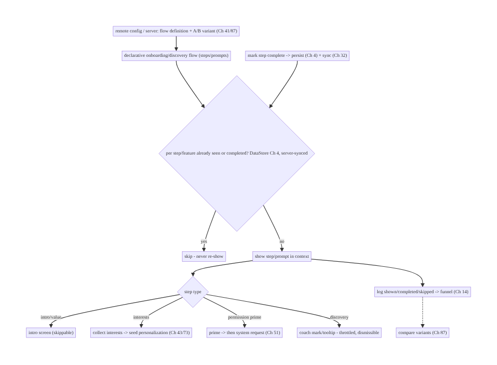
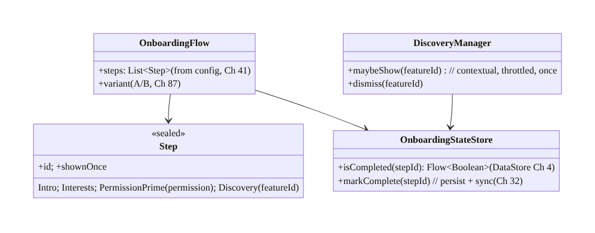
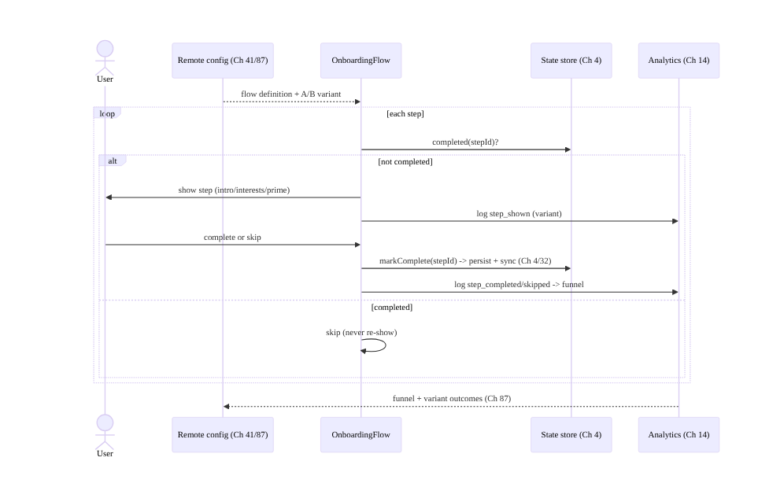
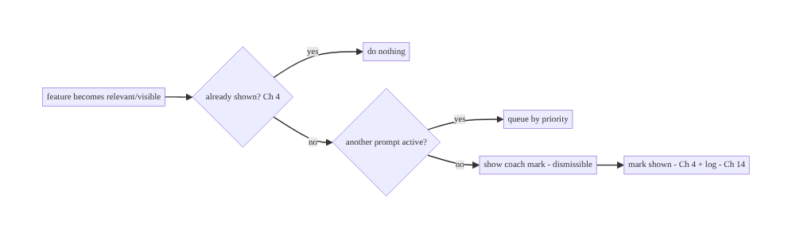
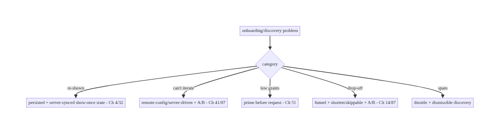

# Chapter 80 — Onboarding & Feature Discovery

> **Part IX — Feature Architectures** · Complexity: **Standard** (≥25 interview questions)
>
> **Prerequisites:** Ch 41 (remote config/experiments), Ch 4 (DataStore), Ch 51
> (permissions), Ch 53 (navigation), Ch 14 (analytics), Ch 45 (startup), Ch 87 (A/B).
> Pairs with Ch 43 (personalization), Ch 73 (recommendations cold-start).
>
> **Reference surface in StreamCart:** first-run onboarding (intro, sign-in/up, interest
> selection, permission priming) and ongoing **feature discovery** (tooltips, coach marks,
> "what's new", badges) — a **server-/config-driven, experiment-friendly, state-tracked**
> system that shows the right guidance once, respects the user, and measures completion.

---

## 80.1 Problem Definition and Real-World Context

Onboarding (the first-run experience) and feature discovery (ongoing in-context guidance)
share one engineering problem: **showing the right guidance, to the right user, at the
right time, exactly once, and measuring it** — without annoying users or hardcoding flows.
A good system is **config-/server-driven** (change onboarding without an app release,
Ch 41), **experiment-friendly** (A/B onboarding variants, Ch 87), **state-tracked** (don't
re-show completed steps — persisted across reinstall ideally), **permission-priming-aware**
(explain before the system prompt, Ch 51), and **measured** (completion funnel, Ch 14).

Concretely, teams hit:

- **Hardcoded onboarding.** A flow baked into the app can't change without a release and
  can't be A/B tested — it should be **remote-config-/server-driven** (steps, copy, order,
  Ch 41/87).
- **Re-showing completed guidance.** A tooltip or intro that reappears after completion is
  the top annoyance. **State must be tracked** (per step/feature, persisted via DataStore
  Ch 4, ideally server-synced so it survives reinstall) so each is shown **once**.
- **Permission priming done wrong.** Firing the system permission prompt cold (Ch 51)
  tanks grant rates; onboarding should **prime** (explain value) **before** the in-context
  request — but not request at first launch for features not yet used.
- **Blocking/over-long onboarding.** A long mandatory flow before any value causes drop-off;
  onboarding should be **skippable/progressive**, show value fast, and defer optional steps.
- **No measurement.** Without a **completion funnel** (Ch 14), you can't see where users
  drop or whether a variant wins (Ch 87).
- **Feature discovery spam.** Showing every tooltip at once overwhelms; discovery should be
  **contextual, throttled, and dismissible**, shown when the feature is relevant.
- **Cold-start personalization.** Interest selection in onboarding seeds personalization/
  recommendations (Ch 43/73) for new users.

The architecture: drive onboarding and discovery from **remote config/server** (steps,
copy, order, targeting — changeable without release, A/B-tested, Ch 41/87); **track state**
per step/feature (persisted, DataStore Ch 4, ideally server-synced) so each shows **once**;
**prime permissions** before the in-context request (Ch 51); keep onboarding **skippable/
progressive** (value fast, defer optional); **measure** a **completion funnel** (Ch 14);
make feature discovery **contextual, throttled, dismissible**; and seed **cold-start
personalization** (Ch 43/73). This chapter composes config-driven flows + state tracking +
experiments + analytics for guidance.

### Three practical use cases

1. **First-run onboarding (StreamCart).** Remote-config-driven steps (intro → sign-up →
   interests → notification priming), skippable, A/B-tested (Ch 87), with a completion
   funnel (Ch 14); interests seed recommendations (Ch 73).
2. **Feature discovery.** A coach mark for a new "Scan" feature shown **once**, in context,
   dismissible; "what's new" after an update; a badge on an unexplored tab.
3. **Permission priming.** Before requesting notifications (Ch 51), an onboarding screen
   explains the value; the system prompt follows — higher grant rate.

### Why this is architectural

Onboarding/discovery is a **config-driven, experiment-friendly, state-tracked, measured**
system composing remote config/experiments (Ch 41/87), persisted state (Ch 4), permission
priming (Ch 51), navigation (Ch 53), analytics (Ch 14), and cold-start personalization
(Ch 43/73). The decisions — server-driven flows, show-once state, priming, measurement —
determine activation, retention, and the ability to iterate without releases.

---

## 80.2 Requirements Engineering

### Functional requirements

| ID | Requirement |
|----|-------------|
| F1 | Drive onboarding/discovery flows from remote config/server (steps/copy/order/targeting), A/B-testable (Ch 41/87). |
| F2 | Track per-step/feature state so each is shown exactly once; persist (ideally server-synced) (Ch 4). |
| F3 | Prime permissions before the in-context request (Ch 51). |
| F4 | Keep onboarding skippable/progressive; show value fast; defer optional steps. |
| F5 | Measure a completion funnel (per step, drop-off, variant) (Ch 14). |
| F6 | Feature discovery contextual, throttled, dismissible; seed cold-start personalization (Ch 43/73). |

### Non-functional requirements

| Attribute | Policy |
|-----------|--------|
| **Iterability** | Change flows without a release (remote-driven); A/B (Ch 41/87). |
| **Respect** | Show once; skippable; not spammy; dismissible. |
| **Measurement** | Completion funnel + variant outcomes (Ch 14/87). |
| **Activation** | Value fast; higher permission grant via priming. |
| **Resilience** | State persists (reinstall-safe if synced); startup-light (Ch 45). |

### Scope

- **In scope:** remote-config-/server-driven flows (steps/copy/order/targeting, Ch 41) +
  A/B (Ch 87), show-once state tracking (persisted, DataStore Ch 4, server-synced option),
  permission priming (Ch 51), skippable/progressive onboarding, completion-funnel analytics
  (Ch 14), feature discovery (contextual/throttled/dismissible coach marks/tooltips/what's-
  new/badges), cold-start personalization seeding (Ch 43/73), startup impact (Ch 45).
- **Out of scope:** remote-config internals (Ch 41), DataStore internals (Ch 4), permission
  mechanics (Ch 51), navigation (Ch 53), analytics pipeline (Ch 14), experiment platform
  (Ch 87), recommendations (Ch 73).

### Assumptions & constraints

- Remote config/experiments (Ch 41/87), DataStore (Ch 4), analytics (Ch 14). `minSdk 24`.
  Flows are **server-/config-driven** and A/B-tested; state is **persisted** (ideally
  server-synced for reinstall); onboarding must be **light at startup** (Ch 45).

---

## 80.3 System Design Fundamentals

- **Config-/server-driven flows (not hardcoded, Ch 41/87).** Onboarding steps and discovery
  prompts — their **presence, order, copy, media, and targeting** — come from **remote
  config / a server endpoint** (Ch 41), so you can **change the flow without an app
  release** and **A/B test** variants (Ch 87). The client renders a **declarative flow
  definition** (a list of steps/prompts) and handles each step type; it doesn't bake the
  sequence into code. New steps/experiments ship via config.
- **Show-once state tracking (the core UX correctness, Ch 4).** Each onboarding step and
  each discovery prompt has a **completion/seen flag**, **persisted** (DataStore, Ch 4) so
  it's **never re-shown** after completion/dismissal. Ideally the state is **server-synced**
  (tied to the account) so it survives **reinstall / new device** (Ch 32) — a user who
  onboarded shouldn't re-onboard on a new phone. Track **per step/feature** (not a single
  "onboarded" bit) so individual discovery prompts and new steps are handled independently.
- **Permission priming before the request (Ch 51).** Firing a system permission prompt
  cold tanks grant rates; onboarding/discovery should **prime** — an app screen explaining
  the **value** ("Get notified when your order ships") — **before** the in-context system
  request (Ch 51). Prime **only** for permissions the user will actually use soon; don't
  request everything at first launch. The priming screen is a config-driven onboarding
  step; the actual request follows the Ch 51 flow.
- **Skippable, progressive, value-fast.** Onboarding should **show value quickly** and be
  **skippable** — a long mandatory flow before any value causes drop-off. Prefer
  **progressive onboarding** (teach features **when first used**, via discovery) over a big
  upfront flow; defer **optional** steps (interests, permissions) and let users skip. Keep
  the **critical path** (e.g., sign-in if required) short.
- **Measure the completion funnel (Ch 14/87).** Log **each step shown/completed/skipped**
  and **drop-off** through the analytics pipeline (Ch 14) so you can see where users fall
  out and **which variant wins** (Ch 87). Discovery prompts log **shown/engaged/dismissed**.
  Measurement is what makes onboarding iterable (config changes + A/B + funnel).
- **Feature discovery: contextual, throttled, dismissible.** Ongoing guidance (coach marks,
  tooltips, "what's new", badges) should appear **in context** (when the feature is
  relevant/visible), **throttled** (not many at once — a queue/priority so you don't
  overwhelm), **dismissible**, and **shown once** (tracked, Ch 4). "What's new" shows after
  an update (version-gated); badges mark unexplored features and clear on use.
- **Cold-start personalization seeding (Ch 43/73).** Onboarding often collects **interests/
  preferences** that seed **personalization** (Ch 43) and **recommendations cold-start**
  (Ch 73) for a new user with no history — a direct input to those systems.
- **Startup-light (Ch 45).** Onboarding/discovery must not bloat **cold start** (Ch 45):
  fetch the flow config lazily/cached (Ch 41), decide what to show quickly, and don't block
  the first frame.

Core insight: **drive onboarding and feature discovery from remote config/server (steps,
copy, order, targeting — changeable without release and A/B-tested, Ch 41/87) rendered from
a declarative flow definition; track per-step/feature show-once state persisted in DataStore
and ideally server-synced so nothing is re-shown and onboarding survives reinstall (Ch 4/32);
prime permissions before the in-context request (Ch 51); keep onboarding skippable and
progressive (value fast, teach features when first used, defer optional steps); measure a
completion funnel through the analytics pipeline so flows are iterable and variants
comparable (Ch 14/87); make discovery contextual, throttled, and dismissible; and seed
cold-start personalization from collected interests (Ch 43/73) — all kept light at startup
(Ch 45).**

---

## 80.4 High-Level Architecture



**Components & ownership**

- **Remote config/server** defines the **flow + variant** (changeable without release,
  A/B); the client **renders** it.
- **Show-once state** (persisted, server-synced) gates each step/prompt; **analytics** logs
  the **funnel**.
- **Step types:** intro, interests (→ personalization), permission priming (→ Ch 51),
  discovery (throttled/dismissible).

**Direction:** config flow + variant → per-step show-once check → render in context → log
funnel → mark complete (persist + sync); discovery contextual/throttled.

---

## 80.5 Detailed Component Design



| Component | Responsibility |
|-----------|----------------|
| `OnboardingFlow` | declarative steps + A/B variant from config (Ch 41/87) |
| `Step` | typed step (intro/interests/permission-prime/discovery) |
| `OnboardingStateStore` | show-once state (DataStore + server sync, Ch 4/32) |
| `DiscoveryManager` | contextual, throttled, once-only discovery prompts |

---

## 80.6 End-to-End Data Flow

### First-run onboarding (config-driven, measured)



### Feature discovery (contextual, throttled, once)



---

## 80.7 Complete Kotlin Implementation

Package: `com.streamcart.onboarding`.

### 80.7.1 Declarative flow from remote config (Ch 41/87)

```kotlin
sealed interface Step {
    val id: String
    data class Intro(override val id: String, val title: String, val body: String, val imageUrl: String) : Step
    data class Interests(override val id: String, val options: List<String>) : Step   // seeds personalization (Ch 43/73)
    data class PermissionPrime(override val id: String, val permission: String, val rationale: String) : Step  // Ch 51
    data class Discovery(override val id: String, val featureId: String, val text: String) : Step
}

@Singleton
class OnboardingFlowProvider @Inject constructor(private val config: RemoteConfigRepository) {   // Ch 41
    /** Flow definition + copy + order + A/B variant come from config -> changeable without release (Ch 41/87). */
    suspend fun flow(): List<Step> = config.onboardingFlow()   // server/remote-config-driven
    fun variant(): String = config.experiment("onboarding")    // A/B (Ch 87)
}
```

### 80.7.2 Show-once state (DataStore + server sync, Ch 4/32)

```kotlin
@Singleton
class OnboardingStateStore @Inject constructor(
    private val dataStore: DataStore<Preferences>,   // Ch 4
    private val sync: OnboardingSync,                 // server-sync so it survives reinstall (Ch 32)
) {
    fun isCompleted(stepId: String): Flow<Boolean> =
        dataStore.data.map { it[booleanPreferencesKey("ob_$stepId")] ?: false }

    suspend fun markComplete(stepId: String) {
        dataStore.edit { it[booleanPreferencesKey("ob_$stepId")] = true }   // persist locally (Ch 4)
        sync.push(stepId)                                                    // sync to account (reinstall-safe, Ch 32)
    }
    // On login/new device: pull server onboarding state so completed steps aren't re-shown.
    suspend fun restore() = sync.pull().forEach { stepId -> dataStore.edit { it[booleanPreferencesKey("ob_$stepId")] = true } }
}
```

### 80.7.3 Onboarding host: render config flow, skip completed, measure (Ch 14)

```kotlin
@HiltViewModel
class OnboardingViewModel @Inject constructor(
    private val flowProvider: OnboardingFlowProvider, private val state: OnboardingStateStore,
    private val analytics: AnalyticsBatcher,          // Ch 14
) : ViewModel() {
    private val variant = flowProvider.variant()
    val steps = flow { emit(flowProvider.flow().filterNot { state.isCompleted(it.id).first() }) }  // skip completed

    fun onStepShown(step: Step) = analytics.log("onboarding_step_shown", mapOf("id" to step.id, "variant" to variant))
    fun onComplete(step: Step) = viewModelScope.launch {
        state.markComplete(step.id)                   // persist + sync (never re-show, Ch 4/32)
        analytics.log("onboarding_step_completed", mapOf("id" to step.id, "variant" to variant))   // funnel (Ch 14)
    }
    fun onSkip(step: Step) = analytics.log("onboarding_step_skipped", mapOf("id" to step.id))
}
```

### 80.7.4 Permission priming before the request (Ch 51)

```kotlin
@Composable
fun PermissionPrimeStep(step: Step.PermissionPrime, onDone: () -> Unit) {
    // PRIME first (explain value), THEN the system request (Ch 51) -> higher grant rate.
    val launcher = rememberLauncherForActivityResult(ActivityResultContracts.RequestPermission()) { onDone() }
    Column {
        Text(step.rationale)                                  // value explanation (priming)
        Button(onClick = { launcher.launch(step.permission) }) { Text("Enable") }   // in-context request (Ch 51)
        TextButton(onClick = onDone) { Text("Not now") }      // skippable
    }
    // Do NOT fire the system prompt cold / at first launch for unused features (Ch 51).
}
```

### 80.7.5 Feature discovery: contextual, throttled, once (Ch 4/14)

```kotlin
@Singleton
class DiscoveryManager @Inject constructor(private val state: OnboardingStateStore, private val analytics: AnalyticsBatcher) {
    private val activePrompt = MutableStateFlow<String?>(null)   // throttle: one at a time

    /** Show a coach mark ONCE, in context, only if nothing else is showing (throttled). */
    suspend fun maybeShow(featureId: String): Boolean {
        if (state.isCompleted("disc_$featureId").first()) return false   // show once (Ch 4)
        if (activePrompt.value != null) return false                     // throttle (don't overwhelm)
        activePrompt.value = featureId
        analytics.log("discovery_shown", mapOf("feature" to featureId))  // Ch 14
        return true
    }
    suspend fun dismiss(featureId: String) {
        state.markComplete("disc_$featureId"); activePrompt.value = null  // never re-show
        analytics.log("discovery_dismissed", mapOf("feature" to featureId))
    }
}
// Interests step -> seed personalization: personalizationRepo.setInterests(selected) (Ch 43/73)
```

### 80.7.6 Module structure

```
:feature:onboarding  OnboardingFlowProvider (config), OnboardingStateStore (DataStore+sync), OnboardingViewModel, step UI, DiscoveryManager
:core:config  remote config/experiments (Ch 41/87); :core:analytics funnel (Ch 14)
# Permissions -> Ch 51; navigation -> Ch 53; personalization seeding -> Ch 43/73; startup-light -> Ch 45.
```

---

## 80.8 Concurrency and Race Conditions

| Scenario | Risk | Handling |
|----------|------|----------|
| Re-show completed step/prompt | annoyance | persisted show-once state (Ch 4); check before show |
| Reinstall re-onboards | poor UX | server-synced state (Ch 32); restore on login |
| Multiple discovery prompts at once | overwhelm | throttle (one active); queue by priority |
| Permission prompt cold | low grants | prime first, then request (Ch 51) |
| Config fetch slow at startup | delayed/blank onboarding | cached config (Ch 41); startup-light (Ch 45) |
| Variant inconsistent | invalid A/B | pin variant per user (Ch 87) |
| Step completed but not logged | funnel gaps | log on complete; offline-queue analytics (Ch 14) |

- **Persisted + server-synced show-once state** is the correctness crux: check completion
  **before** showing (DataStore, Ch 4), and **sync** it (Ch 32) so a reinstall/new device
  doesn't re-onboard — tracking **per step/feature**, not one global bit.
- **Throttle discovery** (one prompt active, queue the rest) so the user isn't overwhelmed;
  mark shown on dismiss (never re-show).
- **Prime before the system request** (Ch 51) and pin the **A/B variant** (Ch 87) for
  consistent experience + valid measurement.

---

## 80.9 Failure Scenarios and Recovery

| Failure | Detection | Response | Outcome |
|---------|-----------|----------|---------|
| Completed guidance reappears | user annoyance | persisted show-once check (Ch 4) | shown once |
| Reinstall re-onboards | user report | server-synced state (Ch 32) | preserved |
| Can't change flow without release | slow iteration | remote-config-driven (Ch 41) | changeable |
| Low permission grants | analytics | prime before request (Ch 51) | higher grants |
| Onboarding drop-off | funnel (Ch 14) | shorten/skippable/progressive; A/B (Ch 87) | improved |
| Discovery spam | opt-out/complaints | throttle + dismissible (one at a time) | respectful |
| Slow/blank first run | startup trace (Ch 45) | cached config; startup-light | fast |



> **Onboarding/discovery is config-driven flows + show-once state + measurement.** Drive it
> from remote config (change/A-B without release, Ch 41/87), track per-step/feature show-once
> state (persisted + server-synced so nothing re-shows and reinstall is safe, Ch 4/32), prime
> permissions (Ch 51), keep it skippable/progressive, throttle discovery, and measure the
> funnel (Ch 14) — so you can iterate to higher activation.

---

## 80.10 Scaling the Implementation

- **Level 1.** Config-driven onboarding steps; persisted show-once state (Ch 4); skippable.
- **Level 2.** Permission priming (Ch 51); completion-funnel analytics (Ch 14); interest
  seeding for personalization (Ch 43/73).
- **Level 3 — production.** A/B variants (Ch 41/87); server-synced state (reinstall-safe,
  Ch 32); throttled/dismissible feature discovery; "what's new" (version-gated).
- **Level 4 — large.** Targeted onboarding (segment/locale/config), progressive onboarding
  (teach-on-use), discovery priority queue, re-engagement flows.
- **Level 5 — enterprise.** Onboarding experimentation platform (Ch 87), activation-funnel
  governance, personalization-driven onboarding (Ch 43), localization, accessibility.

**Avoid overengineering:** config-driven flow + show-once state + funnel + priming is the
core. Don't hardcode flows; don't re-show completed guidance; don't spam discovery.

---

## 80.11 Alternative Approaches and Trade-offs

| Dimension | Option A | Option B | When |
|-----------|----------|----------|------|
| Flow source | Remote config/server (Ch 41) | hardcoded | Config-driven (iterate/A-B without release) |
| State | Persisted + server-synced (Ch 4/32) | in-memory / local-only | Persisted+synced (show-once, reinstall-safe) |
| Granularity | Per step/feature | single "onboarded" bit | Per step/feature (independent prompts/new steps) |
| Permissions | Prime then request (Ch 51) | cold system prompt | Prime (higher grants) |
| Length | Skippable/progressive | long mandatory | Skippable/progressive (less drop-off) |
| Discovery | Contextual/throttled/once | all tooltips at once | Contextual/throttled (not spammy) |
| Measurement | Funnel + A/B (Ch 14/87) | none | Always measure (iterate) |

**Config-driven vs hardcoded flows:** a hardcoded onboarding can't change without an app
release and can't be A/B tested, so you can't iterate toward better activation. A
**remote-config/server-driven** flow (steps, copy, order, targeting, Ch 41) lets you change
it and **experiment** (Ch 87) without releases — the client renders a declarative flow
definition. Always config-drive onboarding/discovery.

**Per-step/feature state vs a single "onboarded" bit:** a single flag can't handle **new**
onboarding steps (added via config) or **individual** discovery prompts — it either
re-shows everything or nothing. **Per-step/feature show-once state** (persisted + synced,
Ch 4/32) shows each exactly once, independently, and survives reinstall. Track granularly.

**Prime-then-request vs cold permission prompt:** firing the system permission dialog cold
(Ch 51) yields reflexive denials and permanent denial. **Priming** (an app screen explaining
the value) **before** the in-context request markedly improves grant rates. Onboarding is the
natural place to prime notifications/location — but only for features the user will use soon.

---

## 80.12 Security & Privacy Considerations

- **Permission priming is persuasion, not coercion (Ch 51/28):** explain genuine value;
  respect "not now"; don't dark-pattern users into permissions; prime only for permissions
  actually needed soon.
- **Interest/preference data is personal (Ch 28):** interests collected in onboarding feed
  personalization (Ch 43/73) — handle with **consent**, allow changing/clearing, don't leak.
- **Server-synced onboarding state (Ch 32/42):** tie to the account (per-account, Ch 42);
  don't expose one user's onboarding/interests to another.
- **Config as untrusted-ish (Ch 41/23):** remote flow config drives UI — fetch over authed/
  TLS config (Ch 41/23); don't let config inject unsafe content (sanitize rendered copy/
  links, Ch 52) or trigger unexpected actions.
- **Analytics privacy (Ch 14/28):** funnel events shouldn't carry PII; respect consent.
- **No sensitive data in onboarding logs** (Ch 28).
- Client vs backend: the **server/config** defines flows, assigns experiments, and stores
  synced state + interests; the **client** renders safely, primes permissions respectfully,
  and logs the funnel — it doesn't coerce or leak.

---

## 80.13 Performance and Resource Optimization

- **Startup-light (Ch 45):** cache the flow config (Ch 41); decide what to show quickly;
  don't block the first frame on a config fetch.
- **Lazy step content:** load images/media per step (Ch 56), not all upfront.
- **Cheap show-once checks:** DataStore reads (Ch 4) are fast; gate before rendering.
- **Throttled discovery:** one prompt at a time avoids layout/animation overhead and
  overwhelm.
- **Batch analytics** (Ch 14): funnel events batched/offline-queued.
- **Profiling:** onboarding start impact on cold start (Ch 45), step render time, funnel
  completion, discovery engagement, config fetch latency.

---

## 80.14 Testing Strategy

Flow rendering, show-once state, priming, and funnel logging are testable.

```kotlin
class OnboardingStateTest {
    @Test fun `completed step is not re-shown`() = runTest {
        state.markComplete("intro")
        assertTrue(state.isCompleted("intro").first())   // show-once (Ch 4)
    }
    @Test fun `server-synced state restored on new device`() = runTest {
        sync.serverState = setOf("intro", "interests"); state.restore()
        assertTrue(state.isCompleted("interests").first())   // reinstall-safe (Ch 32)
    }
}

class OnboardingFlowTest {
    @Test fun `renders config-driven steps and skips completed`() = runTest {
        config.flow = listOf(Step.Intro("intro", ...), Step.Interests("interests", ...))
        state.markComplete("intro")
        assertEquals(listOf("interests"), vm.steps.first().map { it.id })   // config-driven + skip (Ch 41)
    }
    @Test fun `logs step funnel events`() = runTest { /* shown/completed/skipped (Ch 14) */ }
    @Test fun `applies A-B variant`() = runTest { assertEquals("variantB", vm.variant) }   // Ch 87
}

class DiscoveryTest {
    @Test fun `shows once and throttles concurrent prompts`() = runTest { /* one active; second queued */ }
}
```

What to test: show-once state (persisted + restored from server); config-driven flow +
skip-completed; A/B variant applied; funnel events logged (Ch 14); permission priming →
request order (Ch 51); discovery once + throttled; interests seed personalization (Ch 43).
Fake config/analytics/sync; DataStore test.

---

## 80.15 Production Observability

- **Metrics:** onboarding **completion funnel** (per step shown/completed/skipped, drop-off);
  **variant outcomes** (Ch 87); permission grant rate after priming (Ch 51); discovery
  shown/engaged/dismissed; time-to-value; reinstall re-onboard rate (→ 0 with sync);
  onboarding cold-start impact (Ch 45).
- **Logs:** `onboarding{step, event, variant}` / `discovery{feature, event}` — no PII
  (Ch 28).
- **Debugging:** re-shown guidance → state not persisted/checked (Ch 4); reinstall re-onboard
  → state not synced (Ch 32); low grants → no priming (Ch 51); high drop-off → too long/
  mandatory (shorten, A/B); discovery spam → not throttled; slow first run → config fetch on
  critical path (Ch 45).
- **Alerting:** funnel-completion regression after a config change (Ch 41/87); grant-rate
  drop; discovery-dismiss spike.
- **Dashboards:** completion funnel by variant; grant rate; discovery engagement; time-to-
  value.

---

## 80.16 System Design Interview Preparation

> ≥25 questions.

**Fundamentals**
1. *Onboarding + discovery shared problem?* Show the right guidance once, measured,
   iterably.
2. *Flow source?* Remote config/server (Ch 41) — changeable without release, A/B (Ch 87).
3. *Why not hardcode?* Can't iterate/experiment without releases.
4. *Show-once state?* Persisted per step/feature (DataStore, Ch 4), ideally server-synced
   (Ch 32).
5. *Why per-step not one bit?* New steps + individual prompts handled independently.

**State**
6. *Persist where?* DataStore (Ch 4).
7. *Reinstall-safe?* Server-synced to the account (Ch 32).
8. *Check when?* Before showing each step/prompt.

**Permissions**
9. *Priming?* Explain value before the system request (Ch 51) → higher grants.
10. *Cold prompt?* Bad — reflexive denial.
11. *Prime everything at launch?* No — only soon-needed permissions.

**UX**
12. *Length?* Skippable, progressive, value-fast.
13. *Progressive onboarding?* Teach features when first used (discovery).
14. *Defer?* Optional steps (interests, permissions).

**Discovery**
15. *Discovery prompts?* Contextual, throttled, dismissible, once.
16. *Throttle?* One active; queue by priority.
17. *"What's new"?* Version-gated after update.
18. *Badges?* Mark unexplored; clear on use.

**Measurement/experiments**
19. *Funnel?* Log step shown/completed/skipped + drop-off (Ch 14).
20. *A/B?* Variant from config (Ch 87); pin per user; compare outcomes.
21. *Why measure?* Iterate to activation.

**Personalization**
22. *Interests?* Seed personalization/recommendations cold-start (Ch 43/73).

**Security/startup**
23. *Priming ethics?* Persuade, not coerce (Ch 28).
24. *Startup impact?* Startup-light; cache config (Ch 45/41).

**Testing/Production**
25. *Re-shown in prod?* State not persisted/checked.
26. *Key metric?* Completion funnel + grant rate.

### Design-change challenges
1. **Change onboarding without a release.** Remote-config-/server-driven flow (Ch 41).
2. **A tooltip keeps reappearing.** Persisted per-feature show-once state (Ch 4).
3. **Reinstall re-onboards users.** Server-synced state (Ch 32).
4. **Low notification opt-in.** Prime before the request (Ch 51).
5. **A/B two onboarding flows.** Config variant + funnel measurement (Ch 41/87/14).

### Mock walkthrough (abridged)
Clarify (first-run vs discovery, A/B, reinstall-safe?) → remote-config/server-driven flow +
variant (Ch 41/87) → per-step/feature show-once state (DataStore + server sync, Ch 4/32) →
skippable/progressive, value-fast → permission priming before request (Ch 51) → completion-
funnel analytics (Ch 14) → discovery contextual/throttled/dismissible → interests seed
personalization (Ch 43/73) → startup-light (Ch 45) → observability (funnel, grants).

---

## 80.17 Practical Exercises

1. **Beginner.** Render a remote-config-driven onboarding flow and skip steps the user has
   completed (persisted show-once state). *Eval:* config-driven; never re-shows completed.
2. **Intermediate.** Add permission priming before the system request (Ch 51) and log a
   completion funnel (Ch 14). *Eval:* primes then requests; funnel events logged.
3. **Advanced.** Server-sync onboarding state (reinstall-safe) and add throttled, once-only
   feature discovery coach marks. *Eval:* reinstall doesn't re-onboard; discovery not spammy.
4. **Production debugging.** Fix a reappearing tooltip (state not persisted) and a cold
   permission prompt (add priming). *Eval:* shown once; higher grants.
5. **System design challenge.** A/B two onboarding variants (config, Ch 87) with a funnel
   dashboard and interest-seeded personalization (Ch 43/73). *Eval:* variant comparison;
   personalization seeded.

*(Solutions withheld unless requested.)*

---

## 80.18 Chapter Summary & Reference Sheet

**Key decisions:** drive onboarding and feature discovery from **remote config/server** —
steps, copy, order, targeting, rendered from a **declarative flow definition** — so you can
**change flows without an app release** and **A/B test** variants (Ch 41/87); track
**per-step/feature show-once state** **persisted in DataStore** and ideally **server-synced**
so nothing is re-shown and onboarding **survives reinstall/new device** (Ch 4/32); **prime
permissions before the in-context system request** (Ch 51) and only for soon-needed ones;
keep onboarding **skippable and progressive** (value fast, teach features when first used,
defer optional steps); **measure a completion funnel** through the analytics pipeline so
flows are iterable and variants comparable (Ch 14/87); make feature discovery **contextual,
throttled (one at a time), and dismissible**; **seed cold-start personalization** from
collected interests (Ch 43/73); and keep it **light at cold start** (cached config, Ch 45/41).
Prime respectfully (persuade, not coerce) and treat interests/analytics as personal data
(Ch 28).

**Concepts:** config-/server-driven declarative flows + A/B (Ch 41/87), per-step/feature
show-once state (persisted + synced, Ch 4/32), permission priming (Ch 51), skippable/
progressive onboarding, completion-funnel measurement (Ch 14), contextual/throttled/
dismissible discovery, cold-start personalization seeding (Ch 43/73), startup-light (Ch 45).

**Common mistakes:** hardcoded flows (can't iterate/A-B); single "onboarded" bit (re-shows or
mishandles new steps); state not persisted/synced (re-shown, reinstall re-onboards); cold
permission prompts (low grants); long mandatory onboarding (drop-off); discovery spam (all at
once); no funnel measurement; blocking cold start on config.

**Checklist:** ☐ remote-config/server-driven flow + A/B variant (Ch 41/87) ☐ per-step/feature
show-once state in DataStore (Ch 4), server-synced (Ch 32) ☐ check completion before showing
☐ prime permissions before request (Ch 51), only soon-needed ☐ skippable/progressive,
value-fast ☐ completion-funnel analytics (Ch 14) ☐ discovery contextual/throttled/dismissible/
once ☐ seed personalization from interests (Ch 43/73) ☐ startup-light (cached config, Ch 45/
41) ☐ per-account + consent + sanitized config copy (Ch 42/28/52) ☐ funnel + grant-rate
telemetry.

**Key APIs:** remote config/experiments (Ch 41/87), DataStore `Preferences` (show-once state,
Ch 4), delta sync for state (Ch 32), `ActivityResultContracts.RequestPermission` after priming
(Ch 51), analytics funnel events (Ch 14), Navigation (Ch 53), personalization seeding (Ch 43/
73), `AsyncImage` for step media (Ch 56).

**References:**
- Remote config (flow-driven UI): Ch 41 + https://firebase.google.com/docs/remote-config
- Request permissions (priming): https://developer.android.com/training/permissions/requesting
- (composes) Ch 41 Remote Config, Ch 87 A/B & Experiments, Ch 4 DataStore, Ch 32 Sync, Ch 51 Permissions, Ch 14 Analytics, Ch 53 Navigation, Ch 43 Personalization, Ch 73 Recommendations, Ch 45 Startup

### Chapter review (Phase 4)
- **Completeness:** all 18 sections; architecture/class/sequence/flow/failure diagrams;
  declarative config flow + show-once state (DataStore+sync) + onboarding VM + permission
  priming + discovery manager code; concurrency (persisted+synced show-once, throttle, prime,
  variant pin); failure (config-driven + show-once + measured principle); 5 levels; config-vs-
  hardcoded, per-step-state, prime-vs-cold trade-offs; security (priming ethics, personal
  interests, synced state, config safety); perf (startup-light, lazy, throttle); state + flow +
  discovery tests; observability (funnel, grants); 26 Q&A + 5 challenges. ✅
- **Expand later:** remote config/experiments (Ch 41/87), permissions (Ch 51), analytics
  (Ch 14), personalization (Ch 43/73).
- **Interview coverage:** exceeds ≥25 bar.
