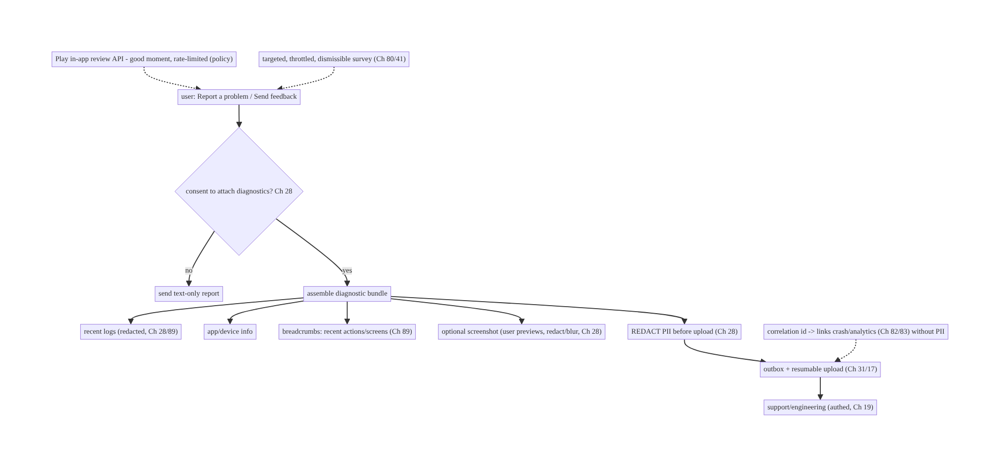
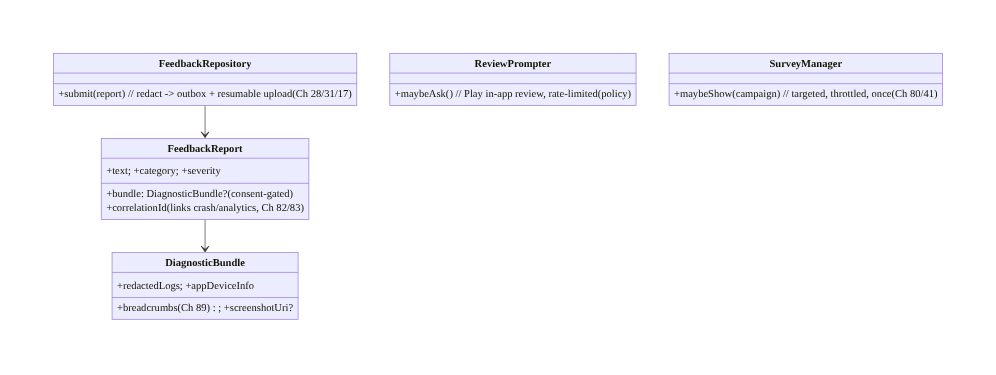
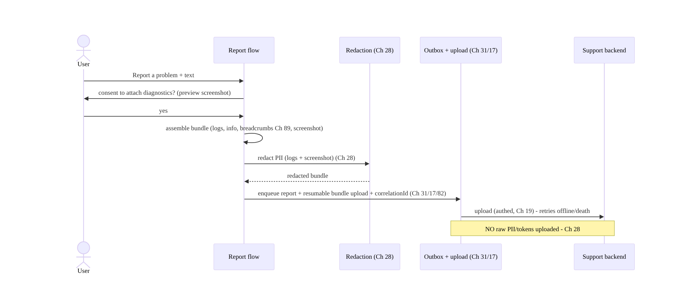
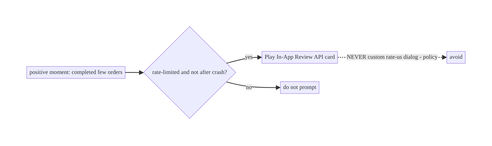
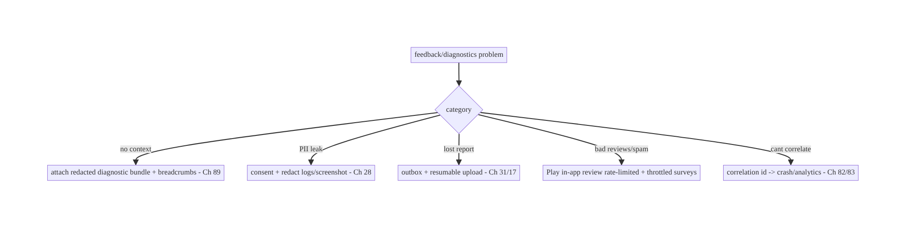

# Chapter 81 — In-App Feedback & Diagnostics

> **Part IX — Feature Architectures** · Complexity: **Standard** (≥25 interview questions)
>
> **Prerequisites:** Ch 28 (PII redaction/privacy), Ch 17 (uploads), Ch 31 (outbox), Ch 83
> (crash/ANR — forward ref), Ch 89 (logging), Ch 23 (security), Ch 3 (SSOT). Pairs with
> Ch 82 (analytics), Ch 41 (remote config).
>
> **Reference surface in StreamCart:** the "Report a problem / Send feedback" flow and the
> **diagnostic bundle** it attaches — recent logs, device/app info, a screenshot, a
> breadcrumb trail — collected and uploaded **with user consent and PII redaction** so
> support/engineering can debug, and in-app surveys/ratings prompts done respectfully.
>
> **Note:** this chapter completes **Part IX — Feature Architectures (Ch 71–81)**.

---

## 81.1 Problem Definition and Real-World Context

When something goes wrong, users want to **report it** and engineers need **enough context
to debug** — but collecting that context (logs, screenshots, device state) is a **privacy
and consent minefield**. In-app feedback/diagnostics is the system that lets a user **send
feedback or a bug report** with an attached **diagnostic bundle** (recent redacted logs,
device/app metadata, optional screenshot, breadcrumbs), uploaded **reliably** and **only
with explicit consent and PII redaction** (Ch 28). It also covers **respectful in-app
surveys and rating prompts** (ask at the right time, not spammily). Done wrong, it leaks
PII, nags users into bad store reviews, or gives support useless reports with no context.

Concretely, teams hit:

- **Useless reports (no context).** "App is broken" with no logs/device info is
  undebuggable. Attach a **diagnostic bundle** (recent logs, app/device info, breadcrumbs,
  optional screenshot) so engineers can reproduce.
- **PII leakage in diagnostics (Ch 28).** Logs/screenshots can contain **PII** (names,
  emails, tokens, messages, card data). Diagnostics must be **redacted** (Ch 28) and
  collected **only with consent** — a diagnostic upload is a **privacy event**.
- **Consent missing.** Silently uploading logs/screenshots is a trust and legal violation.
  The user must **explicitly consent** and ideally **see/control** what's attached.
- **Unreliable upload.** A feedback submission (with a potentially large bundle) must be
  **reliable** (outbox + retry + resumable upload, Ch 31/17) so it isn't lost offline.
- **Rating-prompt spam / policy.** Prompting for a Play rating at the wrong time (or with a
  custom dialog, violating policy) annoys users and backfires; use the **in-app review API**
  at a **good moment**, rate-limited.
- **Survey fatigue.** In-app surveys shown too often/at bad times hurt UX; they should be
  **targeted, throttled, and dismissible** (like discovery, Ch 80).
- **Breadcrumbs & correlation.** Linking a report to **crash/analytics data** (Ch 82/83)
  and a **correlation id** helps engineers find the session — without logging PII.

The architecture: a **feedback/bug-report flow** that assembles a **diagnostic bundle**
(recent **redacted** logs, app/device info, breadcrumbs, optional screenshot) **only with
explicit consent**, **redacts PII** (Ch 28), and uploads it **reliably** (outbox +
resumable upload, Ch 31/17) with a **correlation id** linking to crash/analytics (Ch 82/83);
plus **respectful prompts** — the **Play in-app review API** at a good, rate-limited moment,
and **targeted, throttled surveys**. This chapter is about **getting debuggable,
privacy-safe feedback and asking for input respectfully**.

### Three practical use cases

1. **Report a problem (StreamCart).** User taps "Report a problem" → consents to attaching
   diagnostics → a **redacted** bundle (logs, device info, screenshot, breadcrumbs) uploads
   reliably with a correlation id → support can debug.
2. **Shake-to-report (internal/beta).** A shake gesture captures a screenshot + recent logs
   for a quick bug report (common in beta builds), consent-gated and redacted.
3. **In-app review prompt.** After a positive moment (completed a few orders), show the
   **Play in-app review** prompt once, rate-limited — not a custom dialog, not after a
   crash.

### Why this is architectural

Feedback/diagnostics is a **privacy-critical collection + reliable upload + respectful
prompting** system composing PII redaction/privacy (Ch 28), reliable upload (Ch 31/17),
logging/breadcrumbs (Ch 89), crash correlation (Ch 82/83), and consent. The decisions —
consent-gated, redacted, reliable, correlated diagnostics + policy-compliant respectful
prompts — determine debuggability, user trust, and legal compliance.

---

## 81.2 Requirements Engineering

### Functional requirements

| ID | Requirement |
|----|-------------|
| F1 | Let the user send feedback/bug reports with an attached diagnostic bundle. |
| F2 | Assemble a bundle (recent logs, app/device info, breadcrumbs, optional screenshot). |
| F3 | Collect only with explicit consent; redact PII; let the user see/control attachments (Ch 28). |
| F4 | Upload reliably (outbox + resumable upload) with a correlation id to crash/analytics (Ch 31/17/82/83). |
| F5 | Prompt for ratings via the Play in-app review API at a good, rate-limited moment. |
| F6 | Show targeted, throttled, dismissible in-app surveys. |

### Non-functional requirements

| Attribute | Policy |
|-----------|--------|
| **Privacy** | Consent-gated; PII-redacted; user-controlled attachments (Ch 28). |
| **Debuggability** | Enough context (logs/device/breadcrumbs/correlation) to reproduce. |
| **Reliability** | Report + bundle survive offline/death; retried (Ch 31/17). |
| **Respect** | Rating prompts policy-compliant + rate-limited; surveys throttled. |
| **Security** | Redaction thorough (tokens/PII); authed upload (Ch 23/19). |

### Scope

- **In scope:** feedback/bug-report flow, diagnostic bundle assembly (redacted logs/device
  info/breadcrumbs/screenshot), **consent + PII redaction** (Ch 28), reliable upload (outbox
  + resumable, Ch 31/17) + correlation id (Ch 82/83), Play in-app review API (rate-limited),
  targeted/throttled surveys, shake-to-report (beta), breadcrumbs/logging (Ch 89).
- **Out of scope:** crash/ANR capture (Ch 83), analytics pipeline (Ch 82), logging internals
  (Ch 89), redaction framework (Ch 28), upload internals (Ch 17), outbox (Ch 31).

### Assumptions & constraints

- A **redaction** layer (Ch 28), reliable **upload** (Ch 17) + **outbox** (Ch 31), a
  **breadcrumb/log buffer** (Ch 89), and crash/analytics with a **correlation id** (Ch 82/
  83). Play **in-app review API** for ratings. `minSdk 24`. Diagnostics are a **privacy
  event** (consent + redaction mandatory).

---

## 81.3 System Design Fundamentals

- **A feedback report = user message + consent-gated, redacted diagnostic bundle.** The
  user's **text** (and category/severity) plus an **optional diagnostic bundle** —
  **recent logs**, **app/device info** (version, OS, device model, locale), **breadcrumbs**
  (recent user actions/screens, Ch 89), and an **optional screenshot**. The bundle is what
  makes a report **debuggable** (vs "it's broken").
- **Consent + PII redaction are mandatory (the privacy core, Ch 28).** Collecting logs/
  screenshots is a **privacy event**:
  - **Explicit consent:** the user must **opt in** to attaching diagnostics; ideally they
    can **see/edit** what's attached (preview the screenshot, toggle log inclusion).
  - **PII redaction (Ch 28):** logs and screenshots can contain **names, emails, tokens,
    messages, card data** — **redact** before upload (the logging layer already redacts,
    Ch 28/89; also redact screenshots where sensitive, or let the user blur). **Never
    upload raw secrets/tokens.**
  A diagnostic upload without consent/redaction is a **trust and legal violation** — treat
  it with the same rigor as any PII handling (Ch 28).
- **Breadcrumbs for context (Ch 89).** A rolling buffer of **recent actions/screens/events**
  (redacted) gives engineers the **sequence that led to the problem** — far more useful than
  a single log line. Breadcrumbs are kept in a bounded in-memory/ring buffer (Ch 89) and
  attached to reports (and crashes, Ch 83).
- **Correlation id to crash/analytics (Ch 82/83).** Attach a **correlation/session id** so
  the report links to the user's **crash reports** (Ch 83) and **analytics events** (Ch 82)
  for that session — engineers can find the full picture **without PII** (the id is an
  opaque identifier, not personal data).
- **Reliable upload (Ch 31/17).** A report (with a possibly large bundle: logs +
  screenshot) must **survive offline/process death** and **retry** — enqueue in the
  **outbox** (Ch 31) and upload the bundle **resumably** (Ch 17) with progress. Don't lose a
  report because the network blipped.
- **Rating prompts: Play in-app review API, respectful (policy).** To ask for a store
  rating, use the **Play In-App Review API** (shows Google's rating card in-app) at a
  **good moment** (after a positive action, not after a crash/error), **rate-limited**
  (Google quotas + your own throttle), and **never** a custom "rate us" dialog that
  funnels/pre-filters (policy violation, and it backfires). Don't beg; ask once at the right
  time.
- **Surveys: targeted, throttled, dismissible (like discovery, Ch 80).** In-app surveys
  (NPS, feature feedback) should be **targeted** (segment/trigger, via remote config, Ch 41),
  **throttled** (not often; respect fatigue), **dismissible**, and **shown once** per
  campaign (tracked like onboarding show-once, Ch 80/4). Measure response (Ch 82) but don't
  nag.
- **Shake-to-report (beta/internal).** A shake gesture (or a debug menu) captures a
  screenshot + recent logs for quick bug reports — common in **beta** builds; still
  consent/redaction-aware, often gated to internal/beta.

Core insight: **in-app feedback assembles a diagnostic bundle (recent redacted logs,
app/device info, breadcrumbs, optional screenshot) that makes reports debuggable — but only
with explicit user consent and thorough PII redaction (a diagnostic upload is a privacy
event, Ch 28), uploaded reliably via the outbox + resumable upload (Ch 31/17) with a
correlation id that links to crash/analytics data without PII (Ch 82/83); and it asks for
input respectfully — the Play in-app review API at a good, rate-limited moment (never a
policy-violating custom dialog) and targeted, throttled, dismissible surveys (Ch 80/41) —
so engineers get context, users keep trust, and you stay compliant.**

---

## 81.4 High-Level Architecture



**Components & ownership**

- **Report flow** gathers text + (consent-gated) **diagnostic bundle** (redacted logs/
  info/breadcrumbs/screenshot).
- **Redaction** (Ch 28) runs before upload; **outbox + resumable upload** (Ch 31/17)
  deliver reliably with a **correlation id** (Ch 82/83).
- **Respectful prompts:** Play in-app review (rate-limited) + throttled surveys.

**Direction:** report → consent → assemble bundle → redact (Ch 28) → outbox + resumable
upload (+ correlation id) → support; ratings/surveys asked respectfully.

---

## 81.5 Detailed Component Design



| Component | Responsibility |
|-----------|----------------|
| `FeedbackReport` | user message + consent-gated bundle + correlation id |
| `DiagnosticBundle` | redacted logs + device info + breadcrumbs + optional screenshot |
| `FeedbackRepository` | redact → outbox + resumable upload (Ch 28/31/17) |
| `ReviewPrompter` | Play in-app review at a good, rate-limited moment |
| `SurveyManager` | targeted/throttled/dismissible surveys (Ch 80/41) |

---

## 81.6 End-to-End Data Flow

### Report with consent-gated, redacted diagnostics



### Respectful rating prompt



---

## 81.7 Complete Kotlin Implementation

Package: `com.streamcart.feedback`.

### 81.7.1 Report + bundle model (consent-gated, correlation id)

```kotlin
data class FeedbackReport(
    val text: String, val category: String, val severity: String,
    val bundle: DiagnosticBundle?,              // null if user declined diagnostics (consent, Ch 28)
    val correlationId: String,                  // opaque id linking crash/analytics (Ch 82/83) - NOT PII
)
data class DiagnosticBundle(
    val redactedLogs: String,                   // redacted (Ch 28/89)
    val appDeviceInfo: Map<String, String>,     // version, OS, model, locale (non-PII)
    val breadcrumbs: List<String>,              // recent actions/screens, redacted (Ch 89)
    val screenshotUri: Uri?,                    // optional, user-previewed, redactable (Ch 28)
)
```

### 81.7.2 FeedbackRepository: redact → outbox + resumable upload (Ch 28/31/17)

```kotlin
@Singleton
class FeedbackRepository @Inject constructor(
    private val redactor: PiiRedactor,          // Ch 28
    private val uploader: ResumableUploader,     // Ch 17
    private val outbox: Outbox,                  // Ch 31
    private val breadcrumbs: BreadcrumbBuffer,   // Ch 89
) {
    suspend fun submit(text: String, category: String, severity: String, attachDiagnostics: Boolean, screenshot: Uri?) {
        val bundle = if (attachDiagnostics) assembleBundle(screenshot) else null   // CONSENT-gated (Ch 28)
        val report = FeedbackReport(text, category, severity, bundle, correlationId = Correlation.current())
        // Enqueue for reliable, death-safe, offline-capable submission (Ch 31); bundle uploads resumably (Ch 17).
        outbox.enqueue(OutboxOp.Feedback(report))
    }

    private suspend fun assembleBundle(screenshot: Uri?): DiagnosticBundle = DiagnosticBundle(
        redactedLogs = redactor.redact(LogBuffer.recent()),          // REDACT logs (Ch 28/89) - no tokens/PII
        appDeviceInfo = DeviceInfo.nonPii(),                         // version/OS/model/locale only
        breadcrumbs = breadcrumbs.recent().map { redactor.redact(it) },  // redacted (Ch 89)
        screenshotUri = screenshot?.let { redactor.redactScreenshot(it) },  // blur/redact sensitive regions (Ch 28)
    )

    suspend fun upload(op: OutboxOp.Feedback): OutboxResult = runCatching {
        op.report.bundle?.screenshotUri?.let { uploader.upload(it) }  // resumable (Ch 17)
        api.submitFeedback(op.report)                                 // authed (Ch 19); NO raw PII (Ch 28)
        OutboxResult.Done
    }.getOrElse { if (it.isTransient()) OutboxResult.Retry else OutboxResult.Failed(it) }   // offline-safe (Ch 2/31)
}
```

### 81.7.3 Consent + preview UI (user controls attachments, Ch 28)

```kotlin
@Composable
fun ReportProblemScreen(vm: FeedbackViewModel = hiltViewModel()) {
    var text by remember { mutableStateOf("") }
    var attachDiagnostics by remember { mutableStateOf(true) }   // user controls
    var screenshot by remember { mutableStateOf<Uri?>(vm.captureScreenshot()) }
    Column {
        TextField(text, { text = it }, label = { Text("Describe the problem") })
        // CONSENT: explicit toggle + what's attached (transparency, Ch 28)
        Row { Checkbox(attachDiagnostics, { attachDiagnostics = it }); Text("Attach diagnostics (logs, device info, screenshot)") }
        if (attachDiagnostics) {
            screenshot?.let { ScreenshotPreview(it, onBlur = { screenshot = vm.blurRegion(it) }) }  // user can redact (Ch 28)
            Text("We remove personal info before sending.", style = MaterialTheme.typography.labelSmall)
        }
        Button(onClick = { vm.submit(text, attachDiagnostics, screenshot) }) { Text("Send") }
    }
}
```

### 81.7.4 Breadcrumbs (Ch 89)

```kotlin
@Singleton
class BreadcrumbBuffer @Inject constructor() {
    private val buffer = ArrayDeque<String>(MAX)   // bounded ring buffer (Ch 89)
    fun log(action: String) { if (buffer.size >= MAX) buffer.removeFirst(); buffer.addLast("${now()} $action") }
    fun recent(): List<String> = buffer.toList()   // attached to reports + crashes (Ch 83), redacted on use
}
// Log screen views, taps, key events (NO PII) -> the sequence that led to the problem.
```

### 81.7.5 Respectful rating prompt (Play in-app review API)

```kotlin
class ReviewPrompter @Inject constructor(@ApplicationContext private val ctx: Context, private val prefs: ReviewPrefs) {
    private val manager = ReviewManagerFactory.create(ctx)
    /** Ask at a GOOD moment (positive action), rate-limited; NEVER a custom dialog (policy). */
    suspend fun maybeAsk(activity: Activity) {
        if (!prefs.eligibleNow() /* rate-limited + not after crash/error */) return
        val info = manager.requestReviewFlow().await()
        manager.launchReviewFlow(activity, info).await()        // Google's in-app review card
        prefs.markAsked()                                       // throttle future prompts
    }
}
```

### 81.7.6 Module structure

```
:feature:feedback  FeedbackReport/DiagnosticBundle, FeedbackRepository (redact+outbox+upload), ReportProblemScreen, ReviewPrompter, SurveyManager
:core:privacy  PiiRedactor (Ch 28); :core:logging BreadcrumbBuffer + LogBuffer (Ch 89)
:core:upload  ResumableUploader (Ch 17); :core:outbox (Ch 31)
# Correlation id -> crash/analytics (Ch 82/83). Surveys -> remote config/throttle (Ch 41/80).
```

---

## 81.8 Concurrency and Race Conditions

| Scenario | Risk | Handling |
|----------|------|----------|
| Diagnostics uploaded without consent | privacy/legal violation | consent-gate; null bundle if declined (Ch 28) |
| PII/tokens in logs/screenshot | leak | redact before upload (Ch 28); blur screenshot |
| Report lost offline/on death | lost bug report | outbox + resumable upload (Ch 31/17) |
| Large bundle upload interrupted | restart | resumable upload (Ch 17) |
| Rating prompt after a crash | backfire/bad review | rate-limit + not-after-error gate |
| Survey spam | fatigue | throttle + once + dismissible (Ch 80) |
| Correlation id contains PII | leak | opaque id only (not email/user data) |

- **Consent + redaction are the non-negotiables:** never assemble/upload a bundle without
  **explicit consent**, and always **redact PII** (logs + screenshot) before upload (Ch 28)
  — a diagnostic upload is a **privacy event**, handled with the same rigor as any PII
  flow. Let the user **see/control** what's attached (preview/blur).
- **Reliable + resumable** (Ch 31/17): a report with a large bundle survives offline/death
  and resumes a cut-off upload — bug reports shouldn't vanish on a blip.
- **Respectful prompting:** rate-limit the review prompt (and never after a crash/error),
  throttle surveys — asking at the wrong time or too often **backfires**.

---

## 81.9 Failure Scenarios and Recovery

| Failure | Detection | Response | Outcome |
|---------|-----------|----------|---------|
| Undebuggable report | support | attach diagnostic bundle (logs/breadcrumbs/info) | debuggable |
| PII leaked | privacy audit | redact logs + screenshot before upload (Ch 28) | safe |
| No consent | legal/trust | consent-gate diagnostics | compliant |
| Report lost | user follow-up | outbox + resumable upload (Ch 31/17) | delivered |
| Bad store reviews from prompt | ratings drop | prompt at good moment, rate-limited, Play API | respectful |
| Survey fatigue | opt-out | throttle + once + dismissible (Ch 80) | respectful |
| Can't find session | support | correlation id links crash/analytics (Ch 82/83) | found |
| Policy strike (custom rate dialog) | Play | use in-app review API | compliant |



> **Diagnostics make reports debuggable; consent + redaction keep them trustworthy; outbox +
> resumable upload make them reliable; and respectful, policy-compliant prompting keeps users
> on side.** Attach a redacted bundle + breadcrumbs + correlation id (with consent), deliver
> it reliably, and ask for ratings/surveys at the right time — never leak PII, never nag.

---

## 81.10 Scaling the Implementation

- **Level 1.** Feedback form + text; app/device info; reliable submit (outbox, Ch 31).
- **Level 2.** Diagnostic bundle (redacted logs + breadcrumbs + optional screenshot) with
  **consent + redaction** (Ch 28/89); resumable upload (Ch 17); correlation id (Ch 82/83).
- **Level 3 — production.** Play in-app review (rate-limited); targeted/throttled surveys
  (Ch 80/41); user preview/control of attachments.
- **Level 4 — large.** Shake-to-report (beta); categorized/triaged reports; attach session
  replay (privacy-reviewed); auto-diagnostics on detected errors (consented).
- **Level 5 — enterprise.** Feedback analytics/triage pipeline, privacy governance for
  diagnostics (Ch 28), support-tool integration, sentiment/NPS tracking, regulatory
  compliance.

**Avoid overengineering:** consent-gated redacted bundle + reliable upload + Play review API
+ throttled surveys is the core. Don't upload raw logs/screenshots; don't nag; don't use
custom rate dialogs.

---

## 81.11 Alternative Approaches and Trade-offs

| Dimension | Option A | Option B | When |
|-----------|----------|----------|------|
| Report context | Diagnostic bundle (logs/breadcrumbs/info) | text only | Bundle (debuggable) — consent-gated |
| Privacy | Consent + redaction (Ch 28) | silent raw upload | Consent+redact always (privacy/legal) |
| Upload | Outbox + resumable (Ch 31/17) | fire-and-forget | Reliable (don't lose reports) |
| Rating prompt | Play in-app review API | custom "rate us" dialog | In-app review API (policy + effective) |
| Prompt timing | Good moment, rate-limited | anytime / after crash | Good moment (not after errors) |
| Surveys | Targeted/throttled/once (Ch 80) | frequent | Throttled (fatigue) |
| Correlation | Opaque id → crash/analytics | include user data | Opaque id (no PII, Ch 82/83) |

**Diagnostic bundle vs text-only (with consent/redaction):** a text-only report ("it's
broken") is usually **undebuggable**; a **diagnostic bundle** (redacted logs, breadcrumbs,
device info, optional screenshot) gives engineers the context to reproduce. But it's a
**privacy event** — so it's **consent-gated and PII-redacted** (Ch 28), with the user able to
see/control attachments. Attach context, but always with consent + redaction.

**Play in-app review API vs custom rate dialog:** a **custom "rate us"** dialog that
pre-filters happy users or nags violates Play policy and backfires (bad reviews, distrust).
The **Play In-App Review API** shows Google's standardized card in-app, must be used at a
**good moment** and **rate-limited** — ask once, at the right time (after a positive action,
never after a crash). Use the API, respectfully.

**Reliable (outbox + resumable) vs fire-and-forget upload:** a bug report with a large bundle
can fail on a network blip or process death — **losing the report**. **Outbox + resumable
upload** (Ch 31/17) make it survive offline/death and resume a cut-off upload, so reports
aren't lost. Reliability matters for support.

---

## 81.12 Security & Privacy Considerations

- **Consent + redaction are mandatory (Ch 28):** a diagnostic upload is a **privacy event** —
  **explicit consent**, **PII redaction** of logs and screenshots (names, emails, **tokens**,
  messages, **card data**), and **user control/preview** of attachments. Never upload raw
  secrets/PII.
- **Redaction thoroughness (Ch 28/89):** the logging layer should already redact (Ch 28);
  re-redact at bundle assembly; blur sensitive screenshot regions; strip auth headers/tokens
  from logs.
- **Correlation id is opaque, not PII (Ch 82/83):** link to crash/analytics via an **opaque
  session id**, not email/user identifiers — engineers correlate without personal data.
- **Authed, secure upload (Ch 19/23):** diagnostics upload over **authed, TLS-pinned**
  channels; access-controlled server-side (support staff only).
- **Per-account (Ch 42):** reports tied to the user with consent; honor deletion requests
  (diagnostics are personal data).
- **Screenshot sensitivity:** screenshots can capture other users' data, messages, or
  payment screens — redact/blur or exclude sensitive screens (FLAG_SECURE screens shouldn't
  be captured).
- **No dark patterns:** rating prompts/surveys must not manipulate (policy + trust).
- Client vs backend: the **client** collects **with consent**, **redacts**, and uploads
  reliably; the **backend** access-controls diagnostics, correlates via opaque ids, and
  honors retention/deletion — neither stores raw PII/secrets.

---

## 81.13 Performance and Resource Optimization

- **Bounded breadcrumb/log buffers** (Ch 89) — ring buffers; don't grow unbounded.
- **Assemble bundle lazily** (only on consent) — don't collect diagnostics proactively.
- **Resumable + compressed upload** (Ch 17/61) — large bundles stream/compress; don't load
  wholly in memory.
- **Right-size screenshots** (Ch 56/57) before upload.
- **Redaction cost** — redact efficiently (streamed, Ch 28); cache patterns.
- **Throttle prompts/surveys** — minimal overhead, respect fatigue.
- **Profiling:** report submit success/latency, bundle size, upload success/resume, redaction
  time, review-prompt acceptance, survey response rate.

---

## 81.14 Testing Strategy

Redaction, consent-gating, reliable submit, and respectful prompting are testable.

```kotlin
class FeedbackRedactionTest {
    @Test fun `bundle redacts PII and tokens before upload`() = runTest {
        LogBuffer.add("user token=secret email=a@b.com")
        val bundle = repo.assembleBundle(screenshot = null)
        assertFalse(bundle.redactedLogs.contains("secret"))    // redacted (Ch 28)
        assertFalse(bundle.redactedLogs.contains("a@b.com"))
    }
    @Test fun `no bundle attached when consent declined`() = runTest {
        repo.submit("bug", "ui", "low", attachDiagnostics = false, screenshot = null)
        assertNull(outbox.last<OutboxOp.Feedback>().report.bundle)   // consent-gated (Ch 28)
    }
    @Test fun `correlation id is opaque not PII`() { assertFalse(Correlation.current().contains("@")) }
}

class FeedbackSubmitTest {
    @Test fun `submit survives offline and retries`() = runTest { /* outbox + resumable (Ch 31/17) */ }
}

class ReviewPromptTest {
    @Test fun `does not prompt after a crash or when rate-limited`() = runTest { /* gate */ }
    @Test fun `uses Play in-app review API, not a custom dialog`() = runTest { /* manager.requestReviewFlow */ }
}
```

What to test: bundle **redacts PII/tokens** (logs + screenshot) (Ch 28); **consent-gating**
(no bundle when declined); correlation id opaque (no PII); reliable submit (offline retry,
resumable, Ch 31/17); review prompt gated (rate-limited, not after crash, Play API); survey
throttle/once (Ch 80). Fake redactor/uploader/outbox/review-manager.

---

## 81.15 Production Observability

- **Metrics:** report submit success/latency + offline-queued; bundle attach rate (consent);
  upload success/resume; **redaction coverage** (no PII slipped — audited); review-prompt
  acceptance; survey response/dismiss; correlation-link success (report ↔ crash/analytics,
  Ch 82/83).
- **Logs:** `feedback{category, hasBundle, correlationId, result}` — **no report content/
  PII** (Ch 28).
- **Debugging:** undebuggable reports → no bundle/breadcrumbs (Ch 89); PII leak → redaction
  gap (Ch 28); lost report → outbox/upload (Ch 31/17); bad reviews → prompt timing/custom
  dialog; survey fatigue → not throttled; can't correlate → correlation id missing (Ch 82/83).
- **Alerting:** **any PII detected in uploaded diagnostics** (privacy incident); report-upload
  failure spike; review-prompt policy flag.
- **Dashboards:** report funnel + bundle rate; redaction coverage; review/survey engagement.

---

## 81.16 System Design Interview Preparation

> ≥25 questions.

**Fundamentals**

1. *What's in a bug report?* User text + consent-gated diagnostic bundle (logs/device info/
   breadcrumbs/screenshot).
2. *Why a bundle?* Text-only is undebuggable; context enables reproduction.
3. *Privacy requirements?* Explicit consent + PII redaction (Ch 28) — a privacy event.
4. *Breadcrumbs?* Recent actions/screens (redacted) → the sequence that led to the problem
   (Ch 89).
5. *Correlation id?* Opaque id linking crash/analytics without PII (Ch 82/83).

**Privacy/consent**

6. *Upload logs silently?* No — consent-gated.
7. *What to redact?* Names, emails, tokens, messages, card data (logs + screenshot) (Ch 28).
8. *User control?* Preview/toggle/blur attachments.
9. *Screenshot risk?* Can capture others' data/payment screens — redact/blur/exclude.

**Reliability**

10. *Lost report?* Outbox + resumable upload (Ch 31/17).
11. *Large bundle interrupted?* Resumable upload (Ch 17).
12. *Offline?* Queue + retry.

**Rating prompts**

13. *How to ask for a rating?* Play In-App Review API.
14. *Custom "rate us" dialog?* Policy violation + backfires.
15. *When?* Good moment (positive action), rate-limited, not after a crash.

**Surveys**

16. *Survey UX?* Targeted, throttled, dismissible, once (Ch 80/41).
17. *Fatigue?* Throttle; measure response (Ch 82).

**Correlation/breadcrumbs**

18. *Link report to crash?* Correlation id (Ch 82/83).
19. *Breadcrumb buffer?* Bounded ring buffer (Ch 89).

**Security**

20. *Upload channel?* Authed + TLS-pinned (Ch 19/23).
21. *Correlation id PII?* No — opaque.
22. *Retention/deletion?* Diagnostics are personal data (Ch 28/42).

**Testing/Production**

23. *Test redaction?* Assert PII/tokens removed.
24. *Test consent?* No bundle when declined.
25. *PII leaked in prod?* Redaction gap (alert).
26. *Bad reviews?* Prompt timing/custom dialog.

### Design-change challenges
1. **Make bug reports debuggable.** Attach a redacted diagnostic bundle + breadcrumbs +
   correlation id (consent, Ch 28/89/82).
2. **Logs contain emails/tokens.** Redact before upload (Ch 28).
3. **Reports lost offline.** Outbox + resumable upload (Ch 31/17).
4. **Rating prompt gives bad reviews.** Play in-app review API at a good moment, rate-limited.
5. **Users annoyed by surveys.** Targeted, throttled, dismissible, once (Ch 80).

### Mock walkthrough (abridged)
Clarify (what context, consent model, prompts?) → report = text + consent-gated diagnostic
bundle (logs/info/breadcrumbs/screenshot) → consent + PII redaction (Ch 28) + user control →
reliable outbox + resumable upload + correlation id (Ch 31/17/82/83) → Play in-app review at
a good moment, rate-limited (policy) → targeted/throttled surveys (Ch 80/41) → security
(authed upload, opaque id, retention) → observability (report funnel, redaction coverage).

---

## 81.17 Practical Exercises

1. **Beginner.** Build a "Report a problem" form that submits text + app/device info reliably
   via an outbox (Ch 31). *Eval:* offline-safe submit.
2. **Intermediate.** Add a consent-gated diagnostic bundle (redacted logs + breadcrumbs +
   optional screenshot) with PII redaction and user preview (Ch 28/89). *Eval:* consent-
   gated; no PII; user controls.
3. **Advanced.** Add a correlation id linking to crash/analytics and resumable bundle upload
   (Ch 82/83/17). *Eval:* correlates without PII; large bundle resumes.
4. **Production debugging.** Fix PII in uploaded logs (redaction gap) and lost reports (no
   outbox). *Eval:* redacted; delivered.
5. **System design challenge.** Add a Play in-app review prompt (good moment, rate-limited)
   and a throttled survey; ensure no custom rate dialog. *Eval:* respectful; policy-compliant.

*(Solutions withheld unless requested.)*

---

## 81.18 Chapter Summary & Reference Sheet

**Key decisions:** build in-app feedback as a **report (user text) plus a consent-gated,
PII-redacted diagnostic bundle** — **recent redacted logs, app/device info, breadcrumbs
(the action sequence, Ch 89), and an optional user-previewed/redactable screenshot** — that
makes reports **debuggable**, treating any diagnostic upload as a **privacy event** requiring
**explicit consent and thorough PII redaction** (names/emails/**tokens**/messages/**card
data**, Ch 28) with the user able to **see/control** attachments; **upload reliably** via the
**outbox + resumable upload** (survives offline/death, retries, Ch 31/17) with an **opaque
correlation id** linking to **crash/analytics** data **without PII** (Ch 82/83); and ask for
input **respectfully** — the **Play In-App Review API** at a **good, rate-limited moment**
(never a policy-violating custom "rate us" dialog, never after a crash) and **targeted,
throttled, dismissible surveys** (Ch 80/41). Upload over **authed, TLS-pinned** channels
(Ch 19/23), per-account with retention/deletion honored (Ch 42/28). The critical invariant:
**no raw PII/secrets ever leave the device**, and **never collect without consent**.

**Concepts:** diagnostic bundle (redacted logs/info/breadcrumbs/screenshot), consent + PII
redaction (privacy event, Ch 28), breadcrumbs (Ch 89), correlation id to crash/analytics
(opaque, Ch 82/83), reliable outbox + resumable upload (Ch 31/17), Play in-app review
(rate-limited, policy), targeted/throttled surveys (Ch 80), shake-to-report (beta).

**Common mistakes:** text-only (undebuggable) OR silent raw-log/screenshot upload (PII leak);
no consent; incomplete redaction (tokens/PII slip); fire-and-forget upload (lost reports);
custom "rate us" dialog / prompting after a crash (policy/backfire); survey fatigue;
correlation id containing PII; capturing sensitive screens.

**Checklist:**

- [ ] report = text + consent-gated diagnostic bundle
- [ ] bundle: redacted logs + device info + breadcrumbs (Ch 89) + optional screenshot
- [ ] explicit consent + PII redaction + user preview/control (Ch 28)
- [ ] reliable outbox + resumable upload (Ch 31/17)
- [ ] opaque correlation id → crash/analytics (Ch 82/83)
- [ ] authed + TLS-pinned upload (Ch 19/23)
- [ ] Play in-app review at a good moment, rate-limited (no custom dialog)
- [ ] targeted/throttled/dismissible surveys (Ch 80/41)
- [ ] per-account + retention/deletion (Ch 42/28)
- [ ] no raw PII/secrets uploaded
- [ ] redaction-coverage + report-funnel telemetry.

**Key APIs:** `PiiRedactor` (Ch 28), `BreadcrumbBuffer`/`LogBuffer` ring buffers (Ch 89),
Outbox + `ResumableUploader` (Ch 31/17), correlation id (Ch 82/83), Play In-App Review
(`ReviewManagerFactory`/`requestReviewFlow`/`launchReviewFlow`), survey throttle/show-once
(Ch 80/4), authed upload (Ch 19/23), `FLAG_SECURE`-aware screenshot capture.

**References:**
- Play In-App Review API: https://developer.android.com/guide/playcore/in-app-review
- Data safety / privacy (diagnostics): https://developer.android.com/privacy-and-security
- (composes) Ch 28 PII Redaction/Privacy, Ch 17 Uploads, Ch 31 Outbox, Ch 89 Logging/Breadcrumbs, Ch 82 Analytics, Ch 83 Crash/ANR, Ch 23 Security, Ch 80 Surveys/Throttle

### Chapter review (Phase 4)
- **Completeness:** all 18 sections; architecture/class/sequence/flow/failure diagrams;
  report+bundle model + redact/outbox/resumable-upload repo + consent/preview UI + breadcrumbs
  + Play in-app review code; concurrency (consent+redaction, reliable+resumable, respectful
  prompting); failure (debuggable+trustworthy+reliable+respectful principle); 5 levels;
  bundle-vs-text, in-app-review-vs-custom, reliable-vs-fire-forget trade-offs; security/privacy
  (consent, redaction, opaque correlation, screenshot sensitivity, retention); perf (bounded
  buffers, resumable/compressed); redaction + consent + prompt tests; observability (redaction
  coverage, report funnel); 26 Q&A + 5 challenges. ✅ Completes Part IX.
- **Expand later:** privacy/redaction (Ch 28), logging/breadcrumbs (Ch 89), analytics (Ch 82),
  crash/ANR (Ch 83), uploads (Ch 17).
- **Interview coverage:** exceeds ≥25 bar.
