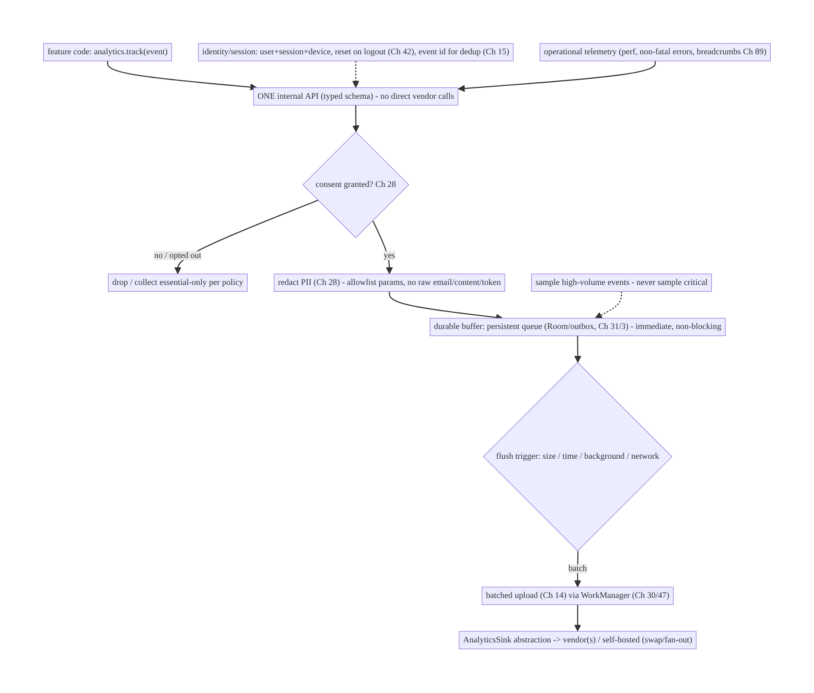
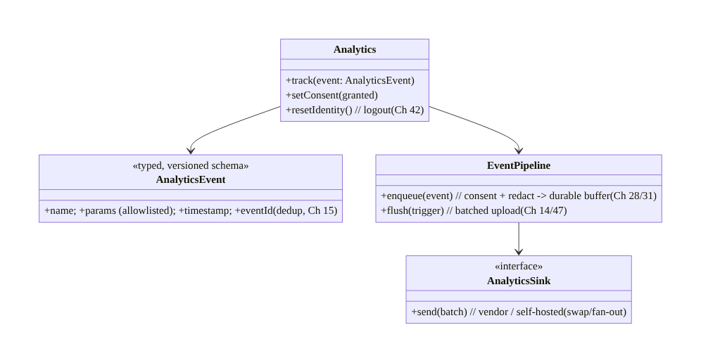
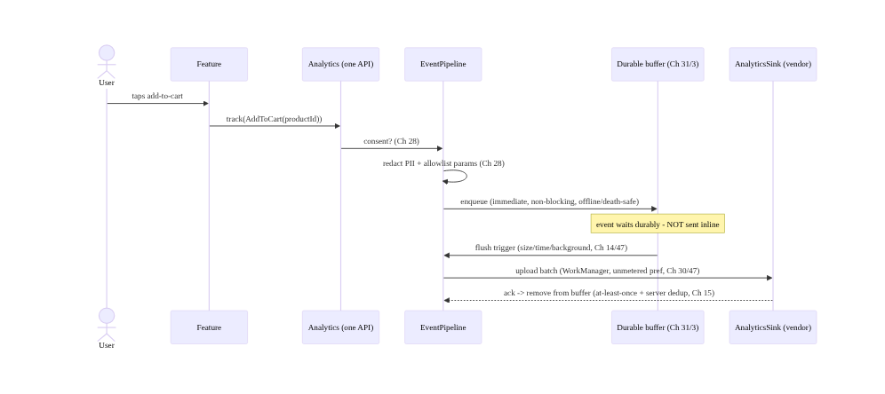
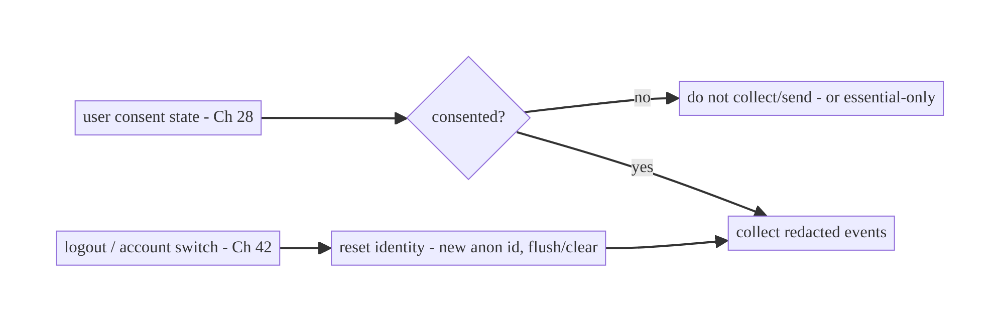
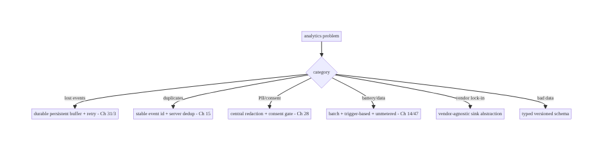

# Chapter 82 — Centralized Logging & Analytics

> **Part X — Performance, Observability & Quality** · Complexity: **Complex** (≥40 interview questions)
>
> **Prerequisites:** Ch 14 (batching/queueing), Ch 28 (PII redaction), Ch 31 (outbox),
> Ch 3 (SSOT/Room), Ch 47 (background limits), Ch 44 (lifecycle), Ch 87 (A/B). Pairs with
> Ch 83 (crash/ANR), Ch 89 (logging), Ch 73 (rec signals).
>
> **Reference surface in StreamCart:** one pipeline for **analytics events** (screen
> views, taps, purchases, rec signals Ch 73) and **operational logs/telemetry** — a
> single, reliable, offline-buffered, batched, consented, PII-safe client SDK feeding the
> backend, decoupled from any vendor.
>
> **Note:** this chapter opens **Part X — Performance, Observability & Quality (Ch 82–93)**.

---

## 82.1 Problem Definition and Real-World Context

Every product decision, ranking model (Ch 73), funnel (Ch 80), and operational dashboard
depends on **analytics events and telemetry** flowing reliably from the app. But a naive
analytics integration (call the vendor SDK directly everywhere, fire events synchronously,
send PII, lose events offline) is a mess: it couples the whole codebase to a vendor, drops
events, drains battery/data, and leaks personal data. A **centralized logging & analytics
pipeline** is the client-side system that **captures events through one internal API**,
**buffers them durably** (offline-safe), **batches** uploads efficiently (Ch 14/47),
**redacts PII and enforces consent** (Ch 28), and is **decoupled from the vendor** behind
an abstraction — so events are reliable, cheap, private, and portable.

Concretely, teams hit:

- **Vendor lock-in / scattered calls.** Calling `FirebaseAnalytics`/`Mixpanel`/… directly
  across the codebase couples everything to one vendor and makes schema/consent/redaction
  impossible to enforce centrally. Need **one internal analytics API** behind an
  **abstraction**.
- **Lost events (offline/death).** Firing events over the network synchronously loses them
  offline or on process death. Events must be **durably buffered** (a persistent queue/
  outbox, Ch 31/3) and sent later.
- **Battery/data from chatty sends.** Sending each event immediately drains the radio
  (Ch 47). Events must be **batched** and flushed on **sensible triggers** (size/time/
  background/network, Ch 14/47).
- **PII + consent violations (Ch 28).** Events can carry **PII** (emails, names, content)
  and must respect **consent** (GDPR/CCPA opt-out, regional). The pipeline must **redact
  PII** and **gate on consent** centrally (Ch 28) — not per call site.
- **No schema / bad data.** Free-form event names/params produce unusable data. A **typed
  event schema** (names, params, versioning) keeps analytics meaningful.
- **Ordering/dedup/identity.** Events need stable ordering, **dedup** (retries), and a
  consistent **user/session/device identity** (reset on logout, Ch 42) — without over-
  identifying (privacy).
- **Operational logs vs analytics.** The same pipeline (or a sibling) carries **operational
  telemetry** (performance, errors, breadcrumbs Ch 89) distinct from **product analytics**,
  both PII-safe.

The architecture: a **single internal analytics/telemetry API** (`track(event)`) behind a
**vendor-agnostic abstraction**; a **typed event schema**; **durable buffering** (persistent
queue, Ch 31/3) so events survive offline/death; **batched, trigger-based upload** respecting
background limits (Ch 14/47); **central consent gating + PII redaction** (Ch 28); consistent
**identity/session** management (reset on logout, Ch 42); **dedup/ordering**; and clean
separation of **product analytics vs operational telemetry** (with crash Ch 83 and logging
Ch 89 as siblings). This chapter is the **reliable, private, vendor-decoupled observability
pipeline**.

### Three practical use cases

1. **Product analytics (StreamCart).** Screen views, taps, add-to-cart, purchase, rec
   signals (Ch 73) captured via `track(...)`, buffered, batched, consented, PII-redacted,
   uploaded — feeding funnels (Ch 80) and models (Ch 73).
2. **Operational telemetry.** Performance timings, non-fatal errors, network metrics, and
   breadcrumbs (Ch 89) through the same reliable pipeline, PII-safe, for dashboards/alerting.
3. **Vendor swap / multi-sink.** Change analytics vendor (or fan out to several sinks)
   without touching call sites — the abstraction isolates the vendor.

### Why this is architectural

Centralized analytics is a **cross-cutting pipeline** every feature feeds and that
underpins product decisions, ranking (Ch 73), funnels (Ch 80), and ops — composing batching
(Ch 14), durable buffering (Ch 31/3), PII redaction + consent (Ch 28), background limits
(Ch 47), identity (Ch 42), and vendor abstraction. The decisions — one API, typed schema,
durable + batched + consented + redacted + vendor-agnostic — determine data quality,
reliability, privacy, cost, and portability.

---

## 82.2 Requirements Engineering

### Functional requirements

| ID | Requirement |
|----|-------------|
| F1 | Capture analytics/telemetry via one internal, vendor-agnostic API with a typed schema. |
| F2 | Durably buffer events (survive offline/process death); don't lose events (Ch 31/3). |
| F3 | Batch uploads on sensible triggers (size/time/background/network), respecting limits (Ch 14/47). |
| F4 | Centrally gate on consent and redact PII (GDPR/CCPA) (Ch 28). |
| F5 | Manage identity/session consistently; reset on logout; dedup/order events (Ch 42/15). |
| F6 | Separate product analytics from operational telemetry; decouple from vendor (swap/fan-out). |

### Non-functional requirements

| Attribute | Policy |
|-----------|--------|
| **Reliability** | No lost events (durable buffer + retry); at-least-once + dedup. |
| **Battery/data** | Batched, trigger-based, background-friendly (Ch 14/47). |
| **Privacy** | Central consent + PII redaction; regional compliance (Ch 28). |
| **Data quality** | Typed schema; versioned; consistent identity. |
| **Portability** | Vendor-agnostic abstraction; multi-sink. |

### Scope

- **In scope:** single internal `track` API + vendor abstraction, typed event schema +
  versioning, durable buffering (persistent queue/outbox, Ch 31/3), batching + flush triggers
  (Ch 14/47), central consent gating + PII redaction (Ch 28), identity/session (reset on
  logout, Ch 42), dedup/ordering (Ch 15), product-vs-operational separation, offline/death
  survival, sampling.
- **Out of scope:** batching mechanics (Ch 14), redaction framework (Ch 28), outbox (Ch 31),
  crash/ANR (Ch 83), logging/breadcrumbs (Ch 89), A/B platform (Ch 87), backend analytics
  stack.

### Assumptions & constraints

- A vendor SDK (Firebase/Amplitude/self-hosted) sits **behind an abstraction**; durable
  buffering via Room/outbox (Ch 31/3); batching + background flush via WorkManager (Ch 14/
  30/47); central consent + PII redaction (Ch 28). `minSdk 24`. Delivery is **at-least-once**
  (dedup server-side); events are **PII-safe** and **consented**.

---

## 82.3 System Design Fundamentals

- **One internal API behind a vendor-agnostic abstraction (the decoupling core).** All
  event capture goes through a **single internal interface** — `analytics.track(event)` —
  **not** direct vendor SDK calls scattered across the app. Behind it, an **`AnalyticsSink`**
  abstraction wraps the vendor(s). This lets you **enforce schema, consent, and redaction
  centrally**, **swap vendors** or **fan out to multiple sinks** without touching call
  sites, and **test** the pipeline. Scattered vendor calls are the anti-pattern.
- **Typed event schema (data quality).** Events are **typed** (sealed hierarchy or a schema)
  with **defined names and params**, not free-form strings — so data is consistent,
  queryable, and refactor-safe. **Version** the schema (events evolve, Ch 16-style). A typed
  schema prevents the "1000 inconsistent event names" problem.
- **Durable buffering — don't lose events (Ch 31/3).** Events are **written to a persistent
  queue** (Room/outbox, Ch 31/3) **immediately** (fast, local), **not** sent synchronously.
  This makes capture **non-blocking**, **offline-safe**, and **process-death-safe** — events
  wait in the durable buffer and upload later. Losing events because they were fired over the
  network inline is the classic reliability bug.
- **Batched, trigger-based upload (Ch 14/47).** The buffer is **flushed in batches** on
  **sensible triggers**: **size** (N events), **time** (every few minutes), **app background**
  (flush on `ON_STOP`, Ch 44), and **network** (prefer unmetered/WorkManager, Ch 47). This
  respects **battery/data** (Ch 14) and **Doze/background limits** (Ch 47) — never a request
  per event. WorkManager (Ch 30) handles reliable background flush.
- **Central consent + PII redaction (Ch 28) — the privacy core.** Before any event leaves
  the device:
  - **Consent gating:** if the user hasn't consented (or opted out — GDPR/CCPA, regional),
    **don't collect/send** analytics (or collect only essential/anonymized per policy). The
    pipeline checks consent **centrally**.
  - **PII redaction:** events are **redacted** (Ch 28) — no raw emails/names/content/tokens;
    param allowlists; hashed/anonymized ids where needed. Enforced **in the pipeline**, not
    per call site (so no event can accidentally carry PII).
  This central enforcement is **only possible** because of the single API/abstraction.
- **Identity, session, dedup, ordering (Ch 42/15).** Events carry a **user id** (consented/
  anonymized), a **session id**, a **device id**, and a **sequence/timestamp**. On **logout/
  account switch** (Ch 42), **reset identity** (new anonymous id; don't leak across users).
  Delivery is **at-least-once**, so events have a **stable event id** for **server-side
  dedup** (Ch 15), and ordering uses sequence/timestamp. Avoid **over-identifying** (privacy).
- **Sampling (cost/volume).** High-volume events (e.g., scroll, impressions Ch 73) may be
  **sampled** (send a fraction) to control cost/volume while preserving statistical validity;
  critical events (purchase) are **never** sampled. Sampling is a pipeline policy.
- **Product analytics vs operational telemetry.** Keep **product analytics** (user behavior:
  funnels, ranking signals) and **operational telemetry** (performance, non-fatal errors,
  breadcrumbs Ch 89) conceptually separate (different schemas/sinks/retention), though they
  can share the pipeline. **Crash/ANR** (Ch 83) and **logging** (Ch 89) are siblings feeding
  observability. Both must be **PII-safe**.

Core insight: **route all analytics and telemetry through one internal, vendor-agnostic
`track` API with a typed, versioned schema, so you can enforce schema, consent, and PII
redaction centrally and swap or fan out vendors without touching call sites; capture events
by writing them to a durable persistent buffer immediately (non-blocking, offline- and
death-safe, Ch 31/3) rather than sending synchronously, then upload in batches on sensible
triggers (size/time/background/network) that respect battery and background limits (Ch 14/
47); gate on consent and redact PII in the pipeline (GDPR/CCPA, Ch 28) before anything
leaves the device; manage consistent identity/session with logout reset (Ch 42) and
at-least-once delivery with stable event ids for server-side dedup (Ch 15); sample
high-volume events; and keep product analytics distinct from operational telemetry (with
crash Ch 83 and logging Ch 89 as siblings) — all PII-safe.**

---

## 82.4 High-Level Architecture



**Components & ownership**

- **One internal `track` API** (typed schema) → **central consent gate + PII redaction**
  (Ch 28) → **durable buffer** (Ch 31/3) → **batched trigger-based upload** (Ch 14/30/47) →
  **vendor-agnostic sink(s)**.
- **Identity/session** (reset on logout, dedup ids) and **sampling** are pipeline policies.
- **Product analytics + operational telemetry** both flow through it, PII-safe.

**Direction:** `track` → consent → redact → durable buffer → batched upload → vendor sink;
identity/sampling/dedup as policies; vendor-decoupled.

---

## 82.5 Detailed Component Design



| Component | Responsibility |
|-----------|----------------|
| `Analytics` | the one internal API: track, consent, identity reset |
| `AnalyticsEvent` | typed, versioned event + stable event id (dedup, Ch 15) |
| `EventPipeline` | consent + redact (Ch 28) → durable buffer (Ch 31/3) → batched flush (Ch 14/47) |
| `AnalyticsSink` | vendor-agnostic sink abstraction (swap/fan-out) |

---

## 82.6 End-to-End Data Flow

### Capture → buffer → batched upload (consented, redacted)



### Consent + logout reset



---

## 82.7 Complete Kotlin Implementation

Package: `com.streamcart.analytics`.

### 82.7.1 One internal API + typed event schema

```kotlin
sealed interface AnalyticsEvent {               // TYPED, versioned schema - not free-form strings
    val name: String; val params: Map<String, Any?>
    data class ScreenView(val screen: String) : AnalyticsEvent {
        override val name = "screen_view"; override val params = mapOf("screen" to screen)
    }
    data class AddToCart(val productId: String, val price: Long) : AnalyticsEvent {
        override val name = "add_to_cart"; override val params = mapOf("product_id" to productId, "price" to price)
    }
    data class Purchase(val orderId: String, val total: Long) : AnalyticsEvent { /* never sampled */ ... }
    // Operational: data class PerfTiming(...), data class NonFatal(...) (Ch 89)
}

interface Analytics {                            // THE ONE API - all call sites use this (no vendor SDK directly)
    fun track(event: AnalyticsEvent)
    fun setConsent(granted: Boolean)
    fun resetIdentity()                          // logout (Ch 42)
}
```

### 82.7.2 Pipeline: consent + redact → durable buffer (Ch 28/31/3)

```kotlin
@Singleton
class EventPipeline @Inject constructor(
    private val consent: ConsentManager,         // Ch 28
    private val redactor: PiiRedactor,           // Ch 28
    private val dao: EventDao,                    // durable buffer (Room, Ch 3/31)
    private val identity: IdentityProvider,      // user/session/device (Ch 42)
    private val sampler: Sampler,
    private val scope: CoroutineScope,
) : Analytics {
    override fun track(event: AnalyticsEvent) {
        if (!consent.analyticsGranted()) return                       // CENTRAL consent gate (Ch 28)
        if (!sampler.keep(event)) return                             // sample high-volume (never critical)
        val redacted = redactor.redactParams(event.params)           // CENTRAL PII redaction (Ch 28) - allowlist
        val record = EventRecord(
            eventId = UUID.randomUUID().toString(),                  // stable id -> server dedup (Ch 15)
            name = event.name, params = redacted,
            userId = identity.userId, sessionId = identity.sessionId, deviceId = identity.deviceId,
            timestamp = System.currentTimeMillis(), schemaVersion = SCHEMA_VERSION,
        )
        scope.launch { dao.insert(record) }                          // DURABLE buffer, immediate, non-blocking (Ch 31/3)
    }
    override fun setConsent(granted: Boolean) = consent.set(granted)  // if revoked -> stop + optionally purge buffer
    override fun resetIdentity() { identity.reset(); /* flush then clear user scope on logout (Ch 42) */ }
}
```

### 82.7.3 Batched, trigger-based upload (Ch 14/30/47)

```kotlin
@Singleton
class EventUploader @Inject constructor(private val dao: EventDao, private val sink: AnalyticsSink, private val wm: WorkManager) {
    /** Flush on triggers: size, time, app background (Ch 44), network. WorkManager for reliable background (Ch 30/47). */
    fun scheduleBatchFlush() = wm.enqueueUniquePeriodicWork("analytics-flush", KEEP,
        PeriodicWorkRequestBuilder<FlushWorker>(15, TimeUnit.MINUTES)
            .setConstraints(Constraints.Builder().setRequiredNetworkType(NetworkType.CONNECTED).build()).build())  // Ch 47

    suspend fun flush(): Result {
        val batch = dao.nextBatch(limit = 200)                        // batch (Ch 14)
        if (batch.isEmpty()) return Result.success()
        return runCatching { sink.send(batch) }                       // vendor-agnostic sink
            .fold({ dao.deleteAll(batch.map { it.eventId }); Result.success() },  // remove on ack
                  { Result.retry() })                                 // keep + retry (at-least-once, Ch 2/31)
    }
    // Flush on ON_STOP (background) too: appScope flush (Ch 44) so events aren't stranded.
}
```

### 82.7.4 Vendor-agnostic sink (swap / fan-out)

```kotlin
interface AnalyticsSink { suspend fun send(batch: List<EventRecord>) }   // the abstraction

class FirebaseSink @Inject constructor(...) : AnalyticsSink { override suspend fun send(batch: List<EventRecord>) { /* vendor */ } }
class SelfHostedSink @Inject constructor(private val api: TelemetryApi) : AnalyticsSink { override suspend fun send(batch) = api.ingest(batch) }
class FanOutSink(private val sinks: List<AnalyticsSink>) : AnalyticsSink {   // send to several (multi-sink)
    override suspend fun send(batch: List<EventRecord>) = sinks.forEach { it.send(batch) }
}
// Swapping the vendor = swapping the bound AnalyticsSink in DI (Ch 5). Call sites never change.
```

### 82.7.5 Identity + logout reset (Ch 42) + consent revoke

```kotlin
@Singleton
class IdentityProvider @Inject constructor(private val prefs: DataStore<Preferences>) {
    var userId: String? = null; var deviceId: String = deviceId(); var sessionId: String = newSession()
    fun reset() {                                 // logout/account switch (Ch 42)
        userId = null; sessionId = newSession()   // new anonymous session; don't leak across users
    }
}
// Consent revoke: pipeline stops collecting; optionally PURGE the durable buffer (Ch 28) per policy.
```

### 82.7.6 Module structure

```
:core:analytics  Analytics (API), AnalyticsEvent (typed schema), EventPipeline (consent+redact+buffer),
                 EventUploader (batch+WorkManager), AnalyticsSink (+ vendor/self-hosted/fan-out), IdentityProvider, Sampler
:core:privacy  ConsentManager + PiiRedactor (Ch 28); :core:data EventDao (durable buffer, Ch 3/31)
# Crash/ANR -> Ch 83; logging/breadcrumbs -> Ch 89 (siblings). Batching -> Ch 14; background -> Ch 30/47.
```

---

## 82.8 Concurrency and Race Conditions

| Scenario | Risk | Handling |
|----------|------|----------|
| Event fired over network inline | lost offline/on death; jank | enqueue to durable buffer immediately (Ch 31/3) |
| Flush retried after partial send | duplicate events | at-least-once + stable event id → server dedup (Ch 15) |
| Consent revoked mid-session | collecting without consent | central consent gate; stop + optional purge (Ch 28) |
| Logout leaks events across users | wrong attribution/privacy | reset identity (new anon id) on logout (Ch 42) |
| High-volume floods buffer | storage/cost | sample high-volume (never critical); bounded buffer |
| Chatty uploads | battery/data | batch + trigger-based + unmetered (Ch 14/47) |
| Vendor change | code churn | vendor-agnostic sink abstraction (swap/fan-out) |

- **Durable buffer + at-least-once + dedup** is the reliability model: capture **writes to a
  persistent queue immediately** (non-blocking, offline/death-safe, Ch 31/3); upload is
  **at-least-once** (retry on failure) so a partial send may **duplicate**, resolved by a
  **stable event id** the server **dedups** (Ch 15). Never send inline.
- **Central consent + redaction** (Ch 28) are enforced **in the pipeline** (possible only
  because of the single API) — no call site can bypass them; consent revoke stops collection
  (and may purge the buffer).
- **Logout identity reset** (Ch 42) prevents events being attributed across users (privacy +
  correctness).

---

## 82.9 Failure Scenarios and Recovery

| Failure | Detection | Response | Outcome |
|---------|-----------|----------|---------|
| Lost events (offline/death) | gaps | durable buffer + retry (Ch 31/3) | retained |
| Duplicate events | inflated metrics | stable event id + server dedup (Ch 15) | correct |
| PII in events | privacy audit | central redaction (Ch 28) | safe |
| Collecting without consent | legal | central consent gate (Ch 28) | compliant |
| Battery/data complaints | vitals | batch + trigger-based + unmetered (Ch 14/47) | efficient |
| Vendor lock-in | migration pain | vendor-agnostic sink (swap/fan-out) | portable |
| Inconsistent event data | unusable | typed, versioned schema | queryable |
| Cross-user attribution | privacy/accuracy | identity reset on logout (Ch 42) | isolated |



> **A good analytics pipeline is one API, durably buffered, batched, consented, redacted, and
> vendor-decoupled.** The single `track` API makes central consent + PII redaction + schema
> enforceable; the durable buffer + at-least-once + dedup make it reliable; batching +
> triggers make it cheap; and the sink abstraction makes it portable. Direct scattered vendor
> calls fail all of these at once.

---

## 82.10 Scaling the Implementation

- **Level 1.** One `track` API + typed schema + vendor sink; events sent via the vendor SDK.
- **Level 2.** Durable buffer (Ch 31/3) + batched trigger-based upload (Ch 14/47) — offline/
  death-safe, efficient.
- **Level 3 — production.** Central consent gate + PII redaction (Ch 28); identity/session +
  logout reset (Ch 42); stable event id + server dedup (Ch 15); vendor-agnostic sink.
- **Level 4 — large.** Sampling policies; multi-sink/fan-out; schema versioning + validation;
  operational telemetry sink (perf/errors, Ch 89); regional consent/compliance; A/B exposure
  logging (Ch 87).
- **Level 5 — enterprise.** Self-hosted analytics, data governance (retention/PII policies),
  real-time streaming, data-quality monitoring, consent management platform, cross-platform
  schema parity.

**Avoid overengineering:** one API + durable buffer + batched upload + consent/redaction +
sink abstraction is the core. Don't call vendor SDKs directly; don't send inline; don't skip
consent/redaction.

---

## 82.11 Alternative Approaches and Trade-offs

| Dimension | Option A | Option B | When |
|-----------|----------|----------|------|
| Capture API | One internal API + abstraction | direct vendor SDK calls | One API (central consent/redaction/schema/swap) |
| Send | Durable buffer + batched (Ch 31/14) | inline/synchronous | Buffer+batch (reliable, efficient) |
| Schema | Typed + versioned | free-form strings | Typed (data quality) |
| Privacy | Central consent + redaction (Ch 28) | per-call-site | Central (no bypass) |
| Delivery | At-least-once + dedup (Ch 15) | fire-and-forget / exactly-once | At-least-once + dedup (practical) |
| Vendor | Agnostic sink (swap/fan-out) | coupled | Agnostic (portability) |
| Volume | Sample high-volume | send everything | Sample (cost) — never critical events |

**One API + abstraction vs direct vendor calls:** calling the vendor SDK directly across the
codebase makes **consent, redaction, and schema impossible to enforce centrally**, couples
everything to one vendor, and can't be tested. A **single internal `track` API** behind a
**sink abstraction** lets you enforce privacy/schema in one place, **swap or fan out vendors**
without touching call sites, and test the pipeline. This single decision enables everything
else.

**Durable buffer + batched vs inline send:** sending each event synchronously over the
network **loses events offline/on death**, **janks** the UI, and **drains battery/data**.
Writing events to a **durable buffer immediately** (non-blocking) and **uploading in batches**
on triggers (Ch 14/47) makes capture reliable, offline/death-safe, and efficient. Never send
inline.

**Central consent + redaction vs per-call-site:** enforcing privacy at each call site is
error-prone — one forgotten redaction leaks PII, one missed consent check violates law. The
**pipeline** enforces **consent gating and PII redaction centrally** (Ch 28), so **no event
can bypass** them. This is only possible with the single API/abstraction.

---

## 82.12 Security & Privacy Considerations

- **Consent gating (Ch 28):** collect/send analytics **only with consent** (GDPR/CCPA,
  regional opt-out); on revoke, **stop** and optionally **purge** the buffer. Essential/
  anonymized-only modes per policy. Enforced **centrally**.
- **PII redaction (Ch 28):** **no raw PII** in events — param **allowlists**, redact/hash
  emails/names/content/ids, **never tokens/secrets**. Enforced in the pipeline so no event
  carries PII. Operational telemetry (Ch 89) is PII-safe too.
- **Identity minimization (Ch 28/42):** use anonymized/consented ids; **don't over-identify**;
  **reset identity on logout** so events aren't linked across users.
- **Secure, authed upload (Ch 19/23):** events upload over **TLS-pinned, authed** channels;
  access-controlled server-side.
- **Data governance:** retention limits, deletion on request (right to erasure), regional
  data residency — pipeline + backend policies (Ch 28).
- **No sensitive events:** don't log security-sensitive actions in a way that leaks (e.g.,
  full card data, auth tokens) — ever.
- Client vs backend: the **client** enforces consent + redaction + identity + reliable
  batched upload; the **backend** dedups, applies retention/governance, and controls access —
  neither stores raw PII in analytics.

---

## 82.13 Performance and Resource Optimization

- **Non-blocking capture** — `track` writes to the buffer async; never blocks the caller/UI.
- **Batching + triggers** (Ch 14/47) — the main battery/data lever; flush on size/time/
  background/unmetered, not per event.
- **Sampling** high-volume events (scroll/impressions, Ch 73) — control volume/cost; never
  sample critical (purchase).
- **Bounded durable buffer** — cap size; drop lowest-priority on overflow (never critical).
- **Efficient redaction** (Ch 28) — allowlist params (cheap) rather than scanning free-form.
- **WorkManager background flush** (Ch 30/47) — reliable, Doze-aware, unmetered.
- **Profiling:** event capture overhead (µs), buffer size, upload batch size/frequency/
  success, battery/data from analytics, event delivery rate, dedup rate.

---

## 82.14 Testing Strategy

The pipeline (consent, redaction, buffering, batching, dedup, vendor abstraction) is highly
unit-testable with a fake sink.

```kotlin
class EventPipelineTest {
    @Test fun `drops events without consent`() = runTest {
        consent.granted = false; pipeline.track(ScreenView("home"))
        assertEquals(0, dao.count())                                  // central consent gate (Ch 28)
    }
    @Test fun `redacts PII from params`() = runTest {
        pipeline.track(event(params = mapOf("email" to "a@b.com")))
        assertFalse(dao.last().params.toString().contains("a@b.com")) // central redaction (Ch 28)
    }
    @Test fun `buffers immediately - does not send inline`() = runTest {
        pipeline.track(ScreenView("home")); assertEquals(1, dao.count()); assertTrue(sink.sent.isEmpty())  // durable (Ch 31)
    }
    @Test fun `resets identity on logout`() = runTest { val s = identity.sessionId; identity.reset(); assertNotEquals(s, identity.sessionId) }  // Ch 42
}

class EventUploaderTest {
    @Test fun `uploads in batches and removes on ack`() = runTest { /* nextBatch -> send -> delete (Ch 14) */ }
    @Test fun `keeps events on failure for retry`() = runTest { sink.fail = true; uploader.flush(); assertTrue(dao.count() > 0) }  // at-least-once (Ch 2/31)
}

class VendorSwapTest { @Test fun `swapping sink does not change call sites`() { /* bind SelfHostedSink; track still works */ } }
```

What to test: consent gate (no consent → no collect); central PII redaction; **buffer-not-
inline** capture; batched upload + remove-on-ack + keep-on-failure (at-least-once, Ch 14/31);
stable event id (dedup, Ch 15); identity reset on logout (Ch 42); sampling; **vendor swap** via
the sink. Fake sink/consent/redactor; Room in-memory.

---

## 82.15 Production Observability

- **Metrics:** event **delivery rate** (captured vs uploaded); buffer size/overflow; upload
  batch size/frequency/success; **dedup rate** (server); consent-gated drop rate; PII-leak
  incidents (→ 0, audited); battery/data from analytics; capture overhead; sampling rates.
- **Logs:** pipeline health only — **never event content/PII** (Ch 28).
- **Debugging:** lost events → not buffered/not flushing (Ch 31/14); duplicates → no event-id
  dedup (Ch 15); PII leak → redaction gap (Ch 28); collecting without consent → gate bypass;
  battery → inline/too-frequent sends; vendor migration pain → not using the sink abstraction;
  bad data → free-form schema.
- **Alerting:** **any PII in uploaded events** (privacy incident); delivery-rate drop (events
  lost); buffer overflow; consent-compliance regression.
- **Dashboards:** event delivery/dedup rates; buffer health; consent/redaction coverage;
  analytics battery/data cost.

---

## 82.16 System Design Interview Preparation

> ≥40 questions.

**Fundamentals**

1. *Why centralize?* Enforce schema/consent/redaction centrally; decouple vendor; reliable
   pipeline.
2. *One API?* `analytics.track(event)` behind a vendor-agnostic sink — no direct vendor calls.
3. *Typed schema?* Defined names/params, versioned — data quality.
4. *Capture model?* Write to a durable buffer immediately (non-blocking), not inline.
5. *Why not send inline?* Lost offline/on death; jank; battery.

**Reliability**

6. *Durable buffer?* Persistent queue (Room/outbox, Ch 31/3) — offline/death-safe.
7. *Upload?* Batched on triggers (size/time/background/network, Ch 14/47).
8. *Delivery semantics?* At-least-once + stable event id → server dedup (Ch 15).
9. *Partial send?* Keep + retry; dedup handles duplicates.
10. *Background flush?* WorkManager (Ch 30), unmetered pref (Ch 47); flush on ON_STOP.

**Privacy**

11. *Consent?* Central gate; collect only with consent (GDPR/CCPA, Ch 28); revoke stops +
    optional purge.
12. *PII?* Central redaction (allowlist params; no raw email/content/token, Ch 28).
13. *Why central?* No call site can bypass; only possible with one API.
14. *Identity?* Consented/anonymized; reset on logout (Ch 42); don't over-identify.

**Schema/identity**

15. *Event id?* Stable → dedup (Ch 15).
16. *Session/user/device?* Carried on events; reset identity on logout.
17. *Schema versioning?* Events evolve; version them.

**Efficiency**

18. *Batching?* The battery/data lever (Ch 14).
19. *Flush triggers?* Size/time/background/network.
20. *Sampling?* High-volume events; never critical.
21. *Bounded buffer?* Cap; drop lowest-priority on overflow.

**Vendor**

22. *Vendor abstraction?* `AnalyticsSink` — swap/fan-out without touching call sites.
23. *Multi-sink?* Fan-out sink.
24. *Self-hosted?* Just another sink.

**Product vs ops**

25. *Separation?* Product analytics (behavior) vs operational telemetry (perf/errors,
    Ch 89).
26. *Crash/ANR + logging?* Siblings (Ch 83/89); PII-safe.
27. *Rec signals (Ch 73)?* Product analytics through the same pipeline.

**Security**

28. *Upload channel?* Authed + TLS-pinned (Ch 19/23).
29. *Governance?* Retention/deletion/residency (Ch 28).
30. *Sensitive events?* Never leak card/tokens.

**Testing/Production**

31. *Test consent?* No consent → no collect.
32. *Test redaction?* PII removed.
33. *Test buffer?* Not inline; batched; remove-on-ack; keep-on-failure.
34. *Test vendor swap?* Rebind sink; call sites unchanged.
35. *Lost events in prod?* Not buffered/flushing.
36. *Duplicates?* No event-id dedup.
37. *PII leak?* Redaction gap (alert).
38. *Battery?* Inline/too-frequent.
39. *Bad data?* Free-form schema.
40. *Key metrics?* Delivery rate, dedup rate, PII incidents, battery cost.
41. *Vendor migration?* Sink abstraction.

### Design-change challenges
1. **Decouple from the analytics vendor.** One `track` API + `AnalyticsSink` abstraction.
2. **Events lost offline.** Durable buffer + batched upload (Ch 31/14).
3. **PII in analytics / GDPR.** Central consent gate + PII redaction (Ch 28).
4. **Analytics drains battery.** Batch + trigger-based + unmetered (Ch 14/47).
5. **Inconsistent event data.** Typed, versioned schema.

### Mock walkthrough (abridged)
Clarify (product + ops, vendor, consent/regions, volume?) → one internal `track` API + typed
schema behind a vendor-agnostic sink → central consent gate + PII redaction (Ch 28) → durable
buffer (Ch 31/3, non-blocking) → batched trigger-based upload (Ch 14/47 via WorkManager) →
identity/session + logout reset (Ch 42) + at-least-once + event-id dedup (Ch 15) → sampling →
product vs operational separation (crash Ch 83, logging Ch 89 siblings) → security (authed
upload, governance) → observability (delivery/dedup, PII incidents).

---

## 82.17 Practical Exercises

1. **Beginner.** Build one `track(event)` API with a typed event schema behind an
   `AnalyticsSink` abstraction (no direct vendor calls). *Eval:* central API; vendor-agnostic.
2. **Intermediate.** Add a durable buffer (Room/outbox) and batched, trigger-based upload
   (size/time/background) via WorkManager (Ch 31/14/47). *Eval:* offline/death-safe; batched.
3. **Advanced.** Add central consent gating + PII redaction (Ch 28), identity with logout
   reset (Ch 42), and stable event ids for dedup (Ch 15). *Eval:* no PII/unconsented; reset on
   logout; dedupable.
4. **Production debugging.** Fix lost events (inline send → buffer) and PII in events
   (redaction gap). *Eval:* retained; redacted.
5. **System design challenge.** Add sampling, a fan-out sink (two vendors), and swap the
   vendor without touching call sites; add a delivery-rate dashboard. *Eval:* sampled;
   multi-sink; swappable; measured.

*(Solutions withheld unless requested.)*

---

## 82.18 Chapter Summary & Reference Sheet

**Key decisions:** route **all** analytics and operational telemetry through **one internal,
vendor-agnostic `track` API** with a **typed, versioned event schema** — never direct vendor
SDK calls — so that **consent gating, PII redaction, and schema** are enforced **centrally**
and the **vendor can be swapped or fanned out** (via an `AnalyticsSink` abstraction) without
touching call sites; **capture events by writing them to a durable persistent buffer
immediately** (non-blocking, **offline- and process-death-safe**, Ch 31/3) rather than sending
synchronously, then **upload in batches on sensible triggers** (size/time/background/network)
that respect **battery and background limits** (Ch 14/47, via WorkManager); **gate on consent
and redact PII in the pipeline** (GDPR/CCPA, allowlisted params, no raw emails/content/tokens,
Ch 28) before anything leaves the device; manage **consistent identity/session** with
**logout reset** (Ch 42) and **at-least-once delivery with stable event ids for server-side
dedup** (Ch 15); **sample** high-volume events (never critical ones); and keep **product
analytics distinct from operational telemetry** (with **crash/ANR** Ch 83 and **logging/
breadcrumbs** Ch 89 as PII-safe siblings). Upload over **authed, TLS-pinned** channels with
**retention/deletion governance** (Ch 19/23/28).

**Concepts:** one `track` API + vendor-agnostic sink (swap/fan-out), typed versioned schema,
durable buffering (persistent queue), batched trigger-based upload (Ch 14/47), central consent
+ PII redaction (Ch 28), identity/session + logout reset (Ch 42), at-least-once + event-id
dedup (Ch 15), sampling, product-vs-operational separation.

**Common mistakes:** direct scattered vendor calls (can't enforce consent/redaction/schema,
lock-in); inline/synchronous send (lost offline/on death, jank, battery); no durable buffer;
no batching (battery/data); PII in events / no consent gate (legal); free-form schema (bad
data); no event-id dedup (inflated metrics); not resetting identity on logout (cross-user
attribution); vendor-coupled (no portability).

**Checklist:**

- [ ] one `track` API + typed versioned schema behind `AnalyticsSink` (no direct vendor calls)
- [ ] durable persistent buffer, immediate non-blocking capture (Ch 31/3)
- [ ] batched, trigger-based upload (size/time/background/unmetered, Ch 14/47 via WorkManager)
- [ ] central consent gate + PII redaction (Ch 28)
- [ ] identity/session + reset on logout (Ch 42)
- [ ] at-least-once + stable event id → server dedup (Ch 15)
- [ ] sampling (never critical)
- [ ] product vs operational separation (crash Ch 83, logging Ch 89)
- [ ] authed + TLS-pinned upload + governance (Ch 19/23/28)
- [ ] delivery-rate + PII-incident telemetry.

**Key APIs:** `Analytics.track`/`setConsent`/`resetIdentity` (one API), sealed
`AnalyticsEvent` (typed schema), `EventPipeline` (consent+redact+buffer), Room `EventDao`
(durable buffer, Ch 3/31), `EventUploader` + WorkManager (batched flush, Ch 14/30/47),
`AnalyticsSink` (vendor/self-hosted/fan-out), `ConsentManager`/`PiiRedactor` (Ch 28),
`IdentityProvider` (Ch 42), `Sampler`, stable event id (Ch 15).

**References:**
- Analytics best practices (events/params): https://developer.android.com/topic/architecture (data layer) + vendor docs
- Data safety / consent: https://developer.android.com/privacy-and-security
- WorkManager (background flush): https://developer.android.com/develop/background-work/background-tasks/persistent
- (composes) Ch 14 Batching/Queueing, Ch 28 PII Redaction/Consent, Ch 31 Outbox, Ch 3 SSOT, Ch 47 Background Limits, Ch 42 Multi-Account, Ch 15 Idempotency/Dedup, Ch 83 Crash/ANR, Ch 89 Logging, Ch 73 Rec Signals, Ch 87 A/B

### Chapter review (Phase 4)
- **Completeness:** all 18 sections; architecture/class/sequence/flow/failure diagrams;
  one-API + typed schema + pipeline (consent+redact+buffer) + batched uploader + vendor-sink
  abstraction + identity-reset code; concurrency (durable buffer+at-least-once+dedup, central
  consent/redaction, logout reset); failure (one-API+buffered+batched+consented+decoupled
  principle); 5 levels; one-API-vs-direct, buffer-vs-inline, central-privacy trade-offs;
  security/privacy (consent, redaction, identity minimization, governance); perf (non-blocking,
  batch, sample); pipeline + vendor-swap tests; observability (delivery/dedup, PII incidents);
  41 Q&A + 5 challenges. ✅ Opens Part X.
- **Expand later:** batching (Ch 14), privacy (Ch 28), crash/ANR (Ch 83), logging (Ch 89),
  A/B (Ch 87).
- **Interview coverage:** exceeds ≥40 Complex bar.
