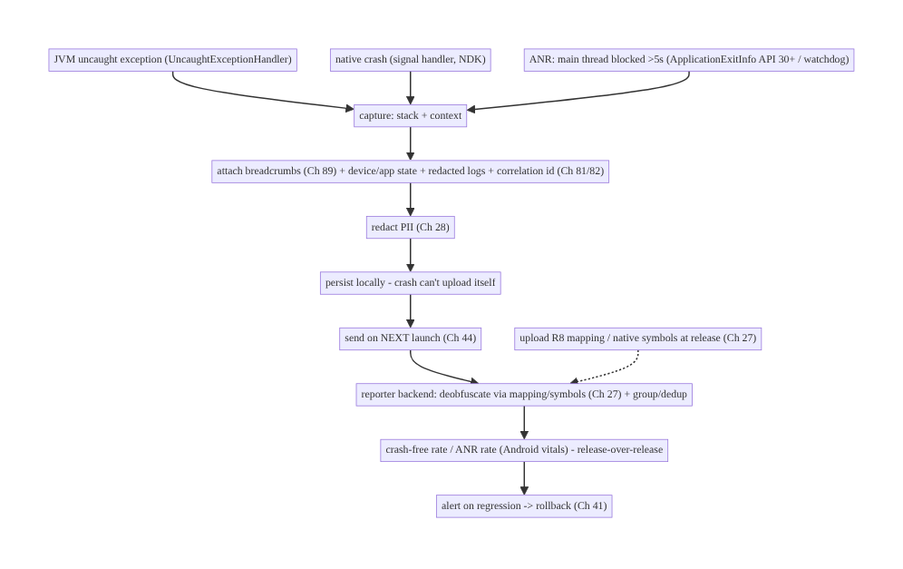
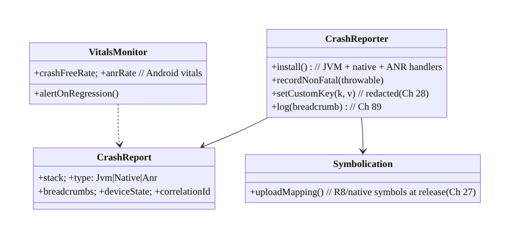
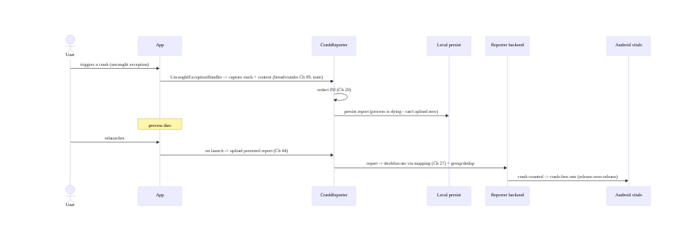
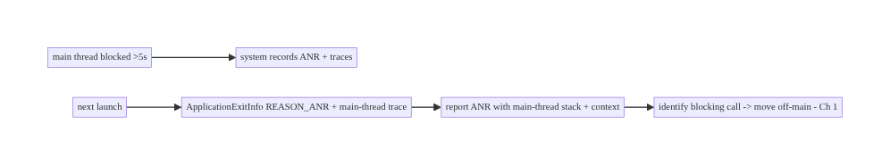
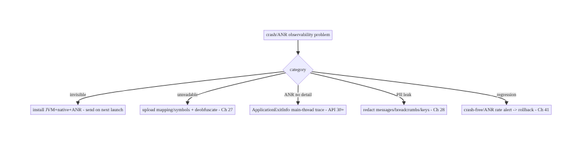

# Chapter 83 — Crash & ANR Reporting

> **Part X — Performance, Observability & Quality** · Complexity: **Standard** (≥25 interview questions)
>
> **Prerequisites:** Ch 82 (analytics pipeline), Ch 28 (PII redaction), Ch 89 (logging/
> breadcrumbs), Ch 27 (R8/deobfuscation), Ch 81 (feedback/correlation), Ch 44 (lifecycle).
> Pairs with Ch 45/86 (startup/perf), Ch 41 (release/vitals).
>
> **Reference surface in StreamCart:** catching crashes (fatal exceptions, native crashes)
> and **ANRs** (main-thread blocks), attaching breadcrumbs/device state, **symbolicating**
> R8-obfuscated stacks, reporting them PII-safely, and watching **Android vitals** so the
> app's **crash-free rate** stays high.

---

## 83.1 Problem Definition and Real-World Context

Crashes and **ANRs** (Application Not Responding — the main thread blocked too long) are the
top drivers of bad reviews, uninstalls, and reduced Play Store visibility (Android vitals
ranks apps on crash/ANR rates). You need to **detect** them (JVM exceptions, native crashes,
ANRs), **capture context** (stack trace, breadcrumbs Ch 89, device/app state, the session's
logs), **symbolicate** R8/NDK-obfuscated stacks (Ch 27) so they're readable, **report**
PII-safely (Ch 28), and **monitor** aggregate **crash-free rate / ANR rate** (Android vitals)
— all without the reporting itself leaking PII or causing problems. A crash you can't see,
can't read (obfuscated), or that leaks PII is a failure of observability.

Concretely, teams hit:

- **No/incomplete crash capture.** JVM exceptions are easy; **native (NDK) crashes** and
  **ANRs** need special handling. A reporter (Crashlytics/Sentry/custom) must capture **all
  three**, with the **stack + context**, and send it on the **next launch** (a crash can't
  reliably send during the crash).
- **Unreadable obfuscated stacks (Ch 27).** R8 minifies/obfuscates release builds, so stack
  traces are gibberish without the **mapping file**; native crashes need **symbols**. You
  must upload **mapping/symbols** and **deobfuscate/symbolicate** reports (Ch 27).
- **ANRs are hard.** An ANR is the **main thread blocked >5s** (input) — detection needs the
  system's ANR signal + the main-thread stack; the cause is often main-thread I/O, lock
  contention, or a slow Binder call. Capturing the **main-thread stack at ANR** is key.
- **Missing context.** A bare stack trace is often not enough; **breadcrumbs** (Ch 89),
  device/app state, memory, the session's **logs**, and a **correlation id** (Ch 81/82) make
  it debuggable.
- **PII in crash reports (Ch 28).** Exception messages, logs, and custom keys can carry
  **PII** — crash reports must be **redacted** (Ch 28); never log card data/tokens into
  exceptions.
- **Monitoring the wrong thing.** You must watch **crash-free users/sessions** and **ANR
  rate** (Android vitals) — aggregate, release-over-release, by device/OS — not just
  individual stacks; and **alert** on regressions.
- **Reporting reliability.** Reports must be **buffered and sent on next launch** (the
  crashing process can't finish an upload); de-duplicated; and not themselves crash the app.

The architecture: integrate a **crash/ANR reporter** that captures **JVM + native crashes +
ANRs** with **stack + breadcrumbs + device/app state + session logs + correlation id**
(Ch 89/81/82); **upload mapping files/symbols** and **symbolicate** reports (Ch 27); **redact
PII** (Ch 28); **buffer and send on next launch** reliably; and **monitor crash-free rate /
ANR rate via Android vitals** with **release-gated alerting**. This chapter is about **seeing,
reading, and acting on crashes and ANRs — privacy-safely**.

### Three practical use cases

1. **JVM crash (StreamCart).** An uncaught exception is captured with its stack +
   breadcrumbs + device state (redacted), buffered, sent on next launch, **deobfuscated**
   via the mapping file (Ch 27), and grouped — engineers fix it; crash-free rate recovers.
2. **ANR.** A main-thread block (slow I/O) triggers an ANR; the reporter captures the
   **main-thread stack** + context, so the blocking call is identified and moved off-main
   (Ch 1); ANR rate drops.
3. **Native (NDK) crash.** A native library crash is captured and **symbolicated** with
   uploaded symbols.

### Why this is architectural

Crash/ANR reporting is the **core quality-observability** system, composing crash/ANR
detection, context capture (breadcrumbs Ch 89, correlation Ch 81/82), deobfuscation (Ch 27),
PII redaction (Ch 28), reliable next-launch reporting, and Android-vitals monitoring/alerting.
The decisions — capture-all-three, symbolicate, redact, send-on-next-launch, monitor
crash-free/ANR rate — determine whether you can keep the app stable and store-ranked.

---

## 83.2 Requirements Engineering

### Functional requirements

| ID | Requirement |
|----|-------------|
| F1 | Capture JVM exceptions, native crashes, and ANRs with stack + context. |
| F2 | Attach breadcrumbs, device/app state, session logs, and a correlation id (Ch 89/81/82). |
| F3 | Upload mapping files/symbols; symbolicate/deobfuscate reports (Ch 27). |
| F4 | Redact PII from reports; never report secrets (Ch 28). |
| F5 | Buffer reports and send reliably on next launch; dedup/group. |
| F6 | Monitor crash-free rate / ANR rate (Android vitals); alert on regressions by release/device. |

### Non-functional requirements

| Attribute | Policy |
|-----------|--------|
| **Coverage** | JVM + native + ANR captured; high capture rate. |
| **Readability** | Deobfuscated/symbolicated stacks (Ch 27). |
| **Privacy** | PII-redacted; no secrets (Ch 28). |
| **Reliability** | Buffered + sent on next launch; reporter never crashes the app. |
| **Actionability** | Crash-free/ANR rate monitored; alert on regressions. |

### Scope

- **In scope:** crash/ANR detection (JVM via `UncaughtExceptionHandler`/reporter SDK,
  native/NDK, ANR via system signal/`ApplicationExitInfo`), context (breadcrumbs Ch 89,
  device/app state, logs, correlation id Ch 81/82), mapping/symbol upload + deobfuscation
  (Ch 27), PII redaction (Ch 28), reliable next-launch reporting + dedup/grouping, Android
  vitals (crash-free/ANR rate) + alerting, custom keys/non-fatals.
- **Out of scope:** analytics pipeline (Ch 82), logging/breadcrumbs internals (Ch 89), R8
  internals (Ch 27), redaction framework (Ch 28), feedback (Ch 81), perf profiling (Ch 86).

### Assumptions & constraints

- A crash reporter (Crashlytics/Sentry/custom) captures JVM/native/ANR; **R8** obfuscates
  release builds (mapping upload needed, Ch 27); **Android vitals** (Play Console) tracks
  crash-free/ANR rates. `minSdk 24` (`ApplicationExitInfo` for exit reasons is API 30+).
  Reports are **PII-safe** and **sent on next launch**.

---

## 83.3 System Design Fundamentals

- **Capture all three: JVM, native, ANR.**
  - **JVM exceptions:** a global `Thread.UncaughtExceptionHandler` (the reporter SDK
    installs one) captures uncaught exceptions with the **stack trace**. You can also report
    **non-fatal** exceptions (caught but notable) with context.
  - **Native (NDK) crashes:** signals (SIGSEGV, etc.) captured by a native handler (the
    reporter's), producing a native stack needing **symbols** to read.
  - **ANRs:** the main thread blocked too long (input dispatch >5s). Detected via the
    system's ANR mechanism and, on **API 30+**, **`ApplicationExitInfo`**
    (`REASON_ANR` with the traces) read on next launch; reporters also use a watchdog on the
    main thread. The key artifact is the **main-thread stack at the block**.
- **A crash can't reliably report itself → buffer + send on next launch.** During a crash
  the process is dying; a network upload may not finish. The reporter **persists** the report
  locally and **uploads it on the next app launch** (Ch 44) — reliable delivery despite the
  crash. (ANRs via `ApplicationExitInfo` are inherently read next launch.)
- **Context makes crashes debuggable (Ch 89/81/82).** A bare stack is often insufficient.
  Attach:
  - **Breadcrumbs** (Ch 89): the recent action/screen sequence leading to the crash.
  - **Device/app state:** app version, OS, device model, memory, free disk, orientation,
    custom keys (feature flags, screen).
  - **Session logs** (redacted, Ch 89) and a **correlation id** (Ch 81/82) linking to
    analytics/feedback.
  Breadcrumbs + state are what turn "NPE in X" into "NPE in X after the user did A→B→C on a
  low-memory device."
- **Deobfuscation/symbolication (Ch 27) — readability.** **R8** minifies/obfuscates release
  builds, so stacks are unreadable without the **mapping file**; native crashes need
  **symbols**. **Upload the mapping file/symbols** (at build/release time) to the reporter;
  it **deobfuscates/symbolicates** incoming reports into readable stacks. Without this,
  release crashes are gibberish — a common oversight.
- **PII redaction (Ch 28).** Exception **messages**, **logs**, **breadcrumbs**, and **custom
  keys** can carry **PII** (emails, user content, tokens). The reporter data must be
  **redacted** (Ch 28) — never put card data/tokens/PII into exception messages or custom
  keys. Crash reports are a **privacy surface** like any telemetry (Ch 82).
- **Grouping & dedup.** Reporters **group** identical crashes (by stack signature) into
  **issues** with counts/trends, and **dedup** repeated instances — so you triage **issues**
  (ranked by impact), not millions of individual stacks.
- **Monitor crash-free rate / ANR rate (Android vitals).** The product KPIs are
  **crash-free users** and **crash-free sessions**, and the **ANR rate** — tracked in
  **Android vitals** (Play Console) and the reporter, **release-over-release**, by **device/
  OS**. Watch these; **alert** on regressions (a new release spiking crashes/ANRs); Play
  **demotes** apps exceeding bad-behavior thresholds. Velocity (crashes in a new release)
  drives **rollback** decisions (Ch 41).
- **The reporter must be robust.** Reporting must **never crash the app** itself, be
  **low-overhead**, respect **consent** (Ch 28/82), and handle its own failures gracefully.

Core insight: **capture all three failure types — JVM exceptions, native crashes, and ANRs
(main-thread blocks, via the system signal/`ApplicationExitInfo` on API 30+) — with the
stack plus rich context (breadcrumbs Ch 89, device/app state, redacted session logs, a
correlation id Ch 81/82); because a crashing process can't reliably upload, persist the
report and send it on the next launch; upload R8 mapping files / native symbols and
deobfuscate/symbolicate so release stacks are readable (Ch 27); redact PII so reports are
privacy-safe (Ch 28); group/dedup into triageable issues; and monitor crash-free rate and
ANR rate in Android vitals release-over-release with alerting (and rollback on velocity) —
with the reporter itself low-overhead and never crashing the app.**

---

## 83.4 High-Level Architecture



**Components & ownership**

- **Capture** JVM + native + ANR with **stack + context** (breadcrumbs, state, logs,
  correlation id, Ch 89/81/82), **redacted** (Ch 28), **persisted** and **sent on next
  launch**.
- **Reporter backend** **deobfuscates** (mapping/symbols, Ch 27), **groups/dedups** into
  issues.
- **Android vitals** monitors **crash-free/ANR rate**; **alerting** + **rollback** on
  regression (Ch 41).

**Direction:** crash/ANR → capture + context + redact → persist → next-launch upload →
deobfuscate/group → crash-free/ANR rate monitoring + alert/rollback.

---

## 83.5 Detailed Component Design



| Component | Responsibility |
|-----------|----------------|
| `CrashReporter` | install JVM/native/ANR handlers; non-fatals; custom keys; breadcrumbs (Ch 89) |
| `CrashReport` | stack + type + context (breadcrumbs/state/correlation), redacted (Ch 28) |
| `Symbolication` | upload mapping/symbols → deobfuscate (Ch 27) |
| `VitalsMonitor` | crash-free/ANR rate (Android vitals) + alerting/rollback (Ch 41) |

---

## 83.6 End-to-End Data Flow

### Crash → next-launch report → deobfuscate → vitals



### ANR capture (ApplicationExitInfo, API 30+)



---

## 83.7 Complete Kotlin Implementation

Package: `com.streamcart.crash`.

### 83.7.1 Install reporter (JVM + native + ANR) with context (Ch 89/28)

```kotlin
@Singleton
class CrashReporter @Inject constructor(
    private val breadcrumbs: BreadcrumbBuffer,   // Ch 89
    private val redactor: PiiRedactor,           // Ch 28
    private val consent: ConsentManager,         // Ch 28/82
) {
    fun install() {
        if (!consent.crashReportingGranted()) return     // consent (Ch 28)
        // Reporter SDK installs JVM UncaughtExceptionHandler + native signal handler + ANR detection.
        Firebase.crashlytics.setCrashlyticsCollectionEnabled(true)   // (or Sentry/custom)
        // Attach custom keys/breadcrumbs (REDACTED, Ch 28/89). ApplicationExitInfo read on next launch for ANR.
    }
    fun log(breadcrumb: String) = Firebase.crashlytics.log(redactor.redact(breadcrumb))   // Ch 89, redacted (Ch 28)
    fun setCustomKey(key: String, value: String) = Firebase.crashlytics.setCustomKey(key, redactor.redact(value))  // no PII
    fun recordNonFatal(t: Throwable) = Firebase.crashlytics.recordException(t)   // caught-but-notable
    fun setCorrelationId(id: String) = Firebase.crashlytics.setCustomKey("correlation_id", id)   // link analytics/feedback (Ch 81/82)
}
```

### 83.7.2 Read ANRs via ApplicationExitInfo on next launch (API 30+)

```kotlin
class ExitInfoReader @Inject constructor(@ApplicationContext private val ctx: Context, private val reporter: CrashReporter) {
    /** On launch, inspect why the previous process exited - capture ANRs (and native crashes) with their traces. */
    fun reportPreviousExits() {
        if (Build.VERSION.SDK_INT < 30) return
        val am = ctx.getSystemService(ActivityManager::class.java)
        am.getHistoricalProcessExitReasons(ctx.packageName, 0, 5).forEach { info ->
            when (info.reason) {
                ApplicationExitInfo.REASON_ANR -> reporter.reportAnr(info.traceInputStream?.readBytes())   // main-thread trace
                ApplicationExitInfo.REASON_CRASH_NATIVE -> reporter.reportNativeExit(info)
                ApplicationExitInfo.REASON_LOW_MEMORY -> reporter.setCustomKey("prev_exit", "low_memory")
                else -> {}
            }
        }
    }
}
// Call reportPreviousExits() early on launch (Ch 44/45) - lightweight.
```

### 83.7.3 Breadcrumbs + device state (context, Ch 89)

```kotlin
// Breadcrumbs: log screen views, key taps, events (NO PII, Ch 89) -> attached to the crash.
fun trackScreen(screen: String, reporter: CrashReporter) = reporter.log("screen:$screen")

// Device/app state as custom keys (non-PII): version, flags, memory, screen.
fun attachState(reporter: CrashReporter, featureFlags: Map<String, Boolean>) {
    reporter.setCustomKey("low_memory", isLowMemory().toString())
    featureFlags.forEach { (k, v) -> reporter.setCustomKey("ff_$k", v.toString()) }   // Ch 41
}
```

### 83.7.4 Mapping/symbol upload for deobfuscation (Ch 27, build config)

```kotlin
// build.gradle(.kts): enable R8 + mapping upload so release stacks are READABLE (Ch 27).
android {
    buildTypes { release { isMinifyEnabled = true } }   // R8 (Ch 27)
}
// Crashlytics Gradle plugin uploads the mapping file automatically; NDK symbols uploaded for native (Ch 27).
// Without the mapping/symbols, release crash stacks are gibberish.
```

### 83.7.5 Non-fatal reporting with context

```kotlin
// Report a caught-but-notable error (e.g., a recoverable failure) with context, redacted (Ch 28).
fun reportHandled(reporter: CrashReporter, e: Exception, context: String) {
    reporter.setCustomKey("handled_context", context)   // redacted (no PII)
    reporter.recordNonFatal(e)                          // grouped as a non-fatal issue
}
```

### 83.7.6 Module structure

```
:core:crash  CrashReporter (JVM+native+ANR), ExitInfoReader (ApplicationExitInfo), context/custom-keys
:core:logging  BreadcrumbBuffer (Ch 89); :core:privacy  PiiRedactor + ConsentManager (Ch 28)
# Mapping/symbol upload -> R8/build (Ch 27). Vitals -> Play Console + reporter dashboards. Correlation -> Ch 81/82.
```

---

## 83.8 Concurrency and Race Conditions

| Scenario | Risk | Handling |
|----------|------|----------|
| Upload during crash | report lost | persist + send on next launch (not during crash) |
| ANR trace missed | undetected ANR | `ApplicationExitInfo` (API 30+) + watchdog |
| Obfuscated stack | unreadable | upload mapping/symbols; deobfuscate (Ch 27) |
| PII in exception/logs | leak | redact messages/breadcrumbs/custom keys (Ch 28) |
| Reporter crashes the app | worse than the bug | robust reporter; low-overhead; guard its own errors |
| Duplicate reports | noise | group/dedup by stack signature |
| Reporting without consent | privacy | consent gate (Ch 28/82) |

- **Send on next launch, not during the crash:** the crashing process is dying and can't
  finish an upload — **persist** the report and **upload on the next launch** (ANRs via
  `ApplicationExitInfo` are inherently next-launch). This is the reliability crux.
- **Deobfuscation is mandatory for release** (Ch 27): without the mapping file/symbols,
  release stacks are gibberish and un-triage-able — upload them at build/release time.
- **Redact everything in the report** (Ch 28): messages, breadcrumbs, custom keys, logs —
  no PII/secrets; crash reports are a privacy surface.

---

## 83.9 Failure Scenarios and Recovery

| Failure | Detection | Response | Outcome |
|---------|-----------|----------|---------|
| Crashes invisible | low crash-free with no reports | install reporter (JVM/native/ANR); send next launch | visible |
| Unreadable stacks | gibberish | upload mapping/symbols; deobfuscate (Ch 27) | readable |
| ANRs undetected | ANR rate up, no detail | `ApplicationExitInfo`/watchdog capture main-thread stack | diagnosed |
| PII in reports | privacy audit | redact (Ch 28) | safe |
| Missing context | hard to repro | breadcrumbs + state + correlation (Ch 89/81/82) | debuggable |
| New release spikes crashes | vitals alert | alert + rollback (Ch 41) | mitigated |
| Reporter crashes app | worse crashes | robust/guarded reporter | stable |



> **Crash/ANR reporting is: capture all three, add context, send on next launch,
> deobfuscate, redact, and monitor crash-free/ANR rate.** A crash you can't see (not
> captured), can't read (obfuscated), can't reproduce (no context), or that leaks PII is a
> broken observability chain — and the crash-free/ANR rate in Android vitals is the KPI that
> gates releases and store ranking.

---

## 83.10 Scaling the Implementation

- **Level 1.** Reporter capturing JVM exceptions + stacks; mapping upload for deobfuscation
  (Ch 27); crash-free rate in vitals.
- **Level 2.** Native crashes + ANRs (`ApplicationExitInfo`, Ch 44/45); breadcrumbs + device
  state + custom keys (Ch 89); PII redaction + consent (Ch 28).
- **Level 3 — production.** Correlation id to analytics/feedback (Ch 81/82); non-fatals;
  grouping/dedup; release-over-release vitals + alerting + rollback (Ch 41).
- **Level 4 — large.** Per-device/OS crash analysis; velocity-based rollback; regression
  gating in CI; crash budgets/SLOs; native symbol pipelines.
- **Level 5 — enterprise.** Crash-free SLOs with error budgets, automated triage/assignment,
  trend forecasting, cross-platform parity, privacy governance for reports.

**Avoid overengineering:** a mature reporter (Crashlytics/Sentry) + mapping upload + redaction
+ breadcrumbs + vitals monitoring covers almost everything. Don't hand-roll crash capture;
don't skip deobfuscation or redaction.

---

## 83.11 Alternative Approaches and Trade-offs

| Dimension | Option A | Option B | When |
|-----------|----------|----------|------|
| Reporter | Mature SDK (Crashlytics/Sentry) | hand-rolled | SDK (handles native/ANR/grouping); hand-roll rarely |
| Delivery | Send on next launch | upload during crash | Next launch (process is dying) |
| Stacks | Deobfuscate via mapping (Ch 27) | ship un-obfuscated | Deobfuscate (keep R8; upload mapping) |
| ANR | `ApplicationExitInfo` + watchdog | ignore ANRs | Capture (ANR rate is a vitals KPI) |
| Context | Breadcrumbs + state + correlation | bare stack | Rich context (debuggable) |
| Privacy | Redact + consent (Ch 28) | raw reports | Redact (privacy surface) |
| Monitoring | Crash-free/ANR rate + alerting (vitals) | individual stacks only | Aggregate + alert (gate releases) |

**Mature reporter vs hand-rolled:** capturing **native crashes** and **ANRs** correctly,
**grouping** by signature, and **deobfuscating** is a large effort that **Crashlytics/Sentry**
have solved. A hand-rolled `UncaughtExceptionHandler` catches JVM exceptions but misses native/
ANR/grouping/symbolication. Use a mature reporter; spend effort on **context, redaction, and
monitoring**, not reimplementing capture.

**Send-on-next-launch vs upload-during-crash:** the crashing process is terminating, so a
network upload started during the crash often **doesn't finish** (lost report). **Persisting**
the report and **uploading on the next launch** (Ch 44) is reliable — and ANRs/native crashes
read via `ApplicationExitInfo` are inherently next-launch. Always send on next launch.

**Deobfuscate (keep R8) vs ship un-obfuscated:** disabling R8 to get readable stacks loses
R8's **size/security benefits** (Ch 27). The right approach is to **keep R8** and **upload the
mapping file** so the reporter **deobfuscates** server-side — readable stacks **and** an
optimized/obfuscated release. Always deobfuscate via mapping, never disable R8.

---

## 83.12 Security & Privacy Considerations

- **Crash reports are a privacy surface (Ch 28):** exception **messages**, **logs**,
  **breadcrumbs**, and **custom keys** can carry **PII/secrets** — **redact** them and
  **never** put card data/tokens/PII into exceptions or keys. Treat reports like any
  telemetry (Ch 82).
- **Consent (Ch 28/82):** crash reporting respects **consent** (some regions/users opt out);
  gate collection centrally.
- **Correlation id is opaque (Ch 81/82):** link to analytics/feedback via an **opaque id**,
  not personal data.
- **Mapping file security (Ch 27):** the mapping file deobfuscates your app — keep it
  **secure** (not shipped in the APK); upload it to the reporter at build time.
- **Secure, authed upload (Ch 19/23):** reports upload over **TLS-pinned, authed** channels;
  access-controlled server-side.
- **Per-account (Ch 42):** associate reports with the user **only** per consent, via opaque
  ids; honor deletion.
- **No sensitive screens in attached screenshots** (if any, Ch 81) — redact.
- Client vs backend: the **client** captures + redacts + sends; the **reporter backend**
  deobfuscates, groups, and access-controls; **Android vitals** aggregates — none store raw
  PII.

---

## 83.13 Performance and Resource Optimization

- **Low-overhead capture:** breadcrumbs/custom keys are cheap in-memory ops (Ch 89); the
  reporter must add minimal runtime cost.
- **Send on next launch** (not during crash) — no impact on the crashing path; upload
  lightly on launch (don't bloat cold start, Ch 45).
- **Bounded breadcrumb buffer** (Ch 89) — ring buffer; don't grow unbounded.
- **ANR detection** via `ApplicationExitInfo` is **free** (system-provided, read next launch)
  — prefer it over a heavy main-thread watchdog where possible.
- **Deobfuscation is server-side** — no client cost.
- **Profiling:** crash-free rate, ANR rate, report upload success, capture overhead, cold-
  start impact of next-launch upload (Ch 45).

---

## 83.14 Testing Strategy

Crash capture is validated with forced crashes/ANRs; context/redaction unit-tested; vitals
via staged rollouts.

```kotlin
// Forced crash (debug) to verify capture + context + deobfuscation pipeline:
fun forceCrash() { throw RuntimeException("test crash") }   // verify it appears deobfuscated with breadcrumbs

class RedactionTest {
    @Test fun `custom keys and breadcrumbs are redacted`() {
        reporter.setCustomKey("email", "a@b.com"); // via redactor
        // assert stored value is redacted (Ch 28)
    }
    @Test fun `no PII in exception context`() { /* ... */ }
}

class ExitInfoTest {
    @Test fun `reports previous ANR from ApplicationExitInfo`() { /* fake ActivityManager -> REASON_ANR -> report */ }
}
// Manual/staged: force an ANR (sleep on main thread), verify it's captured with the main-thread stack;
// verify mapping upload -> deobfuscated stack in the reporter; monitor crash-free rate in a staged rollout.
```

What to test: forced JVM crash captured + deobfuscated (mapping, Ch 27) + breadcrumbs/state
attached; ANR captured via `ApplicationExitInfo` with main-thread stack; redaction of custom
keys/breadcrumbs/messages (Ch 28); next-launch upload; consent gate; correlation id opaque.
Staged rollout to watch crash-free/ANR rate before full release (Ch 41).

---

## 83.15 Production Observability

- **Metrics (the KPIs):** **crash-free users** + **crash-free sessions**; **ANR rate**;
  release-over-release trends; crash/ANR by **device/OS/version**; top issues by impact;
  report upload success; non-fatal rates; capture rate.
- **Dashboards:** Android vitals (Play Console) + reporter (Crashlytics/Sentry) — crash-free/
  ANR rate by release/device; issue triage ranked by impact.
- **Debugging:** invisible crashes → reporter not capturing (JVM/native/ANR) or not sending
  next launch; gibberish stacks → mapping not uploaded (Ch 27); ANRs without detail →
  `ApplicationExitInfo` not read; PII in reports → redaction gap (Ch 28); new-release spike →
  a regression (rollback, Ch 41).
- **Alerting:** **crash-free rate / ANR rate regression** on a new release (gate/rollback,
  Ch 41); **velocity** (fast-growing new crash); **any PII in reports** (privacy incident).
- **Release gating:** Play's bad-behavior thresholds + your SLOs gate rollout; **halt/roll
  back** a release that regresses vitals (Ch 41).

---

## 83.16 System Design Interview Preparation

> ≥25 questions.

**Fundamentals**
1. *What to capture?* JVM exceptions, native (NDK) crashes, and ANRs.
2. *ANR?* Main thread blocked too long (input >5s).
3. *Why not upload during the crash?* Process is dying — persist + send on next launch.
4. *ANR capture?* `ApplicationExitInfo` (API 30+) main-thread trace + watchdog.
5. *Reporter?* Mature SDK (Crashlytics/Sentry) — handles native/ANR/grouping.

**Readability**
6. *Why gibberish stacks?* R8 obfuscation (Ch 27).
7. *Fix?* Upload mapping file/symbols → deobfuscate/symbolicate.
8. *Disable R8 instead?* No — lose size/security; deobfuscate via mapping.

**Context**
9. *Beyond the stack?* Breadcrumbs (Ch 89) + device/app state + logs + correlation id.
10. *Breadcrumbs?* Recent action/screen sequence → repro.
11. *Correlation id?* Opaque link to analytics/feedback (Ch 81/82).
12. *Custom keys?* Flags/screen/memory — redacted (Ch 28).

**Privacy**
13. *PII in reports?* Redact messages/breadcrumbs/keys; never secrets (Ch 28).
14. *Consent?* Crash reporting respects consent (Ch 28/82).
15. *Mapping file security?* Keep secure; not in the APK.

**Monitoring**
16. *KPIs?* Crash-free users/sessions + ANR rate (Android vitals).
17. *Granularity?* By release/device/OS; trends.
18. *Grouping?* By stack signature into issues (triage by impact).
19. *Regression?* Alert + rollback (Ch 41); velocity.
20. *Why vitals matter?* Play ranks/demotes on crash/ANR behavior.

**Reliability/robustness**
21. *Reporter crashes app?* Must be robust/low-overhead.
22. *Duplicate reports?* Group/dedup.
23. *Delivery?* Persist + next launch.

**Testing/Production**
24. *Test capture?* Force a crash → verify deobfuscated + context.
25. *Test ANR?* `ApplicationExitInfo` / block main thread.
26. *Invisible crashes?* Not capturing / not sending next launch.

### Design-change challenges
1. **Release crash stacks are unreadable.** Keep R8; upload mapping; deobfuscate (Ch 27).
2. **ANRs are high but undiagnosable.** Capture via `ApplicationExitInfo` (main-thread trace)
   → move blocking call off-main (Ch 1).
3. **Crashes carry user emails.** Redact exception messages/keys/breadcrumbs (Ch 28).
4. **A new release spikes crashes.** Vitals alert → rollback (Ch 41).
5. **Crashes aren't being reported.** Reporter not installed / not sending on next launch;
   fix + send persisted reports.

### Mock walkthrough (abridged)
Clarify (JVM/native/ANR, release build, privacy?) → capture all three (reporter SDK +
`ApplicationExitInfo` for ANR) → attach context (breadcrumbs Ch 89, state, correlation Ch 81/
82) → redact PII (Ch 28) → persist + send on next launch → upload mapping/symbols +
deobfuscate (Ch 27) → group/dedup → monitor crash-free/ANR rate in Android vitals release-
over-release → alert + rollback (Ch 41) → reporter robust/low-overhead.

---

## 83.17 Practical Exercises

1. **Beginner.** Integrate a crash reporter capturing JVM exceptions with stacks, and upload
   the R8 mapping file so stacks deobfuscate (Ch 27). *Eval:* crashes visible + readable.
2. **Intermediate.** Attach breadcrumbs (Ch 89) + device state + an opaque correlation id
   (Ch 81/82); redact PII from custom keys/messages (Ch 28). *Eval:* debuggable; no PII.
3. **Advanced.** Capture ANRs via `ApplicationExitInfo` (main-thread trace) and native crashes
   with symbols; send persisted reports on next launch. *Eval:* ANR/native captured next
   launch.
4. **Production debugging.** Fix unreadable release stacks (missing mapping) and PII leaking
   into reports (redaction gap). *Eval:* readable; safe.
5. **System design challenge.** Monitor crash-free/ANR rate release-over-release with alerting
   and a velocity-based rollback (Ch 41). *Eval:* regression alert; rollback triggers.

*(Solutions withheld unless requested.)*

---

## 83.18 Chapter Summary & Reference Sheet

**Key decisions:** capture **all three** failure types — **JVM exceptions**, **native (NDK)
crashes**, and **ANRs** (main-thread blocks >5s, via the system signal and
**`ApplicationExitInfo`** on API 30+ for the main-thread trace) — with the **stack plus rich
context** (**breadcrumbs** Ch 89, device/app state, redacted session logs, an **opaque
correlation id** linking analytics/feedback Ch 81/82); because a **crashing process can't
reliably upload**, **persist** the report and **send it on the next launch** (Ch 44); **keep
R8** and **upload the mapping file / native symbols** so the reporter **deobfuscates/
symbolicates** release stacks into readable form (never disable R8, Ch 27); **redact PII**
from messages/breadcrumbs/custom keys/logs (crash reports are a privacy surface, consent-
gated, Ch 28/82); **group/dedup** into triageable issues; and **monitor crash-free users/
sessions and ANR rate in Android vitals** release-over-release, by device/OS, with
**alerting** and **velocity-based rollback** (Ch 41) — using a **mature reporter**
(Crashlytics/Sentry) that is **low-overhead and never crashes the app**. A crash you can't
see, can't read, can't reproduce, or that leaks PII is a broken observability chain; crash-
free/ANR rate is the KPI that gates releases and store ranking.

**Concepts:** JVM/native/ANR capture, `ApplicationExitInfo`, send-on-next-launch, context
(breadcrumbs/state/correlation), deobfuscation/symbolication (mapping/symbols, Ch 27), PII
redaction + consent (Ch 28), grouping/dedup, crash-free/ANR rate (Android vitals) +
alerting/rollback (Ch 41), non-fatals, robust low-overhead reporter.

**Common mistakes:** capturing only JVM (missing native/ANR); uploading during the crash
(lost report); shipping without mapping upload (unreadable stacks) or disabling R8; ignoring
ANRs; bare stacks with no context; PII in exception messages/keys/logs; no consent; not
monitoring crash-free/ANR rate or not alerting/rolling back on regressions; a reporter that
adds overhead or crashes the app.

**Checklist:** ☐ capture JVM + native + ANR (`ApplicationExitInfo` API 30+) ☐ send on next
launch (persist; don't upload during crash) ☐ attach breadcrumbs (Ch 89) + device state +
correlation id (Ch 81/82) ☐ keep R8 + upload mapping/symbols → deobfuscate (Ch 27) ☐ redact
PII + consent (Ch 28/82) ☐ group/dedup into issues ☐ non-fatals with context ☐ monitor
crash-free/ANR rate in Android vitals by release/device ☐ alert + velocity rollback (Ch 41)
☐ mature, low-overhead reporter that never crashes the app ☐ secure authed upload + mapping
security (Ch 19/23/27).

**Key APIs:** crash reporter SDK (Crashlytics/Sentry — `recordException`/`log`/`setCustomKey`),
`Thread.setDefaultUncaughtExceptionHandler`, `ActivityManager.getHistoricalProcessExitReasons`/
`ApplicationExitInfo` (`REASON_ANR`/`REASON_CRASH_NATIVE`, API 30+), R8 `isMinifyEnabled` +
mapping/symbol upload (Ch 27), `BreadcrumbBuffer` (Ch 89), `PiiRedactor`/`ConsentManager`
(Ch 28), Android vitals (Play Console), rollback (Ch 41).

**References:**
- Android vitals (crashes/ANRs): https://developer.android.com/topic/performance/vitals
- Diagnose ANRs: https://developer.android.com/topic/performance/vitals/anr
- ApplicationExitInfo: https://developer.android.com/reference/android/app/ApplicationExitInfo
- Crashlytics / NDK symbols / deobfuscation: https://firebase.google.com/docs/crashlytics
- (composes) Ch 82 Analytics Pipeline, Ch 28 PII Redaction/Consent, Ch 89 Logging/Breadcrumbs, Ch 27 R8/Deobfuscation, Ch 81 Feedback/Correlation, Ch 44/45 Lifecycle/Startup, Ch 41 Release/Rollback

### Chapter review (Phase 4)
- **Completeness:** all 18 sections; architecture/class/sequence/ANR-flow/failure diagrams;
  reporter install (JVM+native+ANR) + ApplicationExitInfo reader + breadcrumbs/state + mapping
  config + non-fatal code; concurrency (next-launch delivery, deobfuscation, redaction,
  robust reporter); failure (capture+context+next-launch+deobfuscate+redact+monitor principle);
  5 levels; mature-SDK, next-launch, deobfuscate-vs-disable-R8 trade-offs; security (reports
  as privacy surface, redaction, consent, mapping security); perf (low-overhead, next-launch);
  forced-crash + redaction + ANR tests; observability (crash-free/ANR rate, alerting/rollback);
  26 Q&A + 5 challenges. ✅
- **Expand later:** analytics (Ch 82), privacy (Ch 28), logging (Ch 89), R8 (Ch 27), release/
  rollback (Ch 41), perf (Ch 86).
- **Interview coverage:** exceeds ≥25 bar.
