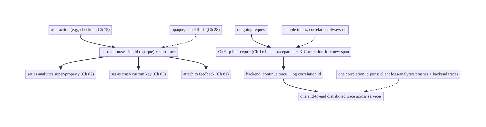
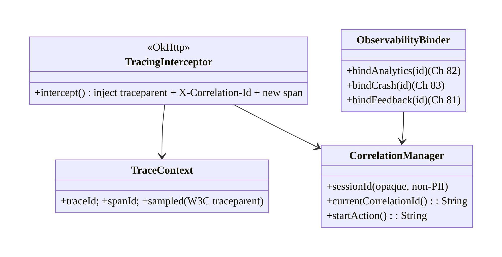
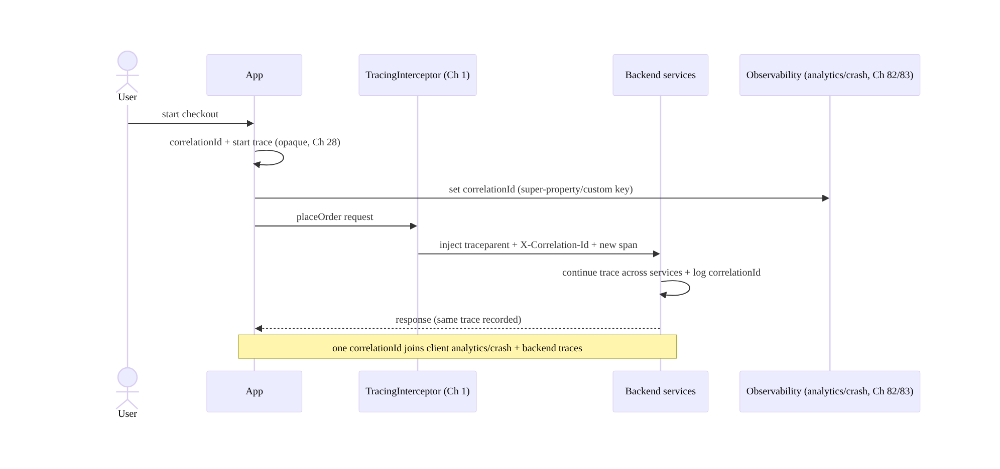
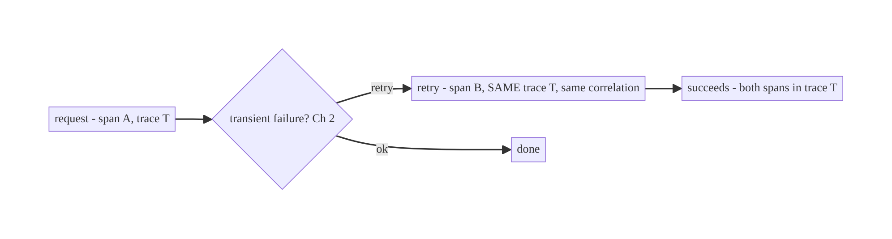
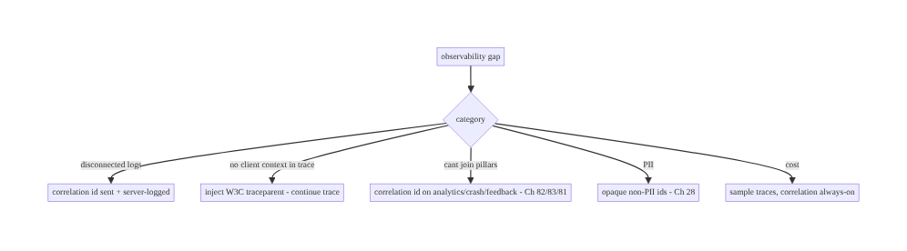

# Chapter 84 — Distributed Tracing & Correlation IDs

> **Part X — Performance, Observability & Quality** · Complexity: **Standard** (≥25 interview questions)
>
> **Prerequisites:** Ch 1 (networking/OkHttp), Ch 82 (analytics pipeline), Ch 83
> (crash reporting), Ch 81 (feedback/correlation), Ch 2 (retries), Ch 28 (privacy). Pairs
> with Ch 85 (perf monitoring), Ch 87 (error telemetry).
>
> **Reference surface in StreamCart:** the thread that ties a user action on the device to
> the backend work it triggers — a **trace/correlation id** propagated from the app through
> every request so a slow checkout, a failed order, or a crash can be followed end-to-end
> across client and server logs, traces, analytics (Ch 82), and crash reports (Ch 83).

---

## 84.1 Problem Definition and Real-World Context

When something goes wrong — a checkout fails, a screen is slow, an order never arrives —
engineers need to **follow one user's one action across many systems**: the client code,
the network request, the backend services it fans out to, the database, and back. Without
a shared **identifier** threaded through all of it, client logs and server logs are
disconnected islands; you can't tell **which** backend trace corresponds to **this**
user's failed tap. **Distributed tracing** (trace + span ids propagated across service
boundaries) and **correlation ids** (a stable id linking a client session/action to its
backend work and to analytics/crash data) solve this — they make the whole system
**observable end-to-end**.

Concretely, teams hit:

- **Disconnected client/server logs.** A user reports a failed order; support has a client
  log and the backend has thousands of traces — with **no way to link them**. A
  **correlation id** sent on the request and logged on both sides joins them.
- **No trace propagation.** The backend uses distributed tracing (OpenTelemetry/Jaeger),
  but the **client doesn't start or propagate** a trace, so backend traces don't include
  the **client-originated** context (which screen/action started this). The client should
  **inject trace context** (W3C `traceparent`) into outgoing requests.
- **Can't correlate across observability pillars.** Analytics events (Ch 82), crash
  reports (Ch 83), feedback (Ch 81), and backend traces are separate — a **shared
  correlation id** (per session/action) lets you jump between them.
- **Per-request vs per-session ids.** You need both: a **per-request id** (trace a single
  call) and a **session/correlation id** (tie all of a session's activity together) —
  consistently generated and propagated.
- **Retries and id reuse.** A retried request (Ch 2) should keep its trace semantics
  correct (new span, same trace); an idempotency key (Ch 15) is distinct from a trace id.
- **Privacy.** Trace/correlation ids must be **opaque** (not PII, Ch 28) — they identify a
  flow, not a person.
- **Sampling & overhead.** Tracing everything is costly; **sample** traces while keeping
  correlation ids cheap and always-on.

The architecture: generate a **correlation/session id** (opaque) on the client and a
**per-request trace context** (W3C Trace Context `traceparent`), **propagate** them on
every outgoing request via an **OkHttp interceptor** (Ch 1); **log** the correlation id on
the client (analytics Ch 82, crash Ch 83, feedback Ch 81) and have the **server log/trace**
it too, so one id joins client logs, backend traces, analytics, and crashes; manage
**per-request vs per-session** ids and **retry** semantics (Ch 2); keep ids **opaque/
non-PII** (Ch 28); and **sample** traces. This chapter is about **threading one id through
everything so the system is traceable end-to-end**.

### Three practical use cases

1. **Debug a failed checkout (StreamCart).** The checkout flow carries a correlation id;
   the failed `placeOrder` (Ch 75) request's `traceparent` links to the backend trace
   showing which service failed — joined to the client's analytics/crash via the
   correlation id.
2. **Trace a slow screen.** A screen's load fans out to several API calls, all sharing the
   session correlation id and each with its own trace; the end-to-end latency breakdown is
   visible across client and server.
3. **Support ties a report to a session.** A user's feedback (Ch 81) carries the
   correlation id; support finds the exact backend traces, client logs, and crashes for
   that session.

### Why this is architectural

Distributed tracing/correlation is the **connective tissue of observability**, tying
networking (Ch 1), analytics (Ch 82), crash reporting (Ch 83), feedback (Ch 81), and
backend tracing into one followable thread. The decisions — correlation + trace ids,
W3C propagation via an interceptor, cross-pillar logging, opaque/non-PII, sampling —
determine whether you can actually debug production end-to-end.

---

## 84.2 Requirements Engineering

### Functional requirements

| ID | Requirement |
|----|-------------|
| F1 | Generate an opaque correlation/session id and per-request trace context (W3C `traceparent`). |
| F2 | Propagate them on every outgoing request via an OkHttp interceptor (Ch 1). |
| F3 | Log the correlation id on the client across analytics, crash, and feedback (Ch 82/83/81). |
| F4 | Enable the server to log/trace the same id, joining client and backend. |
| F5 | Handle per-request vs per-session ids and retry semantics (new span, same trace) (Ch 2). |
| F6 | Keep ids opaque/non-PII; sample traces for cost (Ch 28). |

### Non-functional requirements

| Attribute | Policy |
|-----------|--------|
| **Traceability** | One id joins client logs/analytics/crashes + backend traces. |
| **Standards** | W3C Trace Context propagation; OpenTelemetry-compatible. |
| **Privacy** | Opaque ids, not PII (Ch 28). |
| **Overhead** | Correlation always-on + cheap; traces sampled. |
| **Consistency** | Ids generated/propagated uniformly (interceptor). |

### Scope

- **In scope:** correlation/session id + per-request trace context (W3C `traceparent`),
  propagation via OkHttp interceptor (Ch 1), cross-pillar correlation (analytics Ch 82,
  crash Ch 83, feedback Ch 81), per-request vs per-session ids, retry/span semantics
  (Ch 2), opaque/non-PII ids (Ch 28), sampling, OpenTelemetry-on-mobile overview.
- **Out of scope:** analytics pipeline (Ch 82), crash reporting (Ch 83), feedback (Ch 81),
  networking internals (Ch 1), backend tracing infra, perf monitoring (Ch 85).

### Assumptions & constraints

- OkHttp (Ch 1) for propagation; the backend uses **distributed tracing** (OpenTelemetry/
  W3C Trace Context) and logs correlation ids; analytics/crash/feedback pipelines accept a
  correlation id (Ch 82/83/81). `minSdk 24`. Ids are **opaque** (non-PII, Ch 28); traces are
  **sampled**.

---

## 84.3 System Design Fundamentals

- **Two kinds of id: trace context (per request) + correlation/session id (per session/
  flow).**
  - **Trace context (W3C Trace Context):** a **`traceparent`** header carrying a **trace id**
    (the whole distributed operation) and a **span id** (this hop), plus flags (sampled).
    The client **starts or continues** a trace and injects `traceparent` into each outgoing
    request; the **backend continues** the same trace across its services — producing one
    end-to-end **distributed trace**. This is the **standard** (W3C Trace Context,
    OpenTelemetry).
  - **Correlation/session id:** a **stable, opaque id** for a **session** (or a logical
    user action/flow) that ties together **all** of a session's client activity — analytics
    events (Ch 82), crash reports (Ch 83), feedback (Ch 81) — **and** is sent to the backend
    so server logs carry it. Where a trace follows **one request**, the correlation id joins
    **everything in a session/flow**.
  Both are needed: the trace gives you the **per-request latency/error breakdown across
  services**; the correlation id gives you the **"all activity for this session" join across
  observability pillars**.
- **Propagate via one interceptor (Ch 1).** An **OkHttp interceptor** injects the
  **`traceparent`** (and a correlation-id header, e.g., `X-Correlation-Id`) into **every**
  outgoing request — uniformly, in one place (like auth, Ch 19). This guarantees consistency
  and means feature code doesn't manage headers. The interceptor also creates the per-request
  **span**.
- **Log the correlation id across all client pillars (Ch 82/83/81).** Set the correlation id
  as a:
  - **Analytics** super-property (Ch 82) so every event carries it,
  - **Crash reporter** custom key (Ch 83) so crashes carry it,
  - **Feedback** attachment (Ch 81) so reports carry it,
  - **Client log** field.
  Then **one id** lets you jump from a crash → the session's analytics → the backend traces
  → the feedback. This cross-pillar join is the whole point.
- **Server logs/traces the same id.** The backend, on receiving `traceparent` +
  `X-Correlation-Id`, **continues the trace** and **logs the correlation id** on every log
  line/span for that request — so client-sent ids appear in **server** logs and traces,
  completing the join. (This is a backend requirement the client enables by sending the ids.)
- **Per-request vs per-session + retries (Ch 2).** Each **request** gets a **new span** (and
  usually a new `traceparent` span id) under the **trace**; a **retry** (Ch 2) is a **new
  span** (it's a new attempt) but can share the **trace/correlation** context so the retry is
  visible in the same trace. The **correlation/session id** persists across requests within a
  session. (Note: a **trace id** is **not** an **idempotency key**, Ch 15 — different purpose:
  tracing vs dedup.)
- **Opaque, non-PII ids (Ch 28).** Trace/correlation ids are **random opaque identifiers**
  (UUID/128-bit) — they identify a **flow/session**, **not a person**. **Never** embed PII
  (email, user id in the clear) in them. This keeps tracing **privacy-safe** (Ch 28/82/83).
- **Sampling (cost).** Full distributed tracing is **expensive** (storage/overhead), so
  traces are **sampled** (a fraction, with the sampled flag in `traceparent` so the backend
  agrees) — while the **correlation id is always-on and cheap** (just a header + a logged
  field). Sample traces; always correlate.
- **OpenTelemetry on mobile.** OpenTelemetry (OTel) provides SDKs and the W3C Trace Context
  standard; on mobile it's emerging — you can use OTel or a lighter custom correlation layer,
  but **standard propagation (W3C `traceparent`)** is what makes client traces continue into
  the backend's tracing system.

Core insight: **thread two opaque, non-PII identifiers through the system — a W3C Trace
Context (`traceparent`: trace id + per-hop span id) that the client starts and injects into
every request so the backend continues one end-to-end distributed trace, and a stable
correlation/session id that joins all of a session's client activity (analytics Ch 82,
crash Ch 83, feedback Ch 81) and is sent so server logs carry it — propagated uniformly by a
single OkHttp interceptor (Ch 1), logged across every client observability pillar and the
server, with new spans per request/retry (Ch 2) under a persistent session correlation,
opaque/non-PII ids (Ch 28), and sampled traces (correlation always-on) — so one user's one
action can be followed end-to-end across client and server.**

---

## 84.4 High-Level Architecture



**Components & ownership**

- **Correlation/session id + trace** started per action; set across **analytics/crash/
  feedback** (Ch 82/83/81).
- **OkHttp interceptor** injects `traceparent` + correlation id on **every** request and
  creates the per-request span (Ch 1).
- **Backend** continues the trace and logs the correlation id → **one id joins** all
  pillars.
- **Sampling** for traces; **opaque/non-PII** ids (Ch 28).

**Direction:** action → correlation id + trace → set across pillars → interceptor injects
on requests → backend continues trace + logs id → end-to-end join.

---

## 84.5 Detailed Component Design



| Component | Responsibility |
|-----------|----------------|
| `TraceContext` | W3C trace id + span id + sampled flag (`traceparent`) |
| `CorrelationManager` | opaque session/action correlation id |
| `TracingInterceptor` | inject `traceparent` + correlation id + new span per request (Ch 1) |
| `ObservabilityBinder` | set correlation id on analytics/crash/feedback (Ch 82/83/81) |

---

## 84.6 End-to-End Data Flow

### One action, end-to-end



### Retry keeps trace, new span



---

## 84.7 Complete Kotlin Implementation

Package: `com.streamcart.tracing`.

### 84.7.1 Correlation id + trace context (opaque, non-PII, Ch 28)

```kotlin
@Singleton
class CorrelationManager @Inject constructor() {
    val sessionId: String = UUID.randomUUID().toString()   // opaque, per session; NOT PII (Ch 28)
    private var currentAction: String? = null
    fun startAction(): String { currentAction = UUID.randomUUID().toString(); return currentAction!! }
    fun currentCorrelationId(): String = currentAction ?: sessionId   // action id if in a flow, else session
}

data class TraceContext(val traceId: String, val spanId: String, val sampled: Boolean) {
    // W3C traceparent: version-traceId-spanId-flags
    fun toTraceparent() = "00-$traceId-$spanId-%02x".format(if (sampled) 1 else 0)
    companion object {
        fun start(sampledRate: Double): TraceContext = TraceContext(
            traceId = randomHex(32), spanId = randomHex(16), sampled = Random.nextDouble() < sampledRate)  // sample (cost)
        fun childSpan(parent: TraceContext) = parent.copy(spanId = randomHex(16))   // new span, same trace (retry/next request)
    }
}
```

### 84.7.2 OkHttp interceptor: inject traceparent + correlation id (Ch 1)

```kotlin
class TracingInterceptor @Inject constructor(private val correlation: CorrelationManager) : Interceptor {
    override fun intercept(chain: Interceptor.Chain): Response {
        val trace = TraceContext.start(sampledRate = 0.1)              // per-request trace/span (sampled)
        val request = chain.request().newBuilder()
            .header("traceparent", trace.toTraceparent())              // W3C Trace Context -> backend continues trace
            .header("X-Correlation-Id", correlation.currentCorrelationId())  // joins client+server (always-on)
            .build()
        // (A full OTel SDK would create a real span with timing here.)
        return chain.proceed(request)   // retry (Ch 2) -> a new interceptor pass -> new span, same correlation
    }
}
// Added to the OkHttp stack alongside auth/logging interceptors (Ch 1/19).
```

### 84.7.3 Bind correlation id across observability pillars (Ch 82/83/81)

```kotlin
@Singleton
class ObservabilityBinder @Inject constructor(
    private val analytics: Analytics,        // Ch 82
    private val crash: CrashReporter,         // Ch 83
    private val correlation: CorrelationManager,
) {
    /** One correlation id on EVERY pillar -> jump between crash <-> analytics <-> backend traces <-> feedback. */
    fun bind() {
        val id = correlation.currentCorrelationId()
        analytics.setSuperProperty("correlation_id", id)   // every event carries it (Ch 82)
        crash.setCustomKey("correlation_id", id)           // every crash carries it (Ch 83)
        // feedback attaches it too (Ch 81); client logs include it.
    }
}
```

### 84.7.4 Start a traced action (e.g., checkout, Ch 75)

```kotlin
fun startTracedCheckout(correlation: CorrelationManager, binder: ObservabilityBinder) {
    correlation.startAction()   // new correlation id for this flow (ties its requests + events + any crash)
    binder.bind()               // propagate to analytics/crash/feedback
    // subsequent requests carry traceparent + X-Correlation-Id via the interceptor -> backend joins them.
}
```

### 84.7.5 Server-side expectation (what the client enables)

```kotlin
// The BACKEND must: read `traceparent` -> continue the W3C trace (OpenTelemetry);
// read `X-Correlation-Id` -> log it on every log line/span for the request.
// Then a single id joins client observability (Ch 82/83/81) and backend traces/logs.
// (Client enables this by sending the headers; backend owns continuation + logging.)
```

### 84.7.6 Module structure

```
:core:tracing  CorrelationManager, TraceContext (W3C), TracingInterceptor (Ch 1), ObservabilityBinder
# Analytics -> Ch 82; crash -> Ch 83; feedback -> Ch 81. OpenTelemetry SDK optional. Backend continues trace + logs id.
```

---

## 84.8 Concurrency and Race Conditions

| Scenario | Risk | Handling |
|----------|------|----------|
| Id not propagated on some requests | broken trace/join | inject in one interceptor (all requests, Ch 1) |
| Retry reuses span id | wrong trace graph | new span per attempt, same trace/correlation (Ch 2) |
| Correlation id missing on crash | can't join | set as crash custom key on bind (Ch 83) |
| PII in id | privacy leak | opaque random ids only (Ch 28) |
| Trace not sampled but logged | inconsistent | sampled flag in traceparent; backend honors it |
| Concurrent actions share id | ambiguous | per-action correlation id for distinct flows |
| Backend ignores headers | no join | backend must continue trace + log id (requirement) |

- **One interceptor guarantees propagation:** injecting `traceparent` + correlation id in a
  single OkHttp interceptor (Ch 1) means **every** request carries them — scattered manual
  headers inevitably miss some, breaking the trace/join.
- **New span per request/retry, persistent correlation:** each attempt is a **new span**
  under the **same trace** (Ch 2), and the **correlation/session id persists** across the
  flow — so retries and fan-out appear correctly in one trace and one session join.
- **Opaque ids keep it private:** random 128-bit ids identify a flow, not a person (Ch 28) —
  never encode PII.

---

## 84.9 Failure Scenarios and Recovery

| Failure | Detection | Response | Outcome |
|---------|-----------|----------|---------|
| Client/server logs disconnected | support can't trace | correlation id sent + server-logged | joined |
| Backend trace lacks client context | incomplete trace | client injects `traceparent` (continue trace) | end-to-end |
| Can't jump crash → backend | debugging gap | correlation id on crash (Ch 83) + server | linked |
| PII in ids | privacy audit | opaque ids (Ch 28) | safe |
| Tracing too costly | cost | sample traces (correlation always-on) | affordable |
| Missing on some requests | gaps | single interceptor (Ch 1) | consistent |
| Retry confuses trace | wrong graph | new span, same trace (Ch 2) | correct |



> **One opaque id, propagated by one interceptor and logged on every pillar and the server,
> makes the whole system followable.** The W3C `traceparent` continues the backend's
> distributed trace with client context; the correlation id joins the client's analytics,
> crashes, and feedback to those traces. Sample the expensive traces; keep the cheap
> correlation always-on.

---

## 84.10 Scaling the Implementation

- **Level 1.** Correlation/session id + `X-Correlation-Id` header via an OkHttp interceptor
  (Ch 1); log it on the client.
- **Level 2.** W3C `traceparent` propagation (continue backend trace); set correlation id on
  analytics/crash/feedback (Ch 82/83/81).
- **Level 3 — production.** Per-request spans + retry semantics (Ch 2); sampling; opaque
  non-PII ids (Ch 28); server-side continuation + logging.
- **Level 4 — large.** OpenTelemetry SDK with real client spans (screen load, request
  timing); trace-based perf (Ch 85); cross-service dashboards; adaptive sampling.
- **Level 5 — enterprise.** Full client-to-backend distributed tracing, SLO/trace-based
  alerting, trace governance, PII/consent review, multi-platform correlation parity.

**Avoid overengineering:** a correlation id + W3C `traceparent` via one interceptor + binding
to the pillars covers most debugging needs. Don't hand-roll a tracing system; use W3C/OTel
standards. Don't trace everything — sample.

---

## 84.11 Alternative Approaches and Trade-offs

| Dimension | Option A | Option B | When |
|-----------|----------|----------|------|
| Standard | W3C Trace Context / OpenTelemetry | custom headers | W3C/OTel (backend continuation, interop) |
| Ids | Trace (per request) + correlation (per session) | one id | Both (per-request latency + session join) |
| Propagation | One interceptor (Ch 1) | per-call headers | Interceptor (consistency) |
| Cross-pillar | Correlation id on analytics/crash/feedback | separate | Correlation id (join, Ch 82/83/81) |
| Ids | Opaque, non-PII (Ch 28) | embed user id | Opaque (privacy) |
| Cost | Sample traces, correlation always-on | trace everything | Sample (cost) |
| Trace id vs idempotency | Distinct (Ch 15) | reuse | Distinct (tracing ≠ dedup) |

**W3C/OpenTelemetry vs custom tracing:** a custom header scheme can carry an id, but it
**won't continue the backend's distributed trace** unless it follows the **W3C Trace
Context** standard the backend tracing system (OTel/Jaeger/Zipkin) understands. Using **W3C
`traceparent`** means client-originated context **flows into the backend trace** and tools
interoperate. Use the standard; don't invent a propagation format.

**Trace + correlation vs a single id:** a **trace id** follows **one request** across
services (latency/error breakdown); a **correlation/session id** joins **all** of a session's
client activity (analytics, crashes, feedback) and server logs. They answer different
questions — "what did this request do across services?" vs "show me everything for this
session." Use **both**.

**One interceptor vs per-call propagation:** adding trace headers per call site inevitably
**misses requests** (breaking traces/joins) and duplicates logic. A **single OkHttp
interceptor** (Ch 1) injects them on **every** request uniformly — like auth (Ch 19).
Centralize propagation.

---

## 84.12 Security & Privacy Considerations

- **Opaque, non-PII ids (Ch 28):** trace and correlation ids are **random identifiers** of a
  flow/session, **never** PII — don't embed email/clear user id. This keeps tracing
  privacy-safe across analytics/crash/feedback (Ch 82/83/81).
- **Consent (Ch 28/82):** correlation/tracing follows the same **consent** regime as
  analytics — if the user opted out, don't collect/correlate beyond what's essential.
- **Don't leak sensitive data in traces:** spans/logs tied to the trace must **not** carry
  request bodies with PII/secrets, tokens, or card data (Ch 28) — redact as everywhere.
- **Server-side access control:** traces/logs with correlation ids are **internal**
  observability data — access-controlled (support/engineering), retention-limited (Ch 28).
- **Id spoofing:** a client-sent `traceparent`/correlation id is **not** a security
  credential — the backend uses it for **correlation only**, never authorization (auth is
  Ch 19); treat incoming ids as untrusted labels.
- **Per-account (Ch 42):** reset correlation/session on logout so a session's trace isn't
  attributed across users (and ids stay opaque).
- Client vs backend: the **client** generates opaque ids, propagates via the interceptor, and
  binds to pillars; the **backend** continues traces, logs ids, and access-controls/retains
  the observability data — neither stores PII in ids.

---

## 84.13 Performance and Resource Optimization

- **Correlation id is cheap** (a header + a logged field) — **always-on**; negligible
  overhead.
- **Sample traces** — full span timing/export is costly; sample a fraction (sampled flag in
  `traceparent`), keep correlation always-on.
- **One interceptor** — minimal per-request cost (header injection); no per-call-site logic.
- **Lazy span creation** — only create detailed spans for sampled traces.
- **Bounded trace export** — batch/async export (don't block requests) if using an OTel SDK.
- **Profiling:** propagation overhead (µs), trace sampling rate, correlation-join success
  (can we link a report to a trace?), export cost.

---

## 84.14 Testing Strategy

Propagation, correlation binding, and retry/span semantics are testable with a fake chain.

```kotlin
class TracingInterceptorTest {
    @Test fun `injects traceparent and correlation id on every request`() {
        val req = runInterceptor(TracingInterceptor(FakeCorrelation("corr-1")))
        assertTrue(req.header("traceparent")!!.matches(Regex("00-[0-9a-f]{32}-[0-9a-f]{16}-[0-9a-f]{2}")))  // W3C
        assertEquals("corr-1", req.header("X-Correlation-Id"))
    }
    @Test fun `correlation id is opaque, not PII`() { assertFalse(CorrelationManager().sessionId.contains("@")) }  // Ch 28
}

class CorrelationBindTest {
    @Test fun `binds correlation id to analytics and crash`() {
        binder.bind()
        assertEquals("corr-1", fakeAnalytics.superProps["correlation_id"])   // Ch 82
        assertEquals("corr-1", fakeCrash.customKeys["correlation_id"])       // Ch 83
    }
}

class SpanSemanticsTest {
    @Test fun `retry creates a new span under the same trace`() {
        val t = TraceContext.start(1.0); val child = TraceContext.childSpan(t)
        assertEquals(t.traceId, child.traceId); assertNotEquals(t.spanId, child.spanId)  // same trace, new span (Ch 2)
    }
}
```

What to test: interceptor injects valid W3C `traceparent` + correlation id on every request;
ids opaque/non-PII (Ch 28); correlation id bound to analytics/crash/feedback (Ch 82/83/81);
retry → new span, same trace (Ch 2); sampling flag set; per-action correlation for distinct
flows. Fake OkHttp chain + observability pillars; (integration) verify server logs the id.

---

## 84.15 Production Observability

- **Metrics:** correlation-join success (can a report/crash be linked to a backend trace?);
  trace sampling rate; propagation coverage (% requests with `traceparent`/correlation id →
  should be ~100%); end-to-end trace latency breakdown (client vs server); orphaned
  client/server logs (→ 0).
- **Logs:** every client log/analytics/crash carries `correlation_id`; requests carry
  `traceparent` — **no PII in ids** (Ch 28).
- **Debugging:** disconnected logs → id not sent/server not logging it; incomplete backend
  trace → `traceparent` not injected/continued; can't join crash↔trace → correlation id not
  on crash (Ch 83); PII in id → not opaque; tracing cost → increase sampling.
- **Alerting:** propagation-coverage drop (interceptor regression); correlation-join failure
  spike.
- **Dashboards:** end-to-end traces (client→backend) with latency breakdown; correlation-join
  rate; sampling.

---

## 84.16 System Design Interview Preparation

> ≥25 questions.

**Fundamentals**

1. *Distributed tracing?* Trace + span ids propagated across service boundaries → one
   end-to-end trace.
2. *Correlation id?* Stable opaque id joining a session's client activity + server logs.
3. *Both needed?* Trace = per-request cross-service; correlation = per-session cross-pillar
   join.
4. *Standard?* W3C Trace Context (`traceparent`) / OpenTelemetry.
5. *`traceparent`?* trace id + span id + sampled flag.

**Propagation**

6. *How propagate?* One OkHttp interceptor injects headers on every request (Ch 1).
7. *Why interceptor?* Consistency — never miss a request.
8. *Backend role?* Continue the trace + log the correlation id.

**Cross-pillar**

9. *Join crash↔analytics↔trace?* Correlation id on all pillars (Ch 82/83/81).
10. *Analytics?* Super-property; **crash?** custom key; **feedback?** attachment.
11. *Why one id?* Jump between observability pillars.

**Semantics**

12. *Per-request vs per-session?* New span per request; correlation persists per session.
13. *Retry?* New span, same trace/correlation (Ch 2).
14. *Trace id vs idempotency key?* Distinct (tracing ≠ dedup, Ch 15).

**Privacy**

15. *Ids and PII?* Opaque, non-PII (Ch 28) — identify a flow, not a person.
16. *Consent?* Same regime as analytics (Ch 28/82).
17. *Sensitive data in traces?* Redact; no PII/secrets in spans/logs.

**Cost**

18. *Tracing cost?* Sample traces.
19. *Correlation cost?* Cheap — always-on.
20. *Sampled flag?* In `traceparent`; backend agrees.

**Mobile/standards**

21. *OpenTelemetry on mobile?* Emerging; use W3C propagation for backend continuation.
22. *Custom vs standard?* Standard (interop + continuation).

**Testing/Production**

23. *Test propagation?* Interceptor injects valid headers on every request.
24. *Test join?* Correlation id on all pillars.
25. *Disconnected logs in prod?* Id not sent / server not logging.
26. *Key metric?* Propagation coverage + correlation-join success.

### Design-change challenges
1. **Follow a failed checkout across client and backend.** Correlation id + `traceparent`
   propagated; server logs/continues (Ch 75).
2. **Jump from a crash to the backend trace.** Correlation id on the crash report (Ch 83) +
   server logs.
3. **Backend traces lack client context.** Inject W3C `traceparent` to continue the trace.
4. **Tracing is too expensive.** Sample traces; keep correlation always-on.
5. **Ids might leak PII.** Opaque random ids only (Ch 28).

### Mock walkthrough (abridged)
Clarify (what to trace, backend tracing stack, privacy?) → two ids: W3C `traceparent`
(per request) + correlation/session id (per session) → one OkHttp interceptor injects on
every request (Ch 1) → bind correlation id to analytics/crash/feedback (Ch 82/83/81) →
backend continues trace + logs id → per-request spans + retry semantics (Ch 2) → opaque/
non-PII + consent (Ch 28) → sample traces → observability (propagation coverage, join
success).

---

## 84.17 Practical Exercises

1. **Beginner.** Add an OkHttp interceptor that injects an `X-Correlation-Id` (opaque) on
   every request and log it on the client (Ch 1/28). *Eval:* every request carries it;
   non-PII.
2. **Intermediate.** Add W3C `traceparent` propagation (trace id + span id + sampled) so the
   backend can continue the trace. *Eval:* valid `traceparent`; sampled flag.
3. **Advanced.** Bind the correlation id to analytics (super-property), crash (custom key),
   and feedback (Ch 82/83/81) so one id joins all pillars. *Eval:* crash and analytics carry
   the same id.
4. **Production debugging.** Fix disconnected client/server logs (send + server-log the id)
   and an incomplete backend trace (inject `traceparent`). *Eval:* end-to-end joined.
5. **System design challenge.** Add per-request spans with retry semantics (new span, same
   trace) and trace sampling; measure propagation coverage. *Eval:* correct trace graph;
   sampled; ~100% coverage.

*(Solutions withheld unless requested.)*

---

## 84.18 Chapter Summary & Reference Sheet

**Key decisions:** thread **two opaque, non-PII identifiers** through the system — a **W3C
Trace Context** (`traceparent`: a **trace id** for the whole operation + a **per-hop span
id** + a sampled flag) that the client **starts and injects into every outgoing request** so
the **backend continues one end-to-end distributed trace** (OpenTelemetry-compatible), and a
**stable correlation/session id** that **joins all of a session's client activity** —
analytics (Ch 82), crash reports (Ch 83), feedback (Ch 81) — **and is sent so server logs
carry it**; **propagate both uniformly via a single OkHttp interceptor** (Ch 1) that also
creates the **per-request span** (a **retry** is a **new span under the same trace**, Ch 2;
a trace id is **not** an idempotency key, Ch 15); **bind the correlation id across every
client pillar** (analytics super-property, crash custom key, feedback attachment, log field)
so **one id lets you jump between crash ↔ analytics ↔ backend traces ↔ feedback**; keep ids
**opaque/non-PII** under the same **consent** regime as analytics (Ch 28/82); and **sample
the expensive traces while keeping the cheap correlation always-on** — so **one user's one
action is followable end-to-end across client and server**.

**Concepts:** W3C Trace Context (`traceparent`), distributed tracing (trace/span),
correlation/session id, single-interceptor propagation (Ch 1), cross-pillar binding
(analytics/crash/feedback, Ch 82/83/81), per-request vs per-session + retry span semantics
(Ch 2), opaque/non-PII ids (Ch 28), sampling, OpenTelemetry on mobile.

**Common mistakes:** disconnected client/server logs (no shared id); not injecting
`traceparent` (backend trace lacks client context); per-call-site headers (missed requests);
not binding the correlation id to crash/analytics (can't join pillars); PII in ids; tracing
everything (cost — sample); reusing span ids across retries (wrong trace graph); custom
non-standard propagation (backend can't continue).

**Checklist:**

- [ ] opaque correlation/session id + W3C `traceparent` (non-PII, Ch 28)
- [ ] single OkHttp interceptor injects both on every request (Ch 1)
- [ ] backend continues trace + logs correlation id
- [ ] bind correlation id to analytics/crash/feedback (Ch 82/83/81)
- [ ] new span per request/retry, same trace (Ch 2)
- [ ] sample traces, correlation always-on
- [ ] consent regime (Ch 28)
- [ ] no PII/secrets in spans/logs
- [ ] reset on logout (Ch 42)
- [ ] propagation-coverage + correlation-join telemetry.

**Key APIs:** W3C Trace Context `traceparent` header, OkHttp `Interceptor` (Ch 1),
`UUID`/128-bit random ids (opaque), analytics super-property (Ch 82), crash `setCustomKey`
(Ch 83), feedback correlation (Ch 81), OpenTelemetry SDK (optional), sampling.

**References:**
- W3C Trace Context: https://www.w3.org/TR/trace-context/
- OpenTelemetry (Android/mobile): https://opentelemetry.io/docs/instrumentation/android/
- (composes) Ch 1 Networking, Ch 82 Analytics, Ch 83 Crash Reporting, Ch 81 Feedback, Ch 2 Retries, Ch 28 Privacy, Ch 85 Perf Monitoring

### Chapter review (Phase 4)
- **Completeness:** all 18 sections; architecture/class/sequence/retry/failure diagrams;
  correlation manager + W3C trace context + interceptor + observability binder + traced-action
  code; concurrency (one-interceptor propagation, span-per-retry, opaque ids); failure (one-id
  + propagate + bind + sample principle); 5 levels; W3C-vs-custom, trace+correlation, single-
  interceptor trade-offs; security (opaque/non-PII, consent, not-a-credential, access control);
  perf (always-on correlation, sampled traces); interceptor + bind + span tests; observability
  (propagation coverage, join success); 26 Q&A + 5 challenges. ✅
- **Expand later:** perf monitoring (Ch 85), error telemetry (Ch 87), analytics (Ch 82),
  crash (Ch 83).
- **Interview coverage:** exceeds ≥25 bar.
