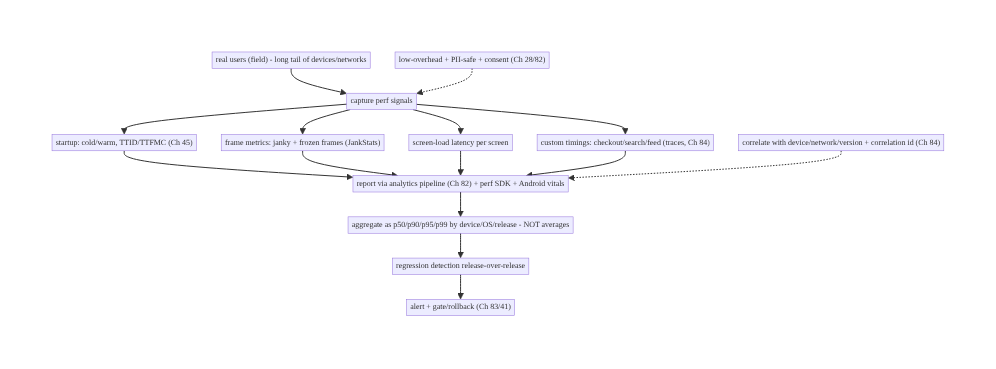
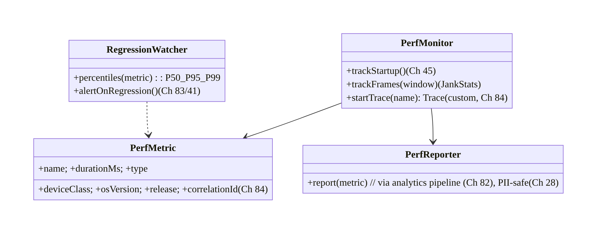
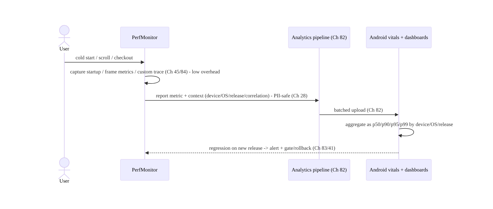
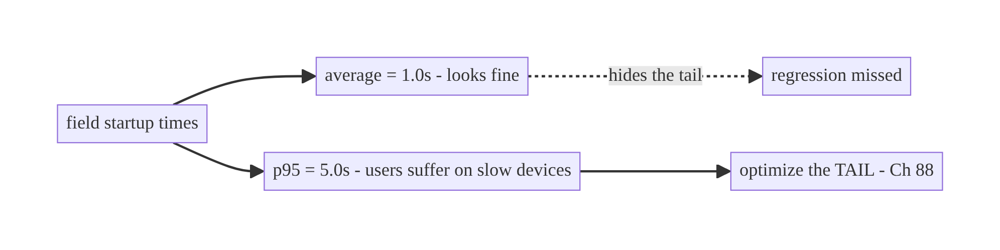
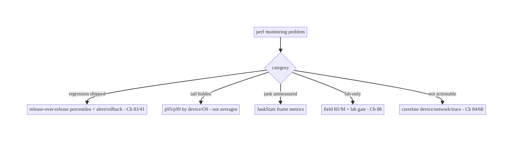

# Chapter 85 — Performance Monitoring (Startup, Frames, Custom Metrics)

> **Part X — Performance, Observability & Quality** · Complexity: **Standard** (≥25 interview questions)
>
> **Prerequisites:** Ch 45 (startup), Ch 82 (analytics pipeline), Ch 84 (tracing), Ch 28
> (privacy), Ch 44 (lifecycle). Pairs with Ch 88 (cold start), Ch 90 (jank), Ch 86 (A/B),
> Ch 83 (crash/vitals).
>
> **Reference surface in StreamCart:** the **field** performance signals — cold-start
> time, frame rendering (jank/frozen frames), screen-load latency, and custom timings
> (checkout duration, search latency) — captured from **real users**, reported through the
> analytics pipeline (Ch 82), and watched as **percentile** metrics in Android vitals and
> dashboards so regressions are caught.

---

## 85.1 Problem Definition and Real-World Context

You cannot improve what you don't measure, and **lab** measurements (Macrobenchmark on your
dev phone, Ch 88) don't reflect what **real users on real devices/networks** experience.
**Performance monitoring** is the system that captures **field** performance — **startup
time**, **frame rendering** (jank/frozen frames), **screen-load latency**, and **custom
timings** (checkout, search) — from production, reports them through the analytics pipeline
(Ch 82), and surfaces them as **percentile** (p50/p90/p95/p99) metrics (not averages) in
**Android vitals** and dashboards, so you can **detect regressions** release-over-release and
by device/OS. Without it, you ship perf regressions blind and only hear about them via bad
reviews.

Concretely, teams hit:

- **Lab-only measurement.** Macrobenchmark (Ch 88) is great for CI gates but measures **one
  device**; the field is a **long tail** of slow/old devices and bad networks. You need
  **real-user monitoring (RUM)**.
- **Averages hide pain.** A "good average" startup hides a terrible **p95**; perf must be
  tracked as **percentiles** (p50/p90/p95/p99) — the tail is where users suffer and where
  Android vitals thresholds bite.
- **Not measuring the right things.** The key field signals: **cold/warm start time**
  (Ch 45/88), **frame metrics** (jank = slow frames, **frozen frames** >700ms), **screen-
  load/TTID/TTFMC** (Ch 45), and **custom business timings** (checkout, search, feed load).
- **No frame monitoring.** Jank (dropped frames) is the top perceived-performance problem
  (Ch 90); you must capture **frame timing** in the field (`FrameMetrics`/JankStats).
- **Overhead/privacy of monitoring.** The monitoring itself must be **low-overhead** and
  **PII-safe** (Ch 28/82) — don't slow the app to measure it, don't log PII.
- **No regression detection/alerting.** Metrics are useless without **release-over-release**
  comparison and **alerting** on regressions (and gating/rollback, Ch 83/41).
- **Android vitals vs custom.** **Android vitals** (Play Console) gives startup/frame/ANR
  (Ch 83) from the field for free; **custom metrics** (Firebase Performance / your pipeline,
  Ch 82) add screen loads and business timings.

The architecture: capture **field performance** — **startup** (Ch 45), **frame metrics**
(JankStats/`FrameMetrics`), **screen-load latency** (TTID/TTFMC, Ch 45), and **custom
timings** (traces/spans, Ch 84) — from **real users**; report them through the **analytics
pipeline** (Ch 82) and **Android vitals** / a perf-monitoring SDK; aggregate as
**percentiles** (p50/p90/p95/p99) **by device/OS/release**; keep monitoring **low-overhead**
and **PII-safe** (Ch 28); and **detect regressions** with alerting and release gating (Ch 83/
41). This chapter is about **seeing real-user performance and catching regressions**.

### Three practical use cases

1. **Startup monitoring (StreamCart).** Cold/warm start time from the field, p95 by device
   class, tracked release-over-release in Android vitals; a regression triggers an alert
   (Ch 88/83).
2. **Frame/jank monitoring.** JankStats captures janky/frozen frames per screen in
   production; the scroll-heavy feed (Ch 71) shows its jank rate so you know where to
   optimize (Ch 90).
3. **Custom timing.** A `checkout_duration` trace (Ch 84) measures how long place-order takes
   for real users (Ch 75), p90 by network, so slow checkouts are visible.

### Why this is architectural

Performance monitoring is the **field-observability** layer for quality, composing startup
(Ch 45), frame metrics, custom tracing (Ch 84), the analytics pipeline (Ch 82), privacy
(Ch 28), and Android vitals/alerting (Ch 83). The decisions — measure the right field signals
as percentiles, low-overhead + PII-safe capture, regression detection + gating — determine
whether you can keep the app fast for real users.

---

## 85.2 Requirements Engineering

### Functional requirements

| ID | Requirement |
|----|-------------|
| F1 | Capture field startup time (cold/warm), frame metrics (jank/frozen), screen-load latency (Ch 45). |
| F2 | Capture custom business timings (checkout, search, feed) as traces/spans (Ch 84). |
| F3 | Report via the analytics pipeline + perf SDK + Android vitals (Ch 82). |
| F4 | Aggregate as percentiles (p50/p90/p95/p99) by device/OS/release — not averages. |
| F5 | Keep monitoring low-overhead and PII-safe (Ch 28). |
| F6 | Detect regressions release-over-release; alert and gate/rollback (Ch 83/41). |

### Non-functional requirements

| Attribute | Policy |
|-----------|--------|
| **Fidelity** | Real-user (field), not lab; percentiles capture the tail. |
| **Overhead** | Low-overhead capture; doesn't slow the app. |
| **Privacy** | PII-safe; consent regime (Ch 28/82). |
| **Actionability** | By device/OS/release; regression alerting (Ch 83/41). |
| **Coverage** | Startup + frames + screen loads + custom timings. |

### Scope

- **In scope:** field startup (Ch 45/88), frame metrics (JankStats/`FrameMetrics`, jank/
  frozen), screen-load latency (TTID/TTFMC, `reportFullyDrawn`), custom timings (traces/spans,
  Ch 84), reporting via analytics (Ch 82) + perf SDK + Android vitals, percentile aggregation
  by device/OS/release, low-overhead + PII-safe (Ch 28), regression detection/alerting/gating
  (Ch 83/41), RUM vs lab (Ch 88).
- **Out of scope:** startup optimization (Ch 45/88), jank fixing (Ch 90), analytics pipeline
  (Ch 82), tracing (Ch 84), crash/ANR (Ch 83), Macrobenchmark detail (Ch 88).

### Assumptions & constraints

- Analytics pipeline (Ch 82) + a perf-monitoring SDK (Firebase Performance / custom) +
  **Android vitals** (Play Console). JankStats/`FrameMetrics` for frames; `reportFullyDrawn`/
  traces for screen loads (Ch 45). `minSdk 24`. Monitoring is **low-overhead** and **PII-
  safe**; metrics are **percentiles** by device/OS/release.

---

## 85.3 System Design Fundamentals

- **Field (RUM) vs lab (Ch 88).** **Lab** tools (Macrobenchmark, Ch 88) measure **one
  controlled device** — essential for **CI gates** and reproducibility, but they don't see
  the **field's long tail** (old/slow devices, bad networks, memory pressure). **Field /
  Real-User Monitoring (RUM)** captures what **real users** experience. You need **both**:
  lab for gating, field for truth. This chapter is **field** monitoring.
- **Measure in percentiles, not averages (the key statistical point).** An **average** hides
  the tail — a 1s mean startup can hide a 5s **p95**. Track **p50/p90/p95/p99** (and max):
  the **tail** (p95/p99) is where users suffer, where bad reviews come from, and where
  **Android vitals thresholds** apply. Always report and alert on **percentiles** segmented
  by **device class/OS/release**.
- **The field signals to capture:**
  - **Startup time (Ch 45/88):** **cold** (process start → first frame/fully-drawn) and
    **warm**; TTID (time to initial display) and TTFMC (`reportFullyDrawn`). Android vitals
    reports field startup; a perf SDK can too.
  - **Frame metrics (jank):** **janky frames** (slow frames missing the frame deadline) and
    **frozen frames** (>700ms) — the top perceived-perf signal (Ch 90). Capture via
    **JankStats** (Jetpack) or `Window.addOnFrameMetricsAvailableListener` — per screen, in
    the field.
  - **Screen-load latency:** TTID/TTFMC per screen (Ch 45) — how long until a screen is
    usable; custom traces around navigation.
  - **Custom business timings:** **checkout duration** (Ch 75), **search latency** (Ch 9),
    **feed load** (Ch 71) — measured as **traces/spans** (Ch 84) so you track what matters to
    the product, not just system metrics.
- **Report via the analytics pipeline + perf SDK + Android vitals (Ch 82).** Performance
  metrics flow through the **same reliable, batched, consented, PII-safe pipeline** as
  analytics (Ch 82) — durably buffered, batched, redacted. **Android vitals** (Play Console)
  gives startup/frames/ANR (Ch 83) for free from the field; a **perf SDK** (Firebase
  Performance) or your pipeline adds **custom** screen loads and business timings. Correlate
  with **tracing** (Ch 84) where a specific trace is slow.
- **Low-overhead, PII-safe capture (Ch 28).** The monitoring must **not slow the app** —
  frame-metrics listeners are cheap, custom traces are lightweight, and everything is
  **batched** (Ch 82). Metrics are **PII-safe**: they measure timing, not personal data; log
  device/OS/screen, not user content (Ch 28). Respect **consent** (Ch 82).
- **Regression detection + alerting + gating (Ch 83/41).** Metrics are only useful if you
  **compare release-over-release** (did this release make startup/jank worse?), **by device/
  OS**, and **alert** on regressions — then **gate/roll back** a bad release (Ch 41) like
  crashes (Ch 83). Android vitals flags bad behavior that affects **store ranking**. Set
  **perf budgets/SLOs** (e.g., p95 cold start < X) and alert on breach.
- **Sampling (cost).** High-volume per-frame data is **sampled/aggregated** (don't export
  every frame); startup/custom timings may be sampled too — balance fidelity vs cost (Ch 82).
- **Correlate perf with context.** Attach device class, network type (Ch 68), app version,
  and a **correlation id** (Ch 84) so a slow timing can be **investigated** (which trace,
  which device). Perf without context isn't actionable.

Core insight: **monitor real-user (field) performance — not just lab (Ch 88) — capturing the
signals that matter: cold/warm startup (Ch 45), frame metrics (janky and >700ms frozen frames
via JankStats), screen-load latency (TTID/TTFMC), and custom business timings (checkout,
search, feed) as traces/spans (Ch 84); report them through the same reliable, batched,
consented, PII-safe pipeline as analytics plus Android vitals (Ch 82), aggregated as
percentiles (p50/p90/p95/p99 — never averages, because the tail is where users suffer)
segmented by device/OS/release; keep capture low-overhead and PII-safe (Ch 28); and detect
regressions release-over-release with alerting, SLOs/budgets, and gating/rollback (Ch 83/41)
— correlating slow metrics with trace/device context (Ch 84) so they're actionable.**

---

## 85.4 High-Level Architecture



**Components & ownership**

- **Capture** field startup/frames/screen-loads/custom-timings (low-overhead, Ch 45/84).
- **Report** via the analytics pipeline + perf SDK + **Android vitals** (Ch 82).
- **Aggregate as percentiles** by device/OS/release; **detect regressions** → alert/gate
  (Ch 83/41).
- **Correlate** with context (Ch 84); **PII-safe** + consented (Ch 28).

**Direction:** field capture → pipeline (Ch 82) + vitals → percentile aggregation by
device/release → regression alerting/gating; correlated + PII-safe.

---

## 85.5 Detailed Component Design



| Component | Responsibility |
|-----------|----------------|
| `PerfMonitor` | capture startup/frames/custom timings (low-overhead, Ch 45/84) |
| `PerfMetric` | a timing + context (device/OS/release/correlation, Ch 84) |
| `PerfReporter` | report via the analytics pipeline, PII-safe (Ch 82/28) |
| `RegressionWatcher` | percentile aggregation + regression alerting (Ch 83/41) |

---

## 85.6 End-to-End Data Flow

### Capture → report → percentiles → regression



### Percentiles vs average



---

## 85.7 Complete Kotlin Implementation

Package: `com.streamcart.perf`.

### 85.7.1 Frame metrics via JankStats (jank/frozen frames)

```kotlin
@Composable
fun MonitoredScreen(screen: String, content: @Composable () -> Unit) {
    val window = (LocalContext.current as Activity).window
    DisposableEffect(window) {
        val jankStats = JankStats.createAndTrack(window) { frameData ->   // JankStats (Jetpack)
            if (frameData.isJank) perfReporter.report(PerfMetric(
                name = "frame_jank", durationMs = frameData.frameDurationUiNanos / 1_000_000,
                type = if (frameData.frameDurationUiNanos > 700_000_000) "frozen" else "janky",  // >700ms = frozen
                screen = screen, /* + device/OS/release context */))
        }
        onDispose { jankStats.isTrackingEnabled = false }   // low-overhead; scoped to screen (Ch 44)
    }
    content()
}
```

### 85.7.2 Startup monitoring (field, Ch 45)

```kotlin
// Android vitals reports field startup for free. For custom: reportFullyDrawn marks TTFMC (Ch 45).
class StartupMonitor @Inject constructor(private val reporter: PerfReporter) {
    fun onFullyDrawn(activity: ComponentActivity, startNanos: Long) {
        activity.reportFullyDrawn()   // marks TTFMC for vitals/traces (Ch 45)
        reporter.report(PerfMetric(name = "cold_start_ttfmc",
            durationMs = (System.nanoTime() - startNanos) / 1_000_000, type = "startup"))   // custom field metric
    }
    // Perf SDK (Firebase Performance) auto-captures _app_start trace; add custom for screen loads.
}
```

### 85.7.3 Custom business timings as traces (Ch 84)

```kotlin
@Singleton
class PerfMonitor @Inject constructor(private val reporter: PerfReporter, private val correlation: CorrelationManager) {  // Ch 84
    /** Measure a business operation (checkout/search/feed) end-to-end. */
    suspend fun <T> trace(name: String, block: suspend () -> T): T {
        val start = System.nanoTime()
        return try { block() } finally {
            reporter.report(PerfMetric(name = name, durationMs = (System.nanoTime() - start) / 1_000_000,
                type = "custom", correlationId = correlation.currentCorrelationId()))   // correlate (Ch 84)
        }
    }
}
// Usage: perfMonitor.trace("checkout_duration") { placeOrderUseCase.place(session) }  (Ch 75)
//        perfMonitor.trace("search_latency") { searchRepo.search(query) }             (Ch 9)
```

### 85.7.4 PII-safe reporting via the analytics pipeline (Ch 82/28)

```kotlin
@Singleton
class PerfReporter @Inject constructor(private val analytics: Analytics, private val device: DeviceContext) {  // Ch 82
    fun report(metric: PerfMetric) {
        analytics.track(AnalyticsEvent.Perf(                         // same reliable, batched, consented pipeline (Ch 82)
            name = metric.name, durationMs = metric.durationMs,
            params = mapOf(                                           // CONTEXT - no PII (Ch 28)
                "type" to metric.type, "device_class" to device.deviceClass, "os" to device.osVersion,
                "release" to device.appVersion, "network" to device.networkType,                 // Ch 68
                "correlation_id" to metric.correlationId, "screen" to metric.screen)))
    }
    // No user content/PII; timing + device/OS/release/screen context only.
}
```

### 85.7.5 Percentiles + regression watch (dashboard/backend side)

```kotlin
// Aggregation is backend/dashboard-side (Android vitals / Firebase / your pipeline):
//  - compute p50/p90/p95/p99 by device_class x os x release (NOT averages)
//  - compare release-over-release -> regression -> alert + gate/rollback (Ch 83/41)
//  - SLOs/budgets: e.g., p95 cold_start < 2s on mid-tier; p95 frame jank rate < X%
```

### 85.7.6 Module structure

```
:core:perf  PerfMonitor (frames/startup/custom), PerfMetric, PerfReporter (via analytics, Ch 82)
# Startup -> Ch 45; frames -> JankStats; custom -> traces (Ch 84); vitals -> Play Console.
# Aggregation/regression/alerting -> backend/vitals (Ch 83/41). PII-safe -> Ch 28.
```

---

## 85.8 Concurrency and Race Conditions

| Scenario | Risk | Handling |
|----------|------|----------|
| Monitoring slows the app | perf paradox | low-overhead capture (JankStats/listeners); batch (Ch 82) |
| Averages reported | tail hidden | percentiles (p50/p90/p95/p99) |
| No device segmentation | misleading | segment by device class/OS/release |
| Lab-only | field tail missed | RUM (field) + lab (Ch 88) |
| Per-frame flood | cost | sample/aggregate frames (Ch 82) |
| PII in metrics | leak | timing + context only, no content (Ch 28) |
| Regression unnoticed | shipped slow | release-over-release + alerting (Ch 83/41) |

- **Low-overhead is essential** (the monitoring must not degrade what it measures): frame
  listeners/JankStats are cheap, custom traces are lightweight, and reporting is **batched**
  through the analytics pipeline (Ch 82) — never block the UI or spam the network to measure.
- **Percentiles by segment** are the only honest view: an average or an un-segmented number
  hides the **tail** and the **slow-device** population where perf actually hurts.
- **Field + lab together:** RUM shows the real distribution; Macrobenchmark (Ch 88) gives a
  reproducible CI gate — neither alone suffices.

---

## 85.9 Failure Scenarios and Recovery

| Failure | Detection | Response | Outcome |
|---------|-----------|----------|---------|
| Perf regression shipped | p95 spike | release-over-release alerting + rollback (Ch 83/41) | caught |
| "Average is fine" but users complain | reviews | track percentiles (tail) | visible |
| Jank unmeasured | user reports | JankStats frame metrics | measured |
| Lab passed, field slow | field data | RUM captures the tail (Ch 88) | surfaced |
| Monitoring slows app | own metrics | low-overhead + batched (Ch 82) | negligible |
| PII in perf data | privacy audit | context-only, PII-safe (Ch 28) | safe |
| Not actionable | can't fix | correlate device/network/trace (Ch 84/68) | actionable |



> **Monitor real users in percentiles, by device/release, and alert on regressions.** The
> field's tail (p95/p99 on slow devices/networks) is where performance actually hurts and
> where Android vitals thresholds bite — averages and lab-only measurement miss it. Capture
> startup/frames/screen-loads/custom-timings low-overhead through the analytics pipeline,
> and gate releases on perf like you do on crashes (Ch 83).

---

## 85.10 Scaling the Implementation

- **Level 1.** Android vitals (startup/frames/ANR) from the field; percentile awareness.
- **Level 2.** JankStats frame monitoring per screen; custom timings (traces, Ch 84) via the
  analytics pipeline (Ch 82); PII-safe + consent (Ch 28).
- **Level 3 — production.** Percentile dashboards by device/OS/release; regression alerting +
  gating/rollback (Ch 83/41); SLOs/budgets; context correlation (Ch 84/68).
- **Level 4 — large.** Per-screen/flow perf budgets; adaptive sampling; perf experiments
  (Ch 86); device-tiered targets; trace-based deep investigation (Ch 84).
- **Level 5 — enterprise.** Perf SLOs with error budgets, automated regression gating in CI
  (lab, Ch 88) + field alerting, perf governance, cross-platform parity, long-tail device
  programs.

**Avoid overengineering:** Android vitals + JankStats + a few custom timings through the
analytics pipeline, tracked as percentiles with regression alerting, covers most needs. Don't
measure averages; don't add heavy monitoring; don't rely on lab alone.

---

## 85.11 Alternative Approaches and Trade-offs

| Dimension | Option A | Option B | When |
|-----------|----------|----------|------|
| Where | Field (RUM) | lab (Macrobenchmark, Ch 88) | Both: field for truth, lab for CI gate |
| Stat | Percentiles (p50/p90/p95/p99) | averages | Percentiles always (tail) |
| Segmentation | By device/OS/release | aggregate | Segment (slow-device tail) |
| Frames | JankStats/`FrameMetrics` | none | JankStats (jank is top signal) |
| Custom timings | Traces/spans (Ch 84) | nothing | Traces (business metrics) |
| Reporting | Analytics pipeline + vitals (Ch 82) | ad-hoc | Pipeline (reliable, consented, PII-safe) |
| Action | Regression alert + gate (Ch 83/41) | dashboards only | Alert+gate (catch regressions) |

**Field (RUM) vs lab (Macrobenchmark, Ch 88):** **lab** measures one controlled device
reproducibly — ideal for **CI gating** — but can't see the **field's long tail** (old devices,
bad networks, memory pressure). **Field RUM** captures the real distribution users experience.
Use **both**: Macrobenchmark to **gate** regressions in CI (Ch 88), RUM to **see truth** and
alert on field regressions.

**Percentiles vs averages:** an **average** collapses the distribution and **hides the tail**
— a good mean can mask a terrible p95 that drives bad reviews and trips Android vitals
thresholds. **Percentiles (p95/p99)** segmented by device/OS/release show where users actually
suffer. Always measure and alert on percentiles, never averages.

**Analytics pipeline vs ad-hoc reporting:** sending perf metrics ad-hoc (inline, unbatched,
unconsented) repeats the analytics mistakes (Ch 82) — lost/expensive/PII-risky. Routing perf
through the **same reliable, batched, consented, PII-safe pipeline** (Ch 82) gives durable,
efficient, compliant reporting. Reuse the pipeline.

---

## 85.12 Security & Privacy Considerations

- **PII-safe metrics (Ch 28):** performance data is **timing + device/OS/screen context**,
  **not** personal data — never attach user content, PII, or secrets. Screen names should be
  non-sensitive labels (Ch 28).
- **Consent (Ch 28/82):** perf monitoring follows the same **consent** regime as analytics;
  if the user opted out, limit to essential/anonymous.
- **Correlation ids opaque (Ch 84):** link slow metrics to traces via **opaque** ids, not PII.
- **No sensitive screens in traces:** a custom trace around a payment screen (Ch 75) measures
  **timing**, not content — never capture screen content.
- **Secure, access-controlled dashboards:** perf data is internal; access-controlled,
  retention-limited (Ch 28).
- Client vs backend: the **client** captures low-overhead PII-safe timings and reports via
  the pipeline; the **backend/vitals** aggregates percentiles, detects regressions, and
  access-controls — neither stores PII in perf data.

---

## 85.13 Performance and Resource Optimization

- **Low-overhead capture** — JankStats/frame listeners are cheap; custom traces are
  lightweight; **batch** reporting (Ch 82). Monitoring must not degrade perf.
- **Sample high-volume** — per-frame data sampled/aggregated; startup/custom timings sampled
  as needed (Ch 82).
- **Scope frame tracking to visible screens** (Ch 44) — don't track off-screen.
- **Report via the batched pipeline** (Ch 82) — no inline/synchronous sends.
- **Minimal context** — device/OS/release/screen (cheap), not heavy payloads.
- **Profiling:** monitoring overhead (should be negligible), report volume, percentile
  computation cost (backend), sampling rate.

---

## 85.14 Testing Strategy

Capture logic and PII-safety are testable; percentiles/regression validated with field data +
staged rollouts.

```kotlin
class PerfReporterTest {
    @Test fun `reports timing with context, no PII`() {
        reporter.report(PerfMetric("checkout_duration", 1200, "custom", correlationId = "c1"))
        val e = analytics.lastPerfEvent()
        assertEquals(1200, e.durationMs); assertTrue(e.params.containsKey("device_class"))
        assertFalse(e.params.values.any { it.toString().contains("@") })   // no PII (Ch 28)
    }
}

class PerfMonitorTest {
    @Test fun `trace measures duration and correlates`() = runTest {
        perfMonitor.trace("search_latency") { delay(100) }
        assertTrue(analytics.lastPerfEvent().durationMs >= 100)
        assertEquals("c1", analytics.lastPerfEvent().params["correlation_id"])   // Ch 84
    }
}

class JankTest {
    @Test fun `classifies frozen vs janky frames`() { /* >700ms -> frozen */ }
}
// Macrobenchmark (Ch 88) for lab gating; staged rollout to watch field percentiles before full release.
```

What to test: custom-trace timing + correlation (Ch 84); PII-safe reporting (context only,
Ch 28); frame classification (janky/frozen); startup metric (`reportFullyDrawn`); reporting
via the pipeline (batched, Ch 82). Lab gating via Macrobenchmark (Ch 88); field percentiles via
staged rollouts.

---

## 85.15 Production Observability

- **Metrics (the point):** **cold/warm startup** p50/p90/p95/p99 by device class/OS/release
  (Android vitals + custom); **frame jank rate** + **frozen-frame rate** per screen; **screen-
  load latency** (TTID/TTFMC); **custom business timings** (checkout/search/feed) percentiles;
  monitoring overhead (negligible); report delivery (Ch 82).
- **Logs:** perf metrics are events in the pipeline (Ch 82) — **no PII** (Ch 28).
- **Debugging:** regression → release-over-release percentile spike (which device/OS); jank →
  frame metrics per screen (Ch 90); slow startup → cold-start trace (Ch 88); slow checkout →
  custom trace + correlation (Ch 84/75); "average fine but complaints" → look at p95/p99.
- **Alerting:** perf **regression** on a new release (p95 breach → gate/rollback, Ch 83/41);
  SLO/budget breach (e.g., p95 cold start); jank-rate spike.
- **Dashboards:** startup/jank/screen-load/custom-timing **percentiles** by device/OS/release;
  release-over-release trends; the **tail**.

---

## 85.16 System Design Interview Preparation

> ≥25 questions.

**Fundamentals**

1. *Field vs lab?* RUM (real users) vs Macrobenchmark (one device, CI gate, Ch 88) — use both.
2. *Why field?* The long tail (slow devices/networks) isn't in the lab.
3. *Percentiles vs averages?* Averages hide the tail; track p50/p90/p95/p99.
4. *Why the tail matters?* p95/p99 is where users suffer + vitals thresholds apply.
5. *Segment by?* Device class, OS, release.

**Signals**

6. *Startup?* Cold/warm, TTID/TTFMC (Ch 45); Android vitals + custom.
7. *Frames?* Janky + frozen (>700ms) via JankStats/`FrameMetrics`.
8. *Screen load?* TTID/TTFMC per screen.
9. *Custom timings?* Business ops (checkout/search/feed) as traces (Ch 84).
10. *Why custom?* Track what matters to the product.

**Reporting**

11. *How report?* Analytics pipeline (Ch 82) + perf SDK + Android vitals.
12. *Why the pipeline?* Reliable, batched, consented, PII-safe (Ch 82).
13. *Android vitals?* Field startup/frames/ANR for free.
14. *Correlate?* Device/network/version + correlation id (Ch 84).

**Overhead/privacy**

15. *Overhead?* Low — cheap listeners + batched; must not slow the app.
16. *Sampling?* High-volume (frames) sampled/aggregated.
17. *PII?* Timing + context only (Ch 28); consent (Ch 82).

**Regression**

18. *Detect?* Release-over-release percentiles by device/OS.
19. *Act?* Alert + gate/rollback (Ch 83/41); SLOs/budgets.
20. *Vitals ranking?* Bad perf affects store visibility.

**Lab/field**

21. *CI gate?* Macrobenchmark (Ch 88).
22. *Field truth?* RUM.

**Testing/Production**

23. *Test capture?* Trace timing + PII-safe reporting.
24. *"Average fine" complaints?* Look at p95/p99.
25. *Jank in prod?* Frame metrics per screen.
26. *Key metric?* Startup/jank percentiles by device/release.

### Design-change challenges
1. **Measure real-user startup.** Android vitals + custom cold-start metric, p95 by device
   (Ch 45/88).
2. **Find janky screens.** JankStats frame metrics per screen (Ch 90).
3. **Average looks fine but users complain.** Track percentiles (p95/p99) by device.
4. **Catch a perf regression before full rollout.** Staged rollout + release-over-release
   alerting (Ch 83/41).
5. **Measure checkout latency for real users.** Custom trace + correlation (Ch 84/75).

### Mock walkthrough (abridged)
Clarify (what to measure, device targets, regression gating?) → field RUM + lab gate (Ch 88)
→ capture startup (Ch 45) + frames (JankStats) + screen loads + custom timings (traces, Ch 84)
→ report via analytics pipeline + vitals (Ch 82), PII-safe (Ch 28) → aggregate percentiles by
device/OS/release (not averages) → correlate context (Ch 84/68) → regression alerting + SLOs +
gate/rollback (Ch 83/41) → low-overhead → observability (tail percentiles).

---

## 85.17 Practical Exercises

1. **Beginner.** Capture frame metrics per screen with JankStats and report janky/frozen
   frames via the analytics pipeline (Ch 82). *Eval:* jank measured; PII-safe.
2. **Intermediate.** Add a custom `checkout_duration` trace (Ch 84/75) and a cold-start
   metric (`reportFullyDrawn`, Ch 45), reported with device/OS/release context. *Eval:*
   timings captured + correlated.
3. **Advanced.** Aggregate as percentiles by device class and add release-over-release
   regression alerting (Ch 83/41). *Eval:* p95 by device; regression alerts.
4. **Production debugging.** Investigate "average startup fine but complaints" by looking at
   p95/p99 on slow devices; find a janky screen. *Eval:* tail surfaced; screen identified.
5. **System design challenge.** Combine Macrobenchmark CI gating (Ch 88) with field RUM
   alerting and perf SLOs/budgets. *Eval:* lab gate + field truth; budget alerts.

*(Solutions withheld unless requested.)*

---

## 85.18 Chapter Summary & Reference Sheet

**Key decisions:** monitor **real-user (field) performance** — not just lab (Macrobenchmark,
Ch 88) — capturing the signals that matter: **cold/warm startup** (TTID/TTFMC, Ch 45), **frame
metrics** (**janky** and **>700ms frozen** frames via **JankStats**/`FrameMetrics`), **screen-
load latency** per screen, and **custom business timings** (checkout, search, feed) as
**traces/spans** (Ch 84); **report them through the same reliable, batched, consented, PII-safe
analytics pipeline** as events plus **Android vitals** (Ch 82); **aggregate as percentiles**
(**p50/p90/p95/p99 — never averages**, because the **tail** on slow devices/networks is where
users suffer and where vitals thresholds apply) **segmented by device class/OS/release**; keep
capture **low-overhead** and **PII-safe** (timing + context only, consented, Ch 28); **correlate**
slow metrics with device/network (Ch 68) and trace/correlation ids (Ch 84) so they're
**actionable**; and **detect regressions release-over-release** with **alerting, SLOs/budgets,
and gating/rollback** (Ch 83/41) — using **both** field RUM (truth) and lab Macrobenchmark (CI
gate, Ch 88).

**Concepts:** field RUM vs lab (Ch 88), percentiles (p95/p99) vs averages, startup (Ch 45),
frame metrics (jank/frozen, JankStats), screen-load latency, custom timings (traces, Ch 84),
reporting via the analytics pipeline + Android vitals (Ch 82), device/OS/release segmentation,
low-overhead + PII-safe (Ch 28), regression alerting/gating (Ch 83/41).

**Common mistakes:** lab-only (missing the field tail); tracking averages (hiding p95/p99); no
segmentation (slow-device population hidden); not measuring frames/jank; heavy monitoring that
slows the app; PII in perf data; ad-hoc reporting (not the pipeline); no regression detection/
alerting (shipping slow blind).

**Checklist:**

- [ ] field RUM + lab gate (Ch 88)
- [ ] capture startup (Ch 45) + frames (JankStats, janky/frozen) + screen loads + custom timings (traces, Ch 84)
- [ ] report via analytics pipeline + Android vitals (Ch 82)
- [ ] percentiles (p50/p90/p95/p99), not averages
- [ ] segment by device/OS/release
- [ ] low-overhead + PII-safe + consent (Ch 28)
- [ ] correlate device/network/trace (Ch 84/68)
- [ ] regression alerting + SLOs/budgets + gate/rollback (Ch 83/41)
- [ ] sample high-volume frames
- [ ] tail (p95/p99) dashboards.

**Key APIs:** `JankStats` (Jetpack frame metrics) / `Window.addOnFrameMetricsAvailableListener`,
`ComponentActivity.reportFullyDrawn` (TTFMC, Ch 45), Firebase Performance / custom traces
(Ch 84), analytics pipeline (Ch 82), Android vitals (Play Console), Macrobenchmark (lab gate,
Ch 88), percentile aggregation (backend/vitals), regression alerting (Ch 83/41).

**References:**
- Android vitals: https://developer.android.com/topic/performance/vitals
- JankStats: https://developer.android.com/topic/performance/jankstats
- Firebase Performance Monitoring: https://firebase.google.com/docs/perf-mon
- Measure app startup (field): https://developer.android.com/topic/performance/vitals/launch-time
- (composes) Ch 45 Startup, Ch 82 Analytics, Ch 84 Tracing, Ch 88 Cold Start/Macrobenchmark, Ch 90 Jank, Ch 83 Crash/Vitals, Ch 41 Release/Rollback, Ch 28 Privacy

### Chapter review (Phase 4)
- **Completeness:** all 18 sections; architecture/class/sequence/percentiles/failure diagrams;
  JankStats + startup + custom-trace + PII-safe reporter code; concurrency (low-overhead,
  percentiles-by-segment, field+lab); failure (percentiles+field+regression principle); 5
  levels; field-vs-lab, percentiles-vs-averages, pipeline trade-offs; security (PII-safe,
  consent, opaque correlation); perf (low-overhead, sample, batched); reporter + trace + jank
  tests; observability (tail percentiles by device/release); 26 Q&A + 5 challenges. ✅
- **Expand later:** startup/cold start (Ch 45/88), jank (Ch 90), analytics (Ch 82), tracing
  (Ch 84), crash/vitals (Ch 83).
- **Interview coverage:** exceeds ≥25 bar.
