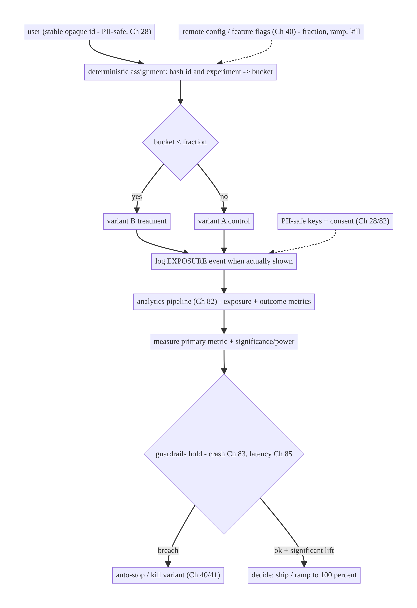
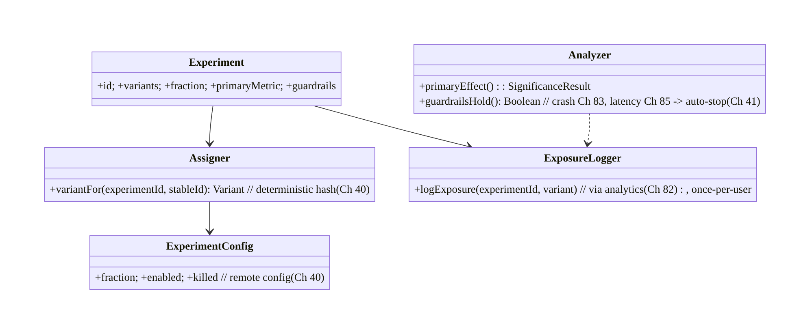
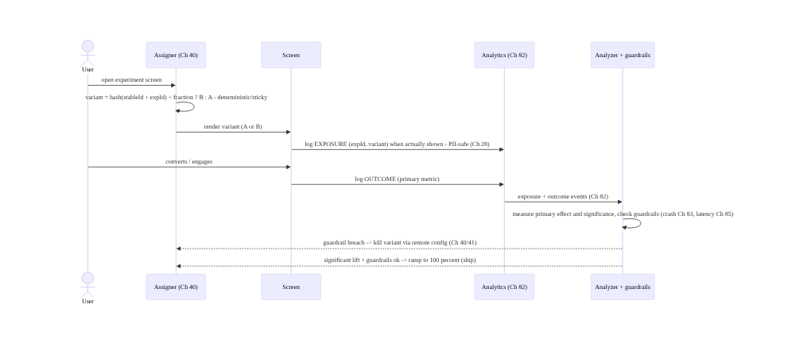
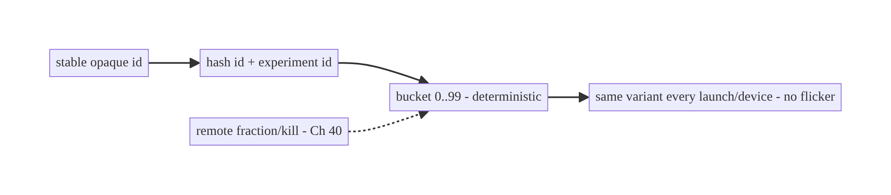
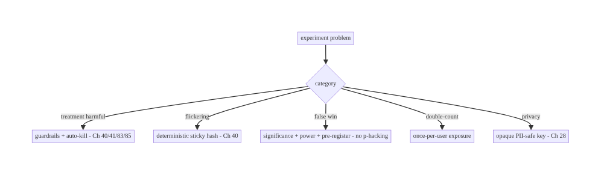

# Chapter 86 — A/B Testing & Experimentation

> **Part X — Performance, Observability & Quality** · Complexity: **Standard** (≥25 interview questions)
>
> **Prerequisites:** Ch 40 (feature flags/remote config), Ch 82 (analytics pipeline), Ch 84
> (correlation), Ch 28 (privacy), Ch 41 (staged rollout). Pairs with Ch 85 (perf), Ch 83
> (crash/guardrails), Ch 72 (recommendations).
>
> **Reference surface in StreamCart:** running **controlled experiments** — assigning users
> to **variants** (control vs treatment), exposing a change to a **fraction** of traffic,
> measuring the effect on **metrics** (conversion, retention, latency, Ch 85), and deciding
> whether to **ship or kill** — built on the same **remote config / feature-flag** plumbing
> (Ch 40) and **analytics pipeline** (Ch 82), with **consistent assignment**, **guardrail
> metrics**, and **privacy** (Ch 28).

---

## 86.1 Problem Definition and Real-World Context

"Will this change actually help?" is usually unknowable by opinion — a new checkout button, a
reordered feed, a different onboarding (Ch 80) may help or hurt, and only a **controlled
experiment** tells you. **A/B testing** assigns users to **variants** (A = control / existing,
B = treatment / new), exposes the change to a **fraction** of traffic, measures the effect on
**target metrics** (conversion, retention, revenue, engagement) and **guardrail metrics**
(crash rate Ch 83, latency Ch 85, uninstalls), and lets you **decide with data** whether to
**roll out or roll back**. It's built on the **feature-flag/remote-config** system (Ch 40)
(which variant to show) and the **analytics pipeline** (Ch 82) (measuring the outcome), with
**consistent, random assignment**, **statistical significance**, and **privacy** (Ch 28).

Concretely, teams hit:

- **Shipping on opinion/HiPPO.** Without experiments you ship the highest-paid person's
  opinion and never know if it helped — or if it **hurt** a metric you didn't watch.
- **Inconsistent assignment.** A user **flickering** between variants (seeing A then B)
  ruins the experiment and the UX. Assignment must be **deterministic/sticky** per user
  (hash of a stable id, Ch 40) so a user stays in one variant.
- **No guardrails.** A treatment that lifts clicks but **triples crashes** (Ch 83) or
  **doubles latency** (Ch 85) is a loss; experiments need **guardrail metrics** that stop a
  harmful variant (tie into staged rollout/kill switch, Ch 41/40).
- **Measuring the wrong thing / p-hacking.** Picking the metric after seeing results,
  peeking and stopping early, or ignoring significance leads to false wins. Need a
  **pre-registered** primary metric, adequate **sample size/power**, and **significance**.
- **Exposure vs assignment.** You must log when a user was **actually exposed** to the
  variant (saw the change), not just assigned, to measure effect correctly.
- **Built on flags, not a separate system.** Experiments reuse **remote config/feature
  flags** (Ch 40) for assignment+delivery and the **analytics pipeline** (Ch 82) for
  measurement — not a bespoke stack.
- **Privacy.** Assignment keys and exposure logs must be **PII-safe** and **consented**
  (Ch 28/82).

The architecture: **assign** users to variants **deterministically** (hash of a stable id, via
remote config/flags, Ch 40) so assignment is **sticky**; **expose** the treatment to a
**fraction** of traffic (ramp like staged rollout, Ch 41); **log exposure + outcomes** through
the **analytics pipeline** (Ch 82); **measure** the effect on a **pre-registered primary
metric** with **significance/power**, plus **guardrail metrics** (crash Ch 83, latency Ch 85)
that can **auto-stop** a harmful variant (Ch 40/41); keep assignment/exposure **PII-safe +
consented** (Ch 28); and **decide** ship/kill with data. This chapter is about **learning
whether a change helps, safely**.

### Three practical use cases

1. **Checkout button experiment (StreamCart).** 50/50 split on a redesigned place-order
   button (Ch 75); primary metric = checkout conversion; guardrails = crash rate (Ch 83) +
   checkout latency (Ch 85); sticky per-user; ship if significant lift and guardrails hold.
2. **Feed ranking experiment.** A new recommendation model (Ch 72) vs control, 10% ramp;
   primary = engagement/retention; guardrail = feed load latency (Ch 85) + reports.
3. **Onboarding experiment.** Two onboarding flows (Ch 80); primary = activation; sticky so a
   user never sees both; measured via the analytics funnel (Ch 82).

### Why this is architectural

Experimentation composes feature flags/remote config (Ch 40), the analytics pipeline (Ch 82),
staged rollout/kill switch (Ch 41), guardrails (crash Ch 83, perf Ch 85), and privacy (Ch 28).
The decisions — deterministic sticky assignment, fractional exposure, pre-registered metric +
significance, guardrails that auto-stop — determine whether experiments produce **trustworthy
decisions** rather than noise or harm.

---

## 86.2 Requirements Engineering

### Functional requirements

| ID | Requirement |
|----|-------------|
| F1 | Assign users to variants deterministically/sticky (hash of stable id, via flags, Ch 40). |
| F2 | Expose treatment to a configurable fraction; ramp like staged rollout (Ch 41). |
| F3 | Log exposure + outcome metrics through the analytics pipeline (Ch 82). |
| F4 | Measure effect on a pre-registered primary metric with significance/power. |
| F5 | Watch guardrail metrics (crash Ch 83, latency Ch 85); auto-stop harmful variants (Ch 40/41). |
| F6 | Keep assignment/exposure PII-safe + consented (Ch 28). |

### Non-functional requirements

| Attribute | Policy |
|-----------|--------|
| **Consistency** | Sticky per-user assignment; no flickering. |
| **Trustworthiness** | Pre-registered metric; significance; no p-hacking. |
| **Safety** | Guardrails + kill switch (Ch 40/41/83). |
| **Privacy** | PII-safe keys; consent (Ch 28/82). |
| **Reuse** | Built on flags (Ch 40) + analytics (Ch 82), not bespoke. |

### Scope

- **In scope:** variant assignment (deterministic/sticky hash, via remote config/flags, Ch 40),
  fractional exposure + ramp (Ch 41), exposure logging, outcome metrics via analytics (Ch 82),
  primary + guardrail metrics, significance/power/sample-size basics, auto-stop (Ch 40/41/83),
  PII-safe + consent (Ch 28), ship/kill decision.
- **Out of scope:** flag plumbing (Ch 40), analytics pipeline internals (Ch 82), rollout
  mechanics (Ch 41), deep statistics (reference only), recommendation models (Ch 72).

### Assumptions & constraints

- Remote config/feature-flag system (Ch 40) for assignment+delivery; analytics pipeline
  (Ch 82) for measurement; staged-rollout/kill-switch (Ch 41/40) for safety. Assignment is
  **deterministic** (hash of a stable, PII-safe id). Primary metric **pre-registered**;
  guardrails watched. Consent respected (Ch 28). `minSdk 24`.

---

## 86.3 System Design Fundamentals

- **Experiment = controlled comparison.** Split users into **control (A)** and **treatment
  (B)** (or multiple variants), change **one thing** for treatment, measure the **difference**
  in a metric. Random assignment makes the groups comparable so the difference is **caused**
  by the change (causal inference), not correlation.
- **Deterministic, sticky assignment (the key client property, Ch 40).** A user must get the
  **same variant every time** — **hash a stable id** (an opaque experiment/user id, PII-safe,
  Ch 28) with the experiment id into a bucket; `bucket < fraction → treatment`. This is
  **stateless** (no stored assignment needed), **consistent** across launches/devices, and
  delivered via **remote config/flags** (Ch 40). Flickering between variants ruins both data
  and UX — stickiness is non-negotiable.
- **Fractional exposure + ramp (Ch 41).** Start the treatment at a **small fraction** (1%,
  5%) and **ramp** like a staged rollout (Ch 41) — this limits blast radius and lets
  **guardrails** catch harm before full exposure. The fraction is a remote-config value (Ch 40)
  you can change server-side.
- **Exposure logging vs assignment (subtle but important).** Log when a user is **actually
  exposed** (rendered/experienced the variant), not merely **assigned** — a user assigned to
  treatment who never reaches the screen shouldn't dilute the measurement. Analyze on
  **exposed** users (or intention-to-treat consistently); exposure is an analytics event
  (Ch 82).
- **Primary metric + guardrails (pre-registered).** Decide **before** the experiment: a
  **primary metric** (the thing you're trying to move — conversion, retention, revenue) and
  **guardrail metrics** (things that must **not** get worse — crash rate Ch 83, latency Ch 85,
  uninstalls, errors). You **ship** only if the primary improves **significantly** and
  guardrails **hold**; a guardrail breach **auto-stops/kills** the variant (Ch 40/41).
- **Statistical significance, power, sample size (avoid false wins).** A difference could be
  **noise**; you need **significance** (the effect is unlikely by chance, e.g., p < 0.05 or a
  confidence interval excluding zero) and enough **sample size/power** to detect the effect.
  **Don't p-hack:** don't pick the metric after the fact, don't **peek-and-stop** early
  (inflates false positives — use sequential tests or a fixed horizon), don't run many metrics
  and cherry-pick. Pre-register; decide on the primary.
- **Built on flags + analytics (reuse, Ch 40/82).** Experiments aren't a new system:
  **assignment/delivery** = remote config/feature flags (Ch 40); **measurement** = the
  analytics pipeline (Ch 82); **safety** = staged rollout/kill switch (Ch 41/40). The
  experiment layer adds **buckets, exposure logs, and analysis**.
- **Privacy (Ch 28/82).** The **assignment key** is an **opaque, PII-safe** id (Ch 28);
  exposure/outcome events follow the **consent** regime (Ch 82). Don't key experiments on PII;
  don't leak which variant implies sensitive info.
- **Interaction & isolation.** Running many experiments at once can **interact**; use
  **layers/mutually-exclusive** buckets for conflicting experiments, or accept orthogonal
  randomization for independent ones.

Core insight: **assign users to variants deterministically and stickily by hashing a stable,
PII-safe id with the experiment id (via remote config/feature flags, Ch 40 — so a user never
flickers between A and B), expose the treatment to a configurable fraction and ramp it like a
staged rollout (Ch 41) to bound blast radius; log actual exposure (not just assignment) and
outcomes through the analytics pipeline (Ch 82); decide ship/kill on a pre-registered primary
metric with real statistical significance and adequate power (no p-hacking, no peek-and-stop)
while guardrail metrics — crash rate (Ch 83), latency (Ch 85), uninstalls — must not regress
and auto-stop a harmful variant (Ch 40/41); and keep assignment keys and exposure logs
PII-safe and consented (Ch 28) — reusing the flag and analytics infrastructure rather than
building a bespoke stack.**

---

## 86.4 High-Level Architecture



**Components & ownership**

- **Assigner** hashes a stable id → variant (deterministic/sticky), gated by remote config
  (Ch 40).
- **Exposure logger** records actual exposure via analytics (Ch 82).
- **Analyzer** (backend) measures primary metric + significance; watches **guardrails**
  (Ch 83/85) → **auto-stop** (Ch 40/41).
- **Decision:** ship/kill. **Privacy:** PII-safe keys + consent (Ch 28).

**Direction:** stable id → deterministic bucket (flags, Ch 40) → variant → exposure/outcome via
analytics (Ch 82) → significance + guardrails → ship/kill.

---

## 86.5 Detailed Component Design



| Component | Responsibility |
|-----------|----------------|
| `Experiment` | definition: variants, fraction, primary + guardrail metrics |
| `Assigner` | deterministic sticky variant from a stable id (Ch 40) |
| `ExposureLogger` | log actual exposure via analytics, once per user (Ch 82) |
| `ExperimentConfig` | remote fraction/enabled/killed (Ch 40) |
| `Analyzer` | significance on primary + guardrail watch → auto-stop (backend, Ch 83/85/41) |

---

## 86.6 End-to-End Data Flow

### Assign → expose → measure → decide



### Sticky assignment (no flicker)



---

## 86.7 Complete Kotlin Implementation

Package: `com.streamcart.experiments`.

### 86.7.1 Deterministic, sticky assignment (built on flags, Ch 40)

```kotlin
enum class Variant { CONTROL, TREATMENT }

@Singleton
class Assigner @Inject constructor(
    private val config: ExperimentConfig,    // remote config (Ch 40)
    private val ids: StableIdProvider,       // opaque, PII-safe id (Ch 28)
) {
    /** Deterministic + sticky: same user -> same variant every time, no stored state. */
    fun variantFor(experimentId: String): Variant {
        if (config.isKilled(experimentId)) return Variant.CONTROL           // kill switch (Ch 40/41)
        val fraction = config.fraction(experimentId)                         // remote ramp (Ch 41)
        val bucket = bucketOf(ids.stableId(), experimentId)                  // 0..9999
        return if (bucket < (fraction * 10000).toInt()) Variant.TREATMENT else Variant.CONTROL
    }
    private fun bucketOf(stableId: String, experimentId: String): Int {
        val digest = MessageDigest.getInstance("SHA-256").digest("$experimentId:$stableId".toByteArray())
        val v = ((digest[0].toInt() and 0xFF) shl 8) or (digest[1].toInt() and 0xFF)   // stable hash
        return v % 10000
    }
}
```

### 86.7.2 Exposure logging (via analytics, once per user, Ch 82)

```kotlin
@Singleton
class ExposureLogger @Inject constructor(private val analytics: Analytics) {   // Ch 82
    private val logged = Collections.synchronizedSet(mutableSetOf<String>())    // once per (exp,variant) per session
    /** Log ONLY when the variant is actually shown - exposure, not just assignment. */
    fun logExposure(experimentId: String, variant: Variant) {
        if (logged.add("$experimentId:$variant")) {
            analytics.track(AnalyticsEvent.Exposure(                            // PII-safe (Ch 28)
                experimentId = experimentId, variant = variant.name))           // opaque; via pipeline (Ch 82)
        }
    }
}
```

### 86.7.3 Using an experiment in UI

```kotlin
@Composable
fun CheckoutButton(assigner: Assigner, exposure: ExposureLogger, onPlace: () -> Unit) {
    val variant = remember { assigner.variantFor("checkout_button_v2") }        // sticky (Ch 40)
    LaunchedEffect(variant) { exposure.logExposure("checkout_button_v2", variant) }  // exposure (Ch 82)
    when (variant) {
        Variant.TREATMENT -> NewPlaceOrderButton(onPlace)                        // B: new design
        Variant.CONTROL   -> ClassicPlaceOrderButton(onPlace)                    // A: existing
    }
    // Outcome (conversion) logged by the checkout flow (Ch 75) via analytics (Ch 82).
}
```

### 86.7.4 Remote config: fraction, ramp, kill (Ch 40)

```kotlin
@Singleton
class ExperimentConfig @Inject constructor(private val remoteConfig: RemoteConfig) {   // Ch 40
    fun fraction(expId: String): Double = remoteConfig.getDouble("exp_${expId}_fraction", 0.0)  // ramp (Ch 41)
    fun isKilled(expId: String): Boolean = remoteConfig.getBoolean("exp_${expId}_killed", false) // kill (Ch 40)
    // Backend ramps fraction 0.01 -> 0.05 -> 0.5 -> 1.0 while guardrails hold (Ch 41);
    // sets killed=true if a guardrail breaches (crash Ch 83, latency Ch 85).
}
```

### 86.7.5 Analysis (backend-side, documented)

```kotlin
// Analysis is backend (on the analytics warehouse, Ch 82):
//  - PRIMARY: effect = metric(treatment_exposed) - metric(control_exposed); significance (CI excludes 0 / p<0.05)
//  - POWER/SAMPLE SIZE: ensure enough exposed users to detect the expected effect (pre-registered)
//  - GUARDRAILS: crash rate (Ch 83), latency p95 (Ch 85), uninstalls MUST NOT regress -> else auto-kill (Ch 41)
//  - NO p-hacking: pre-registered primary metric; fixed horizon or sequential test (no naive peeking)
//  - DECISION: ship (ramp to 100%) if significant lift + guardrails hold; else kill (Ch 40)
```

### 86.7.6 Module structure

```
:core:experiments  Assigner (deterministic, Ch 40), ExposureLogger (Ch 82), ExperimentConfig (Ch 40)
# Delivery/assignment reuse flags (Ch 40); measurement reuses analytics (Ch 82);
# safety reuses staged rollout/kill (Ch 41); guardrails -> crash (Ch 83) + perf (Ch 85).
# Analysis/significance -> backend warehouse. PII-safe keys -> Ch 28.
```

---

## 86.8 Concurrency and Race Conditions

| Scenario | Risk | Handling |
|----------|------|----------|
| User flickers A↔B | ruined data + UX | deterministic sticky hash (Ch 40) |
| Exposure logged many times | inflated counts | once-per-user/session dedupe |
| Assignment on PII | privacy leak | opaque stable id (Ch 28) |
| Peeking/early stop | false wins | pre-registered horizon / sequential test |
| Guardrail breach unnoticed | user harm | guardrails + auto-kill (Ch 83/85/41) |
| Many experiments interact | confounded | layers / mutual exclusion |
| Fraction change mid-flight | re-bucket | deterministic hash keeps assignment stable |

- **Deterministic hashing** gives stickiness **without stored state** and is **stable across
  devices** (same stable id, Ch 40) — raising the fraction only **adds** users to treatment,
  never moves existing ones out (monotonic bucketing).
- **Exposure dedupe** ensures you count **users**, not impressions, consistently.
- **Guardrails + auto-kill** make experiments **safe** — a harmful treatment is stopped via
  remote config (Ch 40/41) before wide exposure.

---

## 86.9 Failure Scenarios and Recovery

| Failure | Detection | Response | Outcome |
|---------|-----------|----------|---------|
| Treatment harms a metric | guardrail breach | auto-kill via remote config (Ch 40/41) | contained |
| User sees both variants | flicker reports | deterministic sticky assignment (Ch 40) | consistent |
| False win (noise) | low power/peeking | significance + power + pre-registration | trustworthy |
| Exposure double-counted | inflated metric | once-per-user dedupe | accurate |
| PII in assignment key | privacy audit | opaque id (Ch 28) | safe |
| Experiments interact | confounded results | layers / mutual exclusion | isolated |
| Shipped a loser | post-hoc metrics | guardrails + decision gate | prevented |



> **Make assignment sticky, measure a pre-registered metric with real significance, and let
> guardrails auto-kill harm.** The failure modes of experimentation are flickering (sticky
> hashing fixes it), false wins (significance + power + pre-registration fix it), and shipping
> a harmful treatment (guardrails + kill switch fix it). Reuse flags (Ch 40) and analytics
> (Ch 82) rather than building bespoke, and keep keys PII-safe (Ch 28).

---

## 86.10 Scaling the Implementation

- **Level 1.** A single flag-gated A/B via remote config (Ch 40); outcome via analytics
  (Ch 82); eyeball the result.
- **Level 2.** Deterministic sticky assignment; exposure logging; pre-registered primary +
  guardrails (Ch 83/85); fractional ramp (Ch 41).
- **Level 3 — production.** Significance/power analysis (backend); auto-kill on guardrail
  breach (Ch 40/41); PII-safe keys + consent (Ch 28).
- **Level 4 — platform.** Experimentation platform: many concurrent experiments with
  **layers/mutual exclusion**, metric libraries, automated analysis dashboards, sequential
  testing, holdbacks.
- **Level 5 — enterprise.** Org-wide experimentation culture: metric governance, CUPED/
  variance reduction, interleaving (Ch 72), long-term holdouts, guardrail SLOs, experiment
  review boards.

**Avoid overengineering:** a flag-gated, deterministic A/B with a pre-registered primary
metric, guardrails, and a significance check covers most needs. Don't build a platform for one
test; don't ship on opinion; don't skip guardrails or stickiness.

---

## 86.11 Alternative Approaches and Trade-offs

| Dimension | Option A | Option B | When |
|-----------|----------|----------|------|
| Assignment | Deterministic hash (sticky, Ch 40) | stored/random per-call | Hash (sticky, stateless) |
| Delivery | Remote config/flags (Ch 40) | bespoke system | Reuse flags |
| Measurement | Analytics pipeline (Ch 82) | custom logging | Reuse analytics |
| Analysis | Significance + power | eyeball/averages | Significance (trustworthy) |
| Safety | Guardrails + auto-kill (Ch 40/41) | none | Guardrails always |
| Exposure | Log actual exposure | assignment-only | Exposure (correct effect) |
| Stopping | Pre-registered/sequential | peek-and-stop | Pre-registered (no p-hacking) |

**Deterministic hash vs stored assignment:** **hashing** a stable id gives **sticky, stateless,
cross-device** assignment (same user → same variant, raising the fraction never re-buckets
existing users) — no storage, no sync. **Stored** assignment needs persistence/sync and can
drift. Prefer **deterministic hashing** (Ch 40).

**Experiment vs ship-on-opinion:** shipping without an experiment means you **never know** if
the change helped — or if it **hurt** an unwatched metric (crashes, latency). A controlled
experiment with a **pre-registered primary metric, significance, and guardrails** gives a
**trustworthy, safe** decision. Experiment for anything that matters.

**Reuse (flags + analytics) vs bespoke:** building a separate experimentation stack duplicates
**assignment** (flags, Ch 40), **measurement** (analytics, Ch 82), and **safety** (rollout/kill,
Ch 41). Reusing them means experiments inherit **reliability, consent, and kill switches** for
free; the experiment layer only adds **buckets, exposure, analysis**.

---

## 86.12 Security & Privacy Considerations

- **PII-safe assignment key (Ch 28):** hash an **opaque, stable** id (not email/phone); the
  bucket reveals nothing personal. Don't key experiments on PII.
- **Consent (Ch 28/82):** exposure/outcome events follow the same **consent** regime as
  analytics; opted-out users limited to essential/anonymous.
- **No sensitive-variant leakage:** don't let "which variant" imply sensitive info (e.g., an
  experiment targeting a protected group) — avoid discriminatory targeting.
- **Guardrails include safety:** crash (Ch 83), ANR, security errors as guardrails — a variant
  that degrades safety is killed (Ch 40/41).
- **Kill switch (Ch 40/41):** a harmful or abused experiment is **remotely killable** without
  an app update.
- Client vs backend: the **client** assigns deterministically and logs PII-safe exposure; the
  **backend** analyzes significance, watches guardrails, and controls fraction/kill (Ch 40) —
  neither stores PII in experiment keys.

---

## 86.13 Performance and Resource Optimization

- **Assignment is cheap** — a single hash; **no network** (fraction comes from already-fetched
  remote config, Ch 40). Compute once per screen (`remember`).
- **Exposure logging is batched** via the analytics pipeline (Ch 82) — once per user/session,
  not per frame.
- **No extra storage** — deterministic hashing needs no stored assignment.
- **Guardrails reuse existing metrics** (crash Ch 83, perf Ch 85) — no new capture.
- **Ramp bounds cost/risk** — small fraction first (Ch 41).
- **Profiling:** assignment cost (negligible), exposure event volume, remote-config fetch
  (Ch 40), analysis cost (backend).

---

## 86.14 Testing Strategy

Assignment determinism, fraction gating, and exposure dedupe are unit-testable; significance is
validated on real data.

```kotlin
class AssignerTest {
    @Test fun `assignment is deterministic and sticky`() {
        val v1 = assigner.variantFor("exp_checkout"); val v2 = assigner.variantFor("exp_checkout")
        assertEquals(v1, v2)   // same user -> same variant, every call (Ch 40)
    }
    @Test fun `fraction gates treatment`() {
        config.setFraction("exp_checkout", 0.0); assertEquals(Variant.CONTROL, assigner.variantFor("exp_checkout"))
        config.setFraction("exp_checkout", 1.0); assertEquals(Variant.TREATMENT, assigner.variantFor("exp_checkout"))
    }
    @Test fun `killed experiment forces control`() {
        config.kill("exp_checkout"); assertEquals(Variant.CONTROL, assigner.variantFor("exp_checkout"))   // Ch 40/41
    }
}

class ExposureLoggerTest {
    @Test fun `exposure logged once per user`() {
        exposure.logExposure("exp", Variant.TREATMENT); exposure.logExposure("exp", Variant.TREATMENT)
        assertEquals(1, analytics.exposureCount("exp"))   // dedupe (Ch 82)
    }
}
// Significance/power validated on the analytics warehouse with real exposed-user data (Ch 82).
```

What to test: deterministic sticky assignment (Ch 40); fraction/kill gating (Ch 40/41);
exposure dedupe (once per user, Ch 82); PII-safe key; guardrail wiring (crash Ch 83, latency
Ch 85). Significance/power validated on real data; ramp via staged rollout (Ch 41).

---

## 86.15 Production Observability

- **Metrics:** per-experiment **exposure counts** (treatment/control), **primary metric** by
  variant with significance/CI, **guardrail metrics** (crash rate Ch 83, latency p95 Ch 85,
  uninstalls) by variant, **fraction/ramp** state (Ch 40/41), kill events.
- **Logs:** exposure/outcome events in the analytics pipeline (Ch 82) — **PII-safe** (Ch 28).
- **Debugging:** flicker → check deterministic assignment (Ch 40); false win → check power/
  significance/peeking; no effect → check exposure logging (did users actually see it?);
  guardrail breach → which metric, auto-kill fired? (Ch 40/41).
- **Alerting:** **guardrail breach** on any live experiment (crash/latency spike in treatment
  → auto-kill, Ch 40/41/83/85); experiment running underpowered/too long.
- **Dashboards:** per-experiment primary vs guardrail by variant; ramp state; significance;
  decision (ship/kill).

---

## 86.16 System Design Interview Preparation

> ≥25 questions.

**Fundamentals**

1. *What is A/B testing?* Controlled comparison of control vs treatment on a metric.
2. *Why experiment?* Causal evidence a change helps — not opinion.
3. *Assignment?* Deterministic hash of a stable id → sticky variant (Ch 40).
4. *Why sticky?* No flickering; consistent data + UX.
5. *Built on?* Flags/remote config (Ch 40) + analytics (Ch 82).

**Assignment**

6. *Deterministic how?* Hash(stableId + expId) → bucket < fraction.
7. *Stateless?* Yes — no stored assignment; stable across devices.
8. *Raise fraction?* Monotonic — adds users, doesn't re-bucket.
9. *PII?* Opaque stable id, not PII (Ch 28).

**Exposure/metrics**

10. *Exposure vs assignment?* Log when actually shown, not just assigned.
11. *Primary metric?* Pre-registered; the thing you move.
12. *Guardrails?* Must-not-regress: crash (Ch 83), latency (Ch 85), uninstalls.
13. *Where measured?* Analytics pipeline (Ch 82).

**Statistics**

14. *Significance?* Effect unlikely by chance (p<0.05 / CI excludes 0).
15. *Power/sample size?* Enough exposed users to detect the effect.
16. *p-hacking?* Pre-register; no peek-and-stop; no metric cherry-picking.
17. *Peeking?* Inflates false positives; fixed horizon or sequential test.

**Safety**

18. *Guardrail breach?* Auto-kill via remote config (Ch 40/41).
19. *Ramp?* Small fraction first (Ch 41), like staged rollout.
20. *Kill switch?* Remote, no app update (Ch 40).

**Edge cases**

21. *Many experiments?* Layers / mutual exclusion to avoid interaction.
22. *Flickering?* Deterministic sticky hash (Ch 40).
23. *Privacy?* Opaque keys + consent (Ch 28/82).

**Testing/Production**

24. *Test assignment?* Determinism + fraction/kill gating.
25. *No effect seen?* Check exposure logging + power.
26. *Ship decision?* Significant lift + guardrails hold.

### Design-change challenges
1. **Run a checkout button A/B.** Deterministic 50/50, primary = conversion, guardrails =
   crash+latency (Ch 83/85), auto-kill.
2. **Prevent flickering.** Deterministic sticky hash of a stable id (Ch 40).
3. **Avoid a false win.** Pre-register primary, ensure power, no peeking.
4. **Safely ramp a risky model (Ch 72).** Fractional ramp + guardrails + auto-kill (Ch 41).
5. **Run many experiments without interference.** Layers / mutual exclusion.

### Mock walkthrough (abridged)
Clarify (hypothesis, primary metric, guardrails, traffic?) → deterministic sticky assignment
(hash stable id, Ch 40) → fractional exposure + ramp (Ch 41) → log exposure + outcome via
analytics (Ch 82) → measure primary with significance + power (pre-registered, no p-hacking) →
guardrails (crash Ch 83, latency Ch 85) auto-kill (Ch 40/41) → PII-safe + consent (Ch 28) →
decide ship/kill → observability (per-variant metrics).

---

## 86.17 Practical Exercises

1. **Beginner.** Flag-gate a UI change as a deterministic 50/50 A/B (Ch 40) and log exposure +
   an outcome via analytics (Ch 82). *Eval:* sticky assignment; exposure logged.
2. **Intermediate.** Add a pre-registered primary metric and guardrails (crash Ch 83, latency
   Ch 85); ramp the fraction (Ch 41). *Eval:* guardrails wired; ramp works.
3. **Advanced.** Implement auto-kill on guardrail breach via remote config (Ch 40/41) and
   document a significance/power plan. *Eval:* auto-kill fires; power considered.
4. **Production debugging.** Investigate a "no effect" result — verify exposure logging and
   power; investigate flickering — verify deterministic assignment. *Eval:* root cause found.
5. **System design challenge.** Design multi-experiment layers/mutual exclusion with per-
   experiment guardrails and automated analysis. *Eval:* isolation; trustworthy decisions.

*(Solutions withheld unless requested.)*

---

## 86.18 Chapter Summary & Reference Sheet

**Key decisions:** run **controlled experiments** by **assigning users to variants
deterministically and stickily** — hash a **stable, PII-safe id** with the experiment id (via
**remote config/feature flags**, Ch 40) so a user gets the **same variant every time** (no
flickering), with **no stored state** and **cross-device** consistency; **expose** the treatment
to a **configurable fraction** and **ramp** it like a **staged rollout** (Ch 41) to bound blast
radius; **log actual exposure** (not just assignment) and outcomes through the **analytics
pipeline** (Ch 82); **decide ship/kill on a pre-registered primary metric** with real
**statistical significance** and adequate **power** (**no p-hacking, no peek-and-stop**), while
**guardrail metrics** — **crash rate** (Ch 83), **latency** (Ch 85), uninstalls — **must not
regress** and **auto-stop/kill** a harmful variant via remote config (Ch 40/41); and keep
**assignment keys and exposure logs PII-safe and consented** (Ch 28) — **reusing** the flag
(Ch 40) and analytics (Ch 82) infrastructure rather than building a bespoke stack.

**Concepts:** control vs treatment, deterministic sticky assignment (hash, Ch 40), fractional
exposure + ramp (Ch 41), exposure vs assignment logging, primary + guardrail metrics,
significance/power/sample-size, no p-hacking/peeking, auto-kill (Ch 40/41/83/85), reuse of flags
+ analytics (Ch 40/82), PII-safe keys + consent (Ch 28).

**Common mistakes:** shipping on opinion; non-sticky assignment (flickering); logging
assignment instead of exposure; no guardrails (harmful treatment ships); p-hacking/peek-and-
stop/underpowered (false wins); keying on PII; building a bespoke stack instead of reusing flags
+ analytics; no kill switch.

**Checklist:**

- [ ] deterministic sticky assignment (hash stable id, Ch 40)
- [ ] fractional exposure + ramp (Ch 41)
- [ ] log actual exposure + outcome via analytics (Ch 82)
- [ ] pre-registered primary metric
- [ ] significance + power (no p-hacking/peeking)
- [ ] guardrails (crash Ch 83, latency Ch 85) auto-kill (Ch 40/41)
- [ ] PII-safe keys + consent (Ch 28)
- [ ] reuse flags + analytics
- [ ] layers for many experiments
- [ ] ship/kill decision gate.

**Key APIs/concepts:** remote config / feature flags (assignment + fraction + kill, Ch 40),
SHA-256 bucketing (deterministic sticky), analytics pipeline (exposure + outcomes, Ch 82),
staged rollout (ramp, Ch 41), guardrail metrics (crash Ch 83, perf Ch 85), significance/power
(backend analysis), consent/PII-safe keys (Ch 28).

**References:**
- Firebase Remote Config + A/B Testing: https://firebase.google.com/docs/ab-testing
- Trustworthy Online Controlled Experiments (Kohavi et al.) — the standard reference
- Statistical significance / power — experimentation literature
- (composes) Ch 40 Feature Flags/Remote Config, Ch 82 Analytics, Ch 41 Staged Rollout, Ch 83 Crash, Ch 85 Perf, Ch 28 Privacy, Ch 72 Recommendations

### Chapter review (Phase 4)
- **Completeness:** all 18 sections; architecture/class/sequence/sticky/failure diagrams;
  assigner + exposure + remote-config code; concurrency (stickiness, dedupe, auto-kill);
  failure (sticky+significance+guardrails principle); 5 levels; hash-vs-stored, experiment-vs-
  opinion, reuse trade-offs; security (PII-safe keys, consent, no discriminatory targeting);
  perf (cheap assignment, batched exposure); assigner + exposure tests; observability (per-
  variant + guardrails); 26 Q&A + 5 challenges. ✅
- **Expand later:** flags/remote config (Ch 40), analytics (Ch 82), staged rollout (Ch 41),
  guardrails (crash Ch 83, perf Ch 85).
- **Interview coverage:** exceeds ≥25 bar.
