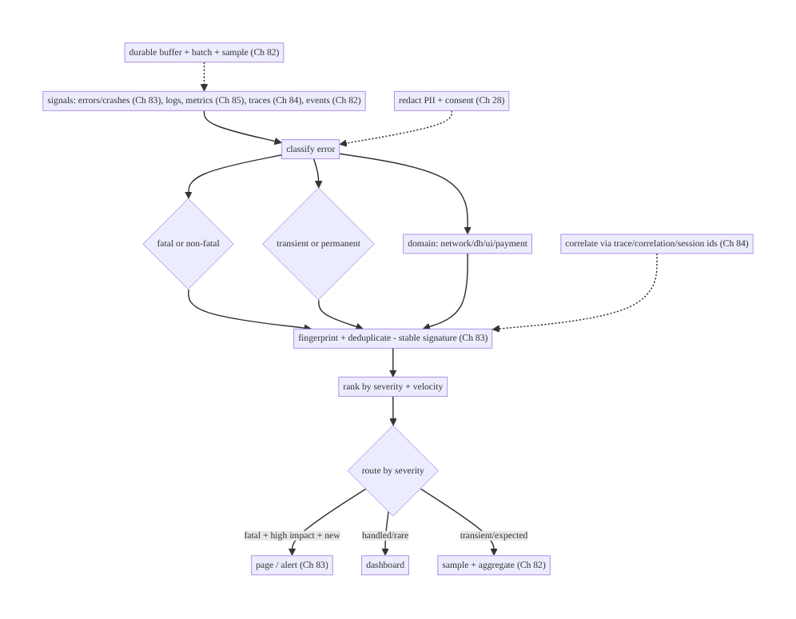
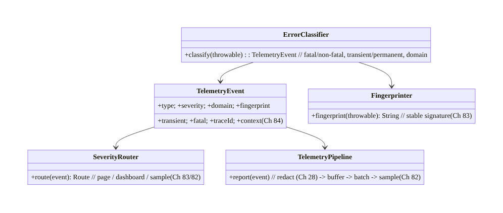
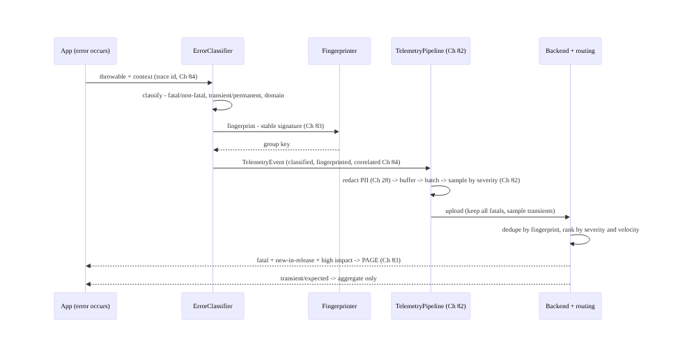
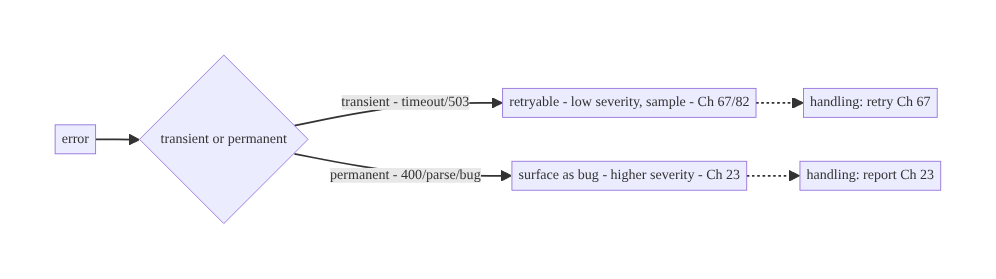
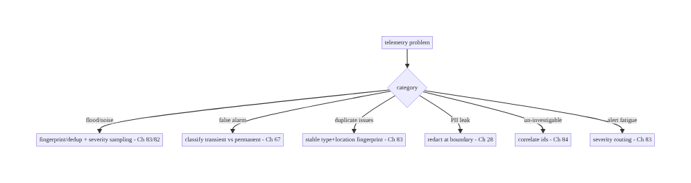

# Chapter 87 — Error Classification & Telemetry Pipeline

> **Part X — Performance, Observability & Quality** · Complexity: **Standard** (≥25 interview questions)
>
> **Prerequisites:** Ch 82 (analytics/logging pipeline), Ch 83 (crash/ANR), Ch 84 (tracing),
> Ch 85 (perf), Ch 28 (privacy), Ch 23 (error handling/Result). Pairs with Ch 81 (feedback/
> diagnostics), Ch 67 (network errors).
>
> **Reference surface in StreamCart:** the unifying **telemetry pipeline** that ingests all
> signals — **errors** (handled + unhandled, Ch 83), **logs**, **metrics** (Ch 85), **traces**
> (Ch 84), **analytics** (Ch 82) — and the **error classification** scheme that turns raw
> failures into **actionable, grouped, severity-ranked, PII-safe** signal: fatal vs non-fatal,
> transient vs permanent, by domain/cause, **fingerprinted/deduplicated**, routed by severity.

---

## 87.1 Problem Definition and Real-World Context

Previous chapters built individual observability pillars — **analytics** (Ch 82), **crash/ANR**
(Ch 83), **tracing** (Ch 84), **performance** (Ch 85). This chapter is the **unifying layer**:
a **telemetry pipeline** that ingests **all** signals (errors, logs, metrics, traces, events)
through one **reliable, batched, consented, PII-safe** path, and an **error classification**
scheme that turns the flood of raw failures into **actionable** signal — **grouped**
(fingerprinted/deduplicated so 10,000 occurrences of one bug are one issue), **classified**
(fatal vs non-fatal, transient vs permanent, by domain), **severity-ranked** (what needs a page
vs a dashboard), and **routed** accordingly. Without classification, telemetry is **noise**:
you can't tell a retryable network blip (Ch 67) from a data-corruption bug, or a one-off from a
crash-looping release (Ch 83).

Concretely, teams hit:

- **Signal silos.** Analytics, crashes, traces, metrics in **separate** SDKs/pipelines with no
  **correlation** (Ch 84) — you can't connect a slow trace to the crash it caused. Need a
  **unified pipeline** (or at least correlated via ids, Ch 84).
- **Unclassified errors = noise.** 50,000 errors/day with no **grouping** or **severity** is
  useless. Errors must be **classified**: **fatal** (crash, Ch 83) vs **non-fatal** (handled,
  Ch 23); **transient** (retryable network, Ch 67) vs **permanent** (bug/data); by **domain**
  (network/db/UI/payment). And **fingerprinted** so duplicates collapse.
- **No deduplication/fingerprinting.** The **same** bug reported 10,000 times should be **one
  issue** with a count — group by a **stable fingerprint** (stack signature, error type +
  location), not raw text (Ch 83).
- **No severity routing.** A **fatal, high-volume, new-in-this-release** error needs a **page**
  (Ch 83); a rare handled warning needs a **dashboard**. Severity drives **routing/alerting**.
- **PII in telemetry.** Errors/logs often carry PII (user data in a stack message, a URL with
  a token) — must be **redacted** (Ch 28) at the boundary.
- **Reliability/cost of the pipeline.** Telemetry must be **durably buffered, batched,
  sampled** (Ch 82) — not lose data on crash, not drain battery/data, not cost a fortune at
  volume.
- **Transient vs permanent handling.** A **transient** error (timeout, 503, Ch 67) is
  **retryable** and often **expected** (lower severity); a **permanent** one (400, parse
  failure, assertion) is a **bug** (higher severity). Classification drives **handling**
  (retry vs report, Ch 23/67) and **severity**.

The architecture: a **unified telemetry pipeline** ingesting **errors/logs/metrics/traces/
events** (Ch 82/83/84/85) through one **reliable, batched, consented, PII-safe** path;
**classify** each error — **fatal/non-fatal**, **transient/permanent**, by **domain** —
**fingerprint and deduplicate** (group by stable signature, Ch 83), **rank by severity**, and
**route** (page/dashboard/sample); **correlate** across pillars via ids (Ch 84); **redact PII**
at the boundary (Ch 28); and **sample/buffer** for reliability + cost (Ch 82). This chapter is
about **turning raw failure signal into actionable, deduplicated, severity-ranked, PII-safe
telemetry**.

### Three practical use cases

1. **Classified, deduplicated errors (StreamCart).** A null-deref in checkout (Ch 75) is
   **fingerprinted** (type + location) so its 8,000 occurrences are **one issue** with a count,
   **fatal/permanent** severity, routed to a **page** if new-in-release (Ch 83).
2. **Transient vs permanent network errors.** A 503 (Ch 67) is **transient/retryable**, logged
   at low severity and **sampled**; a 400 with a malformed request is **permanent**, surfaced as
   a bug.
3. **Cross-pillar correlation.** A slow trace (Ch 84/85) that ends in a handled error (Ch 23)
   is **correlated** by trace/correlation id so you see the full story (Ch 84).

### Why this is architectural

This is the **capstone** of observability: it composes analytics (Ch 82), crash (Ch 83),
tracing (Ch 84), performance (Ch 85), error handling (Ch 23/67), and privacy (Ch 28) into one
**classified, deduplicated, correlated, PII-safe** telemetry system. The decisions —
classification scheme, fingerprinting/dedup, severity routing, unified+correlated ingestion —
determine whether you can **operate** the app from signal rather than drown in noise.

---

## 87.2 Requirements Engineering

### Functional requirements

| ID | Requirement |
|----|-------------|
| F1 | Ingest errors/logs/metrics/traces/events through one reliable, batched pipeline (Ch 82/83/84/85). |
| F2 | Classify errors: fatal/non-fatal, transient/permanent, by domain. |
| F3 | Fingerprint + deduplicate (group by stable signature, Ch 83). |
| F4 | Rank by severity; route (page/dashboard/sample) (Ch 83). |
| F5 | Correlate across pillars via ids (Ch 84). |
| F6 | Redact PII at the boundary; consent (Ch 28); buffer/sample for reliability+cost (Ch 82). |

### Non-functional requirements

| Attribute | Policy |
|-----------|--------|
| **Actionability** | Classified, grouped, severity-ranked — not noise. |
| **Reliability** | Durably buffered; survives crash (Ch 82/83). |
| **Privacy** | PII redacted; consent (Ch 28). |
| **Cost** | Batched + sampled by severity (Ch 82). |
| **Correlation** | Cross-pillar via ids (Ch 84). |

### Scope

- **In scope:** unified telemetry ingestion (errors/logs/metrics/traces/events, Ch 82/83/84/85),
  error classification (fatal/non-fatal, transient/permanent, domain), fingerprinting/dedup
  (Ch 83), severity ranking + routing (page/dashboard/sample), cross-pillar correlation (Ch 84),
  PII redaction + consent (Ch 28), buffering/sampling (Ch 82), transient-vs-permanent handling
  (Ch 23/67).
- **Out of scope:** analytics internals (Ch 82), crash capture mechanics (Ch 83), tracing
  propagation (Ch 84), perf metrics (Ch 85), error-handling patterns (Ch 23), network retry
  (Ch 67).

### Assumptions & constraints

- A telemetry/observability backend (Crashlytics + analytics + tracing, or a unified APM)
  reached via the reliable pipeline (Ch 82). Errors **classified + fingerprinted**; severity
  drives **routing**; signals **correlated** by id (Ch 84); PII **redacted** (Ch 28); data
  **buffered + sampled**. `minSdk 24`.

---

## 87.3 System Design Fundamentals

- **Telemetry pillars, unified (Ch 82/83/84/85).** The signals: **logs** (discrete events),
  **metrics** (aggregated numbers, Ch 85), **traces** (causal spans, Ch 84), **events**
  (analytics, Ch 82), **errors/crashes** (Ch 83). A mature system ingests them through **one
  reliable, batched, consented, PII-safe pipeline** (Ch 82) and **correlates** them via shared
  ids (Ch 84) — so a slow trace, its metrics, and the error it produced tell one story.
- **Error classification (the core taxonomy):**
  - **Fatal vs non-fatal:** **fatal** = crash/ANR (process died, Ch 83); **non-fatal** =
    handled error the app recovered from (Ch 23) but is worth tracking. Different severity,
    different handling.
  - **Transient vs permanent:** **transient** = retryable, often expected (timeout, 503,
    offline, Ch 67/67) — lower severity, **sampled**; **permanent** = a bug or bad data (400,
    parse failure, `IllegalStateException`, assertion) — higher severity, surfaced. This drives
    **handling** (retry vs report, Ch 23) **and** severity.
  - **By domain/cause:** network (Ch 67), database (Ch 5), UI/render (Ch 90), payment (Ch 76),
    auth (Ch 20) — so you route to the right team and dashboard.
- **Fingerprinting & deduplication (Ch 83).** The **same** error happening 10,000 times is
  **one issue**, not 10,000 — compute a **stable fingerprint** (exception type + top app frame/
  location, normalized message) and **group** by it, keeping a **count + first/last seen +
  affected users + versions** (Ch 83). Group by **signature**, not raw text (which varies by
  dynamic values). Good fingerprinting is what makes error tools usable.
- **Severity ranking + routing.** Rank by **impact**: **fatal + high-volume + new-in-this-
  release + affecting many users** = **page** (Ch 83); a rare handled warning = **dashboard
  only**; transient/expected = **sampled/aggregated**. Severity drives **alerting** (Ch 83) and
  **sampling** (keep all fatals, sample transients, Ch 82). Velocity (spiking) matters as much
  as volume.
- **Correlation across pillars (Ch 84).** Attach **trace/correlation/session ids** (Ch 84) to
  every signal so an error links to its **trace** (what led to it, Ch 84), its **metrics**
  (Ch 85), the **session/release/device** context — turning an isolated error into an
  **investigable** story (Ch 84/81).
- **PII redaction at the boundary (Ch 28).** Errors/logs are the **biggest PII leak risk** —
  a stack message with user data, a URL with a token, a log line with an email. **Redact** at
  the pipeline boundary (allowlist fields, scrub patterns, Ch 28) **before** upload. Respect
  **consent** (Ch 82).
- **Reliability + cost (Ch 82).** The pipeline is **durably buffered** (survives crash — the
  crash report itself must persist, Ch 83), **batched**, and **sampled by severity** (keep all
  fatals, sample high-volume transients) to bound **battery/data/cost** (Ch 82). Telemetry
  mustn't lose the important signal or bankrupt you on the noise.
- **Structured, not free-text.** Signals are **structured** (type, severity, domain,
  fingerprint, context, ids) — queryable and groupable — not free-text logs. Structure is what
  enables classification, dedup, and correlation.

Core insight: **unify the observability pillars — logs, metrics (Ch 85), traces (Ch 84),
analytics events (Ch 82), errors/crashes (Ch 83) — into one reliable, batched, consented,
PII-safe telemetry pipeline, and classify every error along three axes (fatal vs non-fatal,
transient/retryable vs permanent/bug, and by domain) so classification drives both handling
(retry vs report, Ch 23/67) and severity; fingerprint and deduplicate errors by a stable
signature (type + location) so thousands of occurrences collapse into one counted, ranked issue
(Ch 83); rank by severity and velocity and route accordingly (page the fatal, new-in-release,
high-impact ones; dashboard the rest; sample the expected transients, Ch 82); correlate every
signal across pillars by trace/correlation/session ids (Ch 84) so an error links to the trace,
metrics, and context that explain it; and redact PII at the boundary with consent (Ch 28) while
durably buffering and severity-sampling for reliability and cost (Ch 82) — turning a flood of
raw failures into actionable, deduplicated, correlated, PII-safe signal.**

---

## 87.4 High-Level Architecture



**Components & ownership**

- **Classifier** tags each error (fatal/non-fatal, transient/permanent, domain).
- **Fingerprinter** groups/deduplicates by stable signature (Ch 83).
- **Severity + router** ranks and routes (page/dashboard/sample, Ch 83/82).
- **Correlator** attaches ids (Ch 84); **Redactor** scrubs PII (Ch 28); **pipeline** buffers/
  batches/samples (Ch 82).

**Direction:** signals (Ch 82/83/84/85) → classify → fingerprint/dedup → severity → route;
correlated (Ch 84), redacted (Ch 28), buffered (Ch 82).

---

## 87.5 Detailed Component Design



| Component | Responsibility |
|-----------|----------------|
| `TelemetryEvent` | structured signal: type/severity/domain/fingerprint/transient/ids (Ch 84) |
| `ErrorClassifier` | fatal/non-fatal, transient/permanent, domain |
| `Fingerprinter` | stable signature for grouping/dedup (Ch 83) |
| `SeverityRouter` | rank + route (page/dashboard/sample, Ch 83/82) |
| `TelemetryPipeline` | redact (Ch 28) + buffer + batch + sample (Ch 82) |

---

## 87.6 End-to-End Data Flow

### Error → classify → fingerprint → severity → route



### Transient vs permanent → handling + severity



---

## 87.7 Complete Kotlin Implementation

Package: `com.streamcart.telemetry`.

### 87.7.1 Classification (fatal/non-fatal, transient/permanent, domain)

```kotlin
data class TelemetryEvent(
    val type: String, val severity: Severity, val domain: Domain,
    val fingerprint: String, val transient: Boolean, val fatal: Boolean,
    val traceId: String?, val context: Map<String, String>,   // correlated (Ch 84), PII-safe (Ch 28)
)
enum class Severity { FATAL, ERROR, WARN, INFO }
enum class Domain { NETWORK, DATABASE, UI, PAYMENT, AUTH, UNKNOWN }

@Singleton
class ErrorClassifier @Inject constructor(private val fingerprinter: Fingerprinter, private val correlation: CorrelationManager) {  // Ch 84
    fun classify(t: Throwable, fatal: Boolean): TelemetryEvent {
        val transient = isTransient(t)                                    // retryable vs bug
        return TelemetryEvent(
            type = t::class.simpleName ?: "Unknown",
            severity = when { fatal -> Severity.FATAL; transient -> Severity.WARN; else -> Severity.ERROR },  // transient -> lower
            domain = domainOf(t), fingerprint = fingerprinter.fingerprint(t),   // group/dedup (Ch 83)
            transient = transient, fatal = fatal, traceId = correlation.currentTraceId(),   // correlate (Ch 84)
            context = mapOf("release" to BuildConfig.VERSION_NAME))
    }
    private fun isTransient(t: Throwable): Boolean = when (t) {            // transient = retryable (Ch 67)
        is SocketTimeoutException, is UnknownHostException, is IOException -> true
        is HttpException -> t.code() in listOf(429, 500, 502, 503, 504)   // 5xx/429 retryable
        else -> false                                                     // 4xx (except 429), parse, state -> permanent (bug)
    }
    private fun domainOf(t: Throwable): Domain = when (t) {
        is IOException, is HttpException -> Domain.NETWORK                 // Ch 67
        is SQLException -> Domain.DATABASE                                 // Ch 5
        else -> Domain.UNKNOWN
    }
}
```

### 87.7.2 Fingerprinting / deduplication (Ch 83)

```kotlin
@Singleton
class Fingerprinter @Inject constructor() {
    /** Stable signature so thousands of occurrences group into ONE issue (Ch 83). */
    fun fingerprint(t: Throwable): String {
        val top = t.stackTrace.firstOrNull { it.className.startsWith("com.streamcart") }  // top APP frame
        val sig = "${t::class.qualifiedName}@${top?.className}.${top?.methodName}:${top?.lineNumber}"
        return MessageDigest.getInstance("SHA-256").digest(sig.toByteArray()).joinToString("") { "%02x".format(it) }.take(16)
        // Group by TYPE + LOCATION, not raw message (dynamic values vary) - stable across occurrences.
    }
}
```

### 87.7.3 Severity routing (page/dashboard/sample)

```kotlin
@Singleton
class SeverityRouter @Inject constructor() {
    enum class Route { PAGE, DASHBOARD, SAMPLE }
    /** Route by severity (backend also factors volume/velocity/new-in-release, Ch 83). */
    fun route(event: TelemetryEvent): Route = when {
        event.fatal -> Route.PAGE                      // fatal -> page (Ch 83)
        event.transient -> Route.SAMPLE                // transient/expected -> sample+aggregate (Ch 82)
        else -> Route.DASHBOARD                         // permanent non-fatal -> dashboard
    }
    // Backend escalates DASHBOARD -> PAGE if volume spikes / new-in-release / many users (Ch 83).
}
```

### 87.7.4 Pipeline: redact → buffer → batch → sample (Ch 82/28)

```kotlin
@Singleton
class TelemetryPipeline @Inject constructor(
    private val redactor: PiiRedactor,    // Ch 28
    private val buffer: TelemetryBuffer,   // durable (survives crash, Ch 83)
    private val consent: ConsentManager,   // Ch 82
) {
    fun report(event: TelemetryEvent) {
        if (!consent.telemetryAllowed()) return                          // consent (Ch 82)
        val safe = redactor.redact(event)                                // scrub PII at boundary (Ch 28)
        val keep = event.fatal || Random.nextFloat() < sampleRate(event) // keep ALL fatals; sample transients (Ch 82)
        if (keep) buffer.enqueue(safe)                                    // durable buffer -> batched upload (Ch 82)
    }
    private fun sampleRate(e: TelemetryEvent) = if (e.transient) 0.05f else 1.0f   // sample expected transients
}
// PiiRedactor: allowlist context fields + scrub email/token/card patterns (Ch 28) BEFORE upload.
```

### 87.7.5 Hooking it up (fatal + non-fatal)

```kotlin
// Fatal (crash): uncaught handler (Ch 83) -> classify(fatal=true) -> pipeline (persist before death).
// Non-fatal (handled, Ch 23): in a catch, telemetry.report(classifier.classify(e, fatal = false)).
// Transient network (Ch 67): classified transient -> sampled, low severity (expected).
class CheckoutRepo(private val telemetry: Telemetry) {
    suspend fun place(order: Order): Result<Receipt> = runCatching { api.place(order) }  // Ch 23
        .onFailure { telemetry.report(it, fatal = false) }   // classified, fingerprinted, correlated (Ch 84)
}
```

### 87.7.6 Module structure

```
:core:telemetry  TelemetryEvent, ErrorClassifier, Fingerprinter, SeverityRouter, TelemetryPipeline
# Ingests crash (Ch 83), traces (Ch 84), metrics (Ch 85), events (Ch 82); correlate -> Ch 84;
# redact -> Ch 28; buffer/batch/sample -> Ch 82; dedupe/rank/route -> backend. Handling -> Ch 23/67.
```

---

## 87.8 Concurrency and Race Conditions

| Scenario | Risk | Handling |
|----------|------|----------|
| Error flood | noise + cost | fingerprint/dedup + severity sampling (Ch 83/82) |
| Transient treated as bug | false alarms | classify transient -> low severity/sample (Ch 67) |
| Unstable fingerprint | duplicate issues | type + location signature (not raw message, Ch 83) |
| PII in error | leak | redact at boundary (Ch 28) |
| Crash loses its own report | no signal | durable buffer, persist-before-death (Ch 83) |
| No correlation | un-investigable | attach trace/correlation ids (Ch 84) |
| Everything pages | alert fatigue | severity routing (page fatal only, Ch 83) |

- **Fingerprinting + severity sampling** is what keeps the pipeline **affordable and
  actionable** under a flood — group duplicates, keep all fatals, sample expected transients
  (Ch 83/82).
- **Classification drives handling** (Ch 23/67): a transient error is **retried** and logged
  quietly; a permanent one is **surfaced** — so the taxonomy isn't just reporting, it shapes
  behavior.
- **Durable buffering** ensures the **crash's own report survives** the crash (Ch 83) — the
  most important signal is the one most at risk.

---

## 87.9 Failure Scenarios and Recovery

| Failure | Detection | Response | Outcome |
|---------|-----------|----------|---------|
| Error flood drowns signal | volume spike | fingerprint/dedup + severity sample (Ch 83/82) | actionable |
| Transient alarms as bug | false pages | classify transient (Ch 67) | quiet |
| Same bug = 10k issues | duplicate groups | stable fingerprint (Ch 83) | one issue |
| PII leaked in error | privacy audit | redact at boundary (Ch 28) | safe |
| Crash report lost | missing signal | durable buffer (Ch 83) | captured |
| Can't investigate error | no context | correlate ids (Ch 84) | investigable |
| Alert fatigue | too many pages | severity routing (Ch 83) | focused |



> **Classify, fingerprint, rank, route — and redact.** The flood of raw errors becomes
> actionable only when you classify (fatal/transient/domain), group duplicates by a stable
> signature (Ch 83), rank by severity and velocity, and route (page the fatal, sample the
> transient, Ch 82). Correlate across pillars (Ch 84) to investigate, redact PII at the
> boundary (Ch 28), and durably buffer so the crash's own report survives (Ch 83).

---

## 87.10 Scaling the Implementation

- **Level 1.** Crashlytics (fatal + non-fatal, Ch 83) with default fingerprinting; analytics
  (Ch 82) separate.
- **Level 2.** Explicit classification (transient/permanent/domain); custom fingerprinting;
  severity routing; PII redaction (Ch 28).
- **Level 3 — production.** Unified pipeline (Ch 82) with correlation ids (Ch 84); severity +
  velocity routing (page/dashboard/sample); durable buffering; consent (Ch 28).
- **Level 4 — platform.** One telemetry backend (APM) ingesting logs/metrics/traces/errors/
  events with full correlation (Ch 84); SLO-based alerting; automated grouping/anomaly
  detection.
- **Level 5 — enterprise.** Observability platform: unified schema, tiered sampling, cost
  governance, cross-service correlation (Ch 84), error budgets, on-call routing by domain/
  ownership.

**Avoid overengineering:** Crashlytics + analytics with explicit transient/permanent
classification, stable fingerprinting, severity routing, and PII redaction covers most apps.
Don't page on transients; don't skip fingerprinting; don't leak PII; don't silo the pillars
without correlation.

---

## 87.11 Alternative Approaches and Trade-offs

| Dimension | Option A | Option B | When |
|-----------|----------|----------|------|
| Pipeline | Unified + correlated (Ch 84) | siloed SDKs | Unified/correlated (one story) |
| Grouping | Fingerprint/dedup (Ch 83) | raw, ungrouped | Fingerprint (actionable) |
| Classification | Transient/permanent/domain | unclassified | Classify (drives handling+severity) |
| Routing | Severity + velocity (Ch 83) | all-or-nothing | Severity routing (focus) |
| Sampling | By severity (keep fatals, Ch 82) | uniform/none | Severity sampling (cost) |
| PII | Redact at boundary (Ch 28) | raw | Redact (privacy) |
| Fingerprint key | Type + location | raw message | Type+location (stable) |

**Unified/correlated vs siloed:** separate SDKs for analytics, crashes, traces, metrics mean
you **can't connect** a slow trace to the error it caused (Ch 84). A **unified** (or id-
correlated, Ch 84) pipeline tells **one story** — error ↔ trace ↔ metrics ↔ context. Prefer
correlation (shared ids, Ch 84) even if backends differ.

**Fingerprint by type+location vs raw message:** grouping by **raw message** fails — dynamic
values (ids, timestamps) make every occurrence look unique, so 10,000 instances become 10,000
issues. Grouping by **exception type + top app frame/location** is **stable** across occurrences
→ one counted issue (Ch 83). Always fingerprint by signature.

**Severity sampling vs uniform:** sampling **everything uniformly** either drops important
fatals or keeps too much noise. **Severity sampling** — **keep all fatals** (Ch 83), **sample
expected transients** (Ch 82) — keeps the signal while bounding cost. Sample by severity.

---

## 87.12 Security & Privacy Considerations

- **Redact PII at the boundary (Ch 28):** errors/logs are the **top PII leak** — stack
  messages with user data, URLs with tokens, logged payloads. **Allowlist** context fields,
  **scrub** email/token/card patterns **before** upload (Ch 28). Never ship raw error text with
  PII.
- **Consent (Ch 82):** telemetry follows the consent regime; opted-out users limited to
  essential crash signal (minimal, anonymized).
- **Correlation ids opaque (Ch 84):** link signals by **opaque** ids, not PII.
- **No secrets in context:** release/device/screen in context, never tokens/keys/card data
  (Ch 76).
- **Access-controlled telemetry:** error/trace data is internal, access-controlled, retention-
  limited (Ch 28).
- Client vs backend: the **client** classifies, fingerprints, redacts, and buffers PII-safely;
  the **backend** dedupes, ranks, routes, and access-controls — neither stores PII in telemetry.

---

## 87.13 Performance and Resource Optimization

- **Classification/fingerprinting are cheap** — type/stack inspection + one hash; done off the
  hot path (in the reporting path, Ch 82).
- **Severity sampling bounds volume/cost** — keep fatals, sample transients (Ch 82).
- **Batched, buffered upload** (Ch 82) — no per-error network; survives crash (Ch 83).
- **Dedup reduces backend cost** — one issue per fingerprint, not per occurrence (Ch 83).
- **Redaction is bounded** — allowlist + pattern scrub, not heavy parsing (Ch 28).
- **Profiling:** reporting-path overhead (should be negligible), event volume by severity,
  sampling rates, buffer size, upload batch efficiency (Ch 82).

---

## 87.14 Testing Strategy

Classification, fingerprinting, routing, and redaction are all unit-testable.

```kotlin
class ErrorClassifierTest {
    @Test fun `timeout is transient and low severity`() {
        val e = classifier.classify(SocketTimeoutException(), fatal = false)
        assertTrue(e.transient); assertEquals(Severity.WARN, e.severity); assertEquals(Domain.NETWORK, e.domain)  // Ch 67
    }
    @Test fun `parse error is permanent`() {
        assertFalse(classifier.classify(JsonParseException("x"), fatal = false).transient)   // bug, higher severity
    }
}

class FingerprinterTest {
    @Test fun `same type+location groups despite different messages`() {
        val a = thrownAt("checkout", msg = "id=1"); val b = thrownAt("checkout", msg = "id=2")
        assertEquals(fingerprinter.fingerprint(a), fingerprinter.fingerprint(b))   // one issue (Ch 83)
    }
}

class RedactorTest {
    @Test fun `scrubs PII from error context`() {
        val safe = redactor.redact(eventWith("user@example.com"))
        assertFalse(safe.context.values.any { it.contains("@") })   // Ch 28
    }
}

class SeverityRouterTest {
    @Test fun `fatal pages, transient samples`() {
        assertEquals(Route.PAGE, router.route(fatalEvent())); assertEquals(Route.SAMPLE, router.route(transientEvent()))
    }
}
```

What to test: classification (transient/permanent/domain/severity, Ch 67); stable fingerprinting
(type+location groups, Ch 83); severity routing (page/dashboard/sample, Ch 83); PII redaction
(Ch 28); consent + severity sampling (Ch 82); durable buffering survives crash (Ch 83).

---

## 87.15 Production Observability

- **Metrics:** error **volume by severity/domain/fingerprint**, **top issues** (by count/users/
  velocity, Ch 83), **crash-free rate** (Ch 83), transient vs permanent ratio, **new-in-release**
  issues, pipeline health (buffer/upload/sampling, Ch 82).
- **Logs:** structured telemetry events — **PII-redacted** (Ch 28).
- **Debugging:** error flood → check fingerprinting/dedup (Ch 83); false pages → check
  transient classification (Ch 67); un-investigable error → check correlation ids (Ch 84);
  duplicate issues → check fingerprint stability (Ch 83); PII leak → check redaction (Ch 28).
- **Alerting:** **fatal + new-in-release + high-impact** (page, Ch 83); **velocity spike** on
  any fingerprint (regression); crash-free-rate drop (Ch 83); pipeline drop (Ch 82).
- **Dashboards:** top issues by severity/domain/velocity; crash-free trend (Ch 83); transient/
  permanent split; correlation drill-down to trace (Ch 84).

---

## 87.16 System Design Interview Preparation

> ≥25 questions.

**Fundamentals**
1. *Telemetry pillars?* Logs, metrics (Ch 85), traces (Ch 84), events (Ch 82), errors (Ch 83).
2. *Why unify?* One correlated story across pillars (Ch 84).
3. *Why classify errors?* Turn noise into actionable, routed signal.
4. *Classification axes?* Fatal/non-fatal, transient/permanent, domain.
5. *Why fingerprint?* Group duplicates into one counted issue (Ch 83).

**Classification**
6. *Fatal vs non-fatal?* Crash (Ch 83) vs handled (Ch 23).
7. *Transient vs permanent?* Retryable (timeout/503, Ch 67) vs bug (400/parse).
8. *Why it matters?* Drives handling (retry vs report) + severity.
9. *Domain?* Network/db/ui/payment — routing + ownership.

**Fingerprinting**
10. *How?* Type + top app frame/location (not raw message).
11. *Why not message?* Dynamic values make each unique → 10k issues.
12. *What's kept?* Count, first/last seen, users, versions (Ch 83).

**Severity/routing**
13. *Rank by?* Impact: fatal + volume + velocity + new-in-release.
14. *Route?* Page (fatal/high-impact), dashboard (rare), sample (transient).
15. *Sampling?* Keep all fatals, sample transients (Ch 82).
16. *Velocity?* Spiking matters as much as volume.

**Correlation/privacy**
17. *Correlate?* Trace/correlation/session ids (Ch 84).
18. *Why?* Link error to trace/metrics/context.
19. *PII?* Redact at boundary — errors are the top leak (Ch 28).
20. *Consent?* Follows the analytics regime (Ch 82).

**Reliability**
21. *Crash report survives?* Durable buffer, persist-before-death (Ch 83).
22. *Cost?* Batch + severity-sample (Ch 82).

**Testing/Production**
23. *Test classification?* Transient/permanent/severity cases.
24. *Alert fatigue?* Severity routing — page fatals only.
25. *Error flood?* Fingerprint/dedup + sampling.
26. *Un-investigable?* Correlation ids (Ch 84).

### Design-change challenges
1. **Tame a 50k-errors/day flood.** Fingerprint/dedup + severity routing + sampling (Ch 83/82).
2. **Stop paging on network blips.** Classify transient → low severity/sample (Ch 67).
3. **Connect a slow trace to its error.** Correlation ids (Ch 84).
4. **Prevent PII in error reports.** Redact at the boundary (Ch 28).
5. **Group a bug reported 10k times.** Stable type+location fingerprint (Ch 83).

### Mock walkthrough (abridged)
Clarify (which signals, severity routing, PII?) → unified pipeline ingesting errors/logs/
metrics/traces/events (Ch 82/83/84/85) → classify (fatal/non-fatal, transient/permanent,
domain) → fingerprint/dedup (Ch 83) → severity + velocity routing (page/dashboard/sample) →
correlate ids (Ch 84) → redact PII + consent (Ch 28) → durable buffer + severity sample (Ch 82)
→ observability (top issues, crash-free, Ch 83).

---

## 87.17 Practical Exercises

1. **Beginner.** Classify errors as transient vs permanent (Ch 67) and route severity (page
   fatal, sample transient). *Eval:* correct classification + routing.
2. **Intermediate.** Implement stable fingerprinting (type + location) so duplicate errors
   group into one issue (Ch 83). *Eval:* same bug → one fingerprint.
3. **Advanced.** Add PII redaction at the boundary (Ch 28), correlation ids (Ch 84), and
   severity sampling (keep fatals, Ch 82). *Eval:* PII-safe; correlated; cost-bounded.
4. **Production debugging.** Investigate an error flood (fix dedup) and false pages (fix
   transient classification). *Eval:* flood tamed; pages focused.
5. **System design challenge.** Design a unified telemetry pipeline correlating logs/metrics/
   traces/errors/events (Ch 84) with severity routing and cost governance. *Eval:* one story;
   actionable; affordable.

*(Solutions withheld unless requested.)*

---

## 87.18 Chapter Summary & Reference Sheet

**Key decisions:** build a **unified telemetry pipeline** that ingests **all observability
pillars** — logs, **metrics** (Ch 85), **traces** (Ch 84), **analytics events** (Ch 82), and
**errors/crashes** (Ch 83) — through one **reliable, batched, consented, PII-safe** path, and
**classify every error** along three axes: **fatal vs non-fatal** (crash, Ch 83, vs handled,
Ch 23), **transient/retryable vs permanent/bug** (timeout/503, Ch 67, vs 400/parse), and by
**domain** (network/db/ui/payment) — so classification **drives both handling** (retry vs
report, Ch 23/67) **and severity**; **fingerprint and deduplicate** errors by a **stable
signature** (exception type + top app frame/location, **not** raw message) so thousands of
occurrences collapse into **one counted, ranked issue** (Ch 83); **rank by severity and
velocity** and **route** accordingly (**page** the fatal, new-in-release, high-impact ones;
**dashboard** the rest; **sample** expected transients, Ch 82); **correlate** every signal by
**trace/correlation/session ids** (Ch 84) so an error links to the trace, metrics, and context
that explain it; and **redact PII at the boundary** with consent (Ch 28) while **durably
buffering** (so the crash's own report survives, Ch 83) and **severity-sampling** for
reliability and cost (Ch 82) — turning a flood of raw failures into **actionable, deduplicated,
correlated, PII-safe** signal.

**Concepts:** telemetry pillars unified (Ch 82/83/84/85), error classification (fatal/non-fatal,
transient/permanent, domain), fingerprinting/dedup (Ch 83), severity + velocity routing (page/
dashboard/sample), correlation ids (Ch 84), PII redaction + consent (Ch 28), durable buffering
+ severity sampling (Ch 82), classification-drives-handling (Ch 23/67).

**Common mistakes:** siloed pillars (no correlation); ungrouped errors (flood); fingerprinting
by raw message (duplicate issues); paging on transients (alert fatigue); no severity sampling
(cost/noise); PII in error text; losing the crash's own report; unclassified errors (can't
route or handle).

**Checklist:** ☐ unified pipeline ingesting errors/logs/metrics/traces/events (Ch 82/83/84/85)
☐ classify fatal/non-fatal + transient/permanent + domain ☐ fingerprint/dedup by type+location
(Ch 83) ☐ rank by severity + velocity ☐ route page/dashboard/sample ☐ correlate via ids (Ch 84)
☐ redact PII + consent (Ch 28) ☐ durable buffer (crash survives, Ch 83) ☐ severity sampling
(keep fatals, Ch 82) ☐ classification drives handling (Ch 23/67).

**Key APIs/concepts:** Crashlytics fatal + non-fatal (`recordException`, Ch 83), custom keys/
fingerprints (Ch 83), structured telemetry events, SHA-256 signature fingerprinting, severity/
velocity routing (backend), correlation ids (Ch 84), PII redaction (Ch 28), reliable batched
pipeline (Ch 82), transient classification (Ch 67).

**References:**
- Observability pillars (logs/metrics/traces) — observability literature
- Crashlytics issue grouping/fingerprinting: https://firebase.google.com/docs/crashlytics
- OpenTelemetry (unified signals + correlation): https://opentelemetry.io
- (composes) Ch 82 Analytics, Ch 83 Crash/ANR, Ch 84 Tracing, Ch 85 Perf, Ch 28 Privacy, Ch 23 Error Handling, Ch 67 Network Errors

### Chapter review (Phase 4)
- **Completeness:** all 18 sections; architecture/class/sequence/transient/failure diagrams;
  classifier + fingerprinter + router + pipeline code; concurrency (dedup+sampling, classify-
  drives-handling, durable buffer); failure (classify+fingerprint+route+redact principle); 5
  levels; unified-vs-siloed, fingerprint-key, severity-sampling trade-offs; security (redact,
  consent, opaque ids); perf (cheap classify, severity sample, dedup); classifier+fingerprint+
  router+redactor tests; observability (top issues, crash-free, Ch 83); 26 Q&A + 5 challenges. ✅
- **Expand later:** crash/ANR (Ch 83), tracing (Ch 84), analytics (Ch 82), privacy (Ch 28),
  error handling (Ch 23/67).
- **Interview coverage:** exceeds ≥25 bar.
