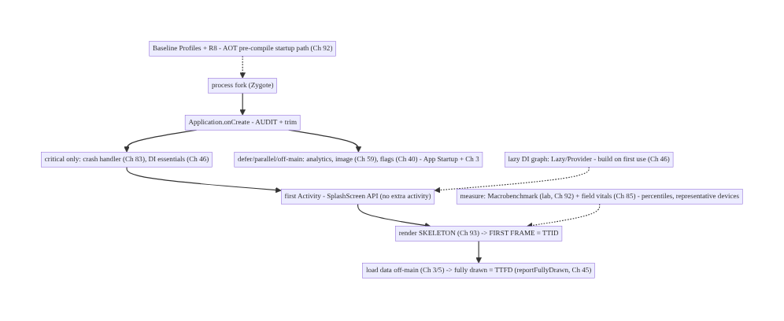
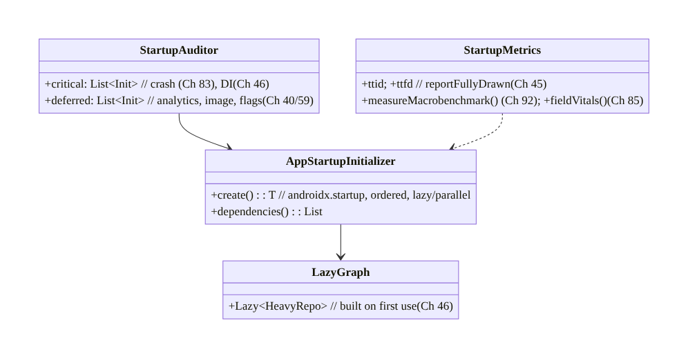
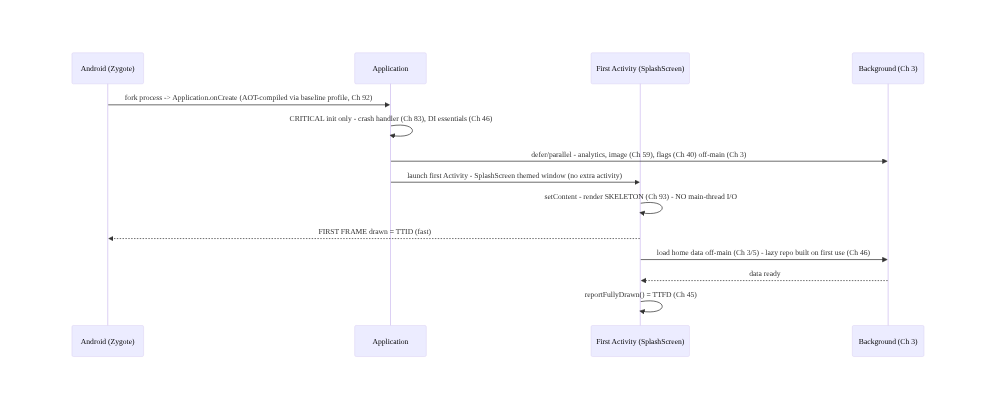
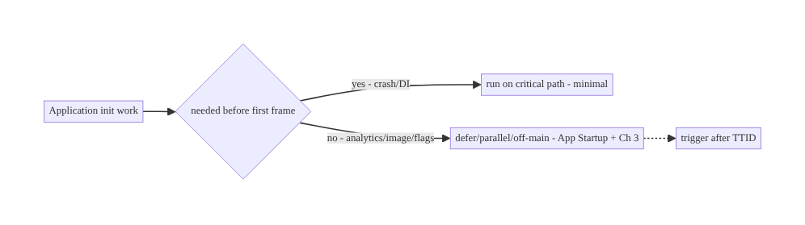
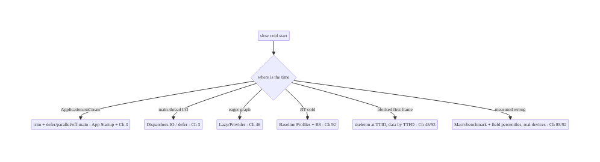

# Chapter 88 — Cold Start Optimization

> **Part X — Performance, Observability & Quality** · Complexity: **Complex** (≥40 interview questions)
>
> **Prerequisites:** Ch 45 (startup sequence), Ch 85 (perf monitoring), Ch 92 (baseline
> profiles/R8), Ch 44 (lifecycle), Ch 46 (DI/Hilt), Ch 3 (threading). Pairs with Ch 90 (jank),
> Ch 89 (memory), Ch 93 (lists).
>
> **Reference surface in StreamCart:** making the app **launch fast** — minimizing **cold
> start** time (process create → first frame → fully drawn, Ch 45) by deferring/parallelizing
> **Application.onCreate** and library init, using **App Startup**, a well-designed **splash**
> (SplashScreen API), **lazy** dependency graphs (Ch 46), **baseline profiles** (Ch 92), and
> measuring with **Macrobenchmark** (lab) + **field** metrics (Ch 85) — because **startup is
> the first impression** and a slow one loses users.

---

## 88.1 Problem Definition and Real-World Context

**Cold start** — launching the app when its **process doesn't exist** (killed/first launch, so
Android must fork Zygote, create the `Application`, init libraries, build the first `Activity`,
inflate/compose, and render the **first frame**, then reach **fully drawn**, Ch 45) — is the
**slowest** launch path and the **first impression** users get. A slow cold start (blank screen,
long splash) directly loses users and trips **Android vitals** thresholds (Ch 85). **Cold start
optimization** is the discipline of making this path fast: **deferring and parallelizing**
`Application.onCreate` and library initialization (**App Startup**), a correct **SplashScreen**,
a **lazy dependency graph** (Ch 46), avoiding main-thread I/O, **baseline profiles** to pre-
compile the hot path (Ch 92), and **measuring** rigorously with **Macrobenchmark** (lab) and
**field** data (Ch 85). This is the **Complex** counterpart to Ch 45 (the sequence) and Ch 85
(monitoring) — focused on **making it fast**.

Concretely, teams hit:

- **Bloated `Application.onCreate`.** Every SDK's `init` runs **synchronously on the main
  thread** before the first frame — analytics, crash (Ch 83), image loader (Ch 59), DI graph
  (Ch 46), feature flags (Ch 40) — adding hundreds of ms. The #1 cold-start cost.
- **Synchronous library initialization.** Each library initializing itself (often via a
  `ContentProvider`, which also costs) in series. **App Startup** (`androidx.startup`)
  consolidates/ orders them and lets you **defer/parallelize/lazy-init**.
- **Main-thread I/O at startup.** Reading `SharedPreferences`/DataStore (Ch 7), disk, or the
  DB (Ch 5) on the main thread **before first frame** blocks rendering. Must be **off-main** or
  **deferred**.
- **Eager dependency graph (Ch 46).** Building the **entire** Hilt/DI graph eagerly at startup
  constructs objects you don't need yet. Use **lazy** injection (`Lazy<T>`/`Provider<T>`) and
  scope work.
- **Wrong splash (pre-Android 12 patterns).** A dedicated splash `Activity` adds a **whole
  extra `Activity` launch**; the correct approach is the **SplashScreen API** (Android 12+,
  compat library) — a themed window, no extra activity.
- **No pre-compilation (JIT cold, Ch 92).** On first runs, code is **interpreted/JIT-compiled**
  — slow. **Baseline Profiles** (Ch 92) pre-compile (AOT) the **startup + critical-path** code
  so it's fast from the first launch. One of the biggest wins.
- **TTID vs TTFD confusion (Ch 45).** **TTID** (time to initial display — first frame) vs
  **TTFD** (time to full display — `reportFullyDrawn`, Ch 45). Optimize to show **something**
  fast (TTID) and be **usable** fast (TTFD); don't block the first frame on full data.
- **Measuring on a flagship only.** Optimizing on a fast dev phone hides the **low-end** reality
  (Ch 85). Measure with **Macrobenchmark** (lab, reproducible, Ch 92) **and** field vitals
  (Ch 85), on **representative** devices, in **percentiles**.

The architecture: minimize the **cold-start critical path** (Ch 45) — **defer and parallelize**
`Application.onCreate`/library init (**App Startup**, off-main, Ch 3); build a **lazy dependency
graph** (Ch 46); use the **SplashScreen API** (no extra activity); show **TTID** fast and reach
**TTFD** (`reportFullyDrawn`) quickly without blocking the first frame; **pre-compile** the hot
path with **Baseline Profiles + R8** (Ch 92); and **measure** with **Macrobenchmark (lab) +
field (Ch 85)** on representative devices in **percentiles**. This chapter is about **making the
first impression fast**.

### Three practical use cases

1. **Trim `Application.onCreate` (StreamCart).** Move analytics/image-loader/non-critical SDK
   init off the main-thread critical path (App Startup + background), defer feature-flag fetch
   (Ch 40); cold start drops from 1.8s → 0.9s on a mid-tier device (Ch 85).
2. **Baseline Profile for startup (Ch 92).** Generate a baseline profile covering launch + home
   feed (Ch 71); AOT-compiled startup is ~20–30% faster from first launch, verified by
   Macrobenchmark.
3. **Lazy DI + deferred DB (Ch 46/5).** Inject heavy repositories via `Lazy<T>`; don't open the
   Room DB or read DataStore on the main thread before first frame — show the UI, then load.

### Why this is architectural

Cold start composes the startup sequence (Ch 45), App Startup/library init, DI (Ch 46),
threading (Ch 3), SplashScreen, baseline profiles/R8 (Ch 92), and measurement (Macrobenchmark +
field, Ch 85). The decisions — defer/parallelize init, lazy graph, pre-compile, measure in
percentiles on real devices — determine whether the first impression is fast, which drives
retention and store ranking.

---

## 88.2 Requirements Engineering

### Functional requirements

| ID | Requirement |
|----|-------------|
| F1 | Minimize `Application.onCreate` + library init on the critical path (App Startup, Ch 3). |
| F2 | Build a lazy dependency graph; avoid eager construction (Ch 46). |
| F3 | Avoid main-thread I/O before first frame; defer/off-main (Ch 3/5/7). |
| F4 | Use the SplashScreen API (no extra activity); show TTID fast, reach TTFD quickly (Ch 45). |
| F5 | Pre-compile the hot path with Baseline Profiles + R8 (Ch 92). |
| F6 | Measure with Macrobenchmark (lab) + field vitals (Ch 85) in percentiles on representative devices. |

### Non-functional requirements

| Attribute | Policy |
|-----------|--------|
| **Speed** | Fast TTID + TTFD; p95 cold start within budget (Ch 85). |
| **Correctness** | Deferred init must not break features that need it. |
| **Measured** | Lab (reproducible) + field (truth), percentiles (Ch 85/92). |
| **Device coverage** | Low-end representative, not just flagship. |
| **No regression** | CI gate on startup (Macrobenchmark, Ch 92). |

### Scope

- **In scope:** cold-start critical path (Ch 45), `Application.onCreate` trimming, App Startup /
  library init ordering/deferral, off-main I/O (Ch 3), lazy DI graph (Ch 46), SplashScreen API,
  TTID/TTFD (`reportFullyDrawn`, Ch 45), baseline profiles + R8 (Ch 92), Macrobenchmark + field
  measurement (Ch 85), warm/hot start context.
- **Out of scope:** startup sequence detail (Ch 45), perf monitoring pipeline (Ch 85), baseline-
  profile/R8 mechanics (Ch 92), jank (Ch 90), memory (Ch 89), DI setup (Ch 46).

### Assumptions & constraints

- Compose or Views; Hilt (Ch 46); Room/DataStore (Ch 5/7); App Startup available; SplashScreen
  compat; Baseline Profiles + R8 (Ch 92); Macrobenchmark for lab (Ch 92) + Android vitals for
  field (Ch 85). Measured in **percentiles** on **representative** devices. `minSdk 24`.

---

## 88.3 System Design Fundamentals

- **The cold-start critical path (Ch 45).** Process fork (Zygote) → `Application.onCreate` (+
  all `ContentProvider`/library init) → first `Activity` `onCreate`/`setContent` → measure/
  layout/inflate or compose → **first frame drawn** (**TTID**) → data loaded → **fully drawn**
  (**TTFD**, `reportFullyDrawn`). Everything on this path **before the first frame** delays the
  user seeing anything. The goal: **shrink the pre-first-frame work** and **move the rest off
  the critical path**.
- **`Application.onCreate` is the hotspot.** It runs **synchronously on the main thread before
  anything is shown**. Every SDK `init` here adds directly to cold start. **Audit** it: what
  **must** run before first frame (crash handler, Ch 83; DI graph essentials, Ch 46) vs what can
  be **deferred** (analytics flush, image preload, feature-flag fetch, Ch 40) or **parallelized/
  off-main** (Ch 3).
- **App Startup (`androidx.startup`).** Libraries often auto-init via **their own
  `ContentProvider`** — each costs and they can't be ordered. **App Startup** consolidates them
  under **one** provider with **explicit dependency ordering**, and lets you **defer** (lazy,
  manual) or **parallelize** initialization. Mark non-critical initializers **lazy** and trigger
  them **after** first frame.
- **Off-main I/O + deferral (Ch 3/5/7).** Never read **disk/DB/DataStore/prefs** on the main
  thread before first frame — it blocks rendering. Read **off-main** (Dispatchers.IO, Ch 3) or
  **defer** until after TTID. Show the UI with a lightweight state, then load data (TTFD).
- **Lazy dependency graph (Ch 46).** Building the **whole** Hilt graph eagerly constructs
  objects you don't need at launch. Use **`Lazy<T>`/`Provider<T>`** so heavy dependencies
  (repositories, DB, network clients) are built **on first use**, not at startup. Scope
  construction to when it's needed.
- **SplashScreen API (not an extra activity).** The old pattern — a dedicated splash
  `Activity` — adds a **second activity launch** to cold start. The **SplashScreen API**
  (Android 12+, `androidx.core.splashscreen` compat) shows a **themed window** during the normal
  cold start with **no extra activity**, and lets you **keep it on-screen** until content is
  ready (`setKeepOnScreenCondition`) — but don't hold it too long (that's just a slow start in
  disguise).
- **TTID vs TTFD (Ch 45).** **TTID** (first frame) — show **something** (skeleton/placeholder,
  Ch 93) **fast**; **TTFD** (`reportFullyDrawn`) — **usable** with real data. **Don't block the
  first frame on the network/DB** — render a skeleton at TTID, fill at TTFD. Report both to
  vitals (Ch 85).
- **Baseline Profiles + R8 (the AOT win, Ch 92).** On fresh installs/updates, code runs
  **interpreted then JIT** — slow. A **Baseline Profile** lists the **startup + critical-path**
  methods so ART **AOT-compiles** them at install → **fast from the first launch** (often
  **20–30%** faster startup). **R8** (Ch 92) shrinks/optimizes code (less to load/init). These
  are among the **biggest, lowest-effort** wins — covered in depth in Ch 92.
- **Measurement: Macrobenchmark (lab) + field (Ch 85/92).** **Macrobenchmark** measures cold/
  warm/hot start **reproducibly** in CI (`StartupTimingMetric`, `CompilationMode`) — the **gate**
  against regressions (Ch 92). **Field vitals** (Ch 85) show the **real distribution** (p95 on
  low-end). Measure **both**, in **percentiles**, on **representative** devices — never optimize
  by eyeballing a flagship.
- **Warm/hot start context (Ch 45).** **Warm** (process alive, activity recreated) and **hot**
  (activity in memory) are faster; cold is the worst case and the focus. Optimizations (lazy
  graph, deferred init) help all three. Also mind **process death/restoration** (Ch 44) — a
  warm start restoring state shouldn't redo cold work.

Core insight: **the cold-start critical path (Ch 45) is process-fork → Application.onCreate +
library init → first Activity → first frame (TTID) → fully drawn (TTFD); make it fast by
auditing and shrinking Application.onCreate (defer analytics/image/flag init, keep only the
crash handler and DI essentials), consolidating and ordering library init under App Startup with
non-critical initializers lazy/parallel/off-main (Ch 3), never doing main-thread disk/DB/
DataStore I/O before the first frame, building a lazy Hilt graph (Lazy<T>/Provider<T>) so heavy
dependencies construct on first use not at launch (Ch 46), using the SplashScreen API (no extra
activity, keep on screen only until ready), rendering a skeleton at TTID and filling real data
by TTFD (reportFullyDrawn, Ch 45) so the first frame is never blocked on the network, and pre-
compiling the startup + critical-path code with Baseline Profiles + R8 for a 20–30% AOT win
from the first launch (Ch 92) — then measuring rigorously with Macrobenchmark (lab, CI-gated,
Ch 92) and field vitals (Ch 85) in percentiles on representative low-end devices, because
startup is the first impression and the tail is where it's lost.**

---

## 88.4 High-Level Architecture



**Components & ownership**

- **`Application.onCreate`** audited: critical init only; rest **deferred/parallel/off-main**
  (App Startup, Ch 3).
- **SplashScreen API** (no extra activity); **skeleton at TTID**, real data by **TTFD**
  (Ch 45).
- **Lazy DI graph** (Ch 46); **Baseline Profiles + R8** pre-compile (Ch 92).
- **Measurement:** Macrobenchmark (lab, Ch 92) + field vitals (Ch 85), percentiles.

**Direction:** fork → trimmed `onCreate` (critical only; defer rest) → SplashScreen → skeleton
(TTID) → off-main data (TTFD); lazy graph + AOT; measured in lab + field.

---

## 88.5 Detailed Component Design



| Component | Responsibility |
|-----------|----------------|
| `StartupAuditor` | classify init: critical vs deferred |
| `AppStartupInitializer` | ordered, lazy/parallel library init (App Startup) |
| `LazyGraph` | lazy DI — heavy deps on first use (Ch 46) |
| `StartupMetrics` | TTID/TTFD (Ch 45); Macrobenchmark (Ch 92) + field (Ch 85) |

---

## 88.6 End-to-End Data Flow

### Cold-start critical path (optimized)



### Audit: critical vs deferred



---

## 88.7 Complete Kotlin Implementation

Package: `com.streamcart.startup`.

### 88.7.1 Trimmed `Application.onCreate` (critical only; defer the rest)

```kotlin
@HiltAndroidApp
class StreamCartApp : Application() {
    override fun onCreate() {
        super.onCreate()
        // CRITICAL ONLY - must run before first frame:
        CrashReporter.install(this)                 // crash handler first (Ch 83)
        // DI graph is Hilt - essentials only; heavy deps are Lazy (see 88.7.3, Ch 46).

        // DEFER everything non-critical OFF the main-thread critical path (Ch 3):
        appScope.launch(Dispatchers.Default) {       // after onCreate returns; off-main
            Analytics.init(this@StreamCartApp)        // not needed for first frame (Ch 82)
            ImageLoaderFactory.warm(this@StreamCartApp)  // Coil (Ch 59)
            FeatureFlags.prefetch()                   // Ch 40 - defer; use cached meanwhile
        }
        // NO SharedPreferences/DataStore/DB reads here on the main thread (Ch 5/7).
    }
}
```

### 88.7.2 App Startup: ordered, lazy, non-critical init

```kotlin
// Replace each library's auto-init ContentProvider with App Startup (androidx.startup):
class AnalyticsInitializer : Initializer<Unit> {                 // consolidated under ONE provider
    override fun create(context: Context) { /* lightweight register; heavy work deferred */ }
    override fun dependencies(): List<Class<out Initializer<*>>> = emptyList()   // explicit ordering
}
// In the manifest, disable libraries' own ContentProviders and mark non-critical initializers
// LAZY (manual) so they run AFTER first frame, triggered post-TTID - not on the critical path.
```

### 88.7.3 Lazy dependency graph (Ch 46)

```kotlin
@HiltViewModel
class HomeViewModel @Inject constructor(
    private val feedRepo: dagger.Lazy<FeedRepository>,   // built on FIRST USE, not at startup (Ch 46)
    private val db: dagger.Lazy<AppDatabase>,            // Room opened lazily, off-main (Ch 5)
) : ViewModel() {
    fun load() = viewModelScope.launch(Dispatchers.IO) {  // off-main (Ch 3)
        val feed = feedRepo.get().home()                  // triggers construction here, after first frame
        _state.value = HomeState.Ready(feed)              // -> reportFullyDrawn (TTFD)
    }
}
```

### 88.7.4 SplashScreen API + TTID/TTFD (Ch 45)

```kotlin
class MainActivity : ComponentActivity() {
    override fun onCreate(savedInstanceState: Bundle?) {
        val splash = installSplashScreen()               // androidx.core.splashscreen - NO extra activity
        super.onCreate(savedInstanceState)
        val vm: HomeViewModel by viewModels()
        // Keep splash only until essentials ready - do NOT hold on the network (that's a slow start):
        splash.setKeepOnScreenCondition { vm.state.value is HomeState.Initializing }  // brief
        setContent {
            val state by vm.state.collectAsStateWithLifecycle()
            HomeScreen(state)                            // render SKELETON (Ch 93) at FIRST FRAME = TTID
            LaunchedEffect(Unit) { vm.load() }           // load data off-main -> TTFD
            if (state is HomeState.Ready) {
                LaunchedEffect(Unit) { reportFullyDrawn() }  // TTFD marker for vitals (Ch 45/85)
            }
        }
    }
}
```

### 88.7.5 Measurement: Macrobenchmark (lab, Ch 92) + field (Ch 85)

```kotlin
@RunWith(AndroidJUnit4::class)
class StartupBenchmark {
    @get:Rule val rule = MacrobenchmarkRule()
    @Test fun coldStartup() = rule.measureRepeated(
        packageName = "com.streamcart", metrics = listOf(StartupTimingMetric()),  // TTID/TTFD
        compilationMode = CompilationMode.Partial(),   // with baseline profile (Ch 92)
        startupMode = StartupMode.COLD, iterations = 10,
    ) { pressHome(); startActivityAndWait() }
    // CI GATE: fail if p-median cold start regresses (Ch 92). Field truth -> Android vitals (Ch 85).
}
```

### 88.7.6 Module structure

```
:app  StreamCartApp (trimmed onCreate), MainActivity (SplashScreen)
:core:startup  App Startup initializers (ordered/lazy), StartupMetrics
:benchmark  Macrobenchmark StartupBenchmark (Ch 92)
# Lazy graph -> Hilt Lazy/Provider (Ch 46); off-main -> Ch 3; AOT -> Baseline Profiles + R8 (Ch 92);
# TTID/TTFD -> Ch 45; field -> vitals (Ch 85).
```

---

## 88.8 Concurrency and Race Conditions

| Scenario | Risk | Handling |
|----------|------|----------|
| Deferred init raced by feature | NPE/uninit | gate feature on init-ready; use cached (Ch 40) |
| Main-thread I/O at startup | blocked frame | off-main (Dispatchers.IO, Ch 3) / defer |
| Eager graph construction | slow onCreate | Lazy/Provider (Ch 46) |
| Splash held on network | slow start | keep splash brief; skeleton + TTFD (Ch 45) |
| Parallel init ordering | dependency break | App Startup explicit `dependencies()` |
| Background init on main dispatcher | still blocks | Dispatchers.Default/IO (Ch 3) |
| Warm start redoes cold work | wasted | distinguish warm/hot; restore state (Ch 44) |

- **Deferring init introduces ordering hazards:** a feature that needs a **deferred** library
  must **wait for it** (or use a cached value, Ch 40) — don't let the first use race an
  uninitialized SDK. App Startup's **explicit `dependencies()`** order parallel init safely.
- **Off-main is non-negotiable before first frame (Ch 3):** any main-thread disk/DB/DataStore
  read blocks the very frame you're trying to show fast. Use `Dispatchers.IO`, and for CPU init
  `Dispatchers.Default` — never the main dispatcher for startup work.
- **Keep the splash honest:** holding the SplashScreen until data loads just **hides** a slow
  start; render a **skeleton** at TTID and reach **TTFD** fast (Ch 45/93).

---

## 88.9 Failure Scenarios and Recovery

| Failure | Detection | Response | Outcome |
|---------|-----------|----------|---------|
| Slow cold start | p95 vitals (Ch 85) | audit onCreate; defer/off-main; baseline profile (Ch 92) | fast |
| Blank/long splash | user reports | skeleton at TTID; brief splash (Ch 45/93) | responsive |
| Deferred-init crash | exception | gate feature on ready / cached (Ch 40) | robust |
| Main-thread jank at start | StrictMode/trace | off-main I/O (Ch 3) | smooth |
| Regression release-over-release | Macrobenchmark CI (Ch 92) | gate fails PR | prevented |
| Fast on flagship, slow on low-end | field p95 (Ch 85) | measure representative devices | honest |
| JIT-cold first launch | Macrobenchmark `None` vs `Partial` | baseline profile (Ch 92) | AOT fast |



> **Shrink the critical path, defer the rest, pre-compile it, and measure it right.** Cold
> start is lost in a bloated `Application.onCreate`, main-thread I/O, an eager graph, a JIT-cold
> first launch, and a first frame blocked on the network. Fix each: trim + defer (App Startup +
> off-main, Ch 3), lazy graph (Ch 46), Baseline Profiles + R8 (Ch 92), skeleton at TTID → TTFD
> (Ch 45) — then gate with Macrobenchmark (Ch 92) and watch field p95 (Ch 85) on real devices.

---

## 88.10 Scaling the Implementation

- **Level 1.** SplashScreen API; audit `Application.onCreate`; move obvious init off-main
  (Ch 3); `reportFullyDrawn` (Ch 45).
- **Level 2.** App Startup (consolidate/ order/defer); lazy DI graph (Ch 46); skeleton at TTID
  (Ch 93); field startup vitals (Ch 85).
- **Level 3 — production.** Baseline Profiles + R8 (Ch 92); Macrobenchmark CI gate; percentile
  startup budgets by device class (Ch 85); representative-device measurement.
- **Level 4 — large.** Per-flow baseline profiles (startup + top journeys); startup SLOs;
  module-level lazy loading; dependency-graph audits; automated regression gating (Ch 92).
- **Level 5 — enterprise.** Startup governance: budgets with error budgets, device-tier
  targets, long-tail device program, continuous profiling, cross-team startup ownership, AOT/
  profile pipelines (Ch 92).

**Avoid overengineering:** SplashScreen + trimmed `onCreate` + App Startup deferral + lazy graph
+ Baseline Profiles + R8, measured by Macrobenchmark and field vitals, gets most of the win.
Don't micro-optimize before measuring; don't hold the splash; don't optimize only on a flagship.

---

## 88.11 Alternative Approaches and Trade-offs

| Dimension | Option A | Option B | When |
|-----------|----------|----------|------|
| Init | Deferred/parallel (App Startup) | eager synchronous | Defer non-critical |
| Graph | Lazy (Lazy/Provider, Ch 46) | eager full graph | Lazy (build on use) |
| Splash | SplashScreen API | dedicated splash Activity | SplashScreen (no extra activity) |
| First frame | Skeleton at TTID (Ch 93) | block on data | Skeleton → TTFD |
| Compilation | Baseline Profiles + R8 (Ch 92) | JIT only | Baseline profiles (AOT win) |
| I/O | Off-main / deferred (Ch 3) | main-thread | Off-main always |
| Measure | Macrobenchmark + field (Ch 85/92) | eyeball flagship | Both, percentiles, real devices |

**SplashScreen API vs dedicated splash Activity:** a **splash Activity** adds a **whole extra
activity launch** to cold start (slower) and can flash. The **SplashScreen API** shows a themed
window **within** the normal start — **no extra activity** — and keeps on screen only until
ready. Always use the SplashScreen API.

**Baseline Profiles vs JIT-only (Ch 92):** without a profile, startup code is **interpreted/
JIT-compiled** on first launches — slow. A **Baseline Profile** AOT-compiles the startup +
critical path → **20–30% faster from the first launch**, a **huge, low-effort** win. Always ship
one (Ch 92).

**Skeleton at TTID vs blocking on data:** **blocking** the first frame until data loads means a
**long blank/splash** — bad first impression. Rendering a **skeleton** at **TTID** and filling
real data by **TTFD** (`reportFullyDrawn`, Ch 45) shows **something fast** and feels responsive.
Never block the first frame on the network/DB.

---

## 88.12 Security & Privacy Considerations

- **Don't defer security-critical init past its need:** the **crash handler** (Ch 83) and any
  **security/attestation** (Ch 24) that must run before sensitive work should be on the critical
  path or gated — deferral is for **non-critical** init (analytics, image), not security.
- **No secrets in startup logs/traces (Ch 28):** startup profiling/metrics are **timing**, not
  content; keep PII out (Ch 85/28).
- **Baseline profiles contain method names, not data (Ch 92):** they're compilation hints, not
  secrets.
- **Deferred consent (Ch 28):** analytics/telemetry deferral must still respect **consent** —
  don't init tracking before consent is resolved (Ch 82/28).
- **Gate features on secure init:** a feature needing auth/crypto (Ch 20/24) must wait for that
  init, not race a deferred one.
- Client vs backend: cold-start optimization is **client-side**; the only cross-cutting concern
  is not deferring **security/consent** init incorrectly (Ch 24/28).

---

## 88.13 Performance and Resource Optimization

- **This chapter *is* performance** — the summary: **trim `onCreate`**, **defer/parallelize/off-
  main** init (App Startup, Ch 3), **lazy graph** (Ch 46), **SplashScreen API**, **skeleton at
  TTID → TTFD** (Ch 45/93), **Baseline Profiles + R8** (Ch 92).
- **Measure before optimizing** — Macrobenchmark (lab, Ch 92) + system traces (Perfetto) show
  **where** the time goes; don't guess.
- **Representative devices + percentiles** — optimize for the **low-end p95** (Ch 85), not the
  flagship.
- **AOT the hot path** — Baseline Profiles are the biggest low-effort win (Ch 92).
- **Don't over-defer** — deferring something the first screen needs just moves the delay to
  TTFD; balance.
- **Profiling:** TTID/TTFD (Ch 45), `Application.onCreate` duration, per-initializer cost, main-
  thread I/O (StrictMode), compilation mode comparison (`None` vs `Partial`, Ch 92).

---

## 88.14 Testing Strategy

Startup is measured (Macrobenchmark) and guarded (CI); correctness of deferral is unit/
integration-tested.

```kotlin
class StartupBenchmark {   // lab gate (Ch 92)
    @get:Rule val rule = MacrobenchmarkRule()
    @Test fun coldStart_withBaselineProfile() = rule.measureRepeated(
        packageName = "com.streamcart", metrics = listOf(StartupTimingMetric()),
        compilationMode = CompilationMode.Partial(),       // baseline profile (Ch 92)
        startupMode = StartupMode.COLD, iterations = 10) { pressHome(); startActivityAndWait() }
    @Test fun coldStart_noCompilation() = /* CompilationMode.None - shows the AOT delta (Ch 92) */ Unit
}

class DeferredInitTest {
    @Test fun `feature waits for deferred init or uses cached`() { /* no race / NPE (Ch 40) */ }
    @Test fun `no main-thread IO before first frame`() { /* StrictMode penaltyDeath in debug (Ch 3) */ }
}
// Field: Android vitals cold-start p95 by device class (Ch 85); staged rollout watches it (Ch 41).
```

What to test: Macrobenchmark cold start (lab gate, with/without baseline profile, Ch 92);
deferred-init correctness (no race, cached fallback, Ch 40); StrictMode (no main-thread I/O,
Ch 3); TTID/TTFD markers (`reportFullyDrawn`, Ch 45); field p95 by device (Ch 85).

---

## 88.15 Production Observability

- **Metrics:** **cold/warm/hot start** p50/p90/p95/p99 by **device class/OS/release** (field
  vitals, Ch 85); **TTID vs TTFD** (Ch 45); `Application.onCreate` duration; Macrobenchmark lab
  numbers (Ch 92); compilation-mode delta (baseline profile effect, Ch 92).
- **Logs/traces:** system traces (Perfetto) of the cold-start path — **PII-safe** (Ch 28/85).
- **Debugging:** slow start → trace `onCreate`/init (where's the time?); low-end slow → field
  p95 by device (Ch 85); JIT-cold → compilation-mode comparison (Ch 92); blocked frame →
  StrictMode/main-thread I/O (Ch 3); regression → Macrobenchmark CI (Ch 92).
- **Alerting:** cold-start **regression** release-over-release (p95 breach → gate/rollback,
  Ch 85/41/92); startup budget/SLO breach by device class.
- **Dashboards:** startup percentiles by device/OS/release; TTID/TTFD; onCreate/init breakdown;
  baseline-profile effect; the low-end **tail** (Ch 85).

---

## 88.16 System Design Interview Preparation

> ≥40 questions (Complex).

**Fundamentals**
1. *Cold vs warm vs hot?* No process / process alive / activity in memory (Ch 45).
2. *Cold-start path?* Fork → onCreate+init → first Activity → first frame (TTID) → fully drawn (TTFD).
3. *Why optimize cold start?* First impression; retention; vitals ranking (Ch 85).
4. *Biggest cost?* `Application.onCreate` + synchronous library init.
5. *TTID vs TTFD?* First frame vs usable (`reportFullyDrawn`, Ch 45).

**Application.onCreate**
6. *Why the hotspot?* Runs synchronously on main before first frame.
7. *Audit how?* Critical (crash/DI) vs deferrable (analytics/image/flags).
8. *Defer where?* App Startup lazy / off-main (Ch 3).
9. *Crash handler?* Critical — install first (Ch 83).
10. *Analytics init?* Deferable (Ch 82).

**App Startup**
11. *What is it?* `androidx.startup` — consolidate/order/defer library init.
12. *ContentProvider cost?* Each library's auto-init provider costs; consolidate.
13. *Ordering?* Explicit `dependencies()`.
14. *Lazy init?* Non-critical initializers triggered after first frame.

**Threading/I-O**
15. *Main-thread I/O?* Never before first frame — off-main (Ch 3).
16. *Which dispatcher?* IO for disk/DB, Default for CPU init (Ch 3).
17. *DataStore/prefs?* Off-main / deferred (Ch 7).
18. *DB open?* Lazy, off-main (Ch 5).

**DI graph**
19. *Eager graph problem?* Constructs unneeded objects at startup (Ch 46).
20. *Lazy how?* `Lazy<T>`/`Provider<T>` — build on first use.
21. *Scope?* Construct when needed, not at launch.

**Splash**
22. *SplashScreen API vs splash Activity?* No extra activity vs a whole extra launch.
23. *Keep on screen?* `setKeepOnScreenCondition` — briefly, not on network.
24. *Holding splash = ?* Slow start in disguise.

**Baseline profiles / R8**
25. *JIT-cold problem?* Interpreted/JIT on first launches — slow (Ch 92).
26. *Baseline Profile?* AOT-compile startup path → 20–30% faster first launch (Ch 92).
27. *R8?* Shrink/optimize — less to load/init (Ch 92).
28. *How measured?* Macrobenchmark `CompilationMode.None` vs `Partial` (Ch 92).

**Measurement**
29. *Lab tool?* Macrobenchmark (`StartupTimingMetric`) — CI gate (Ch 92).
30. *Field tool?* Android vitals — real distribution (Ch 85).
31. *Why both?* Lab reproducible gate + field truth.
32. *Percentiles?* p95 on low-end — the tail (Ch 85).
33. *Device choice?* Representative/low-end, not flagship.

**Edge cases**
34. *First frame blocked on data?* Skeleton at TTID → TTFD (Ch 45/93).
35. *Deferred-init race?* Gate feature / cached (Ch 40).
36. *Warm start redoing cold work?* Distinguish; restore state (Ch 44).
37. *Process death restoration?* Warm path, not full cold (Ch 44).

**Production**
38. *Regression gate?* Macrobenchmark CI (Ch 92).
39. *Field regression?* Vitals p95 → rollback (Ch 85/41).
40. *StrictMode?* Catch main-thread I/O at startup (Ch 3).
41. *Trace tool?* Perfetto/system trace for the path.
42. *Budget?* p95 cold start by device class (Ch 85).

### Design-change challenges
1. **Cut a 2s cold start in half.** Audit+trim onCreate, defer/off-main (App Startup+Ch 3),
   lazy graph (Ch 46), Baseline Profiles+R8 (Ch 92), skeleton at TTID (Ch 93).
2. **Replace a splash Activity.** SplashScreen API (no extra activity).
3. **Make first launch fast (JIT-cold).** Baseline Profiles + R8 (Ch 92).
4. **Stop blocking the first frame.** Skeleton at TTID, data by TTFD (Ch 45).
5. **Gate startup regressions in CI.** Macrobenchmark + field vitals (Ch 92/85).

### Mock walkthrough (abridged)
Clarify (target device/budget, measured how?) → map the critical path (Ch 45) → audit+trim
`onCreate` (critical vs deferred) → App Startup consolidate/order/defer + off-main (Ch 3) → lazy
DI graph (Ch 46) → SplashScreen API, skeleton at TTID → TTFD (`reportFullyDrawn`, Ch 45/93) →
Baseline Profiles + R8 (Ch 92) → measure Macrobenchmark (lab, CI gate) + field vitals
percentiles on representative devices (Ch 85/92) → don't defer security/consent (Ch 24/28) →
observability (startup tail by device).

---

## 88.17 Practical Exercises

1. **Beginner.** Add the SplashScreen API, `reportFullyDrawn` (Ch 45), and move obvious SDK
   init off the main thread (Ch 3). *Eval:* no extra activity; TTFD marked; init off-main.
2. **Intermediate.** Audit `Application.onCreate`, move non-critical init to App Startup (lazy)
   and a background scope; render a skeleton at TTID (Ch 93). *Eval:* trimmed onCreate; skeleton
   fast.
3. **Advanced.** Add a Baseline Profile + R8 (Ch 92) and measure the cold-start delta with
   Macrobenchmark (`None` vs `Partial`). *Eval:* AOT win measured; CI gate added.
4. **Production debugging.** Profile a slow cold start with Perfetto; find and fix main-thread
   I/O (Ch 3) and an eager graph (Ch 46); verify on a low-end device (Ch 85). *Eval:* time
   located and cut.
5. **System design challenge.** Design a startup budget + regression-gating pipeline
   (Macrobenchmark CI + field vitals percentiles by device class) with per-flow baseline
   profiles. *Eval:* gated, measured, device-tiered.

*(Solutions withheld unless requested.)*

---

## 88.18 Chapter Summary & Reference Sheet

**Key decisions:** make **cold start** (process-fork → `Application.onCreate` + library init →
first Activity → **first frame/TTID** → **fully drawn/TTFD**, Ch 45) fast because it's the
**first impression** and the **tail** (p95 on low-end) is where users are lost: **audit and trim
`Application.onCreate`** to **critical init only** (crash handler Ch 83, DI essentials Ch 46) and
**defer/parallelize/off-main** the rest (analytics, image Ch 59, feature flags Ch 40) via **App
Startup** (`androidx.startup` — consolidate each library's auto-init `ContentProvider` under one
provider with explicit ordering and lazy initializers) and background dispatchers (Ch 3); **never
do main-thread disk/DB/DataStore I/O before the first frame** (Ch 3/5/7); build a **lazy Hilt
graph** (`Lazy<T>`/`Provider<T>`) so heavy dependencies construct **on first use**, not at
launch (Ch 46); use the **SplashScreen API** (no extra activity; keep on screen only until
essentials ready, never on the network); **render a skeleton at TTID and fill real data by
TTFD** (`reportFullyDrawn`, Ch 45/93) so the first frame is never blocked; **pre-compile the
startup + critical path with Baseline Profiles + R8** for a **20–30% AOT win from the first
launch** (Ch 92); and **measure rigorously** with **Macrobenchmark** (lab, reproducible, **CI-
gated**, Ch 92) **and field vitals** (Ch 85) in **percentiles** on **representative low-end
devices** — not by eyeballing a flagship.

**Concepts:** cold/warm/hot start (Ch 45), critical path, `Application.onCreate` audit, App
Startup (consolidate/order/defer), off-main I/O (Ch 3), lazy DI graph (Ch 46), SplashScreen API,
TTID vs TTFD (`reportFullyDrawn`, Ch 45), skeleton (Ch 93), Baseline Profiles + R8 (Ch 92),
Macrobenchmark (lab) + field vitals (Ch 85), percentiles + representative devices.

**Common mistakes:** bloated synchronous `onCreate`; main-thread I/O before first frame; eager
DI graph; a dedicated splash Activity; holding the splash on the network; blocking the first
frame on data (no skeleton); no Baseline Profile (JIT-cold); optimizing/measuring only on a
flagship; no Macrobenchmark CI gate; deferring security/consent init incorrectly (Ch 24/28).

**Checklist:** ☐ audit + trim `Application.onCreate` (critical only) ☐ App Startup
(consolidate/order/defer, lazy initializers) ☐ off-main / deferred I/O (no main-thread disk/DB,
Ch 3) ☐ lazy DI graph (`Lazy`/`Provider`, Ch 46) ☐ SplashScreen API (no extra activity, brief)
☐ skeleton at TTID → `reportFullyDrawn` TTFD (Ch 45/93) ☐ Baseline Profiles + R8 (Ch 92) ☐
Macrobenchmark cold-start CI gate (`None` vs `Partial`) ☐ field vitals p95 by device class
(Ch 85) ☐ representative low-end devices, percentiles ☐ don't defer security/consent (Ch 24/28).

**Key APIs:** `installSplashScreen` / `setKeepOnScreenCondition` (`androidx.core.splashscreen`),
`androidx.startup.Initializer` + `dependencies()`, `ComponentActivity.reportFullyDrawn` (TTFD,
Ch 45), `dagger.Lazy`/`Provider` (lazy graph, Ch 46), `Dispatchers.IO`/`Default` (off-main,
Ch 3), Baseline Profiles + `CompilationMode.Partial` + R8 (Ch 92), `MacrobenchmarkRule` +
`StartupTimingMetric` (lab, Ch 92), Android vitals (field, Ch 85), StrictMode (main-thread I/O),
Perfetto/system trace.

**References:**
- App startup time: https://developer.android.com/topic/performance/vitals/launch-time
- App Startup library: https://developer.android.com/topic/libraries/app-startup
- SplashScreen API: https://developer.android.com/develop/ui/views/launch/splash-screen
- Macrobenchmark & startup: https://developer.android.com/topic/performance/benchmarking/macrobenchmark-overview
- (composes) Ch 45 Startup, Ch 85 Perf Monitoring, Ch 92 Baseline Profiles/R8, Ch 46 DI, Ch 3 Threading, Ch 93 Lists, Ch 44 Lifecycle

### Chapter review (Phase 4)
- **Completeness:** all 18 sections; architecture/class/sequence/audit/failure diagrams;
  trimmed-onCreate + App Startup + lazy-graph + SplashScreen + Macrobenchmark code; concurrency
  (deferred-init ordering, off-main, lazy); failure (trim+defer+AOT+measure principle); 5 levels;
  SplashScreen-vs-activity, baseline-profile-vs-JIT, skeleton-vs-block trade-offs; security (don't
  defer security/consent); perf (the whole chapter); Macrobenchmark + deferred-init + StrictMode
  tests; observability (startup tail by device); 42 Q&A + 5 challenges. ✅
- **Expand later:** startup sequence (Ch 45), baseline profiles/R8 (Ch 92), perf monitoring
  (Ch 85), DI (Ch 46), jank (Ch 90).
- **Interview coverage:** 42 Q&A — exceeds the ≥40 Complex bar.
