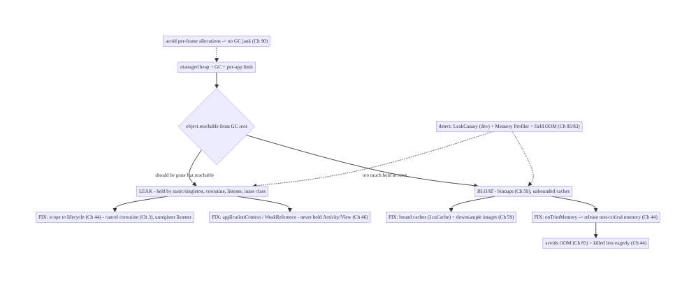
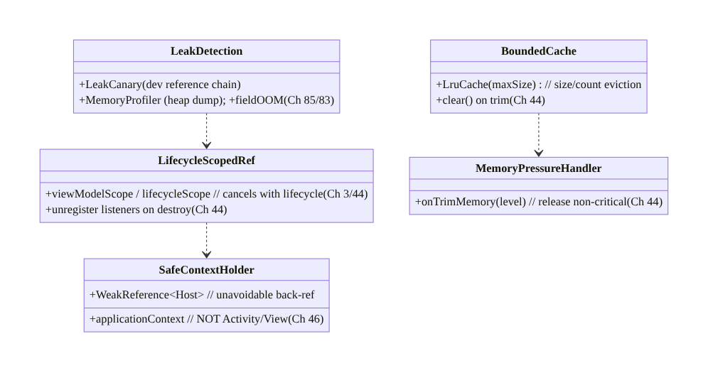
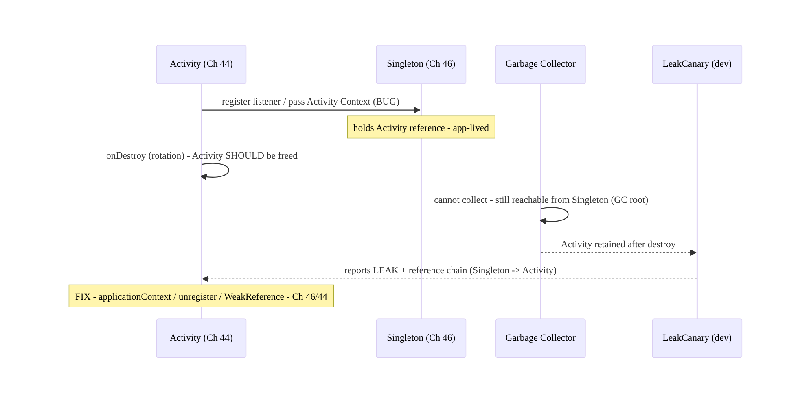
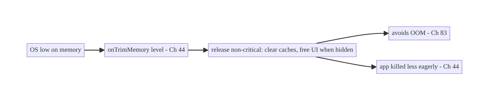
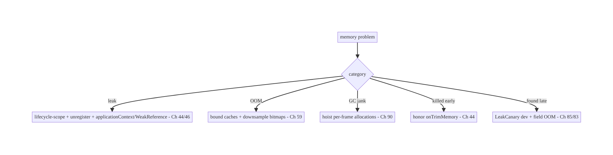

# Chapter 89 — Memory Management & Leak Prevention

> **Part X — Performance, Observability & Quality** · Complexity: **Complex** (≥40 interview questions)
>
> **Prerequisites:** Ch 44 (lifecycle), Ch 3 (threading/coroutines), Ch 59 (image loading),
> Ch 46 (DI/scopes), Ch 85 (perf monitoring), Ch 83 (crash/OOM). Pairs with Ch 90 (jank),
> Ch 88 (cold start), Ch 93 (lists).
>
> **Reference surface in StreamCart:** keeping the app's **memory** healthy — understanding
> the **managed heap + GC**, avoiding **leaks** (holding `Context`/`View`/lifecycle objects
> past their life, Ch 44), preventing **OutOfMemoryError** (large bitmaps, Ch 59; unbounded
> caches), responding to **memory pressure** (`onTrimMemory`), and **detecting** leaks
> (LeakCanary) and footprint (Android Studio Memory Profiler, field, Ch 85) — because leaks
> and bloat cause **jank** (GC pauses, Ch 90), **OOM crashes** (Ch 83), and background kills.

---

## 89.1 Problem Definition and Real-World Context

Android apps run under a **managed heap** with **garbage collection** and a **per-app memory
limit**; exceeding it causes **OutOfMemoryError** (a crash, Ch 83), and churning it causes **GC
pauses** that drop frames (**jank**, Ch 90). The two dominant problems are **memory leaks** —
objects that should be freed but are **held** by a longer-lived reference (the classic: an
`Activity`/`View`/`Context` captured by a static field, a singleton, a running coroutine, a
registered listener, or an inner class that outlives its host, Ch 44) — and **memory bloat** —
holding **too much** at once (giant bitmaps, Ch 59; unbounded caches/lists). **Memory management
& leak prevention** is the discipline of understanding the heap/GC, **scoping** references to
lifecycles (Ch 44), **bounding** caches, responding to **`onTrimMemory`** pressure, and
**detecting** leaks (LeakCanary) and footprint (Memory Profiler + field, Ch 85). Leaks and bloat
make the app slow (GC), crash (OOM), and more likely to be **killed** in the background (Ch 44).

Concretely, teams hit:

- **Context/View/Activity leaks (the #1 Android leak).** A **static** field, a **singleton**
  (Ch 46), a **companion object**, a long-running **coroutine/thread** (Ch 3), a registered
  **listener/callback/BroadcastReceiver** (Ch 44), or a non-static **inner class** captures an
  `Activity`/`Fragment`/`View`/`Context` and **outlives** it — so the whole view hierarchy can't
  be collected. Rotations make it worse (a new `Activity` each time).
- **Coroutine/flow leaks (Ch 3).** A coroutine launched in the wrong scope (`GlobalScope`, or a
  scope not tied to lifecycle) keeps running and **captures** the `Activity`/`ViewModel`. Must
  use **lifecycle/viewModelScope** (Ch 44) and collect with **`repeatOnLifecycle`**.
- **Bitmap/image bloat → OOM (Ch 59).** Bitmaps are the **largest** objects; loading full-res
  images into memory, not downsampling, or unbounded image caches causes **OOM**. Image loaders
  (Coil/Glide, Ch 59) manage this — but misuse (caching originals, huge `ImageView`s) still
  bloats.
- **Unbounded caches/collections.** An in-memory cache or list with **no eviction** grows until
  OOM. Caches must be **bounded** (`LruCache`, size/count limits) and respond to memory
  pressure.
- **Ignoring memory pressure.** The OS signals pressure via **`onTrimMemory`**/`ComponentCallbacks2`
  (and the deprecated `onLowMemory`); an app that ignores it holds memory the OS needs → the
  app is **killed** sooner (Ch 44). Must **release** caches/non-critical memory on trim.
- **GC churn → jank (Ch 90).** Allocating heavily **per frame** (in `onDraw`/recompose, Ch 90)
  causes frequent GC → **pauses** → dropped frames. Avoid allocations on the hot path.
- **Leaks found late / not at all.** Without **LeakCanary** (debug) and **Memory Profiler**
  leaks ship to production and show up as **OOM crashes** (Ch 83) and background kills — hard to
  diagnose after the fact. Need **detection** in dev + **field OOM** monitoring (Ch 85).
- **The `WeakReference` / lifecycle-scoping toolkit.** The fixes: **scope to lifecycle**
  (Ch 44), **unregister** listeners, **cancel** coroutines, use **`WeakReference`** where a
  back-reference is unavoidable, **don't** hold `Context`/`View` in long-lived objects (use
  `applicationContext` where appropriate), and **bound** caches.

The architecture: understand the **managed heap + GC + per-app limit**; **scope every reference
to a lifecycle** (Ch 44) — cancel coroutines (`viewModelScope`/`lifecycleScope`, Ch 3),
unregister listeners/receivers, never hold `Activity`/`View`/`Context` in singletons/statics
(use `applicationContext`), use `WeakReference` for unavoidable back-refs; **bound** caches
(`LruCache`) and image memory (Ch 59); **respond to `onTrimMemory`** by releasing non-critical
memory (Ch 44); **avoid per-frame allocations** (GC churn → jank, Ch 90); and **detect** leaks
(LeakCanary) + footprint (Memory Profiler) + **field OOM** (Ch 85/83). This chapter is about
**keeping memory healthy so the app doesn't jank, OOM, or get killed**.

### Three practical use cases

1. **Fix an Activity leak (StreamCart).** A singleton analytics helper (Ch 46) held an
   `Activity` `Context`; rotating leaked a view hierarchy each time. Fix: inject
   `applicationContext`, not the `Activity`; LeakCanary confirms the leak is gone.
2. **Bound an image cache → stop OOM (Ch 59).** The product gallery cached full-res bitmaps
   unbounded → OOM on low-RAM devices. Fix: Coil's bounded memory cache + downsampling to view
   size; respond to `onTrimMemory` by clearing it.
3. **Scope a coroutine (Ch 3).** A `GlobalScope.launch` outlived its screen and captured the
   `ViewModel`. Fix: `viewModelScope`/`repeatOnLifecycle` so it cancels with the lifecycle
   (Ch 44).

### Why this is architectural

Memory management composes lifecycle (Ch 44), threading/coroutine scopes (Ch 3), image loading
(Ch 59), DI scopes (Ch 46), and monitoring (Memory Profiler + field OOM, Ch 85/83). The
decisions — lifecycle-scoped references, bounded caches, memory-pressure response, allocation
discipline, leak detection — determine whether the app stays fast (no GC jank, Ch 90), stable
(no OOM, Ch 83), and resident (not killed, Ch 44).

---

## 89.2 Requirements Engineering

### Functional requirements

| ID | Requirement |
|----|-------------|
| F1 | Scope every reference to a lifecycle; cancel coroutines, unregister listeners (Ch 44/3). |
| F2 | Never hold Activity/View/Context in singletons/statics; use applicationContext / WeakReference (Ch 46). |
| F3 | Bound caches (LruCache) and image memory; downsample bitmaps (Ch 59). |
| F4 | Respond to onTrimMemory by releasing non-critical memory (Ch 44). |
| F5 | Avoid per-frame allocations (GC churn → jank, Ch 90). |
| F6 | Detect leaks (LeakCanary) + footprint (Memory Profiler) + field OOM (Ch 85/83). |

### Non-functional requirements

| Attribute | Policy |
|-----------|--------|
| **Stability** | No OOM (bounded memory, Ch 83). |
| **Smoothness** | No GC jank (allocation discipline, Ch 90). |
| **Residency** | Respond to trim → not killed early (Ch 44). |
| **Detectability** | LeakCanary (dev) + field OOM (Ch 85). |
| **Correctness** | Lifecycle-scoped; no leaks. |

### Scope

- **In scope:** managed heap + GC + per-app limit, leak taxonomy (Context/View/Activity,
  coroutine/flow, listener/receiver, static/singleton, inner class), lifecycle scoping (Ch 44/3),
  `WeakReference`/`applicationContext`, bounded caches (`LruCache`) + image memory (Ch 59),
  `onTrimMemory`/`ComponentCallbacks2`, per-frame allocation discipline (Ch 90), detection
  (LeakCanary, Memory Profiler, field OOM, Ch 85/83).
- **Out of scope:** lifecycle detail (Ch 44), coroutine internals (Ch 3), image-loader internals
  (Ch 59), jank/rendering (Ch 90), crash reporting mechanics (Ch 83), DI (Ch 46).

### Assumptions & constraints

- ART managed heap with per-app limit (varies by device RAM); GC is automatic. LeakCanary in
  debug; Memory Profiler for footprint; field OOM via vitals/Crashlytics (Ch 85/83). References
  **lifecycle-scoped** (Ch 44); caches **bounded**; `onTrimMemory` **honored**. `minSdk 24`.

---

## 89.3 System Design Fundamentals

- **Managed heap, GC, and the per-app limit.** ART manages a **heap** and **garbage-collects**
  unreachable objects; the app has a **per-process memory limit** (device-dependent — tens to
  hundreds of MB). Exceed it → **`OutOfMemoryError`** (crash, Ch 83). **Reachability** is the
  key: an object is kept alive as long as a **GC root** (static field, live thread, stack)
  reaches it through references. A **leak** is an object still **reachable** that **should** be
  gone — the GC can't collect it because something holds it.
- **The Android leak taxonomy (what holds what):**
  - **Static/singleton holds Activity/View/Context (Ch 46):** a `static`/`companion`/singleton
    field referencing an `Activity`, `View`, or non-application `Context` → the whole view
    hierarchy leaks. **Fix:** hold `applicationContext` (app-lived) or nothing; inject the right
    scope (Ch 46).
  - **Listener/callback/receiver not unregistered (Ch 44):** registering a listener/
    `BroadcastReceiver`/observer that holds the `Activity` and **not unregistering** in the
    paired lifecycle callback → leak. **Fix:** unregister in `onStop`/`onDestroy`/`onPause`
    (Ch 44), or use lifecycle-aware components.
  - **Coroutine/thread captures lifecycle (Ch 3):** a coroutine in `GlobalScope` or a raw
    `Thread`/`Handler` captures the `Activity`/`ViewModel` and outlives it. **Fix:**
    `viewModelScope`/`lifecycleScope`; `repeatOnLifecycle` for collection; cancel on destroy
    (Ch 44).
  - **Non-static inner class / anonymous class:** holds an implicit reference to the outer
    (`Activity`). **Fix:** static nested class + `WeakReference`, or scope properly.
  - **`Handler`/`Runnable` with delayed messages:** a posted `Runnable` holds the `Activity`
    until it runs. **Fix:** remove callbacks on destroy; `WeakReference`.
- **Bitmaps and OOM (Ch 59).** **Bitmaps are the biggest memory objects** (width × height × 4
  bytes for ARGB_8888). Loading full-res into memory, not **downsampling** to the view size, or
  **caching originals** causes **OOM**. **Image loaders** (Coil/Glide, Ch 59) handle
  downsampling, bounded memory/disk caches, and lifecycle cancellation — use them; don't decode
  bitmaps by hand into unbounded caches.
- **Bounded caches (`LruCache`).** Any in-memory cache or collection **must be bounded** — by
  **size** (bytes, e.g., a fraction of `maxMemory`) or **count** — with **LRU eviction**
  (`LruCache`). Unbounded caches are a leak-by-design → OOM. Size caches relative to available
  memory.
- **Memory pressure: `onTrimMemory` / `ComponentCallbacks2` (Ch 44).** The OS signals pressure
  with **`onTrimMemory(level)`** — e.g., `TRIM_MEMORY_RUNNING_LOW`, `TRIM_MEMORY_UI_HIDDEN`
  (app backgrounded), `TRIM_MEMORY_COMPLETE` (about to be killed). A well-behaved app **releases
  non-critical memory** (clear in-memory caches, free UI resources when hidden) on trim — this
  both **avoids OOM** and makes the app **less likely to be killed** (Ch 44). Honor it.
- **Allocation discipline → avoid GC jank (Ch 90).** Allocating heavily on the **hot path** —
  per frame in `onDraw`, per recomposition (Ch 90), in tight loops — causes frequent **GC**,
  whose **pauses drop frames** (jank). **Avoid allocations** in draw/recompose; reuse objects;
  be mindful of autoboxing, lambdas capturing, and temporary collections on the hot path (Ch 90).
- **Detection: LeakCanary + Memory Profiler + field OOM (Ch 85/83).** **LeakCanary** (debug-only)
  automatically detects **retained** `Activity`/`Fragment`/`View`/`ViewModel` after they should
  be gone and gives the **reference chain** (what's holding it) — the single best leak tool.
  **Android Studio Memory Profiler** shows **footprint**, allocations, and lets you capture/
  compare **heap dumps**. **Field OOM** (Ch 85/83) — OOM crashes and `TRIM_MEMORY` kills in
  production — tells you the real-device reality. Use LeakCanary in dev, profile footprint, watch
  field OOM.
- **`WeakReference` / `applicationContext` (the escape hatches).** When a back-reference is
  **unavoidable** (a callback that must reference its host), use a **`WeakReference`** so it
  doesn't **pin** the host. When a long-lived object needs a `Context`, use **`applicationContext`**
  (app-lived, safe) — **never** an `Activity`/`View` `Context`. These, plus lifecycle scoping,
  are the toolkit.

Core insight: **Android runs a managed heap with GC and a per-app limit, so a leak is any object
still reachable from a GC root (a static field, a live thread/coroutine, a registered listener)
that should have been freed — most often an Activity/View/Context captured by a singleton or
static (Ch 46), a coroutine in the wrong scope (Ch 3), a non-static inner class, or an
unregistered listener/receiver that outlives its lifecycle (Ch 44); prevent leaks by scoping
every reference to a lifecycle (viewModelScope/lifecycleScope + repeatOnLifecycle, Ch 3/44),
unregistering listeners and canceling coroutines, never holding Activity/View/Context in long-
lived objects (use applicationContext, or a WeakReference for unavoidable back-refs), bounding
every cache (LruCache by size/count) and image memory with downsampling (Ch 59), and responding
to onTrimMemory by releasing non-critical memory so the app avoids OOM (Ch 83) and is killed less
eagerly (Ch 44); avoid per-frame allocations that churn the GC into frame-dropping pauses
(Ch 90); and detect problems with LeakCanary (dev, gives the reference chain), the Memory
Profiler (footprint and heap dumps), and field OOM/trim monitoring (Ch 85/83) — because leaks
and bloat manifest as jank, OOM crashes, and background kills.**

---

## 89.4 High-Level Architecture



**Components & ownership**

- **Heap/GC** keeps anything reachable from a GC root; a **leak** = wrongly reachable.
- **Fix leaks:** lifecycle scoping (Ch 44/3), `applicationContext`/`WeakReference` (Ch 46).
- **Fix bloat:** bounded caches + image downsampling (Ch 59); **`onTrimMemory`** response
  (Ch 44).
- **Allocation discipline** (no GC jank, Ch 90); **detection** (LeakCanary + Profiler + field,
  Ch 85/83).

**Direction:** reachable-but-should-be-gone = leak → scope/weak-ref; too-much = bloat → bound +
trim; detect with LeakCanary + field OOM.

---

## 89.5 Detailed Component Design



| Component | Responsibility |
|-----------|----------------|
| `LifecycleScopedRef` | coroutines/listeners scoped + canceled with lifecycle (Ch 3/44) |
| `SafeContextHolder` | `applicationContext` / `WeakReference` — never hold Activity/View (Ch 46) |
| `BoundedCache` | `LruCache` size/count eviction; clear on trim |
| `MemoryPressureHandler` | `onTrimMemory` → release non-critical (Ch 44) |
| `LeakDetection` | LeakCanary (dev), Memory Profiler, field OOM (Ch 85/83) |

---

## 89.6 End-to-End Data Flow

### Leak lifecycle (create → hold → detect → fix)



### Memory pressure response



---

## 89.7 Complete Kotlin Implementation

Package: `com.streamcart.memory`.

### 89.7.1 Lifecycle-scoped coroutines + collection (no leak, Ch 3/44)

```kotlin
class FeedViewModel @Inject constructor(private val repo: FeedRepository) : ViewModel() {
    // viewModelScope cancels on ViewModel clear - no leak, no outliving coroutine (Ch 3/44)
    fun refresh() = viewModelScope.launch(Dispatchers.IO) { repo.refresh() }
}

@Composable
fun FeedScreen(vm: FeedViewModel) {
    // collectAsStateWithLifecycle stops collecting when stopped - no leak (Ch 44)
    val state by vm.state.collectAsStateWithLifecycle()
    FeedList(state)
}
// NEVER: GlobalScope.launch { ... uses Activity/ViewModel ... }  // outlives lifecycle -> leak
```

### 89.7.2 Safe Context: applicationContext, never Activity (Ch 46)

```kotlin
@Singleton
class AnalyticsHelper @Inject constructor(
    @ApplicationContext private val appContext: Context,   // app-lived - SAFE (Ch 46); NOT an Activity
) {
    fun log(event: String) { /* uses appContext - never leaks an Activity */ }
}
// BUG (leak): class Helper(val activity: Activity) held by a singleton -> whole view tree leaks.
// If a back-ref to a short-lived host is unavoidable, hold a WeakReference (see 89.7.4).
```

### 89.7.3 Unregister listeners / receivers on lifecycle (Ch 44)

```kotlin
class LocationScreen : Fragment() {
    private val callback = LocationCallback { /* ... */ }
    override fun onStart() { super.onStart(); locationManager.register(callback) }   // register
    override fun onStop() { super.onStop(); locationManager.unregister(callback) }   // UNREGISTER - no leak (Ch 44)
    // A registered callback holds this Fragment; not unregistering leaks it. Pair register/unregister.
}
```

### 89.7.4 WeakReference for unavoidable back-ref + Handler cleanup

```kotlin
// Static nested class + WeakReference so a delayed Runnable doesn't pin the Activity:
class MainActivity : ComponentActivity() {
    private val handler = Handler(Looper.getMainLooper())
    private val task = WeakRunnable(this)
    override fun onDestroy() { handler.removeCallbacks(task); super.onDestroy() }   // remove - no leak
    private class WeakRunnable(activity: MainActivity) : Runnable {
        private val ref = WeakReference(activity)                                   // weak - doesn't pin
        override fun run() { ref.get()?.let { /* use if still alive */ } }
    }
}
```

### 89.7.5 Bounded cache + trim response (Ch 44/59)

```kotlin
@Singleton
class ThumbnailCache @Inject constructor() : ComponentCallbacks2 {
    private val maxKb = (Runtime.getRuntime().maxMemory() / 1024 / 8).toInt()       // ~1/8 of heap
    private val cache = object : LruCache<String, Bitmap>(maxKb) {                   // BOUNDED (Ch 59)
        override fun sizeOf(key: String, v: Bitmap) = v.byteCount / 1024
    }
    fun get(k: String) = cache.get(k); fun put(k: String, b: Bitmap) = cache.put(k, b)

    override fun onTrimMemory(level: Int) {                                          // memory pressure (Ch 44)
        when {
            level >= ComponentCallbacks2.TRIM_MEMORY_RUNNING_LOW -> cache.evictAll() // release non-critical
            level >= ComponentCallbacks2.TRIM_MEMORY_UI_HIDDEN -> cache.trimToSize(maxKb / 2)
        }
    }
    override fun onConfigurationChanged(c: Configuration) {}
    override fun onLowMemory() { cache.evictAll() }
}
// Prefer Coil/Glide's managed bounded memory cache (Ch 59) over hand-rolled bitmap caches.
```

### 89.7.6 Avoid per-frame allocations (GC jank, Ch 90)

```kotlin
// BAD: allocates every draw -> GC churn -> jank (Ch 90)
override fun onDraw(canvas: Canvas) {
    val paint = Paint()                     // allocation PER FRAME - avoid
    canvas.drawRect(RectF(0f,0f,w,h), paint)
}
// GOOD: hoist allocations out of the hot path
private val paint = Paint()                 // allocate ONCE
private val rect = RectF()
override fun onDraw(canvas: Canvas) { rect.set(0f,0f,w,h); canvas.drawRect(rect, paint) }  // no per-frame alloc
// In Compose: hoist/remember objects; avoid allocating in the composition hot path (Ch 90).
```

### 89.7.7 Module structure

```
:core:memory  BoundedCache (LruCache + trim), SafeContextHolder, LeakDetection hooks
# Lifecycle scoping -> Ch 44/3; images -> Coil bounded cache (Ch 59); trim -> ComponentCallbacks2 (Ch 44);
# detection -> LeakCanary (debug dep), Memory Profiler, field OOM (Ch 85/83). Allocation discipline -> Ch 90.
```

---

## 89.8 Concurrency and Race Conditions

| Scenario | Risk | Handling |
|----------|------|----------|
| Coroutine outlives lifecycle | leak + crash on dead view | viewModelScope/lifecycleScope (Ch 3/44) |
| Listener not unregistered | Activity leak | pair register/unregister (Ch 44) |
| Static holds Context | view-tree leak | applicationContext / WeakReference (Ch 46) |
| Unbounded cache grows | OOM | LruCache size/count (Ch 59) |
| Per-frame allocation | GC jank | hoist allocations (Ch 90) |
| Ignoring trim | early kill / OOM | onTrimMemory release (Ch 44) |
| Bitmap not downsampled | OOM | decode to view size (Ch 59) |
| Rotation leaks accumulate | multiplying leaks | lifecycle-scoped; LeakCanary (Ch 44) |

- **Lifecycle scoping is the master fix (Ch 44/3):** tying coroutines, listeners, and callbacks
  to `viewModelScope`/`lifecycleScope`/`repeatOnLifecycle` makes them **cancel/unregister
  automatically** when the owner dies — eliminating the most common leaks without manual
  cleanup.
- **Rotations compound leaks:** each config change creates a **new** `Activity`; a leak per
  rotation **multiplies** memory until OOM. LeakCanary catches retained activities after
  rotation.
- **Bounded + trim-responsive caches** keep footprint in check and make the app a **good OS
  citizen** — released memory on trim means **surviving longer** in the background (Ch 44).

---

## 89.9 Failure Scenarios and Recovery

| Failure | Detection | Response | Outcome |
|---------|-----------|----------|---------|
| Activity leak | LeakCanary chain | applicationContext / unregister / WeakReference (Ch 46/44) | freed |
| OOM crash | field OOM (Ch 83/85) | bound caches + downsample bitmaps (Ch 59) | stable |
| GC jank | Memory Profiler / frames (Ch 90) | hoist per-frame allocations | smooth |
| Killed early in bg | process-death metrics (Ch 44) | honor onTrimMemory | resident |
| Coroutine leak | LeakCanary / logs | lifecycle scope (Ch 3/44) | scoped |
| Cache grows unbounded | profiler footprint | LruCache eviction | bounded |
| Rotation leak pile-up | retained activities | lifecycle-scoped refs (Ch 44) | no accumulation |



> **Scope to lifecycle, bound everything, honor trim — and detect with LeakCanary.** The
> dominant Android memory failures are an Activity/View/Context leaked by a long-lived holder
> (lifecycle scoping + applicationContext/WeakReference fix it), OOM from bitmaps and unbounded
> caches (downsampling + LruCache fix it), and GC jank from per-frame allocations (hoisting
> fixes it). Respond to onTrimMemory to stay resident (Ch 44), and catch leaks in dev with
> LeakCanary + field OOM (Ch 85/83) before they crash production.

---

## 89.10 Scaling the Implementation

- **Level 1.** LeakCanary in debug; use `viewModelScope`/`collectAsStateWithLifecycle` (Ch 44);
  `applicationContext` in singletons (Ch 46).
- **Level 2.** Bounded caches (`LruCache`) + Coil-managed image memory (Ch 59); `onTrimMemory`
  response (Ch 44); unregister listeners.
- **Level 3 — production.** Field OOM monitoring (Ch 85/83); Memory Profiler in CI/manual audits;
  allocation discipline on hot paths (Ch 90); WeakReference where needed.
- **Level 4 — large.** Heap-dump analysis in CI (regression gates), memory budgets by device
  class, per-feature footprint tracking, large-object (bitmap) audits (Ch 59).
- **Level 5 — enterprise.** Memory SLOs, automated leak detection in CI (instrumented tests +
  LeakCanary), native-memory tracking, device-tiered memory policies, OOM-rate error budgets.

**Avoid overengineering:** lifecycle scoping + LeakCanary + bounded caches + `onTrimMemory` +
Coil for images covers the vast majority. Don't hand-roll bitmap caches; don't hold `Context`
in singletons; don't ignore trim; don't micro-optimize allocations without profiling.

---

## 89.11 Alternative Approaches and Trade-offs

| Dimension | Option A | Option B | When |
|-----------|----------|----------|------|
| Reference scope | Lifecycle-scoped (Ch 44/3) | manual/unscoped | Lifecycle-scoped (auto cleanup) |
| Context in singleton | applicationContext (Ch 46) | Activity Context | applicationContext (no leak) |
| Back-ref | WeakReference | strong | Weak when unavoidable |
| Cache | Bounded LruCache (Ch 59) | unbounded | Bounded always |
| Images | Coil/Glide managed (Ch 59) | hand-decoded bitmaps | Managed loader |
| Pressure | Honor onTrimMemory (Ch 44) | ignore | Honor (residency + OOM) |
| Detection | LeakCanary + field (Ch 85) | none/late | LeakCanary + field |

**Lifecycle scoping vs manual cleanup:** **manual** register/unregister and cancel is error-
prone — one missed path leaks. **Lifecycle scoping** (`viewModelScope`, `repeatOnLifecycle`,
lifecycle-aware components, Ch 44/3) makes cleanup **automatic** at the right time. Prefer
scoping; use manual unregister only where no lifecycle-aware option exists.

**applicationContext vs Activity Context in long-lived objects:** holding an **Activity**
`Context` in a singleton/static leaks the **entire view hierarchy** on every rotation. Holding
**`applicationContext`** (app-lived) is safe for most needs (resources, system services). Use
`applicationContext` in anything longer-lived than the `Activity`; use the `Activity` context
only for UI tied to that activity (themed inflation, dialogs) and don't retain it (Ch 46).

**Managed image loader vs hand-rolled bitmap cache (Ch 59):** hand-decoding bitmaps into a cache
invites **OOM** (no downsampling, unbounded) and leaks (lifecycle). **Coil/Glide** downsample to
view size, bound memory/disk caches, and cancel on lifecycle — far safer. Use a managed loader;
don't hand-roll bitmap memory.

---

## 89.12 Security & Privacy Considerations

- **Clear sensitive data from memory (Ch 20/76):** tokens, keys, card data (Ch 76) held in
  memory should be **minimized and cleared** when no longer needed (and not swapped into caches/
  logs). Memory bloat that retains sensitive data widens exposure (Ch 28).
- **Heap dumps may contain PII (Ch 28):** a captured heap dump can contain user data — handle
  **internally**, don't ship/share raw dumps; field OOM reports must be **PII-safe** (Ch 83/28).
- **Don't log memory contents:** OOM diagnostics are **footprint/metrics**, not memory contents
  (Ch 28).
- **Bounded caches reduce retention:** bounding caches also **limits how long** data lives in
  memory (privacy + stability).
- **No secrets in `WeakReference`-reachable singletons:** the escape-hatch holders are for
  lifecycle safety, not for stashing secrets (Ch 24).
- Client-only concern mostly: memory is a **client** property; the cross-cutting privacy note is
  keeping sensitive data minimal and out of heap dumps/logs (Ch 28).

---

## 89.13 Performance and Resource Optimization

- **Avoid allocations on the hot path (Ch 90)** — per-frame/per-recomposition allocations churn
  the GC → pauses → jank. Hoist/reuse objects (`Paint`, `RectF`, buffers).
- **Bound caches relative to `maxMemory`** — size by available heap, not a fixed number; evict
  (LruCache).
- **Downsample bitmaps to view size (Ch 59)** — the single biggest footprint lever; use a
  managed loader.
- **Release on trim (Ch 44)** — free memory when hidden/low → avoid OOM + stay resident.
- **Minimize retained scope** — don't keep large objects alive longer than needed; scope to
  lifecycle (Ch 44).
- **Profiling:** heap footprint (Memory Profiler), allocation rate on hot paths, GC frequency/
  pauses (→ jank, Ch 90), retained set (LeakCanary), field OOM rate + trim kills (Ch 85/83).

---

## 89.14 Testing Strategy

Leaks are caught by LeakCanary (instrumented) and heap-dump assertions; bounds/trim are unit-
testable.

```kotlin
class BoundedCacheTest {
    @Test fun `cache evicts beyond max size`() {
        repeat(1000) { cache.put("k$it", bitmap()) }
        assertTrue(cache.size() <= cache.maxSize())   // bounded (Ch 59)
    }
    @Test fun `onTrimMemory releases memory`() {
        cache.put("k", bitmap()); cache.onTrimMemory(TRIM_MEMORY_COMPLETE)
        assertEquals(0, cache.size())                  // released (Ch 44)
    }
}

@RunWith(AndroidJUnit4::class)
class LeakTest {   // LeakCanary / instrumented
    @Test fun `screen does not retain activity after finish`() {
        val scenario = launchActivity<MainActivity>()
        scenario.recreate(); scenario.recreate()       // rotations
        scenario.close()
        // LeakCanary fails the build on a retained Activity; or assert via heap dump (Ch 44)
    }
}
// StrictMode (debug) flags leaked Closeables/activities; Memory Profiler for footprint audits.
```

What to test: cache bounds + eviction (Ch 59); `onTrimMemory` release (Ch 44); no retained
Activity after rotation/finish (LeakCanary); lifecycle-scoped coroutines cancel (Ch 3/44);
StrictMode leak/closeable detection; footprint audits (Memory Profiler). Field OOM via vitals
(Ch 85/83).

---

## 89.15 Production Observability

- **Metrics:** **OOM crash rate** (Ch 83), **memory footprint** percentiles by device class
  (field, Ch 85), **`TRIM_MEMORY`/low-memory kill** rate (Ch 44), GC pause frequency (→ jank,
  Ch 90), retained-instance reports (LeakCanary in dev; some field leak tracking).
- **Logs:** OOM/trim events — **PII-safe**, footprint not contents (Ch 28/83).
- **Debugging:** OOM → heap dump / top retained objects (bitmaps? caches?); leak → LeakCanary
  reference chain (what holds it); GC jank → allocation profiler on the hot path (Ch 90); early
  kills → trim handling (Ch 44); low-end crashes → footprint by device class (Ch 85).
- **Alerting:** OOM-rate spike (release regression, Ch 83); footprint regression release-over-
  release (Ch 85); low-memory-kill-rate spike (Ch 44).
- **Dashboards:** OOM rate + footprint percentiles by device/release; trim-kill rate; GC/jank
  correlation (Ch 90); top memory consumers.

---

## 89.16 System Design Interview Preparation

> ≥40 questions (Complex).

**Fundamentals**

1. *Managed heap?* ART heap + GC + per-app limit.
2. *What's a leak?* Reachable-from-GC-root object that should be freed.
3. *OOM cause?* Exceeding the per-app limit (bitmaps, unbounded caches).
4. *GC jank?* Per-frame allocations → GC pauses → dropped frames (Ch 90).
5. *Why memory matters?* Jank, OOM crash, background kill.

**Leak taxonomy**

6. *#1 Android leak?* Activity/View/Context held by static/singleton (Ch 46).
7. *Context fix?* applicationContext, not Activity.
8. *Listener leak?* Not unregistering; pair register/unregister (Ch 44).
9. *Coroutine leak?* GlobalScope/wrong scope; use viewModelScope (Ch 3/44).
10. *Inner class leak?* Implicit outer ref; static + WeakReference.
11. *Handler leak?* Delayed Runnable pins Activity; removeCallbacks.

**Fixes**

12. *Master fix?* Lifecycle scoping (Ch 44/3).
13. *WeakReference?* Unavoidable back-ref — doesn't pin host.
14. *repeatOnLifecycle?* Collect only while started — no leak (Ch 44).
15. *Unregister where?* Paired lifecycle callback (onStop/onDestroy).

**Bitmaps/caches**

16. *Why bitmaps?* Largest objects (w×h×4).
17. *Avoid bitmap OOM?* Downsample to view size; managed loader (Ch 59).
18. *Bounded cache?* LruCache size/count eviction.
19. *Size cache by?* Fraction of maxMemory.
20. *Image loader?* Coil/Glide — bounded + lifecycle (Ch 59).

**Memory pressure**

21. *onTrimMemory?* OS pressure signal; release non-critical (Ch 44).
22. *Trim levels?* UI_HIDDEN, RUNNING_LOW, COMPLETE.
23. *Why respond?* Avoid OOM + killed less eagerly (Ch 44).
24. *onLowMemory?* Older callback; evict caches.

**Allocation/GC**

25. *Per-frame alloc?* Hoist out of onDraw/recompose (Ch 90).
26. *Autoboxing?* Avoid on hot path.
27. *GC types?* ART generational; pauses drop frames.

**Detection**

28. *LeakCanary?* Debug — detects retained objects + reference chain.
29. *Memory Profiler?* Footprint, allocations, heap dumps.
30. *Field OOM?* Vitals/Crashlytics (Ch 85/83).
31. *Heap dump?* Snapshot of reachable objects; compare.

**Edge cases**

32. *Rotation leaks?* New Activity each time → multiply; LeakCanary (Ch 44).
33. *ViewModel leak?* Shouldn't hold View/Activity; survives rotation (Ch 44).
34. *Static Context?* Never; app-level if needed (Ch 46).
35. *Fragment view leak?* Null out view binding in onDestroyView.

**Production**

36. *OOM spike?* Release regression — bound/downsample (Ch 83).
37. *Footprint regression?* Profiler + field percentiles (Ch 85).
38. *Early bg kill?* Honor trim (Ch 44).
39. *Low-end crashes?* Footprint by device class (Ch 85).
40. *Sensitive data?* Minimize/clear; PII-safe dumps (Ch 28).
41. *Test leaks?* LeakCanary instrumented + heap assertions.
42. *StrictMode?* Flags leaked closeables/activities.

### Design-change challenges
1. **Fix an Activity leak from a singleton.** applicationContext / WeakReference / unregister
   (Ch 46/44).
2. **Stop OOM in an image gallery.** Downsample + bounded Coil cache + trim (Ch 59/44).
3. **Eliminate GC jank in a custom view.** Hoist per-frame allocations (Ch 90).
4. **Keep the app resident longer in background.** Honor onTrimMemory (Ch 44).
5. **Catch leaks before they ship.** LeakCanary in CI + field OOM monitoring (Ch 85/83).

### Mock walkthrough (abridged)
Clarify (leak or bloat? device targets? detection?) → heap/GC/limit model → leak taxonomy
(static/singleton/coroutine/listener/inner, Ch 46/3/44) → fix by lifecycle scoping +
applicationContext/WeakReference + unregister (Ch 44/46) → bound caches + downsample bitmaps
(LruCache, Coil, Ch 59) → honor onTrimMemory (Ch 44) → avoid per-frame allocations (Ch 90) →
detect: LeakCanary (dev) + Memory Profiler + field OOM (Ch 85/83) → observability (OOM rate +
footprint by device).

---

## 89.17 Practical Exercises

1. **Beginner.** Add LeakCanary, reproduce an Activity leak (singleton holding `Activity`
   Context), and fix it with `applicationContext` (Ch 46). *Eval:* leak reported then gone.
2. **Intermediate.** Replace an unbounded bitmap cache with a bounded `LruCache` + Coil
   downsampling (Ch 59) and add `onTrimMemory` release (Ch 44). *Eval:* bounded; releases on
   trim.
3. **Advanced.** Scope a leaking `GlobalScope` coroutine to `viewModelScope`/`repeatOnLifecycle`
   (Ch 3/44) and null out a Fragment view binding in `onDestroyView`. *Eval:* no retained
   coroutine/view.
4. **Production debugging.** Investigate an OOM spike with a heap dump (find the top retained
   objects); investigate GC jank with the allocation profiler (Ch 90). *Eval:* root cause found.
5. **System design challenge.** Design memory budgets by device class + CI leak detection
   (instrumented LeakCanary) + field OOM monitoring (Ch 85/83). *Eval:* gated, device-tiered,
   observed.

*(Solutions withheld unless requested.)*

---

## 89.18 Chapter Summary & Reference Sheet

**Key decisions:** keep memory healthy under ART's **managed heap + GC + per-app limit** by
treating a **leak** as any object still **reachable from a GC root** (a static/singleton field,
a live thread/coroutine, a registered listener) that **should** be freed — most often an
**Activity/View/Context** captured by a **singleton or static** (Ch 46), a **coroutine in the
wrong scope** (`GlobalScope`, Ch 3), a **non-static inner class**, a **`Handler`/`Runnable`**, or
an **unregistered listener/receiver** that outlives its **lifecycle** (Ch 44); **prevent leaks**
by **scoping every reference to a lifecycle** (`viewModelScope`/`lifecycleScope` +
`repeatOnLifecycle`/`collectAsStateWithLifecycle`, Ch 3/44), **unregistering** listeners and
**canceling** coroutines, **never holding Activity/View/Context in long-lived objects** (use
**`applicationContext`**, or a **`WeakReference`** for unavoidable back-refs, Ch 46), **bounding
every cache** (`LruCache` by size/count) and **image memory** with **downsampling** (Ch 59), and
**responding to `onTrimMemory`** by releasing non-critical memory so the app **avoids OOM**
(Ch 83) and is **killed less eagerly** in the background (Ch 44); **avoid per-frame/per-
recomposition allocations** that churn the GC into frame-dropping **pauses** (Ch 90); and
**detect** problems with **LeakCanary** (dev — gives the retaining reference chain), the
**Memory Profiler** (footprint + heap dumps), and **field OOM/trim monitoring** (Ch 85/83) —
because leaks and bloat surface as **jank, OOM crashes, and background kills**.

**Concepts:** managed heap + GC + per-app limit, reachability/GC roots, leak taxonomy
(static/singleton/coroutine/listener/inner/Handler), lifecycle scoping (Ch 44/3),
`applicationContext`/`WeakReference` (Ch 46), bounded caches (`LruCache`) + bitmap downsampling
(Ch 59), `onTrimMemory`/`ComponentCallbacks2` (Ch 44), allocation discipline → GC jank (Ch 90),
LeakCanary + Memory Profiler + field OOM (Ch 85/83).

**Common mistakes:** holding `Activity`/`View`/`Context` in a singleton/static; `GlobalScope`
coroutines capturing lifecycle objects; not unregistering listeners/receivers; unbounded caches;
hand-decoded bitmaps without downsampling (OOM); ignoring `onTrimMemory`; per-frame allocations
(GC jank); not nulling Fragment view bindings; finding leaks only in production (no LeakCanary).

**Checklist:**

- [ ] lifecycle-scoped coroutines/collection (viewModelScope, repeatOnLifecycle, Ch 3/44)
- [ ] unregister listeners/receivers in paired callback (Ch 44)
- [ ] applicationContext (not Activity) in long-lived objects; WeakReference for back-refs (Ch 46)
- [ ] bounded caches (LruCache) + downsampled bitmaps / Coil (Ch 59)
- [ ] honor onTrimMemory → release non-critical (Ch 44)
- [ ] no per-frame/recomposition allocations (Ch 90)
- [ ] null Fragment view bindings in onDestroyView
- [ ] LeakCanary in debug
- [ ] Memory Profiler footprint audits
- [ ] field OOM + trim monitoring (Ch 85/83).

**Key APIs:** `viewModelScope`/`lifecycleScope`/`repeatOnLifecycle`/`collectAsStateWithLifecycle`
(Ch 3/44), `@ApplicationContext` / `applicationContext` (Ch 46), `java.lang.ref.WeakReference`,
`android.util.LruCache` (`sizeOf`/`trimToSize`/`evictAll`), `ComponentCallbacks2.onTrimMemory`
(Ch 44), `Handler.removeCallbacks`, Coil/Glide managed caches (Ch 59), LeakCanary (debug),
Android Studio Memory Profiler + heap dumps, StrictMode, field OOM via vitals/Crashlytics
(Ch 85/83).

**References:**
- Manage your app's memory: https://developer.android.com/topic/performance/memory
- onTrimMemory / ComponentCallbacks2: https://developer.android.com/reference/android/content/ComponentCallbacks2
- LeakCanary: https://square.github.io/leakcanary/
- Memory Profiler: https://developer.android.com/studio/profile/memory-profiler
- (composes) Ch 44 Lifecycle, Ch 3 Threading, Ch 59 Image Loading, Ch 46 DI, Ch 85 Perf, Ch 83 Crash/OOM, Ch 90 Jank

### Chapter review (Phase 4)
- **Completeness:** all 18 sections; architecture/class/sequence/pressure/failure diagrams;
  lifecycle-scope + safe-context + WeakReference + bounded-cache + trim + allocation code;
  concurrency (lifecycle master fix, rotation compounding, bounded+trim); failure (scope+bound+
  trim+detect principle); 5 levels; scoping-vs-manual, appContext-vs-Activity, managed-loader
  trade-offs; security (clear sensitive, PII-safe dumps); perf (allocations, bound, downsample,
  trim); cache/trim/leak tests; observability (OOM + footprint by device); 42 Q&A + 5 challenges. ✅
- **Expand later:** lifecycle (Ch 44), threading (Ch 3), image loading (Ch 59), jank (Ch 90),
  crash/OOM (Ch 83).
- **Interview coverage:** 42 Q&A — exceeds the ≥40 Complex bar.
