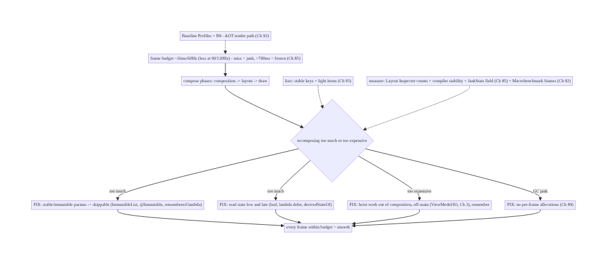
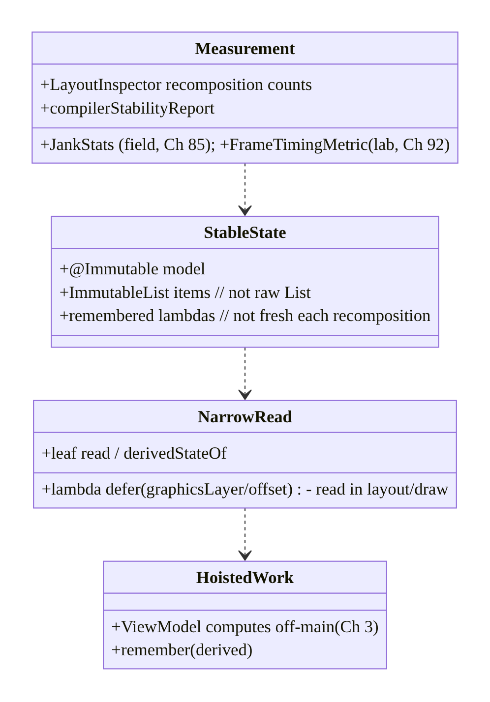
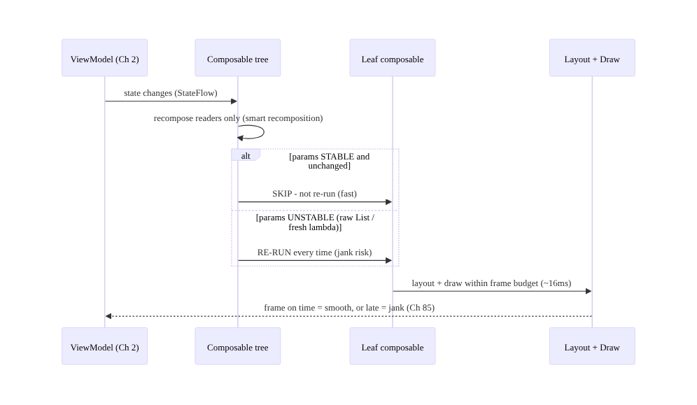
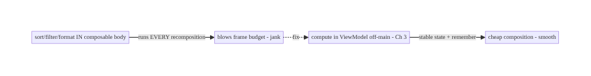
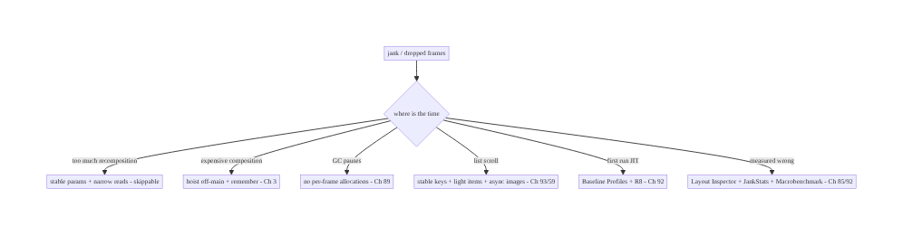

# Chapter 90 — Rendering Performance & Jank in Compose

> **Part X — Performance, Observability & Quality** · Complexity: **Complex** (≥40 interview questions)
>
> **Prerequisites:** Ch 2 (Compose/UDF), Ch 85 (perf monitoring/JankStats), Ch 89 (memory/GC),
> Ch 93 (lists/LazyColumn), Ch 3 (threading), Ch 44 (lifecycle). Pairs with Ch 88 (cold start),
> Ch 92 (baseline profiles).
>
> **Reference surface in StreamCart:** keeping the UI **smooth** — rendering every frame within
> the **frame budget** (≈16ms at 60Hz, ≈8–11ms at 90/120Hz) so there's no **jank** (dropped/slow
> frames) or **frozen frames** (>700ms) — by understanding Compose's **recomposition** model,
> making state **stable** and reads **narrow**, keeping work **off the composition/UI thread**
> (Ch 3), and **measuring** with the **Layout Inspector recomposition counts**, **Compose
> compiler metrics**, **JankStats** (field, Ch 85), and **Macrobenchmark `FrameTimingMetric`**
> (Ch 92).

---

## 90.1 Problem Definition and Real-World Context

Smoothness is **perceived quality**: the UI thread must produce each frame within the **frame
budget** — **~16.7ms at 60Hz** (less at 90/120Hz) — or the frame is **dropped/late** (**jank**),
and a frame over **700ms** is a **frozen frame** (Ch 85). In **Jetpack Compose** (Ch 2), the
dominant cause of jank is **recomposition problems**: recomposing **too much** (unstable
parameters, broad state reads, no `remember`), doing **expensive work in composition** (sorting/
allocating/IO on the composition thread), and **janky lists** (Ch 93). **Rendering performance &
jank** is the discipline of keeping every frame within budget: understanding the **compose
phases** (composition → layout → draw) and the **recomposition** model, making state **stable**
and reads **deferred/narrow**, **hoisting** work out of composition and **off the main thread**
(Ch 3), avoiding **per-frame allocations** (GC jank, Ch 89), and **measuring** recomposition and
frame timing rigorously. Jank is the most **visible** perf problem — users feel stutter
immediately.

Concretely, teams hit:

- **Over-recomposition.** A composable recomposes far more than needed because a parameter is
  **unstable** (an unstable type, a lambda recreated each time, a `List` instead of a stable/
  immutable type) or it **reads state too broadly** — so the whole subtree recomposes on every
  change. The #1 Compose jank source.
- **Unstable parameters / types.** Compose can **skip** a composable if its parameters are
  **stable** and unchanged. A **mutable** or **unknown-stability** type (a plain `class`, a raw
  `List`, a lambda capturing unstable state) marks it **unstable** → it **can't skip** →
  recomposes every time. Fix with **stable/immutable** types (`@Immutable`/`@Stable`,
  `ImmutableList`, stable collections) and **remembered lambdas**.
- **Broad state reads.** Reading a `State`/`StateFlow` **high** in the tree (and passing values
  down) recomposes the **whole subtree**; reading it **low** (at the leaf that needs it), or
  **deferring** the read (lambda/`derivedStateOf`), narrows recomposition. Read state **as low
  and as late as possible**.
- **Expensive work in composition.** Composition runs on a thread that **blocks frames** —
  sorting, filtering, allocating, formatting, or (worst) **I/O** in the composable body runs on
  **every recomposition** and blows the budget. **Hoist** it: compute in the `ViewModel`/off-
  main (Ch 3), `remember` the result, pass stable inputs.
- **Missing `remember` / `derivedStateOf`.** Recomputing a derived value every recomposition
  (instead of `remember`/`derivedStateOf`) wastes the budget; `remember` caches across
  recompositions, `derivedStateOf` recomputes **only when inputs change**.
- **Janky lists (Ch 93).** `LazyColumn` without stable **`key`s**, with unstable items, heavy
  item composables, or synchronous image decode (Ch 59) janks on scroll — covered in depth in
  Ch 93.
- **Per-frame allocations → GC jank (Ch 89).** Allocating in composition or `onDraw` churns the
  GC → pauses → dropped frames (Ch 89). Hoist allocations.
- **The compose phases & where time goes.** **Composition** (what to show — recomposition),
  **layout** (measure/place), **draw**. Jank can be in any phase; most Compose jank is
  **excessive recomposition** + **expensive composition**, but deep layout and overdraw matter
  too. **Measure** to know which.
- **Measuring recomposition & frames.** **Layout Inspector** shows **recomposition/skip counts**
  per composable; the **Compose compiler metrics** report **stability** (which params/types are
  unstable); **JankStats** (Ch 85) measures **field** jank; **Macrobenchmark `FrameTimingMetric`**
  (Ch 92) measures frame durations in the lab. Don't guess — measure.
- **First-run jank (JIT, Ch 92).** On first runs, composition code is interpreted/JIT → slower
  → more first-scroll jank. **Baseline Profiles** (Ch 92) AOT-compile Compose + scroll paths →
  smoother from first launch.

The architecture: keep every frame within the **frame budget** by minimizing **recomposition** —
make parameters/state **stable/immutable** (`@Immutable`/`@Stable`, immutable collections,
remembered lambdas) so composables can **skip**; **read state as low and late as possible**
(leaf reads, lambda deferral, `derivedStateOf`); **hoist expensive work out of composition** and
**off the main thread** (ViewModel/Dispatchers.IO, Ch 3), `remember`ing results; **avoid per-
frame allocations** (GC jank, Ch 89); optimize **lists** with stable keys + light items (Ch 93);
**AOT-compile** the render path (Baseline Profiles, Ch 92); and **measure** with Layout Inspector
recomposition counts, compose compiler stability metrics, **JankStats** (field, Ch 85), and
**Macrobenchmark `FrameTimingMetric`** (lab, Ch 92). This chapter is about **keeping the UI
smooth**.

### Three practical use cases

1. **Kill over-recomposition (StreamCart).** The product card recomposed on every unrelated
   state change because it took a raw `List` and a fresh lambda; Layout Inspector showed
   thousands of recompositions. Fix: `ImmutableList` + remembered callback + `@Immutable` model →
   recompositions drop ~95%, scroll is smooth (Ch 93).
2. **Hoist expensive composition.** A screen sorted/filtered a list **in the composable body**
   every recomposition. Fix: move to the `ViewModel` (off-main, Ch 3), expose stable state,
   `remember` derived values → frame budget restored.
3. **Smooth first scroll (Ch 92).** First-scroll jank from JIT-cold Compose; a Baseline Profile
   covering the feed scroll (Ch 92) AOT-compiles it → smooth from first launch, verified by
   Macrobenchmark `FrameTimingMetric`.

### Why this is architectural

Rendering performance composes Compose's recomposition model (Ch 2), memory/GC (Ch 89), lists
(Ch 93), threading (Ch 3), baseline profiles (Ch 92), and measurement (JankStats + Macrobenchmark,
Ch 85/92). The decisions — stable state, narrow reads, hoisted work, allocation discipline,
AOT-compiled render path, rigorous measurement — determine whether the UI is smooth, which is the
most visible dimension of quality.

---

## 90.2 Requirements Engineering

### Functional requirements

| ID | Requirement |
|----|-------------|
| F1 | Render every frame within the frame budget (~16ms/60Hz, less at 90/120Hz); no jank/frozen frames. |
| F2 | Minimize recomposition: stable/immutable params + skippable composables. |
| F3 | Read state as low and late as possible (leaf reads, deferral, derivedStateOf). |
| F4 | Hoist expensive work out of composition and off the main thread (Ch 3). |
| F5 | Avoid per-frame allocations (GC jank, Ch 89); optimize lists (Ch 93). |
| F6 | Measure: Layout Inspector counts, compiler stability, JankStats (field), Macrobenchmark frames (Ch 85/92). |

### Non-functional requirements

| Attribute | Policy |
|-----------|--------|
| **Smoothness** | Within frame budget; low jank/frozen-frame rate (Ch 85). |
| **Efficiency** | Minimal recomposition; hoisted work. |
| **Measured** | Recomposition counts + field jank + lab frames (Ch 85/92). |
| **Device coverage** | Smooth on low-end (not just flagship, Ch 85). |
| **No regression** | Macrobenchmark frame gate (Ch 92). |

### Scope

- **In scope:** frame budget + jank/frozen frames (Ch 85), compose phases (composition/layout/
  draw), recomposition model + skipping, stability (`@Immutable`/`@Stable`, immutable
  collections, remembered lambdas), narrow/deferred state reads (leaf, `derivedStateOf`),
  hoisting work off composition + off-main (Ch 3), `remember`/`derivedStateOf`, per-frame
  allocations (GC jank, Ch 89), list jank pointer (Ch 93), measurement (Layout Inspector,
  compiler metrics, JankStats, Macrobenchmark `FrameTimingMetric`, Ch 85/92), baseline profiles
  pointer (Ch 92).
- **Out of scope:** Compose basics/UDF (Ch 2), perf monitoring pipeline (Ch 85), memory detail
  (Ch 89), list detail (Ch 93), baseline-profile mechanics (Ch 92), threading detail (Ch 3).

### Assumptions & constraints

- Jetpack Compose (Ch 2) with the Compose compiler; UDF with `ViewModel` + `StateFlow` (Ch 2).
  Measured with Layout Inspector (recomposition counts), compose compiler metrics (stability),
  JankStats (field, Ch 85), Macrobenchmark `FrameTimingMetric` (lab, Ch 92). Target smooth on
  **representative** devices. `minSdk 24`.

---

## 90.3 System Design Fundamentals

- **The frame budget & jank (Ch 85).** The display refreshes at **60/90/120Hz**; each frame must
  be produced in **1/refresh** seconds (**~16.7ms at 60Hz**, ~11ms at 90Hz, ~8ms at 120Hz). Miss
  it → the frame is **late/dropped** (**jank** — visible stutter); a frame **>700ms** is a
  **frozen frame** (Ch 85). The UI/composition thread does composition + layout + draw dispatch
  within this budget — any heavy work on it janks.
- **The compose phases.** Compose renders in three phases: **composition** (run composables to
  decide *what* to show — this is where **recomposition** happens), **layout** (measure + place),
  **draw** (issue draw commands). Recomposition re-runs (parts of) composition when state
  changes. Jank can be in any phase, but **most Compose jank is excessive/expensive
  recomposition** (plus deep layout and overdraw). Measure to locate it.
- **Recomposition & skipping (the core model).** When observed state changes, Compose
  **recomposes** the composables that **read** it. Compose can **skip** a composable (not re-run
  it) if **all its parameters are stable and unchanged** — this is the key to performance.
  **Smart recomposition** re-runs only what's affected. The goal: **maximize skipping** by making
  parameters stable and reads narrow, so a change recomposes **only the leaf** that depends on it.
- **Stability — why composables don't skip.** Compose marks a type **stable** if it's immutable
  or its mutations are observable (`@Immutable`/`@Stable`, primitives, stable collections). An
  **unstable** parameter — a **mutable** class, a type of **unknown stability** (a class from a
  module without the Compose compiler), a raw **`List`/`Map`/`Set`** (interface — unknown
  stability), or a **lambda recreated** each recomposition — makes the composable **unskippable**
  → it recomposes **every time** the parent does. **Fixes:** `@Immutable`/`@Stable` on models,
  **immutable collections** (`kotlinx.collections.immutable` `ImmutableList`), **remembered**
  lambdas (or stable method refs), and keeping unstable types out of composable params. The
  **Compose compiler stability metrics** report exactly which params/types are unstable.
- **Narrow & deferred state reads.** **Where** you read state determines **what** recomposes.
  Reading state **high** and passing values down recomposes the **whole subtree**. Reading it
  **low** (at the leaf that uses it), or **deferring** the read behind a **lambda** (e.g.,
  `Modifier.offset { ... }`, `graphicsLayer { ... }` — read in layout/draw, not composition) or
  **`derivedStateOf`** (recompute only when the *derived* value changes), **narrows**
  recomposition. **Read state as low and as late as possible.**
- **Hoist expensive work out of composition + off-main (Ch 3).** The composable body runs on
  **every recomposition** — so **sorting, filtering, formatting, allocating, or I/O** there is
  catastrophic. **Hoist** computation to the **`ViewModel`** / a **background dispatcher** (Ch 3),
  expose **ready, stable state**, and `remember` any per-composition derived value. Never do
  blocking/IO work in a composable (Ch 3).
- **`remember` and `derivedStateOf`.** **`remember`** caches a value **across recompositions**
  (compute once, reuse) — use it for any non-trivial derived/created object. **`derivedStateOf`**
  wraps a computation that reads state and **recomputes only when its result changes** (not on
  every input change) — use it when a frequently-changing state drives a rarely-changing derived
  value (e.g., `isScrolled = derivedStateOf { listState.firstVisibleItemIndex > 0 }`). Together
  they cut recomposition cost.
- **Per-frame allocations → GC jank (Ch 89).** Allocating in composition, `onDraw`, or a tight
  loop churns the **GC**, whose pauses **drop frames** (Ch 89). Hoist/`remember` allocations;
  avoid creating lambdas/collections/objects on the hot path.
- **Lists (Ch 93).** `LazyColumn`/`LazyRow` jank — missing stable **`key`s**, unstable items,
  heavy item content, sync image decode (Ch 59) — is the most common scroll-jank source, covered
  in depth in **Ch 93**. The same principles (stability, keys, light items, async images) apply.
- **Baseline Profiles for the render path (Ch 92).** First-run composition/scroll is **JIT-cold**
  → janky; a **Baseline Profile** covering launch + key scrolls (Ch 92) **AOT-compiles** the
  Compose runtime + your render path → **smoother from the first launch**. Pair with R8 (Ch 92).
- **Measurement (don't guess).** **Layout Inspector** → **recomposition + skip counts** per
  composable (find the over-recomposing one). **Compose compiler metrics** → **stability report**
  (which params are unstable, why skipping fails). **JankStats** (Ch 85) → **field** jank/frozen
  rate per screen. **Macrobenchmark `FrameTimingMetric`** (Ch 92) → **lab** frame durations (CI
  gate). **System trace (Perfetto)** → where the frame time goes. Measure, then optimize the
  thing that's actually slow.

Core insight: **keep every frame within the budget (~16ms at 60Hz, less at 90/120Hz — a late
frame is jank, a >700ms frame is frozen, Ch 85) by minimizing recomposition: make composables
skippable by giving them stable/immutable parameters (@Immutable/@Stable models, immutable
collections instead of raw List/Map, remembered lambdas instead of freshly-allocated ones — the
Compose compiler stability metrics tell you exactly which params are unstable and why), read
state as low and as late as possible (leaf reads, lambda/graphicsLayer deferral so the read
happens in layout/draw not composition, and derivedStateOf so a frequently-changing state only
recomposes when the derived result changes), hoist all expensive work — sorting, filtering,
formatting, and above all I/O — out of the composable body (which re-runs on every
recomposition) into the ViewModel and off the main thread (Ch 3), caching with remember; avoid
per-frame allocations that churn the GC into frame-dropping pauses (Ch 89); apply the same
stability + stable-key + light-item discipline to lists (Ch 93); AOT-compile the composition and
scroll paths with Baseline Profiles + R8 so the first run isn't JIT-janky (Ch 92); and measure
with Layout Inspector recomposition counts, the compiler stability report, JankStats in the
field (Ch 85), and Macrobenchmark FrameTimingMetric in the lab (Ch 92) rather than guessing —
because jank is the most visible quality defect and the tail (low-end, first scroll) is where
it's felt.**

---

## 90.4 High-Level Architecture



**Components & ownership**

- **Frame budget** sets the deadline; **compose phases** (composition/layout/draw) do the work.
- **Minimize recomposition:** stable params (skippable), narrow/deferred reads, hoisted work
  (Ch 3), no per-frame allocation (Ch 89).
- **Lists** (Ch 93); **AOT** render path (Ch 92); **measure** (Layout Inspector + JankStats +
  Macrobenchmark, Ch 85/92).

**Direction:** frame budget → compose phases → minimize/cheapen recomposition (stable + narrow +
hoisted + no-alloc) → smooth; measured by counts + field + lab.

---

## 90.5 Detailed Component Design



| Component | Responsibility |
|-----------|----------------|
| `StableState` | immutable models + collections + remembered lambdas → skippable |
| `NarrowRead` | leaf reads, `derivedStateOf`, lambda deferral → narrow recomposition |
| `HoistedWork` | compute off composition + off-main (Ch 3); `remember` results |
| `Measurement` | Layout Inspector counts, stability report, JankStats (Ch 85), FrameTiming (Ch 92) |

---

## 90.6 End-to-End Data Flow

### State change → recomposition (skip vs re-run)



### Hoist expensive work out of composition



---

## 90.7 Complete Kotlin Implementation

Package: `com.streamcart.ui`.

### 90.7.1 Stable params → skippable composable

```kotlin
@Immutable                                                   // stable -> enables skipping
data class ProductUi(val id: String, val title: String, val price: String, val imageUrl: String)

@Composable
fun ProductCard(
    product: ProductUi,                                      // @Immutable -> stable
    onClick: (String) -> Unit,                               // pass a STABLE/remembered lambda (see caller)
) {
    // Skippable: if `product` is unchanged and `onClick` is stable, Compose SKIPS this on recomposition.
    Card(Modifier.clickable { onClick(product.id) }) { /* ... */ }
}

@Composable
fun Feed(items: ImmutableList<ProductUi>, onClick: (String) -> Unit) {   // ImmutableList, NOT List (stable)
    LazyColumn {
        items(items, key = { it.id }) { product ->           // stable keys (Ch 93)
            ProductCard(product, onClick)                    // onClick is hoisted/stable -> cards skip
        }
    }
}
```

### 90.7.2 Narrow + deferred reads (derivedStateOf, lambda defer)

```kotlin
@Composable
fun FeedWithFab(listState: LazyListState) {
    // derivedStateOf: recomposes the FAB ONLY when crossing the threshold, not every scroll pixel
    val showFab by remember { derivedStateOf { listState.firstVisibleItemIndex > 3 } }
    if (showFab) ScrollToTopFab()

    // Lambda/graphicsLayer defer: read scroll offset in the DRAW phase, not composition -> no recomposition
    Box(Modifier.graphicsLayer { translationY = listState.firstVisibleItemScrollOffset * 0.5f })  // parallax
}
```

### 90.7.3 Hoist expensive work off composition + off-main (Ch 3)

```kotlin
// BAD: sort/filter in the composable body - runs on EVERY recomposition, blocks the frame
@Composable fun BadList(all: List<ProductUi>, query: String) {
    val filtered = all.filter { it.title.contains(query) }.sortedBy { it.price }   // every recomposition!
    LazyColumn { items(filtered) { ProductCard(it, {}) } }
}

// GOOD: compute in the ViewModel, off-main (Ch 3); expose ready, stable state
class FeedViewModel @Inject constructor(private val repo: FeedRepository) : ViewModel() {
    val uiState: StateFlow<ImmutableList<ProductUi>> = combine(repo.products, query) { all, q ->
        all.filter { it.title.contains(q) }.sortedBy { it.price }.toImmutableList()
    }.flowOn(Dispatchers.Default)                                                  // off-main (Ch 3)
     .stateIn(viewModelScope, SharingStarted.WhileSubscribed(5000), persistentListOf())
}
@Composable fun GoodList(vm: FeedViewModel) {
    val items by vm.uiState.collectAsStateWithLifecycle()                          // ready state - cheap composition
    Feed(items, remember { vm::onClick })                                          // remembered lambda - stable
}
```

### 90.7.4 remember to avoid recomputation/allocation (Ch 89)

```kotlin
@Composable
fun FormattedPrice(cents: Long) {
    // remember: build the formatter ONCE, not every recomposition (avoids allocation -> GC jank, Ch 89)
    val formatter = remember { NumberFormat.getCurrencyInstance() }
    val text = remember(cents) { formatter.format(cents / 100.0) }                 // recompute only when cents change
    Text(text)
}
```

### 90.7.5 Measurement: Macrobenchmark FrameTimingMetric (lab, Ch 92)

```kotlin
@RunWith(AndroidJUnit4::class)
class ScrollBenchmark {
    @get:Rule val rule = MacrobenchmarkRule()
    @Test fun feedScroll() = rule.measureRepeated(
        packageName = "com.streamcart", metrics = listOf(FrameTimingMetric()),     // frame durations (jank)
        compilationMode = CompilationMode.Partial(), iterations = 10,              // with baseline profile (Ch 92)
        startupMode = null,
    ) { startActivityAndWait(); device.findObject(By.res("feed")).fling(Direction.DOWN) }
    // CI GATE: fail if frameDurationCpuMs p95 regresses. Field jank -> JankStats/vitals (Ch 85).
}
// Dev: Layout Inspector recomposition counts; enable compose compiler metrics for the stability report.
```

### 90.7.6 Module structure

```
:feature:feed  Feed/ProductCard (stable params), FeedViewModel (hoisted, off-main)
# Stability -> @Immutable + ImmutableList + remembered lambdas; narrow reads -> derivedStateOf/lambda defer;
# lists -> Ch 93; allocations -> Ch 89; AOT -> Baseline Profiles + R8 (Ch 92);
# measure -> Layout Inspector + compiler metrics + JankStats (Ch 85) + Macrobenchmark FrameTiming (Ch 92).
```

---

## 90.8 Concurrency and Race Conditions

| Scenario | Risk | Handling |
|----------|------|----------|
| Work in composition thread | blocks frame | hoist to ViewModel off-main (Ch 3) |
| Unstable param | no skip, over-recompose | @Immutable / ImmutableList / remembered lambda |
| Broad state read | whole subtree recomposes | leaf read / derivedStateOf / defer |
| Per-frame allocation | GC jank | remember / hoist (Ch 89) |
| Fresh lambda each recomposition | unstable param | remember / stable method ref |
| Sync image decode in item | scroll jank | async loader (Coil, Ch 59/93) |
| IO in composable | frame stall + wrong thread | never — ViewModel/IO (Ch 3) |

- **Composition is on the frame-critical thread** — any blocking/IO/heavy compute there
  **directly** causes jank. The UDF discipline (Ch 2) — compute in the `ViewModel` off-main
  (Ch 3), expose ready state — is also the **performance** discipline.
- **Stability is a contract** — an unstable param silently disables skipping, so a far-away state
  change recomposes composables that didn't change. The **compiler stability report** makes this
  visible; immutable types + remembered lambdas restore skipping.
- **`derivedStateOf` prevents recomposition storms** — a rapidly-changing state (scroll offset)
  driving a rarely-changing derived value (is-scrolled) would otherwise recompose every frame;
  `derivedStateOf` gates it.

---

## 90.9 Failure Scenarios and Recovery

| Failure | Detection | Response | Outcome |
|---------|-----------|----------|---------|
| Over-recomposition | Layout Inspector counts | stable params + narrow reads | skips restored |
| Expensive composition | Perfetto/traces | hoist off-main (Ch 3) + remember | cheap composition |
| GC jank | allocation profiler (Ch 89) | hoist allocations | smooth |
| Scroll jank | JankStats (Ch 85) | stable keys + light items + async images (Ch 93/59) | smooth scroll |
| First-scroll jank | Macrobenchmark None vs Partial | Baseline Profile (Ch 92) | AOT smooth |
| Unstable param | compiler stability report | @Immutable / ImmutableList / remember | skippable |
| Low-end jank | field p95 (Ch 85) | optimize + measure on real devices | honest |



> **Make composables skippable, read state narrowly, hoist the work, and measure.** Compose jank
> is over-recomposition (stable params + narrow reads fix it), expensive composition (hoist
> off-main + remember fix it), GC pauses (hoist allocations, Ch 89), and list/first-run jank
> (stable keys + baseline profiles, Ch 93/92). Don't guess — use Layout Inspector recomposition
> counts, the compiler stability report, JankStats in the field (Ch 85), and Macrobenchmark
> FrameTimingMetric in the lab (Ch 92).

---

## 90.10 Scaling the Implementation

- **Level 1.** UDF with `collectAsStateWithLifecycle` (Ch 2); `remember` derived values; no IO in
  composables (Ch 3).
- **Level 2.** Stable params (`@Immutable`, `ImmutableList`, remembered lambdas); narrow reads +
  `derivedStateOf`; stable list keys (Ch 93).
- **Level 3 — production.** Compose compiler stability metrics in CI; Layout Inspector audits;
  JankStats field monitoring (Ch 85); Baseline Profiles + R8 (Ch 92).
- **Level 4 — large.** Macrobenchmark `FrameTimingMetric` CI gates per key screen; jank budgets
  by device class (Ch 85); strong-skipping mode; module-wide stability hygiene.
- **Level 5 — enterprise.** Jank SLOs with error budgets, automated frame-regression gating,
  per-flow baseline profiles (Ch 92), device-tiered rendering, continuous field jank dashboards
  (Ch 85).

**Avoid overengineering:** stable params + narrow reads + hoisted work + stable keys + baseline
profiles, measured with Layout Inspector and JankStats, gets most of the smoothness. Don't
micro-optimize before measuring; don't put work in composition; don't use raw `List`/fresh
lambdas in hot composables.

---

## 90.11 Alternative Approaches and Trade-offs

| Dimension | Option A | Option B | When |
|-----------|----------|----------|------|
| Params | Stable/immutable (skippable) | raw List / fresh lambda | Stable (enable skipping) |
| State read | Narrow/deferred (derivedStateOf) | broad/high | Narrow (less recomposition) |
| Work | Hoisted off-main (Ch 3) | in composition | Hoisted (cheap composition) |
| Derived value | remember / derivedStateOf | recompute each time | remember (cache) |
| Allocations | Hoisted (Ch 89) | per-frame | Hoisted (no GC jank) |
| First run | Baseline Profile (Ch 92) | JIT | Baseline profile (smooth first) |
| Optimize by | Measurement (Ch 85/92) | guessing | Measure first |

**Stable/immutable params vs raw `List`/fresh lambdas:** a raw `List` (interface — unknown
stability) or a lambda **recreated each recomposition** marks a composable **unskippable**, so it
recomposes on **every** parent recomposition — a silent, widespread jank source. **Immutable
collections** + **`@Immutable`/`@Stable`** models + **remembered lambdas** make composables
**skippable**. The compiler stability report shows which to fix. Always prefer stable params in
hot composables.

**Hoisting vs work-in-composition:** computing in the composable body runs it on **every
recomposition** on the **frame-critical thread** — catastrophic for sorting/filtering/IO.
**Hoisting** to the `ViewModel` off-main (Ch 3), exposing ready state, and `remember`ing derived
values makes composition **cheap**. Never compute heavily (and never do IO) in composition.

**Measurement vs guessing:** optimizing by intuition wastes effort on the wrong thing. **Layout
Inspector** (recomposition counts), **compiler stability metrics** (why skipping fails),
**JankStats** (field, Ch 85), and **Macrobenchmark `FrameTimingMetric`** (lab, Ch 92) tell you
**what's actually slow and where**. Measure first, optimize the real bottleneck, verify.

---

## 90.12 Security & Privacy Considerations

- **No sensitive data in recomposition logs/traces (Ch 28):** recomposition counts and frame
  traces are **structural/timing**, not content — keep PII out of any custom perf logging (Ch 85/
  28).
- **Screen content in overdraw/debug tools stays local:** Layout Inspector/debug overlays are
  **dev-only**; don't ship debug rendering that could expose content.
- **Baseline profiles contain method names, not data (Ch 92):** compilation hints, not secrets.
- **Field jank metrics PII-safe (Ch 85):** JankStats reports **screen + timing**, not user
  content (Ch 28).
- **Sensitive screens render like any other:** performance work doesn't change the **secure-
  surface** handling (e.g., `FLAG_SECURE` on payment screens, Ch 76) — orthogonal concern.
- Client-only concern: rendering is **client-side**; the cross-cutting note is keeping perf
  logging/traces PII-safe (Ch 85/28).

---

## 90.13 Performance and Resource Optimization

- **This chapter *is* rendering performance** — summary: **skippable composables** (stable
  params), **narrow/deferred reads** (`derivedStateOf`, lambda defer), **hoist work off
  composition + off-main** (Ch 3), **`remember`** derived/allocated values, **no per-frame
  allocations** (Ch 89), **stable list keys + light items** (Ch 93), **Baseline Profiles + R8**
  (Ch 92).
- **Measure before optimizing** — Layout Inspector counts, compiler stability, Perfetto traces,
  Macrobenchmark frames (Ch 92); don't guess.
- **Target low-end + high-refresh** — the budget is **tighter** at 90/120Hz and work is
  **slower** on low-end; optimize for the **p95** (Ch 85).
- **Defer reads to layout/draw** — `graphicsLayer`/`offset { }` lambdas read state **without
  recomposing**.
- **Strong skipping / stability** — keep hot composables' params stable; use the stability report.
- **Profiling:** recomposition/skip counts, frame duration p95 (JankStats field, FrameTiming
  lab), GC pauses (Ch 89), composition vs layout vs draw time (Perfetto), stability report.

---

## 90.14 Testing Strategy

Frame timing is measured (Macrobenchmark); recomposition is inspected; stability is reported by
the compiler.

```kotlin
class ScrollFrameBenchmark {   // lab gate (Ch 92)
    @get:Rule val rule = MacrobenchmarkRule()
    @Test fun feedScroll_frames() = rule.measureRepeated(
        packageName = "com.streamcart", metrics = listOf(FrameTimingMetric()),
        compilationMode = CompilationMode.Partial(), iterations = 10, startupMode = null,
    ) { startActivityAndWait(); scrollFeed() }   // assert frameDurationCpuMs p95 within budget
}

// Dev checks (not asserted in unit tests, but part of the workflow):
//  - Layout Inspector: recomposition count on ProductCard should be ~1 per data change, not per unrelated change
//  - Compose compiler metrics: enable -> stability report shows ProductUi @Immutable, params stable
//  - StrictMode / no-IO-in-composition: ensure ViewModel does the work (Ch 3)

@Test fun `derivedStateOf gates recomposition`() { /* showFab flips only across the threshold */ }
```

What to test: Macrobenchmark `FrameTimingMetric` on key scrolls (lab gate, p95 within budget,
Ch 92); recomposition counts (Layout Inspector — minimal, dev); compiler stability report (params
stable); `derivedStateOf`/`remember` gating; no IO in composition (Ch 3); field jank via JankStats
(Ch 85).

---

## 90.15 Production Observability

- **Metrics:** **jank rate** + **frozen-frame rate** per screen (JankStats, field, Ch 85),
  **frame-duration percentiles** (Macrobenchmark lab, Ch 92), recomposition counts (dev), GC
  pause correlation (Ch 89), first-scroll jank (baseline-profile effect, Ch 92).
- **Logs/traces:** Perfetto frame traces (dev), JankStats events (field) — **PII-safe** (Ch 28/
  85).
- **Debugging:** janky screen → JankStats (which screen, Ch 85) → Layout Inspector (over-
  recomposing composable?) → compiler stability (unstable param?) → Perfetto (composition/layout/
  draw time?); GC jank → allocation profiler (Ch 89); first-scroll jank → `None` vs `Partial`
  (Ch 92); low-end → field p95 (Ch 85).
- **Alerting:** jank/frozen-frame-rate **regression** release-over-release (Ch 85/41); frame p95
  budget breach (Macrobenchmark CI, Ch 92).
- **Dashboards:** jank/frozen rate by screen/device/release; frame percentiles; first-scroll
  jank; recomposition hotspots (dev).

---

## 90.16 System Design Interview Preparation

> ≥40 questions (Complex).

**Fundamentals**
1. *Frame budget?* ~16.7ms@60Hz, ~11ms@90Hz, ~8ms@120Hz.
2. *Jank?* A late/dropped frame; >700ms = frozen (Ch 85).
3. *Compose phases?* Composition → layout → draw.
4. *Recomposition?* Re-running composables that read changed state.
5. *#1 Compose jank?* Excessive/expensive recomposition.

**Recomposition/skipping**
6. *Skipping?* Compose skips a composable if params are stable + unchanged.
7. *Smart recomposition?* Re-run only affected readers.
8. *Why not skip?* Unstable parameter.
9. *Goal?* Maximize skipping; recompose only the leaf.

**Stability**
10. *Stable type?* Immutable or observably mutable (`@Immutable`/`@Stable`, primitives).
11. *Unstable examples?* Mutable class, raw `List`/`Map`, fresh lambda, unknown-stability type.
12. *Fix collections?* `ImmutableList` (kotlinx.collections.immutable).
13. *Fix lambdas?* `remember` / stable method ref.
14. *Find instability?* Compose compiler stability metrics.
15. *@Immutable vs @Stable?* Immutable (never changes) vs stable (changes observable).

**State reads**
16. *Narrow read?* Read at the leaf that uses it.
17. *Defer read?* Lambda/`graphicsLayer`/`offset { }` — read in layout/draw.
18. *derivedStateOf?* Recompute only when the derived result changes.
19. *Example?* `isScrolled = derivedStateOf { index > 0 }`.
20. *Read high vs low?* Low — narrows recomposition.

**Work/hoisting**
21. *Work in composition?* Runs every recomposition — hoist it.
22. *Where?* ViewModel, off-main (Ch 3).
23. *IO in composable?* Never (Ch 3).
24. *remember?* Cache across recompositions.

**Allocations/GC**
25. *Per-frame alloc?* GC jank — hoist/remember (Ch 89).
26. *onDraw allocations?* Hoist out (Ch 89).

**Lists**
27. *List jank?* Stable keys + light items + async images (Ch 93).
28. *key?* Stable identity so items aren't recomposed/moved wrongly (Ch 93).
29. *Heavy item?* Lighten / defer (Ch 93).

**Baseline profiles**
30. *First-scroll jank?* JIT-cold — Baseline Profile (Ch 92).
31. *What it does?* AOT-compile render path (Ch 92).

**Measurement**
32. *Recomposition counts?* Layout Inspector.
33. *Stability?* Compiler metrics.
34. *Field jank?* JankStats (Ch 85).
35. *Lab frames?* Macrobenchmark `FrameTimingMetric` (Ch 92).
36. *Where time goes?* Perfetto/system trace.

**Edge cases/production**
37. *High-refresh?* Tighter budget (8–11ms).
38. *Low-end jank?* Field p95 (Ch 85).
39. *Regression gate?* Macrobenchmark frames CI (Ch 92).
40. *Overdraw?* Too many layers drawn — flatten.
41. *Deep layout?* Flatten/`SubcomposeLayout` carefully.
42. *Measure first?* Always — optimize the real bottleneck.

### Design-change challenges
1. **Kill over-recomposition in a card.** Stable params (@Immutable + ImmutableList + remembered
   lambda).
2. **Smooth a janky filtered list.** Hoist filter/sort off-main (Ch 3) + stable keys (Ch 93).
3. **Stop a recomposition storm on scroll.** `derivedStateOf` / lambda defer.
4. **Fix first-scroll jank.** Baseline Profiles + R8 (Ch 92).
5. **Gate frame regressions in CI.** Macrobenchmark `FrameTimingMetric` (Ch 92) + field JankStats
   (Ch 85).

### Mock walkthrough (abridged)
Clarify (which screen janks? measured how? device targets?) → frame budget + phases (Ch 85) →
measure (Layout Inspector counts, compiler stability, JankStats/Perfetto) → minimize recomposition:
stable params (@Immutable, ImmutableList, remembered lambdas) + narrow/deferred reads
(derivedStateOf, lambda defer) → hoist work off composition + off-main (Ch 3) + remember → no
per-frame allocations (Ch 89) → lists (stable keys + light items + async images, Ch 93/59) →
Baseline Profiles + R8 (Ch 92) → verify with Macrobenchmark frames (lab) + field JankStats
(Ch 85/92) → observability (jank by screen/device).

---

## 90.17 Practical Exercises

1. **Beginner.** Enable the Compose compiler stability metrics; find an unstable param on a hot
   composable and fix it (`@Immutable` + `ImmutableList` + remembered lambda). *Eval:* composable
   becomes skippable; recomposition count drops.
2. **Intermediate.** Move a sort/filter out of a composable body into the `ViewModel` off-main
   (Ch 3) and add `derivedStateOf` for a scroll-driven flag. *Eval:* cheap composition; no
   recomposition storm.
3. **Advanced.** Add a Baseline Profile covering feed scroll (Ch 92) and measure the frame delta
   with Macrobenchmark `FrameTimingMetric` (`None` vs `Partial`). *Eval:* first-scroll jank
   reduced; CI gate added.
4. **Production debugging.** Use JankStats (Ch 85) to find the jankiest screen, then Layout
   Inspector + Perfetto to locate the cause (over-recomposition? allocation? Ch 89). *Eval:* root
   cause found and fixed.
5. **System design challenge.** Design a jank budget + CI frame-gating pipeline (Macrobenchmark
   per screen) + field JankStats dashboards by device class (Ch 85/92). *Eval:* gated, measured,
   device-tiered.

*(Solutions withheld unless requested.)*

---

## 90.18 Chapter Summary & Reference Sheet

**Key decisions:** keep the UI smooth by rendering **every frame within the frame budget**
(**~16.7ms at 60Hz**, ~11ms at 90Hz, ~8ms at 120Hz — a late frame is **jank**, a **>700ms** frame
is **frozen**, Ch 85), which in **Jetpack Compose** (Ch 2) means **minimizing recomposition**:
make composables **skippable** by giving them **stable/immutable parameters** (**`@Immutable`/
`@Stable`** models, **immutable collections** instead of raw `List`/`Map`, **remembered lambdas**
instead of freshly-allocated ones — the **Compose compiler stability metrics** report exactly
which params are unstable and why skipping fails); **read state as low and as late as possible**
(leaf reads, **lambda/`graphicsLayer` deferral** so the read happens in layout/draw not
composition, and **`derivedStateOf`** so a frequently-changing state only recomposes when the
**derived result** changes); **hoist all expensive work** — sorting, filtering, formatting, and
above all **I/O** — **out of the composable body** (which re-runs on every recomposition) into the
**`ViewModel` off the main thread** (Ch 3), caching with **`remember`**; **avoid per-frame
allocations** that churn the GC into frame-dropping pauses (Ch 89); apply the same stability +
**stable-key** + light-item discipline to **lists** (Ch 93); **AOT-compile** the composition and
scroll paths with **Baseline Profiles + R8** so the first run isn't **JIT-janky** (Ch 92); and
**measure** with **Layout Inspector** recomposition counts, the **compiler stability report**,
**JankStats** in the field (Ch 85), and **Macrobenchmark `FrameTimingMetric`** in the lab (Ch 92)
— rather than guessing, because jank is the **most visible** quality defect and the tail (low-end,
first scroll) is where it's felt.

**Concepts:** frame budget + jank/frozen (Ch 85), compose phases (composition/layout/draw),
recomposition + skipping, stability (`@Immutable`/`@Stable`, immutable collections, remembered
lambdas, compiler metrics), narrow/deferred reads (leaf, lambda defer, `derivedStateOf`), hoisting
off composition + off-main (Ch 3), `remember`/`derivedStateOf`, per-frame allocation → GC jank
(Ch 89), lists (Ch 93), Baseline Profiles + R8 (Ch 92), measurement (Layout Inspector, JankStats,
Macrobenchmark).

**Common mistakes:** raw `List`/fresh lambdas in hot composables (unskippable → over-
recomposition); broad/high state reads; sorting/filtering/IO **in** composition; recomputing
derived values without `remember`/`derivedStateOf`; per-frame allocations (GC jank); janky lists
(no stable keys, heavy items, sync images, Ch 93/59); no Baseline Profile (first-scroll JIT jank);
optimizing by guessing instead of measuring; testing only on a flagship.

**Checklist:** ☐ stable/immutable params (`@Immutable`, `ImmutableList`, remembered lambdas) →
skippable ☐ compiler stability metrics enabled (find unstable params) ☐ narrow + deferred reads
(leaf, `derivedStateOf`, lambda defer) ☐ hoist work off composition + off-main (Ch 3); never IO in
composition ☐ `remember` derived/allocated values ☐ no per-frame allocations (Ch 89) ☐ stable list
keys + light items + async images (Ch 93/59) ☐ Baseline Profiles + R8 (Ch 92) ☐ Layout Inspector
recomposition audit ☐ JankStats field (Ch 85) + Macrobenchmark `FrameTimingMetric` lab gate
(Ch 92).

**Key APIs:** `@Immutable`/`@Stable`, `kotlinx.collections.immutable` (`ImmutableList`/
`persistentListOf`), `remember`/`remember(key)`, `derivedStateOf`, `collectAsStateWithLifecycle`
(Ch 2), `Modifier.graphicsLayer`/`offset { }` (deferred read), `LazyListState`
(`firstVisibleItemIndex`/`ScrollOffset`), Compose compiler metrics (stability report), Layout
Inspector (recomposition counts), JankStats (field, Ch 85), `MacrobenchmarkRule` +
`FrameTimingMetric` + `CompilationMode.Partial` (lab, Ch 92), Perfetto/system trace.

**References:**
- Compose performance: https://developer.android.com/develop/ui/compose/performance
- Stability & skipping: https://developer.android.com/develop/ui/compose/performance/stability
- Compose compiler metrics: https://developer.android.com/develop/ui/compose/performance/stability/diagnose
- JankStats: https://developer.android.com/topic/performance/jankstats
- Macrobenchmark FrameTimingMetric: https://developer.android.com/topic/performance/benchmarking/macrobenchmark-overview
- (composes) Ch 2 Compose/UDF, Ch 85 Perf/JankStats, Ch 89 Memory/GC, Ch 93 Lists, Ch 3 Threading, Ch 92 Baseline Profiles

### Chapter review (Phase 4)
- **Completeness:** all 18 sections; architecture/class/sequence/hoist/failure diagrams; stable-
  params + narrow-reads + hoist + remember + Macrobenchmark code; concurrency (composition-is-
  frame-critical, stability-contract, derivedStateOf); failure (skippable+narrow+hoist+measure
  principle); 5 levels; stable-vs-raw, hoist-vs-in-composition, measure-vs-guess trade-offs;
  security (PII-safe perf logs); perf (the whole chapter); Macrobenchmark + recomposition +
  derivedStateOf tests; observability (jank by screen/device); 42 Q&A + 5 challenges. ✅
- **Expand later:** Compose/UDF (Ch 2), lists (Ch 93), memory/GC (Ch 89), baseline profiles
  (Ch 92), perf monitoring (Ch 85).
- **Interview coverage:** 42 Q&A — exceeds the ≥40 Complex bar.
