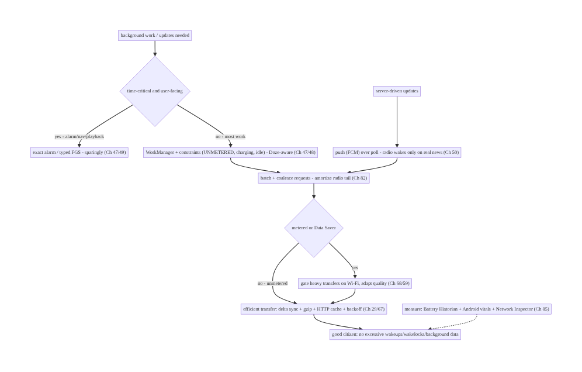
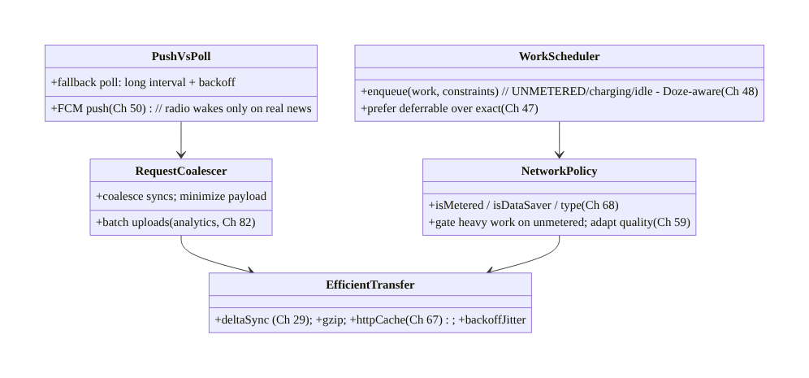
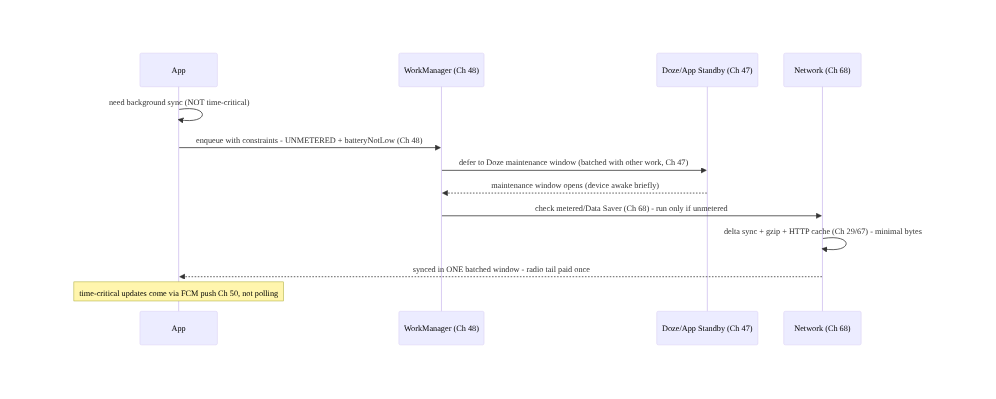
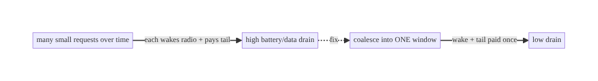
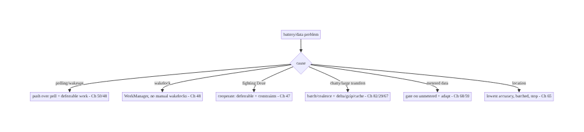

# Chapter 91 — Battery & Network Efficiency

> **Part X — Performance, Observability & Quality** · Complexity: **Standard** (≥25 interview questions)
>
> **Prerequisites:** Ch 47 (Doze/App Standby), Ch 48 (WorkManager), Ch 46/background work,
> Ch 68 (network state), Ch 82 (analytics batching), Ch 85 (perf monitoring). Pairs with Ch 29
> (offline/sync), Ch 50 (FCM), Ch 59 (images).
>
> **Reference surface in StreamCart:** keeping the app a **good citizen** of battery and data —
> minimizing **wakelocks/wakeups**, **batching** and **deferring** background work to efficient
> windows (WorkManager, Doze-aware, Ch 47/48), **coalescing** network requests, honoring
> **metered/Data Saver** and network type (Ch 68), and using **efficient sync** (delta, backoff,
> push-over-poll, Ch 29/50) — because battery drain and data overuse cause **uninstalls**, bad
> reviews, **Android vitals** "excessive background" flags, and OS throttling.

---

## 91.1 Problem Definition and Real-World Context

An app that **drains battery** or **burns mobile data** gets **uninstalled**, earns **1-star
reviews**, is flagged by **Android vitals** ("excessive wakeups / background Wi-Fi scans /
partial wakelocks"), and is **throttled** by the OS (Doze/App Standby/background limits, Ch 47).
**Battery & network efficiency** is the discipline of being a **good citizen**: minimizing
**wakeups and wakelocks**, **batching** and **deferring** background work to **efficient windows**
(WorkManager with constraints, Doze-aware maintenance windows, Ch 47/48), **coalescing** and
**minimizing** network requests, **respecting metered networks / Data Saver** and network type
(Ch 68), and using **efficient data transfer** (delta sync, compression, backoff, **push over
poll**, Ch 29/50). The core principle: **do less, less often, batched, at the right time, over
the right network** — and let the **platform's deferred-execution primitives** (WorkManager,
JobScheduler, Doze) schedule work efficiently instead of fighting them.

Concretely, teams hit:

- **Frequent wakeups / polling (the #1 drain).** Polling a server every minute, a short-interval
  alarm, or a tight background loop **wakes the device/radio** constantly — each radio wake costs
  energy for seconds (the **radio tail**). **Fix:** don't poll — use **push (FCM, Ch 50)**;
  **batch**; use **deferrable** work (WorkManager, Ch 48).
- **Wakelocks held too long.** A **partial wakelock** that isn't released (or a `WAKE_LOCK` for
  work that should be deferrable) keeps the CPU awake → Android vitals **"stuck partial
  wakelock"**. **Fix:** avoid manual wakelocks; let **WorkManager** hold them minimally; always
  release.
- **Fighting Doze/App Standby (Ch 47).** Work scheduled to run "now, every N minutes" is
  **deferred/batched** by **Doze** anyway (Ch 47) — fighting it (exact alarms, foreground
  services for deferrable work) drains battery and may be restricted. **Fix:** use **deferrable**
  APIs that run in **Doze maintenance windows**; reserve exact alarms/FGS for truly time-critical
  user-facing work (Ch 47/49).
- **Un-batched / chatty network.** Many small requests, each waking the radio and paying the
  **tail** cost; no **coalescing**. **Fix:** **batch** uploads (analytics, Ch 82), **coalesce**
  syncs, piggyback requests, prefetch in **one** window.
- **Ignoring metered / Data Saver / network type (Ch 68).** Doing large transfers on **metered**
  cellular or when **Data Saver** is on burns the user's **data** (and money). **Fix:** gate
  heavy work on **unmetered** (Wi-Fi) via WorkManager **constraints**; honor **Data Saver**
  (`ConnectivityManager.restrictBackgroundStatus`); adapt quality by network type (Ch 68/59).
- **Inefficient data transfer.** Full re-downloads instead of **delta sync** (Ch 29); no
  **compression** (gzip); no **caching** (re-fetching unchanged data, Ch 67); aggressive retry
  without **backoff** (Ch 29). **Fix:** delta sync, compression, HTTP caching, exponential
  **backoff + jitter**.
- **Wasteful location / sensors (Ch 65).** High-accuracy continuous location or sensor polling in
  the background is a top drain. **Fix:** lowest-adequate accuracy, batched location, stop when
  not needed (Ch 65).
- **No measurement.** Not knowing where battery/data goes. **Fix:** **Battery Historian** /
  Android vitals (excessive-background metrics, Ch 85), **Network Inspector**, JankStats-style
  field monitoring of background behavior.

The architecture: be a **good battery/data citizen** by **minimizing wakeups/wakelocks** (push
over poll, Ch 50; no tight loops/short alarms), **batching and deferring** background work to
**efficient windows** via **WorkManager** with **constraints** (unmetered, charging, idle) that
cooperate with **Doze/App Standby** (Ch 47/48), **coalescing and minimizing** network requests
(batch uploads, delta sync, compression, HTTP caching, backoff+jitter, Ch 29/82/67), **honoring
metered/Data Saver and network type** (gate heavy work on Wi-Fi, adapt quality, Ch 68/59), and
**measuring** with Battery Historian / Android vitals / Network Inspector (Ch 85). This chapter is
about **doing less, batched, at the right time, over the right network**.

### Three practical use cases

1. **Replace polling with push (StreamCart).** The app polled for order updates every 2 min,
   draining battery and data. Fix: **FCM push** (Ch 50) for updates; a **deferrable WorkManager**
   reconcile when needed — wakeups drop drastically; Android vitals "excessive wakeups" clears.
2. **Gate media prefetch on Wi-Fi (Ch 68/59).** Prefetching video thumbnails on metered cellular
   burned data. Fix: WorkManager **`NetworkType.UNMETERED`** constraint + honor **Data Saver** →
   heavy transfers only on Wi-Fi; adapt quality on cellular (Ch 59).
3. **Batch analytics + delta sync (Ch 82/29).** Per-event network sends and full catalog
   re-downloads wasted battery/data. Fix: **batch** analytics (Ch 82), **delta sync** the catalog
   (Ch 29), **gzip** + HTTP caching → far fewer, smaller requests.

### Why this is architectural

Battery/network efficiency composes Doze/App Standby (Ch 47), WorkManager (Ch 48), network state
/ metered / Data Saver (Ch 68), push (FCM, Ch 50), offline/delta sync (Ch 29), analytics batching
(Ch 82), and measurement (Ch 85). The decisions — push over poll, batch + defer with constraints,
respect metered/Doze, efficient transfer, measure — determine whether the app drains the device
(uninstall, vitals flags, throttling) or coexists well.

---

## 91.2 Requirements Engineering

### Functional requirements

| ID | Requirement |
|----|-------------|
| F1 | Minimize wakeups/wakelocks: push over poll (Ch 50); no tight loops/short alarms. |
| F2 | Batch + defer background work to efficient windows (WorkManager + constraints, Doze-aware, Ch 47/48). |
| F3 | Coalesce + minimize network requests (batch uploads, delta sync, compression, caching, Ch 29/82/67). |
| F4 | Honor metered / Data Saver / network type; gate heavy work on unmetered (Ch 68). |
| F5 | Use efficient transfer: delta, gzip, HTTP cache, backoff+jitter (Ch 29/67). |
| F6 | Measure: Battery Historian, Android vitals excessive-background, Network Inspector (Ch 85). |

### Non-functional requirements

| Attribute | Policy |
|-----------|--------|
| **Battery** | Minimal wakeups/wakelocks; Doze-cooperative (Ch 47). |
| **Data** | Metered/Data-Saver aware; small, coalesced transfers (Ch 68). |
| **Timeliness** | Time-critical via push/exact; everything else deferrable (Ch 47/50). |
| **Citizenship** | No Android vitals excessive-background flags (Ch 85). |
| **Measured** | Battery Historian / vitals / Network Inspector (Ch 85). |

### Scope

- **In scope:** wakeups/wakelocks + radio tail, push-over-poll (Ch 50), deferrable/batched work
  (WorkManager constraints, Doze/App Standby cooperation, Ch 47/48), request coalescing + batching
  (Ch 82), metered/Data Saver/network-type awareness (Ch 68), efficient transfer (delta sync
  Ch 29, gzip, HTTP caching Ch 67, backoff+jitter), location/sensor efficiency pointer (Ch 65),
  measurement (Battery Historian, vitals, Network Inspector, Ch 85).
- **Out of scope:** Doze/Standby mechanics (Ch 47), WorkManager detail (Ch 48), network-state
  detail (Ch 68), FCM detail (Ch 50), sync detail (Ch 29), location detail (Ch 65), image
  adaptation (Ch 59).

### Assumptions & constraints

- WorkManager for deferrable work (Ch 48) cooperating with Doze/App Standby (Ch 47); FCM for push
  (Ch 50); `ConnectivityManager` for metered/Data Saver/type (Ch 68). Heavy work **gated on
  unmetered**; transfers **delta/compressed/cached**; retries **backoff+jitter**. Measured via
  Battery Historian / vitals (Ch 85). `minSdk 24`.

---

## 91.3 System Design Fundamentals

- **Why wakeups and the radio tail cost so much.** Waking the CPU from idle and (especially) the
  **cellular radio** from low-power state costs energy; after a transfer the radio stays in a
  high-power state for **seconds** (the **"tail"**) before idling. So **many small, spread-out**
  requests are far worse than **few batched** ones — each pays the wake + tail. **Batching**
  requests into **one window** amortizes the tail. Frequent **wakeups** (alarms, polling) and
  **partial wakelocks** keep the device from sleeping — the top battery drains, and exactly what
  **Android vitals** flags.
- **Push over poll (Ch 50).** **Polling** (ask the server repeatedly "anything new?") wakes the
  radio on every poll, mostly to hear "no" — hugely wasteful. **Push** (**FCM**, Ch 50) delivers
  updates **only when there's something**, over a **shared, OS-managed** connection (no per-app
  radio wake). **Always prefer push** for server-driven updates; poll only as a fallback, with
  long intervals + backoff.
- **Defer and batch with WorkManager + constraints (Ch 48).** Most background work is **not
  time-critical** and should be **deferrable** — give it to **WorkManager**, which **batches** it
  with other work and runs it in **efficient windows** respecting **constraints**: `NetworkType.
  UNMETERED` (Wi-Fi), `requiresCharging`, `requiresDeviceIdle`, `requiresBatteryNotLow`.
  WorkManager cooperates with **Doze/App Standby** (Ch 47) — it runs your work in **maintenance
  windows** instead of waking the device. **Don't fight the scheduler**; express **constraints**
  and let it choose the time.
- **Cooperate with Doze / App Standby (Ch 47).** **Doze** (device idle) and **App Standby**
  (unused app) **defer** background work, network, and alarms to **batched maintenance windows**.
  Work scheduled "every N minutes" is **coalesced** by Doze anyway. **Cooperate**: use
  **deferrable** APIs (WorkManager), reserve **exact alarms** (`setExactAndAllowWhileIdle`) and
  **foreground services** for **genuinely time-critical, user-facing** work (alarms, navigation,
  Ch 47/49) — misusing them to bypass Doze drains battery and risks restriction.
- **Coalesce and minimize network (Ch 82).** **Batch** outbound (analytics events, logs, Ch 82)
  into periodic flushes; **coalesce** multiple syncs into one; **piggyback** small requests;
  **prefetch** in a single window. Fewer, larger, batched requests beat many small ones (radio
  tail). **Minimize** payloads (only what's needed).
- **Honor metered / Data Saver / network type (Ch 68).** **Metered** (cellular, or metered Wi-Fi)
  means the user **pays per byte**; **Data Saver** (`restrictBackgroundStatus`) means the user
  asked to **limit background data**. **Gate heavy transfers on unmetered (Wi-Fi)** via WorkManager
  constraints; **honor Data Saver** (skip/deferred background data); **adapt** (lower image/video
  quality on cellular, Ch 59/68). Respecting this saves the user **money**.
- **Efficient data transfer (Ch 29/67).** Transfer **less**: **delta sync** (only changes, not
  full re-download, Ch 29); **compression** (gzip/brotli); **HTTP caching** (ETags/Cache-Control
  — don't re-fetch unchanged, Ch 67); **pagination** (don't over-fetch); **backoff + jitter** on
  retries (don't hammer, Ch 29). Less bytes + fewer requests = less battery + data.
- **Location / sensors (Ch 65).** Continuous **high-accuracy** location or sensor polling is a
  **top** background drain. Use the **lowest adequate accuracy**, **batched** location updates,
  **geofencing** over continuous tracking where possible, and **stop** when not needed (Ch 65).
- **Foreground services are not free (Ch 49).** A foreground service keeps the app alive and can
  bypass background limits, but **drains battery** and (Android 14+) requires a **typed** FGS for
  a user-visible ongoing task. Use it only for **genuinely ongoing, user-aware** work (playback,
  navigation, active upload) — not to run deferrable background work (Ch 49).
- **Measurement (Ch 85).** **Battery Historian** (bugreport analysis — wakelocks, wakeups, radio)
  and **Android vitals** (**excessive wakeups, stuck partial wakelocks, excessive background Wi-Fi
  scans, excessive background network**) show battery behavior in the **field**. **Network
  Inspector** / profiler shows request count/size/timing. **Measure** to find the drain, then fix
  the specific cause.

Core insight: **be a good battery and data citizen by doing less, less often, batched, at the
right time, over the right network — because every CPU wakeup and (especially) every cellular
radio wake pays a multi-second tail cost, so many small spread-out requests drain far more than a
few batched ones: prefer push (FCM, Ch 50) over polling so the radio wakes only when there's real
news; hand all non-time-critical work to WorkManager with constraints (UNMETERED, charging, idle,
battery-not-low) so it batches into Doze maintenance windows instead of waking the device, and
cooperate with Doze/App Standby rather than fighting them with exact alarms or foreground services
(reserve those for genuinely time-critical, user-facing work, Ch 47/49); coalesce and batch
network (analytics flushes Ch 82, combined syncs, piggybacked requests), minimize payloads, and
transfer efficiently (delta sync Ch 29, gzip, ETag/HTTP caching Ch 67, pagination, backoff+jitter);
honor metered networks and Data Saver by gating heavy transfers on Wi-Fi and adapting quality on
cellular (Ch 68/59) to save the user money; use lowest-adequate-accuracy, batched location (Ch 65);
and measure with Battery Historian, Android vitals excessive-background metrics, and the Network
Inspector (Ch 85) — because battery drain and data overuse cause uninstalls, bad reviews, vitals
flags that hurt ranking, and OS throttling.**

---

## 91.4 High-Level Architecture



**Components & ownership**

- **Time-critical** → exact alarm / typed FGS (sparingly, Ch 47/49); **everything else** →
  deferrable **WorkManager + constraints** (Doze-aware, Ch 47/48).
- **Push (FCM)** over poll (Ch 50); **batch/coalesce** (Ch 82); **metered/Data-Saver gating**
  (Ch 68).
- **Efficient transfer** (delta/gzip/cache/backoff, Ch 29/67); **measured** (Battery Historian/
  vitals, Ch 85).

**Direction:** classify (time-critical vs deferrable) → push over poll + WorkManager constraints
→ batch/coalesce → metered-aware → efficient transfer → good citizen; measured.

---

## 91.5 Detailed Component Design



| Component | Responsibility |
|-----------|----------------|
| `WorkScheduler` | deferrable WorkManager work + constraints (Doze-aware, Ch 47/48) |
| `PushVsPoll` | FCM push over poll; long-interval backoff fallback (Ch 50) |
| `RequestCoalescer` | batch uploads + coalesce syncs + minimize payload (Ch 82) |
| `NetworkPolicy` | metered/Data-Saver/type gating + quality adaptation (Ch 68/59) |
| `EfficientTransfer` | delta sync + gzip + HTTP cache + backoff+jitter (Ch 29/67) |

---

## 91.6 End-to-End Data Flow

### Classify → schedule efficiently → transfer



### Radio tail: batched vs chatty



---

## 91.7 Complete Kotlin Implementation

Package: `com.streamcart.efficiency`.

### 91.7.1 Deferrable work with constraints (Doze-aware, Ch 48/47)

```kotlin
// Non-time-critical sync: let WorkManager batch it into efficient windows (Ch 48), honoring Doze (Ch 47)
val syncWork = PeriodicWorkRequestBuilder<CatalogSyncWorker>(6, TimeUnit.HOURS)
    .setConstraints(Constraints.Builder()
        .setRequiredNetworkType(NetworkType.UNMETERED)       // Wi-Fi only - save data (Ch 68)
        .setRequiresBatteryNotLow(true)                       // don't drain a low battery
        .setRequiresCharging(false)                           // charging optional
        .build())
    .setBackoffCriteria(BackoffPolicy.EXPONENTIAL, 15, TimeUnit.MINUTES)  // backoff on failure (Ch 29)
    .build()
workManager.enqueueUniquePeriodicWork("catalog-sync", ExistingPeriodicWorkPolicy.KEEP, syncWork)
// NEVER: a 1-minute repeating alarm or a tight polling loop - that's what drains battery + trips vitals.
```

### 91.7.2 Push over poll (Ch 50)

```kotlin
// GOOD: server pushes order updates via FCM - radio wakes only when there IS an update (Ch 50)
class StreamCartMessagingService : FirebaseMessagingService() {
    override fun onMessageReceived(msg: RemoteMessage) {
        // handle update; optionally enqueue a deferrable reconcile (Ch 48) - no polling needed
        orderRepository.onPushUpdate(msg.data)
    }
}
// BAD: viewModelScope.launch { while (true) { delay(120_000); api.pollOrders() } }  // wakes radio constantly
```

### 91.7.3 Metered / Data Saver awareness (Ch 68)

```kotlin
@Singleton
class NetworkPolicy @Inject constructor(private val cm: ConnectivityManager) {   // Ch 68
    fun isUnmetered(): Boolean {
        val caps = cm.getNetworkCapabilities(cm.activeNetwork) ?: return false
        return caps.hasCapability(NetworkCapabilities.NET_CAPABILITY_NOT_METERED)   // Wi-Fi/unmetered
    }
    fun isDataSaverOn(): Boolean =                                                  // user asked to limit bg data
        cm.restrictBackgroundStatus == ConnectivityManager.RESTRICT_BACKGROUND_STATUS_ENABLED
    /** Gate heavy transfers; adapt quality on cellular (Ch 59). */
    fun allowHeavyTransfer(): Boolean = isUnmetered() && !isDataSaverOn()
}
// Image/video quality adapts by network type (Ch 59/68): lower res on cellular, full on Wi-Fi.
```

### 91.7.4 Efficient transfer: delta + gzip + cache + backoff (Ch 29/67)

```kotlin
val client = OkHttpClient.Builder()
    .addInterceptor { chain ->                                   // request gzip (servers often honor)
        chain.proceed(chain.request().newBuilder().header("Accept-Encoding", "gzip").build())
    }
    .cache(Cache(cacheDir, 20L * 1024 * 1024))                   // HTTP cache - don't re-fetch unchanged (Ch 67)
    .build()
// Delta sync: send last-sync cursor; server returns ONLY changes (Ch 29), not the full catalog.
suspend fun syncCatalog(sinceCursor: String): Delta =
    api.catalogDelta(sinceCursor)                                // minimal bytes; ETag/If-None-Match -> 304 (Ch 67)
// Retries use exponential backoff + JITTER (Ch 29) - never a tight retry loop.
```

### 91.7.5 Batch outbound (coalesce, Ch 82)

```kotlin
// Analytics/logs are BATCHED, not sent per-event (Ch 82) - coalesces radio wakes into periodic flushes.
class BatchingUploader @Inject constructor(private val wm: WorkManager) {
    fun enqueue(event: Event) {
        buffer.add(event)                                        // durable buffer (Ch 82)
        // periodic/threshold flush via WorkManager (unmetered) - ONE batched upload (Ch 48/68)
    }
}
```

### 91.7.6 Module structure

```
:core:efficiency  WorkScheduler (constraints), NetworkPolicy (metered/Data Saver), EfficientTransfer
# Deferrable work -> WorkManager (Ch 48) + Doze (Ch 47); push -> FCM (Ch 50); batching -> Ch 82;
# metered/type -> Ch 68; delta/cache -> Ch 29/67; adapt quality -> Ch 59; measure -> Historian/vitals (Ch 85).
```

---

## 91.8 Concurrency and Race Conditions

| Scenario | Risk | Handling |
|----------|------|----------|
| Polling loop | constant radio wakes | push (FCM, Ch 50); deferrable work (Ch 48) |
| Stuck partial wakelock | battery drain + vitals flag | avoid manual wakelocks; WorkManager (Ch 48) |
| Fighting Doze | drain + restriction | deferrable + constraints (Ch 47) |
| Chatty small requests | radio tail × N | batch/coalesce (Ch 82) |
| Heavy transfer on cellular | data cost | gate on unmetered (Ch 68) |
| Full re-download | wasted bytes | delta sync + HTTP cache (Ch 29/67) |
| Tight retry loop | hammering + drain | backoff + jitter (Ch 29) |
| Continuous high-accuracy location | top drain | lowest accuracy, batched, stop (Ch 65) |

- **The platform schedulers are allies, not obstacles (Ch 47/48):** WorkManager + Doze **already**
  batch and defer efficiently — expressing **constraints** and using **deferrable** APIs gets
  efficiency for free; fighting them (exact alarms, FGS, wakelocks) causes the drain **and** the
  vitals flags.
- **Batching amortizes the radio tail:** the single highest-leverage move is turning **many
  spread-out** radio wakes into **few batched** ones (coalesced syncs, batched analytics Ch 82,
  prefetch in one window).
- **Push eliminates poll waste entirely (Ch 50):** FCM's shared OS connection means **zero** per-
  app radio wakes until there's real news — strictly better than polling for server-driven
  updates.

---

## 91.9 Failure Scenarios and Recovery

| Failure | Detection | Response | Outcome |
|---------|-----------|----------|---------|
| Excessive wakeups | Android vitals (Ch 85) | push over poll; deferrable work (Ch 50/48) | fewer wakes |
| Stuck partial wakelock | vitals / Historian | drop manual wakelocks → WorkManager (Ch 48) | released |
| High data usage | vitals / user reports | gate on unmetered; delta/compress (Ch 68/29) | less data |
| Battery drain complaints | reviews / Historian | batch + defer + push (Ch 48/50) | efficient |
| Doze fighting / restricted | background restriction | cooperate (deferrable, Ch 47) | compliant |
| Chatty network | Network Inspector | coalesce/batch (Ch 82) | fewer requests |
| Location drain | Historian | lowest accuracy, batched, stop (Ch 65) | minimal |



> **Do less, batched, at the right time, over the right network — and let the platform schedule
> it.** Battery/data drain comes from polling and wakeups (push + deferrable work fix it),
> wakelocks and fighting Doze (WorkManager + cooperation fix it), chatty/large transfers (batch +
> delta + compress + cache fix it), and metered-oblivious transfers (gate on Wi-Fi fixes it).
> Measure with Battery Historian + Android vitals (Ch 85) and fix the specific drain.

---

## 91.10 Scaling the Implementation

- **Level 1.** WorkManager for background work with basic constraints (Ch 48); FCM push over
  polling (Ch 50); batch analytics (Ch 82).
- **Level 2.** Metered/Data-Saver gating (Ch 68); delta sync + gzip + HTTP caching (Ch 29/67);
  backoff+jitter; quality adaptation by network (Ch 59).
- **Level 3 — production.** Android vitals excessive-background monitoring (Ch 85); Battery
  Historian audits; location efficiency (Ch 65); coalesced syncs.
- **Level 4 — large.** Per-feature battery/data budgets; adaptive sync intervals by usage;
  network-aware prefetch policies; device-tiered behavior; vitals-gated releases (Ch 41/85).
- **Level 5 — enterprise.** Battery/data SLOs with error budgets, automated regression detection
  (field), energy governance, long-tail device/network programs, cross-team efficiency ownership.

**Avoid overengineering:** WorkManager + constraints + FCM push + batched analytics + delta/
cached transfers + metered gating covers most apps. Don't poll; don't hold wakelocks; don't fight
Doze; don't do heavy transfers on cellular; measure before micro-optimizing.

---

## 91.11 Alternative Approaches and Trade-offs

| Dimension | Option A | Option B | When |
|-----------|----------|----------|------|
| Updates | Push (FCM, Ch 50) | polling | Push (no wasted wakes) |
| Scheduling | Deferrable WorkManager (Ch 48) | exact alarm / FGS | Deferrable (Doze-cooperative) |
| Requests | Batched/coalesced (Ch 82) | chatty small | Batched (amortize tail) |
| Transfer | Delta + gzip + cache (Ch 29/67) | full re-download | Delta (fewer bytes) |
| Network | Metered/Data-Saver aware (Ch 68) | oblivious | Aware (save money) |
| Retry | Backoff + jitter (Ch 29) | tight loop | Backoff (no hammering) |
| Location | Lowest accuracy, batched (Ch 65) | continuous high-accuracy | Lowest adequate |

**Push vs poll (Ch 50):** polling wakes the radio on a schedule mostly to hear "nothing new" —
pure waste. **Push (FCM)** delivers over a **shared OS connection** only when there's real news,
with **no per-app radio wake**. For server-driven updates, push is **strictly better**; keep
polling only as a long-interval, backed-off fallback.

**Deferrable (WorkManager) vs exact/FGS (Ch 47/48/49):** **exact alarms** and **foreground
services** bypass Doze/batching — necessary for **time-critical, user-facing** work (alarms,
navigation, playback) but **expensive** and (misused) **restricted**. **Deferrable WorkManager**
work **batches into Doze windows** with constraints — far more efficient for the **majority** of
work. Reserve exact/FGS for genuine time-criticality; default to deferrable.

**Delta/cached transfer vs full re-download (Ch 29/67):** re-downloading everything wastes
**battery and data**. **Delta sync** (only changes, Ch 29) + **HTTP caching** (304s for unchanged,
Ch 67) + **compression** transfer the **minimum bytes**. Always sync incrementally and cache.

---

## 91.12 Security & Privacy Considerations

- **Data Saver is a user privacy/cost choice (Ch 68):** honoring it respects the user's explicit
  request to limit background data — don't bypass it. Efficient apps **save users money**.
- **Push payloads minimal + PII-safe (Ch 50/28):** FCM pushes should carry **minimal, non-
  sensitive** data (an id to fetch, not sensitive content) — pushes transit Google's
  infrastructure (Ch 50/28).
- **Don't leak via network timing:** batching/coalescing also **reduces** fingerprintable
  per-action network signatures (minor privacy benefit).
- **Location efficiency ≈ location privacy (Ch 65):** using lowest-adequate accuracy and stopping
  when not needed is both **efficient** and **privacy-respecting** (Ch 65/28).
- **Measurement data PII-safe (Ch 85):** battery/network field metrics are **behavioral/timing**,
  not content (Ch 28).
- Client vs backend: the **client** schedules efficiently and respects metered/Data Saver; the
  **backend** supports **delta sync** (Ch 29) and **push** (Ch 50) and sets **cache headers**
  (Ch 67) — efficiency is a **contract** between both.

---

## 91.13 Performance and Resource Optimization

- **This chapter *is* efficiency** — summary: **push over poll** (Ch 50), **deferrable + batched**
  work with **constraints** (WorkManager + Doze, Ch 47/48), **coalesce/minimize** requests
  (Ch 82), **metered/Data-Saver gating** (Ch 68), **delta + gzip + HTTP cache + backoff** (Ch 29/
  67), **location efficiency** (Ch 65).
- **Amortize the radio tail** — batch into one window; the tail dominates small-request cost.
- **Gate heavy work on unmetered + good battery** — WorkManager constraints.
- **Transfer the minimum** — delta, compression, caching, pagination.
- **Measure, then fix the specific drain** — Battery Historian / vitals / Network Inspector
  (Ch 85).
- **Profiling:** wakeups/wakelocks (Historian), radio-active time, request count/size (Network
  Inspector), background data (vitals), battery per session, excessive-background flags (Ch 85).

---

## 91.14 Testing Strategy

Constraints, policy gating, and transfer efficiency are unit/integration-testable; battery
behavior is validated with Historian/vitals.

```kotlin
class NetworkPolicyTest {
    @Test fun `heavy transfer gated off on metered`() {
        every { cm.isUnmetered() } returns false
        assertFalse(policy.allowHeavyTransfer())   // cellular -> no heavy transfer (Ch 68)
    }
    @Test fun `data saver blocks heavy transfer`() {
        every { cm.isDataSaverOn() } returns true
        assertFalse(policy.allowHeavyTransfer())   // honor Data Saver (Ch 68)
    }
}

class WorkConstraintsTest {
    @Test fun `sync requires unmetered + battery not low`() {
        val c = syncWork.workSpec.constraints
        assertEquals(NetworkType.UNMETERED, c.requiredNetworkType)   // Wi-Fi (Ch 48)
        assertTrue(c.requiresBatteryNotLow())
    }
}

class TransferTest {
    @Test fun `delta sync sends cursor and applies only changes`() = runTest { /* minimal bytes (Ch 29) */ }
    @Test fun `unchanged resource returns 304 from cache`() { /* HTTP cache (Ch 67) */ }
}
// Field: Battery Historian (wakelocks/wakeups), Android vitals excessive-background metrics (Ch 85).
```

What to test: metered/Data-Saver gating (Ch 68); WorkManager constraints (unmetered, battery, Ch
48); delta sync + HTTP cache (Ch 29/67); backoff+jitter; push handling (no polling, Ch 50);
batched uploads (Ch 82). Field battery via Historian/vitals (Ch 85).

---

## 91.15 Production Observability

- **Metrics (Android vitals, field, Ch 85):** **excessive wakeups**, **stuck partial wakelocks**,
  **excessive background Wi-Fi scans**, **excessive background network usage**, **background data**
  volume; battery drain per session; wakeup/wakelock counts (Battery Historian); request count/
  size (Network Inspector).
- **Logs:** background-work scheduling/outcomes (WorkManager, Ch 48) — PII-safe (Ch 28).
- **Debugging:** drain → Battery Historian (wakelocks? wakeups? radio?); data overuse → Network
  Inspector (chatty? large? metered?); vitals flag → the specific metric (wakeups → polling?
  wakelock → manual lock?); Doze issues → is work deferrable? (Ch 47).
- **Alerting:** Android vitals **excessive-background** flags (affect ranking, Ch 85); battery/
  data regression release-over-release (Ch 85/41); wakeup/wakelock spike.
- **Dashboards:** excessive-background metrics by release/device; wakeups/wakelocks; background
  data; request efficiency; battery per session.

---

## 91.16 System Design Interview Preparation

> ≥25 questions.

**Fundamentals**
1. *Why battery/data matter?* Uninstalls, reviews, vitals flags, OS throttling.
2. *Radio tail?* Radio stays high-power for seconds after a transfer.
3. *Why batch?* Amortize the wake + tail across many requests.
4. *Core principle?* Do less, batched, right time, right network.
5. *Top drains?* Wakeups, wakelocks, polling, continuous location.

**Push/poll**
6. *Push vs poll?* Push wakes only on real news; poll wastes wakes.
7. *Push mechanism?* FCM — shared OS connection (Ch 50).
8. *When poll?* Fallback only — long interval + backoff.

**Scheduling**
9. *Deferrable work?* WorkManager + constraints (Ch 48).
10. *Constraints?* UNMETERED, charging, idle, battery-not-low.
11. *Doze/App Standby?* Defer work to maintenance windows (Ch 47).
12. *Fight or cooperate?* Cooperate — deferrable APIs.
13. *Exact alarm / FGS?* Only time-critical, user-facing (Ch 47/49).
14. *Wakelock?* Avoid manual; WorkManager holds minimally.

**Network**
15. *Coalesce?* Batch uploads/syncs into one window (Ch 82).
16. *Metered?* User pays per byte — gate heavy work on Wi-Fi (Ch 68).
17. *Data Saver?* Honor restrictBackgroundStatus (Ch 68).
18. *Adapt quality?* Lower on cellular (Ch 59/68).

**Transfer**
19. *Delta sync?* Only changes, not full re-download (Ch 29).
20. *Compression?* gzip/brotli.
21. *HTTP caching?* ETag/304 — don't re-fetch unchanged (Ch 67).
22. *Retry?* Backoff + jitter (Ch 29).

**Location/measure**
23. *Location drain?* Lowest accuracy, batched, stop (Ch 65).
24. *Measure battery?* Battery Historian + Android vitals (Ch 85).
25. *Measure data?* Network Inspector + vitals background data.
26. *Vitals flags?* Excessive wakeups/wakelocks/bg data (affect ranking).

### Design-change challenges
1. **Replace a 2-min poll.** FCM push (Ch 50) + deferrable reconcile (Ch 48).
2. **Stop burning cellular data on prefetch.** Gate on UNMETERED + Data Saver (Ch 68).
3. **Fix "excessive wakeups" vitals flag.** Push + deferrable + batch (Ch 50/48/82).
4. **Cut sync data in half.** Delta sync + gzip + HTTP caching (Ch 29/67).
5. **Stop a stuck wakelock.** Drop manual wakelocks → WorkManager (Ch 48).

### Mock walkthrough (abridged)
Clarify (what work, how time-critical, network/battery targets?) → classify time-critical
(exact/FGS, Ch 47/49) vs deferrable (WorkManager + constraints, Ch 48) → push over poll (FCM,
Ch 50) → batch/coalesce (Ch 82) → metered/Data-Saver gating + adapt (Ch 68/59) → efficient
transfer (delta/gzip/cache/backoff, Ch 29/67) → location efficiency (Ch 65) → cooperate with Doze
(Ch 47) → measure (Historian/vitals/Network Inspector, Ch 85) → observability (excessive-
background metrics).

---

## 91.17 Practical Exercises

1. **Beginner.** Replace a polling loop with FCM push (Ch 50) and a deferrable WorkManager
   reconcile (Ch 48). *Eval:* no polling; wakeups drop.
2. **Intermediate.** Add metered/Data-Saver gating (Ch 68) so heavy prefetch runs only on Wi-Fi,
   and adapt image quality by network (Ch 59). *Eval:* no cellular heavy transfer.
3. **Advanced.** Convert a full catalog download to delta sync + gzip + HTTP caching (Ch 29/67)
   with backoff+jitter. *Eval:* far fewer/smaller requests; 304s for unchanged.
4. **Production debugging.** Use Battery Historian + Android vitals (Ch 85) to find a wakelock/
   wakeup drain and fix it (WorkManager/push). *Eval:* flag cleared; drain reduced.
5. **System design challenge.** Design battery/data budgets + vitals-gated releases (Ch 41/85)
   with adaptive sync intervals and network-aware prefetch. *Eval:* budgeted, gated, adaptive.

*(Solutions withheld unless requested.)*

---

## 91.18 Chapter Summary & Reference Sheet

**Key decisions:** be a good **battery and data citizen** by **doing less, less often, batched, at
the right time, over the right network** — because every CPU wakeup and (especially) every
cellular **radio wake** pays a multi-second **tail**, so many small spread-out requests drain far
more than a few batched ones: **prefer push (FCM, Ch 50) over polling** so the radio wakes **only
when there's real news**; hand **all non-time-critical work to WorkManager with constraints**
(**UNMETERED**, charging, idle, battery-not-low) so it **batches into Doze maintenance windows**
instead of waking the device, and **cooperate with Doze/App Standby** (Ch 47) rather than fighting
them with exact alarms or foreground services (reserve those for genuinely **time-critical, user-
facing** work, Ch 47/49); **coalesce and batch** network (analytics flushes Ch 82, combined syncs,
piggybacked requests), **minimize payloads**, and **transfer efficiently** (**delta sync** Ch 29,
**gzip**, **ETag/HTTP caching** Ch 67, pagination, **backoff+jitter**); **honor metered networks
and Data Saver** by **gating heavy transfers on Wi-Fi** and **adapting quality** on cellular
(Ch 68/59) to **save the user money**; use **lowest-adequate-accuracy, batched location** (Ch 65);
and **measure** with **Battery Historian**, **Android vitals** excessive-background metrics, and
the **Network Inspector** (Ch 85) — because battery drain and data overuse cause **uninstalls, bad
reviews, vitals flags that hurt ranking, and OS throttling**.

**Concepts:** radio tail + wakeups + wakelocks, push over poll (FCM, Ch 50), deferrable + batched
work (WorkManager constraints, Doze/App Standby, Ch 47/48), coalescing + batching (Ch 82), metered/
Data-Saver/network-type awareness (Ch 68), efficient transfer (delta Ch 29, gzip, HTTP cache Ch 67,
backoff+jitter), location efficiency (Ch 65), measurement (Battery Historian, Android vitals,
Network Inspector, Ch 85).

**Common mistakes:** polling instead of push; frequent alarms / tight loops (wakeups); manual/
stuck wakelocks; fighting Doze with exact alarms/FGS for deferrable work; chatty small requests
(radio tail); full re-downloads (no delta/cache); heavy transfers on metered/Data-Saver;
continuous high-accuracy location; no measurement.

**Checklist:** ☐ push (FCM) over poll (Ch 50) ☐ deferrable work via WorkManager + constraints
(UNMETERED, battery-not-low, Doze-aware, Ch 47/48) ☐ reserve exact alarm/FGS for time-critical
(Ch 47/49) ☐ batch/coalesce requests + minimize payload (Ch 82) ☐ honor metered/Data Saver; gate
heavy work on Wi-Fi; adapt quality (Ch 68/59) ☐ delta sync + gzip + HTTP cache + backoff+jitter
(Ch 29/67) ☐ lowest-accuracy, batched location (Ch 65) ☐ no manual wakelocks ☐ measure (Battery
Historian, vitals, Network Inspector, Ch 85) ☐ watch excessive-background vitals flags.

**Key APIs:** `WorkManager` + `Constraints` (`setRequiredNetworkType(UNMETERED)`,
`setRequiresBatteryNotLow`, `setBackoffCriteria`), `ExistingPeriodicWorkPolicy` (Ch 48),
`FirebaseMessagingService` (push, Ch 50), `ConnectivityManager` (`NET_CAPABILITY_NOT_METERED`,
`restrictBackgroundStatus` / Data Saver, Ch 68), OkHttp `Cache` + `Accept-Encoding: gzip`
(Ch 67), ETag/`If-None-Match` (304), delta sync (Ch 29), `setExactAndAllowWhileIdle` (time-
critical only, Ch 47), fused location lowest-accuracy/batched (Ch 65), Battery Historian +
Android vitals + Network Inspector (Ch 85).

**References:**
- Optimize for battery / background work: https://developer.android.com/topic/performance/power
- Doze and App Standby: https://developer.android.com/training/monitoring-device-state/doze-standby
- WorkManager: https://developer.android.com/topic/libraries/architecture/workmanager
- Data Saver / metered networks: https://developer.android.com/training/basics/network-ops/data-saver
- Battery Historian: https://developer.android.com/topic/performance/power/battery-historian
- (composes) Ch 47 Doze/Standby, Ch 48 WorkManager, Ch 68 Network State, Ch 50 FCM, Ch 29 Sync, Ch 67 Network, Ch 65 Location, Ch 85 Perf

### Chapter review (Phase 4)
- **Completeness:** all 18 sections; architecture/class/sequence/radio-tail/failure diagrams;
  WorkManager-constraints + push + metered-policy + delta-transfer + batching code; concurrency
  (schedulers-as-allies, batch-amortizes-tail, push-eliminates-poll); failure (do-less-batched-
  right-network principle); 5 levels; push-vs-poll, deferrable-vs-exact, delta-vs-full trade-offs;
  security (Data Saver respect, minimal push, location privacy); perf (the whole chapter);
  policy/constraints/transfer tests; observability (excessive-background vitals); 26 Q&A + 5
  challenges. ✅
- **Expand later:** Doze/Standby (Ch 47), WorkManager (Ch 48), network state (Ch 68), FCM
  (Ch 50), sync (Ch 29).
- **Interview coverage:** exceeds ≥25 bar.
