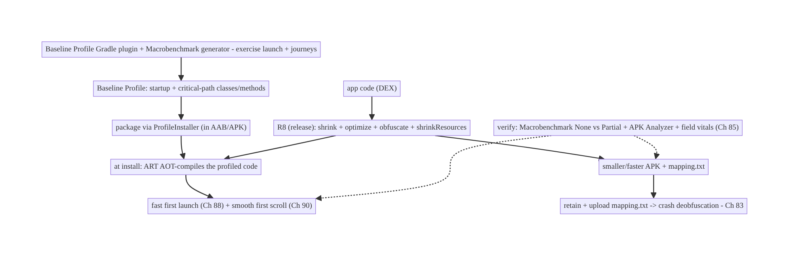
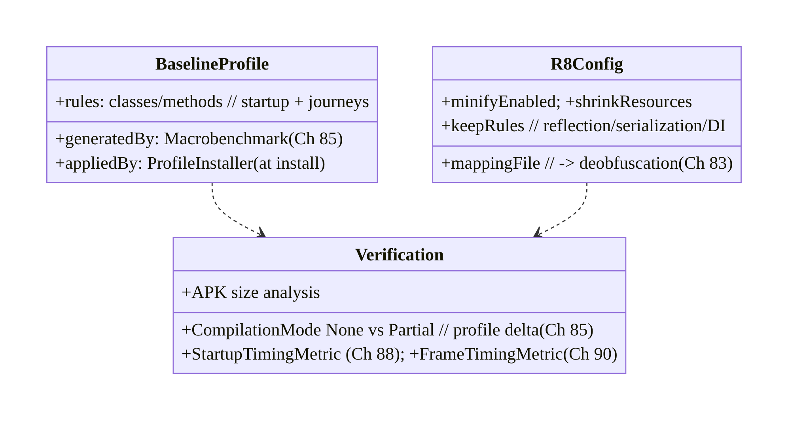
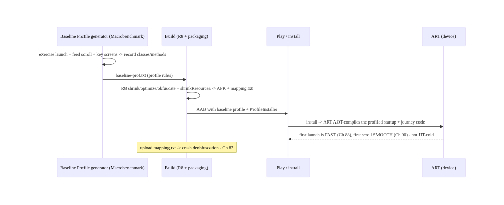
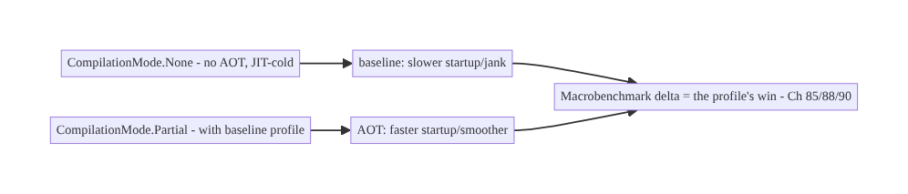
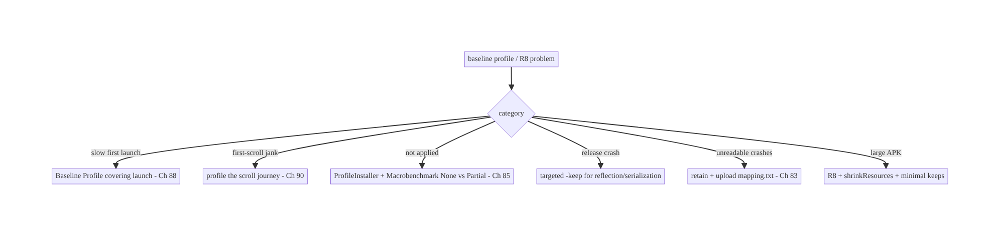

# Chapter 92 — Baseline Profiles & R8 Optimization

> **Part X — Performance, Observability & Quality** · Complexity: **Standard** (≥25 interview questions)
>
> **Prerequisites:** Ch 88 (cold start), Ch 90 (jank), Ch 85 (perf monitoring/Macrobenchmark),
> Ch 45 (startup). Pairs with Ch 89 (memory), Ch 93 (lists), Ch 41 (release).
>
> **Reference surface in StreamCart:** making the app **fast from the first launch** and
> **smaller** — **Baseline Profiles** (AOT-compile the startup + critical-path code so it isn't
> interpreted/JIT-cold, improving **cold start** Ch 88 and **first-scroll jank** Ch 90) and
> **R8** (shrink, optimize, obfuscate — smaller APK, faster load, dead-code removal) — verified
> with **Macrobenchmark** (`CompilationMode.None` vs `Partial`) and the field (Ch 85).

---

## 92.1 Problem Definition and Real-World Context

On a fresh install (or after an update/profile reset), Android runs app code **interpreted**,
then **JIT-compiles** hot methods over time — so the **first** launches and **first** scrolls are
**slow/janky** until the JIT warms up. **Baseline Profiles** fix this: a profile lists the
**startup + critical-path methods/classes**, and ART **AOT-compiles** them **at install** → the
app is **fast from the very first launch** (commonly **20–30%** faster cold start, Ch 88, and
smoother first-scroll, Ch 90). Separately, **R8** (Android's shrinker/optimizer/obfuscator)
**removes dead code, optimizes, and shrinks** the APK/DEX → **smaller download, faster load, less
to compile/initialize**. Together, **Baseline Profiles + R8** are among the **highest-impact,
lowest-effort** performance wins — and both are **verified with Macrobenchmark** (Ch 85) so you
know the gain is real. This chapter is the deep-dive counterpart referenced by Ch 88 (cold start)
and Ch 90 (jank).

Concretely, teams hit:

- **JIT-cold first launches (the core problem).** Without a baseline profile, the **first few
  launches** run **interpreted → JIT**, so they're measurably **slower** than warmed-up runs.
  Users judge the app on the **first** impression (Ch 88). A **Baseline Profile** AOT-compiles the
  startup path so it's fast **immediately**.
- **First-scroll jank (Ch 90).** The first scroll through a list/feed runs **JIT-cold** Compose/
  scroll code → **janky** until warm. Including the **scroll path** in the baseline profile makes
  it **smooth from the start** (Ch 90).
- **No profile / wrong profile.** Shipping without a baseline profile leaves performance **on the
  table**; a profile that **doesn't cover** the real critical journeys (only launch, not the key
  screens) under-delivers. The profile must cover **launch + the most-used journeys**.
- **Profile not applied / verified.** A baseline profile must be **packaged** correctly (via the
  **Baseline Profile Gradle plugin** / `ProfileInstaller`) and **verified** to actually apply —
  otherwise you think you have it but don't. **Macrobenchmark** (`CompilationMode.None` vs
  `Partial`) **measures** the delta.
- **R8 not enabled / misconfigured.** Shipping **debuggable/unshrunk** release builds (R8 off)
  leaves the APK **large** and **unoptimized**; misconfigured **keep rules** either break the app
  (over-shrinking reflection-used code) or defeat shrinking (keeping everything). Need **R8 on**
  for release with correct **`-keep`** rules.
- **Obfuscation vs debuggability (Ch 83).** R8 **obfuscates** (renames) — great for size/IP, but
  stack traces become unreadable unless you **retain + upload the mapping file** for
  **deobfuscation** (Crashlytics, Ch 83). Forgetting the mapping file makes crashes
  undebuggable.
- **Resource shrinking.** Beyond code, **`shrinkResources`** removes unused resources — more size
  savings, must be paired with R8 code shrinking.
- **Measuring the win.** Claims of "faster" must be **measured** — **Macrobenchmark**
  `StartupTimingMetric`/`FrameTimingMetric` with `CompilationMode.None` (no profile) vs `Partial`
  (with profile) quantifies the baseline-profile gain; APK analyzer quantifies R8 size savings;
  field vitals confirm (Ch 85).

The architecture: ship a **Baseline Profile** covering **launch + the critical journeys** (feed
scroll, key screens) — generated with the **Baseline Profile Gradle plugin** (Macrobenchmark-
based generator) and packaged so ART **AOT-compiles** that code **at install** (fast first launch,
Ch 88; smooth first scroll, Ch 90); enable **R8** for release (**shrink + optimize + obfuscate**,
smaller/faster), with correct **`-keep` rules** and **`shrinkResources`**, and **retain + upload
the mapping file** for crash **deobfuscation** (Ch 83); and **verify** everything with
**Macrobenchmark** (`None` vs `Partial`) and **field** metrics (Ch 85). This chapter is about
**fast-from-first-launch + smaller + verified**.

### Three practical use cases

1. **Baseline Profile for StreamCart launch + feed (Ch 88/90).** Generate a profile covering app
   launch and the home-feed scroll (Ch 71); Macrobenchmark shows cold start **~25% faster**
   (`None` vs `Partial`) and first-scroll jank cut — verified before shipping.
2. **R8 shrink + resource shrink.** Enable R8 + `shrinkResources` for release; APK drops
   significantly (dead code/resources removed), with `-keep` rules for reflection-used
   (Gson/Hilt/serialization) classes; mapping file uploaded for Crashlytics (Ch 83).
3. **Verify the profile applied.** Confirm via `ProfileInstaller` + Macrobenchmark that
   `CompilationMode.Partial` reflects the shipped profile — not silently missing.

### Why this is architectural

Baseline Profiles + R8 compose cold start (Ch 88), jank (Ch 90), Macrobenchmark measurement
(Ch 85), crash deobfuscation (Ch 83), and release (Ch 41). The decisions — profile the right
journeys, enable R8 with correct keep rules, retain the mapping file, verify with Macrobenchmark —
determine whether the app is fast from first launch and small, without breaking crash
diagnosability.

---

## 92.2 Requirements Engineering

### Functional requirements

| ID | Requirement |
|----|-------------|
| F1 | Ship a Baseline Profile covering launch + critical journeys (feed scroll, key screens). |
| F2 | Generate it with the Baseline Profile Gradle plugin (Macrobenchmark generator). |
| F3 | Enable R8 for release: shrink + optimize + obfuscate; `shrinkResources`. |
| F4 | Correct `-keep` rules (reflection/serialization/DI) — don't over- or under-shrink. |
| F5 | Retain + upload the mapping file for crash deobfuscation (Ch 83). |
| F6 | Verify with Macrobenchmark (`None` vs `Partial`) and field metrics (Ch 85). |

### Non-functional requirements

| Attribute | Policy |
|-----------|--------|
| **First-launch speed** | AOT startup path; fast from install (Ch 88). |
| **First-scroll smoothness** | Scroll path in profile (Ch 90). |
| **Size** | R8 + resource shrinking; smaller APK. |
| **Debuggability** | Mapping file retained/uploaded (Ch 83). |
| **Verified** | Macrobenchmark `None` vs `Partial` (Ch 85). |

### Scope

- **In scope:** AOT vs JIT vs interpreted, Baseline Profiles (generation via Gradle plugin/
  Macrobenchmark, packaging, `ProfileInstaller`, coverage = launch + journeys), effect on cold
  start (Ch 88) + first-scroll jank (Ch 90), R8 (shrink/optimize/obfuscate), `-keep` rules,
  `shrinkResources`, mapping file + deobfuscation (Ch 83), Cloud/Startup profiles context,
  verification (Macrobenchmark `None`/`Partial`, Ch 85), APK size analysis.
- **Out of scope:** cold-start optimization detail (Ch 88), jank detail (Ch 90), Macrobenchmark
  setup detail (Ch 85), crash reporting (Ch 83), release mechanics (Ch 41).

### Assumptions & constraints

- AGP with the **Baseline Profile Gradle plugin** + **Macrobenchmark** module (Ch 85); **R8**
  enabled for release (`minifyEnabled true`, `shrinkResources true`); `ProfileInstaller`
  packaged. Profile covers **launch + key journeys**; mapping file **retained + uploaded**
  (Ch 83). Verified with `CompilationMode.None` vs `Partial`. `minSdk 24` (ART; Baseline Profiles
  supported broadly via `ProfileInstaller`).

---

## 92.3 System Design Fundamentals

- **Interpreted → JIT → AOT (why the first run is slow).** ART runs DEX bytecode **interpreted**
  at first; it **JIT-compiles** frequently-run ("hot") methods to native over time (and writes a
  **profile** of what was hot, used to AOT-compile later in the background). So **fresh installs**
  are slow until JIT/profile-guided compilation warms up. **AOT** (ahead-of-time) compilation
  **before** running avoids this. A **Baseline Profile** is a way to get **AOT compilation of the
  code you choose, at install time** — skipping the slow warm-up for the paths that matter.
- **Baseline Profiles — what they are.** A **Baseline Profile** is a list of **classes/methods**
  (in a human-readable rules format, compiled to a binary) that you **ship with the app**; at
  **install** (and app update), ART **AOT-compiles** exactly those → the **startup + critical-path
  code is native from the first launch**. Typical wins: **~20–30% faster cold start** (Ch 88) and
  **smoother first scroll** (Ch 90). It's additive to ART's own profile-guided compilation (which
  still kicks in over time for the rest).
- **Generating a Baseline Profile.** Use the **Baseline Profile Gradle plugin** with a
  **Macrobenchmark**-based **generator** that **exercises the critical journeys** (launch, scroll
  the feed, open key screens) on a device/emulator; it **records** the methods/classes those
  journeys touch into the profile. **Coverage matters:** the generator must drive the **real
  most-used journeys** — a profile covering only launch under-delivers on scroll (Ch 90). Include
  **launch + the top user journeys**.
- **Packaging & applying (`ProfileInstaller`).** The profile is **packaged** into the app
  (AAB/APK) and **applied** at install (Play) or via **`ProfileInstaller`** (bundled library) on
  first run for sideloads/older setups. **Verify** it's applied — a profile that isn't packaged/
  applied gives **no** benefit. **Cloud Profiles** / **Startup Profiles** are related mechanisms
  (Play-aggregated field profiles; profiles that also affect DEX layout) — the Baseline Profile
  plugin is the standard app-shipped approach.
- **Effect on cold start (Ch 88) & jank (Ch 90).** Baseline Profiles directly improve the two
  most visible perf dimensions: **cold start** (AOT startup path — faster first launch, Ch 88) and
  **first-scroll jank** (AOT Compose/scroll path — smoother first scroll, Ch 90). These chapters
  **reference this one** for the AOT mechanism.
- **R8 — shrink, optimize, obfuscate.** **R8** (the default release compiler/shrinker) does:
  **shrinking** (remove unused classes/methods/fields — **tree-shaking** from entry points),
  **optimization** (inlining, dead-code elimination, class merging), and **obfuscation**
  (rename to short names — smaller + harder to reverse-engineer). Result: **smaller DEX/APK**,
  **faster to load/verify**, **less to compile/init**. Enable with **`minifyEnabled true`** for
  release; pair with **`shrinkResources true`** to drop unused resources.
- **`-keep` rules (the correctness knob).** R8 shrinks from **reachable entry points**; code
  reached only via **reflection/serialization/JNI** (Gson/Moshi models, Hilt/Dagger, Compose
  stability sometimes, `Parcelable`, enums used by name) may be **wrongly removed/renamed** →
  runtime crash. **`-keep` rules** (ProGuard/R8 rules) tell R8 to **keep** those. **Too few** →
  crashes; **too many** (`-keep class ** { *; }`) → defeats shrinking. Use **library-provided
  consumer rules** + **minimal targeted keeps**; test the **release** build.
- **Obfuscation vs crash debuggability (Ch 83).** Obfuscation renames everything, so **stack
  traces are gibberish** unless you **retain the `mapping.txt`** and **upload it** (to Crashlytics/
  Play) for **deobfuscation/symbolication** (Ch 83). **Always keep and upload the mapping file**
  per release — otherwise production crashes are undebuggable.
- **Verify with Macrobenchmark (Ch 85).** Prove the wins: **Macrobenchmark** with
  **`CompilationMode.None`** (no AOT — simulates JIT-cold) vs **`CompilationMode.Partial`** (with
  baseline profile) **quantifies** the baseline-profile gain on **startup** (`StartupTimingMetric`,
  Ch 88) and **frames** (`FrameTimingMetric`, Ch 90). **APK Analyzer** quantifies R8 size savings.
  **Field vitals** (Ch 85) confirm in production. **Measure — don't assume.**

Core insight: **make the app fast from the very first launch and smaller by shipping a Baseline
Profile and enabling R8: a Baseline Profile lists the startup + critical-journey classes/methods
so ART AOT-compiles them at install time instead of leaving them interpreted/JIT-cold, which is
why fresh installs are otherwise slow — generate it with the Baseline Profile Gradle plugin
driving a Macrobenchmark that exercises the real most-used journeys (launch, feed scroll, key
screens — coverage matters, a launch-only profile under-delivers on scroll), package it via
ProfileInstaller, and it directly improves cold start (~20–30%, Ch 88) and first-scroll jank
(Ch 90); R8 separately shrinks (tree-shakes dead code from entry points), optimizes (inlining/
dead-code elimination), and obfuscates (renames) the release build for a smaller, faster-loading
APK, enabled with minifyEnabled + shrinkResources and correct -keep rules for reflection/
serialization/DI code (too few keeps crashes at runtime, too many defeats shrinking) — but
obfuscation makes crash stack traces unreadable, so you must retain and upload the mapping.txt for
deobfuscation (Ch 83); and you verify both wins with Macrobenchmark (CompilationMode.None vs
Partial for the profile's startup/frame delta) and the APK Analyzer and field vitals (Ch 85),
because these are the highest-impact, lowest-effort perf wins only when actually applied and
measured.**

---

## 92.4 High-Level Architecture



**Components & ownership**

- **R8** shrinks/optimizes/obfuscates release → smaller/faster + **`mapping.txt`** (upload for
  deobfuscation, Ch 83).
- **Baseline Profile** (generated via Gradle plugin + Macrobenchmark) → **AOT** startup +
  journeys at install → **fast first launch** (Ch 88) + **smooth first scroll** (Ch 90).
- **Verify** with Macrobenchmark (`None` vs `Partial`) + APK Analyzer + field (Ch 85).

**Direction:** code → R8 (smaller, +mapping) + Baseline Profile (AOT via ProfileInstaller) →
fast-from-first-launch + small → verified.

---

## 92.5 Detailed Component Design



| Component | Responsibility |
|-----------|----------------|
| `BaselineProfile` | startup + journey rules; generated (Macrobenchmark), applied (ProfileInstaller) |
| `R8Config` | `minifyEnabled`/`shrinkResources`, keep rules, mapping file (Ch 83) |
| `Verification` | Macrobenchmark `None` vs `Partial` (Ch 88/90), APK size, field (Ch 85) |

---

## 92.6 End-to-End Data Flow

### Generate → package → AOT at install → fast



### Verify the gain (None vs Partial)



---

## 92.7 Complete Kotlin / Gradle Implementation

Package/module: `:baselineprofile`, app `build.gradle`.

### 92.7.1 Baseline Profile generator (Macrobenchmark, Ch 85)

```kotlin
@RunWith(AndroidJUnit4::class)
class BaselineProfileGenerator {
    @get:Rule val rule = BaselineProfileRule()
    @Test fun generate() = rule.collect(packageName = "com.streamcart") {
        pressHome(); startActivityAndWait()                       // LAUNCH path (Ch 88)
        // exercise the REAL critical journeys so the profile covers them (coverage matters):
        device.findObject(By.res("feed")).fling(Direction.DOWN)   // FEED SCROLL path (Ch 90)
        device.findObject(By.res("product_0")).click(); device.pressBack()   // key screen
    }
    // Output: baseline-prof.txt (classes/methods) -> packaged; ART AOT-compiles them at install.
}
```

### 92.7.2 R8 + resource shrinking + mapping (app build.gradle)

```kotlin
android {
    buildTypes {
        release {
            isMinifyEnabled = true            // R8: shrink + optimize + obfuscate
            isShrinkResources = true          // drop unused resources (pair with R8)
            proguardFiles(
                getDefaultProguardFile("proguard-android-optimize.txt"),
                "proguard-rules.pro",          // our -keep rules
            )
            // mapping.txt is produced automatically -> upload for deobfuscation (Ch 83)
        }
    }
}
// Baseline Profile Gradle plugin wires the generated profile into the release build.
```

### 92.7.3 Keep rules (proguard-rules.pro) — correctness

```proguard
# Keep reflection/serialization-used models (Gson/Moshi) - else R8 removes/renames -> runtime crash
-keep class com.streamcart.model.** { *; }
-keepclassmembers class com.streamcart.model.** { <fields>; }
# Hilt/Dagger, Parcelable, enums-by-name usually covered by library consumer rules; add targeted keeps only as needed.
# AVOID: -keep class ** { *; }  // keeps everything -> defeats shrinking
# Keep source file + line numbers for readable (deobfuscated) stack traces (Ch 83):
-keepattributes SourceFile,LineNumberTable
-renamesourcefileattribute SourceFile
```

### 92.7.4 Verify with Macrobenchmark (None vs Partial, Ch 85/88/90)

```kotlin
@RunWith(AndroidJUnit4::class)
class ProfileVerificationBenchmark {
    @get:Rule val rule = MacrobenchmarkRule()
    private fun startup(mode: CompilationMode) = rule.measureRepeated(
        packageName = "com.streamcart", metrics = listOf(StartupTimingMetric()),  // Ch 88
        compilationMode = mode, startupMode = StartupMode.COLD, iterations = 10,
    ) { pressHome(); startActivityAndWait() }
    @Test fun noProfile() = startup(CompilationMode.None())        // JIT-cold baseline
    @Test fun withProfile() = startup(CompilationMode.Partial())   // with baseline profile -> faster
    // Delta (None - Partial) = the baseline-profile win. Also FrameTimingMetric for scroll (Ch 90).
}
```

### 92.7.5 Upload mapping for deobfuscation (Ch 83)

```kotlin
// Crashlytics Gradle plugin uploads mapping.txt automatically on release build;
// or upload to Play Console. Without it, obfuscated crash stack traces are unreadable (Ch 83).
// firebaseCrashlytics { mappingFileUploadEnabled = true }   // per release
```

### 92.7.6 Module structure

```
:baselineprofile  BaselineProfileGenerator (Macrobenchmark, Ch 85) -> baseline-prof.txt
:app  R8 (minify + shrinkResources) + keep rules + baseline profile plugin + mapping upload (Ch 83)
:benchmark  ProfileVerificationBenchmark (None vs Partial, Ch 88/90)
# Fast first launch -> Ch 88; smooth first scroll -> Ch 90; verify -> Macrobenchmark (Ch 85).
```

---

## 92.8 Concurrency and Race Conditions

> Baseline Profiles & R8 are **build/compilation-time** concerns, so classic runtime races don't
> apply. The analogous pitfalls are **correctness/coverage** issues:

| Scenario | Risk | Handling |
|----------|------|----------|
| Profile covers only launch | under-delivers on scroll | exercise real journeys (Ch 90) |
| Profile not applied | no benefit | ProfileInstaller + verify (None vs Partial) |
| Over-shrinking (too few keeps) | runtime crash | keep reflection/serialization/DI classes |
| Under-shrinking (keep all) | no size win | minimal targeted keeps |
| Mapping file lost | undebuggable crashes | retain + upload mapping.txt (Ch 83) |
| Release untested (R8 on) | ships broken | test the release (minified) build |
| Assuming the win | unverified | Macrobenchmark None vs Partial (Ch 85) |

- **Coverage is the baseline-profile analog of correctness:** a profile only helps the journeys it
  **covers**, so the generator must drive the **real** critical paths (launch **and** scroll
  **and** key screens). Verify with Macrobenchmark that `Partial` beats `None` for those journeys.
- **Keep rules are the R8 correctness knob:** R8's static reachability can't see **reflection/
  serialization**, so missing keeps cause **release-only** crashes (invisible in debug). Always
  **test the minified release build**, and lean on **library consumer rules** plus **minimal**
  targeted keeps.
- **The mapping file is non-negotiable for debuggability (Ch 83):** obfuscation + no mapping =
  undebuggable production crashes — retain and upload it **every release**.

---

## 92.9 Failure Scenarios and Recovery

| Failure | Detection | Response | Outcome |
|---------|-----------|----------|---------|
| Slow first launch | Macrobenchmark None vs Partial (Ch 88) | ship Baseline Profile | fast first launch |
| First-scroll jank | FrameTimingMetric (Ch 90) | include scroll path in profile | smooth |
| Profile not applied | Partial == None | fix packaging/ProfileInstaller + verify | applied |
| Release crash (R8) | crash on reflection class | add targeted -keep rule | stable |
| Unreadable crashes | obfuscated stack trace (Ch 83) | retain + upload mapping.txt | deobfuscated |
| Large APK | APK Analyzer | R8 + shrinkResources + minimal keeps | smaller |
| Unverified win | no numbers | Macrobenchmark + APK Analyzer (Ch 85) | measured |



> **Ship the profile, enable R8, keep the mapping file — and verify.** Baseline Profiles + R8 are
> the highest-impact, lowest-effort perf wins, but only when the profile **covers the real
> journeys** and is **actually applied** (verify None vs Partial, Ch 85), R8 has **correct keep
> rules** (test the release build), and the **mapping file is uploaded** so crashes stay
> debuggable (Ch 83). Measure the gain — don't assume it.

---

## 92.10 Scaling the Implementation

- **Level 1.** Enable R8 (`minifyEnabled`) + `shrinkResources` for release; upload the mapping
  file (Ch 83); add library consumer keep rules.
- **Level 2.** Add a Baseline Profile (Gradle plugin) covering **launch**; verify cold start with
  Macrobenchmark `None` vs `Partial` (Ch 88).
- **Level 3 — production.** Expand the profile to **key journeys** (feed scroll, Ch 90); CI
  verification of the profile delta; APK-size tracking; field vitals confirmation (Ch 85).
- **Level 4 — large.** Per-flow profiles for all major journeys; automated profile regeneration in
  CI; size budgets; R8 optimization passes tuned; dynamic feature modules.
- **Level 5 — enterprise.** Profile + size governance, Cloud/Startup Profiles, per-module keep-
  rule hygiene, automated startup/size regression gates (Ch 41), cross-release AOT/size dashboards
  (Ch 85).

**Avoid overengineering:** R8 + `shrinkResources` + a Baseline Profile covering launch + the top
journey, mapping file uploaded, verified with Macrobenchmark, captures most of the win. Don't ship
without a profile; don't keep everything; don't forget the mapping file; don't claim wins you
didn't measure.

---

## 92.11 Alternative Approaches and Trade-offs

| Dimension | Option A | Option B | When |
|-----------|----------|----------|------|
| First-run speed | Baseline Profile (AOT) | JIT-only | Baseline Profile (fast first launch) |
| Profile coverage | Launch + journeys | launch only | Journeys (smooth scroll too, Ch 90) |
| Release build | R8 on (shrink/optimize) | R8 off | R8 on (smaller/faster) |
| Keep rules | Minimal targeted | keep-all / none | Minimal targeted (shrink + correct) |
| Resources | `shrinkResources` | keep all | Shrink (size) |
| Debuggability | Upload mapping.txt (Ch 83) | no mapping | Upload (readable crashes) |
| Proof | Macrobenchmark (Ch 85) | assume | Measure |

**Baseline Profile vs JIT-only:** without a profile, startup + scroll run **interpreted/JIT** on
first launches — slow/janky until warm. A **Baseline Profile AOT-compiles** those paths at install
→ **fast/smooth from the first launch** (~20–30% startup, Ch 88/90). It's additive to ART's own
profiling. **Always ship one** covering launch + top journeys.

**R8 on vs off:** shipping **unshrunk** release builds wastes **size** (dead code/resources) and
**load/compile time**. **R8** tree-shakes, optimizes, and obfuscates → **smaller, faster**. The
cost is **keep-rule** maintenance and **mapping-file** management — both well-trodden. **Always
enable R8** for release with correct keeps + mapping upload.

**Minimal targeted keeps vs keep-all:** `-keep class ** { *; }` is "safe" but **defeats
shrinking** (no size win). **Too few** keeps crashes on reflection/serialization. **Minimal,
targeted** keeps (library consumer rules + specific models) **shrink effectively while staying
correct** — verified by testing the **release** build. Prefer minimal targeted keeps.

---

## 92.12 Security & Privacy Considerations

- **Obfuscation raises the reverse-engineering bar (not a security guarantee):** R8 renaming makes
  the app **harder to reverse-engineer** (IP/tamper resistance), but it is **not encryption** —
  don't rely on obfuscation to hide **secrets** (keys still shouldn't be in the APK, Ch 24).
- **Mapping file is sensitive (Ch 83):** `mapping.txt` **de-obfuscates** your app — treat it as
  **internal**, upload it to your crash tooling securely (Ch 83), don't ship/leak it publicly.
- **Baseline profiles contain method/class names, not data:** compilation hints — not secrets or
  PII (Ch 28).
- **Shrinking can remove debug/log code:** R8 can strip debug logging in release (good for leak-
  prevention), but ensure **security-relevant** code isn't stripped by a wrong keep (Ch 24).
- **Resource shrinking + size** reduces attack surface marginally (less code) — not a primary
  security control.
- Build-time concern: these are **build** features; the security notes are **mapping-file
  confidentiality** (Ch 83) and **not trusting obfuscation as secret-hiding** (Ch 24).

---

## 92.13 Performance and Resource Optimization

- **Baseline Profiles = first-launch + first-scroll speed (Ch 88/90)** — AOT the startup + top
  journeys; the single biggest low-effort startup/jank win.
- **R8 = size + load/compile speed** — shrink + optimize + obfuscate; `shrinkResources` for
  assets.
- **Coverage drives the profile win** — profile the **real** journeys, not just launch (Ch 90).
- **Minimal keeps maximize shrinking** — keep only reflection/serialization/DI code.
- **Verify, quantify** — Macrobenchmark `None` vs `Partial` (startup/frames), APK Analyzer (size),
  field vitals (Ch 85).
- **Profiling:** cold start `None` vs `Partial` (Ch 88), frame timing `None` vs `Partial` (Ch 90),
  APK/DEX size before/after R8, resource count, field startup/jank (Ch 85).

---

## 92.14 Testing Strategy

The profile delta and release correctness are the things to test; size is measured.

```kotlin
class ProfileVerificationBenchmark {   // quantify the baseline-profile win (Ch 85/88/90)
    @get:Rule val rule = MacrobenchmarkRule()
    @Test fun startup_none() = measure(CompilationMode.None())        // JIT-cold baseline
    @Test fun startup_partial() = measure(CompilationMode.Partial())  // with profile -> assert faster
    private fun measure(mode: CompilationMode) = rule.measureRepeated(
        packageName = "com.streamcart", metrics = listOf(StartupTimingMetric()),
        compilationMode = mode, startupMode = StartupMode.COLD, iterations = 10) { pressHome(); startActivityAndWait() }
}

// Release correctness (R8 keep rules):
//  - Run instrumented/smoke tests on the MINIFIED release build - catch over-shrunk reflection classes.
//  - Verify Gson/Moshi serialization, Hilt graph, Parcelable, enums-by-name still work post-R8.
//  - Confirm mapping.txt produced + uploaded (Ch 83); deobfuscate a sample stack trace.
// Size: APK Analyzer before/after R8 + shrinkResources.
```

What to test: Macrobenchmark `None` vs `Partial` startup (Ch 88) + frames (Ch 90) — profile
applied + faster; **release (minified) build** smoke/integration tests — keep rules correct (no
reflection crash); mapping file produced/uploaded + sample deobfuscation (Ch 83); APK size delta
(APK Analyzer). Field confirmation via vitals (Ch 85).

---

## 92.15 Production Observability

- **Metrics:** **cold start** p50/p95 (field vitals + Macrobenchmark `None` vs `Partial`, Ch 88/
  85), **first-scroll jank** (`FrameTimingMetric` `None` vs `Partial`, Ch 90), **APK/DEX size**
  per release, **crash deobfuscation** success (mapping uploaded?, Ch 83), profile-applied rate
  (ProfileInstaller).
- **Logs:** build-time R8/profile reports; ProfileInstaller status — no PII (Ch 28).
- **Debugging:** no startup win → profile applied? (`None` vs `Partial` equal → packaging issue);
  release crash → missing `-keep` (test minified build); unreadable crashes → mapping not uploaded
  (Ch 83); large APK → R8/shrinkResources off or keep-all; scroll still janky → profile missing
  the scroll journey (Ch 90).
- **Alerting:** cold-start/jank regression release-over-release (profile broke?, Ch 88/90/41); APK
  size regression; deobfuscation failures (missing mapping, Ch 83).
- **Dashboards:** cold start + first-scroll (profile effect) by release; APK size trend; profile-
  applied rate; crash deobfuscation health.

---

## 92.16 System Design Interview Preparation

> ≥25 questions.

**Fundamentals**

1. *Interpreted/JIT/AOT?* Interpret first → JIT hot methods → AOT ahead-of-time.
2. *Why first launch slow?* Code is interpreted/JIT-cold until warm.
3. *Baseline Profile?* Ship class/method list → ART AOT-compiles at install.
4. *Typical win?* ~20–30% faster cold start (Ch 88) + smoother first scroll (Ch 90).
5. *R8?* Shrink + optimize + obfuscate the release build.

**Baseline Profiles**

6. *Generate how?* Baseline Profile Gradle plugin + Macrobenchmark generator.
7. *Coverage?* Launch + real critical journeys (not launch-only).
8. *Apply how?* Packaged + ProfileInstaller (install time).
9. *Effect?* Faster cold start (Ch 88), smoother first scroll (Ch 90).
10. *Cloud/Startup Profiles?* Play-aggregated / DEX-layout variants.

**R8**

11. *Shrinking?* Tree-shake dead code from entry points.
12. *Optimization?* Inlining, dead-code elimination, class merging.
13. *Obfuscation?* Rename to short names — smaller + harder to RE.
14. *Enable?* `minifyEnabled true` (release).
15. *shrinkResources?* Remove unused resources.

**Keep rules**

16. *Why needed?* R8 can't see reflection/serialization/JNI.
17. *Too few?* Runtime crash (removed/renamed class).
18. *Too many?* Defeats shrinking.
19. *Best practice?* Library consumer rules + minimal targeted keeps.
20. *Test?* On the minified release build.

**Obfuscation/debuggability**

21. *Crash stack traces?* Obfuscated gibberish without mapping.
22. *Fix?* Retain + upload mapping.txt (Ch 83).
23. *Mapping sensitive?* Yes — internal only.

**Verify**

24. *Measure profile win?* Macrobenchmark `None` vs `Partial` (Ch 85).
25. *Measure size?* APK Analyzer.
26. *Confirm in field?* Vitals cold start/jank (Ch 85).

### Design-change challenges
1. **Make first launch faster.** Baseline Profile covering launch; verify None vs Partial (Ch 88).
2. **Smooth first scroll.** Include the scroll journey in the profile (Ch 90).
3. **Shrink the APK.** R8 + shrinkResources + minimal keeps.
4. **Keep crashes debuggable.** Retain + upload mapping.txt (Ch 83).
5. **Prove the win.** Macrobenchmark None vs Partial + APK Analyzer (Ch 85).

### Mock walkthrough (abridged)
Clarify (first-launch speed? size? journeys?) → AOT vs JIT (why first run slow) → Baseline Profile
via Gradle plugin + Macrobenchmark generator covering launch + journeys (Ch 88/90) → package
(ProfileInstaller) → R8 (minify + shrinkResources) + correct keep rules → retain + upload
mapping.txt (Ch 83) → verify Macrobenchmark `None` vs `Partial` + APK Analyzer + field vitals
(Ch 85) → observability (cold start/size/deobfuscation by release).

---

## 92.17 Practical Exercises

1. **Beginner.** Enable R8 + `shrinkResources` for release, add library keep rules, and confirm
   the mapping file is uploaded for Crashlytics (Ch 83). *Eval:* smaller APK; readable crashes.
2. **Intermediate.** Add a Baseline Profile (Gradle plugin) covering app launch and verify the
   cold-start delta with Macrobenchmark `None` vs `Partial` (Ch 88). *Eval:* measurable startup
   win.
3. **Advanced.** Expand the profile to cover feed scroll (Ch 90) and verify the frame delta
   (`FrameTimingMetric` `None` vs `Partial`); tighten keep rules to maximize shrinking. *Eval:*
   smoother first scroll; smaller APK; no release crash.
4. **Production debugging.** Diagnose "no startup win" (profile not applied — fix packaging) and a
   release-only reflection crash (add targeted `-keep`). *Eval:* profile applies; crash fixed.
5. **System design challenge.** Design CI gates for cold-start (Ch 88), frame timing (Ch 90), and
   APK size, plus mapping-file upload verification (Ch 83). *Eval:* regressions gated; crashes
   debuggable.

*(Solutions withheld unless requested.)*

---

## 92.18 Chapter Summary & Reference Sheet

**Key decisions:** make the app **fast from the very first launch** and **smaller** by shipping a
**Baseline Profile** and enabling **R8**: a **Baseline Profile** lists the **startup + critical-
journey classes/methods** so **ART AOT-compiles them at install** instead of leaving them
**interpreted/JIT-cold** (the reason fresh installs are otherwise slow) — **generate** it with the
**Baseline Profile Gradle plugin** driving a **Macrobenchmark** that exercises the **real most-used
journeys** (launch, feed scroll, key screens — **coverage matters**, a launch-only profile under-
delivers on scroll), **package** it via **ProfileInstaller**, and it directly improves **cold
start** (~**20–30%**, Ch 88) and **first-scroll jank** (Ch 90); **R8** separately **shrinks**
(tree-shakes dead code), **optimizes** (inlining/dead-code elimination), and **obfuscates**
(renames) the release build for a **smaller, faster-loading APK**, enabled with **`minifyEnabled`
+ `shrinkResources`** and **correct `-keep` rules** for reflection/serialization/DI code (**too
few keeps crashes** at runtime, **too many defeats shrinking**) — but obfuscation makes crash
stack traces **unreadable**, so you must **retain and upload the `mapping.txt`** for
**deobfuscation** (Ch 83); and you **verify** both wins with **Macrobenchmark**
(**`CompilationMode.None` vs `Partial`** for the profile's startup/frame delta), the **APK
Analyzer** (size), and **field vitals** (Ch 85) — because these are the **highest-impact, lowest-
effort** perf wins **only when actually applied and measured**.

**Concepts:** interpreted/JIT/AOT, Baseline Profiles (generation via Gradle plugin + Macrobenchmark,
coverage, ProfileInstaller), effect on cold start (Ch 88) + first-scroll jank (Ch 90), R8
(shrink/optimize/obfuscate), `-keep` rules, `shrinkResources`, `mapping.txt` + deobfuscation
(Ch 83), verification (`None` vs `Partial`, APK Analyzer, Ch 85).

**Common mistakes:** no Baseline Profile (JIT-cold first launch); profile covering only launch (no
scroll win, Ch 90); profile not applied (unverified); R8 off (large/slow); too few keeps (release
crash); keep-all (no shrink); forgetting the mapping file (undebuggable crashes, Ch 83); assuming
the win without Macrobenchmark (Ch 85); not testing the minified release build.

**Checklist:**

- [ ] Baseline Profile covering launch + top journeys (feed scroll, Ch 90)
- [ ] generated via Gradle plugin + Macrobenchmark; applied via ProfileInstaller
- [ ] verify `None` vs `Partial` startup (Ch 88) + frames (Ch 90)
- [ ] R8 on (`minifyEnabled`) + `shrinkResources`
- [ ] minimal targeted `-keep` rules (reflection/serialization/DI)
- [ ] test the minified release build
- [ ] retain + upload `mapping.txt` for deobfuscation (Ch 83)
- [ ] APK Analyzer size delta
- [ ] field vitals confirm (Ch 85)
- [ ] CI gates for startup/frames/size (Ch 41).

**Key APIs/Gradle:** `BaselineProfileRule` (generator) + Baseline Profile Gradle plugin,
`ProfileInstaller`, `CompilationMode.None`/`Partial` + `StartupTimingMetric` (Ch 88)/
`FrameTimingMetric` (Ch 90) via `MacrobenchmarkRule` (Ch 85), `isMinifyEnabled`/`isShrinkResources`
(R8), `proguard-rules.pro` (`-keep`, `-keepclassmembers`, `-keepattributes
SourceFile,LineNumberTable`), `mapping.txt` upload (Crashlytics/Play, Ch 83), APK Analyzer, field
vitals (Ch 85).

**References:**
- Baseline Profiles: https://developer.android.com/topic/performance/baselineprofiles/overview
- Create a Baseline Profile: https://developer.android.com/topic/performance/baselineprofiles/create-baselineprofile
- R8 / shrink, obfuscate, optimize: https://developer.android.com/build/shrink-code
- Deobfuscate crash stack traces: https://developer.android.com/build/shrink-code#decode-stack-trace
- (composes) Ch 88 Cold Start, Ch 90 Jank, Ch 85 Perf/Macrobenchmark, Ch 83 Crash/Deobfuscation, Ch 45 Startup, Ch 41 Release

### Chapter review (Phase 4)
- **Completeness:** all 18 sections; architecture/class/sequence/None-vs-Partial/failure diagrams;
  generator + R8 config + keep rules + verification + mapping-upload code; concurrency (build-time
  → coverage/keeps/mapping pitfalls); failure (ship+R8+mapping+verify principle); 5 levels;
  profile-vs-JIT, R8-on-vs-off, keeps trade-offs; security (mapping confidential, obfuscation ≠
  secret-hiding); perf (the whole chapter); None-vs-Partial + release-correctness + size tests;
  observability (startup/size/deobfuscation by release); 26 Q&A + 5 challenges. ✅
- **Expand later:** cold start (Ch 88), jank (Ch 90), Macrobenchmark (Ch 85), crash/deobfuscation
  (Ch 83).
- **Interview coverage:** exceeds ≥25 bar.
