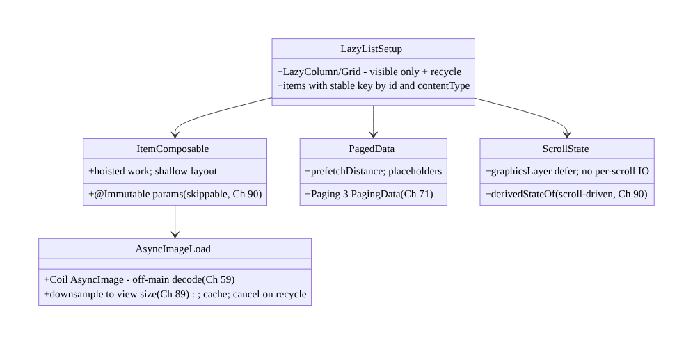
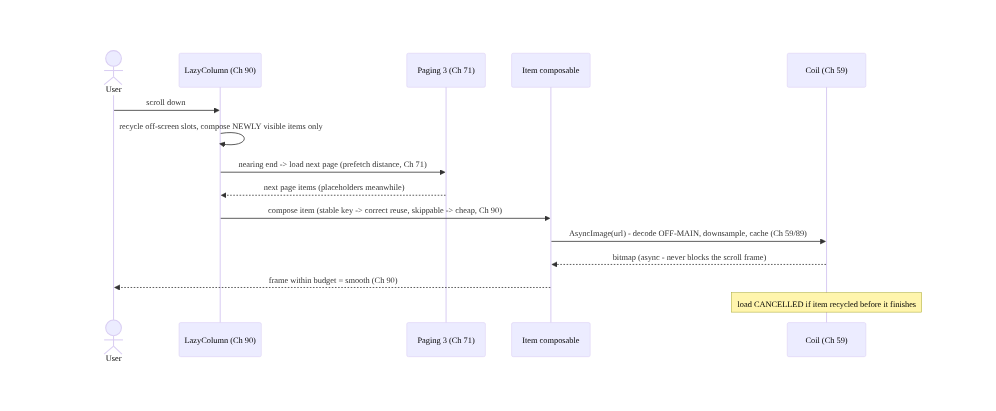
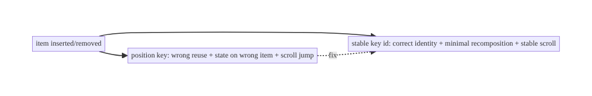
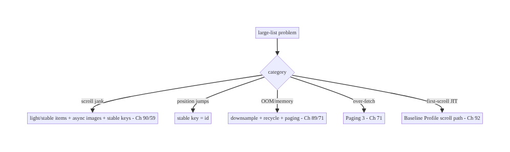

# Chapter 93 — Large List Performance

> **Part X — Performance, Observability & Quality** · Complexity: **Standard** (≥25 interview questions)
>
> **Prerequisites:** Ch 90 (jank/recomposition), Ch 71 (infinite feed/Paging 3), Ch 59 (image
> loading), Ch 89 (memory), Ch 85 (perf monitoring). Pairs with Ch 88 (cold start/first scroll),
> Ch 92 (baseline profiles), Ch 2 (Compose).
>
> **Reference surface in StreamCart:** scrolling **large lists/grids** (product catalog, feed
> Ch 71, order history) **smoothly** — via **`LazyColumn`/`LazyRow`/`LazyVerticalGrid`** (view
> recycling) with **stable `key`s**, **`contentType`**, **light/stable item composables** (Ch 90),
> **async image loading** (Coil, Ch 59), and **paging** (Ch 71) — so even thousands of items scroll
> within the **frame budget** (Ch 90) without jank, excess memory (Ch 89), or over-fetching.

---

## 93.1 Problem Definition and Real-World Context

Lists are the **most common** and most **scroll-performance-sensitive** UI: a product catalog, a
feed (Ch 71), order history, search results (Ch 9) — often **thousands** of items. Rendering them
**all** is impossible (memory, Ch 89) and laying out off-screen items wastes work. **Large list
performance** is the discipline of scrolling big lists **smoothly** (every frame within budget,
Ch 90) by **only composing/laying out visible items** (lazy lists recycle/reuse), giving items
**stable `key`s** and **`contentType`** (correct, efficient reuse), keeping each item composable
**light and stable** (Ch 90 — no over-recomposition, no heavy work), loading **images
asynchronously** (Coil, Ch 59 — never block the scroll on decode), and **paging** data (Ch 71 —
don't load everything). The classic failures are **jank on scroll** (heavy/unstable items, sync
image decode), **memory bloat** (not recycling, full-res bitmaps, Ch 89/59), and **over-fetching**
(loading all data instead of pages, Ch 71).

Concretely, teams hit:

- **Rendering all items (memory + layout death).** Putting thousands of items in a non-lazy
  container (`Column` with all items, or a `ScrollView`) composes/lays out **everything** → huge
  memory (Ch 89) and slow layout. **Fix:** **lazy lists** (`LazyColumn`/`LazyRow`/
  `LazyVerticalGrid`) that only compose **visible** items (+ a small buffer) and **recycle** as you
  scroll.
- **Missing / unstable `key`s (the #1 list bug).** Without a **stable `key`** per item, Compose
  can't track item **identity** across data changes — so inserts/removes/moves cause **wrong reuse**
  (state attached to the wrong item), **unnecessary recomposition**, and **scroll-position jumps**.
  **Fix:** `items(list, key = { it.id })` with a **stable, unique** id.
- **Heavy / unstable item composables (Ch 90).** An item that does **expensive work** (formatting,
  allocation, sorting) **in composition**, or that **over-recomposes** (unstable params, Ch 90),
  janks on **every** scroll frame as items compose. **Fix:** light, **skippable** items (stable
  params, hoisted work, Ch 90).
- **Synchronous image decode on scroll (Ch 59).** Decoding a bitmap **synchronously** in the item
  (or on the main thread) **blocks the frame** → scroll stutter. **Fix:** **async** image loading
  (**Coil** `AsyncImage`, Ch 59) that decodes off-main, downsamples to view size (Ch 89), caches,
  and cancels on recycle.
- **No `contentType` for mixed lists.** A list with **different item types** (header, product, ad)
  reuses incompatible layouts inefficiently without **`contentType`**. **Fix:** provide
  `contentType` so Compose reuses the **right** item structure.
- **Over-fetching / loading all data (Ch 71).** Loading the **entire** dataset into memory to show
  a list wastes memory (Ch 89) and network (Ch 91). **Fix:** **Paging 3** (Ch 71) — load **pages**
  as the user scrolls, with placeholders and prefetch distance.
- **Expensive scroll work.** Recomputing derived values, triggering side effects, or doing I/O
  **per scroll** janks. **Fix:** `derivedStateOf` for scroll-driven state (Ch 90), hoist work, no
  I/O in composition (Ch 90/3).
- **First-scroll JIT jank (Ch 92).** The first scroll runs JIT-cold → janky. **Fix:** a **Baseline
  Profile** covering the scroll path (Ch 92).

The architecture: scroll large lists smoothly with **lazy lists** (`LazyColumn`/`LazyRow`/
`LazyVerticalGrid` — compose only visible items, recycle) + **stable `key`s** (correct identity/
reuse, no position jumps) + **`contentType`** (efficient mixed-type reuse) + **light, stable item
composables** (skippable, hoisted work, Ch 90) + **async image loading** (Coil off-main +
downsample + cache + cancel, Ch 59/89) + **paging** (Paging 3, load pages not everything, Ch 71) +
**scroll-state discipline** (`derivedStateOf`, no per-scroll work, Ch 90) + a **Baseline Profile**
for the scroll path (Ch 92) — verified with **JankStats/Macrobenchmark `FrameTimingMetric`**
(Ch 85/90). This chapter is about **smooth scrolling of big lists**.

### Three practical use cases

1. **Smooth product catalog grid (StreamCart).** 5,000 products in a `LazyVerticalGrid` with
   `key = { it.id }`, `contentType`, light `@Immutable` item cards (Ch 90), Coil `AsyncImage`
   (Ch 59), and Paging 3 (Ch 71) — scrolls within budget, bounded memory (Ch 89).
2. **Fix a janky feed (Ch 71).** The feed janked from heavy item composables + sync image decode;
   fix: lighten items (hoist work, stable params, Ch 90) + Coil async images (Ch 59) + stable keys
   → smooth.
3. **Paged order history (Ch 71).** Thousands of orders loaded via Paging 3 with placeholders and
   prefetch — no over-fetch, no memory blowup (Ch 89/91).

### Why this is architectural

Large list performance composes recomposition/jank (Ch 90), paging/infinite feed (Ch 71), image
loading (Ch 59), memory (Ch 89), baseline profiles (Ch 92), and measurement (Ch 85). The
decisions — lazy recycling, stable keys + contentType, light stable items, async images, paging —
determine whether the most common UI scrolls smoothly or janks and bloats.

---

## 93.2 Requirements Engineering

### Functional requirements

| ID | Requirement |
|----|-------------|
| F1 | Use lazy lists (compose only visible items, recycle) — never render all items. |
| F2 | Stable `key`s per item (correct identity/reuse; no position jumps). |
| F3 | `contentType` for mixed-type lists (efficient reuse). |
| F4 | Light, stable, skippable item composables; hoist work (Ch 90). |
| F5 | Async image loading (Coil: off-main, downsample, cache, cancel) (Ch 59/89). |
| F6 | Page data (Paging 3) instead of loading everything (Ch 71); verify with FrameTiming/JankStats (Ch 85/90). |

### Non-functional requirements

| Attribute | Policy |
|-----------|--------|
| **Smoothness** | Every scroll frame within budget; low jank (Ch 90/85). |
| **Memory** | Bounded (recycling + downsampled images + paging, Ch 89). |
| **Efficiency** | Paged fetch; no over-fetch (Ch 71/91). |
| **Correctness** | Stable keys → correct item state across changes. |
| **Measured** | FrameTiming (lab) + JankStats (field) (Ch 85/90). |

### Scope

- **In scope:** lazy lists (`LazyColumn`/`LazyRow`/`LazyVerticalGrid`) + recycling, stable `key`s
  (identity/reuse/position), `contentType`, light + stable + skippable items (Ch 90), async images
  (Coil, Ch 59) + downsampling (Ch 89), paging (Paging 3, Ch 71), scroll-state discipline
  (`derivedStateOf`, Ch 90), prefetch distance, baseline profile for scroll (Ch 92), measurement
  (FrameTiming/JankStats, Ch 85/90).
- **Out of scope:** jank/recomposition detail (Ch 90), paging detail (Ch 71), image-loader internals
  (Ch 59), memory detail (Ch 89), baseline-profile mechanics (Ch 92), Macrobenchmark setup (Ch 85).

### Assumptions & constraints

- Jetpack Compose lazy lists (Ch 2/90); Coil for images (Ch 59); Paging 3 for data (Ch 71); items
  have **stable unique ids**. Measured with Macrobenchmark `FrameTimingMetric` (lab) + JankStats
  (field, Ch 85/90). Baseline Profile covers scroll (Ch 92). `minSdk 24`.

---

## 93.3 System Design Fundamentals

- **Lazy lists & recycling (the foundation).** `LazyColumn`/`LazyRow`/`LazyVerticalGrid` (Compose)
  — like `RecyclerView` (Views) — **only compose and lay out the items currently visible** (plus a
  small buffer), and **reuse/recycle** item slots as you scroll. This keeps **memory bounded**
  (Ch 89) and **layout cheap** regardless of dataset size. **Never** put a large dataset in a
  non-lazy `Column`/`ScrollView` (composes/lays out **everything**). Lazy is the baseline for any
  list that could be long.
- **Stable `key`s — identity, reuse, and position (the #1 lever).** By default a lazy list keys
  items **by position/index**; when the data changes (insert/remove/move), position-keying causes
  **wrong reuse** — item state (scroll position within item, animations, remembered values) sticks
  to the **wrong** item, items **recompose** unnecessarily, and the **scroll position jumps**.
  Providing a **stable, unique `key`** (`items(list, key = { it.id })`) lets Compose track each
  item's **identity** → correct reuse, minimal recomposition, stable scroll position across data
  changes, and correct item animations. **Always provide stable keys** for dynamic lists.
- **`contentType` — efficient reuse of mixed items.** When a list has **different item types**
  (header vs product vs ad vs footer), Compose reuses item compositions more efficiently if you
  declare **`contentType`** per item — so it reuses a **product** slot for a product, not for a
  header. For single-type lists it's optional; for **mixed** lists it **improves reuse** and
  reduces recomposition. Provide `contentType` for heterogeneous lists.
- **Light, stable, skippable item composables (Ch 90).** Each item composes as it scrolls into
  view, so item cost is paid **repeatedly**. An item that **over-recomposes** (unstable params,
  Ch 90) or does **heavy work in composition** (formatting, allocation, sorting, I/O) **janks** the
  scroll. Make items **skippable** (stable/`@Immutable` params, Ch 90), **hoist** work out of the
  item (precompute in the `ViewModel`/paging map, Ch 90/3), and keep item layout **shallow** (deep
  nesting costs layout). The item composable is the hot path — keep it **light and stable**.
- **Async image loading (Ch 59/89).** Images are the **most common scroll-jank source** and the
  **biggest memory risk** (Ch 89). **Decode off the main thread** (never synchronously in the
  item), **downsample** to the view size (Ch 89 — avoid full-res bitmaps → OOM), **cache**
  (memory/disk, Ch 59), and **cancel** the load when the item is recycled/scrolled away. **Coil**'s
  `AsyncImage` does all of this — use it; **never** decode bitmaps synchronously in a list item.
- **Paging — don't load everything (Ch 71).** Loading the **entire** dataset to show a list wastes
  **memory** (Ch 89) and **network/battery** (Ch 91). **Paging 3** (Ch 71) loads **pages** as the
  user scrolls (with a **prefetch distance** so the next page is ready before they hit the end),
  supports **placeholders**, and integrates with lazy lists (`collectAsLazyPagingItems`). For any
  potentially large/remote dataset, **page it** (Ch 71).
- **Scroll-state discipline (Ch 90).** Reading scroll state (`LazyListState.firstVisibleItemIndex`/
  `ScrollOffset`) **directly** in composition recomposes **every scroll frame**; wrap scroll-driven
  derived state in **`derivedStateOf`** (recompute only when the *derived* value changes, Ch 90),
  and **defer** visual effects (parallax) to **`graphicsLayer`** lambdas (read in draw, not
  composition, Ch 90). **Never** do I/O or heavy work per scroll.
- **Prefetch & smoothness tuning.** Lazy lists **prefetch** upcoming items; Paging's **prefetch
  distance** loads the next page ahead of time (Ch 71). Keep item composition cheap enough that
  prefetch stays ahead of the scroll. Avoid **unbounded** item heights that thrash layout.
- **First-scroll JIT jank → Baseline Profile (Ch 92).** The **first** scroll runs **JIT-cold**
  (interpreted/JIT Compose + scroll code) → janky until warm. A **Baseline Profile** covering the
  **scroll journey** (Ch 92) AOT-compiles it → **smooth from the first scroll**. Include lists in
  the profile.
- **Measurement (Ch 85/90).** Verify scroll smoothness with **Macrobenchmark `FrameTimingMetric`**
  (lab — fling the list, measure frame durations, Ch 90) and **JankStats** (field — per-screen jank,
  Ch 85). Use **Layout Inspector** to find over-recomposing items (Ch 90). **Measure** the scroll —
  don't assume.

Core insight: **scroll large lists smoothly by never rendering everything — use lazy lists
(LazyColumn/LazyRow/LazyVerticalGrid, like RecyclerView) that compose and lay out only the visible
items and recycle slots as you scroll, keeping memory bounded (Ch 89) and layout cheap regardless
of dataset size; give every item a stable, unique key (items(list, key = { it.id })) so Compose
tracks identity across inserts/removes/moves — otherwise position-keying causes wrong reuse (state
on the wrong item), needless recomposition, and scroll-position jumps — and declare contentType for
mixed-type lists so the right slot is reused; keep each item composable light, stable, and
skippable (@Immutable params, hoisted work, shallow layout, Ch 90) because item cost is paid
repeatedly as items scroll into view, and load images asynchronously with Coil (off-main decode,
downsample to view size, cache, cancel on recycle, Ch 59/89) because synchronous bitmap decode is
the top scroll-jank and OOM source; page the data with Paging 3 (load pages with a prefetch
distance, not the whole dataset, Ch 71) to bound memory and network (Ch 89/91); keep scroll-driven
state cheap with derivedStateOf and graphicsLayer deferral and never do I/O per scroll (Ch 90);
ship a Baseline Profile covering the scroll path so the first scroll isn't JIT-janky (Ch 92); and
verify with Macrobenchmark FrameTimingMetric (lab) and JankStats (field, Ch 85/90) — because lists
are the most common and most scroll-sensitive UI, and jank, memory bloat, and over-fetching all
show up here.**

---

## 93.4 High-Level Architecture



**Components & ownership**

- **Paging 3** loads pages + prefetch (not everything, Ch 71); **lazy list** composes only visible
  + recycles.
- **Stable keys** (identity/reuse) + **`contentType`** (mixed reuse); **light stable items**
  (Ch 90).
- **Async images** (Coil off-main/downsample/cache/cancel, Ch 59/89); **scroll discipline**
  (`derivedStateOf`, Ch 90).
- **Baseline Profile** for scroll (Ch 92); **verified** (FrameTiming/JankStats, Ch 85/90).

**Direction:** page → lazy + recycle → stable keys + contentType → light stable items → async
images + scroll discipline → smooth; profiled + measured.

---

## 93.5 Detailed Component Design


| Component | Responsibility |
|-----------|----------------|
| `LazyListSetup` | lazy list + stable keys + `contentType` (visible-only + recycle) |
| `ItemComposable` | light, stable, skippable item; hoisted work (Ch 90) |
| `AsyncImageLoad` | Coil off-main decode + downsample + cache + cancel (Ch 59/89) |
| `PagedData` | Paging 3 pages + prefetch + placeholders (Ch 71) |
| `ScrollState` | `derivedStateOf` + `graphicsLayer`; no per-scroll work (Ch 90) |

---

## 93.6 End-to-End Data Flow

### Scroll → recycle → compose visible → async image



### Stable key vs position key (on data change)



---

## 93.7 Complete Kotlin Implementation

Package: `com.streamcart.ui.list`.

### 93.7.1 Lazy list + stable keys + contentType

```kotlin
@Composable
fun ProductCatalog(items: LazyPagingItems<CatalogRow>) {   // Paging 3 (Ch 71)
    LazyVerticalGrid(columns = GridCells.Adaptive(160.dp)) {
        items(
            count = items.itemCount,
            key = items.itemKey { it.id },                  // STABLE key -> identity/reuse, no jumps
            contentType = items.itemContentType { it.type }, // mixed types (product/header/ad) -> efficient reuse
        ) { index ->
            when (val row = items[index]) {
                is CatalogRow.Product -> ProductCard(row.product)   // light, stable item (Ch 90)
                is CatalogRow.Header -> SectionHeader(row.title)
                null -> PlaceholderCard()                           // Paging placeholder (Ch 71)
            }
        }
    }
}
```

### 93.7.2 Light, stable, skippable item + async image (Ch 90/59)

```kotlin
@Immutable                                                  // stable -> skippable (Ch 90)
data class ProductUi(val id: String, val title: String, val price: String, val imageUrl: String)

@Composable
fun ProductCard(product: ProductUi) {
    // Skippable item (stable param). Shallow layout. NO heavy work / NO I/O in composition (Ch 90).
    Card {
        AsyncImage(                                         // Coil: off-main decode, downsample, cache, cancel (Ch 59/89)
            model = ImageRequest.Builder(LocalContext.current)
                .data(product.imageUrl).size(Size.ORIGINAL).build(),
            contentDescription = product.title,
            modifier = Modifier.aspectRatio(1f),            // bounded size -> downsample target (Ch 89)
            contentScale = ContentScale.Crop,
        )
        Text(product.title); Text(product.price)            // price pre-formatted in the ViewModel/paging map (Ch 90)
    }
}
// Pre-format (price, dates) in the ViewModel/PagingData.map - NOT in the item composable (Ch 90).
```

### 93.7.3 Scroll-state discipline (derivedStateOf, Ch 90)

```kotlin
@Composable
fun CatalogWithScrollToTop(listState: LazyGridState, items: LazyPagingItems<CatalogRow>) {
    // derivedStateOf: FAB recomposes only when crossing the threshold, NOT every scroll pixel (Ch 90)
    val showScrollTop by remember { derivedStateOf { listState.firstVisibleItemIndex > 6 } }
    Box {
        LazyVerticalGrid(state = listState, columns = GridCells.Adaptive(160.dp)) { /* items as above */ }
        if (showScrollTop) ScrollToTopFab(listState)
    }
    // NEVER read firstVisibleItemIndex directly in composition (recomposes every frame), and NO I/O per scroll.
}
```

### 93.7.4 Paging source (don't load everything, Ch 71)

```kotlin
class CatalogViewModel @Inject constructor(repo: CatalogRepository) : ViewModel() {
    // Paging 3: pages loaded on scroll with prefetch; not the whole dataset (Ch 71)
    val catalog: Flow<PagingData<CatalogRow>> = Pager(
        config = PagingConfig(pageSize = 30, prefetchDistance = 10, enablePlaceholders = true),  // prefetch ahead
    ) { repo.catalogPagingSource() }
        .flow.map { it.map { product -> product.toUi() } }   // pre-format off the item (Ch 90/3)
        .cachedIn(viewModelScope)
}
```

### 93.7.5 Verify scroll smoothness (Macrobenchmark FrameTiming, Ch 85/90)

```kotlin
@RunWith(AndroidJUnit4::class)
class CatalogScrollBenchmark {
    @get:Rule val rule = MacrobenchmarkRule()
    @Test fun scroll() = rule.measureRepeated(
        packageName = "com.streamcart", metrics = listOf(FrameTimingMetric()),   // frame durations (Ch 90)
        compilationMode = CompilationMode.Partial(), iterations = 10, startupMode = null,  // baseline profile (Ch 92)
    ) {
        startActivityAndWait()
        val grid = device.findObject(By.res("catalog"))
        repeat(5) { grid.fling(Direction.DOWN) }                                 // assert frame p95 within budget
    }
    // Field: JankStats per screen (Ch 85). Dev: Layout Inspector for over-recomposing items (Ch 90).
}
```

### 93.7.6 Module structure

```
:feature:catalog  ProductCatalog (lazy + keys + contentType), ProductCard (light/stable, Ch 90), CatalogViewModel (Paging 3, Ch 71)
# Recycling -> lazy lists; images -> Coil (Ch 59/89); paging -> Ch 71; item stability -> Ch 90;
# scroll path AOT -> Baseline Profile (Ch 92); verify -> FrameTiming/JankStats (Ch 85/90).
```

---

## 93.8 Concurrency and Race Conditions

| Scenario | Risk | Handling |
|----------|------|----------|
| Rendering all items | memory + layout death | lazy lists (visible-only + recycle) |
| Position keys on data change | wrong reuse + scroll jump | stable `key = { it.id }` |
| Sync image decode on scroll | frame block | Coil async off-main (Ch 59) |
| Heavy/unstable item | per-frame jank | light + skippable item (Ch 90) |
| Full-res bitmaps | OOM | downsample to view size (Ch 89) |
| Load-everything | memory/network bloat | Paging 3 (Ch 71) |
| Scroll-state read in composition | recompose every frame | derivedStateOf / graphicsLayer (Ch 90) |
| Image load after recycle | wasted/wrong image | cancel on recycle (Coil, Ch 59) |

- **Stable keys fix a whole class of correctness + perf bugs at once:** identity-based reuse means
  item state stays with the right item, recomposition is minimal, scroll position is stable across
  data changes, and item animations are correct — missing keys break all four.
- **Async image loading is the single biggest scroll-smoothness lever (Ch 59/89):** sync decode
  blocks the frame and full-res bitmaps OOM; Coil's off-main decode + downsample + cache + cancel-
  on-recycle solves both, and cancellation prevents wasted work on fast scroll.
- **Paging bounds memory and network together (Ch 71/89/91):** loading pages (not everything) keeps
  the in-memory list bounded and avoids over-fetching — essential for large/remote datasets.

---

## 93.9 Failure Scenarios and Recovery

| Failure | Detection | Response | Outcome |
|---------|-----------|----------|---------|
| Scroll jank | JankStats/FrameTiming (Ch 85/90) | light items + async images + stable keys (Ch 90/59) | smooth |
| Scroll-position jumps | visual/state bugs | stable `key = { it.id }` | stable |
| OOM on long list | field OOM (Ch 89/83) | downsample + recycle + paging (Ch 89/71) | bounded |
| Over-fetch / slow load | network/memory (Ch 91) | Paging 3 (Ch 71) | paged |
| Item over-recomposes | Layout Inspector (Ch 90) | stable params + hoist work (Ch 90) | skippable |
| First-scroll jank | Macrobenchmark None vs Partial | Baseline Profile scroll path (Ch 92) | AOT smooth |
| Wrong image on fast scroll | visual | cancel on recycle (Coil, Ch 59) | correct |



> **Lazy + stable keys + light items + async images + paging.** Large-list jank comes from
> rendering too much (lazy + paging fix it), position-keyed reuse (stable keys fix it), heavy/
> unstable items (light skippable items fix it, Ch 90), and sync image decode (Coil async fixes it,
> Ch 59). Bound memory with recycling + downsampling + paging (Ch 89/71), AOT the scroll path
> (Ch 92), and verify with FrameTiming/JankStats (Ch 85/90).

---

## 93.10 Scaling the Implementation

- **Level 1.** Lazy list (`LazyColumn`/grid) with **stable keys**; Coil `AsyncImage` (Ch 59).
- **Level 2.** `contentType` for mixed lists; light `@Immutable` items (Ch 90); `derivedStateOf`
  for scroll state; Paging 3 for large/remote data (Ch 71).
- **Level 3 — production.** Baseline Profile covering scroll (Ch 92); JankStats field monitoring
  (Ch 85); Macrobenchmark `FrameTimingMetric` CI gate (Ch 90); downsampled images (Ch 89).
- **Level 4 — large.** Prefetch tuning, placeholders/skeletons, item-type optimization, nested-
  scroll performance, sticky headers, per-screen jank budgets (Ch 85).
- **Level 5 — enterprise.** List-perf SLOs, automated frame-regression gates (Ch 92), device-tiered
  item complexity, continuous field jank dashboards by list screen (Ch 85).

**Avoid overengineering:** lazy list + stable keys + light items + Coil async images + Paging 3,
verified with FrameTiming/JankStats, covers virtually every list. Don't render all items; don't
position-key; don't decode images synchronously; don't load everything; don't skip measurement.

---

## 93.11 Alternative Approaches and Trade-offs

| Dimension | Option A | Option B | When |
|-----------|----------|----------|------|
| Container | Lazy list (recycle) | non-lazy Column/ScrollView | Lazy for any long list |
| Keys | Stable `key = id` | position/index | Stable (correct reuse + scroll) |
| Mixed items | `contentType` | none | contentType for heterogeneous |
| Item | Light/stable/skippable (Ch 90) | heavy/unstable | Light (per-frame cost) |
| Images | Coil async (Ch 59) | sync decode | Async (no frame block) |
| Data | Paging 3 (Ch 71) | load all | Page large/remote datasets |
| Scroll state | derivedStateOf (Ch 90) | direct read | derivedStateOf (no recompose storm) |

**Lazy vs non-lazy container:** a non-lazy `Column`/`ScrollView` composes and lays out **every**
item → memory + layout blow up on large lists. **Lazy lists** compose only **visible** items and
**recycle** → bounded memory, cheap layout, any size. **Always lazy** for lists that could be long.

**Stable keys vs position keys:** position-keying breaks on data change — **wrong reuse**, **state
on the wrong item**, **scroll jumps**, **extra recomposition**. **Stable unique keys** give
**identity-based** reuse → correct, minimal, stable. Always provide stable keys for dynamic lists.

**Async images vs sync decode (Ch 59):** synchronous bitmap decode in an item **blocks the scroll
frame** and risks **OOM** (full-res, Ch 89). **Coil** decodes **off-main**, **downsamples**,
**caches**, and **cancels on recycle** → smooth + bounded. Never decode images synchronously in a
list.

**Paging vs load-all (Ch 71):** loading the whole dataset wastes **memory** (Ch 89) and **network/
battery** (Ch 91). **Paging 3** loads pages with prefetch → bounded + efficient. Page any large or
remote dataset.

---

## 93.12 Security & Privacy Considerations

- **Image URLs / content in lists (Ch 59/28):** list items often show user/remote content — load
  images through the **managed loader** (Coil, Ch 59) with proper caching/headers; don't leak auth
  in image URLs; respect content visibility (Ch 28).
- **Paged data respects authorization (Ch 71/20):** each page fetch is an **authorized** request
  (Ch 20); don't cache another user's paged data across accounts (per-account isolation, Ch 28).
- **Placeholders don't leak stale data:** ensure placeholders/recycled slots don't briefly show a
  **previous item's** sensitive content (clear on reuse) — stable keys + correct reuse help here.
- **No PII in scroll/jank telemetry (Ch 85/28):** JankStats/FrameTiming report **timing + screen**,
  not item content (Ch 28).
- **Sensitive lists (Ch 76):** a list showing sensitive data (payment methods, Ch 76) renders under
  the same **secure-surface** rules — orthogonal to list perf.
- Client-mostly concern: list performance is **client-side**; the cross-cutting notes are
  **authorized paging** (Ch 20/71), **per-account isolation** (Ch 28), and **no stale content on
  recycle**.

---

## 93.13 Performance and Resource Optimization

- **This chapter *is* list performance** — summary: **lazy** (visible-only + recycle), **stable
  keys**, **`contentType`**, **light/stable/skippable items** (Ch 90), **async images** (Coil off-
  main + downsample + cache + cancel, Ch 59/89), **paging** (Ch 71), **`derivedStateOf`** scroll
  state (Ch 90), **Baseline Profile** scroll path (Ch 92).
- **Keep item composition cheap** — hoist formatting/work into the `ViewModel`/paging map (Ch 90);
  shallow layout.
- **Downsample images to slot size** — biggest memory lever (Ch 89).
- **Page + prefetch** — bounded memory/network; next page ready before the end (Ch 71).
- **Verify the scroll** — FrameTiming (lab, Ch 90) + JankStats (field, Ch 85); Layout Inspector for
  over-recomposing items (Ch 90).
- **Profiling:** frame p95 on scroll (FrameTiming/JankStats), item recomposition counts (Layout
  Inspector), list memory footprint (Ch 89), image cache hit rate (Ch 59), page-load timing (Ch 71).

---

## 93.14 Testing Strategy

Scroll smoothness is measured (Macrobenchmark); keys/paging/item stability are verified.

```kotlin
class CatalogScrollBenchmark {   // lab gate (Ch 90/92)
    @get:Rule val rule = MacrobenchmarkRule()
    @Test fun scroll_frames() = rule.measureRepeated(
        packageName = "com.streamcart", metrics = listOf(FrameTimingMetric()),
        compilationMode = CompilationMode.Partial(), iterations = 10, startupMode = null,
    ) { startActivityAndWait(); repeat(5) { device.findObject(By.res("catalog")).fling(Direction.DOWN) } }
    // assert frameDurationCpuMs p95 within budget
}

class PagingTest {
    @Test fun `loads pages not everything`() = runTest { /* only pageSize+prefetch loaded initially (Ch 71) */ }
}
@Test fun `stable keys keep scroll position on insert`() { /* insert item -> position stable, no jump */ }
// Dev: Layout Inspector -> item recomposition ~1 per data change (Ch 90); compiler stability (item @Immutable).
// Field: JankStats per list screen (Ch 85).
```

What to test: Macrobenchmark `FrameTimingMetric` on fling (lab gate, p95 within budget, Ch 90/92);
Paging loads pages not everything (Ch 71); stable keys keep scroll position across inserts; item
recomposition minimal (Layout Inspector, Ch 90); item `@Immutable`/skippable (compiler stability,
Ch 90); async image (no sync decode, Ch 59); field jank via JankStats (Ch 85).

---

## 93.15 Production Observability

- **Metrics:** **scroll jank rate** + **frozen frames** per list screen (JankStats, field, Ch 85),
  **frame p95 on scroll** (FrameTiming, lab, Ch 90), list **memory footprint** (Ch 89), **image
  cache hit rate** + decode time (Ch 59), **page-load latency** + prefetch effectiveness (Ch 71),
  first-scroll jank (baseline-profile effect, Ch 92).
- **Logs/traces:** scroll frame traces (Perfetto, dev); paging load events (Ch 71) — PII-safe
  (Ch 28).
- **Debugging:** scroll jank → JankStats (which list, Ch 85) → Layout Inspector (over-recomposing
  item? Ch 90) → is image sync-decoded? (Ch 59) → heavy item work? (Ch 90); position jumps → stable
  keys?; OOM → downsample/recycle/paging (Ch 89/71); over-fetch → Paging config (Ch 71); first-
  scroll jank → `None` vs `Partial` (Ch 92).
- **Alerting:** list-screen jank/frozen regression release-over-release (Ch 85/41); frame p95 budget
  breach (Macrobenchmark CI, Ch 90/92); list OOM (Ch 89/83).
- **Dashboards:** jank/frozen by list screen/device/release; scroll frame percentiles; list memory;
  image cache; page-load latency.

---

## 93.16 System Design Interview Preparation

> ≥25 questions.

**Fundamentals**
1. *Why not render all items?* Memory + layout blow up; use lazy lists.
2. *Lazy list?* Composes only visible items + recycles (like RecyclerView).
3. *Compose lazy APIs?* `LazyColumn`/`LazyRow`/`LazyVerticalGrid`.
4. *Biggest list bug?* Missing/unstable keys.
5. *Why keys?* Identity → correct reuse, no scroll jumps, minimal recomposition.

**Keys/contentType**
6. *Default key?* Position/index — breaks on data change.
7. *Stable key?* `items(list, key = { it.id })` — unique + stable.
8. *What breaks without keys?* Wrong reuse, state on wrong item, scroll jump, extra recomposition.
9. *contentType?* Efficient reuse for mixed item types.
10. *Single-type list?* contentType optional.

**Items**
11. *Item cost?* Paid repeatedly as items scroll in — keep light.
12. *Over-recomposing item?* Stable/@Immutable params (Ch 90).
13. *Heavy work in item?* Hoist to ViewModel/paging map (Ch 90).
14. *Shallow layout?* Deep nesting costs layout.

**Images**
15. *Image jank?* Sync decode blocks the frame.
16. *Fix?* Coil async — off-main decode (Ch 59).
17. *Memory?* Downsample to view size (Ch 89).
18. *Fast scroll?* Cancel load on recycle (Ch 59).

**Paging**
19. *Load everything?* No — Paging 3 (Ch 71).
20. *Prefetch distance?* Load next page before the end.
21. *Placeholders?* Show skeletons for not-yet-loaded (Ch 71).
22. *Why page?* Bound memory + network (Ch 89/91).

**Scroll/measure**
23. *Scroll-state read?* `derivedStateOf` — not direct (Ch 90).
24. *First-scroll jank?* Baseline Profile scroll path (Ch 92).
25. *Measure?* Macrobenchmark `FrameTimingMetric` (lab) + JankStats (field) (Ch 85/90).
26. *Find slow item?* Layout Inspector recomposition counts (Ch 90).

### Design-change challenges
1. **Smooth a 5,000-item grid.** Lazy grid + stable keys + contentType + light items + Coil +
   Paging 3 (Ch 90/59/71).
2. **Fix scroll-position jumps.** Stable `key = { it.id }`.
3. **Stop OOM on a long image list.** Downsample + recycle + paging (Ch 89/71).
4. **Smooth the first scroll.** Baseline Profile scroll path (Ch 92).
5. **Gate scroll-jank regressions.** Macrobenchmark `FrameTimingMetric` (Ch 90) + field JankStats
   (Ch 85).

### Mock walkthrough (abridged)
Clarify (dataset size, remote?, mixed types?, device targets?) → lazy list (visible-only + recycle)
→ stable keys + contentType → light/stable/skippable items (Ch 90) → async images (Coil off-main +
downsample + cancel, Ch 59/89) → Paging 3 (pages + prefetch + placeholders, Ch 71) → scroll
discipline (derivedStateOf, no per-scroll work, Ch 90) → Baseline Profile scroll path (Ch 92) →
verify FrameTiming (lab) + JankStats (field) (Ch 85/90) → observability (jank by list screen).

---

## 93.17 Practical Exercises

1. **Beginner.** Build a `LazyColumn` with stable keys (`key = { it.id }`) and Coil `AsyncImage`
   (Ch 59); confirm scroll position is stable on insert. *Eval:* keyed; async images; no jump.
2. **Intermediate.** Add `contentType` for a mixed list (headers + products), make items
   `@Immutable`/skippable, and hoist price formatting out of the item (Ch 90). *Eval:* efficient
   reuse; minimal item recomposition.
3. **Advanced.** Back the list with Paging 3 (prefetch + placeholders, Ch 71) and add a Baseline
   Profile covering the scroll (Ch 92); verify with Macrobenchmark `FrameTimingMetric`. *Eval:*
   paged; smooth first scroll.
4. **Production debugging.** Use JankStats (Ch 85) to find a janky list, then Layout Inspector to
   find an over-recomposing item (Ch 90) and a sync-decoded image (Ch 59); fix both. *Eval:* root
   causes found and fixed.
5. **System design challenge.** Design a list-perf budget + CI frame-gating (Macrobenchmark per
   list screen) + field JankStats dashboards by device class (Ch 85/92). *Eval:* gated, measured,
   device-tiered.

*(Solutions withheld unless requested.)*

---

## 93.18 Chapter Summary & Reference Sheet

**Key decisions:** scroll large lists smoothly by **never rendering everything** — use **lazy
lists** (**`LazyColumn`/`LazyRow`/`LazyVerticalGrid`**, like `RecyclerView`) that **compose and lay
out only the visible items and recycle** slots as you scroll, keeping **memory bounded** (Ch 89)
and layout cheap regardless of dataset size; give every item a **stable, unique `key`**
(`items(list, key = { it.id })`) so Compose tracks **identity** across inserts/removes/moves —
otherwise position-keying causes **wrong reuse** (state on the wrong item), needless recomposition,
and **scroll-position jumps** — and declare **`contentType`** for **mixed-type** lists so the right
slot is reused; keep each **item composable light, stable, and skippable** (**`@Immutable`** params,
**hoisted** work, shallow layout, Ch 90) because item cost is paid **repeatedly** as items scroll
into view; load images **asynchronously** with **Coil** (off-main decode, **downsample** to view
size, cache, **cancel on recycle**, Ch 59/89) because **synchronous bitmap decode** is the top
scroll-jank and OOM source; **page** the data with **Paging 3** (load pages with a **prefetch
distance**, not the whole dataset, Ch 71) to bound memory and network (Ch 89/91); keep scroll-driven
state cheap with **`derivedStateOf`** and **`graphicsLayer`** deferral and **never do I/O per
scroll** (Ch 90); ship a **Baseline Profile** covering the **scroll path** so the first scroll isn't
**JIT-janky** (Ch 92); and **verify** with **Macrobenchmark `FrameTimingMetric`** (lab) and
**JankStats** (field, Ch 85/90) — because lists are the **most common and most scroll-sensitive**
UI, and **jank, memory bloat, and over-fetching** all show up here.

**Concepts:** lazy lists + recycling (`LazyColumn`/`LazyRow`/`LazyVerticalGrid`), stable `key`s
(identity/reuse/position), `contentType` (mixed reuse), light/stable/skippable items (Ch 90), async
images (Coil off-main/downsample/cache/cancel, Ch 59/89), Paging 3 (pages + prefetch + placeholders,
Ch 71), scroll-state discipline (`derivedStateOf`/`graphicsLayer`, Ch 90), Baseline Profile scroll
path (Ch 92), measurement (FrameTiming/JankStats, Ch 85/90).

**Common mistakes:** rendering all items (non-lazy container); missing/unstable keys (wrong reuse +
scroll jumps); no `contentType` on mixed lists; heavy/unstable item composables (Ch 90); synchronous
image decode (jank + OOM, Ch 59/89); loading everything instead of paging (Ch 71); reading scroll
state directly in composition (recompose storm, Ch 90); I/O per scroll; no Baseline Profile (first-
scroll JIT jank, Ch 92); not measuring the scroll.

**Checklist:** ☐ lazy list (visible-only + recycle) ☐ stable `key = { it.id }` (no position jumps)
☐ `contentType` for mixed lists ☐ light + stable + skippable items (`@Immutable`, hoisted work,
Ch 90) ☐ Coil async images (off-main + downsample + cache + cancel, Ch 59/89) ☐ Paging 3 (pages +
prefetch + placeholders, Ch 71) ☐ `derivedStateOf`/`graphicsLayer` scroll state; no per-scroll I/O
(Ch 90) ☐ Baseline Profile covers scroll (Ch 92) ☐ Macrobenchmark `FrameTimingMetric` gate (Ch 90)
+ JankStats field (Ch 85) ☐ clear sensitive content on recycle (Ch 28).

**Key APIs:** `LazyColumn`/`LazyRow`/`LazyVerticalGrid` (+ `items(..., key, contentType)`),
`LazyPagingItems` (`itemKey`/`itemContentType`/`collectAsLazyPagingItems`, Ch 71), `Pager` +
`PagingConfig` (`pageSize`/`prefetchDistance`/`enablePlaceholders`, Ch 71), `cachedIn`, Coil
`AsyncImage`/`ImageRequest` (Ch 59), `@Immutable` items (Ch 90), `derivedStateOf` +
`LazyListState`/`LazyGridState` (Ch 90), `Modifier.graphicsLayer` (defer), `MacrobenchmarkRule` +
`FrameTimingMetric` (Ch 90/92), JankStats (Ch 85), Layout Inspector.

**References:**
- Lazy lists: https://developer.android.com/develop/ui/compose/lists
- Compose list performance / keys: https://developer.android.com/develop/ui/compose/lists#item-keys
- Paging 3: https://developer.android.com/topic/libraries/architecture/paging/v3-overview
- Coil (async images): https://coil-kt.github.io/coil/compose/
- (composes) Ch 90 Jank/Recomposition, Ch 71 Infinite Feed/Paging, Ch 59 Image Loading, Ch 89 Memory, Ch 85 Perf, Ch 92 Baseline Profiles, Ch 2 Compose

### Chapter review (Phase 4)
- **Completeness:** all 18 sections; architecture/class/sequence/key-vs-position/failure diagrams;
  lazy+keys+contentType + light-item+async-image + scroll-discipline + paging + Macrobenchmark code;
  concurrency (stable-keys-fix-class, async-images-lever, paging-bounds); failure (lazy+keys+light+
  async+paging principle); 5 levels; lazy-vs-nonlazy, keys, async-images, paging trade-offs;
  security (authorized paging, per-account isolation, no stale on recycle); perf (the whole
  chapter); FrameTiming + paging + keys tests; observability (jank by list screen); 26 Q&A + 5
  challenges. ✅
- **Expand later:** jank/recomposition (Ch 90), paging (Ch 71), image loading (Ch 59), memory
  (Ch 89), baseline profiles (Ch 92).
- **Interview coverage:** exceeds ≥25 bar.
