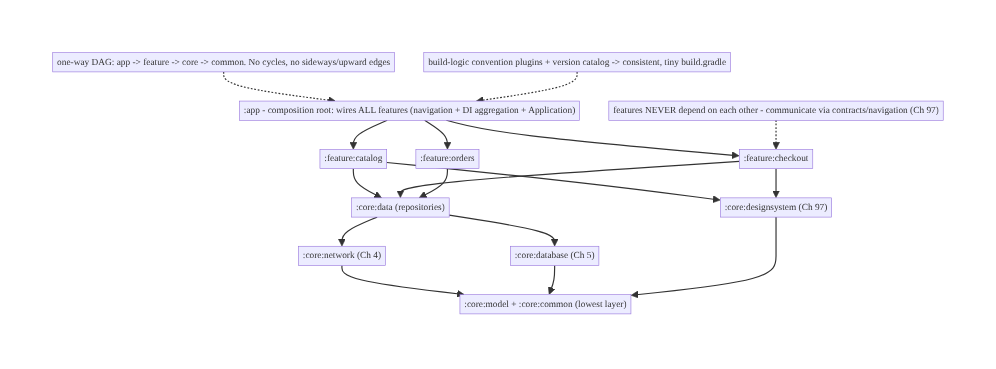
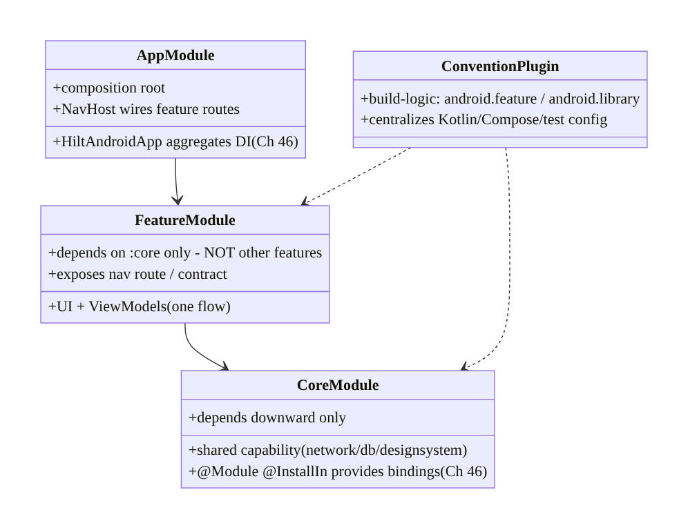
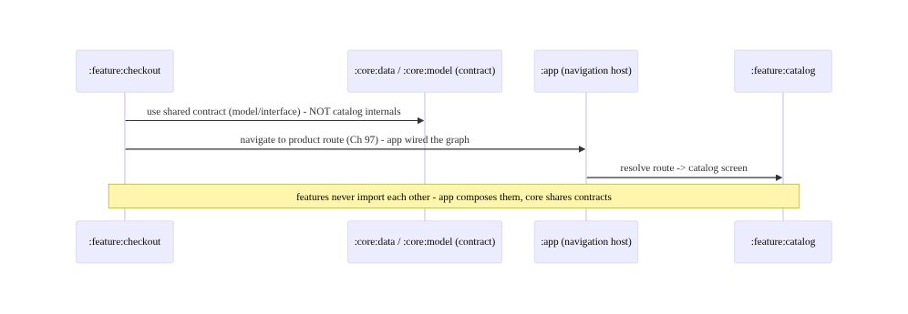
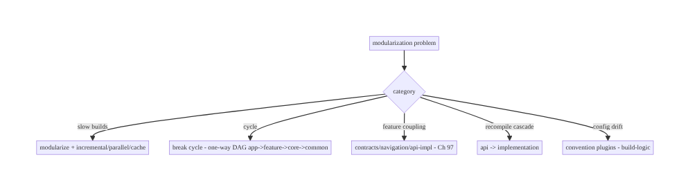

# Chapter 94 — Multi-Module Architecture at Enterprise Scale

> **Part XI — Reach, Scale & Platform Breadth** · Complexity: **Complex** (≥40 interview questions)
>
> **Prerequisites:** Ch 46 (DI/Hilt), Ch 1 (architecture/layers), Ch 88 (build/startup), Ch 92
> (R8), Ch 41 (release). Pairs with Ch 97 (theming/design system), Ch 100 (capstone).
>
> **Reference surface in StreamCart:** structuring the whole app as **many Gradle modules** —
> `:app`, per-feature modules (`:feature:catalog`, `:feature:checkout`), shared `:core:*`
> (network, database, design-system, common), and clean **module boundaries** enforced by
> **API/implementation visibility** and **dependency direction** — so a large team can build
> **fast** (parallel + incremental + cached builds), work **in parallel** without collisions,
> and keep the architecture **enforced by the build graph** itself (features can't depend on each
> other; everything flows through contracts).

---

## 94.1 Problem Definition and Real-World Context

A real app at scale isn't one module — it's **dozens to hundreds** of Gradle modules. A single-
module (monolith) app becomes unworkable past a certain size: **every change recompiles
everything** (slow builds), **everyone edits the same module** (merge collisions), **architecture
isn't enforced** (any class can reach any other — layering erodes), and you **can't reuse** code
across apps. **Multi-module architecture** decomposes the app into **well-bounded Gradle modules**
— an `:app` shell, **feature** modules (self-contained screens/flows), and **core/shared** modules
(network, database, design system, common utilities) — with **explicit dependencies** and
**enforced boundaries** (features depend on core, never on each other; dependencies flow **one
way**; module internals are hidden behind **`api`/`implementation`** and public contracts). The
payoff: **faster builds** (Gradle builds only changed modules + dependents, in **parallel**, with
**build caching**), **parallel teamwork** (teams own modules), **enforced architecture** (the
**build graph** forbids illegal dependencies), and **reuse** (core modules, even across apps).

Concretely, teams hit:

- **Monolith build times.** One module → **any** change recompiles the **whole** app; build times
  grow to minutes, killing iteration. **Multi-module** + Gradle's **incremental** + **parallel** +
  **build cache** means a change rebuilds only the **affected** modules.
- **Merge collisions / ownership.** Everyone editing one module → constant conflicts, no clear
  ownership. **Feature modules** give teams **isolated** areas they own.
- **Architecture erosion (no enforcement).** In a monolith, **any class can import any other** —
  layering (Ch 1) and feature isolation **erode** over time. **Module boundaries** make illegal
  dependencies a **compile error** (the build graph enforces architecture).
- **Feature coupling.** Features importing each other's internals → a tangle. **Rule:** features
  **never** depend on each other directly; they communicate through **shared contracts** (a
  `:core` API, a navigation contract, Ch 97) and the `:app` wires them.
- **Dependency direction & cycles.** Wrong direction (core depending on a feature) or **cycles**
  break the build. Dependencies must form a **DAG** flowing **app → feature → core → common**
  (one way).
- **`api` vs `implementation` leakage.** Exposing a dependency with **`api`** leaks it to
  consumers (recompile cascade + coupling); **`implementation`** hides it (faster builds, looser
  coupling). Overusing `api` destroys build performance and encapsulation.
- **DI across modules (Ch 46).** Hilt/Dagger wiring must **span modules** cleanly — core modules
  provide bindings, features consume them, `:app` aggregates — without a feature seeing another's
  internals.
- **:app as the composition root.** The `:app` module is the **only** place that knows about
  **all** features — it **wires** them together (navigation, DI aggregation) so features stay
  **decoupled**. Features are **leaves**; `:app` is the **root**.
- **Convention plugins / build logic.** Hundreds of modules can't each copy-paste build config.
  **Convention plugins** (`build-logic`) centralize shared Gradle setup (Kotlin, Compose,
  testing, Android config) so modules stay consistent and `build.gradle` files stay tiny.
- **Module granularity.** Too **coarse** (few big modules) → poor build parallelism/enforcement;
  too **fine** (hundreds of tiny modules) → Gradle overhead + navigation pain. Find the right
  **granularity** (often per-feature + layered core).

The architecture: decompose into **`:app`** (composition root — wires everything), **`:feature:*`**
(self-contained flows — depend only on core, **never each other**), and **`:core:*`** (shared:
network Ch 4, database Ch 5, design-system Ch 97, common, model) with **enforced boundaries**:
**one-way dependency DAG** (app → feature → core → common, no cycles), **`api`/`implementation`**
visibility to hide internals and limit recompile cascades, features communicating only through
**shared contracts** (not each other's internals), **Hilt DI spanning modules** (core provides,
features consume, app aggregates, Ch 46), and **convention plugins** (`build-logic`) for
consistent, minimal build config — so builds are **fast** (incremental + parallel + cached),
teams work **in parallel**, and the **build graph enforces the architecture**. This chapter is
about **structuring a large app so it builds fast, scales to many teams, and enforces its own
architecture**.

### Three practical use cases

1. **Decompose StreamCart's monolith.** Split into `:app`, `:feature:catalog/checkout/orders/
   account`, `:core:network/database/designsystem/common/model`; a change to checkout rebuilds
   only `:feature:checkout` + `:app`, not the catalog — build time drops dramatically.
2. **Enforce feature isolation.** `:feature:checkout` tries to import `:feature:catalog`'s
   internals → **compile error** (no dependency declared); they communicate via a `:core`
   contract + navigation (Ch 97). Architecture enforced by the build.
3. **Centralize build config.** 40 modules each had 60-line `build.gradle`; a `build-logic`
   convention plugin reduces each to ~10 lines and makes Kotlin/Compose/test config consistent.

### Why this is architectural

Multi-module architecture **is** the macro-architecture: it composes DI (Ch 46), layering (Ch 1),
build/startup (Ch 88), R8 (Ch 92), the design system (Ch 97), and release (Ch 41). The decisions
— module decomposition (app/feature/core), one-way dependency DAG, api/implementation visibility,
feature isolation via contracts, cross-module DI, convention plugins, granularity — determine
build speed, team scalability, and whether the architecture holds as the app grows.

---

## 94.2 Requirements Engineering

### Functional requirements

| ID | Requirement |
|----|-------------|
| F1 | Decompose into `:app` (composition root), `:feature:*`, `:core:*` modules. |
| F2 | Enforce a one-way dependency DAG (app → feature → core → common); no cycles. |
| F3 | Features never depend on each other; communicate via shared contracts (Ch 97). |
| F4 | Use `api`/`implementation` to hide internals and limit recompile cascades. |
| F5 | Hilt DI spans modules cleanly (core provides, features consume, app aggregates, Ch 46). |
| F6 | Convention plugins (`build-logic`) for consistent, minimal module build config. |

### Non-functional requirements

| Attribute | Policy |
|-----------|--------|
| **Build speed** | Incremental + parallel + build cache; rebuild only affected modules. |
| **Scalability** | Teams own modules; parallel work without collisions. |
| **Enforcement** | Build graph forbids illegal dependencies (compile errors). |
| **Encapsulation** | Module internals hidden behind contracts (`implementation`). |
| **Consistency** | Convention plugins; uniform config. |

### Scope

- **In scope:** module types (app/feature/core/common/model), dependency DAG + direction + cycle
  avoidance, `api` vs `implementation` visibility, feature isolation via contracts + navigation
  (Ch 97), cross-module Hilt DI (Ch 46), `:app` as composition root, convention plugins
  (`build-logic`), module granularity, build performance (incremental/parallel/cache), dynamic
  feature modules (brief).
- **Out of scope:** DI internals (Ch 46), layering within a module (Ch 1), build/startup detail
  (Ch 88), R8 (Ch 92), design system detail (Ch 97), release (Ch 41), navigation detail.

### Assumptions & constraints

- Gradle with Kotlin DSL + version catalogs; Hilt (Ch 46); Compose. **One-way dependency DAG**
  (no cycles); features **isolated**; internals hidden (`implementation`); **convention plugins**
  for shared config. Gradle **build cache** + **configuration cache** + **parallel** enabled.
  `minSdk 24`.

---

## 94.3 System Design Fundamentals

- **Why modularize (the four payoffs).** (1) **Build speed** — Gradle rebuilds only **changed
  modules + their dependents** (incremental), builds independent modules **in parallel**, and
  **caches** outputs (local + remote build cache); a monolith rebuilds **everything**. (2)
  **Parallel teamwork** — teams **own** modules and work without stepping on each other. (3)
  **Enforced architecture** — the **build graph** makes illegal dependencies a **compile error**
  (you literally **cannot** import what you don't depend on). (4) **Reuse** — core modules are
  reusable (even across apps). These are the reasons to pay modularization's complexity cost.
- **Module types (the standard decomposition).**
  - **`:app`** — the **composition root** / shell: the **only** module that depends on **all**
    features; it **wires** them (navigation host, DI aggregation, Application). Thin — no business
    logic. Features are **leaves**; `:app` is the **root**.
  - **`:feature:*`** — self-contained **flows/screens** (catalog, checkout, orders, account),
    each its own UI + ViewModels + feature-scoped logic. **Depend only on `:core:*`**, **never on
    each other**. Owned by a team.
  - **`:core:*`** — **shared** capabilities: `:core:network` (Ch 4), `:core:database` (Ch 5),
    `:core:designsystem` (Ch 97), `:core:common` (utilities), `:core:model` (shared data types),
    `:core:data` (repositories). Depended on by features; depend on **lower** core/common only.
  - **`:core:model` / `:core:common`** — the **lowest** layer: pure data types + utilities, no
    Android/feature deps — depended on by everyone.
- **Dependency direction & the DAG (the central rule).** Dependencies must flow **one way** and
  form a **Directed Acyclic Graph**: **`:app` → `:feature:*` → `:core:*` → `:core:common/model`**.
  **No cycles** (Gradle fails on them), and **no upward/sideways** deps (core must **not** depend
  on a feature; features must **not** depend on each other). This direction is what **enforces
  layering and feature isolation** — the build graph **is** the architecture diagram.
- **Feature isolation via contracts (not internals).** Two features that need to interact
  (checkout → product detail) must **not** import each other's internals. Instead: (a) share a
  **contract** in `:core` (a model/interface), (b) communicate through **navigation** (a route/
  deep link, Ch 97) that `:app` wires, or (c) a **feature-API module** pattern (`:feature:catalog:
  api` with interfaces, `:feature:catalog:impl` with the implementation — others depend only on
  `api`). This keeps features **swappable and independently buildable**.
- **`api` vs `implementation` (the build-performance + encapsulation knob).** In a module's
  dependencies: **`implementation dep`** → the dependency is **internal** (not exposed to
  consumers); changing it **doesn't recompile** consumers, and consumers **can't** use it →
  **faster builds + encapsulation**. **`api dep`** → the dependency is **exposed** in this
  module's public API (consumers can use it, and **recompile** when it changes) → **use sparingly**
  (only when a type genuinely appears in your public API). **Default to `implementation`**;
  overusing `api` creates **recompile cascades** and coupling. This is one of the highest-leverage
  build-speed levers.
- **Cross-module DI with Hilt (Ch 46).** Hilt wiring **spans modules**: **core** modules provide
  bindings via **`@Module @InstallIn(SingletonComponent::class)`**; **features** consume via
  **`@Inject`**/`@HiltViewModel`; **`:app`** hosts **`@HiltAndroidApp`** and **aggregates** all
  modules' bindings into one graph at the composition root. A feature gets dependencies **without**
  seeing another feature's internals — Hilt resolves across the module graph. Keep bindings in the
  module that **owns** the capability.
- **:app as composition root.** Only `:app` knows the **full** set of features — it builds the
  **navigation graph** (wiring feature routes), **aggregates DI**, and holds the `Application`.
  This is what keeps features **decoupled**: they don't know about each other; `:app` **composes**
  them. (Analogous to the composition root in DI, Ch 46.)
- **Convention plugins (`build-logic`).** With many modules, **duplicating** build config is
  unmaintainable. **Convention plugins** (a `build-logic` included build with plugins like
  `streamcart.android.feature`, `streamcart.android.library`) **centralize** shared Gradle config
  (Kotlin/Compose/Android/test setup, common dependencies). Each module's `build.gradle` becomes
  **tiny** (apply the convention plugin + its specific deps) and **consistent**. Version catalogs
  (`libs.versions.toml`) centralize dependency versions.
- **Granularity (the trade-off).** **Too coarse** (few big modules) → less build parallelism,
  weaker enforcement, more collisions. **Too fine** (hundreds of tiny modules) → Gradle
  configuration overhead, navigation/cognitive burden, over-engineering. A good default:
  **per-feature** modules + **layered core** modules; split further only when a module is large/
  slow/shared enough to justify it. Measure build impact.
- **Dynamic feature modules (brief).** **Dynamic feature modules** (installed **on demand** via
  Play, not at install) reduce **install size** for rarely-used features — a **delivery** concern
  layered on modularization. Most apps use standard modules; dynamic features are for large,
  optional flows.

Core insight: **decompose a large app into many Gradle modules — a thin `:app` composition root
that is the only module aware of all features and wires them (navigation + DI aggregation + the
Application), self-contained `:feature:*` modules that depend only on `:core:*` and never on each
other, and shared `:core:*` modules (network, database, design system, common, model) in layers —
with dependencies forced into a one-way Directed Acyclic Graph (app → feature → core → common, no
cycles, no upward or sideways edges) so the build graph itself enforces layering and feature
isolation as compile errors; features that must interact do so through shared contracts, a
navigation route the app wires, or an api/impl split, never by importing each other's internals;
default every dependency to implementation (internal, no recompile cascade, encapsulated) and use
api only for types genuinely in a module's public surface, because that single choice is among the
biggest build-speed and coupling levers; wire Hilt across modules (core provides bindings, features
consume, app aggregates into one graph, Ch 46) so a feature gets what it needs without seeing
another's internals; centralize build config in convention plugins (build-logic) plus version
catalogs so hundreds of modules stay consistent with tiny build.gradle files; and pick a
granularity (per-feature + layered core) that maximizes incremental/parallel/cached build speed and
team parallelism without drowning in tiny modules — because the payoff is fast builds (rebuild only
affected modules), many teams working in parallel, architecture the build enforces, and reusable
core.**

---

## 94.4 High-Level Architecture



**Components & ownership**

- **`:app`** composition root — wires all features (navigation + DI, Ch 46); thin.
- **`:feature:*`** — isolated flows; depend only on core; **never each other**.
- **`:core:*`** — shared (network/db/designsystem/data/common/model), layered; depend **downward**
  only.
- **Boundaries** enforced by the **one-way DAG**; config by **convention plugins**.

**Direction:** app → feature → core → common (one-way DAG); features isolated; internals hidden
(`implementation`); DI spans modules; config centralized.

---

## 94.5 Detailed Component Design



| Component | Responsibility |
|-----------|----------------|
| `:app` | composition root — wire features (nav + DI aggregation, Ch 46); thin shell |
| `:feature:*` | one flow (UI+VM); depend only on core; expose route/contract |
| `:core:*` | shared capability; provide DI bindings; depend downward only |
| `build-logic` | convention plugins — centralize Kotlin/Compose/Android/test config |

---

## 94.6 End-to-End Data Flow

### Build graph: a change rebuilds only affected modules


### Cross-module interaction (via contract, not internals)



---

## 94.7 Implementation (Gradle + Kotlin)

Repo layout and build config.

### 94.7.1 Module layout + settings.gradle

```kotlin
// settings.gradle.kts
include(":app")
include(":feature:catalog", ":feature:checkout", ":feature:orders", ":feature:account")
include(":core:data", ":core:network", ":core:database", ":core:designsystem", ":core:common", ":core:model")
includeBuild("build-logic")   // convention plugins
// Dependency DAG: :app -> :feature:* -> :core:data -> :core:network/:core:database -> :core:model/:core:common
```

### 94.7.2 Convention plugin (build-logic) — centralized config

```kotlin
// build-logic/convention/.../AndroidFeatureConventionPlugin.kt
class AndroidFeatureConventionPlugin : Plugin<Project> {
    override fun apply(target: Project) = with(target) {
        pluginManager.apply("streamcart.android.library")          // base Android+Kotlin+Compose config
        pluginManager.apply("dagger.hilt.android.plugin")          // Hilt for every feature (Ch 46)
        dependencies {
            add("implementation", project(":core:data"))           // features depend on core
            add("implementation", project(":core:designsystem"))   // Ch 97
            add("implementation", project(":core:common"))
            // NOTE: no feature depends on another feature - enforced here + by the graph
        }
    }
}
```

### 94.7.3 A feature module's tiny build.gradle

```kotlin
// feature/checkout/build.gradle.kts - tiny, thanks to the convention plugin
plugins { id("streamcart.android.feature") }                       // all shared config applied
android { namespace = "com.streamcart.feature.checkout" }
dependencies {
    implementation(libs.androidx.compose.ui)                       // feature-specific extras only
    // NO implementation(project(":feature:catalog")) - features never depend on each other
}
```

### 94.7.4 api vs implementation (encapsulation + build speed)

```kotlin
// core/data/build.gradle.kts
dependencies {
    api(project(":core:model"))              // model types APPEAR in :core:data's public API -> expose (api)
    implementation(project(":core:network")) // network is an INTERNAL detail -> hide (implementation)
    implementation(project(":core:database")) // database internal -> hide
    // Consumers of :core:data see :core:model, but NOT :core:network/:core:database.
    // Changing :core:network does NOT recompile features (implementation) -> faster builds.
}
```

### 94.7.5 Cross-module Hilt DI (Ch 46)

```kotlin
// :core:network provides its bindings; features consume without seeing internals
@Module @InstallIn(SingletonComponent::class)     // Ch 46 - installed into the app-wide graph
object NetworkModule {
    @Provides @Singleton fun okHttp(): OkHttpClient = OkHttpClient.Builder().build()   // Ch 4
    @Provides @Singleton fun retrofit(client: OkHttpClient): Retrofit = /* ... */ TODO()
}
// :feature:checkout just @Injects a repository from :core:data - Hilt resolves across modules.
@HiltViewModel class CheckoutViewModel @Inject constructor(private val repo: OrderRepository) : ViewModel()
// :app hosts @HiltAndroidApp -> aggregates ALL modules' bindings into one graph (composition root).
```

### 94.7.6 Module structure

```
:app                 composition root: NavHost (wires feature routes), @HiltAndroidApp, Application
:feature:catalog/checkout/orders/account   isolated flows (UI+VM), depend on :core only
:core:data           repositories (api :core:model; implementation :core:network/:core:database)
:core:network (Ch 4), :core:database (Ch 5), :core:designsystem (Ch 97)
:core:common, :core:model   lowest layer (utilities, data types) - everyone depends on these
build-logic          convention plugins (android.feature/library) + version catalog
```

---

## 94.8 Concurrency and Race Conditions

> Modularization is a **build-time / structural** concern; the analog of "races" are **build-graph
> and boundary** hazards:

| Scenario | Risk | Handling |
|----------|------|----------|
| Dependency cycle | build fails | enforce one-way DAG (app→feature→core→common) |
| Feature depends on feature | coupling/tangle | forbid; use contracts/navigation (Ch 97) |
| Overusing `api` | recompile cascade + coupling | default `implementation` |
| Core depends on feature | inverted layering | core depends downward only |
| Inconsistent module config | drift/bugs | convention plugins (build-logic) |
| Too-fine granularity | Gradle overhead | right-size (per-feature + layered core) |
| DI binding in wrong module | leaks/duplication | bindings in the owning module (Ch 46) |

- **The build graph is the enforcement mechanism:** unlike runtime architecture rules (which
  erode), a **missing dependency edge** makes an illegal import a **compile error** — the
  architecture is enforced **mechanically**, not by discipline.
- **`implementation` is the default for a reason:** it both **encapsulates** (consumers can't
  reach internals) and **speeds builds** (no recompile when an internal dep changes). Reserve
  **`api`** for types that genuinely appear in the public surface.
- **Parallel builds + build cache** turn modularization's structure into **speed**: independent
  modules build **concurrently**, and unchanged modules come **from cache** (local or remote,
  shared across the team/CI).

---

## 94.9 Failure Scenarios and Recovery

| Failure | Detection | Response | Outcome |
|---------|-----------|----------|---------|
| Slow monolith builds | build profiling | modularize; incremental/parallel/cache | fast |
| Dependency cycle | Gradle error | break cycle (move shared code to core) | DAG restored |
| Feature↔feature coupling | illegal import | contracts/navigation/api-impl (Ch 97) | isolated |
| Recompile cascade | build profiling | `api`→`implementation` | fast rebuilds |
| Config drift across modules | inconsistency | convention plugins (build-logic) | consistent |
| Merge collisions | git conflicts | feature-module ownership | parallel teams |
| Architecture erosion | review/graph audit | build-graph enforcement | enforced |



> **Let the build graph enforce the architecture.** Modularize into app/feature/core with a
> one-way DAG so illegal dependencies become compile errors; keep features isolated (contracts/
> navigation, Ch 97), default to `implementation` to encapsulate and speed builds, aggregate DI at
> the `:app` composition root (Ch 46), and centralize config in convention plugins. The payoff —
> fast incremental/parallel/cached builds, parallel teams, enforced architecture — is why large
> apps modularize.

---

## 94.10 Scaling the Implementation

- **Level 1.** Split `:app` + a few `:core` modules (network, database, common); enable Gradle
  parallel + build cache.
- **Level 2.** Per-feature modules; one-way DAG; `api`/`implementation` discipline; cross-module
  Hilt (Ch 46); design-system module (Ch 97).
- **Level 3 — production.** Convention plugins (build-logic) + version catalogs; feature api/impl
  split where needed; remote build cache (CI/team); module-ownership map.
- **Level 4 — enterprise.** Hundreds of modules; dependency-graph governance (lint rules forbidding
  bad edges); affected-module-only CI; dynamic feature modules for optional flows; build-scan-based
  optimization.
- **Level 5 — org scale.** Monorepo tooling, module-graph visualization + budgets, build-time SLOs,
  shared core libraries across apps, platform teams owning `:core`, automated architecture-fitness
  functions.

**Avoid overengineering:** per-feature + layered-core modules with a one-way DAG, convention
plugins, and `implementation`-by-default covers most apps. Don't over-split into hundreds of tiny
modules; don't let features depend on each other; don't overuse `api`; don't duplicate build config.

---

## 94.11 Alternative Approaches and Trade-offs

| Dimension | Option A | Option B | When |
|-----------|----------|----------|------|
| Structure | Multi-module (app/feature/core) | monolith (single module) | Multi-module at scale |
| Dependencies | One-way DAG | tangled/cyclic | DAG always |
| Feature interaction | Contracts/navigation (Ch 97) | direct feature deps | Contracts (isolation) |
| Visibility | `implementation` default | `api` everywhere | `implementation` (speed+encap) |
| Feature structure | api/impl split | single feature module | api/impl for swappable/large |
| Config | Convention plugins | per-module copy-paste | Convention plugins |
| Delivery | Standard modules | dynamic feature modules | Dynamic for optional/large flows |

**Multi-module vs monolith:** a **monolith** is simplest for small apps but at scale gives **slow
builds** (recompile everything), **merge collisions**, and **eroding architecture** (any import
allowed). **Multi-module** gives **fast incremental/parallel/cached builds**, **parallel teams**,
and **build-enforced architecture** — at the cost of **setup complexity** (Gradle, DI across
modules). Modularize when build time/team size/architecture erosion justify it.

**`implementation` vs `api`:** **`api`** exposes a dependency to consumers (they can use it **and
recompile** when it changes) — convenient but creates **coupling + recompile cascades**.
**`implementation`** hides it (encapsulation + no cascade). **Default to `implementation`**; use
`api` only when a type genuinely appears in your **public API**. This is a top build-speed lever.

**Feature api/impl split vs single feature module:** a single `:feature:x` is simpler; an
**`:feature:x:api` (interfaces) + `:feature:x:impl`** split lets **other code depend only on the
api** (not the implementation) — enabling **swappability**, **better build parallelism**, and
**tighter isolation** — at the cost of **more modules**. Use api/impl for large or cross-depended
features; keep small ones single.

---

## 94.12 Security & Privacy Considerations

- **Module boundaries limit blast radius (Ch 20/24):** security-sensitive capabilities (auth
  Ch 20, crypto/keystore Ch 24, payments Ch 76) live in **dedicated core modules** with **narrow
  public APIs** (`implementation`-hidden internals) — a feature can't reach into the keystore
  wiring, only the exposed contract. Modularization **enforces least privilege** structurally.
- **Secrets stay in their module (Ch 24):** keys/config live in the owning `:core` module (not
  spread across features); the module's public API exposes **operations**, not secrets.
- **Dynamic feature modules + integrity:** on-demand modules are delivered by Play; ensure **code
  integrity** (signed, Play-delivered) — don't load untrusted code (Ch 24).
- **Build-logic is privileged code (supply chain):** convention plugins run at **build time** with
  full access — treat `build-logic` as **trusted, reviewed** code; a compromised build plugin is a
  **supply-chain** risk (Ch 92/24).
- **Per-module lint/rules for security:** forbid, via graph rules, a feature depending directly on
  a sensitive internal module — enforce access through the vetted API.
- Build-time/structural concern: the security value is **structural least privilege** (boundaries
  limit what each module can reach) and **supply-chain hygiene** for build-logic (Ch 24).

---

## 94.13 Performance and Resource Optimization

- **Build performance is the point** — **incremental** (rebuild only affected modules), **parallel**
  (independent modules concurrently), **build cache** (local + remote; unchanged modules from
  cache), **configuration cache** (skip configuration phase). Modularization enables all four.
- **`implementation` over `api`** — the biggest **recompile-cascade** reducer (changing an internal
  dep doesn't recompile consumers).
- **Right-size modules** — enough to parallelize/cache, not so fine that Gradle **configuration
  overhead** dominates.
- **Convention plugins + version catalogs** — fast, consistent configuration; configuration cache
  friendly.
- **Affected-only CI** — build/test only modules touched by a change (and dependents).
- **Profiling:** build scans (task timing, cache hit rate), configuration time, module graph
  (fan-in/out), incremental-build time per typical change, remote-cache effectiveness.

---

## 94.14 Testing Strategy

Each module tests **independently** (faster, parallel); the graph/boundaries are verified by the
build + lint.

```kotlin
// Each module has its own tests, run independently and in parallel:
//  :core:data        -> repository unit tests (fakes for :core:network/:core:database)
//  :feature:checkout -> ViewModel + UI tests (fakes for :core:data) - no other feature needed
//  :core:designsystem-> component screenshot/behavior tests (Ch 97)

// Boundary enforcement (verified mechanically):
//  - Dependency DAG: Gradle fails on cycles; a lint/graph rule forbids feature->feature edges.
//  - api/implementation: changing an `implementation` dep does NOT recompile consumers (build check).

class CheckoutViewModelTest {   // tests in isolation with a FAKE core:data repo
    @Test fun `places order via core contract`() = runTest { /* fake OrderRepository (core contract) */ }
}
// Affected-module CI: a change to :feature:checkout runs only its tests + dependents, in parallel.
```

What to test: each module in **isolation** (fakes for its core deps) — faster + parallel;
**dependency DAG** (no cycles — Gradle; no feature→feature — lint/graph rule); **api/implementation**
encapsulation (consumers can't see hidden deps); cross-module DI resolves (Ch 46). CI runs
**affected modules only**, in parallel.

---

## 94.15 Production Observability

- **Build metrics (the key "production" here is the build/CI):** **build time** (clean + incremental)
  by change type, **cache hit rate** (local + remote), **configuration time**, **affected-module
  count** per change, **module graph** health (fan-in/out, cycles=0), CI build/test duration.
- **Logs:** Gradle build scans (task timing, cache, dependency resolution).
- **Debugging:** slow builds → build scan (which tasks? cache misses? `api` cascades?); cycle →
  Gradle error (break it); feature coupling → graph/lint violation; config drift → convention-plugin
  audit; recompile cascade → find the `api` dep to make `implementation`.
- **Alerting:** build-time regression (a change made builds slower — e.g., a new `api` cascade);
  cache-hit-rate drop; a new dependency cycle / illegal edge (CI fails).
- **Dashboards:** build-time trends, cache effectiveness, module-graph metrics, affected-module
  distribution, CI duration by module.

---

## 94.16 System Design Interview Preparation

> ≥40 questions (Complex).

**Fundamentals**
1. *Why modularize?* Build speed, parallel teams, enforced architecture, reuse.
2. *Monolith problems?* Slow builds, collisions, architecture erosion.
3. *Module types?* `:app`, `:feature:*`, `:core:*`.
4. *:app role?* Composition root — wires all features (nav + DI).
5. *Feature module?* One self-contained flow; depends on core only.

**Dependency graph**
6. *Dependency direction?* One-way: app → feature → core → common.
7. *Cycles?* Forbidden — Gradle fails; it's a DAG.
8. *Core depend on feature?* Never — downward only.
9. *Features depend on each other?* Never — contracts/navigation.
10. *What enforces architecture?* The build graph (compile errors).

**Feature isolation**
11. *How do features interact?* Shared contract (core), navigation (app-wired), api/impl.
12. *api/impl split?* `:feature:x:api` (interfaces) + `:impl` — depend on api only.
13. *Why isolate?* Swappable, independently buildable, no tangle.

**api vs implementation**
14. *implementation?* Internal dep — hidden, no recompile cascade.
15. *api?* Exposed dep — consumers use + recompile.
16. *Default?* `implementation`.
17. *When api?* Type appears in your public API.
18. *Why it matters?* Build speed + encapsulation.

**DI across modules**
19. *Hilt across modules?* Core provides, feature consumes, app aggregates (Ch 46).
20. *Bindings where?* In the owning module.
21. *@HiltAndroidApp?* In `:app` — aggregates the graph.
22. *Feature sees other's internals?* No — Hilt resolves across the graph.

**Build config**
23. *Convention plugins?* build-logic — centralize shared Gradle config.
24. *Version catalogs?* Centralize dependency versions.
25. *Why?* Hundreds of modules stay consistent; tiny build.gradle.

**Granularity/build**
26. *Granularity?* Per-feature + layered core; not too fine.
27. *Too fine?* Gradle overhead + navigation pain.
28. *Build speed from?* Incremental + parallel + build cache.
29. *Build cache?* Reuse unchanged module outputs (local/remote).
30. *Configuration cache?* Skip configuration phase.

**Dynamic features**
31. *Dynamic feature module?* On-demand install (Play) — smaller install.
32. *When?* Large/optional flows.

**Edge cases/production**
33. *Break a cycle?* Move shared code to a lower core module.
34. *Recompile cascade?* An `api` dep — make it `implementation`.
35. *Affected-only CI?* Build/test only touched modules + dependents.
36. *Shared code across apps?* Reusable core modules.
37. *Enforce no-bad-edges?* Lint/graph rules in CI.
38. *Test a module?* In isolation with fakes for core deps.
39. *Module ownership?* Teams own feature/core modules.
40. *build-logic risk?* Supply-chain — it's privileged build code.
41. *Measure build?* Build scans (timing, cache).
42. *:core:model/common?* Lowest layer — pure types/utilities.

### Design-change challenges
1. **Modularize a monolith.** app/feature/core decomposition + one-way DAG.
2. **Speed up builds.** `api`→`implementation`, parallel, build cache, affected-only CI.
3. **Stop feature coupling.** Contracts/navigation/api-impl (Ch 97).
4. **Standardize 50 modules' config.** Convention plugins + version catalogs.
5. **Enforce architecture.** Build-graph + lint rules forbidding illegal edges.

### Mock walkthrough (abridged)
Clarify (app size, team count, build pain?) → decompose (`:app` composition root, `:feature:*`,
`:core:*`) → one-way dependency DAG (app→feature→core→common, no cycles) → feature isolation
(contracts/navigation/api-impl, Ch 97) → `implementation` default / `api` sparingly → cross-module
Hilt (core provides, app aggregates, Ch 46) → convention plugins + version catalogs → granularity
(per-feature + layered core) → build speed (incremental/parallel/cache) → observability (build
metrics).

---

## 94.17 Practical Exercises

1. **Beginner.** Extract `:core:network` (Ch 4) and `:core:common` from a monolith; enable Gradle
   parallel + build cache. *Eval:* modules build; faster incremental build.
2. **Intermediate.** Create `:feature:checkout` depending only on `:core:*` (not other features),
   with cross-module Hilt (Ch 46) and a tiny build.gradle. *Eval:* isolated; DI resolves.
3. **Advanced.** Add a `build-logic` convention plugin (`android.feature`) + version catalog, and
   convert `api` deps to `implementation` where possible. *Eval:* consistent config; recompile
   cascade reduced.
4. **Production debugging.** Use a build scan to find a recompile cascade (an `api` dep) and a
   dependency cycle; fix both. *Eval:* faster builds; DAG restored.
5. **System design challenge.** Design the module graph + enforcement (lint rules forbidding
   feature→feature and upward edges) + affected-only CI for a 100-module app. *Eval:* enforced,
   fast, scalable.

*(Solutions withheld unless requested.)*

---

## 94.18 Chapter Summary & Reference Sheet

**Key decisions:** decompose a large app into many Gradle modules — a **thin `:app` composition
root** (the only module aware of **all** features; it **wires** them via navigation + DI
aggregation + the Application, Ch 46), self-contained **`:feature:*`** modules that depend **only
on `:core:*`** and **never on each other**, and shared layered **`:core:*`** modules (network Ch 4,
database Ch 5, design system Ch 97, data, common, model) — with dependencies forced into a
**one-way Directed Acyclic Graph** (**app → feature → core → common**, **no cycles**, no upward or
sideways edges) so the **build graph itself enforces** layering and feature isolation as **compile
errors**; features that must interact do so through **shared contracts**, a **navigation route** the
app wires (Ch 97), or an **api/impl split** — never by importing each other's internals; **default
every dependency to `implementation`** (internal, no recompile cascade, encapsulated) and use
**`api` only** for types genuinely in a module's **public surface**, because that choice is among
the biggest **build-speed and coupling** levers; wire **Hilt across modules** (core provides,
features consume, `:app` aggregates into one graph, Ch 46); **centralize build config in convention
plugins** (`build-logic`) plus **version catalogs** so hundreds of modules stay consistent with tiny
`build.gradle` files; and pick a **granularity** (per-feature + layered core) that maximizes
**incremental/parallel/cached** build speed and team parallelism without drowning in tiny modules —
for the payoff of **fast builds** (rebuild only affected modules), **many teams in parallel**,
**build-enforced architecture**, and **reusable core**.

**Concepts:** module types (app/feature/core/common/model), one-way dependency DAG + cycle
avoidance, `api` vs `implementation` (encapsulation + recompile cascades), feature isolation via
contracts/navigation/api-impl (Ch 97), cross-module Hilt DI (Ch 46), `:app` composition root,
convention plugins + version catalogs (build-logic), granularity, build speed (incremental/parallel/
cache), dynamic feature modules.

**Common mistakes:** staying monolithic at scale (slow builds, erosion); feature→feature
dependencies (tangle); dependency cycles / upward edges; overusing `api` (recompile cascades +
coupling); duplicating build config across modules; over-splitting into hundreds of tiny modules;
putting DI bindings in the wrong module; `:app` holding business logic (should be a thin shell).

**Checklist:** ☐ `:app` (thin composition root) + `:feature:*` + `:core:*` decomposition ☐ one-way
DAG (app→feature→core→common); no cycles ☐ features never depend on each other (contracts/
navigation/api-impl, Ch 97) ☐ `implementation` default; `api` only for public-surface types ☐
cross-module Hilt (core provides, app aggregates, Ch 46) ☐ convention plugins (build-logic) +
version catalogs ☐ right-size granularity (per-feature + layered core) ☐ parallel + build cache +
configuration cache ☐ affected-module-only CI ☐ lint/graph rules forbidding illegal edges.

**Key Gradle/APIs:** `settings.gradle.kts` `include`/`includeBuild`, `project(":core:x")` deps,
`api`/`implementation` configurations, `build-logic` convention plugins (`Plugin<Project>`), version
catalog (`libs.versions.toml`), Gradle `--parallel` / build cache / configuration cache, Hilt
`@Module @InstallIn(SingletonComponent::class)` / `@HiltAndroidApp` (Ch 46), dynamic feature modules
(`com.android.dynamic-feature`), build scans, module-graph/lint rules.

**References:**
- Android modularization guide: https://developer.android.com/topic/modularization
- Now in Android (modularization reference app): https://github.com/android/nowinandroid
- Gradle build performance: https://docs.gradle.org/current/userguide/performance.html
- api vs implementation: https://docs.gradle.org/current/userguide/java_library_plugin.html
- (composes) Ch 46 DI/Hilt, Ch 1 Architecture, Ch 88 Build/Startup, Ch 92 R8, Ch 97 Design System, Ch 100 Capstone

### Chapter review (Phase 4)
- **Completeness:** all 18 sections; architecture/class/build-graph/sequence/failure diagrams;
  settings + convention-plugin + feature + api/impl + cross-module-DI code; concurrency (build-graph
  enforcement, implementation-default, parallel+cache); failure (let-the-build-enforce principle); 5
  levels; multi-module-vs-monolith, api-vs-impl, api/impl-split trade-offs; security (structural
  least privilege, build-logic supply chain); perf (build speed — the point); isolated-module +
  boundary tests; observability (build metrics); 42 Q&A + 5 challenges. ✅
- **Expand later:** DI (Ch 46), architecture/layers (Ch 1), design system (Ch 97), build/startup
  (Ch 88), capstone (Ch 100).
- **Interview coverage:** 42 Q&A — exceeds the ≥40 Complex bar.
