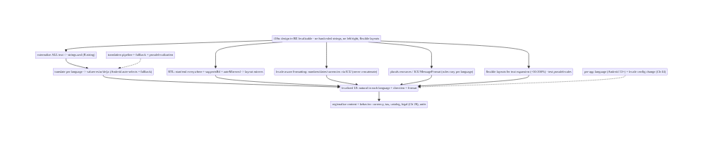
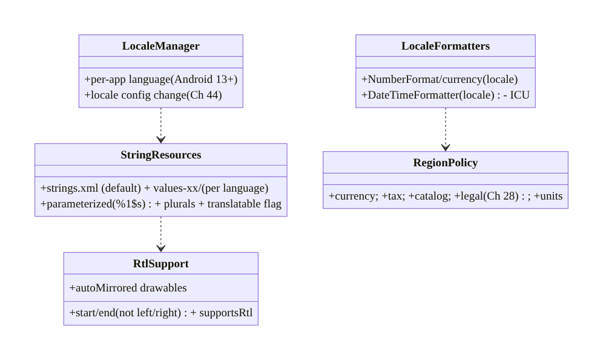
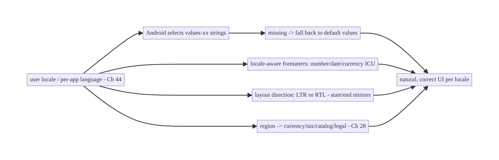
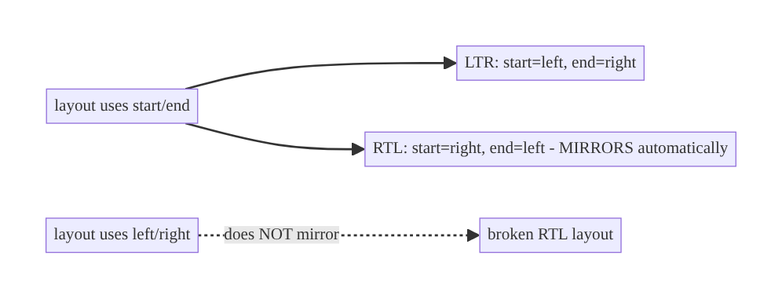
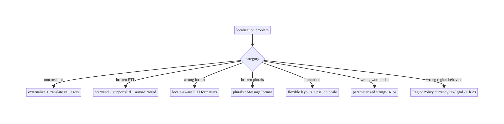

# Chapter 95 — Localization, RTL & Regionalization

> **Part XI — Reach, Scale & Platform Breadth** · Complexity: **Standard** (≥25 interview questions)
>
> **Prerequisites:** Ch 2 (Compose UI), Ch 97 (theming/config), Ch 44 (config changes), Ch 1
> (architecture). Pairs with Ch 96 (accessibility), Ch 100 (capstone).
>
> **Reference surface in StreamCart:** reaching a **global** audience — **translating** UI text
> (string resources, no hardcoded strings), supporting **RTL** languages (Arabic/Hebrew) via
> **start/end** layout, **formatting** numbers, dates, currencies, and plurals **per locale**
> (ICU), and **regionalizing** content/behavior (currency, tax, catalog, legal) — so the app is
> **correct and natural** in every market, not just an English app with swapped words.

---

## 95.1 Problem Definition and Real-World Context

Shipping globally means the app must be **correct and natural** in each user's **language**,
**script direction**, and **region** — not an English app with translated words. **Localization
(l10n)** translates UI text; **internationalization (i18n)** is designing the app so it **can** be
localized (no hardcoded strings, no assumptions about text direction/length/format);
**regionalization** adapts **content and behavior** per region (currency, tax, catalog, legal,
units). The core discipline: **externalize all user-facing text** into **string resources** (never
hardcode), support **RTL** by using **start/end** (not left/right) throughout, **format**
numbers/dates/currencies/plurals **per locale** with **ICU** (never concatenate or assume formats),
and **regionalize** data/behavior. Get it wrong and the app shows **untranslated strings**,
**broken RTL layouts**, **wrong number/date/currency formats**, **broken plurals**, and
**truncated/overflowing** text — all of which make it feel foreign and broken in non-English
markets.

Concretely, teams hit:

- **Hardcoded strings (the #1 i18n bug).** Text literals in code/XML can't be translated. **Every**
  user-facing string must live in **`strings.xml`** (`R.string.*` / `stringResource`) so
  translators can localize it per language (`values-es/`, `values-ar/`, …).
- **No RTL support.** Using **left/right** (margins, gravity, drawables) breaks **RTL** languages
  (Arabic, Hebrew), where the layout should **mirror**. Use **start/end** everywhere, set
  `supportsRtl="true"`, and the layout mirrors automatically; test RTL.
- **Locale-wrong formatting.** Formatting numbers (`1,000.5` vs `1.000,5`), dates (`MM/DD` vs
  `DD/MM`), times (12h vs 24h), and **currencies** by **string concatenation** or a fixed format
  is wrong per locale. Use **ICU / locale-aware formatters** (`NumberFormat`, `DateTimeFormatter`,
  `java.text`/`android.icu`).
- **Broken plurals.** `"$count items"` is wrong — plural **rules** vary by language (English: 1/
  many; Arabic: zero/one/two/few/many/other; Polish: complex). Use **plurals resources**
  (`getQuantityString`) / ICU **MessageFormat**, never string concatenation.
- **String concatenation / word order.** Building sentences by concatenating fragments breaks in
  languages with different **word order**. Use **parameterized** strings with **placeholders**
  (`%1$s`) so translators reorder.
- **Text expansion / truncation.** Translations can be **30–200%** longer (German, Finnish);
  fixed-width layouts **truncate/overflow**. Design **flexible** layouts; test with long
  translations/pseudolocales.
- **Regionalization ≠ translation.** The **same language** differs by region (en-US vs en-GB:
  spelling, date, currency; es-ES vs es-MX). And **behavior** differs: **currency**, **tax**,
  **catalog availability**, **legal/consent** (Ch 28), **units** (metric/imperial). Regionalize
  **content + behavior**, not just words.
- **Per-app language (Android 13+).** Users can set a **per-app language** (`AppCompat`/
  `LocaleManager`) independent of the device — the app must honor it. Also handle **locale change**
  as a config change (Ch 44).
- **Translation pipeline / untranslated fallback.** Missing translations must **fall back** (to
  the default `values/`), and a **pipeline** (export strings → translate → import) keeps
  translations in sync as strings change. Pseudolocalization catches issues early.

The architecture: **externalize all user-facing text** into **string resources** (never hardcode;
per-language `values-xx/`), support **RTL** with **start/end** everywhere (+ `supportsRtl`, mirror
drawables), **format** numbers/dates/times/currencies with **locale-aware ICU formatters** (never
concatenate or assume), handle **plurals** with **plurals/ICU MessageFormat**, use **parameterized**
strings for correct **word order**, design **flexible layouts** for **text expansion**, and
**regionalize content + behavior** (currency, tax, catalog, legal, units) per region — honoring
**per-app language** (Android 13+) and **locale config changes** (Ch 44), with a **translation
pipeline** and **fallback**. This chapter is about **being correct and natural in every market**.

### Three practical use cases

1. **Translate + RTL StreamCart.** All strings in `strings.xml`, translated to `values-es/ar/de/
   ja`; start/end layout mirrors correctly for Arabic (RTL); tested with pseudolocales for
   expansion.
2. **Locale-correct price/date.** Product prices formatted with **currency + locale** (`$1,234.56`
   vs `1.234,56 €`), order dates per locale (`DD/MM/YYYY` vs `MM/DD/YYYY`) — via ICU formatters,
   never concatenation.
3. **Regionalize checkout.** Currency, tax rules, available catalog, and legal/consent (Ch 28)
   adapt by **region** — not just translated text.

### Why this is architectural

Localization composes UI (Ch 2), theming/config (Ch 97), config changes (Ch 44), and architecture
(Ch 1), and interacts with privacy/legal (Ch 28). The decisions — externalized strings, RTL via
start/end, locale-aware formatting, plurals, flexible layouts, regionalized behavior — determine
whether the app **reaches global markets correctly** or ships broken for most of the world.

---

## 95.2 Requirements Engineering

### Functional requirements

| ID | Requirement |
|----|-------------|
| F1 | Externalize all user-facing text into string resources (never hardcode); per-language `values-xx/`. |
| F2 | Support RTL: start/end everywhere, `supportsRtl`, mirror drawables; test RTL. |
| F3 | Format numbers/dates/times/currencies with locale-aware ICU formatters. |
| F4 | Handle plurals (plurals resources / ICU MessageFormat); parameterized strings for word order. |
| F5 | Design flexible layouts for text expansion; test with pseudolocales/long translations. |
| F6 | Regionalize content + behavior (currency, tax, catalog, legal, units); honor per-app language + locale changes (Ch 44). |

### Non-functional requirements

| Attribute | Policy |
|-----------|--------|
| **Correctness** | Natural in each locale (format, plurals, direction). |
| **Reach** | Every target market correct; fallback for missing. |
| **Flexibility** | Layouts survive text expansion + RTL. |
| **Maintainability** | Translation pipeline; no hardcoded strings. |
| **Compliance** | Regional legal/consent (Ch 28). |

### Scope

- **In scope:** string externalization (`strings.xml`, `values-xx/`), i18n vs l10n vs
  regionalization, RTL (start/end, `supportsRtl`, mirroring), locale-aware formatting (numbers/
  dates/times/currencies, ICU), plurals (`plurals`/MessageFormat), parameterized strings/word
  order, text expansion/flexible layouts, pseudolocalization, per-app language (Android 13+),
  locale config changes (Ch 44), regionalization (currency/tax/catalog/legal/units), translation
  pipeline + fallback.
- **Out of scope:** Compose UI basics (Ch 2), theming (Ch 97), config-change detail (Ch 44),
  accessibility (Ch 96), privacy/consent detail (Ch 28).

### Assumptions & constraints

- Compose/Views with `strings.xml` resources; `supportsRtl="true"`; ICU formatters (`android.icu`/
  `java.text`); `AppCompat`/`LocaleManager` for per-app language (Android 13+). All user-facing
  text **externalized**; layouts use **start/end**; formatting **locale-aware**. `minSdk 24`.

---

## 95.3 System Design Fundamentals

- **i18n vs l10n vs regionalization (the three concepts).** **Internationalization (i18n)** is
  **designing** the app so it **can** be localized — no hardcoded strings, no left/right
  assumptions, no format assumptions, flexible layouts. **Localization (l10n)** is **translating**
  (and adapting formats) for a specific **language/locale**. **Regionalization** adapts **content
  and behavior** for a **region** (currency, tax, catalog, legal) — beyond language. You i18n
  **once** (architecturally), then l10n **per language** and regionalize **per market**.
- **Externalize all strings (resources, the foundation).** **Every** user-facing string lives in
  **`res/values/strings.xml`** (`R.string.*` / `stringResource(R.string.x)`), **never** hardcoded
  in code/layout. Translations go in **`values-<lang>/strings.xml`** (`values-es/`, `values-ar/`,
  `values-de/`, `values-ja/`, with region qualifiers like `values-es-rMX/`). Android **selects**
  the right file by the user's locale, **falling back** to default `values/` for missing
  translations. This separation lets **translators** work without touching code.
- **RTL support (start/end, mirroring).** For **RTL** languages (Arabic, Hebrew, Persian, Urdu),
  the UI should **mirror** — text right-aligned, layout flowing right-to-left, back arrows flipped.
  Achieve it by: (1) `android:supportsRtl="true"`; (2) using **`start`/`end`** instead of **`left`/
  `right`** for **all** padding/margin/gravity/constraints (Compose uses start/end by default; it
  **auto-mirrors**); (3) **auto-mirroring drawables** (`autoMirrored`) for directional icons; (4)
  **testing** in RTL (force RTL in dev options / a pseudolocale). Hardcoded left/right is the main
  RTL bug.
- **Locale-aware formatting (ICU, never concatenate).** Numbers, dates, times, and currencies have
  **locale-specific** formats: decimal/grouping separators (`1,234.56` en vs `1.234,56` de), date
  order (`MM/DD/YYYY` en-US vs `DD/MM/YYYY` en-GB vs `YYYY/MM/DD` ja), 12h/24h, currency symbol +
  placement (`$1,234.56` vs `1 234,56 €`). **Always** use **locale-aware formatters** —
  `NumberFormat.getCurrencyInstance(locale)`, `DateTimeFormatter.ofLocalizedDate(...)`,
  `android.icu.*` — **never** build formats by concatenation or assume a format. **Currency** needs
  both the **currency** (USD/EUR — a data/region concern) and the **locale** (formatting).
- **Plurals (quantity strings / ICU MessageFormat).** **Plural rules vary** drastically:
  English has **2** forms (one/other), Arabic has **6** (zero/one/two/few/many/other), Polish/
  Russian have complex rules. `"$count items"` is **wrong**. Use **plurals resources**
  (`<plurals>` + `getQuantityString(R.plurals.items, count, count)`) or **ICU MessageFormat**,
  which encode the correct per-language rules. Never concatenate a count with a noun.
- **Parameterized strings & word order.** Languages differ in **word order** and grammar.
  **Concatenating fragments** (`"Added " + name + " to cart"`) breaks when a language needs a
  different order. Use **parameterized** strings with **positional placeholders** (`"Added %1$s to
  cart"` → translators reorder as `"%1$s a été ajouté…"`). One string per sentence, placeholders
  for variables.
- **Text expansion & flexible layouts.** Translations vary in **length** — German/Finnish can be
  **+30–200%** vs English; some scripts are **taller**. Fixed-width/height layouts **truncate or
  overflow**. Design **flexible** (wrap, constraints, scrollable, avoid fixed sizes for text), and
  **test** with **long** translations and **pseudolocalization** (`en-XA`/`ar-XB` — expands text,
  adds accents, forces RTL) to catch issues **before** translation.
- **Per-app language & locale changes (Android 13+, Ch 44).** Android 13+ lets users set a **per-
  app language** (independent of device) via system settings / `LocaleManager` /
  `AppCompatDelegate.setApplicationLocales`. The app must **honor** it and **persist** it. A
  **locale change** is a **configuration change** (Ch 44) — the activity recreates and resources
  re-resolve; state must survive (Ch 44). Support **locale lists** (user's ordered preferences).
- **Regionalization (content + behavior).** Beyond language: **currency** (what to charge),
  **tax/VAT** rules, **catalog/availability** (different products per market), **legal/consent**
  (GDPR in EU, Ch 28), **units** (metric/imperial), **payment methods** (Ch 76), **address
  formats**, **phone formats**, **first day of week**. Regionalization is a **data + business-logic**
  concern driven by the user's **region** (not just language) — often server-driven.
- **Translation pipeline & fallback.** Keep translations in sync via a **pipeline**: **export**
  strings → **translate** (TMS/vendor) → **import**, with **versioning** and **missing-translation
  fallback** (to default). Mark **non-translatable** strings (`translatable="false"` for brand
  names, format patterns). Catch missing/overflowing translations in CI with **pseudolocales**.

Core insight: **reach a global audience by internationalizing the app once (so it can be localized)
and then localizing and regionalizing per market: externalize every user-facing string into
resources (strings.xml, never hardcoded, with per-language values-xx/ files Android auto-selects
and falls back from), support RTL by using start/end instead of left/right everywhere plus
supportsRtl and auto-mirrored drawables so Arabic/Hebrew layouts mirror correctly, format all
numbers/dates/times/currencies with locale-aware ICU formatters rather than concatenation or fixed
patterns (because separators, date order, 12/24h, and currency placement all vary by locale),
handle plurals with plurals resources or ICU MessageFormat (plural rules range from English's 2
forms to Arabic's 6, so count+noun concatenation is always wrong), use parameterized strings with
positional placeholders so translators can reorder for each language's word order, and design
flexible layouts tested with pseudolocales because translations can be 30-200% longer and truncate
fixed widths; then regionalize content and behavior — currency, tax, catalog, legal/consent
(Ch 28), units, payment methods — by the user's region, not just their language; honor the per-app
language setting (Android 13+) and treat locale change as a config change (Ch 44); and maintain a
translation pipeline with fallback — because a global app must be correct and natural in every
market, not an English app with swapped words.**

---

## 95.4 High-Level Architecture



**Components & ownership**

- **i18n** (externalize strings, start/end, flexible layouts, locale formatters) — the
  architectural foundation.
- **l10n** (translate per language, RTL, format, plurals) — per-language correctness.
- **Regionalization** (currency/tax/catalog/legal/units) — per-market behavior.
- **Per-app language + config change** (Ch 44); **pipeline + fallback**.

**Direction:** i18n once (externalize + start/end + ICU + flexible) → l10n per language (translate
+ RTL + format + plurals) → regionalize per market (content + behavior); per-app language +
pipeline.

---

## 95.5 Detailed Component Design



| Component | Responsibility |
|-----------|----------------|
| `StringResources` | externalized, parameterized, pluralized text per language |
| `RtlSupport` | start/end + `supportsRtl` + mirrored drawables |
| `LocaleFormatters` | locale-aware number/date/currency formatting (ICU) |
| `RegionPolicy` | regionalized currency/tax/catalog/legal/units (Ch 28) |
| `LocaleManager` | per-app language + locale config change (Ch 44) |

---

## 95.6 End-to-End Data Flow

### Locale selection → resources + formatting



### RTL mirroring (start/end vs left/right)



---

## 95.7 Implementation (Kotlin + resources)

Package: `com.streamcart.i18n`.

### 95.7.1 Externalized, parameterized, pluralized strings

```xml
<!-- res/values/strings.xml (default/English) -->
<resources>
    <string name="add_to_cart">Add to cart</string>
    <string name="added_item">Added %1$s to cart</string>   <!-- parameterized -> translators reorder -->
    <plurals name="items_in_cart">                            <!-- plural rules per language -->
        <item quantity="one">%1$d item</item>
        <item quantity="other">%1$d items</item>
    </plurals>
    <string name="brand" translatable="false">StreamCart</string>  <!-- don't translate brand -->
</resources>
<!-- res/values-ar/strings.xml (Arabic) provides translations; values-de/ German; etc. -->
```

```kotlin
// Usage - NEVER hardcode user-facing text:
Text(stringResource(R.string.add_to_cart))                               // externalized
Text(stringResource(R.string.added_item, product.name))                  // parameterized
Text(pluralStringResource(R.plurals.items_in_cart, count, count))        // correct plurals
```

### 95.7.2 RTL: start/end (not left/right)

```kotlin
// Compose uses start/end by default and auto-mirrors for RTL - DON'T hardcode left/right:
Row(Modifier.padding(start = 16.dp, end = 8.dp)) {                       // mirrors in RTL
    Icon(Icons.AutoMirrored.Filled.ArrowBack, null)                      // AutoMirrored -> flips in RTL
    Text(product.title, textAlign = TextAlign.Start)                     // Start, not Left
}
// Manifest: <application android:supportsRtl="true"> ; test with forced RTL / pseudolocale ar-XB.
```

### 95.7.3 Locale-aware formatting (ICU, never concatenate)

```kotlin
@Singleton
class LocaleFormatters @Inject constructor() {
    /** Currency: needs the CURRENCY (data) + the user's LOCALE (formatting). */
    fun price(amountMinor: Long, currency: String, locale: Locale = Locale.getDefault()): String {
        val fmt = NumberFormat.getCurrencyInstance(locale)                // locale-aware (symbol + placement)
        fmt.currency = Currency.getInstance(currency)                     // USD/EUR from region data
        return fmt.format(amountMinor / 100.0)                            // "$1,234.56" / "1.234,56 €"
    }
    fun date(instant: Instant, locale: Locale = Locale.getDefault()): String =
        DateTimeFormatter.ofLocalizedDate(FormatStyle.MEDIUM).withLocale(locale)   // locale date order
            .format(instant.atZone(ZoneId.systemDefault()))
    // NEVER: "$" + amount, or "${d}/${m}/${y}" - locale-wrong.
}
```

### 95.7.4 Per-app language (Android 13+) + locale change (Ch 44)

```kotlin
// Per-app language (Android 13+ via AppCompat) - independent of device locale:
fun setAppLanguage(tag: String) {
    AppCompatDelegate.setApplicationLocales(LocaleListCompat.forLanguageTags(tag))  // e.g. "ar", "de"
    // Triggers a config change (Ch 44) - activity recreates, resources re-resolve, state must survive.
}
// Locale change is a configuration change (Ch 44): keep state in ViewModel/rememberSaveable.
```

### 95.7.5 Regionalization (content + behavior)

```kotlin
// Region drives BEHAVIOR, not just language (often server-driven):
data class RegionPolicy(
    val currency: String,          // USD / EUR / INR
    val taxRule: TaxRule,          // VAT / sales tax per region
    val catalogRegion: String,     // available products differ by market
    val legalConfig: LegalConfig,  // GDPR consent in EU (Ch 28)
    val units: Units,              // metric / imperial
)
// StreamCart checkout (Ch 75) uses RegionPolicy: charge in local currency, apply local tax,
// show region-available catalog, enforce regional consent (Ch 28). Regionalization != translation.
```

### 95.7.6 Module structure

```
:core:designsystem / :core:common  LocaleFormatters, locale utilities
res/values*/                        strings.xml (default) + values-xx/ (per language) + plurals
:core:data                          RegionPolicy (region-driven behavior, often server-provided)
# i18n -> externalize + start/end + ICU + flexible layouts; l10n -> translate + RTL + format + plurals;
# per-app language -> LocaleManager/AppCompat (Android 13+); config change -> Ch 44; legal -> Ch 28.
```

---

## 95.8 Concurrency and Race Conditions

> Localization is mostly a **resource-resolution / formatting** concern; the pitfalls are
> **correctness** ones:

| Scenario | Risk | Handling |
|----------|------|----------|
| Hardcoded string | untranslatable | externalize to strings.xml |
| left/right used | broken RTL | start/end + supportsRtl |
| Concatenated format | locale-wrong | ICU locale-aware formatters |
| Count + noun concat | broken plurals | plurals/MessageFormat |
| Fragment concatenation | wrong word order | parameterized strings (%1$s) |
| Fixed-width text | truncation on expansion | flexible layouts + pseudolocale test |
| Locale change loses state | reset screen | survive config change (Ch 44) |
| Missing translation | blank/English | fallback to default values/ |

- **Resource qualifiers do the selection automatically:** Android picks `values-<locale>` by the
  user's **locale list**, **falling back** to default `values/` — so the discipline is **having
  the resources** (externalized, translated) and **not hardcoding**.
- **start/end is the RTL correctness contract:** using it everywhere makes mirroring **automatic**;
  a single hardcoded `left`/`right` (or `Left` icon) breaks RTL — audit for them.
- **Locale change is a config change (Ch 44):** switching language recreates the activity; state
  must live in `ViewModel`/`rememberSaveable` or the screen resets — the same discipline as
  rotation (Ch 44).

---

## 95.9 Failure Scenarios and Recovery

| Failure | Detection | Response | Outcome |
|---------|-----------|----------|---------|
| Untranslated text shown | QA / pseudolocale | externalize + translate (values-xx/) | localized |
| Broken RTL layout | RTL testing | start/end + supportsRtl + autoMirrored | mirrors |
| Wrong number/date/currency | locale QA | ICU locale-aware formatters | correct |
| Broken plurals | plural QA | plurals/MessageFormat | correct |
| Truncated translation | pseudolocale/long-text | flexible layouts | fits |
| Wrong word order | translation QA | parameterized strings | natural |
| State lost on locale switch | manual test | survive config change (Ch 44) | preserved |
| Wrong region behavior | market QA | RegionPolicy (currency/tax/legal, Ch 28) | regionalized |



> **Externalize, use start/end, format with ICU, and regionalize behavior.** Localization failures
> are hardcoded/untranslated strings (externalize), broken RTL (start/end + supportsRtl),
> locale-wrong formats (ICU formatters), broken plurals (plurals resources), truncation (flexible
> layouts + pseudolocales), and region-oblivious behavior (RegionPolicy for currency/tax/legal,
> Ch 28). Design i18n once; localize and regionalize per market; survive locale config changes
> (Ch 44).

---

## 95.10 Scaling the Implementation

- **Level 1.** Externalize all strings; `supportsRtl` + start/end; locale-aware formatters for
  price/date.
- **Level 2.** Translate target languages (values-xx/); plurals; parameterized strings; flexible
  layouts; pseudolocale testing.
- **Level 3 — production.** Translation pipeline (export/translate/import) + fallback; per-app
  language (Android 13+); locale-change handling (Ch 44); RTL QA.
- **Level 4 — global.** Regionalization (currency/tax/catalog/legal, Ch 28); region-driven server
  config; many locales; continuous pseudolocalization in CI; translation coverage metrics.
- **Level 5 — enterprise.** Full i18n/l10n governance: TMS integration, locale SLAs, per-market
  compliance (Ch 28), machine-translation + review pipelines, locale-specific A/B (Ch 86), market
  expansion playbooks.

**Avoid overengineering:** externalized strings + start/end + ICU formatters + plurals + flexible
layouts + fallback covers the l10n basics for most apps; regionalize behavior as you enter markets.
Don't hardcode strings; don't use left/right; don't concatenate formats/plurals; don't assume
region == language.

---

## 95.11 Alternative Approaches and Trade-offs

| Dimension | Option A | Option B | When |
|-----------|----------|----------|------|
| Text | String resources (externalized) | hardcoded | Resources always |
| Direction | start/end (+supportsRtl) | left/right | start/end (RTL) |
| Formatting | Locale-aware ICU | concatenation/fixed | ICU always |
| Plurals | plurals/MessageFormat | count+noun concat | plurals resources |
| Sentences | Parameterized (%1$s) | fragment concat | Parameterized (word order) |
| Layout | Flexible (expansion) | fixed width | Flexible + pseudolocale |
| Region | Regionalize behavior | translate only | Regionalize for markets |

**Resources vs hardcoded strings:** hardcoded text **cannot** be translated — the #1 i18n failure.
**String resources** (`strings.xml` + `values-xx/`) let Android **auto-select** the locale and let
**translators** work without code. Externalize **everything** user-facing.

**start/end vs left/right:** **left/right** **doesn't mirror** → broken RTL layouts.
**start/end** (Compose default) **auto-mirrors** for RTL. Use start/end **everywhere** (+
`supportsRtl`, auto-mirrored drawables); audit for stray left/right.

**ICU formatters vs concatenation:** **concatenating** or assuming a format is **locale-wrong**
(separators, date order, currency placement, plural rules all vary). **Locale-aware ICU
formatters** produce correct output for each locale. Never concatenate numbers/dates/currencies or
build plurals by hand.

---

## 95.12 Security & Privacy Considerations

- **Regional legal/consent compliance (Ch 28):** regionalization includes **legal** — **GDPR**
  consent in the EU, regional privacy laws, data-residency; the app must enforce the **right
  regime** per region (Ch 28). This is a **compliance** requirement, not cosmetic.
- **Don't leak locale-inferred sensitive info:** a user's locale/region can be **sensitive** (it
  can imply location/identity); handle it as **data** (Ch 28), don't broadcast unnecessarily.
- **Translated content integrity:** translations (especially externally sourced) are **content** —
  validate they don't inject markup/format-string exploits (`%n`, unexpected placeholders) that
  could crash or misbehave; keep **translatable=false** for format-sensitive strings.
- **Locale-dependent security strings:** security/legal notices (consent, Ch 28; terms) must be
  **correctly translated** — a mistranslated consent prompt is a **compliance** risk.
- **Right-to-left + sensitive data display:** ensure RTL layout doesn't **misorder** sensitive data
  (account numbers, amounts) — test RTL with real data.
- Client + server + legal: **client** formats/mirrors/translates; **server/region config** drives
  regional **behavior**; **legal/compliance** drives per-region **consent/data** rules (Ch 28).

---

## 95.13 Performance and Resource Optimization

- **Resource resolution is cheap** — Android selects `values-<locale>` at load; no runtime cost
  beyond lookup.
- **Cache formatters where hot** — `NumberFormat`/`DateTimeFormatter` creation isn't free; `remember`/
  reuse per locale on hot paths (lists, Ch 93).
- **Avoid per-item formatting in composition (Ch 90)** — pre-format prices/dates in the ViewModel/
  paging map, not in each list item (Ch 90/93).
- **Bundle only needed locales** — Play delivers per-locale resources; `shrinkResources` (Ch 92) +
  language splits reduce size.
- **Pseudolocalization in CI** — catches expansion/RTL issues cheaply before shipping.
- **Profiling:** formatter allocation on hot paths (Ch 90), resource size per locale, translation
  coverage, layout overflow in pseudolocale.

---

## 95.14 Testing Strategy

Formatting, plurals, and RTL are testable; translation coverage and layout via pseudolocales.

```kotlin
class LocaleFormattersTest {
    @Test fun `currency formats per locale`() {
        assertEquals("$1,234.56", formatters.price(123456, "USD", Locale.US))
        assertEquals("1.234,56 €", formatters.price(123456, "EUR", Locale.GERMANY))   // locale-aware
    }
    @Test fun `date order per locale`() { /* MM/DD vs DD/MM */ }
}

class PluralsTest {
    @Test fun `plural forms resolve per language`() { /* Arabic 6 forms, English 2 (Ch resources) */ }
}

@Test fun `no hardcoded user-facing strings`() { /* lint: HardcodedText - fail on literals in UI */ }
@Test fun `layout survives pseudolocale expansion`() { /* en-XA +200% text - no truncation */ }
@Test fun `RTL mirrors with start-end`() { /* force RTL - layout mirrors, no left/right */ }
// Locale change: switch language -> state survives (Ch 44). Regionalization: RegionPolicy per market.
```

What to test: locale-aware formatting (currency/date per locale); plurals (per-language forms);
no hardcoded strings (lint `HardcodedText`); pseudolocale expansion (no truncation) + RTL mirror;
locale-change state survival (Ch 44); regionalized behavior (RegionPolicy). CI runs pseudolocales.

---

## 95.15 Production Observability

- **Metrics:** **per-locale usage** (which languages/regions), **translation coverage** (% strings
  translated per language), **locale-specific crash/error rates** (Ch 83 — a format/RTL bug may
  crash one locale), layout-overflow reports, per-app-language adoption (Android 13+).
- **Logs:** locale/region in context (as **data**, PII-aware, Ch 28) for debugging locale-specific
  issues — PII-safe (Ch 28).
- **Debugging:** untranslated → missing `values-xx` (fallback showing); broken RTL → left/right in
  layout; wrong format → non-locale formatter; crash in one locale → format-string/plural bug
  (Ch 83); truncation → fixed layout + long translation.
- **Alerting:** locale-specific crash spike (Ch 83 — a locale regression); translation coverage
  drop; region-config error (wrong currency/tax).
- **Dashboards:** usage by locale/region, translation coverage, locale-specific crash/error rates,
  per-app-language adoption.

---

## 95.16 System Design Interview Preparation

> ≥25 questions.

**Fundamentals**

1. *i18n vs l10n?* Design-to-be-localizable vs translating for a locale.
2. *Regionalization?* Adapt content + behavior per region (beyond language).
3. *#1 i18n bug?* Hardcoded strings.
4. *Externalize where?* `strings.xml` → `values-xx/`.
5. *Locale selection?* Android auto-selects by locale; falls back to default.

**RTL**

6. *RTL languages?* Arabic, Hebrew, Persian, Urdu.
7. *How support?* start/end + `supportsRtl` + autoMirrored.
8. *left/right problem?* Doesn't mirror → broken RTL.
9. *Compose default?* start/end (auto-mirrors).
10. *Test RTL?* Force RTL / pseudolocale ar-XB.

**Formatting**

11. *Why locale-aware format?* Separators/date order/currency vary.
12. *Currency?* `NumberFormat.getCurrencyInstance(locale)` + currency.
13. *Concatenation?* Locale-wrong — never.
14. *Date?* `DateTimeFormatter.ofLocalizedDate` (locale).

**Plurals/strings**

15. *Plurals?* `plurals` resources / ICU MessageFormat.
16. *Why?* Rules vary (Arabic 6 forms).
17. *count+noun concat?* Always wrong.
18. *Word order?* Parameterized strings (`%1$s`) — translators reorder.

**Layout**

19. *Text expansion?* +30–200%; flexible layouts.
20. *Catch early?* Pseudolocalization (en-XA).
21. *Fixed width?* Truncates — avoid.

**Locale/region**

22. *Per-app language?* Android 13+ (`LocaleManager`/AppCompat).
23. *Locale change?* Config change — survive it (Ch 44).
24. *Regionalize what?* Currency, tax, catalog, legal (Ch 28), units.
25. *Region == language?* No — en-US vs en-GB; behavior differs.
26. *Fallback?* Missing translation → default `values/`.

### Design-change challenges
1. **Add Arabic (RTL).** Translate + start/end + autoMirrored + RTL test.
2. **Fix wrong prices in Germany.** Locale-aware currency formatter.
3. **Fix broken "1 items".** Plurals resource / MessageFormat.
4. **Support per-app language.** LocaleManager (Android 13+) + config change (Ch 44).
5. **Regionalize checkout.** RegionPolicy (currency/tax/legal, Ch 28/76).

### Mock walkthrough (abridged)
Clarify (target markets, RTL?, regionalization needed?) → i18n (externalize strings, start/end,
ICU formatters, flexible layouts) → l10n (translate values-xx/, RTL, plurals, parameterized,
pseudolocale test) → per-app language + locale config change (Ch 44) → regionalize (currency/tax/
catalog/legal, Ch 28) → translation pipeline + fallback → observability (per-locale usage/crash).

---

## 95.17 Practical Exercises

1. **Beginner.** Externalize all hardcoded strings to `strings.xml`, add `values-es/` translations,
   and enforce with the `HardcodedText` lint. *Eval:* no hardcoded strings; Spanish works.
2. **Intermediate.** Add RTL support (start/end + `supportsRtl` + autoMirrored) and locale-aware
   currency/date formatting (ICU); test with the ar-XB pseudolocale. *Eval:* mirrors; correct
   formats.
3. **Advanced.** Add plurals + parameterized strings, make layouts survive the en-XA pseudolocale
   (+200%), and handle a per-app language change as a config change (Ch 44). *Eval:* correct
   plurals; no truncation; state survives.
4. **Production debugging.** Investigate a crash that happens only in one locale (format-string/
   plural bug, Ch 83) and a truncated German layout. *Eval:* root causes fixed.
5. **System design challenge.** Design regionalization (RegionPolicy: currency/tax/catalog/legal,
   Ch 28) + a translation pipeline with fallback + CI pseudolocalization for 10 markets. *Eval:*
   correct + compliant per market.

*(Solutions withheld unless requested.)*

---

## 95.18 Chapter Summary & Reference Sheet

**Key decisions:** reach a global audience by **internationalizing once** (so the app **can** be
localized) and **localizing + regionalizing per market**: **externalize every user-facing string**
into resources (**`strings.xml`**, never hardcoded, with **per-language `values-xx/`** files Android
**auto-selects** and **falls back** from), support **RTL** by using **`start`/`end`** instead of
**left/right** everywhere plus **`supportsRtl`** and **auto-mirrored** drawables so Arabic/Hebrew
layouts **mirror** correctly, **format** all numbers/dates/times/currencies with **locale-aware ICU
formatters** rather than concatenation or fixed patterns (separators, date order, 12/24h, currency
placement all vary), handle **plurals** with **plurals resources** or **ICU MessageFormat** (rules
range from English's 2 forms to Arabic's 6, so count+noun concatenation is always wrong), use
**parameterized** strings with **positional placeholders** so translators reorder for each
language's **word order**, and design **flexible layouts** tested with **pseudolocales** (en-XA/
ar-XB) because translations can be **30–200%** longer and truncate fixed widths; then
**regionalize content and behavior** — **currency, tax, catalog, legal/consent** (Ch 28), units,
payment methods — by the user's **region**, not just language; **honor the per-app language**
(Android 13+) and treat **locale change as a config change** (Ch 44); and maintain a **translation
pipeline with fallback** — because a global app must be **correct and natural in every market**,
not an English app with swapped words.

**Concepts:** i18n vs l10n vs regionalization, string externalization (`strings.xml`/`values-xx/`/
fallback), RTL (start/end, `supportsRtl`, mirroring), locale-aware formatting (ICU numbers/dates/
currencies), plurals (`plurals`/MessageFormat), parameterized strings/word order, text expansion/
flexible layouts/pseudolocalization, per-app language (Android 13+) + locale config change (Ch 44),
regionalization (currency/tax/catalog/legal/units, Ch 28), translation pipeline.

**Common mistakes:** hardcoded strings; left/right (broken RTL); concatenated/assumed formats
(locale-wrong); count+noun plurals; fragment concatenation (wrong word order); fixed-width layouts
(truncation); assuming region == language; losing state on locale change (Ch 44); no fallback; no
pseudolocale testing; mistranslated legal/consent (Ch 28).

**Checklist:**

- [ ] externalize all user-facing text (`strings.xml` + `values-xx/`)
- [ ] start/end + `supportsRtl` + autoMirrored (RTL)
- [ ] locale-aware ICU formatters (number/date/currency)
- [ ] plurals resources / MessageFormat
- [ ] parameterized strings (`%1$s`) for word order
- [ ] flexible layouts + pseudolocale (en-XA/ar-XB) testing
- [ ] per-app language (Android 13+) + locale config change (Ch 44)
- [ ] regionalize currency/tax/catalog/legal/units (Ch 28)
- [ ] translation pipeline + fallback + `translatable=false`
- [ ] `HardcodedText` lint; locale-specific crash monitoring (Ch 83).

**Key APIs:** `stringResource`/`pluralStringResource`/`R.string`/`R.plurals`, `values-<lang>-r<REGION>/`
qualifiers, `android:supportsRtl` + `start`/`end` + `Icons.AutoMirrored`, `NumberFormat.getCurrencyInstance(locale)`
+ `Currency`, `DateTimeFormatter.ofLocalizedDate(...).withLocale`, `android.icu.*` / ICU
`MessageFormat`, `AppCompatDelegate.setApplicationLocales` / `LocaleManager` (per-app language,
Android 13+), `LocaleListCompat`, pseudolocales (`en-XA`/`ar-XB`), `HardcodedText` lint,
`translatable="false"`.

**References:**
- Localize your app: https://developer.android.com/guide/topics/resources/localization
- RTL support: https://developer.android.com/training/basics/supporting-devices/rtl
- Per-app language (Android 13): https://developer.android.com/guide/topics/resources/app-languages
- Unicode CLDR / ICU (formatting + plurals): https://cldr.unicode.org
- (composes) Ch 2 Compose UI, Ch 97 Theming/Config, Ch 44 Config Changes, Ch 96 Accessibility, Ch 28 Privacy/Legal, Ch 76 Payments

### Chapter review (Phase 4)
- **Completeness:** all 18 sections; architecture/class/flow/RTL/failure diagrams; strings/plurals/
  RTL/ICU-formatter/per-app-language/region code; concurrency (resource-selection, start/end
  contract, locale-config-change); failure (externalize+start/end+ICU+regionalize principle); 5
  levels; resources-vs-hardcoded, start/end-vs-left/right, ICU-vs-concat trade-offs; security
  (regional legal/consent compliance, translation integrity); perf (formatter caching, locale
  splits); formatter/plurals/RTL/pseudolocale tests; observability (per-locale usage/crash); 26
  Q&A + 5 challenges. ✅
- **Expand later:** theming/config (Ch 97), config changes (Ch 44), accessibility (Ch 96), privacy/
  legal (Ch 28).
- **Interview coverage:** exceeds ≥25 bar.
