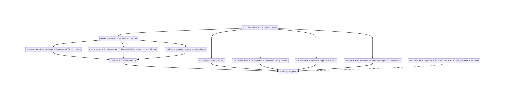
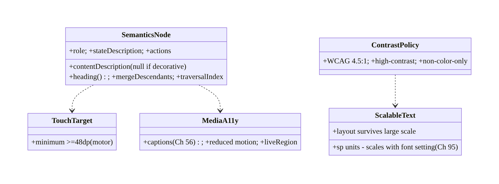
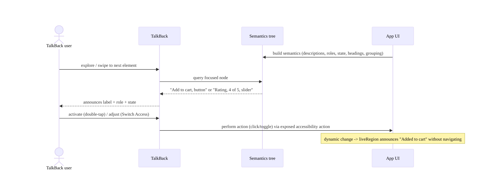
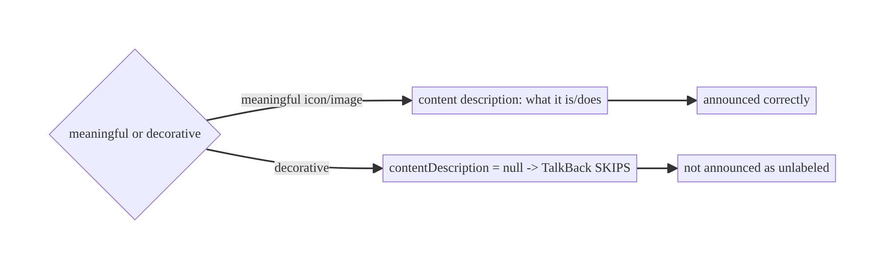
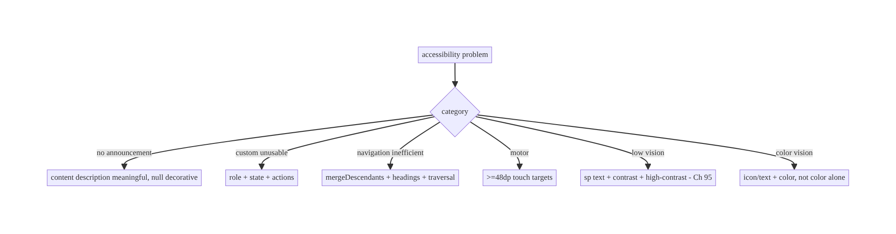

# Chapter 96 — Accessibility Architecture

> **Part XI — Reach, Scale & Platform Breadth** · Complexity: **Standard** (≥25 interview questions)
>
> **Prerequisites:** Ch 2 (Compose UI/semantics), Ch 97 (theming), Ch 95 (localization), Ch 1
> (architecture). Pairs with Ch 90 (rendering), Ch 100 (capstone).
>
> **Reference surface in StreamCart:** making the app usable by **everyone** — including people
> using **TalkBack** (screen reader), **large fonts / display scaling**, **switch access**,
> **high contrast**, and limited motor control — by building a correct **semantics tree**
> (content descriptions, roles, state, headings), **touch-target sizing**, **focus/traversal
> order**, **contrast**, **scalable text (sp)**, and **captions** — because accessibility is a
> **requirement** (legal + ethical + reach), not a nice-to-have, and it's **architected**, not
> bolted on.

---

## 96.1 Problem Definition and Real-World Context

A significant fraction of users rely on **accessibility services** — **TalkBack** (screen reader
for blind/low-vision users), **large fonts / display scaling** (low vision), **Switch Access**
(motor impairments), **high-contrast / color-correction** (color vision), **captions** (deaf/hard-
of-hearing), and reduced-motion settings. An app that ignores them is **unusable** for these users
— and accessibility is increasingly a **legal requirement** (ADA, EN 301 549, Section 508) as well
as an ethical one and a **reach** multiplier. **Accessibility architecture** is the discipline of
building the app so assistive technologies work: a correct **semantics tree** (each element's
**content description**, **role**, **state**, **headings**, grouping) that screen readers consume,
adequate **touch-target sizes** (≥48dp), correct **focus/traversal order**, sufficient **color
contrast**, **scalable text** (`sp`, honoring font-size settings), **captions** for media (Ch 56),
and respect for **reduced motion**. In Compose, much comes **for free** from standard components,
but custom UI and nuance require **explicit semantics** — accessibility is **designed in**, not
retrofitted.

Concretely, teams hit:

- **Missing content descriptions (the #1 a11y bug).** An **icon button**, **image**, or custom
  control with **no content description** is **invisible/opaque** to TalkBack (announces nothing or
  "button"). Every **meaningful** non-text element needs a **content description**; **decorative**
  ones must be **explicitly null** (so they're skipped).
- **Broken semantics on custom UI.** Custom composables/views without **roles/state/semantics** are
  unusable by screen readers (TalkBack can't announce "checkbox, checked" or "tab, selected").
  Custom UI must declare **semantics** (role, state, actions).
- **Tiny touch targets.** Controls smaller than **~48dp** are hard to hit for motor-impaired users
  (and everyone). Ensure **minimum touch-target size** even if the visual is smaller.
- **Wrong focus/traversal order.** TalkBack/Switch Access navigate in a **traversal order**; a
  wrong order (visual ≠ logical) confuses users. Group related content, set **traversal order**,
  mark **headings** for navigation.
- **Insufficient contrast.** Low **text/background contrast** fails low-vision users (and WCAG
  **4.5:1** for normal text). Design and **test** contrast; support **high-contrast** mode.
- **Non-scalable text (`dp` instead of `sp`).** Text sized in **`dp`** **doesn't scale** with the
  user's **font-size** setting; low-vision users can't enlarge it. Use **`sp`** for text and
  **test** at large font scales (don't break layouts).
- **Color-only information.** Conveying state by **color alone** (red = error) fails color-blind
  users. Pair color with **text/icon/shape**.
- **No captions / media accessibility (Ch 56).** Video/audio without **captions** excludes deaf/
  hard-of-hearing users. Provide **captions/subtitles** (Media3, Ch 56).
- **Motion / announcements.** Excessive **animation** can harm (vestibular); honor **reduced
  motion**. **Live region** announcements (e.g., "added to cart") must be announced to TalkBack.
- **Not tested with assistive tech.** Accessibility that isn't **tested** with TalkBack/large
  fonts/Switch Access **regresses** silently. Use **Accessibility Scanner**, **automated a11y
  tests**, and **manual TalkBack** testing.

The architecture: build a correct **semantics tree** — **content descriptions** for meaningful
elements (null for decorative), **roles/state/actions** on custom UI, **headings** and **grouping**
for navigation, correct **focus/traversal order** — ensure **≥48dp touch targets**, sufficient
**contrast** (WCAG, + high-contrast mode), **scalable text** (`sp`, tested at large scales),
**non-color-only** information, **captions** for media (Ch 56), and respect **reduced motion** and
**live-region announcements** — then **test** with TalkBack, large fonts, Switch Access, and the
Accessibility Scanner. This chapter is about **making the app usable by everyone, by design**.

### Three practical use cases

1. **Make StreamCart's catalog TalkBack-usable.** Product images get **content descriptions**
   (name), decorative icons **null**, the add-to-cart **icon button** announces its action, cards
   are **grouped** so TalkBack reads a product as one item — navigable and announced correctly.
2. **Scalable, contrast-correct UI.** Text in **`sp`**, layouts tested at **200%** font scale
   (no truncation, Ch 95), contrast **≥4.5:1**, error state shown by **icon+text** not color
   alone.
3. **Accessible custom rating control.** A custom star-rating composable declares **role =
   Slider/semantics**, current **value/state**, and a **content description** so TalkBack announces
   "rating, 4 of 5 stars" and Switch Access can adjust it.

### Why this is architectural

Accessibility composes UI/semantics (Ch 2), theming/contrast (Ch 97), text scaling/localization
(Ch 95), and media captions (Ch 56). The decisions — semantics tree, touch targets, focus order,
contrast, scalable text, captions, reduced motion — determine whether the app is usable by the
many users relying on assistive technology (and legally compliant), and they must be **designed in**
across the component system, not patched per-screen.

---

## 96.2 Requirements Engineering

### Functional requirements

| ID | Requirement |
|----|-------------|
| F1 | Correct semantics tree: content descriptions (null for decorative), roles, state, headings, grouping. |
| F2 | ≥48dp touch targets; correct focus/traversal order. |
| F3 | Sufficient contrast (WCAG 4.5:1); support high-contrast; non-color-only info. |
| F4 | Scalable text (`sp`), tested at large font scales (Ch 95). |
| F5 | Captions for media (Ch 56); respect reduced motion; live-region announcements. |
| F6 | Test with TalkBack, large fonts, Switch Access, Accessibility Scanner, automated a11y tests. |

### Non-functional requirements

| Attribute | Policy |
|-----------|--------|
| **Usability** | Fully operable via TalkBack/Switch Access. |
| **Inclusivity** | Low-vision, motor, color, hearing supported. |
| **Compliance** | WCAG / legal (ADA, EN 301 549). |
| **Robustness** | Survives large fonts (no truncation, Ch 95). |
| **Tested** | Assistive-tech + automated testing. |

### Scope

- **In scope:** semantics tree (content description, role, state, actions, headings, grouping,
  merge/clear), touch-target sizing (≥48dp), focus/traversal order, contrast (WCAG, high-contrast,
  non-color-only), scalable text (`sp`, large-scale testing, Ch 95), captions/media a11y (Ch 56),
  reduced motion, live-region announcements, testing (TalkBack, Switch Access, large fonts,
  Accessibility Scanner, automated).
- **Out of scope:** Compose UI basics (Ch 2), theming detail (Ch 97), localization detail (Ch 95),
  media playback (Ch 56), rendering (Ch 90).

### Assumptions & constraints

- Compose (semantics modifiers) / Views (accessibility APIs); standard components give much a11y
  **for free**, custom UI needs **explicit** semantics. Text in **`sp`**; targets **≥48dp**;
  contrast **WCAG-compliant**; media **captioned** (Ch 56). Tested with **TalkBack** + large fonts
  + Accessibility Scanner. `minSdk 24`.

---

## 96.3 System Design Fundamentals

- **Assistive technologies to support.** **TalkBack** (screen reader — announces elements, user
  navigates by swipe/explore-by-touch), **large fonts / display size** (system font-scale /
  display-density settings), **Switch Access** (navigate/activate via switches — needs focusable,
  ordered elements), **high-contrast / color inversion / color correction**, **captions**
  (deaf/HoH), **reduced motion** (vestibular), **voice access**. Each imposes requirements; the
  **semantics tree** serves most of them.
- **The semantics tree (the core model).** Beneath the visual UI, Android maintains an
  **accessibility/semantics tree** that assistive services (TalkBack) consume — each node has a
  **content description/label** (what to announce), a **role** (button, checkbox, tab, heading,
  image, slider…), **state** (checked, selected, disabled, expanded), **actions** (click, toggle,
  custom), and structure (**headings**, **grouping/merging**). In **Compose**, you shape this with
  **semantics modifiers** (`contentDescription`, `role`, `stateDescription`, `heading()`,
  `semantics { }`, `mergeDescendants`); in **Views**, with accessibility properties/delegates.
  **Standard components** populate it correctly **for free**; **custom** UI must do it **explicitly**.
- **Content descriptions (meaningful vs decorative).** Every **meaningful** non-text element
  (icon button, informative image) needs a **content description** (what it **is/does**: "Add to
  cart", not "icon"). **Decorative** elements (a background flourish) must be **explicitly null**
  (`contentDescription = null`) so TalkBack **skips** them (not announce "unlabeled"). Text is
  announced automatically. Keep descriptions **concise and meaningful** (action/identity, not
  visual detail).
- **Roles, state, and actions.** TalkBack announces an element's **role** ("button", "checkbox")
  and **state** ("checked", "selected", "disabled") so users know what it is and its status. Custom
  controls must declare **`role`** and **`stateDescription`**/state, and expose **actions**
  (click/toggle/custom accessibility actions) so Switch Access/TalkBack can **operate** them. A
  custom toggle without role/state is just "button" with no indication of on/off.
- **Headings, grouping, traversal order.** **Headings** (`semantics { heading() }`) let TalkBack
  users **jump** between sections. **Grouping/merging** (`mergeDescendants = true`) makes a card
  announce as **one** item (name + price + rating together) instead of three separate swipes.
  **Traversal order** should match the **logical** reading order (usually visual); override it
  (`traversalIndex`/`isTraversalGroup`) when the visual and logical orders diverge. Good structure
  makes navigation **efficient**.
- **Touch targets (≥48dp).** Interactive elements need a **minimum touch target** of **~48dp**
  (Material guidance) even if the **visual** is smaller — critical for **motor-impaired** users
  (and usability generally). Compose: `Modifier.minimumInteractiveComponentSize()` / size the
  touch area; don't ship 24dp tap targets.
- **Contrast & non-color-only (color vision).** Text/background **contrast** must meet **WCAG**
  (**4.5:1** normal text, **3:1** large) for low-vision/aging users; support **high-contrast** mode.
  And **never convey information by color alone** (red = error) — pair with **text/icon/shape**
  (an error icon + message), so **color-blind** users get the information. Design the component
  system for contrast + redundant cues.
- **Scalable text (`sp`) + large-font resilience (Ch 95).** Size **text in `sp`** (scales with the
  user's **font-size** setting), **not `dp`** (fixed). Low-vision users may set **large** fonts;
  layouts must **survive** (no truncation/overlap) — the same **flexible-layout** discipline as
  localization expansion (Ch 95). **Test** at **large font scales** (up to 200%). Non-text sizes
  (icons, targets) use `dp`.
- **Captions, reduced motion, live regions.** **Media** needs **captions/subtitles** (Media3,
  Ch 56) for deaf/HoH users. Honor **reduced motion** (disable/soften non-essential animation for
  vestibular sensitivity). Use **live regions** (`liveRegion` semantics) for dynamic updates
  ("added to cart", "error") so TalkBack **announces** them without the user navigating there.
- **Testing accessibility (don't ship untested).** Use the **Accessibility Scanner** (flags missing
  labels, small targets, low contrast), **automated a11y tests** (Compose
  `assertContentDescriptionEquals`, Espresso accessibility checks), and **manual testing** with
  **TalkBack**, **large fonts**, and **Switch Access**. Accessibility **regresses silently** without
  testing — bake checks into **CI** and QA.

Core insight: **make the app usable by everyone by architecting the accessibility semantics tree
that assistive technologies consume — give every meaningful non-text element a concise content
description (what it is or does) and mark decorative ones explicitly null so TalkBack skips them,
declare role, state, and actions on all custom controls (a custom toggle without them is just an
unlabeled 'button') so screen readers announce 'checkbox, checked' and Switch Access can operate
it, and structure the tree with headings, grouping/merging (so a product card reads as one item),
and a logical traversal order; ensure interactive elements have at least ~48dp touch targets for
motor-impaired users, meet WCAG contrast (4.5:1) with a high-contrast mode and never convey
information by color alone (pair it with text/icon/shape for color-blind users), size text in sp so
it scales with the font-size setting and test layouts at large scales without truncation (the same
flexible-layout discipline as localization expansion, Ch 95), caption media (Ch 56), honor reduced
motion, and announce dynamic changes via live regions; standard Compose/View components populate the
semantics tree correctly for free, but custom UI must declare it explicitly — and because
accessibility regresses silently, test it with TalkBack, large fonts, Switch Access, the
Accessibility Scanner, and automated a11y checks in CI — since accessibility is a legal, ethical,
and reach requirement designed in across the component system, not bolted on per screen.**

---

## 96.4 High-Level Architecture



**Components & ownership**

- **Semantics tree** (content descriptions, roles/state/actions, headings/grouping/order) — serves
  screen readers/Switch Access.
- **Touch targets** (≥48dp, motor), **contrast + non-color-only** (vision), **scalable text** (sp,
  Ch 95).
- **Captions** (Ch 56), **reduced motion**, **live regions**.
- **Testing** (TalkBack, large fonts, Switch Access, Scanner, automated).

**Direction:** UI → correct semantics tree (descriptions/roles/state/structure) + targets +
contrast + scalable text + media a11y → usable by everyone; tested with assistive tech.

---

## 96.5 Detailed Component Design



| Component | Responsibility |
|-----------|----------------|
| `SemanticsNode` | description/role/state/actions/headings/grouping/order (TalkBack/Switch) |
| `TouchTarget` | ≥48dp interactive targets (motor) |
| `ContrastPolicy` | WCAG contrast + high-contrast + non-color-only (vision) |
| `ScalableText` | `sp` text, large-scale-resilient layouts (Ch 95) |
| `MediaA11y` | captions (Ch 56), reduced motion, live-region announcements |

---

## 96.6 End-to-End Data Flow

### TalkBack reads the semantics tree



### Decorative vs meaningful (content description)



---

## 96.7 Implementation (Compose + Kotlin)

Package: `com.streamcart.a11y`.

### 96.7.1 Content descriptions (meaningful vs decorative)

```kotlin
// Meaningful image/icon-button: describe what it IS / DOES
AsyncImage(model = product.imageUrl, contentDescription = product.name)       // announced (Ch 59)
IconButton(onClick = onAddToCart) {
    Icon(Icons.Default.AddShoppingCart, contentDescription = stringResource(R.string.add_to_cart))  // action
}
// Decorative element: explicitly NULL so TalkBack skips it (not "unlabeled image")
Icon(Icons.Default.Star, contentDescription = null, modifier = Modifier.background(...))  // decorative
```

### 96.7.2 Grouping + headings + traversal (navigation)

```kotlin
@Composable
fun ProductCard(product: ProductUi, onClick: () -> Unit) {
    // Merge: TalkBack reads the whole card as ONE item (name + price + rating), not three swipes
    Card(Modifier
        .clickable(onClick = onClick)
        .semantics(mergeDescendants = true) { /* contentDescription auto-composed from children */ }) {
        Text(product.title)
        Text(product.price)
        Text("Rated ${product.rating} of 5")
    }
}
// Section titles as headings so TalkBack users can jump between them:
Text("Recommended", modifier = Modifier.semantics { heading() })
```

### 96.7.3 Custom control: role + state + actions

```kotlin
@Composable
fun StarRating(rating: Int, max: Int = 5, onRate: (Int) -> Unit) {
    Row(Modifier.semantics {
        // Custom control MUST declare role + state + an action, else TalkBack can't announce/operate it
        role = Role.Button
        stateDescription = "$rating of $max stars"                        // announced state
        contentDescription = "Rating"
        // expose an action so Switch Access / TalkBack can adjust it
        setProgress { target -> onRate(target.toInt().coerceIn(1, max)); true }
    }) {
        repeat(max) { i -> Icon(if (i < rating) Icons.Filled.Star else Icons.Outlined.Star,
            contentDescription = null, Modifier.clickable { onRate(i + 1) }) }  // children decorative (merged)
    }
}
```

### 96.7.4 Touch targets, scalable text, non-color-only

```kotlin
// >=48dp touch target even if the visual icon is smaller (motor accessibility)
IconButton(onClick = onClose, modifier = Modifier.minimumInteractiveComponentSize()) {  // ensures >=48dp
    Icon(Icons.Default.Close, contentDescription = stringResource(R.string.close))
}
// Text in sp (scales with font setting, Ch 95); layout must survive large scale (no fixed height)
Text(product.title, fontSize = 16.sp)                                     // sp, NOT dp
// Non-color-only: error shows ICON + TEXT, not just red
Row { Icon(Icons.Default.Error, contentDescription = null); Text(stringResource(R.string.payment_failed)) }
```

### 96.7.5 Live-region announcement + reduced motion

```kotlin
// Live region: announce dynamic change WITHOUT the user navigating to it
var cartMessage by remember { mutableStateOf("") }
Text(cartMessage, modifier = Modifier.semantics { liveRegion = LiveRegionMode.Polite })  // TalkBack announces
// on add-to-cart: cartMessage = "Added ${product.name} to cart"   (Ch 95 parameterized)

// Reduced motion: soften/disable non-essential animation if the user requested it
val reduceMotion = LocalAccessibilityManager.current?.let { /* check setting */ } ?: false
val animSpec = if (reduceMotion) snap() else spring()                     // respect reduced motion
```

### 96.7.6 Module structure

```
:core:designsystem  accessible components (targets >=48dp, contrast, roles/state baked in)
# Semantics -> Compose semantics modifiers; scalable text -> sp (Ch 95); captions -> Media3 (Ch 56);
# contrast/high-contrast -> theming (Ch 97); test -> Accessibility Scanner + TalkBack + automated.
```

---

## 96.8 Concurrency and Race Conditions

> Accessibility is a **UI-correctness** concern; the pitfalls are **semantics-correctness** ones:

| Scenario | Risk | Handling |
|----------|------|----------|
| Missing content description | element invisible to TalkBack | describe meaningful; null decorative |
| Custom control no role/state | unusable by screen reader | declare role + state + actions |
| Ungrouped card | 3 swipes per item | mergeDescendants |
| Small touch target | motor users can't hit | ≥48dp |
| dp text | doesn't scale | sp + large-scale test (Ch 95) |
| Color-only state | color-blind miss it | icon/text + color |
| Dynamic change silent | TalkBack unaware | liveRegion announcement |
| Untested a11y | silent regression | TalkBack + Scanner + automated CI |

- **Standard components give a11y for free; custom UI is where bugs live:** a `Button`/`Checkbox`
  announces correctly out of the box, but a **custom** star-rating/toggle/chip needs **explicit**
  role/state/actions — audit custom composables specifically.
- **Grouping is about navigation efficiency:** without `mergeDescendants`, a TalkBack user swipes
  through **every** child; merging makes a card **one** stop — a large usability win on lists
  (Ch 93).
- **Accessibility and localization share the flexible-layout discipline (Ch 95):** large fonts
  (a11y) and long translations (l10n) both demand **non-fixed** layouts that don't truncate — test
  both.

---

## 96.9 Failure Scenarios and Recovery

| Failure | Detection | Response | Outcome |
|---------|-----------|----------|---------|
| Icon button announces nothing | TalkBack / Scanner | add content description | announced |
| Custom control unusable | TalkBack | role + state + actions | operable |
| Card read as 3 items | TalkBack | mergeDescendants | one item |
| Small target unhittable | Scanner | ≥48dp | hittable |
| Text won't enlarge | large-font test | sp + flexible layout (Ch 95) | scales |
| Color-blind miss error | contrast/color QA | icon+text (non-color-only) | perceivable |
| Dynamic update missed | TalkBack | liveRegion | announced |
| Low contrast | Scanner / contrast check | WCAG contrast + high-contrast | readable |



> **Build the semantics tree, size targets, meet contrast, scale text — and test with assistive
> tech.** Accessibility failures are missing descriptions (describe meaningful, null decorative),
> custom controls without role/state (declare them), inefficient navigation (group + headings),
> small targets (≥48dp), non-scalable text (sp + flexible layouts, Ch 95), and color-only info
> (add icon/text). Standard components help; custom UI needs explicit semantics; test with
> TalkBack + Scanner + automated CI — accessibility regresses silently.

---

## 96.10 Scaling the Implementation

- **Level 1.** Content descriptions on all meaningful elements (null decorative); `sp` text; ≥48dp
  targets; Accessibility Scanner pass.
- **Level 2.** Roles/state/actions on custom controls; grouping + headings; contrast (WCAG) +
  non-color-only; TalkBack manual testing.
- **Level 3 — production.** Accessible **design system** (Ch 97 — targets/contrast/semantics baked
  into components); captions (Ch 56); live regions; reduced motion; large-font resilience (Ch 95).
- **Level 4 — org.** Automated a11y tests in CI; a11y acceptance criteria per feature; Switch Access
  + high-contrast coverage; a11y linting; periodic audits.
- **Level 5 — enterprise.** Accessibility SLOs/compliance (WCAG/EN 301 549/ADA), a11y champions per
  team, user testing with disabled users, VPAT/compliance reporting, continuous a11y regression
  gates.

**Avoid overengineering:** content descriptions + roles/state on custom UI + ≥48dp + contrast +
`sp` + grouping, baked into the design system and tested with TalkBack/Scanner, covers most needs.
Don't skip custom-control semantics; don't ship untested; don't convey by color alone; don't use
`dp` for text.

---

## 96.11 Alternative Approaches and Trade-offs

| Dimension | Option A | Option B | When |
|-----------|----------|----------|------|
| Semantics | Explicit on custom UI | rely on defaults | Explicit for custom controls |
| Decorative images | `contentDescription = null` | omit / describe | null (skip cleanly) |
| Grouping | mergeDescendants | per-child | Merge for cards/items |
| Text units | `sp` (scalable) | `dp` (fixed) | sp for text |
| State signal | Icon/text + color | color only | Non-color-only |
| Targets | ≥48dp | visual size | ≥48dp (motor) |
| Where | Design-system baked | per-screen patches | Design system |

**Design-system-baked a11y vs per-screen patches:** patching accessibility **per screen** is
error-prone and regresses. Baking **touch targets, contrast, roles/state, and semantics** into the
**design-system components** (Ch 97) makes every screen accessible **by default** — the scalable
approach. Architect accessibility into the **component system**.

**Explicit semantics vs defaults:** **standard** components (`Button`, `Checkbox`) are accessible
by **default** — use them where possible. **Custom** UI needs **explicit** role/state/actions/
descriptions, because the framework can't infer them. Prefer standard components; when custom,
**declare semantics explicitly**.

**`sp` vs `dp` for text:** **`dp`** text **ignores** the user's font-size setting — low-vision
users can't enlarge it. **`sp`** scales with the setting. Always use **`sp`** for text (and test at
large scales, Ch 95); use `dp` for non-text dimensions.

---

## 96.12 Security & Privacy Considerations

- **Accessibility services are powerful (user trust):** TalkBack and other a11y services can
  **read screen content** — so **sensitive screens** (payments Ch 76, auth Ch 20) must still
  present content **correctly** to legitimate assistive tech while respecting **`FLAG_SECURE`** and
  not **leaking** secrets in content descriptions (don't put a full card number in a label).
- **Don't put secrets in content descriptions (Ch 28):** a content description is **announced/
  readable** — never embed tokens, full card numbers, or PII beyond what the UI shows (Ch 76/28).
- **Malicious accessibility services (threat model):** Android warns that a11y services are
  powerful; apps can't fully prevent a user-granted a11y service from reading the screen, but
  should **minimize sensitive exposure** and use secure surfaces where required (Ch 76).
- **Captions/transcripts are content (Ch 56/28):** media captions may contain sensitive content —
  handle per privacy (Ch 28).
- **Accessible ≠ less secure:** making UI accessible (labels, roles) must **not** weaken security
  (e.g., don't disable `FLAG_SECURE` for a11y) — provide accessible **and** secure.
- Client concern mostly: the privacy note is **no secrets in announced content**; the security note
  is **secure surfaces + a11y coexist** (Ch 76/20).

---

## 96.13 Performance and Resource Optimization

- **Semantics are cheap but not free** — overly deep/complex semantics trees cost; **merge**
  decorative children, keep the tree **meaningful** (not one node per pixel).
- **Don't over-announce** — excessive live regions/announcements overwhelm TalkBack users; announce
  **meaningful** changes only.
- **Scalable text + flexible layouts** (Ch 95) — the same discipline serves a11y (large fonts) and
  l10n (expansion); build it once.
- **Reduced motion saves work too** — honoring it can **reduce** animation cost.
- **Accessibility Scanner / automated checks** are cheap to run in CI — catch regressions early.
- **Profiling:** semantics-tree size/depth, announcement frequency, large-font layout performance
  (Ch 90/95), Scanner issue count, automated a11y-test coverage.

---

## 96.14 Testing Strategy

Accessibility is testable automatically (semantics assertions, Scanner) and manually (TalkBack,
Switch Access, large fonts).

```kotlin
class AccessibilityTest {
    @get:Rule val compose = createComposeRule()
    @Test fun `add to cart button has content description`() {
        compose.setContent { ProductCard(sampleProduct, onClick = {}) }
        compose.onNodeWithContentDescription("Add to cart").assertExists()   // announced
    }
    @Test fun `custom rating exposes role and state`() {
        compose.setContent { StarRating(rating = 4) {} }
        compose.onNode(hasStateDescription("4 of 5 stars")).assertExists()    // role+state declared
    }
    @Test fun `decorative icon is not in a11y tree`() { /* contentDescription = null -> skipped */ }
}
// Automated: Espresso AccessibilityChecks / Compose semantics assertions in CI.
// Manual (required): TalkBack walkthrough, Switch Access, large font (200%, Ch 95), Accessibility Scanner.
// Contrast: automated contrast check / Scanner; non-color-only: manual/color-blind simulation.
```

What to test: content descriptions present (meaningful) / absent (decorative); custom controls
expose role+state+actions; grouping/headings/traversal; ≥48dp targets; contrast (WCAG) +
non-color-only; `sp` text + large-font layout (Ch 95); live-region announcements; captions (Ch 56).
Automated (semantics assertions, AccessibilityChecks, Scanner in CI) + **manual TalkBack/Switch
Access/large-font**.

---

## 96.15 Production Observability

- **Metrics:** **Accessibility Scanner** issue count (missing labels, small targets, contrast),
  automated a11y-test coverage/pass rate, **a11y-service usage** (how many users have TalkBack/large
  fonts enabled — where available), large-font-related layout issues, a11y-specific crash/error
  (Ch 83).
- **Logs:** a11y-related errors — PII-safe (no announced content with secrets, Ch 28).
- **Debugging:** element not announced → missing content description; custom control unusable →
  missing role/state; navigation inefficient → no grouping/headings; truncation at large font →
  fixed layout (Ch 95); color-blind complaint → color-only info.
- **Alerting:** a11y-test regression in CI (new Scanner issues, failed semantics assertions);
  large-font crash spike (Ch 83).
- **Dashboards:** Scanner issues per release, a11y-test coverage, a11y-service adoption, large-font
  issue trend.

---

## 96.16 System Design Interview Preparation

> ≥25 questions.

**Fundamentals**

1. *Why accessibility?* Usable by all; legal + ethical + reach.
2. *Assistive tech?* TalkBack, large fonts, Switch Access, high-contrast, captions.
3. *Semantics tree?* What assistive services consume (label/role/state/structure).
4. *#1 a11y bug?* Missing content descriptions.
5. *Standard vs custom?* Standard free; custom needs explicit semantics.

**Semantics**

6. *Content description?* What a meaningful element is/does.
7. *Decorative?* `contentDescription = null` → skipped.
8. *Role/state?* Announce "checkbox, checked" etc.
9. *Custom control?* Declare role + state + actions.
10. *Headings?* Let TalkBack jump between sections.
11. *Grouping?* mergeDescendants → one item not many swipes.
12. *Traversal order?* Match logical/visual order.

**Perception/motor**

13. *Touch target?* ≥48dp (motor).
14. *Contrast?* WCAG 4.5:1 + high-contrast.
15. *Color-only?* Never — add icon/text.
16. *Scalable text?* `sp`, test large fonts.
17. *dp text?* Doesn't scale — avoid.

**Media/motion**

18. *Captions?* Media3 for deaf/HoH (Ch 56).
19. *Reduced motion?* Honor the setting.
20. *Live region?* Announce dynamic changes.

**Testing**

21. *Tools?* Accessibility Scanner, TalkBack, Switch Access.
22. *Automated?* Semantics assertions / AccessibilityChecks.
23. *Why test?* Regresses silently.

**Architecture/production**

24. *Where to bake a11y?* Design system (Ch 97).
25. *Sensitive content?* No secrets in descriptions (Ch 28/76).
26. *Large font + l10n?* Shared flexible-layout discipline (Ch 95).

### Design-change challenges
1. **Make an icon-only toolbar TalkBack-usable.** Content descriptions + ≥48dp.
2. **Make a custom toggle accessible.** Role + state + action.
3. **Support large fonts.** sp + flexible layouts (Ch 95).
4. **Fix color-only error states.** Icon+text + contrast.
5. **Bake a11y into the design system.** Accessible components (Ch 97) + CI a11y tests.

### Mock walkthrough (abridged)
Clarify (which assistive tech, custom UI?, compliance target?) → semantics tree (descriptions/
roles/state/actions/headings/grouping/order) → touch targets ≥48dp → contrast WCAG + non-color-only
→ scalable text sp + large-font resilience (Ch 95) → captions (Ch 56) + reduced motion + live
regions → bake into design system (Ch 97) → test (TalkBack + Switch Access + large fonts + Scanner
+ automated CI) → observability (Scanner issues/coverage).

---

## 96.17 Practical Exercises

1. **Beginner.** Add content descriptions to all meaningful icons/images (null for decorative) and
   ensure ≥48dp touch targets; pass the Accessibility Scanner. *Eval:* TalkBack announces; no small
   targets.
2. **Intermediate.** Make a custom control (star rating/toggle) accessible with role + state +
   actions, and group a product card with `mergeDescendants` + a heading. *Eval:* custom control
   operable; card is one item.
3. **Advanced.** Convert text to `sp` and make layouts survive 200% font scale (Ch 95); add a
   live-region "added to cart" announcement and reduced-motion handling. *Eval:* scales; announced;
   motion respected.
4. **Production debugging.** Use TalkBack + Scanner to find an unannounced custom control and a
   color-only error; fix both. *Eval:* operable; non-color-only.
5. **System design challenge.** Design an accessible design system (Ch 97) with targets/contrast/
   semantics baked in + automated a11y CI gates. *Eval:* accessible by default; regressions gated.

*(Solutions withheld unless requested.)*

---

## 96.18 Chapter Summary & Reference Sheet

**Key decisions:** make the app usable by everyone by **architecting the accessibility semantics
tree** that assistive technologies consume — give every **meaningful** non-text element a concise
**content description** (what it **is/does**) and mark **decorative** ones **explicitly null** so
TalkBack skips them; declare **role, state, and actions** on **all custom controls** (a custom
toggle without them is just an unlabeled "button") so screen readers announce "checkbox, checked"
and Switch Access can operate it; structure the tree with **headings**, **grouping/merging** (so a
product card reads as **one** item), and a logical **traversal order**; ensure interactive elements
have **≥48dp touch targets** for motor-impaired users, meet **WCAG contrast** (**4.5:1**) with a
**high-contrast** mode and **never convey information by color alone** (pair with text/icon/shape
for color-blind users); size text in **`sp`** so it **scales** with the font-size setting and test
layouts at **large scales** without truncation (the same **flexible-layout** discipline as
localization expansion, Ch 95); **caption** media (Ch 56), honor **reduced motion**, and announce
dynamic changes via **live regions**; **standard** components populate the semantics tree **for
free** while **custom** UI must declare it **explicitly**; and because accessibility **regresses
silently**, **test** with **TalkBack, large fonts, Switch Access, the Accessibility Scanner, and
automated a11y checks in CI** — since accessibility is a **legal, ethical, and reach requirement**
designed into the **component system** (Ch 97), not bolted on per screen.

**Concepts:** assistive technologies (TalkBack/large fonts/Switch Access/high-contrast/captions),
semantics tree (content description, role, state, actions, headings, grouping/merge, traversal
order), touch targets (≥48dp), contrast (WCAG, high-contrast, non-color-only), scalable text (`sp`,
large-scale resilience, Ch 95), captions (Ch 56), reduced motion, live regions, testing (TalkBack/
Scanner/automated), design-system-baked a11y (Ch 97).

**Common mistakes:** missing content descriptions (or describing decorative elements); custom
controls without role/state/actions; ungrouped cards (per-child swipes); small touch targets; `dp`
text (doesn't scale); color-only information; no captions (Ch 56); ignoring reduced motion; silent
dynamic changes (no live region); shipping untested with assistive tech; patching per-screen
instead of design-system.

**Checklist:**

- [ ] content descriptions (meaningful; null for decorative)
- [ ] role + state + actions on custom controls
- [ ] headings + grouping (mergeDescendants) + traversal order
- [ ] ≥48dp touch targets
- [ ] WCAG contrast + high-contrast + non-color-only
- [ ] `sp` text + large-font layout resilience (Ch 95)
- [ ] captions (Ch 56) + reduced motion + live regions
- [ ] a11y baked into design system (Ch 97)
- [ ] no secrets in content descriptions (Ch 28/76)
- [ ] test: TalkBack + Switch Access + large fonts + Scanner + automated CI.

**Key APIs:** Compose `Modifier.semantics { }` (`contentDescription`, `role`, `stateDescription`,
`heading()`, `liveRegion`, custom actions like `setProgress`), `mergeDescendants`, `traversalIndex`/
`isTraversalGroup`, `Modifier.minimumInteractiveComponentSize()` (≥48dp), `Icons.AutoMirrored`
(Ch 95), `sp` text units, `LiveRegionMode`, View `contentDescription`/`AccessibilityDelegate`,
Media3 captions (Ch 56), Accessibility Scanner, Espresso `AccessibilityChecks`, Compose
`onNodeWithContentDescription`/`hasStateDescription`.

**References:**
- Accessibility overview: https://developer.android.com/guide/topics/ui/accessibility
- Compose accessibility: https://developer.android.com/develop/ui/compose/accessibility
- Material accessibility (touch targets/contrast): https://m3.material.io/foundations/accessible-design
- WCAG / EN 301 549 (contrast, success criteria): https://www.w3.org/WAI/standards-guidelines/wcag/
- (composes) Ch 2 Compose/Semantics, Ch 97 Theming/Design System, Ch 95 Localization/Scaling, Ch 56 Media/Captions, Ch 76 Payments/Secure, Ch 28 Privacy

### Chapter review (Phase 4)
- **Completeness:** all 18 sections; architecture/class/sequence/decorative/failure diagrams;
  content-description + grouping + custom-control + targets/sp/non-color + live-region code;
  concurrency (standard-vs-custom, grouping navigation, shared-with-l10n); failure (semantics+targets+
  contrast+test principle); 5 levels; design-system-baked, explicit-vs-default, sp-vs-dp trade-offs;
  security (no secrets in descriptions, secure+accessible); perf (semantics-tree size, don't
  over-announce); semantics-assertion + Scanner + manual tests; observability (Scanner/coverage); 26
  Q&A + 5 challenges. ✅
- **Expand later:** Compose/semantics (Ch 2), design system (Ch 97), localization/scaling (Ch 95),
  captions (Ch 56).
- **Interview coverage:** exceeds ≥25 bar.
