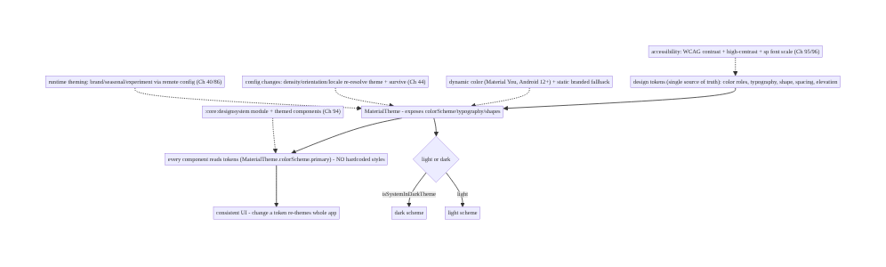
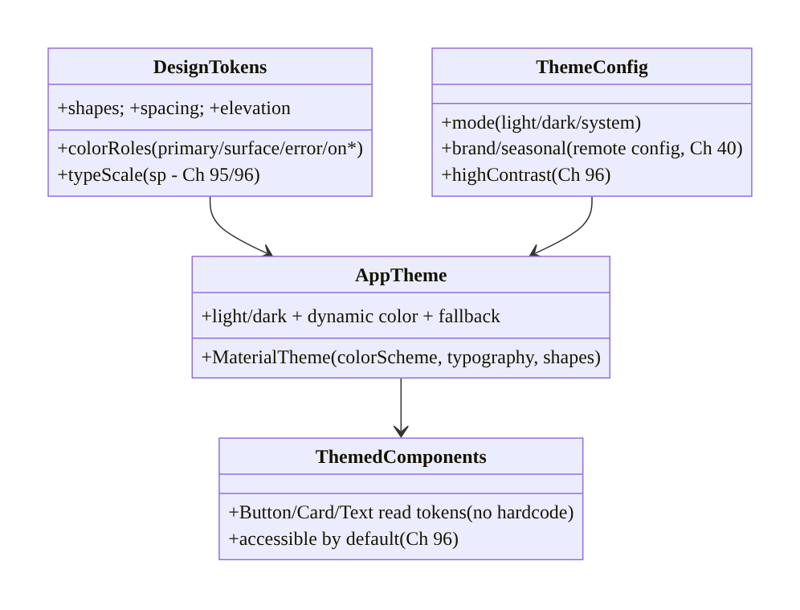
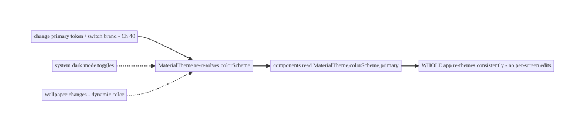
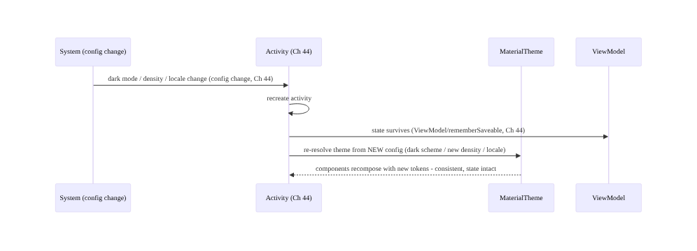
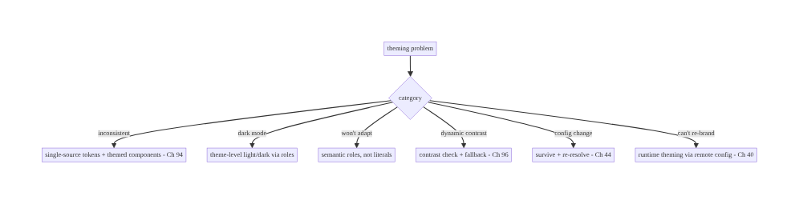

# Chapter 97 — Theming & Dynamic Configuration

> **Part XI — Reach, Scale & Platform Breadth** · Complexity: **Standard** (≥25 interview questions)
>
> **Prerequisites:** Ch 2 (Compose UI), Ch 44 (config changes), Ch 96 (accessibility), Ch 95
> (localization), Ch 40 (remote config). Pairs with Ch 94 (modularization), Ch 100 (capstone).
>
> **Reference surface in StreamCart:** a coherent **design system / theme** — centralized
> **color, typography, shape, spacing** tokens (Material 3) that drive **every** component — with
> **dark/light mode**, **dynamic color** (Material You), **contrast/accessibility** (Ch 96),
> **density/font-scale** resilience (Ch 95/96/44), and **runtime-configurable** theming (brand/
> seasonal/experiment-driven, Ch 40) — so the UI is **consistent, adaptable, and themeable** from
> one source of truth instead of hardcoded styles scattered per screen.

---

## 97.1 Problem Definition and Real-World Context

A large app's UI must be **consistent** (every button, card, text looks right), **adaptable**
(dark/light, dynamic color, large fonts, RTL, Ch 95/96), and **themeable** (brand variants,
seasonal skins, A/B-tested styles, Ch 40/86) — and this is **impossible** if styles are
**hardcoded** per screen (colors as hex literals, fixed text sizes, ad-hoc spacing). **Theming &
dynamic configuration** is the discipline of a **design system**: a **single source of truth** of
**design tokens** — **color**, **typography**, **shape**, **spacing/elevation** — exposed through a
**theme** (Material 3 `MaterialTheme`) that **every** component reads, so changing a token updates
the **whole** app consistently. On top of that: **dark/light** theming, **dynamic color**
(Material You — theme from the wallpaper), **accessibility** integration (contrast, Ch 96; font
scale, Ch 95/96), **configuration resilience** (density, orientation, locale — all **config
changes**, Ch 44), and **runtime theming** (brand/experiment-driven via remote config, Ch 40).
Without a design system, the UI is **inconsistent**, **un-themeable**, and **hard to adapt**.

Concretely, teams hit:

- **Hardcoded styles (the #1 theming failure).** Hex colors, fixed `sp`/`dp` sizes, and ad-hoc
  spacing **scattered** across screens → inconsistency, no dark mode, no re-theming. **Fix:**
  centralize into **design tokens** (a theme) that components **reference** (`MaterialTheme.colorScheme.
  primary`, not `Color(0xFF...)`).
- **No dark mode / per-screen dark hacks.** Bolting dark mode on per-screen (if/else colors) is
  unmaintainable. A **theme with light + dark color schemes** switches **everything** at once;
  components just read **semantic** colors (`surface`, `onSurface`).
- **Semantic vs literal colors.** Using **literal** colors (`Red`) instead of **semantic/role**
  colors (`error`, `primary`, `onPrimary`) breaks theming — the same literal can't adapt to dark/
  dynamic/brand. Use **role-based** tokens.
- **Dynamic color (Material You).** Android 12+ can theme the app from the user's **wallpaper**
  (dynamic color). Supporting it requires reading the **dynamic color scheme** (with a static
  fallback for older/opted-out) — and ensuring **contrast/branding** still work (Ch 96).
- **Config changes mishandled (Ch 44).** **Theme/mode/density/locale/orientation** changes are
  **configuration changes** (Ch 44) — the activity recreates and the theme re-resolves. State must
  survive (Ch 44); theme must **re-read** correctly.
- **Accessibility integration (Ch 96/95).** The theme must support **contrast** (WCAG, Ch 96),
  **high-contrast** mode, and **font scaling** (`sp`, Ch 95/96) — layouts must survive **large
  fonts** and **large display density**. Theming and accessibility are intertwined.
- **No runtime/brand theming.** White-label apps, seasonal skins, or **experiment-driven** themes
  (Ch 86) need the theme to be **configurable at runtime** (from remote config, Ch 40) — not
  baked in. The token layer enables this.
- **Inconsistent components.** Without a shared **component library** built on the theme, teams
  rebuild buttons/cards with slightly different styles. A **design-system module** (Ch 94) with
  **themed components** ensures consistency.

The architecture: a **design system** with a **single source of truth of design tokens** — **color**
(semantic/role-based: primary, surface, error, on*), **typography** (type scale), **shape**,
**spacing/elevation** — exposed via a **theme** (`MaterialTheme`) that **every component reads**
(no hardcoded styles), supporting **light/dark** schemes, **dynamic color** (Material You, with
fallback), **accessibility** (contrast + font scale + high-contrast, Ch 95/96), **config-change
resilience** (density/orientation/locale, Ch 44), and **runtime theming** (brand/seasonal/
experiment via remote config, Ch 40) — packaged as a **`:core:designsystem`** module (Ch 94) with
**themed components**. This chapter is about **a consistent, adaptable, themeable UI from one
source of truth**.

### Three practical use cases

1. **StreamCart design system.** All color/type/shape/spacing as **tokens** in `:core:designsystem`
   (Ch 94); every screen uses `MaterialTheme.colorScheme`/`typography` — changing the brand color
   re-themes the whole app; dark mode works everywhere automatically.
2. **Dynamic color + dark mode.** On Android 12+, the app themes from the user's **wallpaper**
   (Material You) with a **branded static fallback**; dark/light follows the system; contrast stays
   WCAG-compliant (Ch 96).
3. **Runtime brand/seasonal theme (Ch 40/86).** A seasonal skin or an **A/B-tested** color scheme
   (Ch 86) is pushed via **remote config** (Ch 40) and applied at runtime — because theming is
   **token-driven**, not hardcoded.

### Why this is architectural

Theming composes UI (Ch 2), config changes (Ch 44), accessibility (Ch 96), localization/scaling
(Ch 95), modularization (`:core:designsystem`, Ch 94), and remote config (Ch 40/86). The decisions
— centralized semantic tokens, theme-driven components, dark/dynamic color, accessibility + config
resilience, runtime theming — determine whether the UI is consistent, adaptable, and themeable, or
a scattered mess of hardcoded styles.

---

## 97.2 Requirements Engineering

### Functional requirements

| ID | Requirement |
|----|-------------|
| F1 | Single source of truth of design tokens (color/typography/shape/spacing) via a theme. |
| F2 | Every component reads semantic/role-based tokens; no hardcoded styles. |
| F3 | Light/dark schemes + dynamic color (Material You) with static fallback. |
| F4 | Integrate accessibility: contrast (WCAG), high-contrast, font scale (`sp`) (Ch 95/96). |
| F5 | Survive config changes (theme/density/orientation/locale) (Ch 44). |
| F6 | Runtime theming (brand/seasonal/experiment) via remote config (Ch 40/86); packaged as `:core:designsystem` (Ch 94). |

### Non-functional requirements

| Attribute | Policy |
|-----------|--------|
| **Consistency** | One token source drives all components. |
| **Adaptability** | Dark/dynamic/contrast/font-scale/RTL (Ch 95/96). |
| **Themeability** | Runtime-configurable (Ch 40). |
| **Resilience** | Survives config changes (Ch 44). |
| **Reuse** | Design-system module + themed components (Ch 94). |

### Scope

- **In scope:** design tokens (color/typography/shape/spacing/elevation), semantic/role-based color,
  theme (`MaterialTheme`) as single source of truth, light/dark, dynamic color (Material You +
  fallback), accessibility integration (contrast/high-contrast/font scale, Ch 95/96), config-change
  resilience (density/orientation/locale, Ch 44), runtime theming (remote config, Ch 40/86), design-
  system module + themed components (Ch 94).
- **Out of scope:** Compose UI basics (Ch 2), config-change mechanics (Ch 44), accessibility detail
  (Ch 96), localization detail (Ch 95), modularization detail (Ch 94), remote config detail (Ch 40).

### Assumptions & constraints

- Compose + **Material 3** (`MaterialTheme`, `colorScheme`, `typography`, `shapes`); design tokens
  **centralized** in `:core:designsystem` (Ch 94); **semantic** colors; **dynamic color** (Android
  12+) with fallback; accessibility (contrast + `sp`, Ch 95/96); config changes handled (Ch 44);
  runtime theming via remote config (Ch 40). `minSdk 24`.

---

## 97.3 System Design Fundamentals

- **Design tokens as a single source of truth.** A **design system** centralizes **design tokens**
  — the **named, semantic values** for **color**, **typography** (type scale: display/headline/
  title/body/label), **shape** (corner radii), **spacing** (a spacing scale), and **elevation**.
  **Every** component **reads** tokens (never hardcodes) — so changing a token (e.g., primary color)
  **updates the whole app consistently**. This is the foundation: **tokens → theme → components**.
- **The theme (`MaterialTheme`) exposes tokens.** In Compose **Material 3**, **`MaterialTheme`**
  provides `colorScheme`, `typography`, and `shapes`; components read
  `MaterialTheme.colorScheme.primary`, `MaterialTheme.typography.bodyLarge`,
  `MaterialTheme.shapes.medium`. Wrapping the app in **one** `MaterialTheme` (with your tokens)
  means a token change propagates **everywhere**. This is the **injection point** for dark mode,
  dynamic color, and runtime theming.
- **Semantic / role-based color (not literal).** Material 3 colors are **roles**, not literal hues:
  **`primary`/`onPrimary`**, **`surface`/`onSurface`**, **`error`/`onError`**, `secondary`,
  `background`, etc. Components use the **role** (`error` for errors), so the **same component**
  adapts across **light/dark/dynamic/brand** — because the role maps to **different hues** per
  scheme. Using a **literal** color (`Color.Red`) breaks this (it can't adapt). **Always use
  semantic roles.**
- **Light & dark schemes.** Define **two color schemes** (light + dark) mapping the **same roles**
  to appropriate hues; the theme **selects** by the system setting (`isSystemInDarkTheme()`) or a
  user override. Components reading **roles** (`surface`, `onSurface`) switch **automatically** — no
  per-screen dark logic. Dark mode is a **theme** concern, not a component concern.
- **Dynamic color (Material You, Android 12+).** Android 12+ can generate a **color scheme from the
  user's wallpaper** (**dynamic color**). Support it by reading
  **`dynamicLightColorScheme`/`dynamicDarkColorScheme`** when available, with a **static branded
  fallback** for older devices or when the user/brand opts out. Ensure **contrast/branding** still
  hold (a wallpaper-derived scheme must still be **accessible**, Ch 96). Dynamic color is a
  **personalization** win but must not break contrast or brand identity.
- **Accessibility integration (Ch 95/96).** The theme is where **accessibility** meets UI:
  **contrast** (color roles must meet **WCAG 4.5:1**, Ch 96), a **high-contrast** scheme option,
  and **font scaling** — typography in **`sp`** (Ch 95/96) scales with the user's setting, and
  layouts must **survive** large fonts/large display density (**config changes**, Ch 44). Theming
  and accessibility are **co-designed**: tokens encode accessible contrast, typography is scalable.
- **Configuration resilience (Ch 44).** **Theme mode, density (display size), orientation, locale,
  and dark/light** are all **configuration changes** (Ch 44) — the activity **recreates** and the
  theme **re-resolves** from the new config. The app must: **survive** the recreation (state in
  `ViewModel`/`rememberSaveable`, Ch 44), **re-read** the theme correctly (Compose recomposes with
  the new `MaterialTheme`), and handle **density/font-scale/locale** resiliently (Ch 95/96). Theming
  must be **config-change-correct**.
- **Runtime / dynamic theming (Ch 40/86).** Because the theme is **token-driven**, you can change it
  **at runtime**: **brand/white-label** variants, **seasonal** skins, or **experiment-driven**
  themes (A/B, Ch 86) delivered via **remote config** (Ch 40). The app reads theme config (colors/
  branding) at runtime and feeds it into `MaterialTheme` — re-theming **without an app update**.
  This is only possible because styles aren't hardcoded.
- **Design-system module + themed components (Ch 94).** Package the tokens, theme, and a **themed
  component library** (buttons, cards, text styles, spacing) in a **`:core:designsystem`** module
  (Ch 94) that **every feature depends on** — ensuring **consistency** (everyone uses the same
  themed components) and enabling accessibility (Ch 96) baked into components. The design system is
  a **shared core module**, not per-feature styling.

Core insight: **build a design system with a single source of truth of design tokens — color
(semantic/role-based: primary, surface, error, on*, not literal hues), typography (a scalable sp
type scale), shape, and spacing/elevation — exposed through one MaterialTheme that every component
reads (MaterialTheme.colorScheme/typography/shapes, never hardcoded hex or fixed sizes), so
changing a token re-themes the whole app consistently; define light and dark color schemes mapping
the same roles to appropriate hues so components switch automatically by reading roles (dark mode
is a theme concern, not per-screen logic), support dynamic color (Material You) from the wallpaper
on Android 12+ with a static branded fallback while keeping contrast accessible (Ch 96), integrate
accessibility directly into the theme (WCAG-contrast color roles, a high-contrast option, sp
typography that scales, layouts resilient to large fonts and density — all config changes, Ch 44),
survive configuration changes (theme/density/orientation/locale recreate the activity and
re-resolve the theme, so state must survive and the theme re-read correctly, Ch 44), enable runtime
theming (brand/seasonal/experiment-driven schemes via remote config, Ch 40/86 — possible only
because styles are tokens not hardcoded), and package tokens + theme + a themed component library in
a shared :core:designsystem module (Ch 94) that every feature depends on for consistency — turning
UI from scattered hardcoded styles into a consistent, adaptable, themeable system driven from one
source of truth.**

---

## 97.4 High-Level Architecture



**Components & ownership**

- **Design tokens** (semantic color/typography/shape/spacing) — single source of truth.
- **`MaterialTheme`** exposes tokens; **components** read roles (no hardcoding) → consistency.
- **Light/dark** + **dynamic color** (+ fallback); **accessibility** (contrast/scale, Ch 95/96);
  **config resilience** (Ch 44).
- **Runtime theming** (remote config, Ch 40); packaged as **`:core:designsystem`** (Ch 94).

**Direction:** tokens → theme → components (read roles) → consistent + adaptable UI; light/dark +
dynamic + a11y + config-resilient + runtime-themeable.

---

## 97.5 Detailed Component Design



| Component | Responsibility |
|-----------|----------------|
| `DesignTokens` | semantic color/type/shape/spacing — single source of truth |
| `AppTheme` | `MaterialTheme` wiring: light/dark + dynamic color + fallback |
| `ThemeConfig` | mode + brand/seasonal (remote config, Ch 40) + high-contrast (Ch 96) |
| `ThemedComponents` | components reading tokens; accessible by default (Ch 96) |

---

## 97.6 End-to-End Data Flow

### Tokens → theme → component (and a token change)



### Config change re-resolves the theme (Ch 44)



---

## 97.7 Implementation (Compose + Kotlin)

Package: `com.streamcart.designsystem` (module `:core:designsystem`, Ch 94).

### 97.7.1 Design tokens (semantic color + type scale)

```kotlin
// Color ROLES (semantic), light + dark - NOT literal hues scattered in screens
private val LightColors = lightColorScheme(
    primary = Brand700, onPrimary = White, surface = Gray50, onSurface = Gray900, error = Red600, /* ... */)
private val DarkColors = darkColorScheme(
    primary = Brand300, onPrimary = Gray900, surface = Gray900, onSurface = Gray100, error = Red300, /* ... */)

// Typography in SP (scales with font setting, Ch 95/96)
private val AppTypography = Typography(
    bodyLarge = TextStyle(fontSize = 16.sp, lineHeight = 24.sp),       // sp, not dp
    titleLarge = TextStyle(fontSize = 22.sp, fontWeight = FontWeight.SemiBold), /* ... */)
private val AppShapes = Shapes(medium = RoundedCornerShape(12.dp))
```

### 97.7.2 The theme: light/dark + dynamic color + fallback

```kotlin
@Composable
fun StreamCartTheme(
    darkTheme: Boolean = isSystemInDarkTheme(),                        // config-driven (Ch 44)
    dynamicColor: Boolean = true,                                     // Material You
    brandOverride: ColorScheme? = null,                              // runtime brand (Ch 40)
    content: @Composable () -> Unit,
) {
    val colorScheme = when {
        brandOverride != null -> brandOverride                       // runtime theming (Ch 40/86)
        dynamicColor && Build.VERSION.SDK_INT >= Build.VERSION_CODES.S -> {  // dynamic color (Android 12+)
            val ctx = LocalContext.current
            if (darkTheme) dynamicDarkColorScheme(ctx) else dynamicLightColorScheme(ctx)
        }
        darkTheme -> DarkColors                                       // static fallback (branded)
        else -> LightColors
    }
    MaterialTheme(colorScheme = colorScheme, typography = AppTypography, shapes = AppShapes, content = content)
}
```

### 97.7.3 Components read tokens (no hardcoded styles)

```kotlin
@Composable
fun PrimaryButton(text: String, onClick: () -> Unit) {
    Button(onClick = onClick,
        colors = ButtonDefaults.buttonColors(
            containerColor = MaterialTheme.colorScheme.primary,       // ROLE, not Color(0xFF...)
            contentColor = MaterialTheme.colorScheme.onPrimary)) {
        Text(text, style = MaterialTheme.typography.labelLarge)       // token typography (sp)
    }
}
// NEVER: Button(colors = buttonColors(Color(0xFF6200EE))) ... Text(fontSize = 14.dp) - hardcoded, un-themeable.
```

### 97.7.4 Runtime brand/seasonal theming (Ch 40)

```kotlin
// Theme config from remote config (Ch 40) -> runtime re-theming without an app update
@Composable
fun ThemedApp(remoteTheme: RemoteThemeConfig, content: @Composable () -> Unit) {   // Ch 40
    val brandScheme = remoteTheme.toColorSchemeOrNull()              // seasonal/brand/A-B (Ch 86)
    StreamCartTheme(brandOverride = brandScheme, content = content)   // applied at runtime
}
// RemoteThemeConfig { primaryHex, surfaceHex, ... } mapped to a ColorScheme - possible ONLY because tokens.
```

### 97.7.5 High-contrast + font-scale resilience (Ch 95/96)

```kotlin
// High-contrast scheme option (Ch 96) chosen by the user's accessibility setting:
val scheme = if (highContrastEnabled) HighContrastColors else colorScheme   // WCAG contrast (Ch 96)
// Typography is sp -> scales with font setting; layouts must survive large scale (Ch 95/96):
Text(title, style = MaterialTheme.typography.titleLarge,                     // sp scales
    maxLines = 2, overflow = TextOverflow.Ellipsis)                          // flexible, survives large fonts (Ch 95)
```

### 97.7.6 Module structure

```
:core:designsystem (Ch 94)  DesignTokens (color roles/type/shape/spacing), StreamCartTheme, themed components
# Every :feature:* depends on :core:designsystem (Ch 94) -> consistency.
# Dark/dynamic -> MaterialTheme; a11y -> contrast + sp (Ch 95/96); config change -> Ch 44; runtime -> Ch 40.
```

---

## 97.8 Concurrency and Race Conditions

> Theming is a **UI-consistency / configuration** concern; the pitfalls are **consistency and
> config** ones:

| Scenario | Risk | Handling |
|----------|------|----------|
| Hardcoded color/size | un-themeable, inconsistent | tokens via MaterialTheme |
| Literal color (not role) | won't adapt dark/dynamic | semantic roles |
| Per-screen dark logic | inconsistent dark mode | theme-level light/dark schemes |
| Dynamic color breaks contrast | inaccessible | contrast check + fallback (Ch 96) |
| Config change loses state | reset screen | survive config change (Ch 44) |
| dp typography | doesn't scale | sp (Ch 95/96) |
| Divergent components | inconsistency | design-system module (Ch 94) |

- **The single-source-of-truth is the consistency guarantee:** because components read **roles**
  from **one** theme, a token change (dark mode, brand, dynamic color) propagates **everywhere**
  automatically — there's no per-screen state to keep in sync.
- **Theming and config changes are intertwined (Ch 44):** dark/light, density, locale, and
  orientation are **config changes** that recreate the activity and re-resolve the theme — state
  must survive and the theme must re-read, the same discipline as rotation (Ch 44).
- **Theming and accessibility are co-designed (Ch 95/96):** contrast lives in the **color tokens**,
  scalability in the **typography** (`sp`), high-contrast is a **scheme** — accessibility is built
  **into** the design system, not added later.

---

## 97.9 Failure Scenarios and Recovery

| Failure | Detection | Response | Outcome |
|---------|-----------|----------|---------|
| Inconsistent styles | design review | centralize tokens + themed components (Ch 94) | consistent |
| No/broken dark mode | dark-mode QA | theme-level light/dark schemes (roles) | works |
| Color won't adapt | dark/dynamic test | semantic roles (not literal) | adapts |
| Dynamic color low contrast | contrast check (Ch 96) | fallback / enforce contrast | accessible |
| State lost on theme change | config-change test | survive config change (Ch 44) | preserved |
| Text won't scale | large-font test | sp typography (Ch 95/96) | scales |
| Can't re-brand | product request | runtime theming via remote config (Ch 40) | themeable |



> **One source of truth: tokens → theme → components.** Theming failures are hardcoded/literal
> styles (centralize into semantic tokens), per-screen dark logic (theme-level schemes), dynamic
> color breaking contrast (fallback + WCAG, Ch 96), lost state on config change (survive it, Ch 44),
> non-scalable text (sp, Ch 95/96), and un-themeable UI (runtime theming via remote config, Ch 40).
> Package it in a `:core:designsystem` module (Ch 94) so every feature is consistent by default.

---

## 97.10 Scaling the Implementation

- **Level 1.** `MaterialTheme` with semantic color roles + type scale; components read tokens;
  light/dark schemes.
- **Level 2.** Dynamic color (Material You) + static fallback; `:core:designsystem` module (Ch 94)
  with themed components; `sp` typography (Ch 95/96).
- **Level 3 — production.** Accessibility (WCAG contrast + high-contrast, Ch 96); config-change
  resilience (density/locale, Ch 44); design-token documentation; component library.
- **Level 4 — large.** Runtime/brand theming via remote config (Ch 40); white-label variants;
  experiment-driven themes (Ch 86); token tooling (design-to-code sync); theme regression tests.
- **Level 5 — enterprise.** Multi-brand design system, token pipelines (Figma→code), theme
  governance, cross-platform token sharing, accessibility-compliance-baked tokens, automated visual
  regression.

**Avoid overengineering:** `MaterialTheme` + semantic roles + light/dark + dynamic color +
`:core:designsystem` module covers most apps. Don't hardcode styles; don't use literal colors; don't
do per-screen dark logic; don't skip the design-system module.

---

## 97.11 Alternative Approaches and Trade-offs

| Dimension | Option A | Option B | When |
|-----------|----------|----------|------|
| Styles | Design tokens (theme) | hardcoded per screen | Tokens always |
| Color | Semantic roles | literal hues | Roles (adapt) |
| Dark mode | Theme-level schemes | per-screen logic | Theme-level |
| Dynamic color | Material You + fallback | static only | Material You (personalization) |
| Typography | `sp` scale | `dp` fixed | sp (scales, Ch 95/96) |
| Packaging | `:core:designsystem` (Ch 94) | per-feature styles | Shared module |
| Theming | Runtime (remote config, Ch 40) | compile-time only | Runtime for brand/experiment |

**Design tokens vs hardcoded styles:** **hardcoded** hex colors and fixed sizes scattered per
screen → **inconsistency**, **no dark mode**, **no re-theming**. **Design tokens** via a theme give
**one source of truth** that drives **all** components — consistent, adaptable, themeable. Always
tokenize; never hardcode styles.

**Semantic roles vs literal colors:** a **literal** color (`Color.Red`) **can't adapt** to dark/
dynamic/brand. **Semantic roles** (`error`, `primary`, `onSurface`) map to **different hues per
scheme**, so the same component works across all themes. Use **roles**.

**Theme-level dark mode vs per-screen logic:** per-screen **if/else** dark logic is unmaintainable
and inconsistent. A **theme with light + dark schemes** (components read roles) switches
**everything** at once. Dark mode belongs in the **theme**, not components.

---

## 97.12 Security & Privacy Considerations

- **Runtime theme config is content (Ch 40/28):** theme config fetched via remote config (Ch 40) is
  **data** — validate it (don't apply malformed/hostile values that break contrast or hide critical
  UI); a theme that makes **security-critical** text invisible (low contrast) is a risk. Enforce
  **minimum contrast** even on runtime themes (Ch 96).
- **Don't hide security cues via theme:** a theme must not **obscure** security indicators (e.g.,
  a lock icon, an error, a payment-confirmation, Ch 76) — maintain **contrast/visibility** of
  security-relevant UI regardless of brand/skin.
- **Dynamic color from wallpaper is user data (Ch 28):** the derived scheme reflects the user's
  wallpaper — it stays **on-device** (Android generates it); don't exfiltrate it.
- **No secrets in theme/branding:** theme tokens are UI values, not a place for secrets (Ch 24).
- **Accessibility is a safety/compliance property (Ch 96):** runtime themes must preserve
  **contrast/accessibility** — a brand skin that fails WCAG is both an a11y and (potentially) a
  **compliance** problem (Ch 96).
- Client concern mostly: the notes are **validating runtime theme config** (Ch 40) and **preserving
  contrast/visibility of security-critical UI** (Ch 76/96).

---

## 97.13 Performance and Resource Optimization

- **Theme reads are cheap** — `MaterialTheme.colorScheme.*` is a composition-local read; no cost
  concern. Avoid recreating the theme/schemes on every recomposition (hoist/`remember`, Ch 90).
- **Dynamic color is cheap** — the scheme is computed once per config; cache it.
- **Config-change re-theme** — recomposition with new tokens is normal Compose work (Ch 90); keep
  state in ViewModel so recreation is cheap (Ch 44).
- **Runtime theme fetch** — remote theme config comes through the normal remote-config path (Ch 40,
  cached); don't block UI on it (apply fallback, then update).
- **Large-font/density resilience** — flexible layouts (Ch 95/96) avoid re-layout thrash at large
  scales.
- **Profiling:** recomposition on theme change (Ch 90), scheme computation cost, remote-theme fetch
  (Ch 40), layout at large font/density (Ch 95), contrast validation.

---

## 97.14 Testing Strategy

Token usage, dark/dynamic, contrast, and config resilience are testable (screenshot + unit +
instrumented).

```kotlin
class ThemeTest {
    @get:Rule val compose = createComposeRule()
    @Test fun `button uses theme primary, not hardcoded`() {
        // screenshot/semantics: PrimaryButton renders with MaterialTheme.colorScheme.primary in light + dark
    }
    @Test fun `dark scheme applied when system dark`() { /* isSystemInDarkTheme -> DarkColors */ }
    @Test fun `runtime brand override applies`() { /* brandOverride -> that scheme (Ch 40) */ }
}

@Test fun `color roles meet WCAG contrast`() { /* onSurface vs surface >= 4.5:1 (Ch 96) */ }
@Test fun `layout survives large font scale`() { /* 200% fontScale - no truncation (Ch 95/96) */ }
@Test fun `theme re-resolves on config change`() { /* recreate -> dark scheme + state survives (Ch 44) */ }
// Screenshot tests across light/dark/dynamic catch visual regressions; contrast checks automated (Ch 96).
```

What to test: components use **tokens** (not hardcoded) — screenshot across light/dark/dynamic;
dark scheme applied on system dark; runtime brand override (Ch 40); **contrast** of color roles
(WCAG, Ch 96); large-font/density resilience (Ch 95/96); theme re-resolves + state survives on
config change (Ch 44). Visual-regression (screenshot) tests across schemes.

---

## 97.15 Production Observability

- **Metrics:** dark-mode adoption, dynamic-color usage (Android 12+), runtime-theme (brand/
  seasonal/experiment) application success (Ch 40), theme-related crash/layout issues (Ch 83),
  large-font/density issue rate (Ch 95/96), contrast-failure reports (Ch 96).
- **Logs:** theme config applied (mode/brand) — PII-safe (Ch 28).
- **Debugging:** inconsistent UI → hardcoded styles (not tokens); broken dark mode → literal colors
  / per-screen logic; low contrast → token contrast / dynamic color (Ch 96); state lost on theme
  change → config-change handling (Ch 44); re-brand not applying → remote theme fetch (Ch 40).
- **Alerting:** theme-related crash/layout regression (Ch 83); contrast failure after a runtime
  theme change (Ch 96); remote-theme application failure (Ch 40).
- **Dashboards:** dark/dynamic adoption, runtime-theme application, theme-related issues by release,
  contrast/large-font issue trends.

---

## 97.16 System Design Interview Preparation

> ≥25 questions.

**Fundamentals**
1. *Why a design system?* Consistency, adaptability, themeability from one source.
2. *Design tokens?* Named semantic values (color/type/shape/spacing).
3. *Single source of truth?* Theme drives all components.
4. *#1 theming failure?* Hardcoded styles per screen.
5. *MaterialTheme?* Exposes colorScheme/typography/shapes.

**Color**
6. *Semantic vs literal?* Roles (primary/error/onSurface) adapt; literals don't.
7. *Why roles?* Same component works across light/dark/dynamic/brand.
8. *Dark mode?* Theme-level light + dark schemes (roles).
9. *Per-screen dark logic?* Anti-pattern — use theme.

**Dynamic color**
10. *Material You?* Theme from wallpaper (Android 12+).
11. *Fallback?* Static branded scheme for older/opted-out.
12. *Risk?* Contrast — must stay accessible (Ch 96).

**Accessibility**
13. *Theme + a11y?* Contrast (tokens) + high-contrast + sp (Ch 95/96).
14. *Contrast?* WCAG 4.5:1 in color roles.
15. *Typography units?* sp (scales, Ch 95/96).
16. *Large fonts?* Flexible layouts survive (Ch 95/96).

**Config**
17. *Config changes?* Dark/density/locale/orientation (Ch 44).
18. *On change?* Activity recreates, theme re-resolves, state survives (Ch 44).

**Runtime/packaging**
19. *Runtime theming?* Brand/seasonal/experiment via remote config (Ch 40/86).
20. *Why possible?* Token-driven, not hardcoded.
21. *Where packaged?* `:core:designsystem` module (Ch 94).
22. *Themed components?* Shared library reading tokens.

**Edge/production**
23. *Inconsistent components?* Design-system module (Ch 94).
24. *Validate runtime theme?* Enforce contrast; reject malformed (Ch 40/96).
25. *Test theming?* Screenshot across schemes + contrast checks.
26. *Security UI + theme?* Keep security cues visible/contrasted (Ch 76/96).

### Design-change challenges
1. **Add dark mode.** Theme-level light/dark schemes; components read roles.
2. **Support dynamic color.** Material You + static fallback + contrast (Ch 96).
3. **Enable runtime re-branding.** Token-driven theme via remote config (Ch 40).
4. **Make text scale.** sp typography + flexible layouts (Ch 95/96).
5. **Ensure consistency.** `:core:designsystem` module + themed components (Ch 94).

### Mock walkthrough (abridged)
Clarify (dark/dynamic?, branding/white-label?, a11y target?) → design tokens (semantic color roles,
sp type scale, shape, spacing) → MaterialTheme single source of truth → components read tokens (no
hardcode) → light/dark + dynamic color + fallback → accessibility (contrast/high-contrast/sp, Ch 95/
96) → config-change resilience (Ch 44) → runtime theming (remote config, Ch 40/86) → package as
`:core:designsystem` (Ch 94) → test (screenshot across schemes + contrast) → observability.

---

## 97.17 Practical Exercises

1. **Beginner.** Replace hardcoded colors/sizes with `MaterialTheme` semantic roles + `sp`
   typography; add light/dark schemes. *Eval:* no hardcoded styles; dark mode works.
2. **Intermediate.** Add dynamic color (Material You) with a static branded fallback and verify
   contrast (Ch 96); package tokens + themed components in `:core:designsystem` (Ch 94). *Eval:*
   dynamic + accessible; shared module.
3. **Advanced.** Add runtime brand/seasonal theming via remote config (Ch 40) and make the theme
   survive config changes (Ch 44) with state intact. *Eval:* re-themes at runtime; state survives.
4. **Production debugging.** Investigate inconsistent dark-mode screens (literal colors / per-screen
   logic) and a low-contrast dynamic-color case (Ch 96). *Eval:* roles everywhere; contrast fixed.
5. **System design challenge.** Design a multi-brand design system with token pipeline, runtime
   theming (Ch 40), accessibility-baked tokens (Ch 96), and screenshot regression tests. *Eval:*
   consistent, themeable, accessible, tested.

*(Solutions withheld unless requested.)*

---

## 97.18 Chapter Summary & Reference Sheet

**Key decisions:** build a **design system** with a **single source of truth of design tokens** —
**color** (semantic/**role-based**: primary, surface, error, on*, **not literal** hues),
**typography** (a scalable **`sp`** type scale), **shape**, and **spacing/elevation** — exposed
through **one `MaterialTheme`** that **every component reads** (`MaterialTheme.colorScheme/
typography/shapes`, **never** hardcoded hex or fixed sizes), so **changing a token re-themes the
whole app** consistently; define **light and dark color schemes** mapping the **same roles** to
appropriate hues so components switch **automatically** by reading roles (**dark mode is a theme
concern**, not per-screen logic); support **dynamic color** (Material You) from the wallpaper on
Android 12+ with a **static branded fallback** while keeping **contrast accessible** (Ch 96);
**integrate accessibility into the theme** (WCAG-contrast color roles, a **high-contrast** option,
**`sp`** typography that scales, layouts resilient to large fonts/density — all **config changes**,
Ch 44); **survive configuration changes** (theme/density/orientation/locale recreate the activity
and re-resolve the theme, so state must survive and the theme re-read correctly, Ch 44); enable
**runtime theming** (brand/seasonal/experiment-driven schemes via **remote config**, Ch 40/86 —
possible **only because styles are tokens, not hardcoded**); and **package** tokens + theme + a
**themed component library** in a shared **`:core:designsystem`** module (Ch 94) that every feature
depends on — turning UI from scattered hardcoded styles into a **consistent, adaptable, themeable
system** from one source of truth.

**Concepts:** design tokens (color/typography/shape/spacing), `MaterialTheme` single source of
truth, semantic/role-based color, light/dark schemes, dynamic color (Material You + fallback),
accessibility integration (contrast/high-contrast/`sp`, Ch 95/96), config-change resilience (Ch 44),
runtime theming (remote config, Ch 40/86), `:core:designsystem` module + themed components (Ch 94).

**Common mistakes:** hardcoded hex/sizes per screen; literal colors (won't adapt); per-screen dark
logic; dynamic color breaking contrast (Ch 96); `dp` typography (doesn't scale, Ch 95/96); losing
state on config change (Ch 44); divergent components (no design-system module); theme config not
validated (Ch 40); obscuring security-critical UI via theme (Ch 76).

**Checklist:** ☐ design tokens (semantic color roles, `sp` type scale, shape, spacing) ☐
`MaterialTheme` single source of truth; components read tokens (no hardcode) ☐ light/dark schemes
via roles ☐ dynamic color (Material You) + static fallback ☐ WCAG contrast + high-contrast + `sp`
(Ch 95/96) ☐ survive config changes (density/locale/orientation, Ch 44) ☐ runtime theming via
remote config (Ch 40/86) ☐ package as `:core:designsystem` + themed components (Ch 94) ☐ validate
runtime theme (contrast/visibility, Ch 96/76) ☐ screenshot + contrast tests across schemes.

**Key APIs:** `MaterialTheme` (`colorScheme`/`typography`/`shapes`), `lightColorScheme`/
`darkColorScheme`, `dynamicLightColorScheme`/`dynamicDarkColorScheme` (Android 12+),
`isSystemInDarkTheme()`, color **roles** (`primary`/`onPrimary`/`surface`/`onSurface`/`error`),
`Typography`/`TextStyle` in `sp` (Ch 95/96), `Shapes`, `CompositionLocalProvider` (custom tokens),
remote-config-driven theme (Ch 40), `:core:designsystem` module (Ch 94), screenshot testing.

**References:**
- Material 3 theming in Compose: https://developer.android.com/develop/ui/compose/designsystems/material3
- Dynamic color (Material You): https://developer.android.com/develop/ui/compose/designsystems/dynamic
- Material Design 3 (tokens/color roles): https://m3.material.io
- Custom design systems in Compose: https://developer.android.com/develop/ui/compose/designsystems/custom
- (composes) Ch 2 Compose UI, Ch 44 Config Changes, Ch 96 Accessibility, Ch 95 Localization/Scaling, Ch 40 Remote Config, Ch 94 Modularization, Ch 86 A/B Testing

### Chapter review (Phase 4)
- **Completeness:** all 18 sections; architecture/class/flow/config-sequence/failure diagrams;
  tokens + theme (light/dark/dynamic/fallback) + themed-component + runtime-theme + contrast/sp code;
  concurrency (single-source consistency, theming+config intertwined, theming+a11y co-designed);
  failure (tokens→theme→components principle); 5 levels; tokens-vs-hardcoded, roles-vs-literal,
  theme-vs-per-screen trade-offs; security (validate runtime theme, security-UI visibility); perf
  (cheap theme reads, hoist schemes); token-usage + dark + contrast + config tests; observability
  (dark/dynamic adoption); 26 Q&A + 5 challenges. ✅
- **Expand later:** Compose UI (Ch 2), config changes (Ch 44), accessibility (Ch 96), localization
  (Ch 95), remote config (Ch 40), modularization (Ch 94).
- **Interview coverage:** exceeds ≥25 bar.
