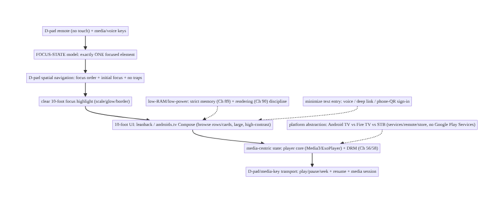
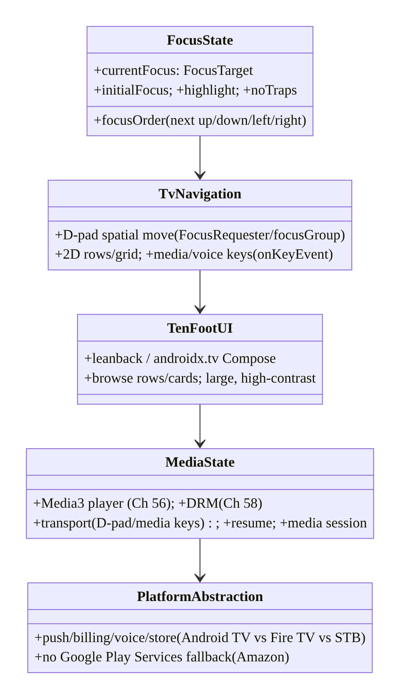
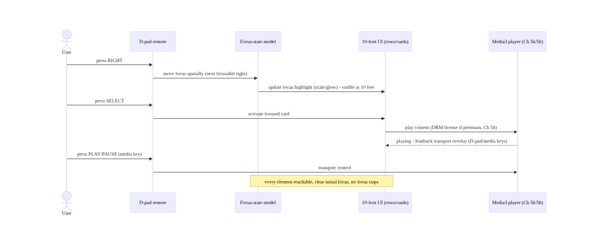
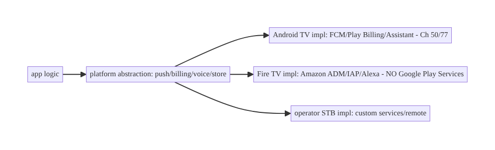
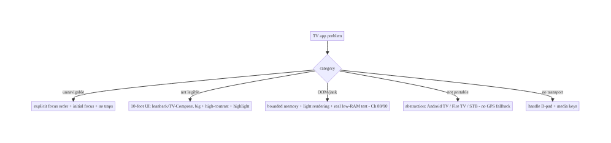

# Chapter 98 — Android TV / STB / Fire TV State & Input Architecture

> **Part XI — Reach, Scale & Platform Breadth** · Complexity: **Complex** (≥40 interview questions)
>
> **Prerequisites:** Ch 56 (Media3/ExoPlayer), Ch 58 (offline OTT/DRM), Ch 2 (Compose),
> Ch 90 (jank), Ch 44 (lifecycle), Ch 89 (memory). Pairs with Ch 99 (Wear), Ch 100 (capstone).
>
> **Reference surface in StreamCart:** the **living-room** form factor — **Android TV**, **set-
> top boxes (STB)**, and **Fire TV** — where the interaction model is **D-pad / remote** (not
> touch), the UI is **10-foot** (viewed from across the room), focus is **explicit**, playback is
> the core job (Ch 56/58), and devices are **low-RAM / low-power** with long sessions. This chapter
> is about **D-pad focus-state architecture, 10-foot UI, leanback/TV navigation, media-centric
> state, and the constraints of TV/STB/Fire TV hardware**.

---

## 98.1 Problem Definition and Real-World Context

The living room is a **different platform**: the user sits **~10 feet** away and drives the UI with
a **D-pad remote** (up/down/left/right + select, maybe a few media/voice keys) — **no touch, no
cursor**. This inverts the mobile interaction model: **focus** becomes the central UI state (there
is **always exactly one focused element**, and the user moves focus with the D-pad), navigation is
**spatial** (which element is up/down/left/right of the current one), text entry is **painful** (an
on-screen keyboard navigated by D-pad), and the UI must be **10-foot legible** (large text, high
contrast, generous focus highlight). The device is typically a **low-RAM, low-power STB / TV /
Fire TV dongle** running long **media** sessions (Ch 56/58). **TV state & input architecture** is
the discipline of building for this: an explicit, predictable **focus-state model** and **D-pad
navigation**, a **10-foot UI** (leanback/TV-Compose patterns — rows/cards/browse), **media-centric
state** (the player is the core, Ch 56/58), and respecting **TV/STB/Fire TV constraints** (memory
Ch 89, no touch, platform differences between Android TV and Amazon Fire TV).

Concretely, teams hit:

- **Porting a touch app to TV (the #1 mistake).** A phone UI with tap targets, scroll gestures,
  and small text is **unusable** on TV — there's **no touch**, focus isn't handled, text is
  illegible at 10 feet. TV needs a **purpose-built** focus/D-pad UI, not a resized phone app.
- **Focus management (the core TV problem).** On TV, **focus is the UI state**: exactly **one**
  element is focused, the user moves it with the **D-pad**, and **every focusable element** must be
  reachable and show a clear **focus highlight**. Broken focus (focus **traps**, **lost** focus,
  **unreachable** elements, wrong **initial** focus) makes the app **unnavigable**.
- **Spatial/directional navigation.** The D-pad moves focus **spatially** (up/down/left/right); the
  framework computes the **next focusable** in that direction, but complex layouts need **explicit**
  focus order (`nextFocusUp/Down/Left/Right`, Compose focus modifiers/`FocusRequester`). Grids/rows
  (the TV browse pattern) need correct **2D** navigation.
- **10-foot UI.** Text, targets, and focus highlights must be **large and high-contrast** for
  across-the-room viewing; dense phone layouts fail. Use **leanback** / **TV Compose** components
  (BrowseFragment/rows/cards, or `androidx.tv` Compose) designed for 10-foot.
- **Media-centric state (Ch 56/58).** TV's core job is **playback** — the **player** (Media3/
  ExoPlayer, Ch 56), **DRM** for premium OTT (Ch 58), **playback controls** via D-pad/media keys,
  **resume**, **background audio**, and **leanback transport** are central. TV state revolves around
  the **player**.
- **Low-RAM / low-power constraints (Ch 89).** Many STBs/Fire TV dongles have **little RAM**
  (512MB–2GB) and weak CPUs/GPUs — **memory** (Ch 89) and **rendering** (Ch 90) discipline is
  **stricter** than mobile; OOM and jank are easier to hit. Long sessions amplify leaks (Ch 89).
- **Platform fragmentation (Android TV vs Fire TV vs STB).** **Fire TV** is an **Amazon**
  fork (Amazon Appstore, Amazon's services, different remote, no Google Play Services) — code must
  handle **both** (and operator **STBs** with custom launchers/remotes). Abstract platform
  differences.
- **No/limited Google services on some devices.** Fire TV and some STBs **lack Google Play
  Services** (no FCM via Google, no Play Billing) — need **alternatives** (Amazon services, Ch 50/
  77 analogs) behind an abstraction.
- **D-pad text entry & deep linking.** Text entry is **slow** (D-pad keyboard) — minimize it (voice,
  QR-to-phone, deep links). **Deep links / voice (Assistant/Alexa)** launch content directly.

The architecture: build a **purpose-built 10-foot UI** with an explicit **focus-state model** —
exactly one focused element, **D-pad spatial navigation** with correct **focus order** and
**initial focus**, clear **focus highlights**, no focus traps — using **leanback / TV-Compose**
patterns (browse rows/cards), a **media-centric state model** (player core, Ch 56/58: playback/
DRM/transport/resume), strict **memory + rendering discipline** for **low-RAM/low-power** devices
(Ch 89/90), and a **platform abstraction** over **Android TV vs Fire TV vs STB** differences
(services, remotes, stores) — minimizing **text entry** (voice/deep-link). This chapter is about
**architecting for the D-pad-driven, media-centric, constrained living-room platform**.

### Three practical use cases

1. **StreamCart TV browse + focus.** A leanback/TV-Compose browse screen (rows of content cards);
   D-pad moves focus with correct **spatial order** and **initial focus**, each card shows a clear
   **focus highlight**, and **select** opens detail/playback — fully navigable without touch.
2. **Media-centric playback (Ch 56/58).** The player (Media3/ExoPlayer, Ch 56) with **DRM** for
   premium OTT (Ch 58), **D-pad/media-key** transport controls (play/pause/seek), **resume**, and
   leanback transport UI — the core TV experience.
3. **Fire TV + low-RAM support.** The same app runs on **Fire TV** (Amazon services/remote behind
   an abstraction, no Google Play Services) and a **low-RAM STB** — with strict memory (Ch 89) and
   rendering (Ch 90) budgets so it doesn't OOM or jank.

### Why this is architectural

TV architecture composes media (Ch 56/58), Compose/leanback UI (Ch 2/90), lifecycle (Ch 44),
memory (Ch 89), and platform abstraction. The decisions — explicit focus-state model, D-pad spatial
navigation, 10-foot UI, media-centric state, low-RAM/low-power discipline, Android-TV/Fire-TV/STB
abstraction — determine whether the app is **navigable, legible, performant, and portable** across
the living-room ecosystem, which is a fundamentally different platform from mobile.

---

## 98.2 Requirements Engineering

### Functional requirements

| ID | Requirement |
|----|-------------|
| F1 | Explicit focus-state model: one focused element; D-pad spatial navigation; correct order + initial focus; clear highlight; no traps. |
| F2 | 10-foot UI (leanback / TV-Compose: browse rows/cards; large, high-contrast). |
| F3 | Media-centric state: player core (Media3/DRM/transport/resume) (Ch 56/58). |
| F4 | Strict memory + rendering discipline for low-RAM/low-power devices (Ch 89/90). |
| F5 | Platform abstraction over Android TV / Fire TV / STB (services, remotes, stores). |
| F6 | Minimize text entry (voice / deep links); handle D-pad/media keys. |

### Non-functional requirements

| Attribute | Policy |
|-----------|--------|
| **Navigability** | Every element D-pad-reachable; predictable focus. |
| **Legibility** | 10-foot (large text, high contrast, visible focus). |
| **Performance** | No OOM/jank on low-RAM/low-power (Ch 89/90). |
| **Portability** | Android TV + Fire TV + STB behind abstractions. |
| **Media-first** | Robust playback/DRM/transport (Ch 56/58). |

### Scope

- **In scope:** focus-state model + D-pad spatial navigation (order, initial focus, highlight,
  traps), 10-foot UI (leanback / `androidx.tv` Compose, browse rows/cards), media-centric state
  (player/DRM/transport/resume, Ch 56/58), low-RAM/low-power constraints (memory Ch 89, rendering
  Ch 90), platform abstraction (Android TV vs Fire TV vs STB: services, remotes, stores, no-GPS),
  text-entry minimization (voice/deep link), media/D-pad keys, leanback vs TV-Compose.
- **Out of scope:** Media3/ExoPlayer detail (Ch 56), DRM/offline OTT detail (Ch 58), Compose basics
  (Ch 2), jank detail (Ch 90), memory detail (Ch 89), lifecycle (Ch 44).

### Assumptions & constraints

- Android TV / Fire TV / operator STB; **D-pad remote** (no touch); **10-foot** viewing; **Media3/
  ExoPlayer** (Ch 56) + **DRM** (Ch 58) for playback; **low-RAM/low-power** devices (strict Ch 89/
  90). Leanback or **`androidx.tv` Compose** for UI. Fire TV **lacks Google Play Services** (Amazon
  services behind abstraction). `minSdk` per TV (often 21+/22+; here aligned to the book's 24).

---

## 98.3 System Design Fundamentals

- **The living room is a different platform (the framing).** TV/STB/Fire TV differ from mobile on
  **every** axis: **input** (D-pad remote, no touch/cursor), **distance** (10 feet — big UI),
  **orientation** (landscape only), **primary job** (media playback, Ch 56/58), **hardware**
  (low-RAM/low-power STBs/dongles), and **ecosystem** (Android TV + Amazon Fire TV + operator STBs,
  different stores/services). You **design for TV**, not port a phone app.
- **Focus is the central UI state (the core model).** With a D-pad, there is **always exactly one
  focused element**, and the user navigates by **moving focus** (not tapping a location). So **focus
  state** — *which element is focused* — is the TV app's **primary UI state**. The architecture must
  guarantee: (1) **every** interactive element is **focusable** and **reachable**; (2) a clear
  **focus highlight** (the user must **see** what's focused from 10 feet); (3) correct **initial
  focus** when a screen appears; (4) no **focus traps** (focus that can't escape a region) or
  **lost focus** (focus going nowhere); (5) **predictable** spatial movement. Broken focus = an
  **unnavigable** app.
- **D-pad spatial / directional navigation.** The D-pad moves focus **spatially**: pressing **right**
  moves to the nearest focusable element to the **right**, etc. The framework computes this
  **geometrically**, but real layouts need **explicit** control: **`nextFocusLeft/Right/Up/Down`**
  (Views) or Compose **focus modifiers** / **`FocusRequester`** / **`Modifier.focusProperties`** to
  define the focus graph, and **`focusGroup`** for rows. **Grids and rows** (the TV browse pattern)
  need correct **2D** navigation (move within a row with left/right, between rows with up/down).
  Handle **wrap-around** and **edge** behavior deliberately.
- **10-foot UI (leanback / TV-Compose).** The UI must be legible and operable from across the room:
  **large text**, **high contrast**, **generous spacing**, **prominent focus highlights** (scale/
  glow/border on the focused card), and **landscape** layouts. Android provides **Leanback**
  (`androidx.leanback`: `BrowseSupportFragment`, rows, cards, `VerticalGridView`/
  `HorizontalGridView`) and, increasingly, **TV Compose** (`androidx.tv.material3`,
  `androidx.tv.foundation`: `TvLazyRow`/`TvLazyColumn`, focus-aware components) — **designed** for
  10-foot + D-pad. Use these, not phone components.
- **Media-centric state (Ch 56/58).** The TV app's **core** is **playback**: the **player**
  (Media3/ExoPlayer, Ch 56) drives the primary state (playing/paused/buffering/position), **DRM**
  (Widevine, Ch 58) gates premium OTT, **transport controls** (play/pause/seek/skip) are driven by
  **D-pad + media keys**, **resume** (continue watching) is expected, and a **leanback playback /
  transport UI** overlays the video. TV state architecture revolves around the **player** — more so
  than mobile. Handle **background audio** and **media session** (Ch 56) for system/voice controls.
- **Low-RAM / low-power constraints (Ch 89/90).** Many STBs and Fire TV **dongles** have **512MB–
  2GB RAM** and **weak CPUs/GPUs** — so **memory discipline** (bounded caches, downsampled images,
  no leaks, Ch 89) and **rendering discipline** (no jank, light lists, Ch 90/93) are **stricter**
  than on phones. **OOM** and **jank** are easy to hit; **long** media sessions amplify **leaks**
  (Ch 89). Budget memory/rendering tightly and **test on real low-end devices**.
- **Platform fragmentation: Android TV vs Fire TV vs STB.** **Android TV / Google TV** (Google
  ecosystem: Play Store, Play Services, Google Assistant). **Amazon Fire TV** is an **Android fork**
  with **Amazon** ecosystem (**Amazon Appstore**, **no Google Play Services** → no Google FCM/Play
  Billing, use **Amazon** equivalents, **Alexa** voice, Amazon's remote). **Operator STBs** run
  customized Android TV with **custom launchers/remotes/services**. Architect a **platform
  abstraction** (interfaces for push, billing, voice, store, device-specific remote keys) with
  **per-platform implementations** — don't hardcode Google services.
- **No Google Play Services on Fire TV/some STBs (Ch 50/77).** **FCM-via-Google** (Ch 50), **Play
  Billing** (Ch 77), **Google sign-in**, and **Play In-App Updates** are **unavailable** on Fire TV
  — use **Amazon** equivalents (ADM for push, Amazon IAP for billing) behind the abstraction. Detect
  the platform and bind the right implementation (Ch 46 DI).
- **Text entry & deep linking/voice.** **D-pad text entry** (on-screen keyboard) is **slow and
  painful** — **minimize** it: use **voice** (Google Assistant / Alexa), **deep links** (launch
  content directly from search/recommendations), **sign-in via phone/QR** (device-code flow), and
  **recommendations/search** integration so users rarely type. **Media/voice keys** and **D-pad
  keys** must be handled (`onKeyEvent`).

Core insight: **the living room is a different platform — D-pad remote instead of touch, 10-foot
viewing instead of in-hand, landscape-only, media playback as the core job, and low-RAM/low-power
STBs/dongles across a fragmented ecosystem (Android TV, Amazon Fire TV, operator STBs) — so you
design for it rather than porting a phone app: make focus the central UI state (exactly one focused
element the user moves with the D-pad, every interactive element focusable and reachable, a clear
10-foot focus highlight, correct initial focus, and no focus traps or lost focus — broken focus
makes the app unnavigable), implement D-pad spatial/directional navigation with explicit focus
order (nextFocus*/FocusRequester/focusGroup) and correct 2D grid/row movement, build a 10-foot UI
with leanback or androidx.tv Compose (browse rows/cards, large high-contrast text, prominent focus
highlights), center the state model on the player (Media3/ExoPlayer with Widevine DRM for premium
OTT, D-pad/media-key transport, resume, media session, Ch 56/58), hold strict memory and rendering
discipline because low-RAM/low-power devices OOM and jank far more easily than phones and long media
sessions amplify leaks (Ch 89/90), abstract the fragmented ecosystem behind interfaces (push,
billing, voice, store, remote keys) with per-platform implementations since Fire TV and some STBs
lack Google Play Services and need Amazon/operator equivalents, and minimize painful D-pad text
entry with voice, deep links, and phone/QR sign-in — because a navigable, legible, performant,
portable living-room app is architected for the D-pad-driven, media-centric, constrained platform,
not resized from mobile.**

---

## 98.4 High-Level Architecture



**Components & ownership**

- **Focus-state model** (one focused element) + **D-pad spatial navigation** (order/initial/no
  traps) + **10-foot highlight** — the TV UI core.
- **10-foot UI** (leanback / TV-Compose rows/cards); **media-centric state** (player/DRM/transport,
  Ch 56/58).
- **Low-RAM/low-power** discipline (Ch 89/90); **platform abstraction** (Android TV/Fire TV/STB);
  **minimal text entry**.

**Direction:** D-pad input → focus-state + spatial navigation → 10-foot UI (leanback/TV-Compose) →
media-centric state (player/DRM/transport); constrained + platform-abstracted + low-text-entry.

---

## 98.5 Detailed Component Design



| Component | Responsibility |
|-----------|----------------|
| `FocusState` | one focused element; order; initial focus; highlight; no traps |
| `TvNavigation` | D-pad spatial move (FocusRequester/focusGroup); 2D rows; media keys |
| `TenFootUI` | leanback / TV-Compose browse rows/cards; 10-foot legibility |
| `MediaState` | player (Media3) + DRM + transport + resume + media session (Ch 56/58) |
| `PlatformAbstraction` | push/billing/voice/store per Android TV/Fire TV/STB (no-GPS fallback) |

---

## 98.6 End-to-End Data Flow

### D-pad navigation → focus → select → play



### Platform abstraction (Android TV vs Fire TV)



---

## 98.7 Implementation (Compose TV + Kotlin)

Package: `com.streamcart.tv`.

### 98.7.1 Focus-state: initial focus + highlight + spatial order

```kotlin
@Composable
fun BrowseRow(title: String, items: List<ContentUi>, onSelect: (ContentUi) -> Unit) {
    val firstCard = remember { FocusRequester() }
    TvLazyRow(Modifier.focusGroup()) {                               // androidx.tv - row is a focus group
        itemsIndexed(items, key = { _, it -> it.id }) { index, item ->
            ContentCard(item, onSelect = onSelect,
                modifier = if (index == 0) Modifier.focusRequester(firstCard) else Modifier)  // initial focus target
        }
    }
    LaunchedEffect(Unit) { firstCard.requestFocus() }               // correct INITIAL focus when row appears
}

@Composable
fun ContentCard(item: ContentUi, onSelect: (ContentUi) -> Unit, modifier: Modifier = Modifier) {
    var focused by remember { mutableStateOf(false) }
    Card(
        onClick = { onSelect(item) },                               // D-pad SELECT activates
        modifier = modifier
            .onFocusChanged { focused = it.isFocused }
            .scale(if (focused) 1.1f else 1.0f)                     // 10-foot focus HIGHLIGHT (scale/glow/border)
            .border(if (focused) 3.dp else 0.dp, MaterialTheme.colorScheme.primary),  // visible from 10 feet
    ) { /* large, high-contrast card content */ }
}
```

### 98.7.2 D-pad / media key handling

```kotlin
// Handle D-pad and MEDIA keys (play/pause/seek) - TV remotes send KeyEvents, not touch
Modifier.onKeyEvent { event ->
    when (event.key) {
        Key.MediaPlayPause -> { player.playWhenReady = !player.playWhenReady; true }   // media key (Ch 56)
        Key.MediaFastForward -> { player.seekForward(); true }
        Key.DirectionCenter -> { onSelect(); true }                                     // D-pad select
        else -> false                                                                   // let focus system handle arrows
    }
}
```

### 98.7.3 Media-centric state (player core, Ch 56/58)

```kotlin
class TvPlayerViewModel @Inject constructor(
    private val playerFactory: PlayerFactory,       // Media3/ExoPlayer (Ch 56)
    private val drm: DrmSessionManager,             // Widevine for premium OTT (Ch 58)
    private val resumeStore: ResumeStore,           // continue-watching position
) : ViewModel() {
    val player: ExoPlayer = playerFactory.create(drm)                    // DRM-enabled (Ch 58)
    fun play(content: Content) {
        val item = MediaItem.Builder().setUri(content.url)
            .setDrmConfiguration(content.drm?.toMedia3())                // license (Ch 58)
            .build()
        player.setMediaItem(item, resumeStore.position(content.id))      // RESUME from saved position
        player.prepare(); player.playWhenReady = true
        // Media session (Ch 56) exposes transport to system/voice; leanback transport overlay for D-pad.
    }
    override fun onCleared() { resumeStore.save(player); player.release() }   // save resume + release (Ch 89)
}
```

### 98.7.4 Platform abstraction (Android TV vs Fire TV vs STB)

```kotlin
// Abstract platform-specific services - Fire TV/STB may lack Google Play Services (Ch 50/77)
interface PlatformServices {
    fun push(): PushProvider        // FCM (Android TV) vs ADM (Fire TV)      - Ch 50
    fun billing(): BillingProvider  // Play Billing vs Amazon IAP             - Ch 77
    fun voice(): VoiceProvider      // Google Assistant vs Alexa
}
// DI binds the right impl per platform (Ch 46):
@Module @InstallIn(SingletonComponent::class)
object PlatformModule {
    @Provides fun services(ctx: Context): PlatformServices =
        if (isFireTv(ctx)) FireTvServices(ctx)       // Amazon ADM/IAP/Alexa - no Google Play Services
        else AndroidTvServices(ctx)                  // FCM/Play Billing/Assistant (Ch 50/77)
}
```

### 98.7.5 Low-RAM discipline (Ch 89/90)

```kotlin
// STBs/dongles have little RAM - stricter than mobile (Ch 89):
//  - bounded image cache sized to the (smaller) heap; downsample card art to card size (Ch 89/59)
//  - light TV card composables, stable keys, async images (Ch 90/93) - jank is easy on weak GPUs
//  - release the player promptly (onCleared) - long sessions amplify leaks (Ch 89)
//  - onTrimMemory -> evict caches (Ch 44/89); test on a real low-RAM Fire TV stick, not an emulator
```

### 98.7.6 Module structure

```
:feature:tv  BrowseRow/ContentCard (focus+highlight), TvPlayerViewModel (player core)
:core:platform  PlatformServices abstraction (Android TV / Fire TV / STB) - Ch 46 DI
# Focus/nav -> androidx.tv + FocusRequester/focusGroup; media -> Media3 (Ch 56) + DRM (Ch 58);
# low-RAM -> Ch 89/90; no-GPS fallback -> Amazon services. Leanback is the View-based alternative.
```

---

## 98.8 Concurrency and Race Conditions

| Scenario | Risk | Handling |
|----------|------|----------|
| Lost / trapped focus | unnavigable | explicit focus order + initial focus + no traps |
| Unreachable element | can't select | ensure focusable + in focus graph |
| Focus highlight invisible | user lost at 10 feet | prominent highlight (scale/glow/border) |
| Media key unhandled | no transport | onKeyEvent for media/D-pad keys |
| Player not released | leak on weak device | release in onCleared (Ch 89) |
| Low-RAM OOM | crash | bounded caches + downsample + test real device (Ch 89) |
| Google service on Fire TV | crash/no-op | platform abstraction (Amazon fallback) |
| Wrong initial focus | confusing | requestFocus on screen entry |

- **Focus is the state machine to get right:** on TV, a **lost** or **trapped** focus leaves the
  user **stuck** with no touch escape — the architecture must guarantee **initial focus**, a
  **reachable** focus graph, and **no traps**; test every screen with **only the D-pad**.
- **Memory/rendering discipline is stricter than mobile (Ch 89/90):** low-RAM STBs/dongles OOM and
  jank where a phone wouldn't; the player must be **released** promptly (long sessions, Ch 89), and
  caches/lists must be **bounded/light** (Ch 89/93) — **test on real low-end hardware**.
- **Platform differences must be abstracted, not branched everywhere:** Fire TV's lack of Google
  Play Services means **push/billing/voice** differ — bind the right implementation via **DI**
  (Ch 46) behind an interface, not scattered `if (fireTv)` checks.

---

## 98.9 Failure Scenarios and Recovery

| Failure | Detection | Response | Outcome |
|---------|-----------|----------|---------|
| App unnavigable (focus) | D-pad-only testing | explicit focus order + initial + no traps | navigable |
| Can't see what's focused | 10-foot review | prominent highlight | legible |
| Phone UI ported | TV UX review | leanback / TV-Compose 10-foot UI | TV-native |
| OOM on Fire TV stick | real-device test (Ch 89) | bounded memory + downsample + release player | stable |
| Jank on weak GPU | FrameTiming (Ch 90) | light cards + stable keys + async art | smooth |
| Crash: no Google services | Fire TV test | platform abstraction (Amazon) | portable |
| No transport controls | remote test | handle media/D-pad keys | controllable |
| Lost resume position | playback test | save/restore resume (Ch 56) | continues |



> **Make focus explicit, build 10-foot, center on the player, respect the hardware, abstract the
> platform.** TV failures are broken focus (explicit order + initial focus + no traps + visible
> highlight), ported phone UIs (leanback/TV-Compose 10-foot), OOM/jank on weak devices (strict
> memory + light rendering, Ch 89/90 — test real hardware), missing transport (handle media/D-pad
> keys), and Google-service crashes on Fire TV (platform abstraction). The living room is a
> different platform — architect for it.

---

## 98.10 Scaling the Implementation

- **Level 1.** TV-Compose/leanback browse rows/cards; focusable cards with a visible highlight;
  D-pad select; a Media3 player (Ch 56).
- **Level 2.** Explicit focus order + initial focus (FocusRequester/focusGroup); media/D-pad key
  handling; DRM for premium (Ch 58); resume.
- **Level 3 — production.** Platform abstraction (Android TV / Fire TV, no-GPS fallback); strict
  memory/rendering budgets for low-RAM (Ch 89/90); media session + voice; deep links.
- **Level 4 — multi-device.** Operator STB support (custom remotes/launchers); recommendations/
  channels integration; voice (Assistant/Alexa); device-tiered quality; A/B on TV (Ch 86).
- **Level 5 — ecosystem.** Full living-room platform: multi-store (Play + Amazon Appstore),
  per-operator builds, TV-specific performance SLOs, large device-matrix testing, living-room
  analytics (Ch 82).

**Avoid overengineering:** TV-Compose/leanback browse + correct focus + a Media3 player + platform
abstraction + low-RAM discipline covers the core. Don't port a phone UI; don't neglect focus; don't
assume Google services; don't skip real-low-RAM-device testing.

---

## 98.11 Alternative Approaches and Trade-offs

| Dimension | Option A | Option B | When |
|-----------|----------|----------|------|
| UI toolkit | TV Compose (`androidx.tv`) | Leanback (Views) | TV-Compose (modern); leanback (legacy/rich browse) |
| App | Purpose-built TV | ported phone app | Purpose-built always |
| Focus | Explicit order + initial | rely on default geometry | Explicit for complex layouts |
| Services | Platform abstraction | hardcode Google | Abstraction (Fire TV/STB) |
| Player | Media3/ExoPlayer (Ch 56) | custom | Media3 (DRM/transport) |
| Text entry | Voice/deep-link/QR | D-pad keyboard | Minimize typing |
| Memory | Strict (low-RAM) | mobile budgets | Strict for STB/dongle (Ch 89) |

**TV Compose vs Leanback:** **Leanback** (`androidx.leanback`, Views) is the **established** TV
toolkit (rich `BrowseSupportFragment`, rows, cards) — mature but **View-based**. **TV Compose**
(`androidx.tv.material3`/`foundation`) is the **modern** declarative approach (focus-aware
`TvLazyRow`/components) — preferred for **new** apps, though some rich leanback patterns are still
maturing. Choose **TV Compose** for new work; **leanback** for legacy or when you need its specific
browse components.

**Purpose-built vs ported phone app:** a **resized phone app** is **unusable** on TV (no touch,
illegible, no focus). A **purpose-built** TV UI (D-pad focus, 10-foot, leanback/TV-Compose) is the
**only** acceptable approach. Share **business logic / data** (Ch 1/94) across phone and TV, but
build **TV-specific UI**.

**Platform abstraction vs hardcoding Google:** hardcoding **Google Play Services** (FCM, Play
Billing) **crashes/no-ops** on **Fire TV** (no GPS). A **platform abstraction** (push/billing/voice
behind interfaces, Ch 46) with **Amazon** implementations keeps the app **portable**. Abstract
platform services from the start.

---

## 98.12 Security & Privacy Considerations

- **DRM for premium content (Ch 58):** TV OTT playback of premium content requires **Widevine DRM**
  (often **L1** hardware-backed on TVs) — the same secure-playback discipline as mobile (Ch 58);
  license handling and secure video path matter more on TV (big-screen piracy target).
- **Shared-device / profiles (privacy, Ch 28):** a TV is often **shared** (family device) — handle
  **profiles** and **per-profile data isolation** (Ch 28); don't leak one user's data/recommendations
  to another; sign-out/switch-profile must clear appropriately.
- **Sign-in on a shared, typing-hostile device:** prefer **device-code / phone-QR** sign-in (Ch 20)
  over typing credentials on a shared TV with a D-pad — more secure and far more usable; don't
  display secrets on a big shared screen.
- **No Google Play Services → different security surfaces (Fire TV):** auth/attestation/integrity
  (Ch 24) that rely on Google services need **alternatives** on Fire TV — don't silently drop
  security checks; use platform-appropriate equivalents.
- **Payment on TV (Ch 76/77):** billing uses the **platform store** (Play vs Amazon IAP) — don't
  roll custom card entry on a shared TV (PCI + usability); defer to the store or phone.
- Client + platform: **DRM/secure playback** (Ch 58), **profile isolation** on shared devices
  (Ch 28), **QR/device-code sign-in** (Ch 20), and **platform-appropriate** integrity/billing
  (Ch 24/77).

---

## 98.13 Performance and Resource Optimization

- **Memory is tighter than mobile (Ch 89)** — low-RAM STBs/dongles: bounded caches sized to the
  smaller heap, downsample card art to card size (Ch 59/89), release the player promptly (long
  sessions, Ch 89), honor `onTrimMemory`.
- **Rendering on weak GPUs (Ch 90/93)** — light TV cards, stable keys, async art, no per-frame
  allocation; the TV browse grid is a **large list** (Ch 93) on a weak GPU — apply list discipline
  strictly.
- **Baseline Profiles help here too (Ch 92)** — AOT the browse/playback path for smoother first use
  on weak CPUs.
- **Playback is the hot path (Ch 56/58)** — efficient buffering, hardware decode, DRM L1; test on
  real devices.
- **Test on real low-end hardware** — emulators hide the OOM/jank reality of a cheap Fire TV stick.
- **Profiling:** memory footprint on low-RAM devices (Ch 89), browse/scroll frame timing on weak
  GPU (Ch 90/93), playback start time + rebuffer (Ch 56), focus-navigation responsiveness, startup
  (Ch 88/92).

---

## 98.14 Testing Strategy

Focus, D-pad navigation, and media are testable; low-RAM behavior needs **real devices**.

```kotlin
class TvFocusTest {
    @get:Rule val compose = createComposeRule()
    @Test fun `every card is D-pad reachable`() {
        // simulate D-pad right/down across the browse grid - assert each card gains focus (no traps)
    }
    @Test fun `initial focus set on screen entry`() { /* firstCard.requestFocus() -> first card focused */ }
    @Test fun `focused card shows highlight`() { /* onFocusChanged -> scale/border applied */ }
}

class TvKeyTest {
    @Test fun `media play-pause key toggles player`() { /* Key.MediaPlayPause -> playWhenReady toggles (Ch 56) */ }
}

class PlatformAbstractionTest {
    @Test fun `Fire TV binds Amazon services, not Google`() { /* isFireTv -> FireTvServices (no GPS) */ }
}
// Real-device (required): low-RAM Fire TV stick - memory/jank (Ch 89/90); D-pad-only navigation walkthrough;
// DRM playback on hardware (L1, Ch 58); resume; voice (Assistant/Alexa).
```

What to test: **D-pad reachability** (every element, no traps) + **initial focus** + **highlight**;
**media/D-pad key** handling (Ch 56); **platform abstraction** (Fire TV → Amazon, no Google); player
**release/resume** (Ch 89/56); DRM playback (Ch 58). **Real low-RAM device** testing for memory/jank
(Ch 89/90) and **D-pad-only** navigation is **mandatory** — emulators miss it.

---

## 98.15 Production Observability

- **Metrics:** **playback** start time + rebuffer + errors (Ch 56), **DRM** license success (Ch 58),
  **memory footprint / OOM** on low-RAM devices (Ch 89), **browse jank** on weak GPU (Ch 90/93),
  **focus/navigation** issues, **platform split** (Android TV vs Fire TV vs STB usage), startup
  (Ch 88/92), by **device model** (huge TV/STB fragmentation).
- **Logs:** playback/focus/platform events — PII-safe (Ch 28; shared-device profile-aware).
- **Debugging:** unnavigable → focus graph (traps/initial focus); OOM → low-RAM device memory
  (Ch 89); jank → browse-grid rendering on weak GPU (Ch 90); crash on Fire TV → Google-service
  dependency (abstraction); playback failure → DRM/buffer (Ch 56/58); by **device model**.
- **Alerting:** playback-error/rebuffer spike (Ch 56); OOM-rate spike on a device model (Ch 89);
  Fire-TV-specific crash (platform); DRM license failures (Ch 58).
- **Dashboards:** playback QoE + DRM by device model, memory/OOM by device, browse jank, platform
  split, focus-issue reports.

---

## 98.16 System Design Interview Preparation

> ≥40 questions (Complex).

**Fundamentals**
1. *How is TV different?* D-pad (no touch), 10-foot, landscape, media-centric, low-RAM, fragmented.
2. *#1 TV mistake?* Porting a phone app.
3. *Central UI state?* Focus (exactly one focused element).
4. *Why focus matters?* No touch — the user navigates by moving focus.
5. *Input?* D-pad + select + media/voice keys.

**Focus**
6. *Focus guarantees?* Reachable, visible highlight, initial focus, no traps.
7. *Focus trap?* Focus can't escape a region — unnavigable.
8. *Spatial navigation?* D-pad moves focus geometrically (next in direction).
9. *Explicit order?* nextFocus*/FocusRequester/focusProperties.
10. *focusGroup?* Group a row for navigation.
11. *Initial focus?* requestFocus on screen entry.
12. *2D navigation?* Rows (left/right) + between rows (up/down).

**10-foot UI**
13. *10-foot?* Large text, high contrast, prominent focus highlight, landscape.
14. *Toolkits?* Leanback (Views) / androidx.tv Compose.
15. *Browse pattern?* Rows of cards (BrowseFragment / TvLazyRow).
16. *Highlight?* Scale/glow/border on focused card.

**Media**
17. *Core job?* Playback (Media3/ExoPlayer, Ch 56).
18. *DRM?* Widevine (L1 on TV) for premium OTT (Ch 58).
19. *Transport?* D-pad + media keys (play/pause/seek).
20. *Resume?* Save/restore position (continue watching).
21. *Media session?* System/voice transport control (Ch 56).

**Constraints**
22. *RAM?* Low (512MB–2GB STB/dongle) — strict memory (Ch 89).
23. *GPU?* Weak — strict rendering/jank (Ch 90/93).
24. *Long sessions?* Amplify leaks — release player (Ch 89).
25. *Test?* Real low-RAM device, not emulator.

**Platform**
26. *Android TV vs Fire TV?* Google vs Amazon ecosystem (fork).
27. *Fire TV lacks?* Google Play Services (no FCM/Play Billing).
28. *Fallback?* Amazon ADM/IAP/Alexa behind abstraction.
29. *STB?* Operator-customized (remotes/launchers/services).
30. *Abstract how?* Interfaces + per-platform DI (Ch 46).

**Text/voice**
31. *Text entry?* Painful (D-pad keyboard) — minimize.
32. *Alternatives?* Voice, deep links, phone/QR sign-in.
33. *Deep links?* Launch content directly (search/recs).
34. *Voice?* Assistant (Android TV) / Alexa (Fire TV).

**Edge/production**
35. *Shared device?* Profiles + per-profile isolation (Ch 28).
36. *Sign-in?* Device-code/QR (not typing on shared TV, Ch 20).
37. *Payment?* Platform store (Play/Amazon IAP), not custom (Ch 77).
38. *Observe by?* Device model (fragmentation).
39. *Startup?* Baseline Profiles help on weak CPU (Ch 92).
40. *Share with phone?* Business logic/data (Ch 94), TV-specific UI.
41. *Leanback vs TV-Compose?* Legacy/rich vs modern declarative.
42. *Key metric?* Playback QoE + memory/jank by device model.

### Design-change challenges
1. **Make a browse grid D-pad-navigable.** Focus order + initial focus + highlight + no traps.
2. **Support Fire TV.** Platform abstraction (Amazon services, no GPS).
3. **Stop OOM on a Fire TV stick.** Strict memory + downsample + release player (Ch 89).
4. **Add D-pad transport controls.** Handle media/D-pad keys + media session (Ch 56).
5. **Avoid typing credentials on TV.** Device-code/QR sign-in (Ch 20).

### Mock walkthrough (abridged)
Clarify (Android TV/Fire TV/STB? media-centric? device RAM?) → focus-state model (one focused,
reachable, initial, highlight, no traps) → D-pad spatial navigation (FocusRequester/focusGroup, 2D
rows) → 10-foot UI (leanback/TV-Compose rows/cards) → media-centric state (Media3 player + DRM +
transport + resume, Ch 56/58) → low-RAM/low-power discipline (Ch 89/90) → platform abstraction
(Android TV/Fire TV/STB, no-GPS fallback, Ch 46) → minimize text entry (voice/deep-link/QR) → test
real low-RAM device + D-pad-only → observability (QoE/memory by device model).

---

## 98.17 Practical Exercises

1. **Beginner.** Build a TV-Compose browse row of focusable cards with a visible focus highlight,
   correct initial focus, and D-pad select → play (Media3, Ch 56). *Eval:* D-pad-navigable; highlight
   visible.
2. **Intermediate.** Add explicit focus order for a 2D grid (no traps) and handle media/D-pad keys
   (play/pause/seek) with resume (Ch 56). *Eval:* every card reachable; transport works; resumes.
3. **Advanced.** Add a platform abstraction (Android TV vs Fire TV, no Google Play Services) with
   per-platform DI (Ch 46), and DRM playback (Ch 58). *Eval:* runs on both; premium plays.
4. **Production debugging.** Diagnose OOM/jank on a real low-RAM Fire TV stick (Ch 89/90) and a focus
   trap on a screen. *Eval:* memory/jank fixed; navigable.
5. **System design challenge.** Design a living-room app spanning Android TV + Fire TV + operator STB
   with shared business logic (Ch 94), TV-specific UI, platform abstraction, DRM (Ch 58), and
   device-model observability. *Eval:* navigable, performant, portable, media-robust.

*(Solutions withheld unless requested.)*

---

## 98.18 Chapter Summary & Reference Sheet

**Key decisions:** treat the **living room as a different platform** — **D-pad remote** instead of
touch, **10-foot** viewing, **landscape-only**, **media playback** as the core job, and **low-RAM/
low-power** STBs/dongles across a **fragmented ecosystem** (Android TV, Amazon Fire TV, operator
STBs) — and **design for it** rather than porting a phone app: make **focus the central UI state**
(exactly **one** focused element the user moves with the D-pad; every interactive element
**focusable and reachable**; a clear **10-foot focus highlight**; correct **initial focus**; **no
focus traps or lost focus** — broken focus makes the app **unnavigable**); implement **D-pad
spatial/directional navigation** with explicit **focus order** (`nextFocus*`/`FocusRequester`/
`focusGroup`) and correct **2D grid/row** movement; build a **10-foot UI** with **leanback** or
**`androidx.tv` Compose** (browse rows/cards, large high-contrast text, prominent highlights);
**center the state model on the player** (Media3/ExoPlayer with **Widevine DRM** for premium OTT,
**D-pad/media-key transport**, **resume**, **media session**, Ch 56/58); hold **strict memory and
rendering discipline** because low-RAM/low-power devices **OOM and jank** far more easily than
phones and **long media sessions amplify leaks** (Ch 89/90); **abstract the fragmented ecosystem**
behind interfaces (push, billing, voice, store, remote keys) with **per-platform implementations**
since **Fire TV and some STBs lack Google Play Services** and need **Amazon/operator equivalents**;
and **minimize painful D-pad text entry** with **voice, deep links, and phone/QR sign-in** — because
a **navigable, legible, performant, portable** living-room app is **architected** for the D-pad-
driven, media-centric, constrained platform, not resized from mobile.

**Concepts:** living-room platform differences, focus-state model (one focused, reachable, initial,
highlight, no traps), D-pad spatial navigation (focus order, 2D rows/grid, media keys), 10-foot UI
(leanback / `androidx.tv` Compose, browse rows/cards), media-centric state (Media3 player + DRM +
transport + resume + media session, Ch 56/58), low-RAM/low-power discipline (memory Ch 89, rendering
Ch 90/93), platform abstraction (Android TV vs Fire TV vs STB, no-GPS fallback), minimal text entry
(voice/deep-link/QR).

**Common mistakes:** porting a phone UI; broken focus (traps, lost/wrong-initial, unreachable,
invisible highlight); dense/small 10-foot UI; hardcoding Google Play Services (crashes on Fire TV);
ignoring low-RAM/low-power (OOM/jank); not releasing the player (leaks, Ch 89); unhandled media/
D-pad keys; forcing D-pad text entry; testing only on emulators (missing real low-RAM reality).

**Checklist:** ☐ focus-state model (one focused, reachable, initial focus, visible highlight, no
traps) ☐ D-pad spatial navigation (focus order, 2D rows/grid, FocusRequester/focusGroup) ☐ 10-foot
UI (leanback / `androidx.tv` Compose, large, high-contrast) ☐ media-centric state (Media3 + DRM +
transport + resume + media session, Ch 56/58) ☐ handle media/D-pad keys (`onKeyEvent`) ☐ strict
memory + rendering for low-RAM/low-power (Ch 89/90) + release player ☐ platform abstraction (Android
TV/Fire TV/STB; no-GPS fallback; DI, Ch 46) ☐ minimize text entry (voice/deep-link/QR sign-in) ☐
profiles/isolation on shared device (Ch 28) ☐ test real low-RAM device + D-pad-only.

**Key APIs:** `androidx.tv.material3`/`androidx.tv.foundation` (`TvLazyRow`/`TvLazyColumn`, TV
`Card`), `Modifier.focusGroup`/`focusRequester`/`onFocusChanged`/`focusProperties`,
`FocusRequester.requestFocus`, `Modifier.onKeyEvent` (`Key.MediaPlayPause`/`DirectionCenter`/media
keys), Leanback (`BrowseSupportFragment`, `VerticalGridView`), Media3/ExoPlayer + `MediaSession`
(Ch 56) + `DrmConfiguration`/Widevine (Ch 58), platform detection + DI (Ch 46), Amazon ADM/IAP (Fire
TV), device-code sign-in (Ch 20), `onTrimMemory` (Ch 89).

**References:**
- Build TV apps / Android TV: https://developer.android.com/training/tv
- TV Compose (`androidx.tv`): https://developer.android.com/training/tv/playback/compose
- Leanback: https://developer.android.com/training/tv/start/libraries
- Amazon Fire TV development: https://developer.amazon.com/docs/fire-tv/
- (composes) Ch 56 Media3/ExoPlayer, Ch 58 DRM/Offline OTT, Ch 2 Compose, Ch 90 Jank, Ch 89 Memory, Ch 44 Lifecycle, Ch 94 Modularization

### Chapter review (Phase 4)
- **Completeness:** all 18 sections; architecture/class/sequence/platform/failure diagrams; focus+
  highlight + key-handling + media-state + platform-abstraction + low-RAM code; concurrency (focus
  state machine, stricter memory/rendering, abstract platform); failure (focus+10-foot+player+
  hardware+platform principle); 5 levels; TV-Compose-vs-leanback, purpose-built-vs-ported,
  abstraction-vs-hardcode trade-offs; security (DRM, shared-device profiles, QR sign-in, no-GPS
  integrity); perf (tighter memory/GPU, real-device); focus + key + platform tests + real-device
  mandate; observability (QoE/memory by device model); 42 Q&A + 5 challenges. ✅
- **Expand later:** Media3 (Ch 56), DRM/OTT (Ch 58), memory (Ch 89), jank (Ch 90), modularization
  (Ch 94).
- **Interview coverage:** 42 Q&A — exceeds the ≥40 Complex bar.
