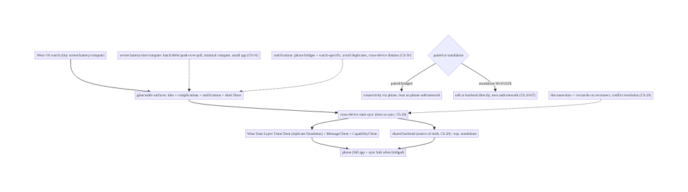
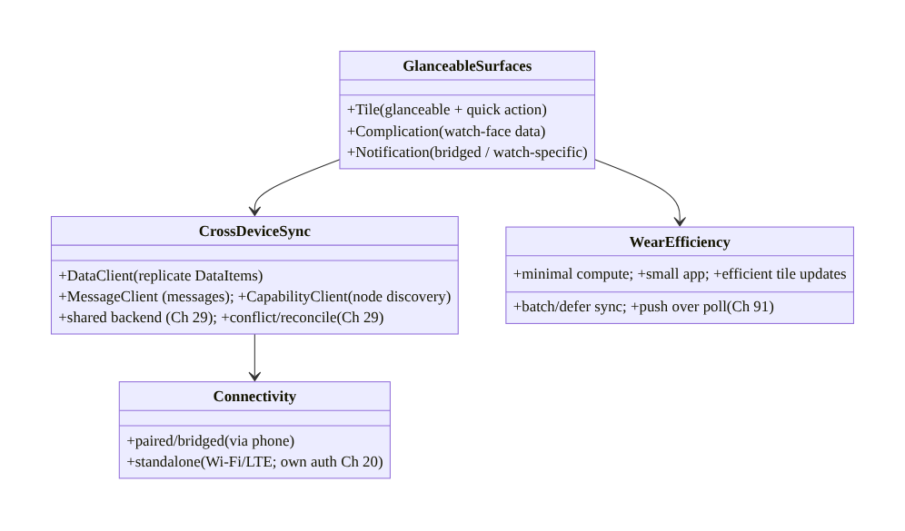
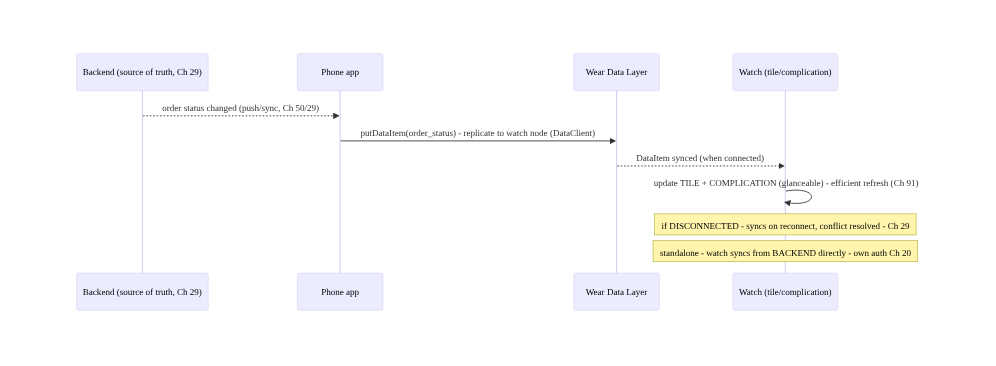
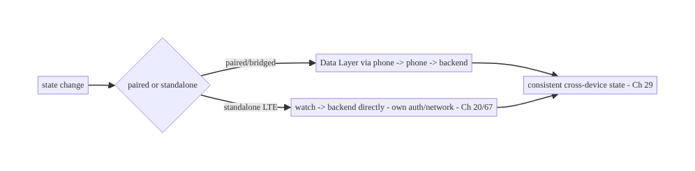
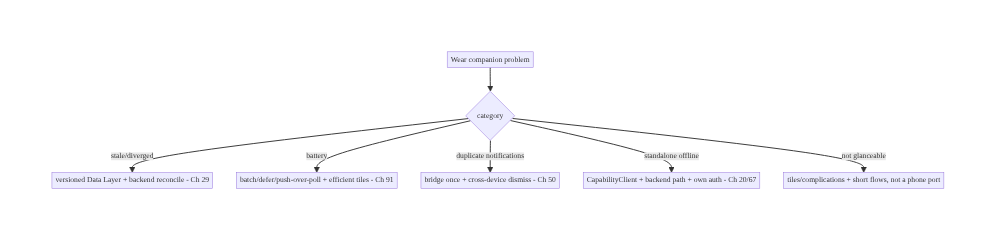

# Chapter 99 — Wear OS Companion & Cross-Device State Sync

> **Part XI — Reach, Scale & Platform Breadth** · Complexity: **Standard** (≥25 interview questions)
>
> **Prerequisites:** Ch 29 (offline/sync), Ch 50 (FCM), Ch 48 (WorkManager), Ch 91 (battery),
> Ch 2 (Compose), Ch 44 (lifecycle). Pairs with Ch 98 (TV), Ch 100 (capstone).
>
> **Reference surface in StreamCart:** the **wrist** form factor — a **Wear OS** companion app
> (tiny screen, tiny battery, often paired to a phone, sometimes standalone with LTE) that shows
> **glanceable** state (order status, notifications), offers **quick actions**, and **syncs state
> with the phone** (and backend) over the **Data Layer** — under **severe battery/size/compute
> constraints** (Ch 91), with **tiles, complications, and notifications** as first-class surfaces.
> This chapter is about **cross-device state sync, the Wear Data Layer, glanceable UX, and wrist
> constraints**.

---

## 99.1 Problem Definition and Real-World Context

A watch is a **glance** device: tiny screen, **seconds** of attention, **minimal** battery/compute,
often **paired** to a phone (bridged connectivity) but sometimes **standalone** (Wi-Fi/LTE). A
Wear OS companion must show **glanceable** state, offer **one-tap actions**, and **stay in sync**
with the phone app and backend — without draining the watch or duplicating the phone's complexity.
**Wear OS companion & cross-device state sync** is the discipline of: a **glanceable** UX (tiles,
complications, notifications, short in-app flows), **cross-device state synchronization** between
watch ↔ phone ↔ backend (via the **Wear Data Layer** — `DataClient`/`MessageClient`/
`CapabilityClient` — and/or a shared backend, Ch 29), and operating under **severe wrist
constraints** (Ch 91: battery, size, compute, tiny screen). The hard parts are **sync** (keeping
watch and phone consistent, handling the watch being disconnected), **constraints** (battery/size),
and **glanceable UX** (not a shrunk phone app).

Concretely, teams hit:

- **Porting the phone app to the watch.** A shrunk phone UI with long flows and dense screens is
  **wrong** for the wrist. Wear needs **glanceable** surfaces (tiles/complications/notifications)
  and **very short** in-app interactions — a **purpose-built** companion, not a port.
- **Cross-device state sync (the core problem).** Watch and phone (and backend) must show
  **consistent** state (order status, cart, auth). Syncing requires the **Wear Data Layer**
  (`DataClient` for synced data items, `MessageClient` for messages, `CapabilityClient` for
  discovering nodes/capabilities) and/or a **shared backend** (Ch 29) — plus handling the watch
  being **disconnected** (bridged vs standalone) and **conflict/ordering** (Ch 29).
- **Paired vs standalone.** Wear can be **paired** (connectivity **bridged** through the phone) or
  **standalone** (own Wi-Fi/LTE, talks to backend directly). The app must handle **both** — and
  the transition (phone out of range). Standalone needs its own **auth/network** (Ch 20/67); paired
  can **lean on the phone**.
- **Notifications: bridged vs watch-specific (Ch 50).** Phone notifications **bridge** to the watch
  automatically, but Wear benefits from **watch-specific** notification actions/layouts. Avoid
  **duplicate** notifications (phone + watch showing the same thing twice). Coordinate the
  notification strategy across devices.
- **Tiles & complications (glanceable surfaces).** **Tiles** (swipeable glanceable screens) and
  **complications** (data on the watch face) are **first-class** Wear surfaces for **at-a-glance**
  info (next order status, a quick action) — updated efficiently (they're **not** always-running
  apps). Designing for tiles/complications is central to Wear UX.
- **Severe battery/size/compute constraints (Ch 91).** The watch has a **tiny battery** and **weak
  compute**; sync and background work must be **extremely** efficient (Ch 91 — batch, defer, push
  over poll), the app **small**, and compute **minimal**. Wear amplifies every **battery/efficiency**
  lesson (Ch 91).
- **Tiny screen / glanceable UX.** Interactions are **seconds** long; UI is **round** (often),
  **small**, **scrollable** (rotary input), with **large touch targets** and **minimal** text.
  Design for **glance + one action**, not deep navigation.
- **Data Layer efficiency & consistency (Ch 29).** Syncing **DataItems** must be **efficient** (not
  chatty — battery, Ch 91) and **consistent** (last-writer / versioned, conflict handling, Ch 29);
  large data shouldn't go over the Data Layer (use the backend). Treat it like **sync** (Ch 29)
  with device-specific transport.

The architecture: build a **purpose-built, glanceable** Wear companion — **tiles/complications/
notifications** as first-class surfaces plus **very short** in-app flows — that **syncs state
cross-device** (watch ↔ phone ↔ backend) via the **Wear Data Layer** (`DataClient`/`MessageClient`/
`CapabilityClient`) and/or a **shared backend** (Ch 29), handling **paired vs standalone**
connectivity and **conflict/disconnection** (Ch 29), under **severe battery/size/compute
constraints** (Ch 91: batch/defer/push-over-poll, minimal compute, small app), with a **tiny-screen
glanceable UX** (rotary input, large targets, minimal text). This chapter is about **a consistent,
efficient, glanceable companion on the wrist**.

### Three practical use cases

1. **Glanceable order status (StreamCart).** A **tile** + **complication** show the user's next
   order status at a glance; the watch **syncs** order state from the phone/backend (Data Layer /
   shared backend, Ch 29) and updates efficiently (Ch 91) — no app launch needed.
2. **Cross-device sync.** The user marks an order received on the phone; the watch reflects it
   (Data Layer sync); if the watch is **disconnected** (bridged, phone away), it **reconciles** when
   reconnected (Ch 29) — consistent state across devices.
3. **Standalone quick action.** On a **standalone LTE** watch (phone absent), a watch notification
   offers "track order" — the watch talks to the **backend directly** (own auth/network, Ch 20/67),
   not via the phone.

### Why this is architectural

Wear composes sync (Ch 29), notifications/push (Ch 50), background work (Ch 48), battery/efficiency
(Ch 91), and UI (Ch 2) — with a **device-to-device** transport (Data Layer) and **paired/standalone**
duality. The decisions — glanceable surfaces, cross-device sync + conflict/disconnection handling,
paired-vs-standalone, severe efficiency — determine whether the companion is **consistent, efficient,
and glanceable**, or a battery-draining shrunk phone app.

---

## 99.2 Requirements Engineering

### Functional requirements

| ID | Requirement |
|----|-------------|
| F1 | Glanceable surfaces: tiles, complications, notifications + very short in-app flows. |
| F2 | Cross-device state sync (watch ↔ phone ↔ backend) via Data Layer and/or shared backend (Ch 29). |
| F3 | Handle paired (bridged) vs standalone (Wi-Fi/LTE) connectivity + disconnection/reconnection. |
| F4 | Coordinate notifications (bridged vs watch-specific; avoid duplicates) (Ch 50). |
| F5 | Operate under severe battery/size/compute constraints (batch/defer/push-over-poll) (Ch 91). |
| F6 | Tiny-screen glanceable UX (rotary input, large targets, minimal text). |

### Non-functional requirements

| Attribute | Policy |
|-----------|--------|
| **Consistency** | Watch/phone/backend state consistent; conflict-handled (Ch 29). |
| **Efficiency** | Minimal battery/compute/size (Ch 91). |
| **Glanceability** | Seconds of attention; tiles/complications first. |
| **Resilience** | Works paired + standalone + disconnected. |
| **Purpose-built** | Not a shrunk phone app. |

### Scope

- **In scope:** glanceable surfaces (tiles, complications, notifications, short flows), cross-device
  sync (Wear Data Layer: `DataClient`/`MessageClient`/`CapabilityClient`; shared backend; conflict/
  disconnection, Ch 29), paired vs standalone connectivity, notification coordination (bridged vs
  watch-specific, Ch 50), battery/size/compute constraints (Ch 91), tiny-screen/rotary glanceable
  UX, Data Layer efficiency/consistency.
- **Out of scope:** sync internals (Ch 29), FCM detail (Ch 50), WorkManager detail (Ch 48), battery
  detail (Ch 91), Compose basics (Ch 2), health/sensors (Wear-specific, beyond scope).

### Assumptions & constraints

- Wear OS (Compose for Wear OS / `androidx.wear`); **Wear Data Layer** (`DataClient`/`MessageClient`/
  `CapabilityClient`) and/or **shared backend** (Ch 29); **paired** (bridged) + **standalone** (Wi-Fi/
  LTE); **tiles/complications/notifications** as glanceable surfaces. **Severe** battery/compute/size
  constraints (Ch 91). Sync is **efficient + consistent** (Ch 29). `minSdk` per Wear (often 30+;
  here aligned to the book's conventions).

---

## 99.3 System Design Fundamentals

- **The wrist is a glance device (the framing).** A watch gets **seconds** of attention on a **tiny
  (often round) screen** with a **tiny battery** and **weak compute**, usually **paired** to a phone.
  So the companion is about **glanceability** (see state instantly), **quick actions** (one tap),
  and **staying in sync** — **not** replicating the phone app. The primary surfaces are **tiles,
  complications, and notifications** (which don't require launching an app), with **short** in-app
  flows for the occasional deeper interaction.
- **Glanceable surfaces (tiles, complications, notifications).** **Tiles** — swipeable, glanceable
  screens (next to the watch face) showing **at-a-glance** info + a quick action; **updated
  periodically/efficiently**, not always running. **Complications** — small data snippets on the
  **watch face** itself (e.g., order count/status). **Notifications** — bridged from phone or
  **watch-specific**, with **actions**. These **first-class** surfaces deliver most of the value
  **without** opening the app. Design the companion **around** them.
- **Cross-device state sync (the core technical problem).** The watch, phone, and backend must show
  **consistent** state. Two mechanisms: (1) **Wear Data Layer** — **`DataClient`** syncs **DataItems**
  (small key-value/blob data) between **nodes** (watch ↔ phone) with **automatic** replication,
  **`MessageClient`** sends **one-off messages** (RPC-like, requires connectivity), **`CapabilityClient`**
  **discovers** which nodes have which capabilities (is the phone reachable? does it have the app?);
  (2) **shared backend** — both devices sync to the **same backend** (Ch 29), especially for
  **standalone** watches. In practice: **small, device-local** state via Data Layer; **authoritative**
  state via the **backend** (Ch 29). Treat it as **sync** (Ch 29): versioning, conflict resolution,
  offline reconciliation.
- **Paired (bridged) vs standalone.** **Paired/bridged** — the watch's connectivity goes **through
  the phone** (Bluetooth/companion); it can **lean on the phone** for network/auth and use the Data
  Layer. **Standalone** — the watch has **own Wi-Fi/LTE** and talks to the **backend directly**
  (needs own **auth** Ch 20, **network** Ch 67). The app must handle **both** and the **transition**
  (phone goes out of range → fall back to standalone or degrade gracefully). **Capability discovery**
  (`CapabilityClient`) tells you if the phone/app is reachable.
- **Disconnection & reconciliation (Ch 29).** The watch is **frequently disconnected** (phone out of
  range, watch off-body, power saving). Sync must be **offline-tolerant**: **DataItems** replicate
  when reconnected; **messages** need connectivity (handle failure); backend sync **reconciles** on
  reconnect (Ch 29). State changes made **offline** on either device must **merge** (conflict
  resolution, Ch 29). Design for **eventual consistency** across devices (Ch 29).
- **Notification coordination (Ch 50).** Phone notifications **bridge** to the watch **automatically**
  — convenient, but you may want **watch-specific** actions/layouts, and must **avoid duplicates**
  (don't post the same notification on both independently). Strategy: let the phone **bridge** general
  notifications, add **watch-specific** enhancements where valuable, and **dismiss across devices**
  (dismissing on one clears the other). Push (Ch 50) may target the phone (which bridges) or, for
  standalone, the watch.
- **Severe battery/size/compute constraints (Ch 91).** The watch battery is **tiny** — every
  **sync**, **background task**, and **wake** matters **more** than on a phone (Ch 91). Apply Ch 91
  **strictly**: **batch/coalesce** Data Layer updates, **defer** work (WorkManager, Ch 48), **push
  over poll**, **minimize** compute, keep the **app small** (size matters on constrained storage),
  and let **tiles/complications** update **efficiently** (periodic, not continuous). Wear is where
  battery discipline is **most** critical.
- **Tiny-screen, glanceable UX.** Round screens, **rotary** input (crown/bezel), **large touch
  targets**, **minimal** text, **short** scrollable lists, **glance + one action**. Use **Compose
  for Wear OS** (`androidx.wear.compose`) components (ScalingLazyColumn, Chip, rotary support).
  **No** deep multi-screen flows — push complexity to the phone; the watch is for **glance + quick
  action**.
- **What goes where (device responsibility split).** **Watch:** glanceable state + quick actions +
  minimal local logic. **Phone:** the **full** app, the richer flows, often the **sync hub** for a
  bridged watch. **Backend:** the **source of truth** (Ch 29) both sync to. Keep **heavy** work and
  **authoritative** state **off** the watch.

Core insight: **build a purpose-built, glanceable Wear companion rather than shrinking the phone
app — center it on the surfaces that need no app launch (tiles for swipeable glanceable state,
complications on the watch face, and notifications bridged or watch-specific) plus very short
in-app flows, because the wrist gives seconds of attention on a tiny screen with a tiny battery;
keep state consistent across watch, phone, and backend by treating it as sync (Ch 29) over the
right transport — the Wear Data Layer for small device-to-device state (DataClient replicates
DataItems between nodes automatically, MessageClient sends connectivity-dependent messages,
CapabilityClient discovers whether the phone/app is reachable) and a shared backend for
authoritative state, especially for standalone watches — while handling the two connectivity modes
(paired/bridged, where the watch leans on the phone, versus standalone Wi-Fi/LTE, where it talks to
the backend directly with its own auth) and the frequent disconnection they entail, reconciling
offline changes with versioning and conflict resolution for eventual consistency (Ch 29); coordinate
notifications so the phone bridges general ones, the watch adds specific actions, and duplicates
and cross-device dismissals are handled (Ch 50); and apply battery/size/compute discipline even more
strictly than on a phone (Ch 91 — batch and defer sync, push over poll, minimize compute, keep the
app small, update tiles/complications efficiently) with a tiny-screen glanceable UX (rotary input,
large targets, minimal text, glance + one action) — keeping heavy work and the source of truth off
the watch (on the phone and backend) so the companion stays consistent, efficient, and glanceable.**

---

## 99.4 High-Level Architecture



**Components & ownership**

- **Glanceable surfaces** (tiles/complications/notifications + short flows) — the Wear UX core.
- **Cross-device sync** (Data Layer + shared backend, Ch 29) with **conflict/disconnection**
  handling.
- **Paired vs standalone** connectivity; **notification coordination** (Ch 50); **severe
  efficiency** (Ch 91).

**Direction:** watch glanceable surfaces → cross-device sync (Data Layer / backend, Ch 29) ↔ phone/
backend; paired-or-standalone, disconnection-reconciled, efficiency-constrained.

---

## 99.5 Detailed Component Design



| Component | Responsibility |
|-----------|----------------|
| `GlanceableSurfaces` | tiles, complications, notifications, short flows |
| `CrossDeviceSync` | Data Layer (`DataClient`/`MessageClient`/`CapabilityClient`) + backend; conflict/reconcile (Ch 29) |
| `Connectivity` | paired/bridged vs standalone (own auth/network, Ch 20/67) |
| `WearEfficiency` | batch/defer/push-over-poll, minimal compute, small app, efficient tiles (Ch 91) |

---

## 99.6 End-to-End Data Flow

### Phone change → sync → watch glanceable update



### Paired vs standalone sync path



---

## 99.7 Implementation (Wear Compose + Kotlin)

Package: `com.streamcart.wear`.

### 99.7.1 Cross-device sync via Data Layer (DataClient)

```kotlin
// PHONE side: publish state to the watch node (replicated automatically by DataClient)
class PhoneSyncPublisher @Inject constructor(private val dataClient: DataClient) {   // Wear Data Layer
    suspend fun publishOrderStatus(order: OrderStatus) {
        val req = PutDataMapRequest.create("/order_status").apply {
            dataMap.putString("id", order.id)
            dataMap.putString("status", order.status)
            dataMap.putLong("version", order.version)         // versioned -> conflict resolution (Ch 29)
        }.asPutDataRequest().setUrgent()
        dataClient.putDataItem(req).await()                   // replicated to watch when connected
    }
}

// WATCH side: observe synced DataItems and update glanceable state
class WatchSyncListener : WearableListenerService() {
    override fun onDataChanged(events: DataEventBuffer) {
        events.filter { it.dataItem.uri.path == "/order_status" }.forEach { e ->
            val map = DataMapItem.fromDataItem(e.dataItem).dataMap
            orderStore.applyIfNewer(map.getString("id"), map.getString("status"), map.getLong("version"))  // Ch 29
            TileService.getUpdater(this).requestUpdate(OrderTileService::class.java)   // refresh tile (glanceable)
        }
    }
}
```

### 99.7.2 Capability discovery (paired vs standalone)

```kotlin
class ConnectivityResolver @Inject constructor(private val capabilityClient: CapabilityClient) {
    /** Is the phone (with our app) reachable? -> choose bridged vs standalone path. */
    suspend fun phoneReachable(): Boolean {
        val caps = capabilityClient.getCapability("streamcart_phone_app", CapabilityClient.FILTER_REACHABLE).await()
        return caps.nodes.isNotEmpty()                        // phone node present -> bridged; else standalone
    }
}
// Standalone: talk to backend directly with the watch's OWN auth (Ch 20) + network (Ch 67).
```

### 99.7.3 Glanceable tile (quick, efficient)

```kotlin
class OrderTileService : TileService() {    // Tiles = glanceable, updated efficiently (NOT always running)
    override fun onTileRequest(req: TileRequest): ListenableFuture<Tile> = /* build tile */ future {
        val order = orderStore.latest()                      // synced state (Ch 29)
        Tile.Builder().setResourcesVersion("1")
            .setTileTimeline(singleGlanceableLayout(            // "Order #123 - Out for delivery" + a quick action
                status = order.status, action = "Track"))        // glance + ONE action; minimal text, large target
            .build()
    }
    // Complications similarly expose a small status snippet on the watch face.
}
```

### 99.7.4 Wear efficiency (Ch 91)

```kotlin
// Severe battery/compute constraints (Ch 91) - stricter than phone:
//  - batch/coalesce Data Layer updates (setUrgent only when needed); don't sync chattily
//  - push over poll (Ch 50/91); defer background work via WorkManager (Ch 48) with constraints
//  - update tiles/complications PERIODICALLY/efficiently, not continuously
//  - minimal compute on the watch; keep heavy work + source of truth on phone/backend
//  - keep the app SMALL (constrained storage); test battery on a real watch
```

### 99.7.5 Glanceable Wear Compose UX

```kotlin
@Composable
fun OrderList(orders: List<OrderUi>) {
    ScalingLazyColumn {                                       // Wear Compose - rotary scroll, large targets
        items(orders, key = { it.id }) { order ->
            Chip(label = { Text(order.status, maxLines = 1) },  // minimal text, glanceable
                onClick = { /* ONE quick action; deep flows -> phone */ },
                modifier = Modifier.fillMaxWidth())
        }
    }
    // Round screen, rotary input, large targets; glance + one action, not deep navigation.
}
```

### 99.7.6 Module structure

```
:wear:app  OrderTileService (tile), OrderList (Wear Compose), WatchSyncListener (Data Layer)
:core:sync (shared, Ch 29)  conflict resolution / versioning reused across phone + watch + backend
# Data Layer -> DataClient/MessageClient/CapabilityClient; backend sync -> Ch 29; notifications -> Ch 50;
# efficiency -> Ch 91; connectivity -> paired/standalone; heavy work/source-of-truth -> phone/backend.
```

---

## 99.8 Concurrency and Race Conditions

| Scenario | Risk | Handling |
|----------|------|----------|
| Watch disconnected | stale state | DataItem replicates on reconnect; backend reconcile (Ch 29) |
| Concurrent watch+phone edit | conflict | versioning + conflict resolution (Ch 29) |
| Chatty Data Layer sync | battery drain | batch/coalesce; setUrgent sparingly (Ch 91) |
| Duplicate notifications | annoyance | bridge once; cross-device dismiss (Ch 50) |
| Standalone, phone assumed | no connectivity | CapabilityClient check; backend path (Ch 20/67) |
| Always-running tile/compute | battery | efficient periodic updates (Ch 91) |
| Large data over Data Layer | slow/battery | use backend for large; Data Layer for small |
| Heavy work on watch | drains/slow | push to phone/backend |

- **Cross-device sync is sync (Ch 29) with a device transport:** the same **versioning, conflict
  resolution, and offline reconciliation** apply — the watch being **frequently disconnected** makes
  **eventual consistency** and **reconcile-on-reconnect** essential.
- **Efficiency is stricter than any other form factor (Ch 91):** the tiny battery means **chatty
  sync, polling, always-running tiles, and heavy compute** are **worse** here than anywhere — apply
  Ch 91 **aggressively** (batch, defer, push-over-poll, minimal compute, small app).
- **Capability discovery drives the paired/standalone decision:** `CapabilityClient` tells you if the
  **phone/app** is reachable, so the app **chooses** the bridged vs standalone **sync path** rather
  than assuming — essential for standalone (LTE) watches.

---

## 99.9 Failure Scenarios and Recovery

| Failure | Detection | Response | Outcome |
|---------|-----------|----------|---------|
| Watch state stale/diverged | sync audit | versioned Data Layer + backend reconcile (Ch 29) | consistent |
| Battery drain | battery metrics (Ch 91) | batch/defer sync, push-over-poll, efficient tiles | efficient |
| Duplicate notifications | UX report | bridge once + cross-device dismiss (Ch 50) | clean |
| Standalone no connectivity | CapabilityClient | backend path + own auth (Ch 20/67) | works |
| Conflict (watch+phone edit) | version mismatch | conflict resolution (Ch 29) | merged |
| Shrunk phone UI | Wear UX review | glanceable tiles/complications + short flows | glanceable |
| Tile always updating | battery | efficient periodic update (Ch 91) | bounded |



> **Sync as sync, stay efficient, and be glanceable.** Wear failures are stale/diverged state
> (versioned Data Layer + backend reconcile, Ch 29), battery drain (batch/defer/push-over-poll,
> efficient tiles, Ch 91 — strictest here), duplicate notifications (bridge once + cross-device
> dismiss, Ch 50), standalone connectivity assumptions (CapabilityClient + backend path, Ch 20/67),
> and shrunk phone UIs (glanceable tiles/complications + short flows). Keep heavy work and the source
> of truth on the phone/backend.

---

## 99.10 Scaling the Implementation

- **Level 1.** Bridged notifications; a basic Wear Compose list; read-only state via Data Layer
  (`DataClient`).
- **Level 2.** Tiles + complications (glanceable); versioned cross-device sync + conflict handling
  (Ch 29); efficient updates (Ch 91).
- **Level 3 — production.** Standalone support (CapabilityClient + backend path + own auth, Ch 20/
  67); notification coordination (watch-specific + cross-device dismiss, Ch 50); strict battery
  discipline (Ch 91).
- **Level 4 — rich.** Richer tiles/complications, quick actions, voice, health/sensor integration
  (Wear-specific), offline-first watch (Ch 29); size optimization.
- **Level 5 — ecosystem.** Multi-device state (phone + watch + TV, Ch 98) consistency, cross-device
  handoff, Wear SLOs (battery/sync), broad watch-model testing, Wear analytics (Ch 82).

**Avoid overengineering:** glanceable tiles/complications + versioned Data Layer sync (Ch 29) +
strict efficiency (Ch 91) + bridged notifications covers most companions. Don't port the phone app;
don't sync chattily; don't assume the phone is present; don't put heavy work/source-of-truth on the
watch.

---

## 99.11 Alternative Approaches and Trade-offs

| Dimension | Option A | Option B | When |
|-----------|----------|----------|------|
| App | Glanceable companion | shrunk phone app | Glanceable always |
| Primary surface | Tiles/complications/notifications | in-app screens | Glanceable surfaces first |
| Sync transport | Data Layer (small) + backend (authoritative) | one only | Both (small vs authoritative) |
| Connectivity | Handle paired + standalone | assume paired | Handle both |
| Sync model | Versioned + reconcile (Ch 29) | last-write-wins naive | Versioned (conflicts) |
| Efficiency | Strict (Ch 91) | phone-level | Strict (tiny battery) |
| Heavy work | On phone/backend | on watch | Off the watch |

**Glanceable companion vs shrunk phone app:** a **shrunk phone app** (long flows, dense screens) is
**wrong** for the wrist — seconds of attention, tiny screen. A **glanceable companion** (tiles,
complications, notifications + short flows) delivers value **at a glance** without app launch. Build
**purpose-built glanceable**, push complexity to the phone.

**Data Layer vs shared backend for sync:** the **Data Layer** is ideal for **small device-to-device**
state (phone ↔ watch, bridged) with **automatic** replication; a **shared backend** (Ch 29) is
needed for **authoritative** state and **standalone** watches. Use **Data Layer for small/local**
and the **backend for authoritative/standalone** — often **both**, treated as sync (Ch 29).

**Handle standalone vs assume paired:** assuming the phone is **always present** breaks on
**standalone** (LTE) watches and when the phone is **out of range**. **CapabilityClient** detects
reachability so the app **chooses** bridged vs backend-direct. Handle **both** connectivity modes.

---

## 99.12 Security & Privacy Considerations

- **Standalone auth (Ch 20):** a standalone watch talking to the backend directly needs its **own
  authenticated session** (Ch 20) — don't assume the phone's auth; handle **token** storage/refresh
  on the watch securely (Ch 24), and **device-code/phone** pairing for sign-in (typing on a watch
  is worse than TV, Ch 98).
- **Data Layer data is synced across devices (Ch 28):** DataItems replicate to the paired watch —
  don't put **sensitive** data (full PII, tokens, payment, Ch 76) on the Data Layer unnecessarily;
  sync **minimal, non-sensitive** glanceable state; authoritative/sensitive data stays backend-side
  (Ch 29).
- **Lost/stolen watch (Ch 28):** a watch is **easily lost** — minimize **sensitive** data at rest on
  it; support **remote** sign-out; rely on **device lock**; don't display secrets on a glanceable
  (often always-on) surface.
- **Notifications on the wrist (Ch 50/28):** bridged notifications show on the watch — ensure
  **sensitive** notification content respects **privacy** (lock-screen/visibility), since the watch
  is glanceable by anyone nearby (Ch 28).
- **Minimal data on device:** the efficiency pressure (Ch 91) and privacy pressure **align** — keep
  the watch's **local data small** and **non-sensitive**.
- Client + backend: **standalone auth** (Ch 20), **minimal/non-sensitive synced data** (Ch 28/29),
  **remote sign-out** for lost devices, **notification privacy** (Ch 50/28).

---

## 99.13 Performance and Resource Optimization

- **Battery is the dominant constraint (Ch 91, strictest here)** — batch/coalesce Data Layer sync,
  **push over poll**, **defer** background work (WorkManager, Ch 48), update tiles/complications
  **periodically** (not continuously), **minimal** compute on-watch.
- **Keep heavy work off the watch** — do it on the **phone/backend**; the watch **displays** glanceable
  state and takes **quick actions**.
- **Small app + small synced data** — constrained storage; sync **minimal** state over the Data Layer;
  large data via backend.
- **Efficient tiles/complications** — they're **not** always-running; refresh on **meaningful change**
  / efficient schedule.
- **Rendering on weak compute (Ch 90)** — light Wear Compose, minimal; short lists.
- **Profiling:** battery per sync/session (Ch 91), Data Layer message frequency/size, tile/
  complication update frequency, watch compute/memory (Ch 89), connectivity (paired/standalone) time.

---

## 99.14 Testing Strategy

Sync, connectivity, and glanceable surfaces are testable; battery needs a **real watch**.

```kotlin
class CrossDeviceSyncTest {
    @Test fun `applies newer version, ignores older`() {   // conflict/versioning (Ch 29)
        orderStore.applyIfNewer("o1", "shipped", version = 2)
        orderStore.applyIfNewer("o1", "placed", version = 1)   // older -> ignored
        assertEquals("shipped", orderStore.status("o1"))
    }
    @Test fun `reconciles after reconnect`() = runTest { /* queued DataItem applied on reconnect (Ch 29) */ }
}

class ConnectivityTest {
    @Test fun `standalone path when phone unreachable`() = runTest {
        every { capabilityClient.phoneReachable() } returns false
        assertTrue(resolver.shouldUseBackendDirectly())        // standalone -> backend (Ch 20/67)
    }
}

class TileTest { @Test fun `tile shows latest synced status`() { /* glanceable state (Ch 29) */ } }
// Real-watch (required): battery over a day (Ch 91), bridged + standalone sync, tile/complication refresh,
// notification bridging/dismiss (Ch 50), disconnection/reconnection reconcile (Ch 29).
```

What to test: **cross-device sync** (versioning/conflict/reconcile, Ch 29); **connectivity**
(paired vs standalone via CapabilityClient); **glanceable surfaces** (tile/complication show synced
state); **notification** coordination (Ch 50). **Real-watch** testing for **battery** (Ch 91),
bridged+standalone sync, and disconnection reconcile is **mandatory**.

---

## 99.15 Production Observability

- **Metrics:** **battery per session/day** on-watch (Ch 91 — the key metric), **sync success/latency**
  + conflict rate (Ch 29), **Data Layer** message frequency/size, **tile/complication** update
  frequency, **paired vs standalone** split, notification bridge/dismiss (Ch 50), watch **memory**
  (Ch 89), by **watch model**.
- **Logs:** sync/connectivity events — PII-safe, minimal (Ch 28; watch data minimal).
- **Debugging:** stale state → sync (version/reconcile, Ch 29); battery drain → chatty sync/polling/
  always-on tile (Ch 91); standalone failure → CapabilityClient/auth (Ch 20); duplicate notifications
  → bridging (Ch 50); by **watch model**.
- **Alerting:** battery-drain spike on-watch (Ch 91); sync failure/conflict spike (Ch 29); standalone
  auth failures (Ch 20).
- **Dashboards:** watch battery, sync health (success/latency/conflict), paired/standalone split,
  tile/complication efficiency, by watch model.

---

## 99.16 System Design Interview Preparation

> ≥25 questions.

**Fundamentals**
1. *Wear UX principle?* Glanceable (seconds) — not a shrunk phone app.
2. *Primary surfaces?* Tiles, complications, notifications.
3. *Tile?* Swipeable glanceable screen + quick action.
4. *Complication?* Small data on the watch face.
5. *Core technical problem?* Cross-device state sync.

**Sync**
6. *Sync mechanisms?* Wear Data Layer + shared backend (Ch 29).
7. *DataClient?* Replicates DataItems between nodes.
8. *MessageClient?* One-off messages (needs connectivity).
9. *CapabilityClient?* Discover reachable nodes/capabilities.
10. *Backend?* Authoritative state, esp. standalone (Ch 29).
11. *Conflicts?* Versioning + conflict resolution (Ch 29).
12. *Disconnection?* Reconcile on reconnect (Ch 29).

**Connectivity**
13. *Paired/bridged?* Connectivity via phone; lean on it.
14. *Standalone?* Own Wi-Fi/LTE; backend directly; own auth (Ch 20).
15. *Choose path?* CapabilityClient reachability.
16. *Transition?* Handle phone going out of range.

**Notifications**
17. *Bridged?* Phone notifications auto-appear on watch.
18. *Watch-specific?* Custom actions/layouts.
19. *Duplicates?* Bridge once; cross-device dismiss (Ch 50).

**Constraints**
20. *Battery?* Tiny — strictest efficiency (Ch 91).
21. *Efficiency levers?* Batch/defer/push-over-poll, efficient tiles (Ch 91).
22. *Heavy work?* On phone/backend, not watch.
23. *App size?* Small (constrained storage).

**UX/production**
24. *Glanceable UX?* Rotary, large targets, minimal text, glance+action.
25. *What's on the watch vs phone?* Glance+quick action vs full app/source-of-truth.
26. *Key metric?* Battery + sync health by watch model.

### Design-change challenges
1. **Show order status at a glance.** Tile + complication synced from phone/backend (Ch 29).
2. **Support a standalone LTE watch.** CapabilityClient + backend path + own auth (Ch 20).
3. **Stop battery drain.** Batch/defer sync, push-over-poll, efficient tiles (Ch 91).
4. **Keep watch/phone consistent.** Versioned Data Layer + reconcile (Ch 29).
5. **Avoid duplicate notifications.** Bridge once + cross-device dismiss (Ch 50).

### Mock walkthrough (abridged)
Clarify (bridged/standalone? what state to sync? battery budget?) → glanceable surfaces (tiles/
complications/notifications + short flows) → cross-device sync as sync (Data Layer small + backend
authoritative, versioned/reconciled, Ch 29) → paired vs standalone (CapabilityClient, own auth for
standalone, Ch 20) → notification coordination (bridge once + dismiss, Ch 50) → severe efficiency
(batch/defer/push-over-poll, efficient tiles, small app, Ch 91) → heavy work/source-of-truth off the
watch → test real watch (battery/sync) → observability (battery/sync by model).

---

## 99.17 Practical Exercises

1. **Beginner.** Build a Wear Compose glanceable order list + a tile showing order status synced from
   the phone via `DataClient` (Ch 29). *Eval:* glanceable; shows synced state.
2. **Intermediate.** Add versioned cross-device sync with conflict resolution (Ch 29) and efficient
   tile updates (Ch 91); handle disconnection/reconnection. *Eval:* consistent; reconciles; efficient.
3. **Advanced.** Add standalone support (CapabilityClient + backend-direct path + own auth, Ch 20/67)
   and notification coordination (bridge once + cross-device dismiss, Ch 50). *Eval:* works
   standalone; no duplicate notifications.
4. **Production debugging.** Diagnose battery drain on a real watch (chatty sync / always-on tile,
   Ch 91) and a stale-state bug (versioning, Ch 29). *Eval:* battery fixed; state consistent.
5. **System design challenge.** Design multi-device state consistency (phone + watch + TV, Ch 98)
   with the backend as source of truth (Ch 29), efficient per-device sync (Ch 91), and per-model
   observability. *Eval:* consistent, efficient, glanceable.

*(Solutions withheld unless requested.)*

---

## 99.18 Chapter Summary & Reference Sheet

**Key decisions:** build a **purpose-built, glanceable Wear companion** rather than shrinking the
phone app — center it on surfaces that need **no app launch** (**tiles** for swipeable glanceable
state, **complications** on the watch face, **notifications** bridged or watch-specific) plus **very
short** in-app flows, because the wrist gives **seconds** of attention on a **tiny screen** with a
**tiny battery**; keep state **consistent across watch, phone, and backend** by treating it as
**sync** (Ch 29) over the right transport — the **Wear Data Layer** for **small device-to-device**
state (**`DataClient`** replicates DataItems between nodes automatically, **`MessageClient`** sends
connectivity-dependent messages, **`CapabilityClient`** discovers whether the phone/app is reachable)
and a **shared backend** for **authoritative** state (especially **standalone** watches) — while
handling the two connectivity modes (**paired/bridged**, where the watch leans on the phone, versus
**standalone** Wi-Fi/LTE, where it talks to the backend directly with its **own auth**, Ch 20) and
the **frequent disconnection** they entail, **reconciling** offline changes with **versioning and
conflict resolution** for **eventual consistency** (Ch 29); **coordinate notifications** so the phone
bridges general ones, the watch adds specific actions, and **duplicates and cross-device dismissals**
are handled (Ch 50); and apply **battery/size/compute discipline even more strictly than on a phone**
(Ch 91 — batch and defer sync, **push over poll**, minimize compute, keep the app **small**, update
tiles/complications **efficiently**) with a **tiny-screen glanceable UX** (rotary input, large
targets, minimal text, **glance + one action**) — keeping **heavy work and the source of truth off
the watch** (on the phone and backend) so the companion stays **consistent, efficient, and
glanceable**.

**Concepts:** glanceable surfaces (tiles/complications/notifications + short flows), cross-device
sync (Wear Data Layer `DataClient`/`MessageClient`/`CapabilityClient` + shared backend, treated as
sync Ch 29), paired/bridged vs standalone connectivity (own auth Ch 20), disconnection/reconciliation
+ conflict resolution (Ch 29), notification coordination (bridge/watch-specific/dismiss, Ch 50),
severe battery/size/compute efficiency (Ch 91), tiny-screen glanceable UX (Wear Compose, rotary),
device responsibility split (watch glance / phone full / backend source-of-truth).

**Common mistakes:** shrinking the phone app (not glanceable); chatty Data Layer sync (battery,
Ch 91); assuming the phone is always present (breaks standalone); naive last-write-wins (conflicts,
Ch 29); duplicate notifications; putting sensitive/large data on the Data Layer (Ch 28); heavy work/
source-of-truth on the watch; always-running tiles/compute; not testing battery on a real watch.

**Checklist:** ☐ glanceable surfaces (tiles/complications/notifications + short flows) ☐ cross-device
sync as sync (Data Layer small + backend authoritative, versioned/reconciled, Ch 29) ☐ paired vs
standalone (CapabilityClient; own auth for standalone, Ch 20) ☐ disconnection reconcile + conflict
resolution (Ch 29) ☐ notification coordination (bridge once + cross-device dismiss, Ch 50) ☐ severe
efficiency (batch/defer/push-over-poll, efficient tiles, small app, Ch 91) ☐ minimal/non-sensitive
synced data (Ch 28) ☐ heavy work + source-of-truth off the watch ☐ glanceable UX (rotary, large
targets, minimal text) ☐ test battery + sync on a real watch.

**Key APIs:** Wear Data Layer (`DataClient.putDataItem`/`PutDataMapRequest`, `MessageClient`,
`CapabilityClient.getCapability`), `WearableListenerService.onDataChanged`, Tiles (`TileService`/
`TileService.getUpdater`), Complications (`ComplicationDataSourceService`), Wear Compose
(`androidx.wear.compose` `ScalingLazyColumn`/`Chip`, rotary), notification bridging/`BridgingConfig`
(Ch 50), WorkManager constraints (Ch 48/91), standalone auth (Ch 20), backend sync (Ch 29).

**References:**
- Wear OS overview: https://developer.android.com/training/wearables
- Data Layer API: https://developer.android.com/training/wearables/data/data-layer
- Tiles: https://developer.android.com/training/wearables/tiles
- Compose for Wear OS: https://developer.android.com/training/wearables/compose
- Standalone vs bridged apps: https://developer.android.com/training/wearables/apps/standalone-apps
- (composes) Ch 29 Sync/Offline, Ch 50 FCM/Notifications, Ch 48 WorkManager, Ch 91 Battery/Efficiency, Ch 20 Auth, Ch 98 TV, Ch 2 Compose

### Chapter review (Phase 4)
- **Completeness:** all 18 sections; architecture/class/sequence/paired-standalone/failure diagrams;
  Data-Layer-sync + capability-discovery + tile + efficiency + Wear-Compose code; concurrency (sync-
  is-sync, strictest-efficiency, capability-driven-path); failure (sync+efficient+glanceable
  principle); 5 levels; glanceable-vs-port, Data-Layer-vs-backend, standalone-vs-paired trade-offs;
  security (standalone auth, minimal synced data, lost watch, notification privacy); perf (battery-
  dominant, heavy-work-off-watch); sync + connectivity + tile tests + real-watch mandate;
  observability (battery/sync by model); 26 Q&A + 5 challenges. ✅
- **Expand later:** sync/offline (Ch 29), FCM/notifications (Ch 50), battery (Ch 91), auth (Ch 20),
  TV (Ch 98).
- **Interview coverage:** exceeds ≥25 bar.
